<!--
Source: Solved Exercises/1/PS1.tex (problems) and
Solved Exercises/1/Solutions/SolutionsPS1.tex (solutions), section 1
"Modeling and the dynamic programming algorithm". Split into Core (1.1 --
modeling and reading a transition diagram; 1.2 -- a first full numerical DP
recursion, no sub-parts) and Additional (1.3 -- a longer numerical DP
recursion with several sub-parts, including a stochastic open-loop vs.
closed-loop comparison; 1.4 -- formulating problems as discrete/
stage-decision/continuous-time optimal control problems, no heavy
computation). Problem 1.4 (transition diagram with two terminal costs,
optimal policies and one optimal path over three stages) was added
2026-09-28 from an instructor-supplied figure, not from PS1.tex; the
former 1.4 became 1.5. Its figure was cropped from that source image to
figures/unit1/figPS1_4.png, and its solution was worked out here (the
source carries none).
-->

## Core exercises

**Problem 1.1** Answer the following questions for both transition diagrams (a) and (b).

::: {layout-ncol="2"}
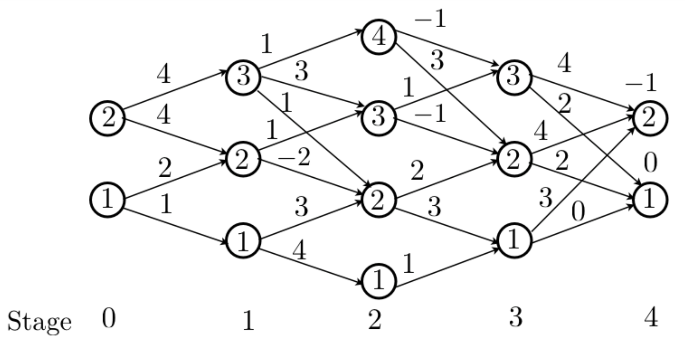

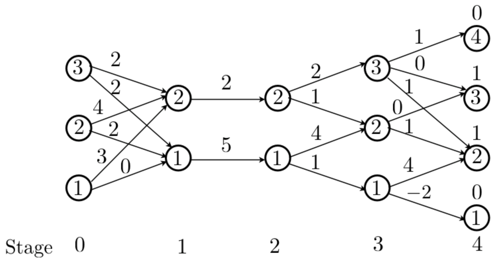
:::

(i) For each initial state at stage $0$, compute one optimal path minimizing the cost incurred from stage $0$ to stage $4$, using the dynamic programming algorithm.
(ii) Indicate one optimal policy and the costs-to-go in the transition diagram.
(iii) Are the optimal policies and the optimal paths for each initial state unique? If not, compute the number of optimal paths for each initial state and the number of optimal policies. Are the costs-to-go different for different optimal policies?

::: {.callout-note collapse="true" title="Solution"}

**Diagram (a).** Using the dynamic programming algorithm we obtain a unique policy, shown below along with the costs-to-go.

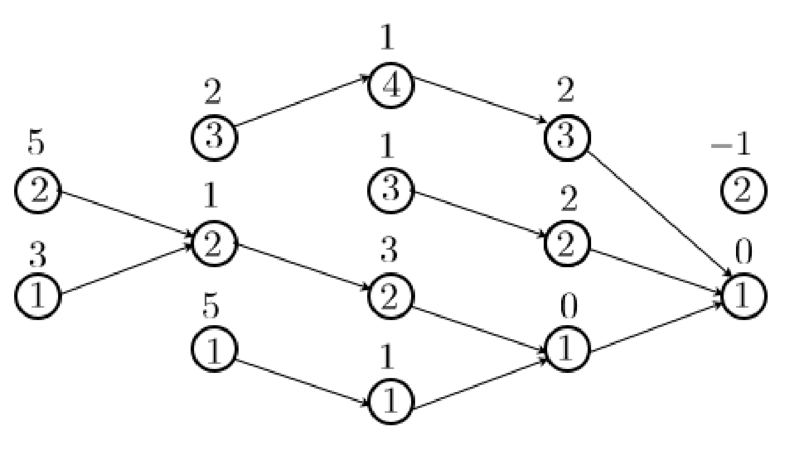{width="60%" fig-align="center"}

The optimal paths are obtained by following the decisions of the optimal policy (left: $x_0=1$, right: $x_0=2$).

::: {layout-ncol="2"}
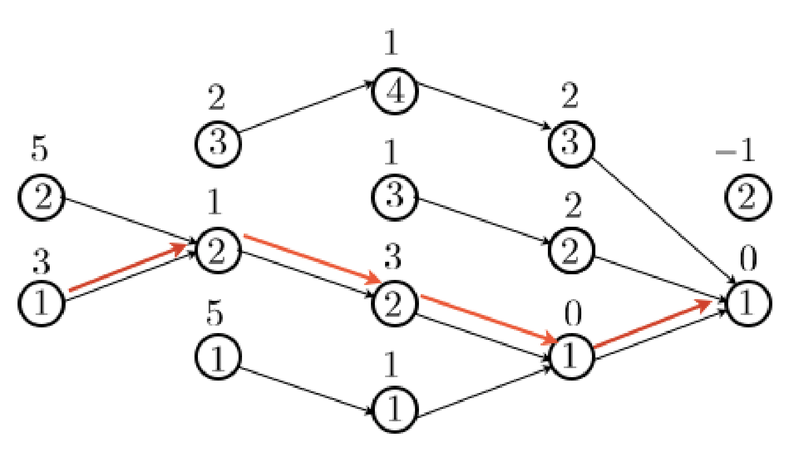

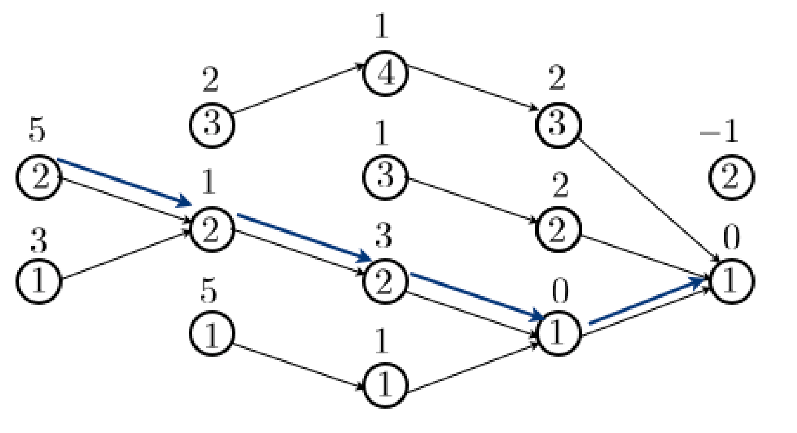
:::

Alternatively, an optimal path can be specified by its decisions and states, $\{(x_0,u_0),(x_1,u_1),(x_2,u_2),(x_3,u_3),(x_4)\}$. Labeling the possible decisions for each state as below,

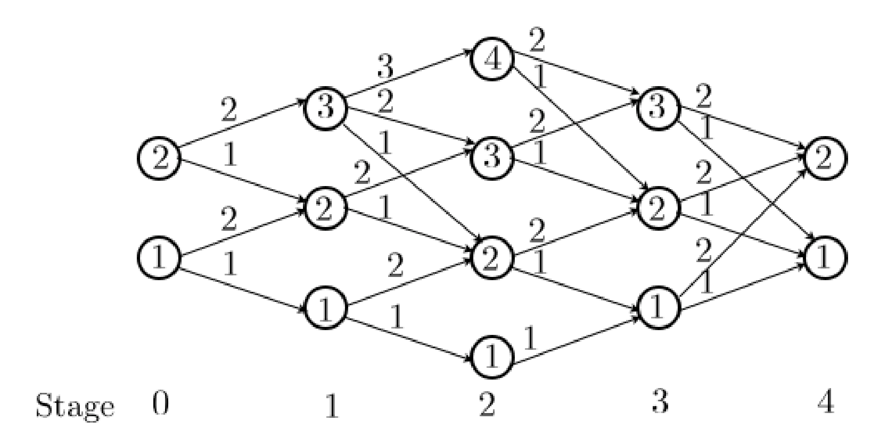{width="60%" fig-align="center"}

an optimal path starting at $x_0=1$ is $\{(1,2),(2,1),(2,1),(1,1),(1)\}$, and an optimal path starting at $x_0=2$ is $\{(2,1),(2,1),(2,1),(1,1),(1)\}$.

For diagram (a) the optimal policy and the optimal paths are unique.

**Diagram (b).** Applying the dynamic programming algorithm gives the costs-to-go and possible optimal decisions below.

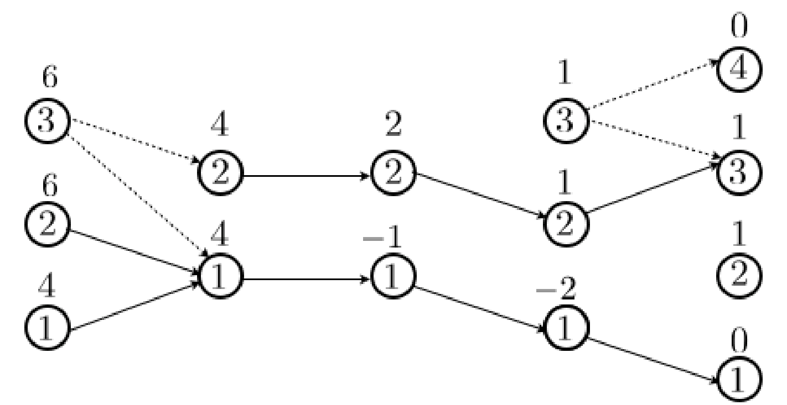{width="60%" fig-align="center"}

Note that for state $4$ at stage $3$ there are two possible optimal decisions, as well as for state $3$ at stage $0$ -- more than one decision achieves the same cost-to-go. One optimal path for each possible initial state is shown below (left: $x_0=3$ and $x_0=2$; right: $x_0=1$). For $x_0=3$ another optimal path could have been chosen instead.

::: {layout-ncol="2"}
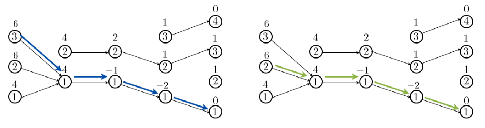

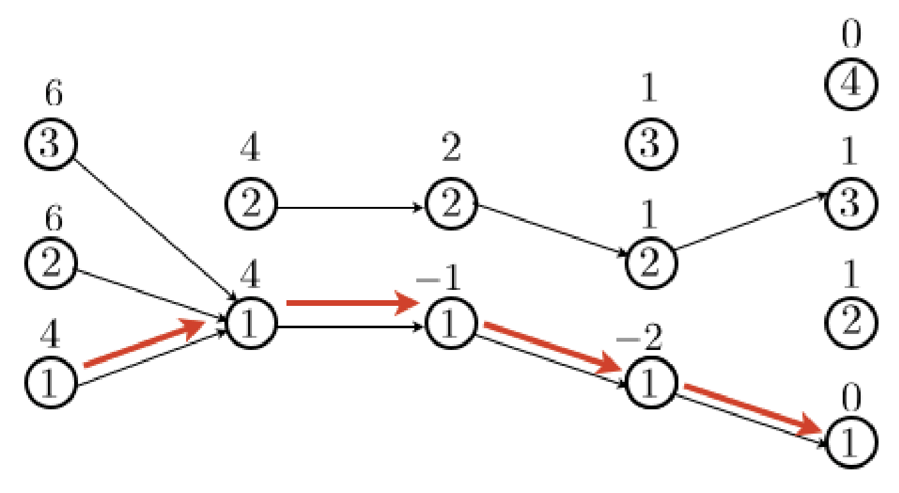
:::

For diagram (b) the optimal policy and the optimal paths are **not** unique: the number of optimal paths for initial state $x_0=3$ is $2$, and the number of optimal paths for states $x_0=1$ and $x_0=2$ is $1$. The number of optimal policies is $4$, shown below. The costs-to-go are always the same across different optimal policies.

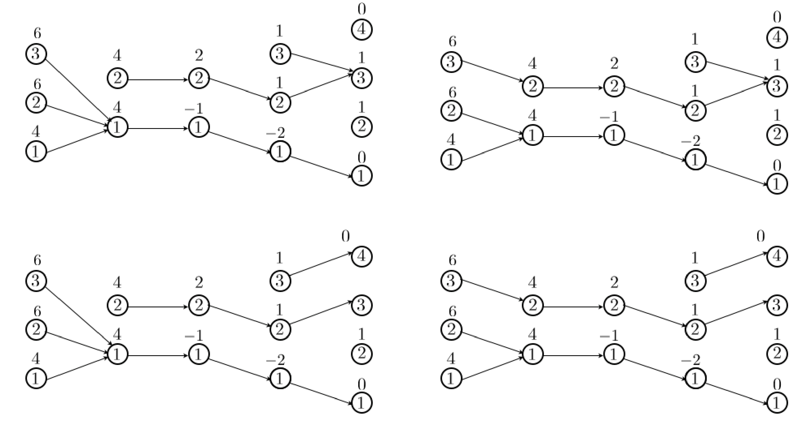{width="70%" fig-align="center"}

:::

**Problem 1.2** Consider an inventory control problem where the number of items of a given product over $h=3$ stages is described by
$$x_{k+1} = \max\{x_k+u_k-d_k,0\}, \qquad k\in\{0,\dots,h-1\},$$
where $x_k\in\{0,\dots,N\}$, $u_k\in\{0,\dots,N-x_k\}$, $d_k$ denotes the demand at stage $k$, and $N=3$ is the storage capacity. The objective is to minimize
$$\sum_{k=0}^{h-1}\big(c_1(x_k)+c_2(u_k)-p\min\{x_k+u_k,d_k\}\big) + g_h(x_h),$$
where $c_1(i)=0.3i$ is the storage cost,
$$c_2(j) = \begin{cases} 2.5j+0.5 & \text{if } j>0 \\ 0 & \text{if } j=0\end{cases}$$
is the ordering cost, $p=4$ is the selling price per item, and $g_h(i)=-2i$ is the terminal cost. Suppose $d_0=d_1=d_2=1$. Sketch the transition diagram and compute the possible optimal policies and costs-to-go.

::: {.callout-note collapse="true" title="Solution"}

The transition diagram is shown below (Fig. 2), together with the result of the dynamic programming algorithm (Fig. 3).

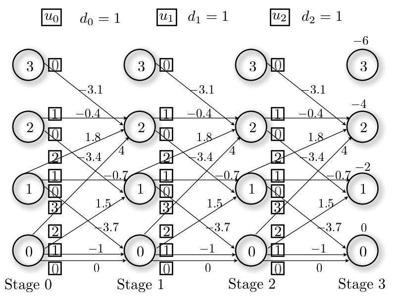{width="80%" fig-align="center"}

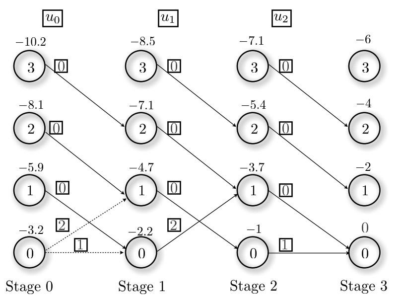{width="80%" fig-align="center"}

For example, at stage $2$, state $1$, the optimal decision is $u_2=0$ because
$$
\begin{aligned}
J_2(1) &= \min_{u_2} g_2(1,u_2) + J_3(\max\{1+u_2-1,0\}) \\
&= \min\{g_2(1,0)+J_3(0),\; g_2(1,1)+J_3(1),\; g_2(1,2)+J_3(2)\} \\
&= \min\{-3.7+0,\ -0.7-2,\ 1.8-4\} = -3.7,
\end{aligned}
$$
where $J_3(x_3)=g_3(x_3)$ and $g_k(x_k,u_k) = c_1(x_k)+c_2(u_k)-p\min\{x_k+u_k,d_k\}$. This is also the value of the cost-to-go $J_2(1)$.

After running the dynamic programming algorithm, there are $N=2$ optimal policies:

| $x_k$ | $u_0=\mu_0(x_0)$ | $u_1=\mu_1(x_1)$ | $u_2=\mu_2(x_2)$ |
|---|---|---|---|
| 3 | 0 | 0 | 0 |
| 2 | 0 | 0 | 0 |
| 1 | 0 | 0 | 0 |
| 0 | 2 | 2 | 1 |

| $x_k$ | $u_0=\mu_0(x_0)$ | $u_1=\mu_1(x_1)$ | $u_2=\mu_2(x_2)$ |
|---|---|---|---|
| 3 | 0 | 0 | 0 |
| 2 | 0 | 0 | 0 |
| 1 | 0 | 0 | 0 |
| 0 | 1 | 2 | 1 |

and the optimal costs-to-go $J_k(x_k)$ are (the same for both policies):

| $x_k$ | $J_0(x_0)$ | $J_1(x_1)$ | $J_2(x_2)$ |
|---|---|---|---|
| 3 | -10.2 | -8.5 | -7.1 |
| 2 | -8.1 | -7.1 | -5.4 |
| 1 | -5.9 | -4.7 | -3.7 |
| 0 | -3.2 | -2.2 | -1 |

:::

## Additional exercises

**Problem 1.3** The following equation describes the evolution of the number of items of a product in a shop over $h$ stages,
$$x_{k+1} = x_k+u_k-d_k, \qquad k\in\{0,\dots,h-1\},$$
where $x_k$, $u_k$, $d_k$ denote the number of items, the supply, and the demand at stage $k$. Negative stock indicates backlogged excess demand, filled in as soon as additional inventory becomes available. At most $N$ items can be stored, i.e. $x_k\leq N$, which restricts supplies to $u_k\in\{0,1,\dots,N-x_k\}$. At each stage a cost $c_1(x_k)$ is incurred for positive or negative stock, and ordering $u_k$ items costs $c_2(u_k) = cu_k + c_{\text{tr}}\|u_k\|_0$, where $c_{\text{tr}}$ is the transportation price, $\|u_k\|_0$ is $0$ if $u_k=0$ and $1$ otherwise, and $c$ is the cost per item. There is a terminal cost
$$g_h(x_h) = \begin{cases} -cx_h+c_1(x_h)+c_{\text{tr}}, & x_h\neq 0 \\ 0, & x_h=0,\end{cases}$$
reflecting that excess items $x_h>0$ are returned and unmet demand $x_h<0$ is met by a final supply ($u_h=-x_h$, cost $cu_h$); in both cases transportation and storage costs apply. The total cost to minimize is
$$\sum_{k=0}^{h-1}\big(c_1(x_k)+c_2(u_k)\big) + g_h(x_h).$$

::: {.callout-note collapse="true" title="Note"}
This model differs from the one discussed in class: negative stocks are allowed, and since all demand is eventually met (possibly via a final supply accounted for in the terminal cost), the cost function need not account for sales profit.
:::

(i) Let $h=3$, $d_0=d_1=d_2=1$, $N=2$, $c=1$, $c_{\text{tr}}=0.2$, and $c_1(i)=0.1i$ if $i\geq 0$, $c_1(i)=-0.05i$ if $i<0$. Assuming the initial inventory is positive, the transition diagram below is obtained, where each state is the number of items at each stage and each arrow is a supply option (cost $c_1(x_k)+c_2(u_k)$); terminal costs are also indicated. Compute the optimal policy. Provide the optimal supplies $u_0,u_1,u_2$ for each initial state $x_0\in\{0,1,2\}$, and indicate whether the optimal supplies are unique.

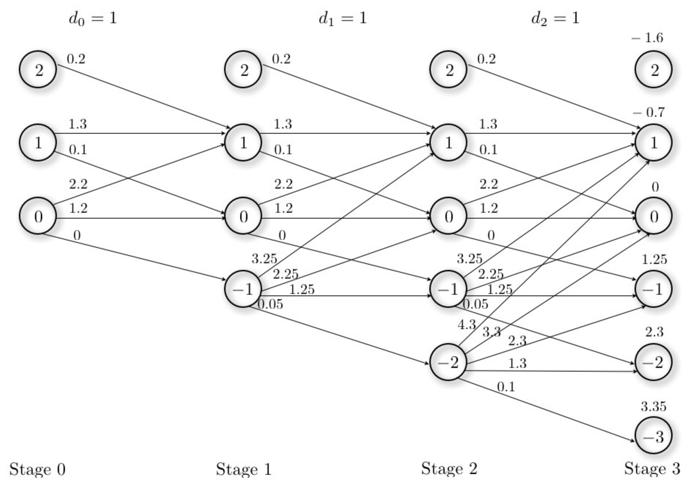{width="90%" fig-align="center"}

(ii) Suppose instead $c_{\text{tr}}=0.01$. Recompute the transition and terminal costs and the optimal policy. Is it the same as for $c_{\text{tr}}=0.2$?

(iii) With $c_{\text{tr}}=0.2$ again, suppose $d_1$ is uncertain: $\text{Prob}[d_1=1]=0.6$, $\text{Prob}[d_1=0]=0.4$. For each optimal path found in (i) for $x_0=0$ (possibly more than one), with supplies $\bar u_0,\bar u_1,\bar u_2$: what is the expected cost if we apply the open-loop supplies $\bar u_0,\bar u_1,\bar u_2$ regardless of the disturbance? What is the expected cost if we instead use the policy from (i) to readjust the supply at stage $2$? Compare the open-loop and closed-loop costs.

::: {.callout-note collapse="true" title="Solution"}

**(i)** The optimal policies are summarized below. There are two optimal policies, since there are two optimal decisions at stage $1$, state $-1$. The optimal supplies are read off by following the arrows for each initial state; the optimal total cost is the cost-to-go at the initial state.

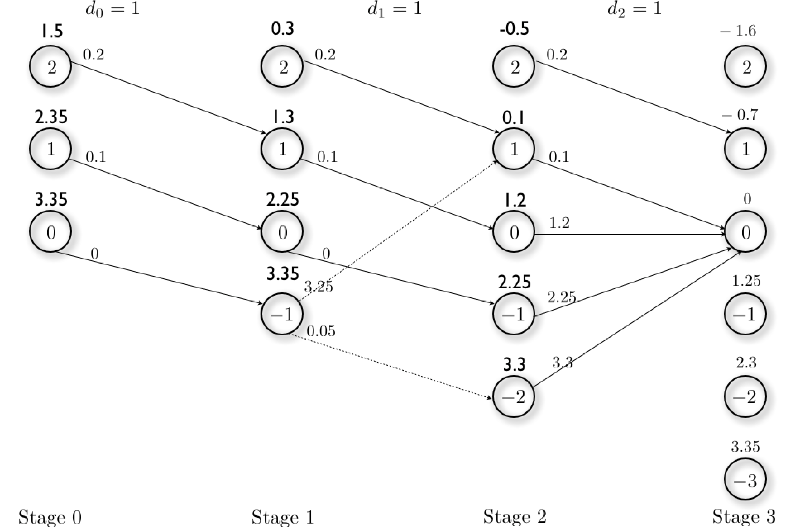{width="80%" fig-align="center"}

- For $x_0=0$: optimal supplies $u_0=0$, $u_1=0$, $u_2=3$, cost $3.35$. Also optimal: $u_0=0$, $u_1=3$, $u_2=0$, same cost.
- For $x_0=1$: optimal supplies $u_0=0$, $u_1=0$, $u_2=2$, cost $2.35$.
- For $x_0=2$: optimal supplies $u_0=0$, $u_1=0$, $u_2=1$, cost $1.5$.

**(ii)** The new transition diagram for $c_{\text{tr}}=0.01$ is shown below, together with the resulting optimal policy. The policy differs: since the transportation cost is now small, the optimal policy tends to set the inventory to zero (reducing storage/backlog cost).

::: {layout-ncol="2"}
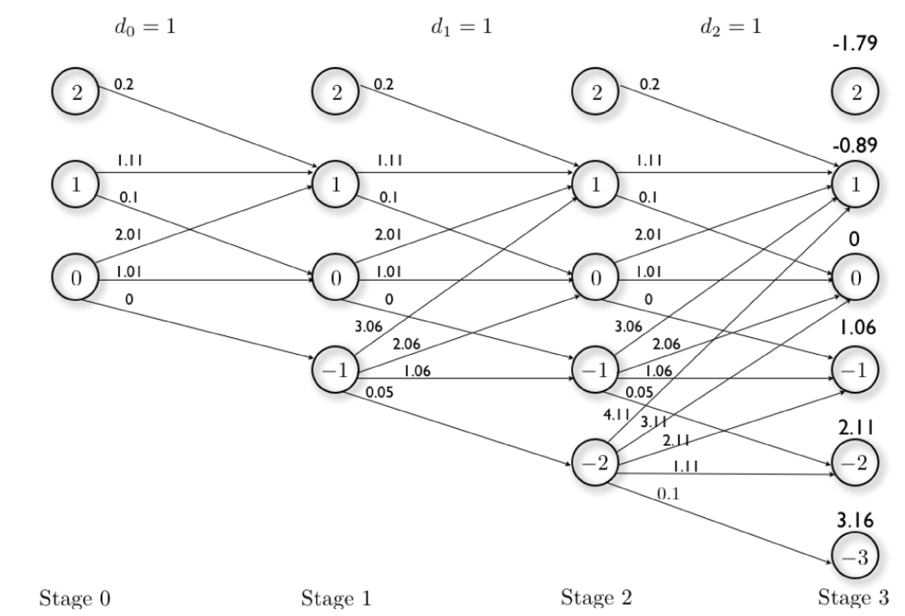

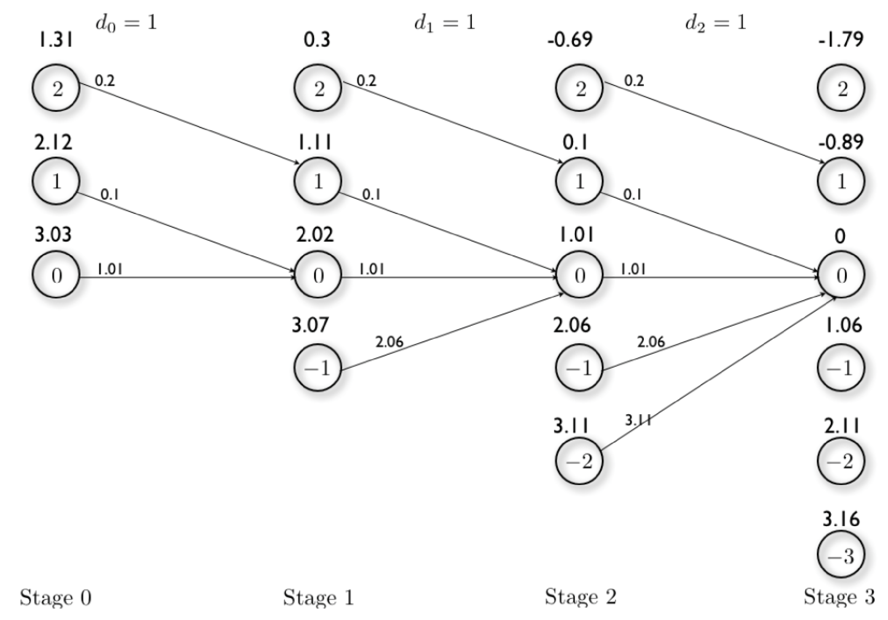
:::

**(iii)** Two optimal open-loop paths were found in (i) for $x_0=0$; consider each in turn.

*Open-loop supplies $\bar u_0=0,\bar u_1=0,\bar u_2=3$.*

If $d_1=1$: same cost as in (i), $3.35$. If $d_1=0$: applying $\bar u_0=0,\bar u_1=0,\bar u_2=3$ gives states $x_0=0,x_1=-1,x_2=-1,x_3=1$ (since $d_0=1,d_1=0,d_2=1$), with cost
$$\underbrace{c_1(0)+c_2(0)}_{=0} + \underbrace{c_1(-1)+c_2(0)}_{=0.05} + \underbrace{c_1(-1)+c_2(3)}_{=3.25} + \underbrace{g_3(1)}_{=-0.7} = 2.6.$$
Expected cost: $0.6\times 3.35 + 0.4\times 2.6 = 3.05$.

For the closed-loop policy, decisions at stages $0,1$ are unchanged ($u_0=0$, $u_1=0$), but after $d_1=0$ occurs and $x_2=-1$, the optimal policy gives $u_2=2$ instead of the open-loop $u_2=3$, so $x_3=0$ and the cost is
$$\underbrace{c_1(0)+c_2(0)}_{=0} + \underbrace{c_1(-1)+c_2(0)}_{=0.05} + \underbrace{c_1(-1)+c_2(2)}_{=2.25} + \underbrace{g_3(0)}_{=0} = 2.3.$$
Expected cost: $0.6\times 3.35 + 0.4\times 2.3 = 2.93$ -- smaller than open-loop, since the final decision adapts to minimize the cost-to-go.

*Open-loop supplies $\bar u_0=0,\bar u_1=3,\bar u_2=0$.*

If $d_1=1$: same cost as in (i), $3.35$. If $d_1=0$: applying $\bar u_0=0,\bar u_1=3,\bar u_2=0$ gives $x_0=0,x_1=-1,x_2=2,x_3=1$, with cost
$$\underbrace{c_1(0)+c_2(0)}_{=0} + \underbrace{c_1(-1)+c_2(3)}_{=3.25} + \underbrace{c_1(2)+c_2(0)}_{=0.2} + \underbrace{g_3(1)}_{=-0.7} = 2.75.$$
Expected cost: $0.6\times 3.35 + 0.4\times 2.75 = 3.11$.

Here the closed-loop policy makes the same decision at stage $2$ ($u_2=0$) as the open-loop one, so the cost and expected cost are identical: $3.11$. Closed-loop and open-loop coincide here because the disturbance at stage $1$ does not change the optimal decision at stage $2$ along this branch.

:::

**Problem 1.4** Consider the transition diagram depicted below, with three decision stages and the terminal costs $g_3(2)=2$, $g_3(1)=1$ indicated next to the stage-$3$ states.

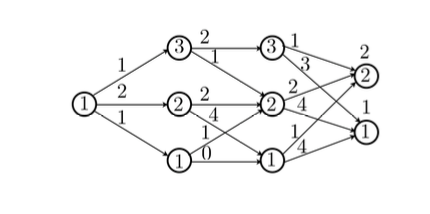{#fig-ps1-4 width="70%" fig-align="center"}

(i) Compute the optimal policies (possibly more than one), using the dynamic programming algorithm.
(ii) Compute one optimal path minimizing the cost incurred from stage $0$ to stage $3$.

::: {.callout-note collapse="true" title="Solution"}

**(i)** The dynamic programming algorithm runs backwards from the terminal stage. Initialize with the terminal costs,

$$J_3(2)=2,\qquad J_3(1)=1.$$

*Stage 2.* For each state, $J_2(i)=\min_j\big(c^2_{i,j}+J_3(j)\big)$:

$$J_2(3)=\min\{\underbrace{1+2}_{j=2},\ \underbrace{3+1}_{j=1}\}=3,\qquad \mu_2(3)=2,$$
$$J_2(2)=\min\{\underbrace{2+2}_{j=2},\ \underbrace{4+1}_{j=1}\}=4,\qquad \mu_2(2)=2,$$
$$J_2(1)=\min\{\underbrace{1+2}_{j=2},\ \underbrace{4+1}_{j=1}\}=3,\qquad \mu_2(1)=2.$$

At stage $2$ every state moves to state $2$, and each minimizer is unique.

*Stage 1.* Now $J_1(i)=\min_j\big(c^1_{i,j}+J_2(j)\big)$:

$$J_1(3)=\min\{\underbrace{2+3}_{j=3},\ \underbrace{1+4}_{j=2}\}=5,\qquad \mu_1(3)\in\{3,2\},$$
$$J_1(2)=\min\{\underbrace{2+4}_{j=2},\ \underbrace{4+3}_{j=1}\}=6,\qquad \mu_1(2)=2,$$
$$J_1(1)=\min\{\underbrace{1+4}_{j=2},\ \underbrace{0+3}_{j=1}\}=3,\qquad \mu_1(1)=1.$$

Note the tie at state $3$: both decisions attain the value $5$, so the minimizer is **not** unique there.

*Stage 0.* There is a single state, and $J_0(1)=\min_j\big(c^0_{1,j}+J_1(j)\big)$:

$$J_0(1)=\min\{\underbrace{1+5}_{j=3},\ \underbrace{2+6}_{j=2},\ \underbrace{1+3}_{j=1}\}=4,\qquad \mu_0(1)=1.$$

Collecting the minimizers, there are exactly **two optimal policies**, which differ only in the decision taken at state $3$ of stage $1$:

| Stage | State | $J_k$ | $\mu_k$ (policy A) | $\mu_k$ (policy B) |
|---|---|---|---|---|
| $0$ | $1$ | $4$ | $1$ | $1$ |
| $1$ | $3$ | $5$ | $3$ | $2$ |
| $1$ | $2$ | $6$ | $2$ | $2$ |
| $1$ | $1$ | $3$ | $1$ | $1$ |
| $2$ | $3$ | $3$ | $2$ | $2$ |
| $2$ | $2$ | $4$ | $2$ | $2$ |
| $2$ | $1$ | $3$ | $2$ | $2$ |

Both policies are optimal from *every* state, and both attain the same costs-to-go $J_k$ -- as they must, since the costs-to-go produced by the dynamic programming algorithm are unique even when the minimizers are not (cf. Problem 1.1 (iii)).

**(ii)** Starting from the only stage-$0$ state and following the minimizers gives the optimal path

$$x_0=1 \ \xrightarrow{\ 1\ } \ x_1=1 \ \xrightarrow{\ 0\ } \ x_2=1 \ \xrightarrow{\ 1\ } \ x_3=2,$$

with total cost

$$1+0+1+\underbrace{2}_{g_3(2)}=4=J_0(1),$$

confirming the value computed in (i). This optimal path is unique, since every minimizer along it is unique -- the tie at stage $1$ occurs at state $3$, which is never visited from $x_0=1$. It is worth noticing that the greedy choice at stage $0$ is ambiguous (the arcs to states $3$ and $1$ both cost $1$), and that the arc to state $3$ is the one that leads to the *worse* continuation: this is exactly the situation the dynamic programming algorithm is designed to resolve.

:::

**Problem 1.5** Formulate each of the following problems as either a discrete optimization problem, a stage-decision problem, or a continuous-time optimal control problem.

(a) We wish to move a mass on a plane surface from $x=0$ to $x=1$ in minimum time, using a force $F=u$. A model can be derived using Newton's law. Assume the friction force is proportional to the velocity.

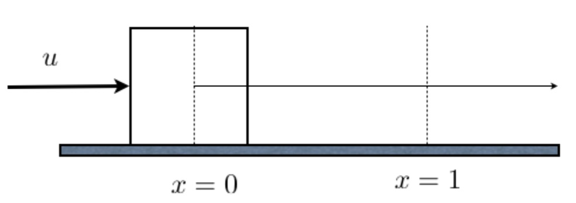{width="25%" fig-align="center"}

(b) Redo (a) assuming the mass is controlled digitally.

(c) Consider planning a project consisting of several activities, as depicted below. Circles represent stages of the project and arrows represent activities; the duration of each activity in weeks is indicated. Some activities can only start after others are concluded. The goal is to find the overall duration of the project and the critical activities -- those for which the project will be delayed if the activity is delayed.

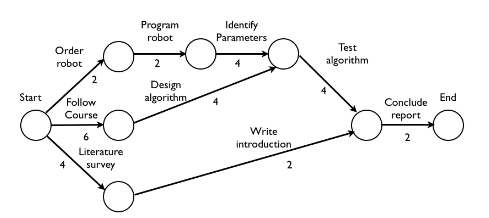{width="70%" fig-align="center"}

(d) A satellite's attitude must be controlled so that its antenna points at a particular location on Earth. Consider on-board control of one rotational degree of freedom by thrusters, as indicated below. Choose the torque $T$ to move the satellite angle $\theta$ from an initial angle $\theta(t_0)$ to a desired angle $\theta_{\text{des}}$ at time $t_0+h$, minimizing the fuel consumption $c(T)$.

::: {layout-ncol="2"}

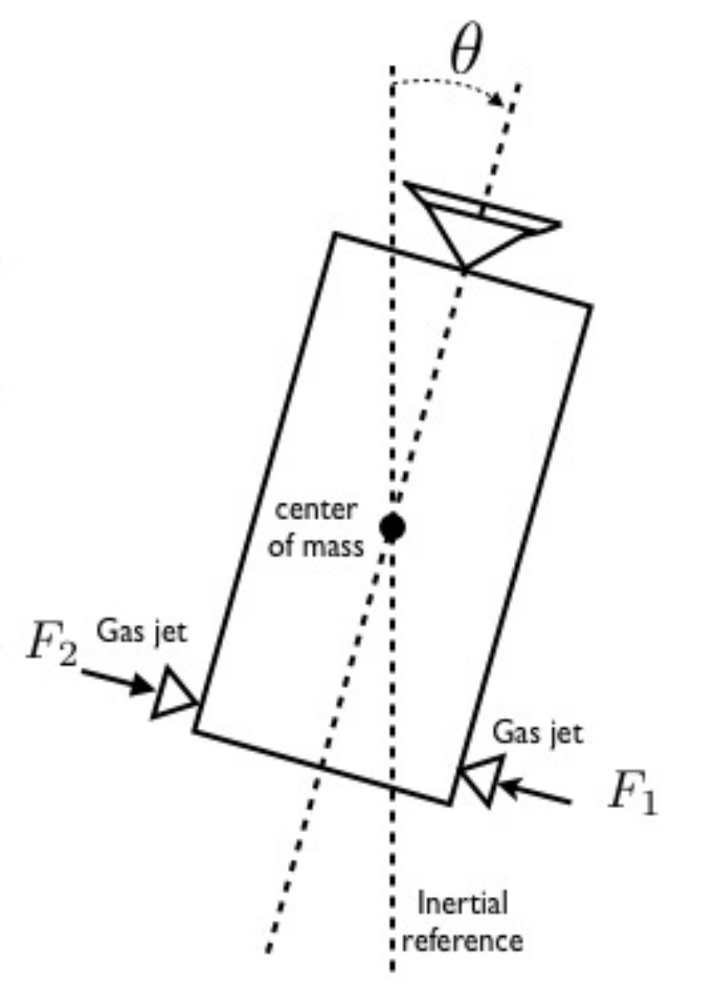
:::

::: {.callout-note collapse="true" title="Solution"}

**(a)** Continuous-time optimal control problem with dynamic model $\dot{\underline{x}} = A\underline{x} + Bu$,
$$\underline{x} = \begin{bmatrix} x\\ \dot{x} \end{bmatrix}, \ \ A = \begin{bmatrix} 0 & 1\\ 0& -\tfrac{k_f}{m} \end{bmatrix}, \ \ B = \begin{bmatrix} 0 \\ \tfrac{1}{m} \end{bmatrix},$$
where $m$ is the mass and $k_f/m$ is the friction coefficient. Initial condition $x(0)=0$, $v(0)=\bar v_0$; terminal constraint $x(T)=1$. Cost to minimize: $\int_0^T g(x(t),u(t))\,dt = T$, with $g\equiv 1$.

**(b)** Stage-decision problem. Let $u(t)=u_k$ for $t\in[t_k,t_{k+1})$ and $\underline{x}_k := x(k\tau)$, $k\in\mathbb{N}_{\geq 0}$, where $\tau$ is the sampling period. Then
$$\underline{x}_{k+1} = A_d\underline{x}_k + B_d u_k, \qquad A_d = e^{A\tau}, \ \ B_d = \int_0^\tau e^{As}ds\, B.$$
Initial condition $x_0=0$, $v_0=\bar v_0$; terminal constraint $x_h=1$ (with $x_h=x(h\tau)$). Cost function: the final (discrete) time $h$.

**(c)** Discrete optimization problem. A small trick lets us formulate it directly as a transition diagram: for each node, count the maximum number of hops required to reach it from the start node, and set the node's stage to this number. If a node's outgoing arrow at stage $k$ leads to a node at a stage $\ell>k+1$, add fictitious states at stages $k+2,\dots,\ell-1$ with zero-cost outgoing arrows; the original arrow's cost, now connecting to a fictitious state at stage $k+1$, stays unchanged. This is illustrated below for the given diagram. The critical path is then obtained by running the DP algorithm with $\max$ instead of $\min$ (equivalently, negate all costs and run the usual $\min$-DP algorithm).

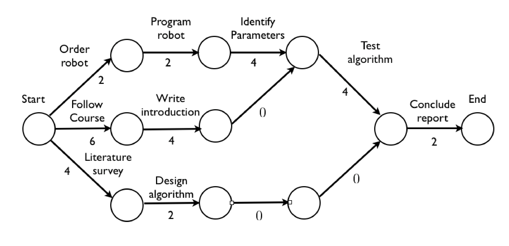{width="80%" fig-align="center"}

**(d)** Continuous-time optimal control problem with dynamic model $\dot{\underline{x}} = A\underline{x} + Bu$,
$$\underline{x} = \begin{bmatrix} \theta \\ \dot\theta \end{bmatrix}, \ \ A = \begin{bmatrix} 0 & 1\\ 0& 0 \end{bmatrix}, \ \ B = \begin{bmatrix} 0 \\ \tfrac{1}{I} \end{bmatrix},$$
where $I$ is the moment of inertia and $u=T$. Terminal constraint $\theta(t_0+h)=\theta_{\text{des}}$. Cost to minimize: $\int_{t_0}^{t_0+h} c(u(t))\,dt$.

:::
