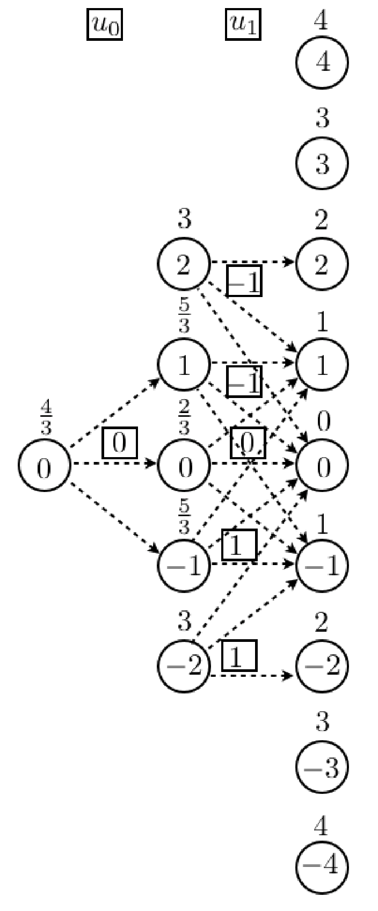
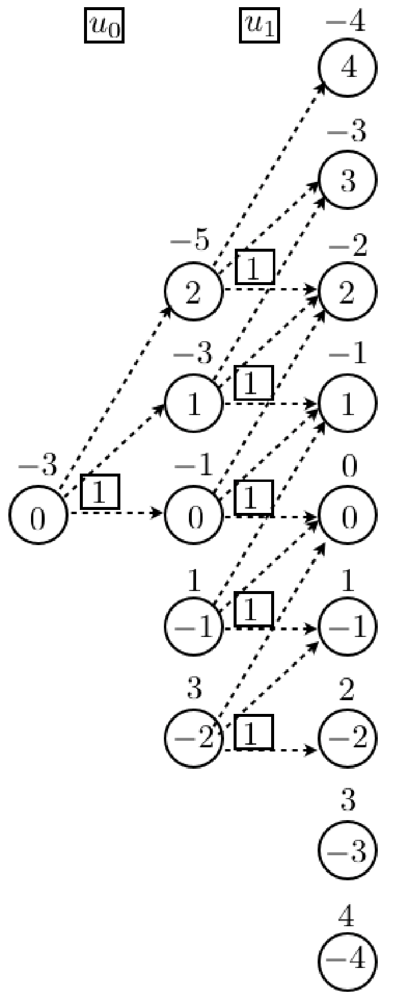
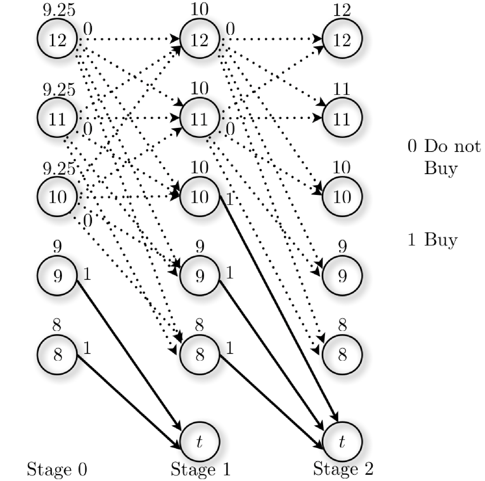
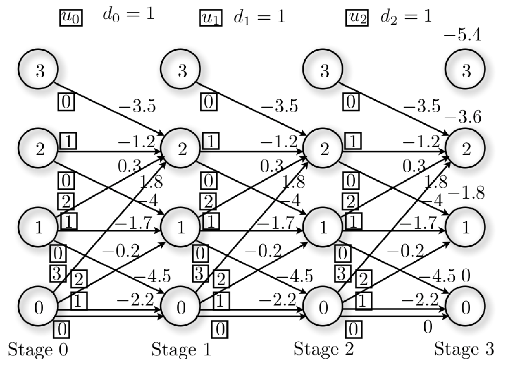
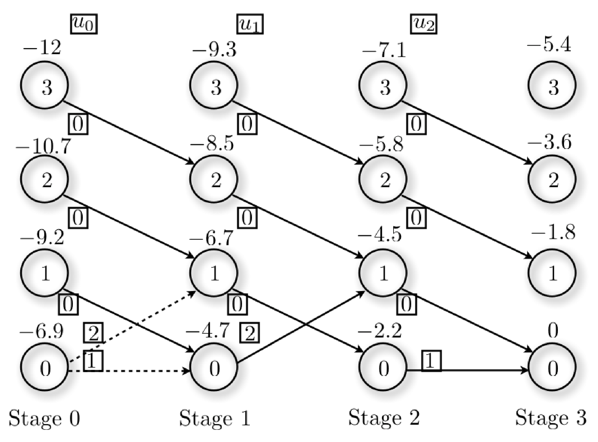
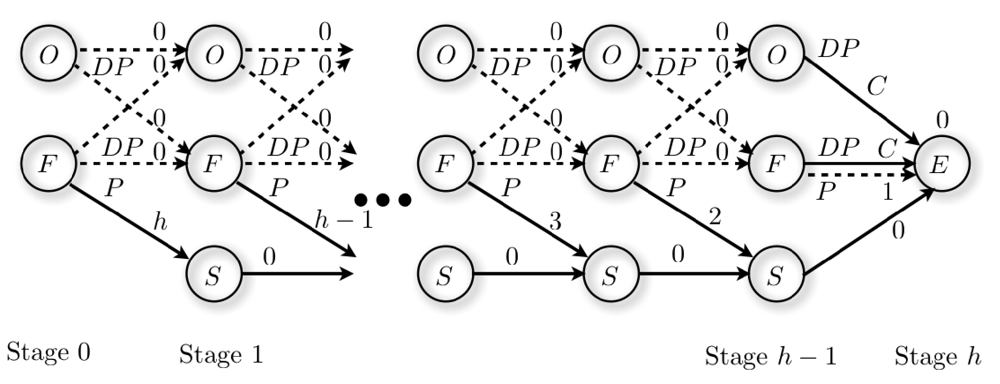

<!--
Source: Solved Exercises/1/PS1.tex (problems) and
Solved Exercises/1/Solutions/SolutionsPS1.tex (solutions), section 2
"Stochastic dynamic programming" -- originally Problems 2.1-2.7. Renumbered
2.1-2.7 in Core/Additional order (matching the Unit 1 exercises convention):
Core = 2.1 (two-stage stochastic DP, introduces the algorithm, originally
2.1), 2.2 (the car-dealer/secretary problem, originally 2.4), 2.3
(inventory control with a 3-outcome disturbance and an
open-loop/closed-loop/SDP comparison, originally 2.3). Additional = 2.4
(Problem 1.3 revisited with a stochastic demand -- direct continuation of
Unit 1, originally 2.2), 2.5 (the house-selling problem, originally 2.6),
2.6 (the parking problem, originally 2.5, Bertsekas Ex. 4.19), 2.7 (the
dice/blackjack game, originally 2.7).

Note on Problem 2.5 (house selling): SolutionsPS1.tex marks this problem
"(solution not provided)". The solution below was worked out from scratch
(backward induction on the expected continuation value) and cross-checked
numerically; flag to Duarte for a second look before distributing.

Note on Problem 2.7: the original solution's derivation of the auxiliary
transition probabilities $p_{j,i}$ (player B's win probability) runs several
pages of combinatorial bookkeeping. The write-up below keeps the modeling
setup and the final policy/probability table (needed to actually use the
result) but summarizes rather than reproduces that derivation verbatim, to
keep the file a reasonable length; the full derivation is in
SolutionsPS1.tex if ever needed.

Figures converted from Solved Exercises/1/Figures/*.eps via ghostscript
(`gs -dEPSCrop -sDEVICE=pngalpha -r300`), copied to figures/unit2/.
-->

A runnable Python companion to these exercises -- a general stochastic
dynamic programming solver and the inventory control example worked out
below -- is available in `code/unit2/` (see its `README.md`).

## Core exercises

**Problem 2.1** Consider the following two-stage stochastic dynamic programming problems
$$\text{Problem 1:} \ \ \left\{\begin{aligned} & \min \sum_{k=0}^2 |x_k| \\ & x_{k+1}=x_k+u_k+d_k\end{aligned}\right. \ \ \ \ \ \ \ \ \text{Problem 2:} \ \ \left\{\begin{aligned} & \min \sum_{k=0}^2 -x_k \\ & x_{k+1}=x_k+u_k+d_k\end{aligned}\right.$$
where $u_k \in \{-1,0,1\}$, $\text{Prob}[d_k=-1] = \text{Prob}[d_k=0] = \text{Prob}[d_k=1]=\frac{1}{3}$, for $k\in \{0,1\}$.

(i) Given that $x_0 \in X_0$, $X_0 = \{0\}$, find the sets $X_1$, $X_2$ of possible values for $x_1$ and $x_2$, respectively, for both problems.
(ii) Find the optimal policies for Problems 1 and 2, using the (stochastic) dynamic programming algorithm.
(iii) What is the expected optimal cost for Problems 1 and 2?

::: {.callout-note collapse="true" title="Solution"}

**(i)** Since $u_k+d_k \in \{-2,\dots,2\}$ at every stage, and this is the same for both problems (only the cost differs), $X_1 = \{-2,-1,0,1,2\}$ and $X_2 = \{-4,-3,-2,-1,0,1,2,3,4\}$.

**(ii)** The optimal policies, obtained by running the stochastic dynamic programming algorithm, are shown below.

::: {layout-ncol="2"}

:::

For Problem 1, at every stage $k\in\{0,1\}$: pick $u_k=0$ if $x_k=0$, $u_k=-1$ if $x_k>0$, $u_k=1$ if $x_k<0$ -- the policy always pushes the state back toward zero. For example, at stage $1$, state $x_1=-2$, the three options $u_1\in\{-1,0,1\}$ have expected cost
$$\frac{1}{3}\big(|x_1|+|x_1+u_1-1|\big)+\frac{1}{3}\big(|x_1|+|x_1+u_1|\big)+\frac{1}{3}\big(|x_1|+|x_1+u_1+1|\big),$$
minimized at $u_1=1$ with expected cost $3$, as shown in the figure.

For Problem 2, since the cost rewards a large state ($-x_k$ is minimized by making $x_k$ as large as possible) and $u_k$ has no direct cost, the optimal policy is simply $u_k=1$ at every stage and every state.

**(iii)** The expected optimal costs are the costs-to-go at stage $0$, state $0$: for Problem 1 the expected cost is $\frac{4}{3}$; for Problem 2 the expected cost is $-3$.

:::

**Problem 2.2** A lady wants to buy a car, which is only available at three car dealers ($1$, $2$, and $3$). She goes first to dealer $1$ and receives an offer. She must then decide either to accept the offer and buy the car or refuse the offer and go to the next dealer $2$, never returning to dealer $1$. In the latter case, she must decide again either to accept the offer of dealer $2$ or go to dealer $3$, never returning to dealer $2$. If she goes to dealer $3$, she must accept the offer of dealer $3$. Based on a study of previous deals she estimates that the dealers $k \in \{1,2,3\}$ make their offers independently and their prices $a_k$ follow the same distribution
$$\text{Prob}[a_k = 8]= \tfrac{1}{3}, \ \ \text{Prob}[a_k = 9] = \tfrac{1}{12}, \ \ \text{Prob}[a_k = 10]  = \tfrac{1}{6}, \ \ \text{Prob}[a_k = 11]  = \tfrac{1}{12}, \ \ \text{Prob}[a_k = 12] = \tfrac{1}{3}.$$

(i) Determine the optimal decisions, to buy or not to buy, after receiving the offer of dealer $1$ and after receiving the offer of dealer $2$.
(ii) Compute the expected cost of the car before going to dealer $1$. Compare this with the expected cost of simply accepting whichever offer dealer $1$ makes.

::: {.callout-note collapse="true" title="Solution"}

**(i)** Let the state $x_k \in \{8,9,10,11,12\}$ be the offer of dealer $1,2,3$ at stages $k\in \{0,1,2\}$, and let an auxiliary state $x_k = t$ denote that an offer has already been accepted. Accepting an offer costs $x_k$ and moves to state $t$ (absorbing, zero further cost); rejecting has no immediate cost and moves to a new offer drawn from the same distribution. The terminal cost is $g_2(x_2)=x_2$ (she must accept dealer $3$'s offer), $g_2(t)=0$.

{width="70%" fig-align="center"}

**Stage 2:** $J_2(x)=x$.

**Stage 1:** $J_1(x) = \min\{x,\ \mathbb{E}[a_3]\}$ where $\mathbb{E}[a_3]=\tfrac13(8)+\tfrac1{12}(9)+\tfrac16(10)+\tfrac1{12}(11)+\tfrac13(12)=10$. So $J_1(x)=\min\{x,10\}$: accept if the dealer-2 offer is $8$ or $9$; reject if it is $11$ or $12$; indifferent at $10$.

**Stage 0:** $J_0(x) = \min\{x,\ \mathbb{E}_{a_2}[J_1(a_2)]\}$. Using $J_1(8)=8,J_1(9)=9,J_1(10)=10,J_1(11)=10,J_1(12)=10$, $\mathbb{E}[J_1(a_2)] = \tfrac13(8)+\tfrac1{12}(9)+\tfrac16(10)+\tfrac1{12}(10)+\tfrac13(10)=9.25$. So $J_0(x)=\min\{x,9.25\}$: accept dealer $1$'s offer only if it is $8$ or $9$; otherwise go to dealer $2$.

**(ii)** The expected cost of the car under the optimal policy is
$$\tfrac13(8)+\tfrac1{12}(9)+\tfrac16(9.25)+\tfrac1{12}(9.25)+\tfrac13(9.25) = 8.8125,$$
compared with $\tfrac13(8)+\tfrac1{12}(9)+\tfrac16(10)+\tfrac1{12}(11)+\tfrac13(12)=10$ for simply accepting whichever offer dealer $1$ makes -- waiting and comparing offers saves, in expectation, about $1.19$.

:::

**Problem 2.3** Consider an inventory control problem over $h=3$ stages, $x_{k+1} = \max\{x_k+u_k-d_k,0\}$, $x_k\in\{0,\dots,N\}$, $u_k\in\{0,\dots,N-x_k\}$, $N=3$, minimizing
$$\sum_{k=0}^{h-1}\big(c_1(x_k)+c_2(u_k)-p\min\{x_k+u_k,d_k\}\big)+g_h(x_h),$$
where $c_1(i)=0.5i$, $c_2(j) = 2j+0.8$ if $j>0$ (else $0$), $p=5$, and $g_h(i)=-1.8i$.

(i) Suppose $d_0=d_1=d_2=1$. Sketch the transition diagram and compute the possible optimal policies. Confirm that for $x_0=2$, $u_0=0$, $u_1=0$, $u_2=1$ are optimal supplies.
(ii) Suppose instead $d_1$ is uncertain, $\text{Prob}[d_1=0]=0.4$, $\text{Prob}[d_1=1]=0.2$, $\text{Prob}[d_1=2]=0.4$ (with $d_0=d_2=1$ still deterministic), and $x_0=2$.

  (a) Apply the fixed supplies $u_0=0$, $u_1=0$, $u_2=1$ from (i), regardless of the disturbance. What is the expected cost?
  (b) Use the policy from (i) to readjust $u_2$ based on the actual state $x_2$. What is the expected cost?
  (c) Use the stochastic dynamic programming algorithm to find the optimal policy and expected cost.
  (d) Compare (a), (b), (c).

::: {.callout-note collapse="true" title="Solution"}

**(i)** The full transition diagram (every admissible supply at every state) and the resulting optimal policy (bold path highlighted by the boxed decisions) are shown below.

Reading the boxed decisions from $x_0=2$: $u_0=0$ (giving $x_1=1$), $u_1=0$ (giving $x_2=0$), $u_2=1$ (giving $x_3=0$) -- confirming the supplies stated in the problem, with cost-to-go $J_0(2)=-9.8$.

**(ii.a)** With the fixed supplies $u_0=0,u_1=0,u_2=1$, the cost as a function of $d_1$ works out to $-7$ if $d_1=0$, and $-10.7$ if $d_1\in\{1,2\}$ (in both cases $x_2$ collapses to the same value). The expected cost is
$$0.4(-7) + 0.4(-10.7) + 0.2(-10.7) = -9.22.$$

**(ii.b)** Adjusting $u_2$ using the policy from (i): for $d_1\in\{1,2\}$ the state $x_2=1$ is reached and the policy still gives $u_2=1$, same as the open-loop choice (cost $-10.7$ both times). For $d_1=0$, $x_2=2$ is reached and the policy now gives $u_2=0$ (rather than the open-loop $u_2=1$), with cost $-8$. The expected cost is
$$0.4(-8) + 0.2(-10.7) + 0.4(-10.7) = -9.62.$$

**(ii.c)** At stage $2$ there is no disturbance, so $J_2$ is unchanged from (i). At stage $1$, the expected cost for each state and decision (using the three-outcome distribution for $d_1$) is:

- $x_1=1$: $u_1=0 \to -5.62$; $u_1=1 \to -5.8$ (optimal); $u_1=2 \to -5.5$.
- $x_1=0$: best is $u_1=2$, expected cost $-4.3$.
- $x_1=2$: best is $u_1=0$, expected cost $-8.1$.
- $x_1=3$: only option $u_1=0$, expected cost $-7.74$.

At stage $0$ (no disturbance yet), one deterministic DP step with these expected costs-to-go gives, for $x_0=2$: $u_0=0$ leading to $x_1=1$, with $J_0(2) = -9.8$.

**(ii.d)** Comparing the three expected costs for $x_0=2$:
$$\underbrace{-9.8}_{\text{(c) stochastic DP}} \ < \ \underbrace{-9.62}_{\text{(b) closed-loop, part-(i) policy}} \ < \ \underbrace{-9.22}_{\text{(a) open-loop}}.$$
As expected, the fully optimal stochastic policy (c) does at least as well as reacting with a policy tuned for the deterministic problem (b), which in turn does at least as well as never reacting to the disturbance at all (a).

:::

## Additional exercises

**Problem 2.4** Consider Problem 1.3 (Unit 1 exercises) and assume, as in question (iii) there, that $c_{\text{tr}}=0.2$ and $\text{Prob}[d_1=1] = 0.6$, $\text{Prob}[d_1=0] = 0.4$ (with $d_0=d_2=1$ still deterministic).

(i) Use the (stochastic) dynamic programming algorithm to compute an optimal policy which minimizes the expected cost.
(ii) What is the expected cost obtained with the stochastic dynamic programming policy for an initial condition $x_0=0$? Is it better than the open-loop and closed-loop options computed in Problem 1.3?

::: {.callout-note collapse="true" title="Solution"}

**(i)** At the last stage (stage $2$) there is no disturbance, so the costs-to-go coincide with the deterministic ones already computed in Problem 1.3: $J_2(-2) = 3.3$, $J_2(-1)=2.25$, $J_2(0)=1.2$, $J_2(1)=0.1$, $J_2(2)=-0.5$.

At stage $1$, for each state $x_1$ we compare the expected cost $\mathbb{E}_{d_1}[c_1(x_1)+c_2(u_1)+J_2(x_1+u_1-d_1)]$ across the admissible $u_1$:

| $x_1=-1$ | $u_1=0$ | $u_1=1$ | $u_1=2$ | $u_1=3$ |
|---|---|---|---|---|
| Expected cost | $(0.05+3.3)(0.6)+(0.05+2.25)(0.4)=2.93$ | $(1.25+2.25)(0.6)+(1.25+1.2)(0.4)=3.08$ | $(2.25+1.2)(0.6)+(2.25+0.1)(0.4)=3.01$ | $(3.25+0.1)(0.6)+(3.25-0.5)(0.4)=3.11$ |

| $x_1=0$ | $u_1=0$ | $u_1=1$ | $u_1=2$ |
|---|---|---|---|
| Expected cost | $(0+2.25)(0.6)+(0+1.2)(0.4)=1.83$ | $(1.2+1.2)(0.6)+(1.2+0.1)(0.4)=1.96$ | $(2.2+0.1)(0.6)+(2.2-0.5)(0.4)=2.06$ |

| $x_1=1$ | $u_1=0$ | $u_1=1$ |
|---|---|---|
| Expected cost | $(0.1+1.2)(0.6)+(0.1+0.1)(0.4)=0.86$ | $(1.3+0.1)(0.6)+(1.3-0.5)(0.4)=1.16$ |

| $x_1=2$ | $u_1=0$ |
|---|---|
| Expected cost | $(0.2+0.1)(0.6)+(0.2-0.5)(0.4)=0.06$ |

In every case $u_1=0$ is optimal, giving $J_1(-1)=2.93$, $J_1(0)=1.83$, $J_1(1)=0.86$, $J_1(2)=0.06$.

This is a genuine change from the deterministic policy: in Problem 1.3, state $x_1=-1$ had **two** optimal decisions ($u_1=0$ and $u_1=3$, both giving cost $3.35$); under uncertainty only $u_1=0$ remains optimal (the other option becomes strictly worse in expectation).

At stage $0$ there is no disturbance yet, so it suffices to apply one deterministic DP step using these expected costs-to-go; this reproduces the same computation as Problem 1.3 and gives $u_0=0$ for $x_0=0$.

**(ii)** For $x_0=0$: $u_0=0$ leads (deterministically, $d_0=1$) to $x_1=-1$, so the expected cost is $J_1(-1)=2.93$.

This is exactly the closed-loop expected cost found in Problem 1.3(iii) for the first open-loop path ($0.6\times 3.35+0.4\times 2.3=2.93$) -- as it should be, since that closed-loop strategy *was* already the fully optimal one along that branch. It is strictly better than both open-loop options computed there ($3.05$ and $3.11$), confirming that the stochastic DP policy achieves the best achievable expected cost.

:::

**Problem 2.5** A gentleman wants to sell his house in the next three months, June, July or August (labeled $1$, $2$, $3$). The best offer he will receive each month, $w_1$ (June), $w_2$ (July), $w_3$ (August), follows

| $\text{Prob}[w_j=P]$ | $P=100$ | $P=125$ | $P=150$ | $P=175$ | $P=200$ |
|---|---|---|---|---|---|
| $j=1$ | $\frac{1}{5}$ | $\frac{1}{5}$ | $\frac{1}{5}$ | $\frac{1}{5}$ | $\frac{1}{5}$ |
| $j=2$ | $\frac{1}{10}$ | $\frac{1}{10}$ | $\frac{1}{5}$ | $\frac{3}{10}$ | $\frac{3}{10}$ |
| $j=3$ | $0$ | $\frac{1}{5}$ | $\frac{1}{5}$ | $\frac{3}{10}$ | $\frac{3}{10}$ |

The offers are independent and only available that month. If he has not sold by August he must accept whatever offer he receives that month. Let $u_1,u_2\in\{0,1\}$ indicate the decision to sell ($u_j=1$) upon seeing offer $w_j$, $j=1,2$. Find the policy that maximizes the expected selling price.

::: {.callout-note collapse="true" title="Note"}
SolutionsPS1.tex does not include a worked solution for this problem. The following was derived independently (backward induction on the expected continuation value) and verified numerically; worth a second look before distributing to students.
:::

::: {.callout-note collapse="true" title="Solution"}

This is a three-stage optimal-stopping problem: sell now (get the current offer) or wait for a possibly-better one later, with a forced sale in August. Solve backward, comparing each month's offer against the expected value of continuing.

**August (forced):** the value of reaching August unsold is $\mathbb{E}[w_3] = 125(0.2)+150(0.2)+175(0.3)+200(0.3) = 167.5$.

**July:** compare $w_2$ against the continuation value $167.5$. Since $175,200 > 167.5 > 150,125,100$, the optimal rule is to sell if $w_2\in\{175,200\}$ and continue otherwise. The value of reaching July unsold is
$$\mathbb{E}[\max\{w_2,167.5\}] = (0.1+0.1+0.2)(167.5) + 0.3(175)+0.3(200) = 179.5.$$

**June:** compare $w_1$ against the continuation value $179.5$. Since only $200>179.5$ (with $175<179.5$), the optimal rule is to sell only if $w_1=200$; otherwise continue to July. The expected selling price under the optimal policy is
$$\mathbb{E}[\max\{w_1,179.5\}] = 0.8(179.5) + 0.2(200) = 183.6.$$

**Optimal policy:** in June, sell only if offered $200$; in July, sell if offered $175$ or $200$; in August, accept whatever is offered. The expected selling price is $183.6$ -- notably higher than $\mathbb{E}[w_1]=150$ (accepting June's offer outright), reflecting the value of the option to wait.

:::

**Problem 2.6** [Bertsekas, Ex. 4.19] A driver is looking for parking on the way to his destination. Each parking place is free with probability $p$, independently of the others. The driver cannot observe whether a place is free until he reaches it. If he parks $k$ places from his destination, he incurs a cost $k$; if he reaches the destination without parking, the cost is $C$.

(a) Let $F_k$ be the minimal expected cost if he is $k$ parking places from his destination, $F_0=C$. Show that $F_k = p\min(k,F_{k-1})+qF_{k-1}$, $k=1,2,\dots$, where $q=1-p$.
(b) Show that an optimal policy is: never park if $k\geq k^*$, take the first free place if $k<k^*$, where $k^*$ is the smallest integer $i$ satisfying $q^{i-1}<(pC+q)^{-1}$.

::: {.callout-note collapse="true" title="Solution"}

**(a)** Let $h$ be the total number of parking places and index stages by $\ell\in\{0,\dots,h-1\}$, with $k=h-\ell$ the number of places remaining. The state $x_\ell\in\{F,O,S\}$ records whether place $\ell$ is free ($F$), occupied ($O$), or the car has already parked at an earlier stage ($S$); a terminal state $E$ (game over) is reached at stage $h$.

At a free place ($x_\ell=F$) the driver either parks ($x_{\ell+1}=S$, cost $k=h-\ell$) or continues ($x_{\ell+1}\in\{F,O\}$ with probabilities $p,q$, no cost). At an occupied place there is no choice. Writing the DP recursion backward from $J_h(E)=0$:
$$J_{h-1}(O)=C,\quad J_{h-1}(F)=\min\{C,1\},$$
$$J_{h-(k+1)}(O) = pJ_{h-k}(F)+qJ_{h-k}(O), \qquad J_{h-(k+1)}(F) = \min\{pJ_{h-k}(F)+qJ_{h-k}(O),\,k+1\}.$$
Defining $F_k := pJ_{h-k}(F)+qJ_{h-k}(O)$ -- the expected cost when $k$ places from the destination, having *just* left a place (so the "occupied" and "free" branches have already been averaged) -- these two recursions collapse into the single scalar recursion
$$F_k = p\min\{F_{k-1},k\}+qF_{k-1}, \qquad k=1,2,\dots, \quad F_0=C.$$

**(b)** Suppose that at some $k$ the optimal decision is not to park, i.e. $F_{k-1}<k$. Then $F_k = pF_{k-1}+qF_{k-1}=F_{k-1}$, and by induction $F_\ell=F_{k-1}$ for all $\ell\geq k-1$ -- so once it becomes optimal not to park, it remains optimal not to park at every larger $\ell$ (equivalently, every smaller $k$... the policy has a single threshold). Conversely, if parking is optimal at $k$ ($F_{k-1}\geq k$), it must also be optimal at $k-1$: for $\ell<k$ with parking optimal, $\min\{F_{\ell-1},\ell\}=\ell$, so
$$F_\ell = p\ell+qF_{\ell-1},$$
a first-order linear recursion driven by $p\ell$, with closed-form solution (verified by direct substitution)
$$F_k = \sum_{\ell=0}^{k}q^{k-\ell}p\ell+q^kC = k-\frac{q}{p}+q^k\Big(C+\frac{q}{p}\Big).$$
The threshold condition $F_{k-1}<k$ (stop parking) becomes, after substituting this closed form and simplifying,
$$q^{k-1} < \frac{1}{pC+q}.$$
So the optimal policy is: park whenever $k\leq k^*-1$ (equivalently $k<k^*$), where $k^*$ is the smallest integer $i$ such that $q^{i-1}<(pC+q)^{-1}$ -- a single distance threshold from the destination, below which one always takes the first free spot.

:::

**Problem 2.7** [Adapted from Bertsekas, Ex. 1.4] Two players $A$ and $B$ play a dice game inspired by blackjack. Both start by throwing a die. Player $A$, knowing $B$'s throw, may stop or throw again and add the result to his running sum; he may repeat this as many times as he likes. If the sum exceeds seven, $A$ busts and loses. If $A$ stops before exceeding seven, $B$ throws successively until his sum equals or exceeds $A$'s score (B wins) or exceeds seven (B loses). Using stochastic dynamic programming, determine $A$'s optimal stopping strategy assuming $B$'s initial throw is two, and give the winning probability as a function of $A$'s initial throw.

::: {.callout-note collapse="true" title="Solution"}

**Modeling.** Cast the problem in canonical stochastic-DP form with $h=7$ stages ($6$ decision stages). The state $x_k$ (for $k\geq 1$) takes values in $\{k+1,\dots,10\}$: values up to $7$ are $A$'s running sum, while $8$, $9$, $10$ are absorbing "already decided" states (won, lost, busted) used to pad the horizon to a fixed length. At states $\leq 7$ the decision is stop ($u=1$) or continue ($u=2$); at the absorbing states there is no real choice. The disturbance $w_k=(w_k^1,w_k^2)$ combines the next die throw ($w_k^1$, uniform on $\{1,\dots,6\}$) with, if $A$ stops, the outcome of $B$'s subsequent play ($w_k^2$).

The only non-trivial ingredient is $p_{j,i}:=\text{Prob}[B\text{ wins}\mid A\text{ stops at }j,\ B\text{ starts with }i\text{ points}]$, which satisfies the recursion (conditioning on $B$'s next throw, and using that $B$ keeps playing until reaching $j$)
$$p_{j,i} = 1 \text{ if } j\leq i, \qquad p_{j,i} = \frac{1}{6}\Big(7-j+1+\sum_{\ell=i+1}^{j-1}p_{j,\ell}\Big) \text{ if } j>i.$$
Working this out for $B$'s initial throw $i=2$ gives $A$'s winning probability $\bar p_{j,2}=1-p_{j,2}$ when stopping at $j\in\{3,\dots,7\}$ as $0.1667,\ 0.2222,\ 0.3194,\ 0.4707,\ 0.6912$ (stopping at $1$ or $2$ always loses to $B$'s initial $2$). The full derivation of $p_{j,i}$ is a several-page combinatorial bookkeeping exercise (see SolutionsPS1.tex if needed); it is not reproduced here.

Given these probabilities, the DP recursion (maximize $A$'s winning probability, i.e. minimize $-\text{Prob}[\text{win}]$) is run backward from stage $6$ to stage $0$, comparing at each running sum the value of stopping now ($-\bar p_{j,2}$) against the expected value of throwing again.

**Result.** The optimal policy is a sequence of thresholds: stop immediately if the current sum is $5$ or $6$; after one more throw, stop if the sum is $5$, $6$, or $7$; the same $\{5,6,7\}$ threshold applies after two and three more throws; after four more throws, stop only at $6$ or $7$; otherwise keep throwing until reaching a sum of $7$ (or busting). In every case, stopping is optimal as soon as the sum reaches $7$, and it is never optimal to stop at a sum of $4$ or below.

The resulting winning probability as a function of $A$'s initial throw $x_0$ is:

| $x_0$ | $1$ | $2$ | $3$ | $4$ | $5$ | $6$ |
|---|---|---|---|---|---|---|
| $\text{Prob}[A \text{ wins}]$ | $0.3920$ | $0.336$ | $0.288$ | $0.2469$ | $0.3194$ | $0.4707$ |

Note the non-monotonic shape: a low initial throw ($x_0=1$) is comparatively good because it leaves $A$ with the most room to throw again and reach a strong sum, while a mid-range throw ($x_0=4$) is worst, being neither close to seven nor leaving much room to safely improve.

:::
