<!--
Source: Solved Exercises/1/PS1.tex (problems) and
Solved Exercises/1/Solutions/SolutionsPS1.tex (solutions), section 3
"Search methods in graphs". Renumbered 2026-08-10 at your request: Core =
3.1 (small weighted graph, DP + Dijkstra, introduces both algorithms on the
same example -- was 3.1), 3.2 (Dijkstra vs. A* with a heuristic -- was
3.4). Additional = 3.3 (Dijkstra on a larger transition diagram, multiple
initial states -- was 3.2), 3.4 (the Hawaii flight-price problem, DP +
Dijkstra again -- was 3.3), 3.5 (negative-weight graphs: when DP still
works and why Dijkstra doesn't -- unchanged, still last).

Problem 3.5's (originally 3.5's) sub-parts are relabeled (i)-(v); the
original PS1.tex has a duplicated "(iii)" label (a transcription slip --
the fourth and fifth sub-questions were both marked "(iii)"/"(iv)"), fixed
here to match the five-part solution in SolutionsPS1.tex.

Figures converted from Solved Exercises/1/Figures/*.eps via ghostscript
(`gs -dEPSCrop -sDEVICE=pngalpha -r300`), copied to figures/unit3/.
figHaw.png is a MATLAB plot (lower resolution than the vector figures);
kept as-is from the source.
-->

A runnable Python companion to these exercises -- Dijkstra's algorithm,
A*, and the DP algorithm applied to graphs -- is available in
`code/unit3/` (see its `README.md`).

## Core exercises

**Problem 3.1** Consider a weighted graph characterized by the following matrix
$$ W = \begin{bmatrix} 0 & 0 & \infty & \infty & 1 \\ 3& 0 & 5 & 3 & 1 \\ \infty & 5 & 0 & 1 & 3 \\ \infty & \infty & 1 & 0 & 1 \\ 1 & 1 & 3 & 1 & 0 \end{bmatrix}$$
where each component $W_{ij}$ of row $i$ and column $j$ denotes the cost of the link from node $i$ to node $j$ ($W_{ij}=\infty$ indicates that there is no link from node $i$ to node $j$).

(i) Compute a shortest path from node $1$ to node $3$ using the dynamic programming algorithm.
(ii) Compute a shortest path from node $1$ to node $3$ using Dijkstra's algorithm.
(iii) For each node $i \in \{1,\dots,5\}$, indicate the first node (immediately after $i$) of the optimal path from node $i$ to node $3$.

::: {.callout-note collapse="true" title="Solution"}

**(i)** Running the dynamic programming algorithm on the transition diagram associated with the graph (the graph repeated at each stage, working backward from node $3$) gives the costs-to-go and optimal decisions shown below. Reading off the boxed decisions from node $1$ traces out a shortest path of cost $3$.

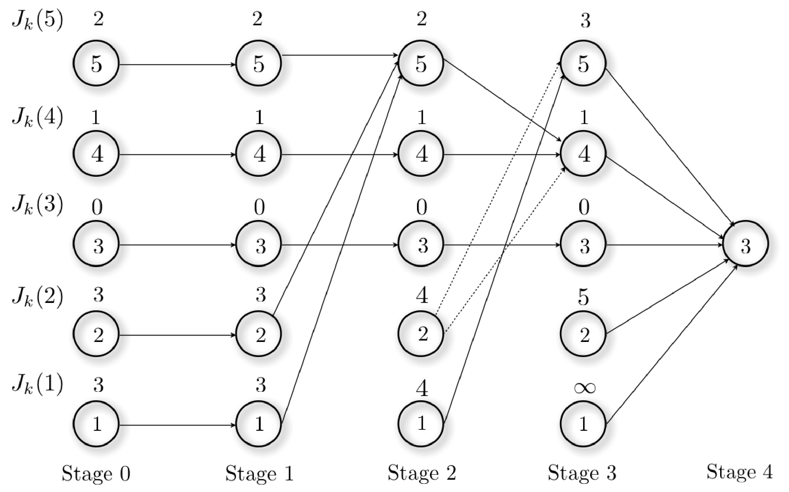

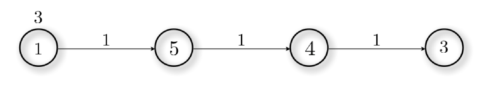

**(ii)** Running Dijkstra's algorithm from node $1$:

| Iteration | Open list (node, estimated distance to node $1$) | Previous node |
|---|---|---|
| $0$ | $\{1,0\}$ | |
| $1$ | $\{2,0\}, \{5,1\}$ | $\beta(2)=1$, $\beta(5)=1$ |
| $2$ | $\{5,1\}, \{3,5\}, \{4,3\}$ | $\beta(3)=2$, $\beta(4)=2$ |
| $3$ | $\{3,4\}, \{4,2\}$ | $\beta(3)=5$, $\beta(4)=5$ |
| $4$ | $\{3,3\}$ | $\beta(3)=4$ |

A shortest path can be read off from this table: $1 \to 5 \to 4 \to 3$, matching (i) (cost $3$).

**(iii)** Combining the answers above (the first node of the optimal path to node $3$, for every possible starting node):

| State | First node of the optimal path to $3$ |
|---|---|
| $1$ | $5$ |
| $2$ | $5$ |
| $3$ | $3$ |
| $4$ | $3$ |
| $5$ | $4$ |

:::

**Problem 3.2** Consider the weighted graph depicted below. Compute the shortest path from node $1$ to node $11$ using:

(i) Dijkstra's algorithm.
(ii) the A* algorithm with the following heuristic $h$

| node $i$ | 1 | 2 | 3 | 4 | 5 | 6 | 7 | 8 | 9 | 10 | 11 |
|---|---|---|---|---|---|---|---|---|---|---|---|
| $h(i)$ | 0 | 25 | 50 | 15 | 16 | 50 | 9 | 7 | 50 | 0 | 0 |

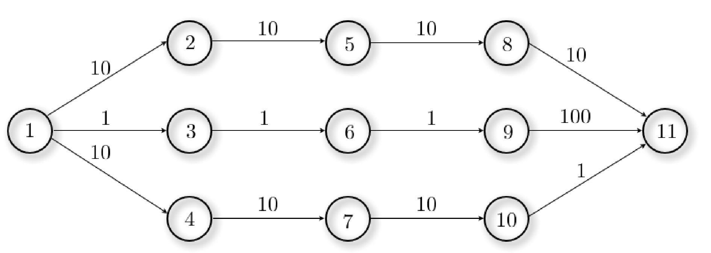

::: {.callout-note collapse="true" title="Solution"}

**(i)** Dijkstra's algorithm:

| Iteration | List of open nodes (node, estimate of the distance from node to node $1$) |
|---|---|
| $0$ | $\{1,0\}$ |
| $1$ | $\{3,1\}, \{4,10\}, \{2,10\}$ |
| $2$ | $\{6,2\}, \{4,10\}, \{2,10\}$ |
| $3$ | $\{9,3\}, \{4,10\}, \{2,10\}$ |
| $4$ | $\{11,103\}, \{4,10\}, \{2,10\}$ |
| $5$ | $\{11,103\}, \{7,20\}, \{2,10\}$ |
| $6$ | $\{11,103\}, \{7,20\}, \{5,20\}$ |
| $7$ | $\{11,103\}, \{10,30\}, \{5,20\}$ |
| $8$ | $\{11,103\}, \{10,30\}, \{8,30\}$ |
| $9$ | $\{11,31\}, \{8,30\}$ |
| $10$ | $\{11,31\}$ |

**(ii)** A* algorithm: first apply the transformation $\bar{c}_{ij} = c_{ij}+h(j)-h(i)$ (valid here because the transformed costs $\bar c_{ij}$ remain non-negative), giving the transformed graph below.

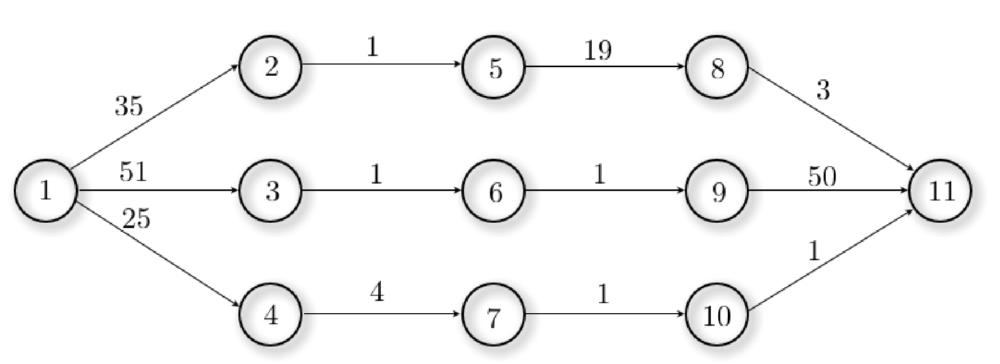

| Iteration | List of open nodes (node, estimate of the distance from node to node $1$) |
|---|---|
| $0$ | $\{1,0\}$ |
| $1$ | $\{4,25\}, \{1,51\}, \{2,35\}$ |
| $2$ | $\{7,29\}, \{1,51\}, \{2,35\}$ |
| $3$ | $\{10,30\}, \{1,51\}, \{2,35\}$ |
| $4$ | $\{11,31\}$ |

Both algorithms find the same shortest path (A* reaches the answer in far fewer iterations, thanks to the heuristic).

:::

## Additional exercises

**Problem 3.3** Consider the transition diagram depicted below. For each initial state at stage $0$ compute one optimal path minimizing the cost incurred from stage $0$ to stage $4$, using Dijkstra's algorithm.

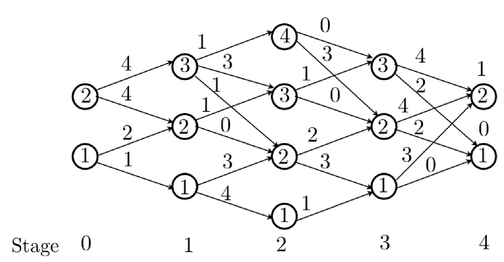

::: {.callout-note collapse="true" title="Solution"}

We start by relabeling the nodes as depicted below (this makes it easier to run Dijkstra's algorithm on a single graph rather than tracking stages explicitly).

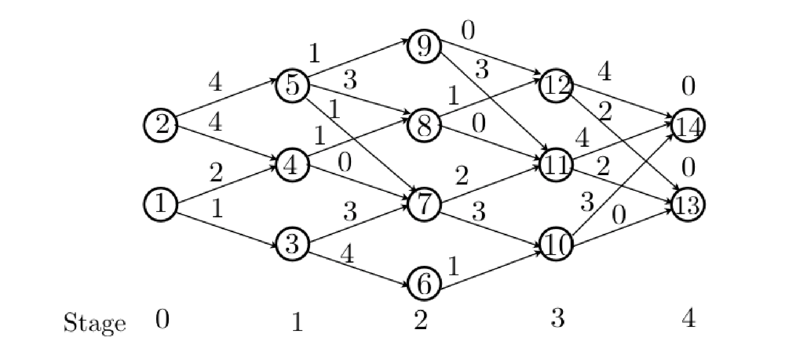

There are two possible initial states (nodes $1$ and $2$) and two possible final states (nodes $13$ and $14$); the optimal path from each initial state is obtained by running Dijkstra's algorithm to both final nodes and keeping the cheaper one.

**From node $1$.** Computing the optimal path from node $1$ to node $13$:

| Iteration | List of open nodes (node $i$, estimate of the distance from $i$ to $1$) |
|---|---|
| $0$ | $\{1,0\}$ |
| $1$ | $\{3,1\}, \{4,2\}$ |
| $2$ | $\{4,2\}, \{6,5\}, \{7,4\}$ |
| $3$ | $\{6,5\}, \{7,2\}, \{8,3\}$ |
| $4$ | $\{6,5\}, \{8,3\}, \{10,5\}, \{11,4\}$ |
| $5$ | $\{6,5\}, \{10,5\}, \{11,3\}, \{12,4\}$ |
| $6$ | $\{6,5\}, \{10,5\}, \{12,4\}, \{13,5\}, \{14,7\}$ |
| $7$ | $\{6,5\},\{13,5\}, \{14,7\}$ |

The distance to node $13$ is $5$. Computing the optimal path from node $1$ to node $14$ (same procedure, table omitted) gives a distance of $7$. Since $5<7$, the optimal path from node $1$ has cost $5$ and is

| Stage | $0$ | $1$ | $2$ | $3$ | $4$ |
|---|---|---|---|---|---|
| Node | $1$ | $2$ | $3$ | $2$ | $1$ |

(node numbers here refer to the *original* diagram's stage-labels along the path, recovered from the relabeled graph).

**From node $2$.** Computing the optimal path from node $2$ to node $13$:

| Iteration | List of open nodes (node $i$, estimate of the distance from $i$ to $2$) |
|---|---|
| $0$ | $\{2,0\}$ |
| $1$ | $\{4,4\}, \{5,4\}$ |
| $2$ | $\{5,4\}, \{7,4\}, \{8,5\}$ |
| $3$ | $\{7,4\}, \{8,5\}, \{9,5\}$ |
| $4$ | $\{8,5\}, \{9,5\}, \{10,7\}, \{11,6\}$ |
| $5$ | $\{9,5\}, \{10,7\}, \{11,5\}, \{12,6\}$ |
| $6$ | $\{10,7\}, \{11,5\}, \{12,5\}$ |
| $7$ | $\{10,7\}, \{12,5\}, \{13,7\}, \{14,9\}$ |
| $8$ | $\{10,7\}, \{13,7\}, \{14,9\}$ |
| $9$ | $\{13,7\}, \{14,9\}$ |

The distance to node $13$ is $7$. Computing the optimal path from node $2$ to node $14$ gives a distance of $9$. Since $7<9$, the optimal path from node $2$ has cost $7$ and is

| Stage | $0$ | $1$ | $2$ | $3$ | $4$ |
|---|---|---|---|---|---|
| Node | $2$ | $2$ | $3$ | $2$ | $1$ |

:::

**Problem 3.4** A cost-minded traveler visiting Hawaii wants to fly from Kauai to Maui and checks the prices of the flights for the next day, summarized in the table below. A direct flight costs $300$ money units, and the traveler believes that there should be a cheaper non-direct flight. He estimates that he can do trips with at most $4$ hops and he is interested in knowing what is the best price with at most $2$, $3$ and $4$ hops to compare the options.

(i) Provide the answers that the traveler is looking for using the dynamic programming algorithm.
(ii) Would there be a better option if $5$ hops were allowed?
(iii) Solve (i) with Dijkstra's algorithm.

::: {layout-ncol="2"}
| Arrival \\ Departure | Oahu | Hawaii | Kauai | Lanai | Maui | Molokai |
|---|---|---|---|---|---|---|
| Oahu | -- | 90 | 70 | 105 | 130 | 95 |
| Hawaii | 95 | -- | 80 | 55 | 100 | 115 |
| Kauai | 75 | 105 | -- | 135 | 250 | 85 |
| Lanai | 105 | 35 | 120 | -- | 40 | 100 |
| Maui | 130 | 95 | 300 | 45 | -- | 140 |
| Molokai | 90 | 120 | 80 | 95 | 95 | -- |

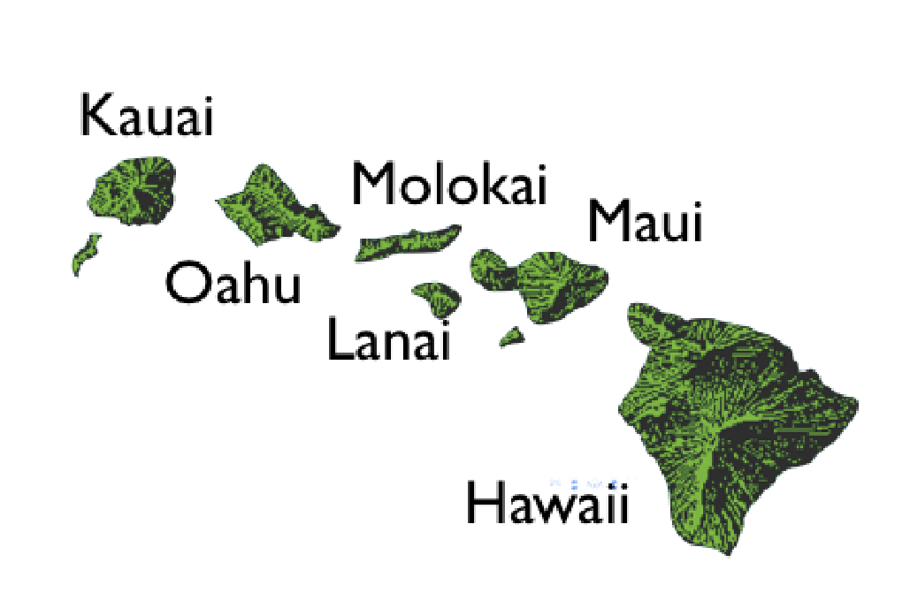
:::

::: {.callout-note collapse="true" title="Solution"}

**(i)-(ii)** Running the DP algorithm on the transition diagram associated with the graph gives the costs-to-go and decisions shown below. Rather than building the full transition diagram directly (tedious, since every node at one stage connects to every node at the next), it is easier to start from the cost-to-go associated with the last step (stage $4$, simply the cost of the direct link from each city to Maui, or $\infty$ if none) and then, at each earlier stage $k$, compute for every state $i$
$$\min_j c_{ij}+J_{k+1}(j),$$
where $c_{ij}$ is the cost of the link from $i$ to $j$ and $J_{k+1}(j)$ is the cost-to-go already found for $j$ at the next stage.

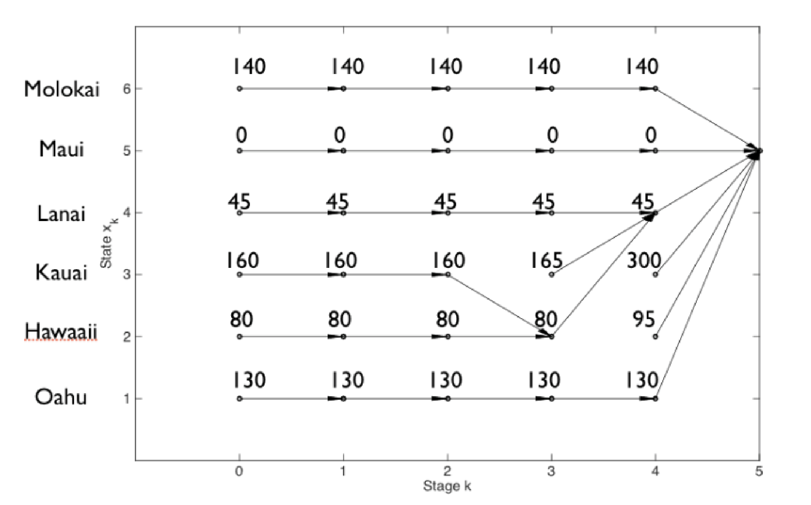

At each iteration $\ell$ of the algorithm, the cost-to-go for a given node corresponds to the optimal cost to reach the destination with $\ell$ hops. Reading the row for Kauai:

- With $2$ hops, the optimal cost is $165$, via Kauai $\to$ Lanai $\to$ Maui.
- With $3$ hops, the optimal cost is $160$, via Kauai $\to$ Hawaii $\to$ Lanai $\to$ Maui.
- With $4$ hops, the optimal cost is still $160$ (same path).
- With $5$ hops, the optimal cost is also still $160$ (same path) -- allowing a fifth hop does not help.

**(iii)** Running Dijkstra's algorithm from Kauai:

| Iteration | List of open nodes (node, estimate of the distance from node to Kauai) |
|---|---|
| $0$ | $\{\text{Kauai},0\}$ |
| $1$ | $\{\text{Oahu},70\}, \{\text{Hawaii},80\}, \{\text{Lanai},120\}, \{\text{Maui},300\}, \{\text{Molokai},80\}$ |
| $2$ | $\{\text{Hawaii},80\}, \{\text{Lanai},120\}, \{\text{Maui},200\}, \{\text{Molokai},80\}$ |
| $3$ | $\{\text{Lanai},115\}, \{\text{Maui},175\}, \{\text{Molokai},80\}$ |
| $4$ | $\{\text{Lanai},115\}, \{\text{Maui},175\}$ |
| $5$ | $\{\text{Maui},160\}$ |

confirming the optimal path Kauai $\to$ Hawaii $\to$ Lanai $\to$ Maui, cost $160$.

:::

**Problem 3.5** Although we have only considered so far graphs with non-negative weights, it is possible to apply the dynamic programming algorithm to find the shortest path in graphs with negative weights, under a certain condition. The aim of this exercise is to find such a condition. Consider the following three graphs.

::: {layout-ncol="3"}
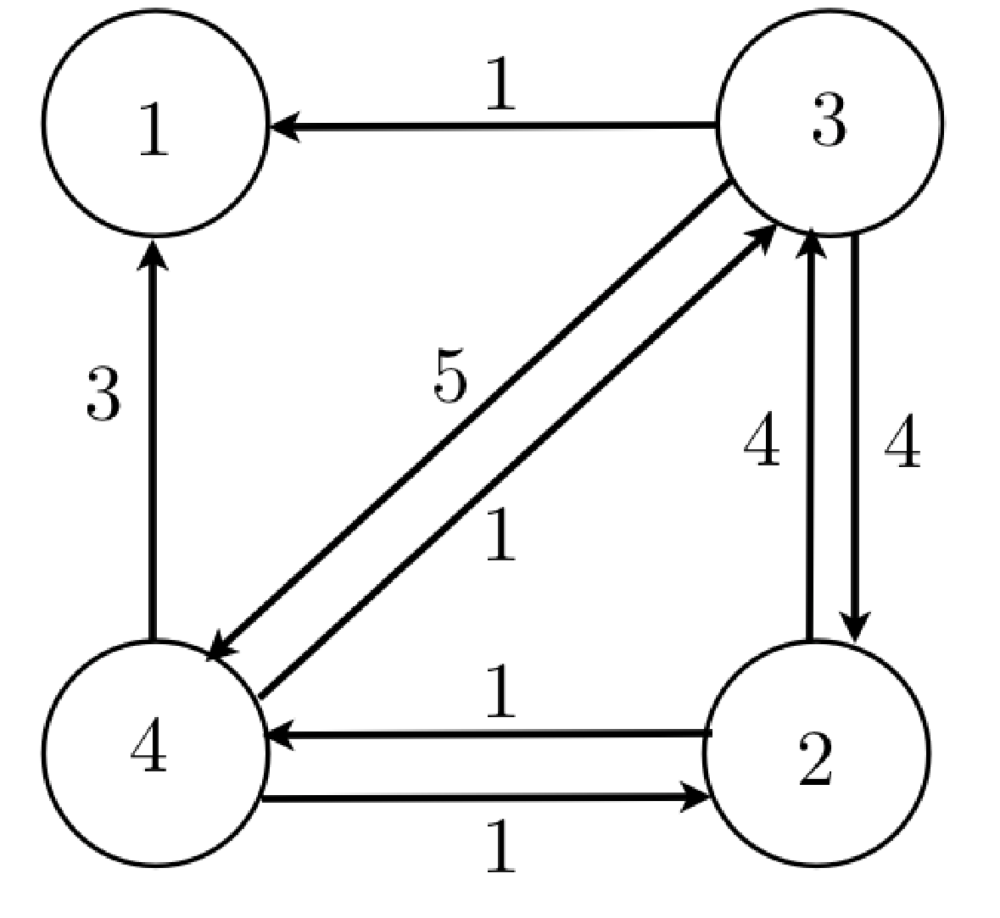

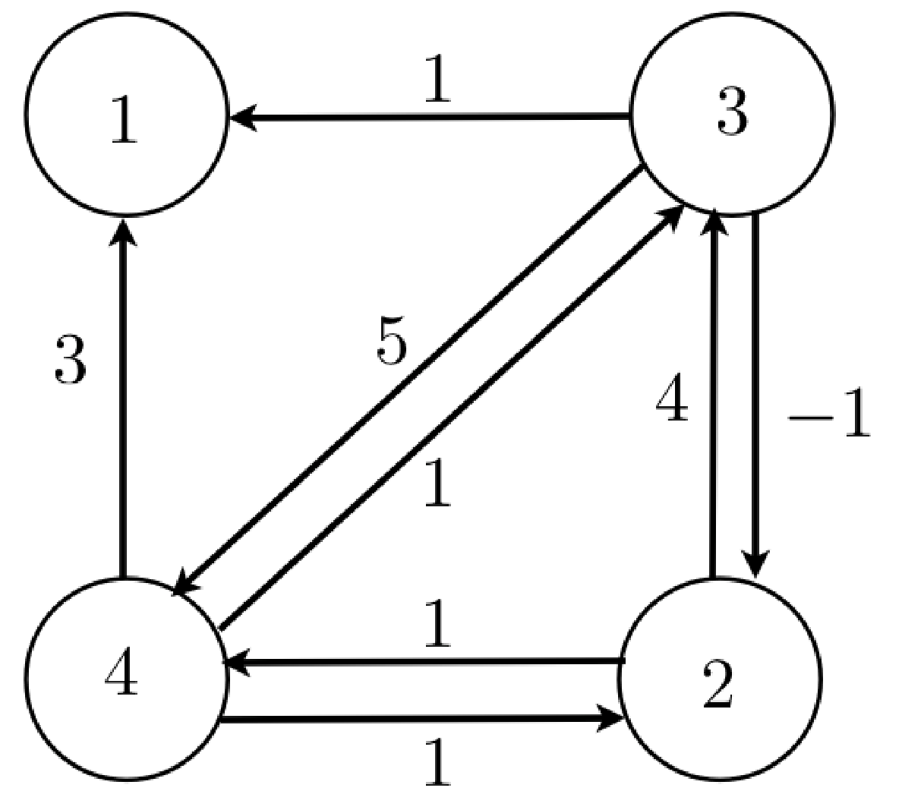

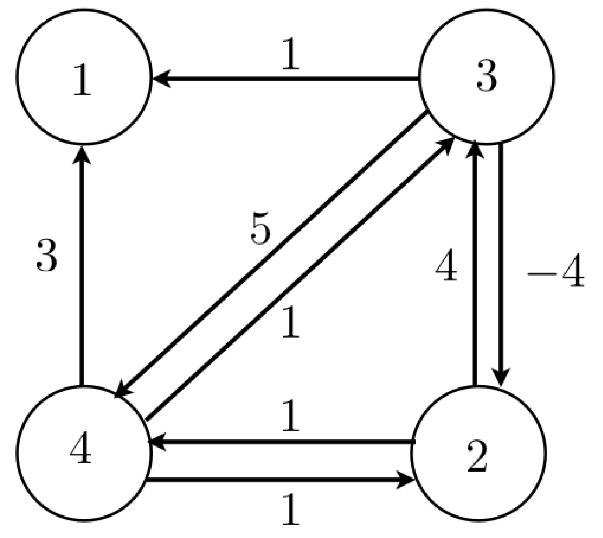
:::

(i) Apply the dynamic programming algorithm to obtain the shortest path from the initial node $2$ to the final node $1$ for graphs (a), (b) and (c).
(ii) Compare the shortest path that you have found for graph (c) with the cost of the following path $2 \to 4\to 3 \to 2 \to 4 \to 3 \to 1$. Is the path found in (i) optimal?
(iii) Can you find a path with a smaller cost for graph (b) than the one found in (i)?
(iv) Can you find a condition under which the dynamic programming algorithm finds the shortest path for graphs with negative weights?
(v) Would it be possible to apply Dijkstra's algorithm?

::: {.callout-note collapse="true" title="Solution"}

**(i)** Running the DP algorithm (with $3$ stages, since the shortest path here never needs more than $3$ hops) for each graph gives the costs-to-go and shortest path shown below; in all three cases DP reports the same path $2\to4\to3\to1$.

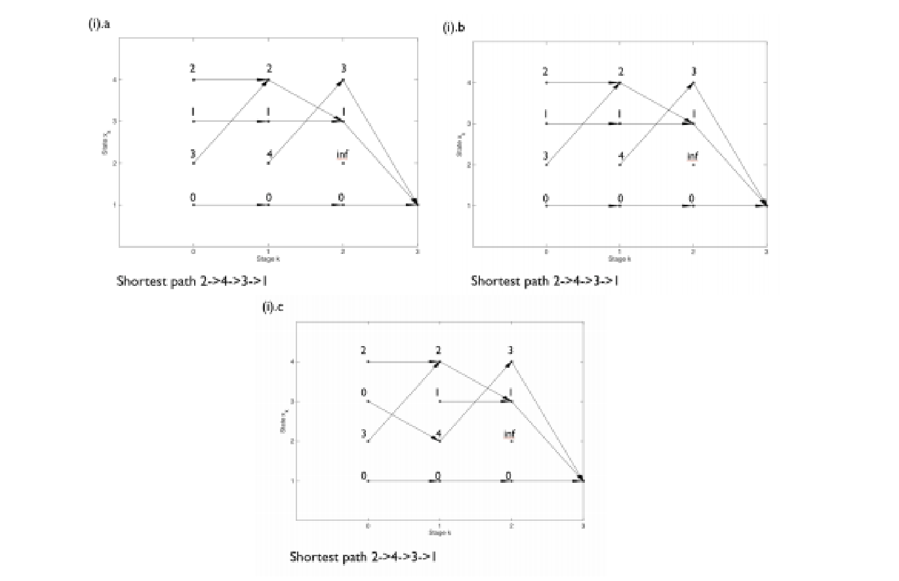

**(ii)** For graph (c), the path $2\to4\to3\to1$ found in (i) has length $3$, whereas the longer path $2\to4\to3\to2\to4\to3\to1$ has length $1$. So the path found by DP in (i) is *not* optimal for graph (c) -- DP fails here because graph (c) contains a negative-cost cycle ($3\to2\to4\to3$ has cost $-4+1+1=-2<0$), so the cost can be driven arbitrarily low by cycling and DP (which only searches out to a fixed number of hops) misses this.

**(iii)** No, it is not possible: for graph (b) the DP path from (i) is already optimal.

**(iv)** DP finds the shortest path for a graph with negative weights provided there are no negative-cost cycles reachable from the initial node and reaching the final node -- with such a cycle, as seen in (ii), the cost can be decreased without bound and no shortest path exists.

**(v)** Dijkstra's algorithm only works for graphs with non-negative weights; of the three graphs above, it could only be applied to (a).

:::
