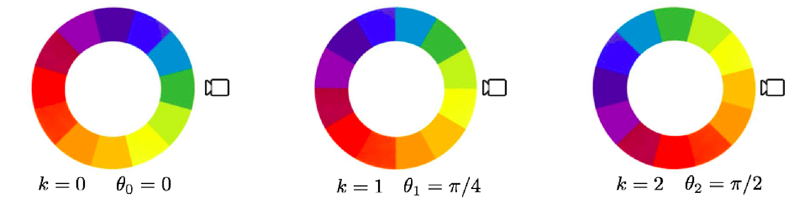
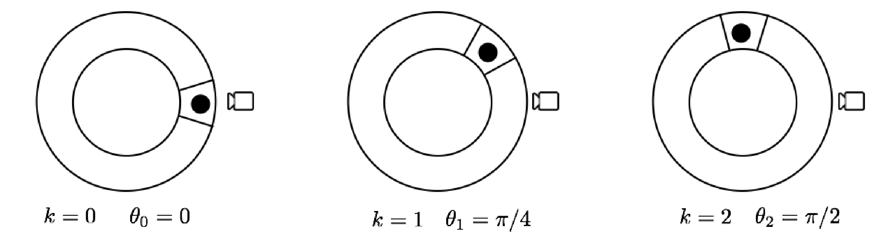

<!--
Source: Solved Exercises/1/PS1.tex (problems) and
Solved Exercises/1/Solutions/SolutionsPS1.tex (solutions), section 4
"Bayes' filter and POMDP" -- Problems 4.1-4.4 (numbering unchanged from the
source), plus two instructor-supplied exam questions added 2026-09-28.
Core = 4.1 (angle estimation with a noisy hue sensor -- the main worked
Bayes-filter example, full solution provided, directly practices the
lecture's central technique) and 4.2 (robot around a pillar: two
prediction/update rounds on a 4-state cyclic chain; instructor-supplied
problem AND solution, transcribed, arithmetic independently verified).
Additional = 4.3 (machine inspection/replacement, Bertsekas Ex. 5.6), 4.4
(coin-tossing with unknown bias, Bertsekas Ex. 5.10), 4.5 (the noiseless
one-hot-sensor variant of 4.1) and 4.6 (fruit sorting: a 3-state Markov
chain with a partly confusable sensor; instructor-supplied problem, solution
worked out here and checked in exact rational arithmetic).

Swapped 2026-09-28 at the instructor's request: the robot-around-a-pillar
problem moved from Additional 4.5 into Core as 4.2, and the former Core 4.2
(noiseless one-hot sensor) moved into Additional as 4.5. Numbers follow
position, so the file still reads 4.1 ... 4.6 in order.

On 4.3 and 4.4: both are POMDP
*policy* problems (not just Bayes-filter computation) from the "Solving
POMDPs" material that Lecture 4 explicitly marks as non-examinable ("This
part of the course (POMDP) is just instructive, and it will not appear in
the exam and in the problem sets"), which is also why the source solutions
file does not provide worked solutions for them (marked "Solution not
provided"). They are kept here as optional practice, citing Bertsekas'
book where a solution can be found, rather than inventing an unverified
answer key -- I ran an independent DP check on 4.3 and could not reproduce
the exact inspection period stated in the problem itself, so rather than
risk shipping a wrong worked solution I left it as citation-only; flag if
you'd like me to dig further or if you have Bertsekas' solution manual on
hand to cross-check against.

Figures figcir1.png/figcir2.png converted from
Solved Exercises/1/Figures/figcir1.eps and figcir2.eps via ghostscript
(`gs -dEPSCrop -sDEVICE=pngalpha -r300`), copied to figures/unit4/.
-->

A runnable Python companion to Problems 4.1, 4.2 and 4.5 -- a general discrete Bayes
filter (prediction + correction) -- is available in `code/unit4/` (see its
`README.md`); running it reproduces the belief vectors in Problem 4.1's
solution exactly.

## Core exercises

**Problem 4.1** Suppose that we wish to estimate the angle of a spinning wheel with a camera. Different colors with continuously varying values of hue according to the HSV color representation are placed on the wheel. Due to space limitations, the camera is placed close to the wheel and can only detect a limited range of the wheel. The angle is quantized into $N$ values and this induces a quantization also for the value of hue of the camera measurements. Due to changes in brightness and other exterior conditions, the camera processing algorithm can provide wrong estimates of the hue, but these are typically close to the correct value. The setting is depicted in the figure below. In this exercise, for simplicity, we assume $N=4$, considering four angles and four associated colors: (i) green, $\theta=0$; (ii) orange, $\theta=\pi/2$; (iii) red, $\theta=\pi$; (iv) blue, $\theta=3\pi/2$. The wheel is assumed to be spinning anti-clockwise according to the following model for the angle $\theta_k$ at time $k \in \mathbb{N}\cup\{0\}$,

$$\theta_{k+1} = \theta_k + w_k$$

where

$$\text{Prob}[\theta_0=\beta] = \begin{cases}0.25 & \text{if } \beta=0\\0.25 & \text{if } \beta=\pi/2\\0.25 & \text{if } \beta=\pi\\0.25 & \text{if } \beta=3\pi/2\end{cases} \qquad \text{Prob}[w_k=\alpha] = \begin{cases}0.2 & \text{if } \alpha=0\\0.6 & \text{if } \alpha=\pi/2\\0.2 & \text{if } \alpha=\pi\end{cases} \quad \forall k$$

The measurement at time $k$ obtained from the algorithm processing camera data is denoted by $y_k \in \{\text{green}, \text{orange}, \text{red}, \text{blue}\}$ and follows the model

$$\text{Prob}[y_k=c\mid\theta_k=0] = \begin{cases}0.1 & \text{c = blue}\\0.8 & \text{c = green}\\0.1 & \text{c = orange}\end{cases} \qquad \text{Prob}[y_k=c\mid\theta_k=\pi/2] = \begin{cases}0.1 & \text{c = green}\\0.8 & \text{c = orange}\\0.1 & \text{c = red}\end{cases}$$

$$\text{Prob}[y_k=c\mid\theta_k=\pi] = \begin{cases}0.1 & \text{c = orange}\\0.8 & \text{c = red}\\0.1 & \text{c = blue}\end{cases} \qquad \text{Prob}[y_k=c\mid\theta_k=3\pi/2] = \begin{cases}0.1 & \text{c = red}\\0.8 & \text{c = blue}\\0.1 & \text{c = green}\end{cases} \quad \forall k$$

Compute, for $k \in \{0,1,2,3,4\}$ and for $c \in \{0,\pi/2,\pi,3\pi/2\}$,

$$\text{Prob}[\theta_k=c\mid I_k]$$

where $I_k=\{y_0,\dots,y_k\}$ and the measurements are $y_0=\text{green}$, $y_1=\text{orange}$, $y_2=\text{orange}$, $y_3=\text{blue}$, $y_4=\text{blue}$.

{width="85%" fig-align="center"}

::: {.callout-note collapse="true" title="Solution"}

We can solve this exercise by recursively applying the Bayes' rule (correction/update step) and propagating model uncertainty (prediction step). We do this for the first step to illustrate the process; a more expedite (equivalent) procedure is to find the matrices $P$ and $R$ defined below and iterate the Bayes filter equations (Lecture 4, slide 15).

**First correction/update step**, $\text{Prob}[\theta_0\mid y_0=\text{green}]$. From Bayes' rule,

$$\begin{aligned}
\text{Prob}[\theta_0=0\mid y_0=\text{green}] &= \alpha\,\text{Prob}[y_0=\text{green}\mid\theta_0=0]\text{Prob}[\theta_0=0] = \alpha\, 0.8\times 0.25\\
\text{Prob}[\theta_0=\pi/2\mid y_0=\text{green}] &= \alpha\,\text{Prob}[y_0=\text{green}\mid\theta_0=\pi/2]\text{Prob}[\theta_0=\pi/2] = \alpha\, 0.1\times 0.25\\
\text{Prob}[\theta_0=\pi\mid y_0=\text{green}] &= \alpha\,\text{Prob}[y_0=\text{green}\mid\theta_0=\pi]\text{Prob}[\theta_0=\pi] = \alpha\, 0\times 0.25\\
\text{Prob}[\theta_0=3\pi/2\mid y_0=\text{green}] &= \alpha\,\text{Prob}[y_0=\text{green}\mid\theta_0=3\pi/2]\text{Prob}[\theta_0=3\pi/2] = \alpha\, 0.1\times 0.25
\end{aligned}$$

where $\alpha = 1/(0.8\times 0.25 + 0.1\times 0.25 + 0\times 0.25 + 0.1\times 0.25)$. Therefore

$$\text{Prob}[\theta_0=\beta\mid y_0=\text{green}] = \begin{cases}0.8 & \beta=0\\0.1 & \beta=\pi/2\\0 & \beta=\pi\\0.1 & \beta=3\pi/2\end{cases}$$

**Prediction step**, $\text{Prob}[\theta_1\mid y_0=\text{green}]$. For $\theta_1=0$,

$$\text{Prob}[\theta_1=0\mid y_0=\text{green}] = \text{Prob}[\theta_0+w_0=0\mid y_0=\text{green}] = \sum_{c\in\{0,\pi/2,\pi\}}\text{Prob}[\theta_0=-c\mid y_0=\text{green}]\text{Prob}[w_0=c]$$
$$= \text{Prob}[\theta_0=0\mid\dots]\text{Prob}[w_0=0] + \text{Prob}[\theta_0=-\pi/2\mid\dots]\text{Prob}[w_0=\pi/2] = 0.8\times 0.2 + 0.1\times 0.6 = 0.22$$

and similarly $\text{Prob}[\theta_1=\pi/2\mid y_0=\text{green}] = 0.1\times 0.2 + 0.8\times 0.6 + 0.1\times 0.2 = 0.52$, $\text{Prob}[\theta_1=\pi\mid y_0=\text{green}] = 0\times 0.2 + 0.1\times 0.6 + 0.8\times 0.2 = 0.22$, $\text{Prob}[\theta_1=3\pi/2\mid y_0=\text{green}] = 0.1\times 0.2 + 0.1\times 0.2 = 0.02$.

**A more expedite process.** This step-by-step computation is time-consuming; it is better organized using matrices. Define a $4\times 4$ matrix $P$ with $P_{ij} = \text{Prob}[\theta_{k+1}=(i-1)\tfrac{\pi}{2}\mid\theta_k=(j-1)\tfrac{\pi}{2}]$,

$$P = \begin{bmatrix}0.2 & 0 & 0.2 & 0.6\\0.6 & 0.2 & 0 & 0.2\\0.2 & 0.6 & 0.2 & 0\\0 & 0.2 & 0.6 & 0.2\end{bmatrix}$$

and a matrix $R$ with $R_{ij} = \text{Prob}[y_k=f(i)\mid\theta_k=(j-1)\tfrac{\pi}{2}]$, where $f(1)=\text{green}$, $f(2)=\text{orange}$, $f(3)=\text{red}$, $f(4)=\text{blue}$,

$$R = \begin{bmatrix}0.8 & 0.1 & 0 & 0.1\\0.1 & 0.8 & 0.1 & 0\\0 & 0.1 & 0.8 & 0.1\\0.1 & 0 & 0.1 & 0.8\end{bmatrix}$$

Then $p_k = \begin{bmatrix}\text{Prob}[\theta_k=0\mid I_k]\\\text{Prob}[\theta_k=\pi/2\mid I_k]\\\text{Prob}[\theta_k=\pi\mid I_k]\\\text{Prob}[\theta_k=3\pi/2\mid I_k]\end{bmatrix}$ is obtained by iterating, for $k\in\{0,\dots,4\}$,

$$q_{k+1} = Pp_k \qquad \bar p_{k+1} = D(y_{k+1})q_{k+1} \qquad p_{k+1} = \frac{\bar p_{k+1}}{\mathbb{1}^\top \bar p_{k+1}}$$

where $D(y_{k+1})$ is diagonal with the row of $R$ corresponding to $y_{k+1}$ on the diagonal, and $p_0 = q_0/\mathbb{1}^\top q_0$, $q_0 = D(y_0)\tilde p_0$, $\tilde p_0 = \begin{bmatrix}1/4 & 1/4 & 1/4 & 1/4\end{bmatrix}^\top$. Working through the first two steps:

$$p_0 = \begin{bmatrix}0.8\\0.1\\0\\0.1\end{bmatrix} \qquad q_1 = P p_0 = \begin{bmatrix}0.22\\0.52\\0.22\\0.04\end{bmatrix} \qquad p_1 = \begin{bmatrix}0.0478\\0.9043\\0.0478\\0\end{bmatrix}$$

Continuing this process (simple matrix multiplications) gives the desired probability distributions

$$p_2 = \begin{bmatrix}0.0085\\0.7427\\0.2488\\0\end{bmatrix} \qquad p_3 = \begin{bmatrix}0.0176\\0\\0.1696\\0.8129\end{bmatrix} \qquad p_4 = \begin{bmatrix}0.1962\\0\\0.0140\\0.7899\end{bmatrix}$$

:::

**Problem 4.2** A robot moves around a pillar in an environment divided into four regions, numbered $1,2,3,4$ in clockwise order around the pillar (so region $4$ is adjacent to region $1$). The initial region is unknown and modelled as

$$\text{Prob}[x_0 = i] = \tfrac{1}{4}, \qquad i\in\{1,2,3,4\},$$

where $x_k\in\{1,2,3,4\}$ is the region the robot occupies at time $k$. The robot does not move at $k=0$, and at $k=1$ it tries to move clockwise but only succeeds with probability $0.5$:

$$\text{Prob}[x_1=i\mid x_0=i]=1, \qquad i\in\{1,2,3,4\},$$

$$\text{Prob}[x_2=i+1\mid x_1=i]=0.5, \quad \text{Prob}[x_2=i\mid x_1=i]=0.5, \qquad i\in\{1,2,3\},$$

$$\text{Prob}[x_2=1\mid x_1=4]=0.5, \quad \text{Prob}[x_2=4\mid x_1=4]=0.5 .$$

A set of sensors placed in the environment summarize their information into a single measurement at each time $k$, giving the most likely region of the robot, $y_k\in\{1,2,3,4\}$. This measurement is correct with probability $0.8$, and when incorrect each of the other regions is reported with equal probability:

$$\text{Prob}[y_k=i\mid x_k=i]=0.8, \quad \text{Prob}[y_k=j\mid x_k=i]=\tfrac{0.2}{3}, \qquad j\in\{1,2,3,4\}\setminus\{i\}.$$

The sensors provide measurements only at $k=1$ and $k=2$, and these are $y_1=2$, $y_2=2$. Compute

$$\text{Prob}[x_2=i \mid y_2=2 \text{ and } y_1=2], \qquad \text{for every } i\in\{1,2,3,4\}.$$

::: {.callout-note collapse="true" title="Solution"}

This is a straightforward application of the Bayes' filter. Since the robot does not move at time $0$ and there is no measurement at time $0$, the distribution of $x_1$ is the same as that of $x_0$: $\text{Prob}[x_1=i]=1/4$ for every $i\in\{1,2,3,4\}$.

**Update at $k=1$.** By the update step of the Bayes' filter,

$$\text{Prob}[x_1=i\mid y_1=2] = \alpha\,\text{Prob}[y_1=2\mid x_1=i]\,\text{Prob}[x_1=i],$$

so that

$$\text{Prob}[x_1=i\mid y_1=2] = \begin{cases}\alpha\,\tfrac{0.2}{3}\times\tfrac14, & i=1\\[2pt] \alpha\,0.8\times\tfrac14, & i=2\\[2pt] \alpha\,\tfrac{0.2}{3}\times\tfrac14, & i=3\\[2pt] \alpha\,\tfrac{0.2}{3}\times\tfrac14, & i=4\end{cases}$$

with $\alpha=4$ the normalizing factor that makes the probabilities add up to one, giving

$$\text{Prob}[x_1=i\mid y_1=2] = \begin{cases}0.2/3, & i=1\\ 0.8, & i=2\\ 0.2/3, & i=3\\ 0.2/3, & i=4.\end{cases}$$

**Prediction to $k=2$.** Using the prediction step,

$$\text{Prob}[x_2=i+1\mid y_1=2] = \tfrac12\text{Prob}[x_1=i\mid y_1=2]+\tfrac12\text{Prob}[x_1=i+1\mid y_1=2], \qquad i\in\{1,2,3\},$$

$$\text{Prob}[x_2=1\mid y_1=2] = \tfrac12\text{Prob}[x_1=4\mid y_1=2]+\tfrac12\text{Prob}[x_1=1\mid y_1=2],$$

which leads to

$$\text{Prob}[x_2=i\mid y_1=2] = \begin{cases}0.2/3, & i=1\\ 0.4+0.1/3, & i=2\\ 0.4+0.1/3, & i=3\\ 0.2/3, & i=4.\end{cases}$$

Note how the prediction step spreads the mass that was concentrated on region $2$ across regions $2$ and $3$, since the clockwise move succeeds only half the time.

**Update at $k=2$.** Applying the update step once more,

$$\text{Prob}[x_2=i\mid y_1=2 \text{ and } y_2=2] = \alpha\,\text{Prob}[y_2=2\mid x_2=i]\,\text{Prob}[x_2=i\mid y_1=2],$$

leading to

$$\text{Prob}[x_2=i\mid y_1=2 \text{ and } y_2=2] = \begin{cases}\alpha\,\tfrac{0.2}{3}\times\tfrac{0.2}{3}, & i=1\\[2pt] \alpha\,0.8\times(0.4+\tfrac{0.1}{3}), & i=2\\[2pt] \alpha\,\tfrac{0.2}{3}\times(0.4+\tfrac{0.1}{3}), & i=3\\[2pt] \alpha\,\tfrac{0.2}{3}\times\tfrac{0.2}{3}, & i=4.\end{cases}$$

Computing $\alpha$ so that the probabilities add up to one gives $\alpha=2.6012$, so that

$$\text{Prob}[x_2=i\mid y_1=2 \text{ and } y_2=2] = \begin{cases}0.0116, & i=1\\ 0.9017, & i=2\\ 0.0751, & i=3\\ 0.0116, & i=4.\end{cases}$$

The second measurement sharpens the belief considerably: region $2$ goes from $0.433$ to $0.902$. Region $3$, which the prediction step had made exactly as likely as region $2$, is pushed down to $0.075$ purely by the second measurement disagreeing with it.

:::

## Additional exercises

**Problem 4.3** [Bertsekas, *Dynamic Programming and Optimal Control*, Ex. 5.6] Consider a machine that can be in one of two states, good or bad. Suppose that the machine produces an item at the end of each period. The item produced is either good or bad depending on whether the machine is in a good or bad state at the beginning of the corresponding period, respectively. We suppose that once the machine is in a bad state it remains in that state until it is replaced. If the machine is in a good state at the beginning of a certain period, then with probability $t$ it will be in the bad state at the end of the period. Once an item is produced, we may inspect the item at a cost $I$ or not inspect. If an inspected item is found to be bad, the machine is replaced with a machine in good state at cost $R$. The cost of producing a bad item is $C>0$. Write a DP algorithm for obtaining an optimal inspection policy assuming a machine initially in good state and a horizon of $N$ periods. Solve the problem for $t=0.2$, $I=1$, $R=3$, $C=2$ and $N=8$ (the optimal policy is to inspect at the end of the third period and not inspect in any other period).

::: {.callout-note collapse="true" title="Solution"}

Not provided in the source materials (marked "Solution not provided" in the exercise solutions) -- this problem is part of the "Solving POMDPs" material that Lecture 4 explicitly flags as non-examinable. See Bertsekas' *Dynamic Programming and Optimal Control*, Example 5.6 / Exercise 5.6, for a worked solution; the belief state is $p_k = \text{Prob}[\text{machine bad at start of period } k \mid \text{information so far}]$, updated by the Bayes filter (deterministically to $0$ or $1$ on inspection, by the transition model otherwise), with the DP algorithm minimizing expected cost-to-go over the inspect/don't-inspect decision at each stage.

:::

**Problem 4.4** [Bertsekas, *Dynamic Programming and Optimal Control*, Ex. 5.10] A person is offered 2 to 1 odds in a coin-tossing game where he wins whenever a tail occurs. However, he suspects that the coin is biased and has an a priori probability distribution $F(p)$ for the probability $p$ that a head occurs at each toss. The problem is to find an optimal policy of deciding whether to continue or stop participating in the game given the outcomes of the game so far. A maximum of $N$ tossings is allowed. Indicate how such a policy can be found by means of DP.

::: {.callout-note collapse="true" title="Solution"}

Not provided in the source materials (marked "Solution not provided" in the exercise solutions) -- like Problem 4.3, this is non-examinable "Solving POMDPs" material. See Bertsekas' *Dynamic Programming and Optimal Control*, Example 5.10 / Exercise 5.10. As a hint: the sufficient statistic for this problem is not $p$ itself but the posterior distribution over $p$ given the coin tosses observed so far (a continuous belief state), updated via Bayes' rule after every toss; the DP then optimizes the stop/continue decision over this belief.

:::

**Problem 4.5** The goal of this exercise is to repeat Problem 4.1 but assuming that the sensor can only detect one of the angles without noise, as suggested in the figure below. The sensor model is then

$$\text{Prob}[y_k=1\mid\theta_k=0]=1 \qquad \text{Prob}[y_k=0\mid\theta_k=0]=0$$

and, for $\beta\in\{\pi/2,\pi,3\pi/2\}$, $\text{Prob}[y_k=1\mid\theta_k=\beta]=0$, $\text{Prob}[y_k=0\mid\theta_k=\beta]=1$.

Compute, for $k\in\{0,1,2,3,4\}$ and for $c\in\{0,\pi/2,\pi,3\pi/2\}$,

$$\text{Prob}[\theta_k=c\mid I_k]$$

where $I_k=\{y_0,\dots,y_k\}$ and the measurements are $y_0=1$, $y_1=0$, $y_2=0$, $y_3=1$, $y_4=0$.

{width="85%" fig-align="center"}

::: {.callout-note collapse="true" title="Solution"}

This exercise is solved as 4.1, with a different sensor model: a $2\times 4$ matrix $R$ with $R_{ij} = \text{Prob}[y_k=i-1\mid\theta_k=(j-1)\tfrac{\pi}{2}]$,

$$R = \begin{bmatrix}0 & 1 & 1 & 1\\1 & 0 & 0 & 0\end{bmatrix}$$

with $P$ as in Problem 4.1. Iterating the Bayes filter gives

$$p_0 = \begin{bmatrix}1\\0\\0\\0\end{bmatrix} \qquad p_1 = \begin{bmatrix}0\\0.75\\0.25\\0\end{bmatrix} \qquad p_2 = \begin{bmatrix}0\\0.1579\\0.5263\\0.3158\end{bmatrix} \qquad p_3 = \begin{bmatrix}1\\0\\0\\0\end{bmatrix} \qquad p_4 = \begin{bmatrix}0\\0.75\\0.25\\0\end{bmatrix}$$

:::

**Problem 4.6** Consider a pick-and-place robot that handles three types of fruit: apples ($A$), pears ($P$) and oranges ($O$). A camera-based system classifies each piece of fruit at time $k$ into the categories $A$, $P$ and $O$, and on the basis of that classification the robot places it in the corresponding container. Let $y_k\in\{A,P,O\}$ be the classification given by the system and $x_k\in\{A,P,O\}$ the true type. The detection system can mistake apples for pears and vice versa, but makes no mistakes on oranges. The probabilities $\text{Prob}[y_k=i\mid x_k=j]$ are:

|  | $j=A$ | $j=P$ | $j=O$ |
|---|---|---|---|
| $i=A$ | $0.9$ | $0.1$ | $0$ |
| $i=P$ | $0.1$ | $0.9$ | $0$ |
| $i=O$ | $0$ | $0$ | $1$ |

: $\text{Prob}[y_k=i\mid x_k=j]$ {#tbl-fruit-sensor}

Pieces of fruit tend to be surrounded by other pieces of the same type, so the next piece picked up is correlated with the previous one. Assuming a Markov model, the transition probabilities $\text{Prob}[x_{k+1}=i\mid x_k=j]$ are:

|  | $j=A$ | $j=P$ | $j=O$ |
|---|---|---|---|
| $i=A$ | $0.6$ | $0.2$ | $0.2$ |
| $i=P$ | $0.2$ | $0.6$ | $0.2$ |
| $i=O$ | $0.2$ | $0.2$ | $0.6$ |

: $\text{Prob}[x_{k+1}=i\mid x_k=j]$ {#tbl-fruit-transition}

At time zero, before the first classification $y_0$, all fruit types are equally likely, $\text{Prob}[x_0=A]=\text{Prob}[x_0=P]=\text{Prob}[x_0=O]=1/3$. Compute the probability distribution of $x_2$ given the classifications at times $k=0$ and $k=1$, $y_0=O$ and $y_1=A$, i.e.

$$\text{Prob}[x_2=i\mid y_0=O,\ y_1=A], \qquad \text{for } i\in\{A,P,O\}.$$

::: {.callout-note collapse="true" title="Solution"}

This is the Bayes' filter of this unit applied to a three-state Markov chain, with the measurement and transition models read off the two tables. Note that the quantity asked for involves no measurement at time $2$: after the update at $k=1$ we take one *prediction* step and stop.

**Update at $k=0$.** With the uniform prior $\text{Prob}[x_0=i]=1/3$,

$$\text{Prob}[x_0=i\mid y_0=O] = \alpha\,\text{Prob}[y_0=O\mid x_0=i]\,\tfrac13 = \begin{cases}\alpha\cdot 0\cdot\tfrac13=0, & i=A\\ \alpha\cdot 0\cdot\tfrac13=0, & i=P\\ \alpha\cdot 1\cdot\tfrac13, & i=O,\end{cases}$$

and normalizing ($\alpha=3$) gives

$$\text{Prob}[x_0=i\mid y_0=O] = \begin{cases}0, & i=A\\ 0, & i=P\\ 1, & i=O.\end{cases}$$

The classification $y_0=O$ settles the matter completely: the last column of @tbl-fruit-sensor says an orange is never misclassified, and the last row says nothing else is ever *reported* as an orange, so $y_0=O$ implies $x_0=O$ with certainty. This is the one observation in this problem that carries no ambiguity at all.

**Prediction to $k=1$.** Since the belief is concentrated on $O$, the prediction step just reads off the $j=O$ column of @tbl-fruit-transition:

$$\text{Prob}[x_1=i\mid y_0=O] = \sum_{j}\text{Prob}[x_1=i\mid x_0=j]\,\text{Prob}[x_0=j\mid y_0=O] = \text{Prob}[x_1=i\mid x_0=O] = \begin{cases}0.2, & i=A\\ 0.2, & i=P\\ 0.6, & i=O.\end{cases}$$

**Update at $k=1$.** Now fold in $y_1=A$:

$$\text{Prob}[x_1=i\mid y_0=O,y_1=A] = \alpha\,\text{Prob}[y_1=A\mid x_1=i]\,\text{Prob}[x_1=i\mid y_0=O] = \begin{cases}\alpha\cdot 0.9\times 0.2 = \alpha\,0.18, & i=A\\ \alpha\cdot 0.1\times 0.2 = \alpha\,0.02, & i=P\\ \alpha\cdot 0\times 0.6 = 0, & i=O,\end{cases}$$

with $\alpha = 1/(0.18+0.02) = 5$, so that

$$\text{Prob}[x_1=i\mid y_0=O,y_1=A] = \begin{cases}0.9, & i=A\\ 0.1, & i=P\\ 0, & i=O.\end{cases}$$

It is worth pausing here. Before the measurement, $O$ was by far the most likely type at $k=1$ (probability $0.6$, because fruit comes in runs). The single classification $y_1=A$ eliminates it outright -- not because $A$ is likely, but because an orange can never be reported as an apple. What survives is the comparison between $A$ and $P$, which the sensor resolves $9$ to $1$. Between them the prior was even ($0.2$ each), so the posterior odds are exactly the sensor's odds.

**Prediction to $k=2$.** Finally, one more prediction step, with no measurement at $k=2$:

$$\text{Prob}[x_2=i\mid y_0=O,y_1=A] = \sum_j \text{Prob}[x_2=i\mid x_1=j]\,\text{Prob}[x_1=j\mid y_0=O,y_1=A],$$

that is, $0.9$ times the $j=A$ column of @tbl-fruit-transition plus $0.1$ times the $j=P$ column:

$$\begin{aligned}
\text{Prob}[x_2=A\mid y_0,y_1] &= 0.9\times 0.6 + 0.1\times 0.2 = 0.54+0.02 = 0.56,\\
\text{Prob}[x_2=P\mid y_0,y_1] &= 0.9\times 0.2 + 0.1\times 0.6 = 0.18+0.06 = 0.24,\\
\text{Prob}[x_2=O\mid y_0,y_1] &= 0.9\times 0.2 + 0.1\times 0.2 = 0.18+0.02 = 0.20,
\end{aligned}$$

which sum to $1$ as they must. Exactly,

$$\text{Prob}[x_2=i\mid y_0=O,\ y_1=A] = \begin{cases}0.56 = 14/25, & i=A\\ 0.24 = 6/25, & i=P\\ 0.20 = 1/5, & i=O.\end{cases}$$

Note how much less sharp this is than the belief at $k=1$: the prediction step, applied to a chain that changes type with probability $0.4$, pulls the distribution back towards uniform. Without a measurement at $k=2$ there is nothing to counteract that, which is the general pattern -- prediction spreads the belief out, updates concentrate it.

:::
