## Unit 1 {.center style="text-align: center;"}

<!--
No YAML title/subtitle/author on purpose: Quarto auto-generates a title
slide whenever `title:` is set, which would duplicate this hand-built one
(custom layout: "Lecture N" as title, topic as subtitle, TU/e logo, course
code, name -- matching what you asked for on 2026-08-07). If you ever want
the plain auto-generated version instead, delete this slide and add
title/subtitle/author back to the YAML above.
-->

### Introduction to Optimal Control, the Dynamic Programming Algorithm {style="text-align: center;"}

{width="15%" fig-align="center"}

::: {.title-slide-meta}
4SC000, Q2 2026-2027

Duarte Antunes
:::

<!--
Converted from Lecture1.key (exported to PDF, 53 slides) on 2026-08-07.
CONVENTION USED HERE: slides that are mostly text/bullets/equations are
rewritten natively (editable Markdown + LaTeX using the shared macros).
Slides built around a hand-drawn diagram (transition diagrams, the Romania
map, the robot grid, application photos) are kept as an embedded image of
the original slide rather than redrawn -- redrawing 30 figures accurately
without being able to verify them against you first risked introducing
errors. Happy to convert any specific one to a native TikZ/matplotlib figure
once you've confirmed this pass is right.

FLAGS / SUGGESTIONS (from doing this conversion, not changes I made):
1. Title slide says "4SC000 Q2 2026-2027" -- your PS1-3/exam/assessment plan
   docs I looked at earlier all say "2025-2026". If 2026-2027 is the
   upcoming offering (matches today's date), those other docs will need a
   year bump when we get to them.
2. Slide 45 ("Final policy and optimal path", "inventory-iterations-2-v2.png")
   is very dense -- lots of small numbers packed into one diagram. Worth
   checking it's legible from the back of Auditorium 7.
3. The outline (slide 2/29/47) is repeated verbatim three times, with the
   current section's bullet underlined each time -- kept that structure below.

REVISION 2026-08-07: figures now in figures/lecture1v3/ -- manually cropped
(not just outer-margin auto-crop) to remove title/caption text that was
duplicated by the native text I'd already written above each image. Two
transcription errors were also caught and fixed while doing this pass:
Appendix A's demand/state numbers were swapped, and the Bellman quote was
cut short (was missing its second half + the attribution line). Also added
the cost formula + indicator function to "Inventory control -- formulation"
(was in the image but not transcribed), and the State/Action/Cost domain
lines to "The new formalism" (same issue).

REVISION 2 2026-08-07: removed the section-divider slide right after the
first Outline (was redundant, directly repeating the Outline that preceded
it -- the other two Outline/section-divider pairs later in the deck are
unchanged). Underlined the first Outline bullet. "Optimal control" slide was
missing an entire second bullet sub-section (its own "Optimal control"
heading with 2 bullets, distinct from the "Optimality" heading above it)
plus the 6-photo montage at the bottom of the original PDF page -- both
caught only by rendering and viewing the actual PDF page, not from the text
I'd extracted earlier. Also re-cropped disturbance-example.png -> v2: the
original crop still had Keynote's own internal slide number ("3") baked
into the bottom-right corner.
-->

## Outline

- Classes of optimal control problems and applications
- Dynamic programming algorithm
- Dynamic programming equations

## Optimal control {.smaller}

### Optimality

- Useful design principle in many engineering contexts (optimize efficiency of a refrigerator, minimize the fuel consumption of a car, etc.).
- Nature is described by laws derived from optimality principles.
- We optimize every day when we make decisions (true?).

### Optimal control

- Deals with problems in which optimal decisions or control actions are pursued over a time period in order to reach final and intermediate goals.
- Arises in the control of physical systems (e.g. mechanical, electrical, biological) and in many other contexts (e.g., economics, computer science, and game theory).

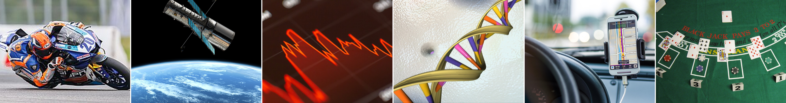{width="100%" fig-align="center"}

::: {style="text-align: center; font-size: 0.4em;"}
Photo credits (Wikimedia Commons): motorcycle racing, "Stepro", CC BY-SA 4.0 -- Hubble Space Telescope in orbit, ESA/Hubble, CC BY 2.0.
:::

## Static optimization

- Determine **one** optimal decision.
- Examples: decide on the price of a product, determine the slope of a straight line which best fits data, etc.

::: {layout-ncol=1}
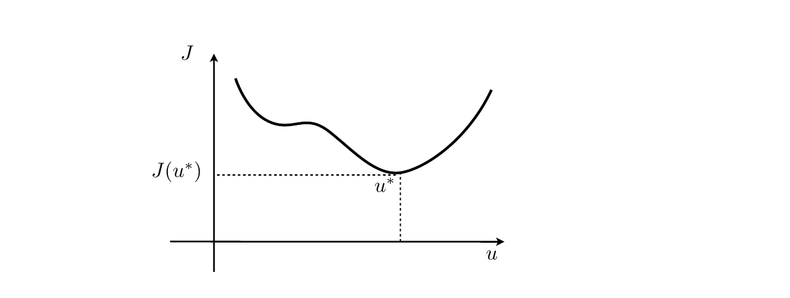{.r-stretch}
:::

## Optimal control {.smaller}

- Determine **several** optimal decisions over time.
- Decisions are functions of state, i.e., a control law to cope with disturbances.
- Examples: driving a car/bike in a race, positioning the tip of a robot arm in the presence of disturbances, playing chess, etc.

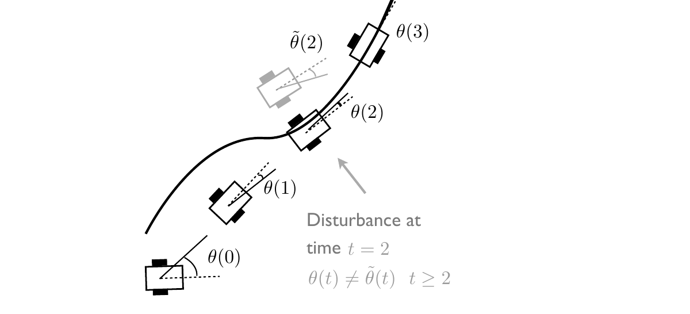{.r-stretch}

## Optimal control formulation {.smaller}

### Dynamic model

- Specifies the rules of the problem or the equations of the physical system.
- **State**: summarizes relevant information to make future decisions.
    - **Control actions**: influence the evolution of the state over time.
    - State evolution may be deterministic or stochastic (driven by disturbances).

### Cost function

- Encapsulates the goals to be achieved in the problem.
- Typically additive over time and by convention should be minimized.

### Goal:

Find a control policy which minimizes the cost.

- **Policy**: set of functions mapping the state at each instant of time to an action.
- Related problem: compute an optimal path/trajectory consisting of optimal decisions over time for a given initial state.

## Optimal control problems

The course will start with problems where the state and input spaces are
**discrete**, and then move to **continuous** ($\mathbb{R}^n$).

When these are subject to stochastic disturbances they are called
**Markov Decision Processes (MDPs)**.

| | state space | Stochastic disturbances |
|---|---|---|
| Discrete decision problems | Discrete (countable) | No |
| Discrete MDPs | Discrete (countable) | Yes |
| Continuous decision/control problems | Continuous | No |
| Continuous MDPs | Continuous | Yes |

Time is always **discrete**; the course will not focus on continuous-time
decision (optimal control) problems -- these will be converted to
stage-decision problems or discrete optimization problems when they appear.

## Discrete decision problems

Specified by a **transition diagram** with $h-1$ decision stages.

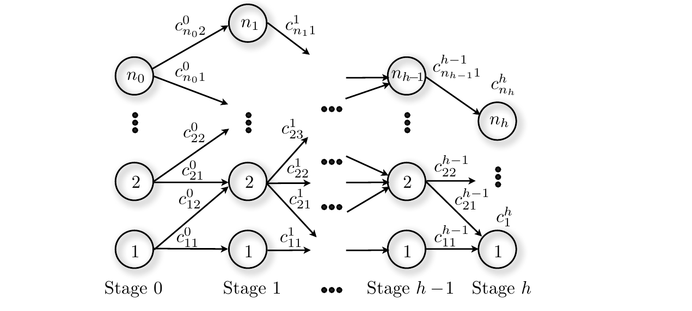{.r-stretch}

## Discrete decision problems -- challenges

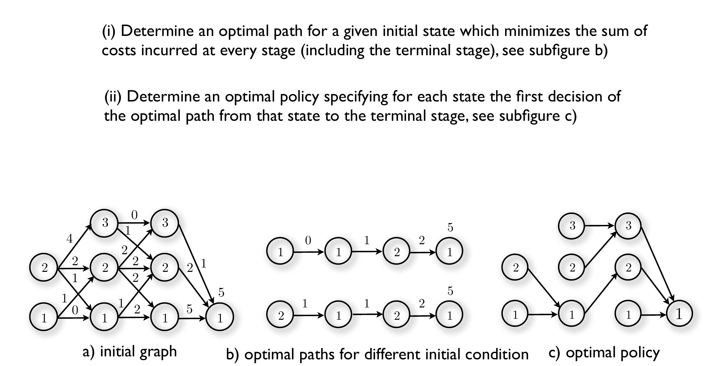{width="100%" fig-align="center"}

## Inventory control

How to manage the supply of products in a shop? Overstock is prejudicial
(physical space limitations, technological obsolescence, etc.) and
understock undermines sales.

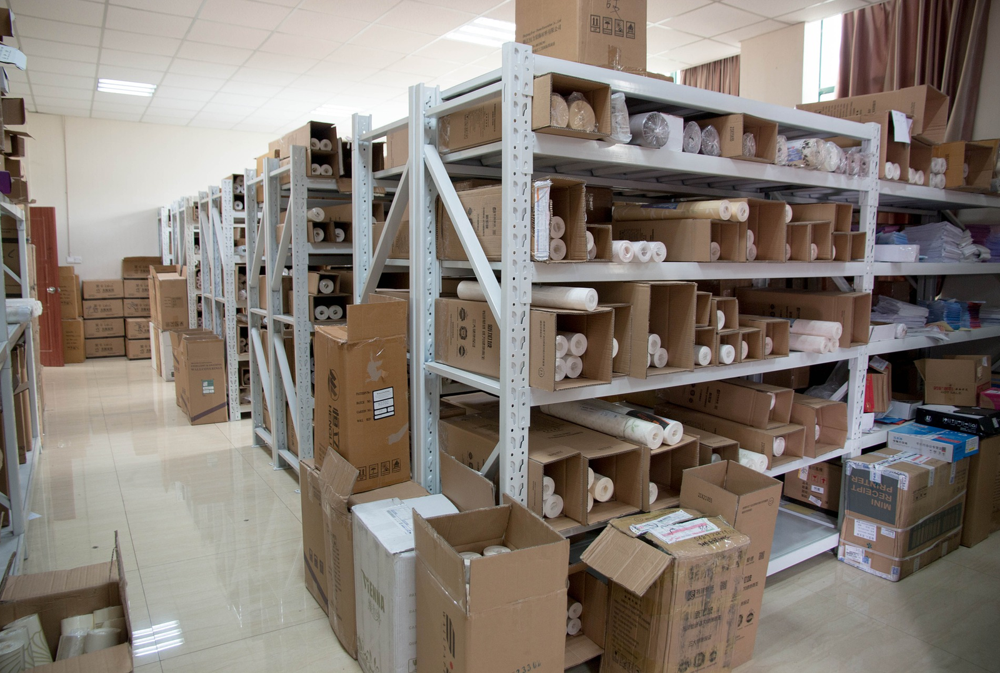{.r-stretch fig-align="center"}

## Shortest paths in graphs

What is the shortest distance from Bucharest to Lugoj?

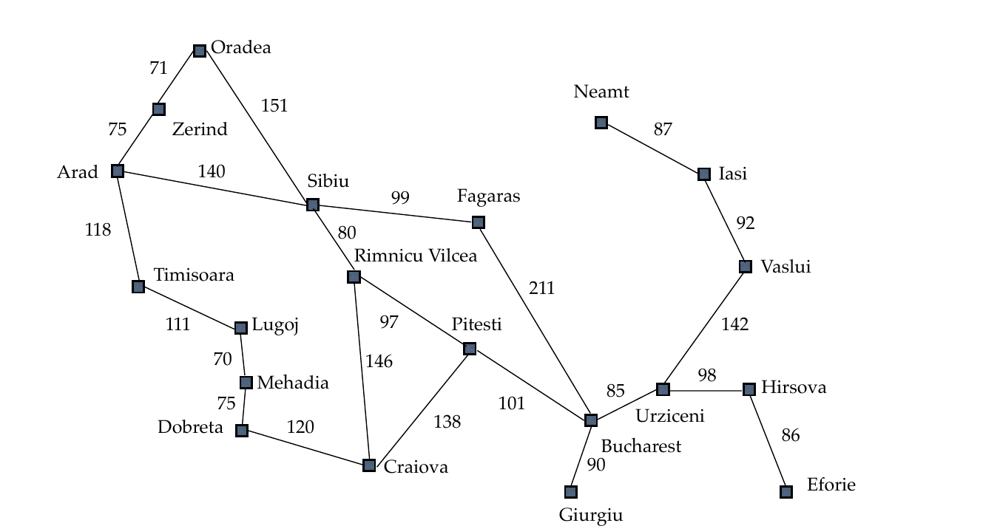{.r-stretch}

## Robot path planning

What is the shortest path for a robot to go from point A to B in a grid map representation of the world?

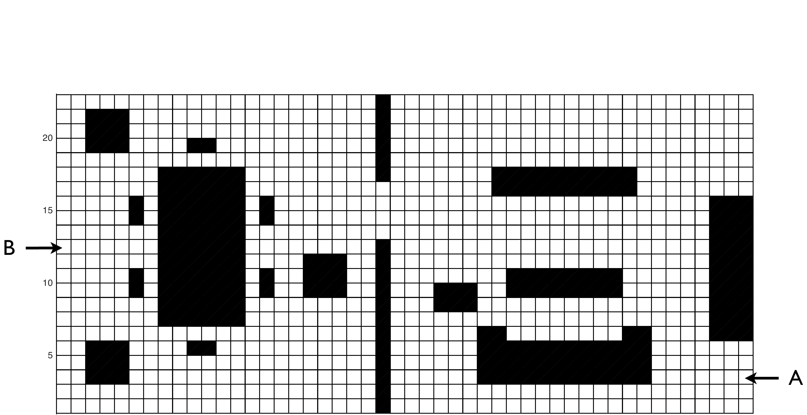{.r-stretch}

## Games

How to make profit in expectation in a game such as blackjack?

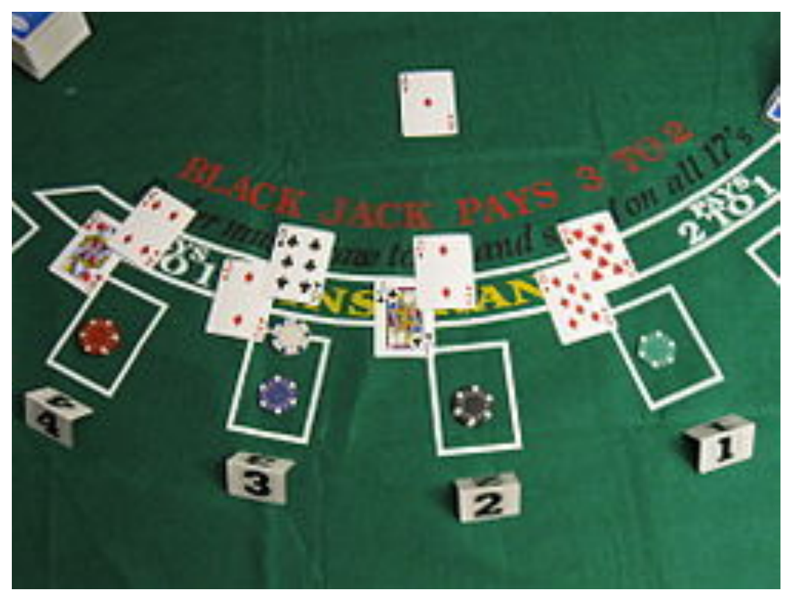{.r-stretch fig-align="center"}

## Planning with uncertainty

How to plan your day in Efteling to maximize your time in your favourite
attractions given (stochastic) models of waiting times in queues?

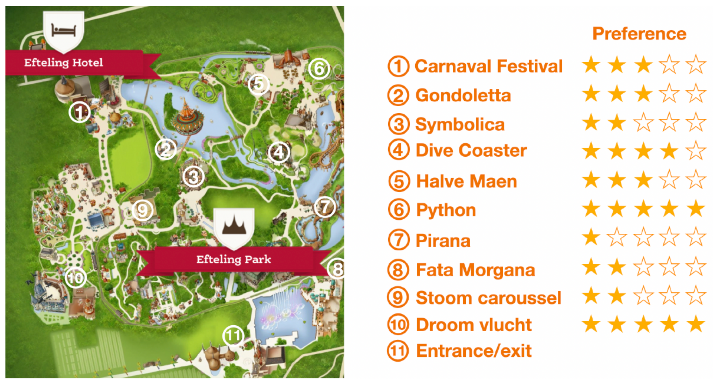{.r-stretch fig-align="center"}

## Continuous decision problems

**Dynamic model**: $x_{k+1} = f_k(x_k,u_k)$, $k\in\{0,\dots,h-1\}$

**Cost function**: $\sum_{k=0}^{h-1} g_k(x_k,u_k) + g_h(x_h)$

**Goals**

(i) find policy $\pi = \{\mu_0,\dots,\mu_{h-1}\}$, $u_k = \mu_k(x_k)$, that leads to the minimum cost for <u>every</u> initial condition.

(ii) find trajectory $\{(x_0,u_0),(x_1,u_1),\dots,(x_{h-1},u_{h-1})\}$ that leads to the minimum cost for a <u>given</u> initial condition.

($x_k$ is the state and $u_k$ is the control input at time $k$.)

## Continuous decision problems (cont.)

Generalization of the discrete optimization problem to general state and
input spaces, e.g., $\mathbb{R}^n$.

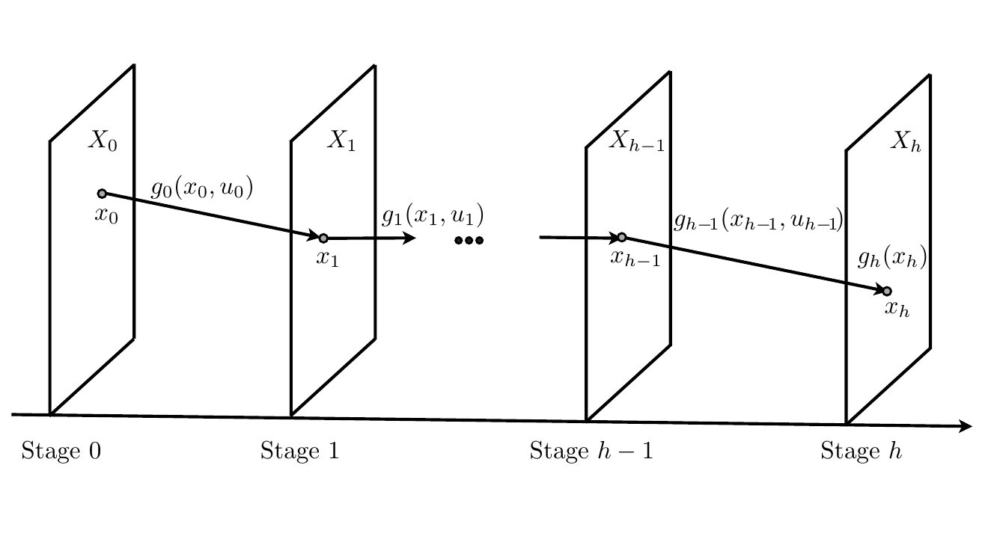{width="75%" fig-align="center"}

## Digital control

Prime application: how to design a digital controller for a physical system?

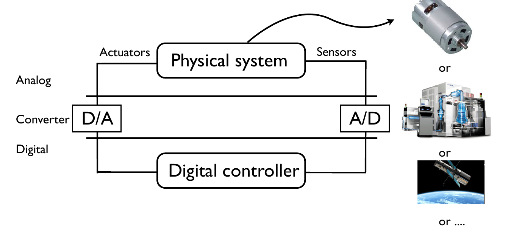{.r-stretch}

## Mixing

How to mix two fluids in minimum time?

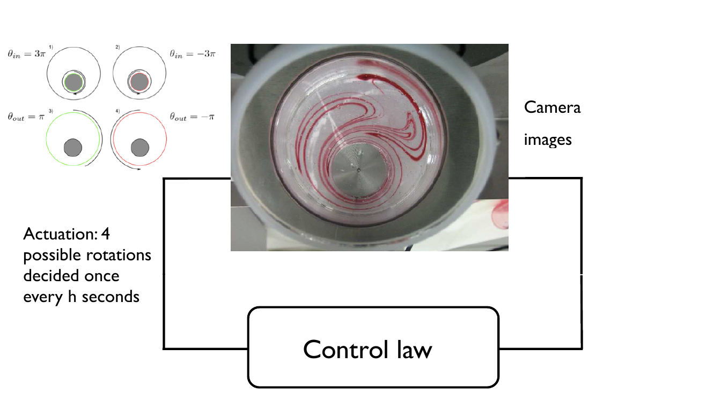{.r-stretch}

## Digital control of a unicycle robot

Given a unicycle robot with constraints on speed and rotation rate and
controlled digitally, how to perform a maneuver in minimum time?

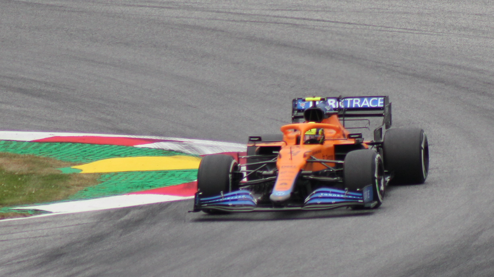{.r-stretch fig-align="center"}

::: {style="text-align: center; font-size: 0.4em;"}
"FIA F1 Austria 2021 Nr. 4 Norris (corner)," Steffen Prößdorf ("Stepro"), CC BY-SA 4.0, Wikimedia Commons.
:::

## Quadcopter control

How to fly a quadcopter taking into account wind preview information?

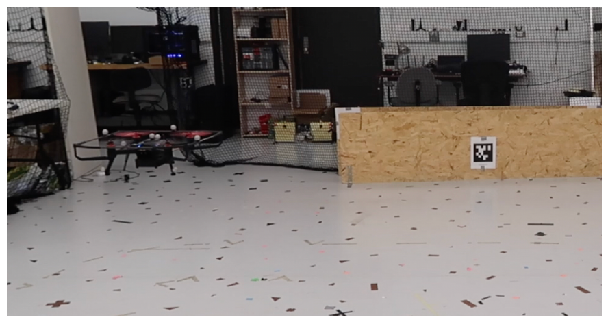{width="85%" fig-align="center"}

## Minimum energy control

Satellites have limited fuel, so minimizing control energy/fuel is critical.
How to move a satellite from one orbit to another in minimum energy?

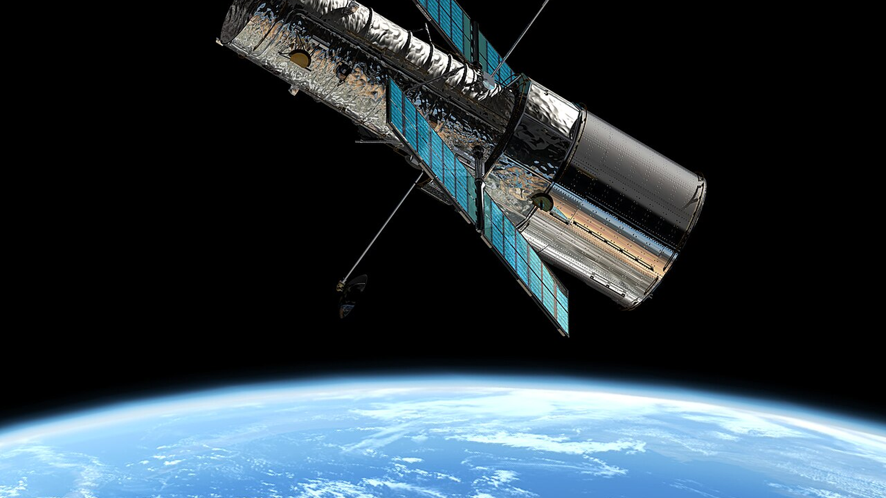{width="70%" fig-align="center"}

::: {style="text-align: center; font-size: 0.4em;"}
Hubble Space Telescope in orbit, ESA/Hubble, CC BY 2.0, Wikimedia Commons.
:::

## Minimum time robot arm control

How to move the tip of a robot arm in minimum time?

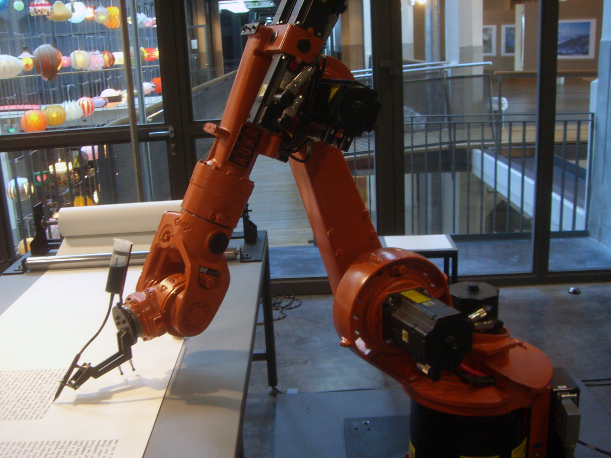{width="60%" fig-align="center"}

::: {style="text-align: center; font-size: 0.4em;"}
"KUKA Industrial Robot Writer," Mirko Tobias Schäfer, CC BY 2.0, Wikimedia Commons.
:::

## Continuous-time optimal control problems

Dynamic model: $\dot{x}(t) = f(t,x(t),u(t))$, $x(0)=x_0$, $t\in[0,h]$

Cost function: $\int_0^h g(t,x(t),u(t))\,dt + g_h(x(h))$

Goals:

- Find a feedback policy minimizing the cost function for every initial condition.
- Find a control input minimizing the cost function.

## Continuous-time optimal control problems (cont.)

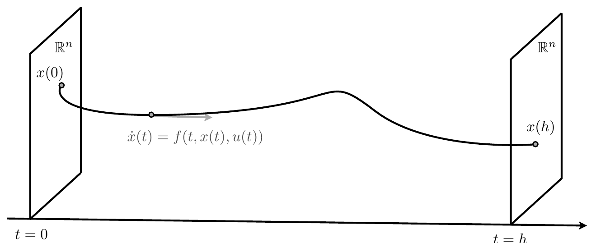{width="75%" fig-align="center"}

Most applications in control systems: motion control, aerospace, etc. When
these arise we will approximate them as discrete-time decision/optimal
control problems.

## Reinforcement learning setting {.smaller}

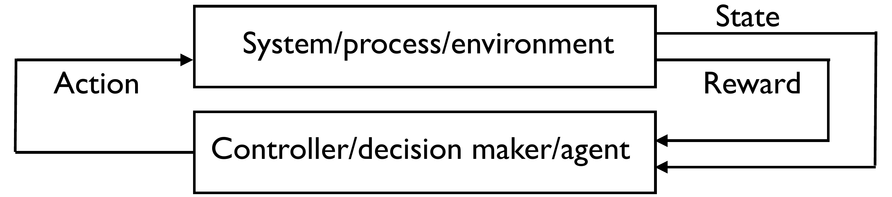{width="90%" fig-align="center"}

- **Dynamic model**: none! Only the real system or a simulator that can be run is available. Still, for analysis, a model of the form above is subsumed.
- **Reward/cost function**: encapsulates the goals to be achieved in the problem, obtained through the agent's interaction with the environment/simulator.
- The distinguishing feature of RL (vs. the classical DP setting above): the transition model/dynamics are unknown to the decision-maker and must be learned from interaction, rather than given.

Goal: find a control policy (function from states to actions) which minimizes the cost based on data (trial and error).

## Learn in Pacman games

Learn optimal policy for next move (up/down/left/right) for the ghost to
catch Pacman in minimum time.

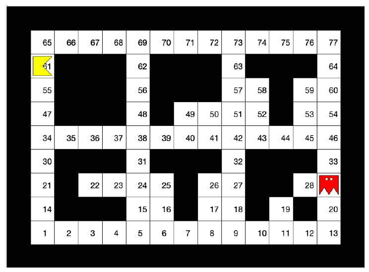{width="55%" fig-align="center"}

## Control a robot arm

How to control a robot arm to perform a ball-balancing task.

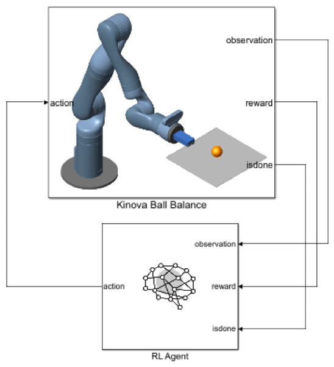{width="45%" fig-align="center"}

::: {style="text-align: center; font-size: 0.4em;"}
Figure: MATLAB Reinforcement Learning Toolbox, MathWorks.
:::

## Outline

- Classes of optimal control problems and applications
- <u>Dynamic programming algorithm</u>
- Dynamic programming equations

## Dynamic programming

- Dynamic programming is an approach to solve optimal control problems.
- It allows finding functions mapping states into actions. These functions are called **policies** or **control laws**.
- One can use these functions to control a system in the presence of disturbances.
- It also allows computing optimal paths/trajectories, although, as we shall see, other methods might be more efficient.

## The principle of optimality

Example: the shortest route from Eindhoven to Paris passes through Antwerp.
Then the piece of the route from Antwerp to Paris is the shortest route
between the two cities.

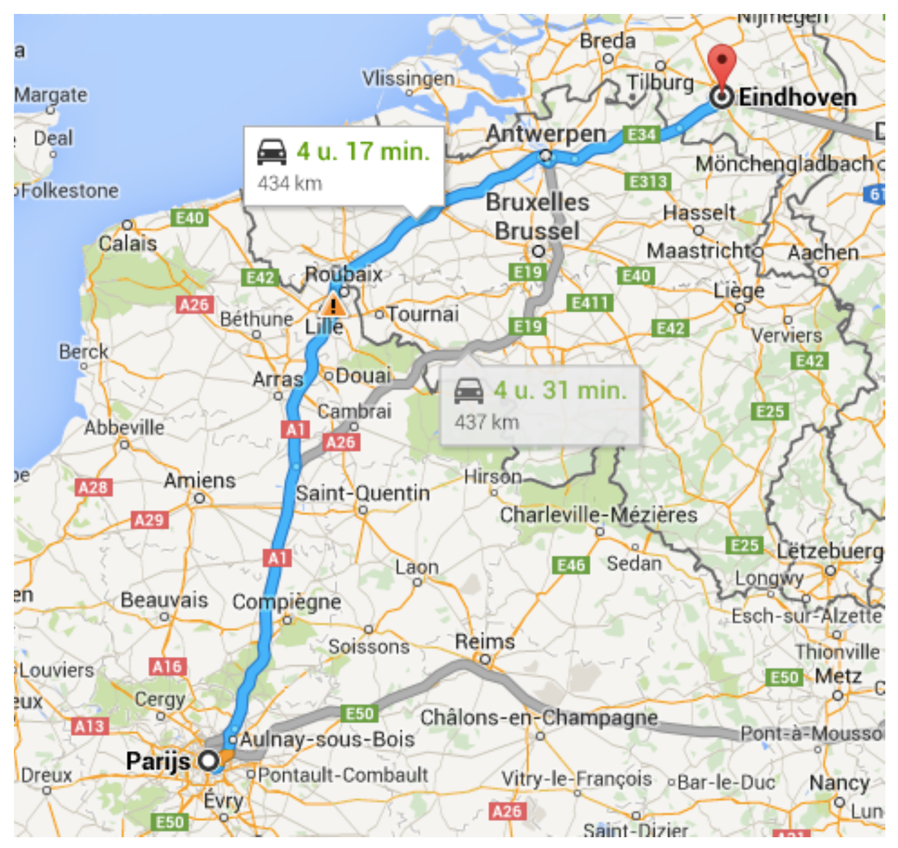{.r-stretch fig-align="center"}

## The principle of optimality

**The tail of an optimal path is also optimal.**

Given an optimal path for a discrete optimization problem from stage $0$ to
stage $h$, consider the state at stage $j$ belonging to the optimal path.
Then the decisions along the optimal path from stage $j$ to $h$ are also
optimal for the subproblem starting at that state at stage $j$.

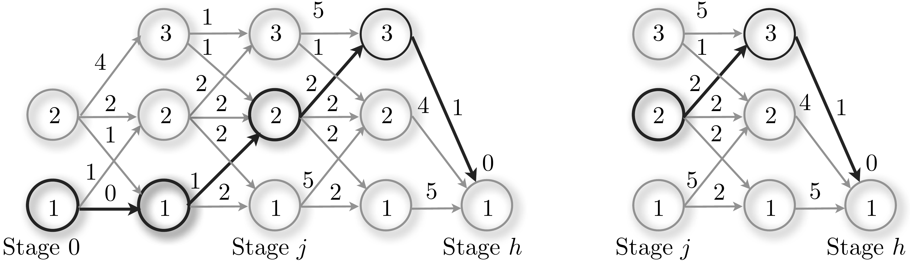{width="100%" fig-align="center"}

The principle of optimality also applies to stage-decision problems and continuous-time optimal control problems, and is the basis of the dynamic programming algorithm.

## Proof of the principle of optimality {.smaller}

**1.** Consider an optimal path from stage $0$ to stage $h$.

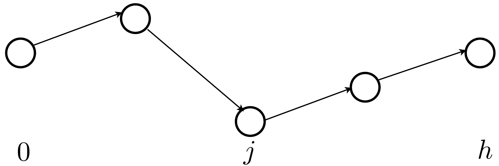{width="55%" fig-align="center"}

$$\text{cost} = \text{cost}_{[0,j)} + \text{cost}_{[j,h]}$$

**2.** Suppose that the piece of the path from stage $j$ to stage $h$ is **not** optimal.

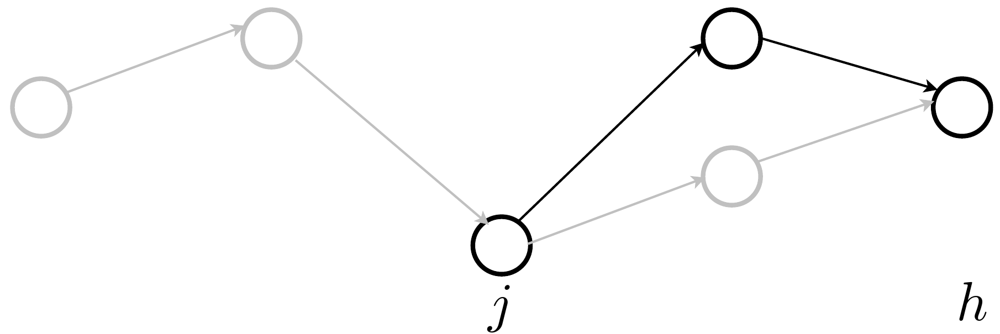{width="55%" fig-align="center"}

$$\underline{\text{cost}}_{[j,h]} < \text{cost}_{[j,h]}$$

**3.** Then there exists a path with smaller cost from stage $0$ to stage $h$ -- contradiction!

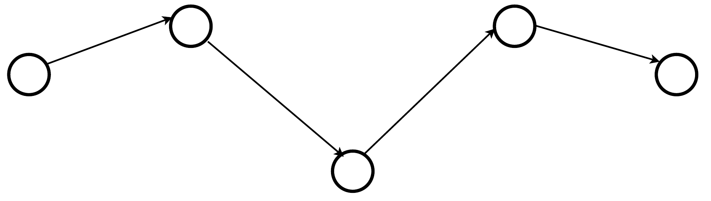{width="55%" fig-align="center"}

$$\text{cost}_{[0,j)} + \underline{\text{cost}}_{[j,h]} < \text{cost}_{[0,j)} + \text{cost}_{[j,h]}$$

## Dynamic programming algorithm

For discrete decision problems:

1. Start at the final decision stage $h$ and set the cost-to-go at stage $h$ equal to the terminal cost.
2. For every state at stage $k < h$, compute the optimal action by minimizing (immediate cost + cost-to-go of the resulting next state). Denote the minimum value the cost-to-go at stage $k$.
3. Repeat step 2 moving backward through $k = h-1, h-2, \dots, 0$.

## Example -- iteration 1 (stage 3)

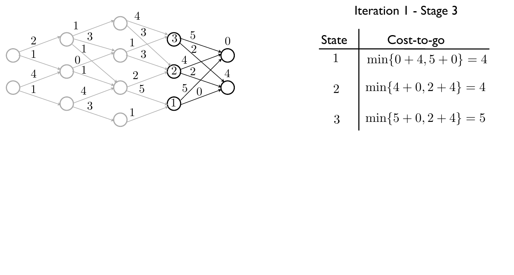{.r-stretch}

## Example -- iteration 2 (stage 2)

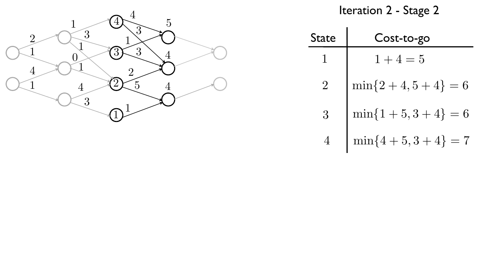{.r-stretch}

## Example -- iteration 3 (stage 1)

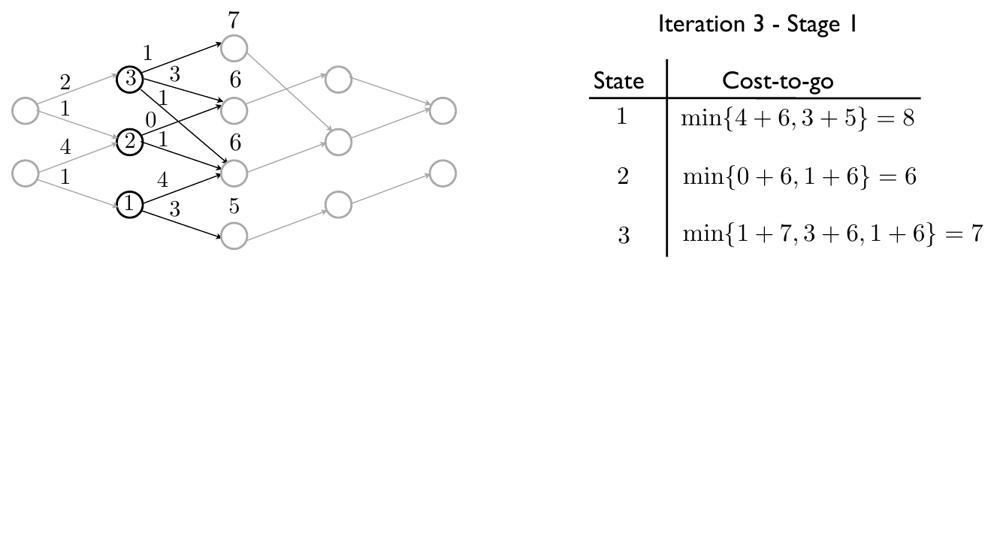{.r-stretch}

## Example -- iteration 4 (stage 0)

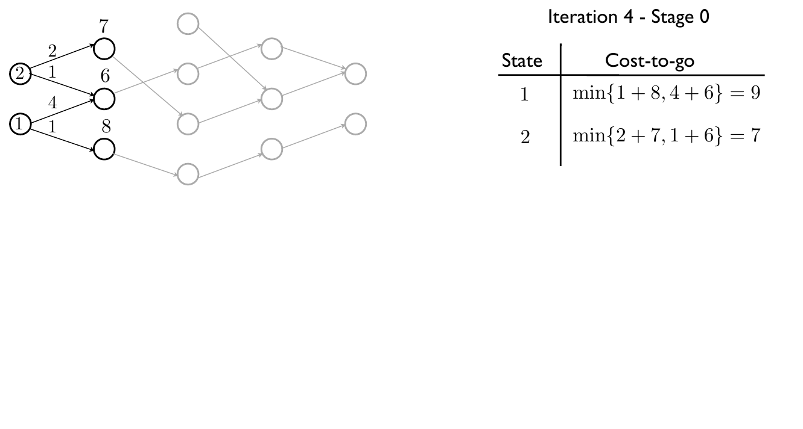{.r-stretch}

## Optimal policy and optimal paths {.smaller}

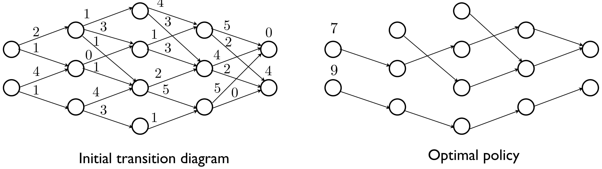{width="90%" fig-align="center"}

### Optimal policy

While running the DP algorithm, for each state at each stage a decision is
made to compute the cost-to-go. That decision is precisely the decision
specified by the optimal policy at that state/stage.

### Optimal path

- For a given initial state, follow the arrows leading to the final stage. This is the optimal path.
- The cost-to-go at stage 0 of that initial state coincides with the cost of the optimal path.

## Non-uniqueness

If more than one option has the same cost while running the dynamic
programming algorithm, simply pick one of the options. In the end, one
optimal policy is obtained (while several may be optimal).

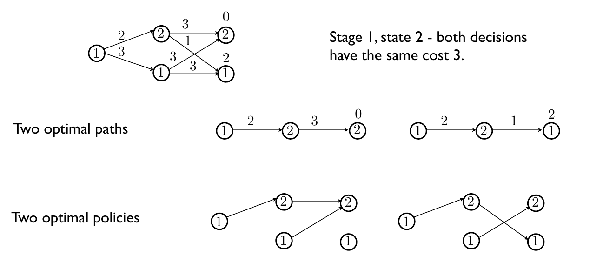{width="100%" fig-align="center"}

## Inventory control -- formulation

Controlling the supply of one product.

Dynamic model: $x_{k+1} = \max\{x_k + u_k - d_k, 0\}$, $u_k \in \{0,1,\dots,N-x_k\}$

Cost: $\sum_{k=0}^{h-1} g_k(x_k,u_k) + g_h(x_h)$, where
$$
g_k(x_k,u_k) = \big(c_1(x_k) + c\,u_k + c_{tr}\lVert u_k\rVert_0\big) - p\min\{d_k, x_k+u_k\}, \qquad \lVert u_k \rVert_0 = \begin{cases} 0 & \text{if } u_k = 0 \\ 1 & \text{if } u_k \neq 0\end{cases}
$$

where $x_k$ = number of items, $u_k$ = supply, $d_k$ = demand, $N$ = capacity, $g_h$ = terminal cost, $p$ = selling price, $c$ = purchase price, $c_{tr}$ = transportation price, $c_1$ = storage cost.

## Formulation -- transition diagram

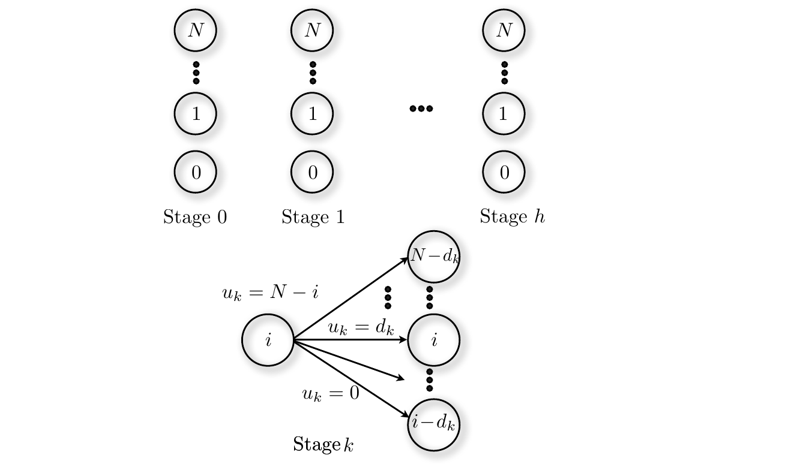{.r-stretch}

## Inventory control -- numerical example

- Number of stages $h=4$
- Capacity $N=4$
- Demand $d_0=d_1=2$, $d_2=d_3=1$
- Selling price $p=10$, purchase price $c=5$, transportation price $c_{tr}=0.5$
- Storage cost $c_1(i) = 0.2i$, $i \in \{0,\dots,N\}$
- Terminal cost $g_4(i) = -r_{i+1}$, $i\in\{0,\dots,4\}$, $r=[0\ 4.8\ 9.6\ 14.4\ 19.2]$

## Some iterations

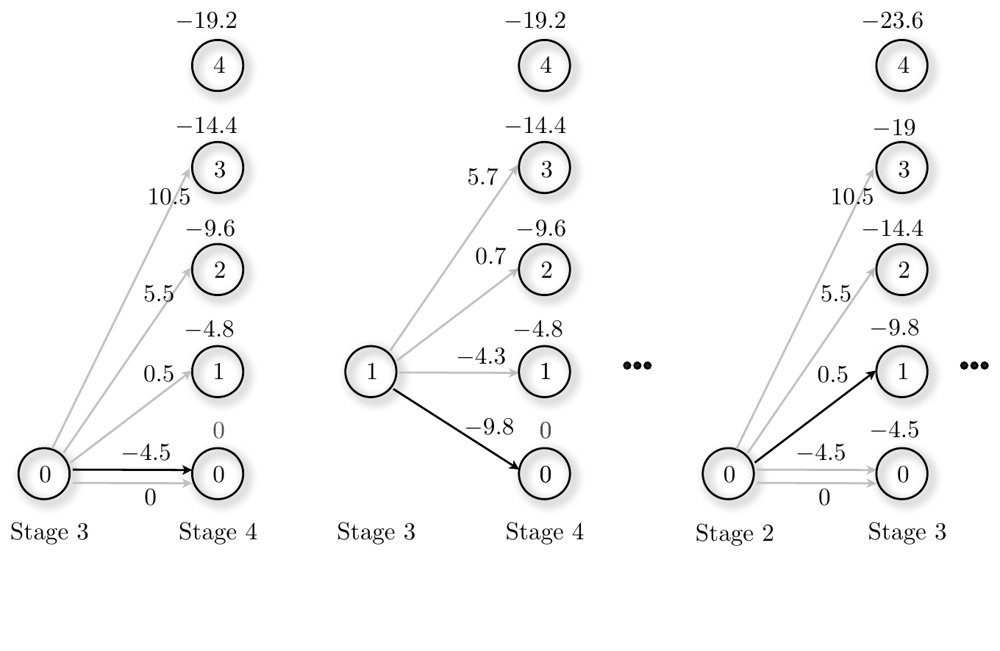{.r-stretch fig-align="center"}

## Final policy and optimal path

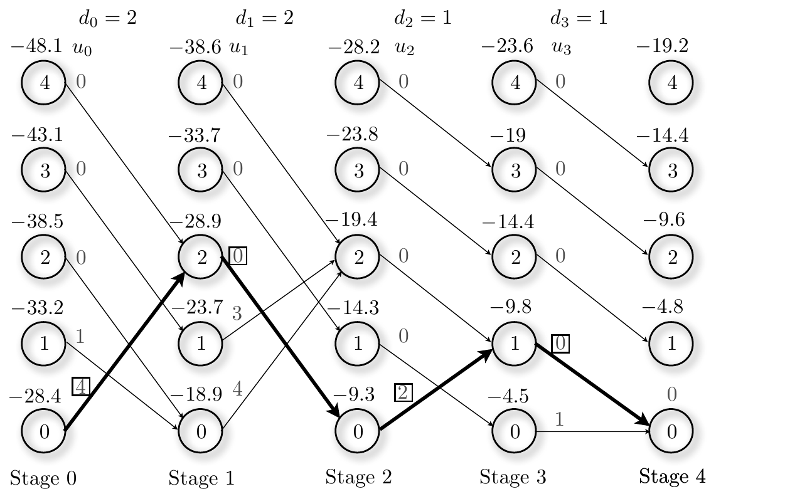{width="70%" fig-align="center"}

## Outline

- Classes of optimal control problems and applications
- Dynamic programming algorithm
- <u>Dynamic programming equations</u>

## Equivalent formulation

Dynamic model: $x_{k+1} = f_k(x_k,u_k)$, $k\in\{0,\dots,h-1\}$

Cost: $\sum_{k=0}^{h-1} g_k(x_k,u_k) + g_h(x_h)$

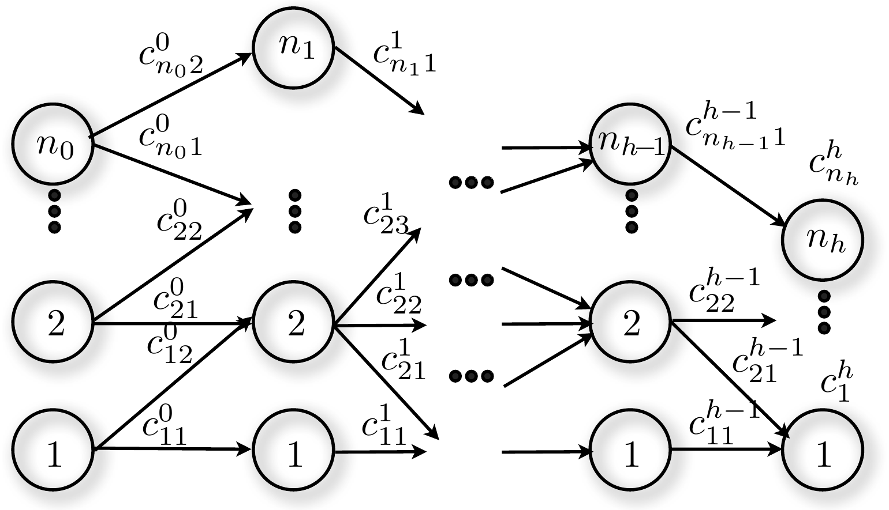{width="85%" fig-align="center"}

State: $x_0 \in \{1,\dots,n_0\}$, $x_1 \in \{1,\dots,n_1\}$, ..., $x_h \in \{1,\dots,n_h\}$

Action: $u_0 \in \{1,\dots,m_{0,x_0}\}$, $u_1 \in \{1,\dots,m_{1,x_1}\}$, ...

Cost: $g_0(x_0,u_0) = c^0_{x_0,u_0}$, $g_1(x_1,u_1) = c^1_{x_1,u_1}$, ..., $g_h(x_h) = c^h_{x_h}$

## Dynamic programming algorithm in the new formalism

Dynamic programming (DP) equations. Start with $J_h(i) = g_h(i)$ for every $i$, and for each decision stage, starting from the last and moving backward, compute
$$
J_k(i) = \min_{j \in U_k(i)} \; g_k(i,j) + J_{k+1}(j)
$$
and $\mu_k(i) = j^\star$, where $j^\star$ is a minimizer in the DP equation above.

## Richard E. Bellman

### Historical note

Dynamic programming was proposed in the 1940s by Richard E. Bellman.

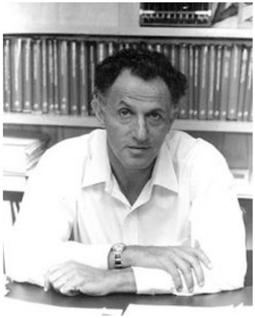{width="30%" fig-align="center"}

::: {style="text-align: center; font-size: 0.4em;"}
Photo: via Wikipedia.
:::

"I was intrigued by dynamic programming. It was clear to me that there was
 a good deal of good analysis there. Furthermore, I could see many
 applications. It was a clear choice. I could either be a traditional
 intellectual, or a modern intellectual using the results of my research
 for the problems of contemporary society."

 -- R. E. Bellman (1920-1984)

## Summary

- **Optimal control**: determine several optimal decisions over time and as a function of the state.
- **Optimal control problems**: three classes (discrete optimization, stage-decision, continuous-time control), many applications.
- **Dynamic programming**: optimal decisions computed backward in time via the principle of optimality; yields both the optimal policy and the optimal cost-to-go.

## Appendix A {.center style="text-align: center;"}

### Inventory control with uncertainty {style="text-align: center;"}

## Coping with disturbances

In the context of the inventory control example

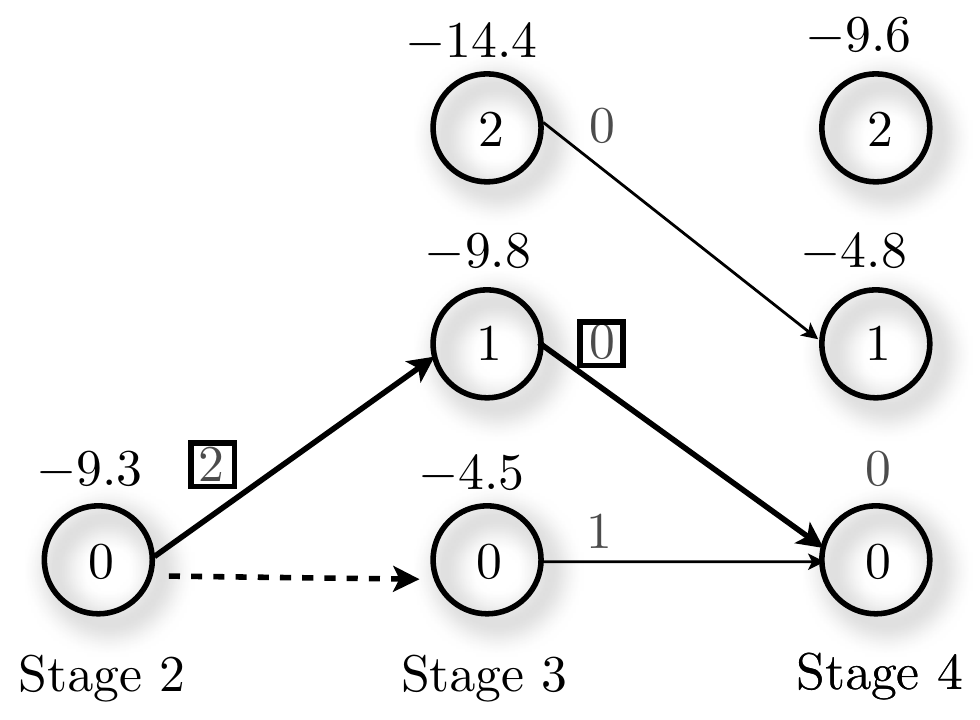{width="55%" fig-align="center"}

What if the demand is $d_2=2$ instead of the expected $d_2=1$?

- The state at stage 3 is then $x_3=0$ instead of $x_3=1$.
- **Open loop**: blindly pick $u_3=0$ as initially planned.
- **Closed-loop** (using DP policy): pick $u_3=1$.

## Open loop vs closed loop

### Costs

- Open loop &nbsp; $g_0(0,4)+g_1(2,0)+g_2(0,2)+g_3(0,0)+g_4(0)$

  $0.5 \;-\; 19.6 \;+\; -9.5 \;+\; 0 \;+\; 0 = -28.6$

- Closed loop &nbsp; $g_0(0,4)+g_1(2,0)+g_2(0,2)+g_3(0,1)+g_4(0)$

  $0.5 \;-\; 19.6 \;+\; -9.5 \;+\; -4.5 \;+\; 0 = -33.1$

### Expected cost if $\text{Prob}[d_2=1]=0.5,\ \text{Prob}[d_2=2]=0.5$

- Open loop &nbsp; $0.5\times(-28.4) + 0.5\times(-28.6) = -28.5$

- Closed loop &nbsp; $0.5\times(-28.4) + 0.5\times(-33.1) = -30.75$
