## Unit 2 {.center style="text-align: center;"}

<!--
Converted from Lecture2.key (exported to PDF, 52 slides) on 2026-08-09,
following the exact conventions finalized on Lecture 1:
- Standard title-slide block reused verbatim from Lecture 1 (only "Unit N"
  and the subtitle change).
- Plain x_k/u_k/J/mu notation used throughout (NOT the \state/\action/
  \costtogo/\policy macros) -- Lecture 1 ended up converting almost every
  occurrence of those macros to plain notation per your explicit requests,
  so this lecture starts directly in the notation you settled on.
- Slides that are mostly text/bullets/equations are rewritten natively.
  Slides built around a hand-drawn diagram, grid, tree, table-as-image, or
  photo are kept as an embedded image of the original slide region (title
  and stray Keynote page-number cropped out) rather than redrawn, for the
  same reason as Lecture 1: redrawing ~25 dense diagrams accurately without
  verifying them against you first risked introducing errors. Figures live
  in figures/lecture2/, currently named pgNN.png (matching the original PDF
  page number) -- happy to rename to descriptive slugs during review, same
  as we ended up doing for Lecture 1's figures/lecture1v3/ set.
- Decorative clipart icons (ostrich/engineer/scientist cartoons on the
  "Coping with disturbances" / open-loop / closed-loop slides) were left out
  of the native-text slides since they're flourish, not content -- say the
  word if you'd like them added as small images.
- Added a reusable `.dp-box` style to styles/tue.scss for the boxed DP
  equation (rounded-rectangle border), matching the hand-drawn box in the
  original "Stochastic Dynamic Prog. algorithm" slide.

FIRST-PASS CAVEAT: given the size of this deck (52 slides, much more
figure/table/matrix-dense than Lecture 1), this pass prioritizes getting
every slide's title, structure, and text/equation content correct, with
faithful image crops for diagrams -- rather than pixel-perfect cropping of
every figure (no stray-page-number cleanup or caption-duplication pass yet).
Expect the same kind of slide-by-slide refinement round we did for Lecture 1.
-->

### Stochastic Dynamic Programming and Applications {style="text-align: center;"}

{width="15%" fig-align="center"}

::: {.title-slide-meta}
4SC000, Q2 2026-2027

Duarte Antunes
:::

## Outline

- <u>Stochastic dynamic programming</u>
- Applications

## Discussion

- We can use the policy provided by the dynamic programming algorithm **assuming no disturbances** to cope with disturbances.
- Is this procedure optimal in any sense? In general, no.
- In fact, as we show next, in the presence of disturbances it may not even be possible to define optimal decisions, since these would depend on future realizations of disturbances.

## Example

Move a robot from an initial stage $0$ to a final stage $h$ in minimum time

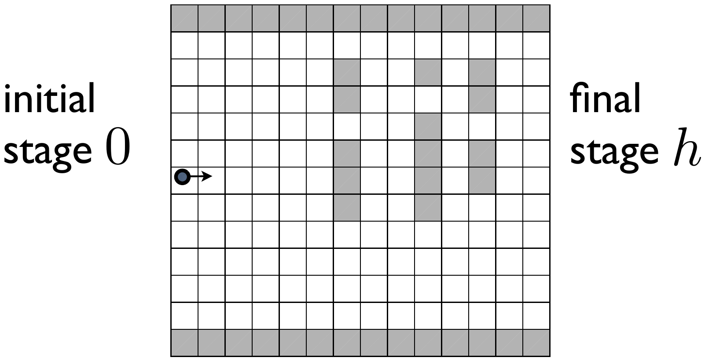{width="65%" fig-align="center"}

Deterministic formulation first and then introduce disturbances

- If the robot is **not** stuck in an obstacle or in a wall it can go up, straight or down. Otherwise, there is only one option (see figs). It takes 1 time unit to move horizontally from stage $i$ to stage $i+1$ and $\sqrt{2}$ to move diagonally. $c$ time units are paid every time an obstacle or a wall is hit.

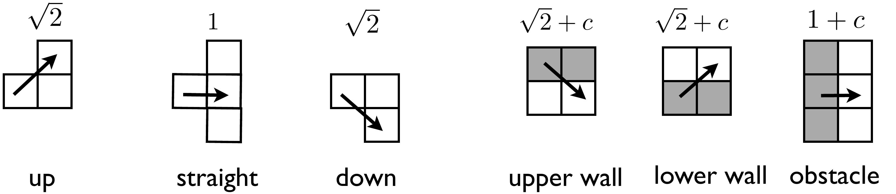{.r-stretch}

## Modeling

This problem can be written in the DP framework for a transition diagram obtained from the rules of the problem.

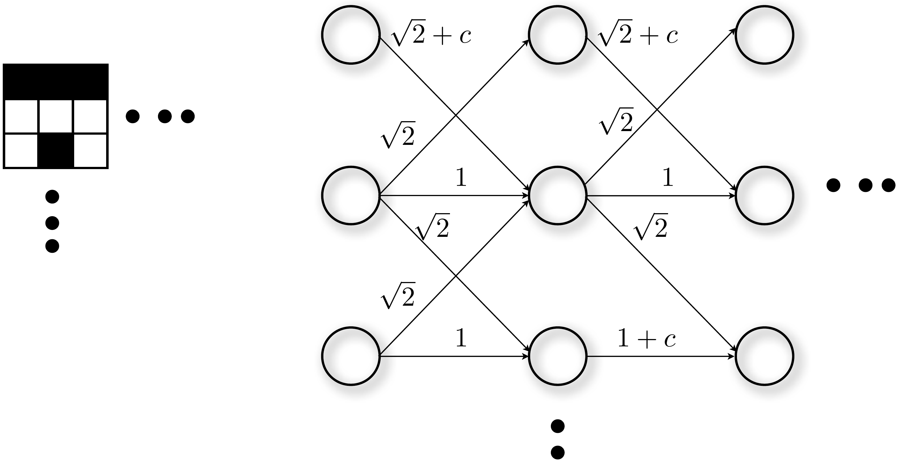{.r-stretch}

## DP equation

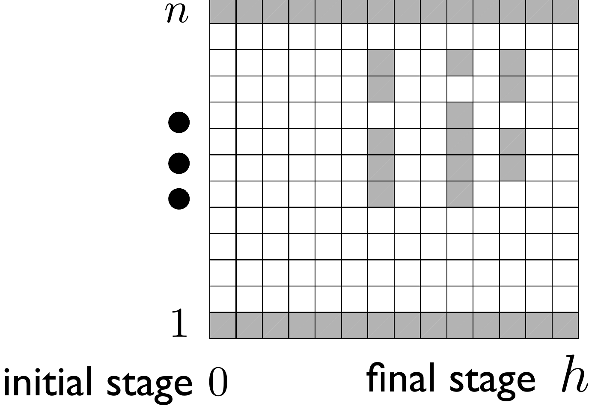{width="45%" fig-align="center"}

$$J_h(i) = 0 \quad i \in \{1,\dots,n\}$$

For $k \in \{h-1, h-2, \dots, 1, 0\}$:

$$J_k(1) = \sqrt{2} + c + J_{k+1}(2)$$

$$J_k(n) = \sqrt{2} + c + J_{k+1}(n-1)$$

$$J_k(i) = \min\{1+J_{k+1}(i), \sqrt{2}+J_{k+1}(i+1), \sqrt{2}+J_{k+1}(i-1)\} \quad \text{not an obstacle node}$$

$$J_k(i) = 1 + c + J_{k+1}(i) \qquad i \in \{2,\dots,n-1\} \quad \text{obstacle node}$$

## Numerical example

$$J_k(n) = \sqrt{2}+c+J_{k+1}(n-1) \qquad J_h(i) = 0$$

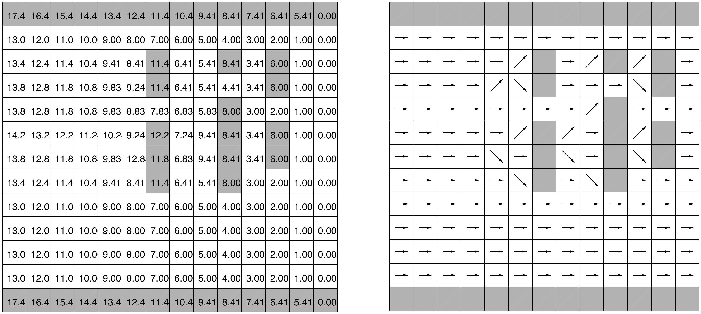{width="85%" fig-align="center"}

$$J_k(1) = \sqrt{2}+c+J_{k+1}(2) \qquad\qquad c=4$$

$$J_k(i) = \min\{1+J_{k+1}(i), \sqrt{2}+J_{k+1}(i+1), \sqrt{2}+J_{k+1}(i-1)\} \quad \text{not an obstacle node}$$

$$J_k(i) = 1+c+J_{k+1}(i) \qquad \text{obstacle node}$$

## Introducing disturbances

Consider that at position A there **might** be a disturbance making the robot move down one extra position.

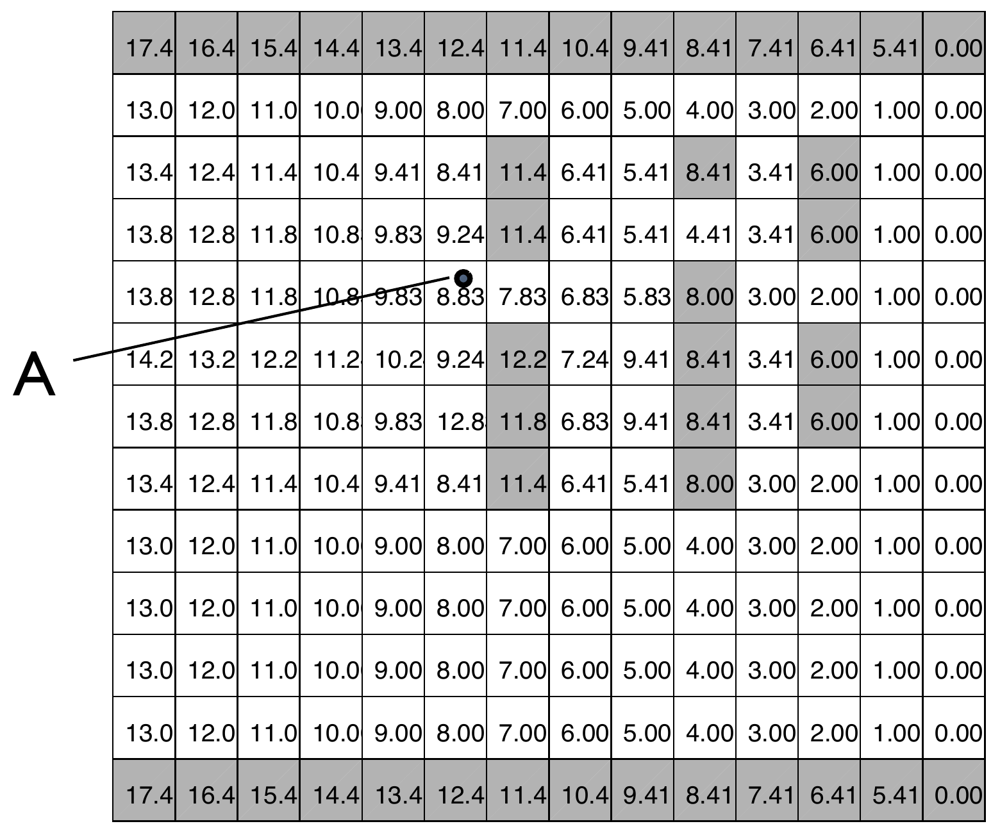{width="42%" fig-align="center"}

**Possible outcomes** (no disturbance/ disturbance)

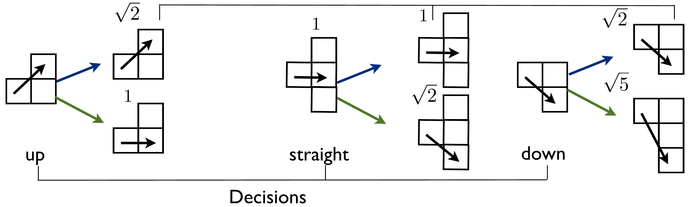{width="92%" fig-align="center"}

## Example

|  | no disturbance | disturbance |
|---|:---:|:---:|
| decision: 'up' | $11.4+\sqrt{2}$ | $7.83+1$ |
| decision: 'straight' | $7.83+1$ | $12.2+\sqrt{2}$ |
| decision: 'down' | $12.2+\sqrt{2}$ | $11.8+\sqrt{5}$ |

: *cost-to-go at position A*

If we knew the future disturbance value, we would pick 'up' if 'disturbance', 'straight' if 'no disturbance'.

Thus, if we assume nothing about the disturbances there is **no optimal decision** at position A.

## Assumptions on disturbances

There are two assumptions that make optimal decisions well-defined

- **Stochastic disturbances.** If we have a stochastic characterization of disturbances we can define optimal policies as the ones that minimize the expected cost. The dynamic programming framework can be extended to provide this policy.
- **Worst-case disturbances.** Optimal control problems with worst-case disturbances can be tackled in the framework of <u>game theory</u> and will not be addressed in the course.

## Stochastic disturbances

For the toy robot problem consider the stochastic characterization: $\text{Prob}[\text{disturbance}]=0.2$, $\text{Prob}[\text{no disturbance}]=0.8$

|  | no disturbance | disturbance | Expected cost |
|---|:---:|:---:|:---:|
| decision: 'up' | $11.4+\sqrt{2}$ | $7.83+1$ | $(11.4+\sqrt{2})0.8+(7.83+1)0.2=12.0174$ |
| decision: 'straight' | $7.83+1$ | $12.2+\sqrt{2}$ | $(7.83+1)0.8+(12.2+\sqrt{2})0.2=9.79$ |
| decision: 'down' | $12.2+\sqrt{2}$ | $11.8+\sqrt{5}$ | $(12.2+\sqrt{2})0.8+(11.8+\sqrt{5})0.2=13.69$ |

: *cost-to-go at position A*

Optimal decision is now well-defined: pick 'straight'.

## Worst-case disturbances

|  | no disturbance | disturbance | Worst-case cost |
|---|:---:|:---:|:---:|
| decision: 'up' | $11.4+\sqrt{2}$ | $7.83+1$ | $11.4+\sqrt{2}$ |
| decision: 'straight' | $7.83+1$ | $12.2+\sqrt{2}$ | $12.2+\sqrt{2}$ |
| decision: 'down' | $12.2+\sqrt{2}$ | $11.8+\sqrt{5}$ | $11.8+\sqrt{5}$ |

: *cost-to-go at position A*

Optimal decision is now well-defined: pick 'up'.

Safe policy (at least we get $11.4+\sqrt{2}$).

## Stochastic formulation

The dynamic model and the cost take now the form

$$x_{k+1} = f_k(x_k, u_k, w_k)$$

$$\sum_{k=0}^{h-1} g_k(x_k, u_k, w_k) + g_h(x_h)$$

where the state and input live in the same finite spaces defined before (slide 3), and disturbances belong to a finite set $w_k \in W_k(i,j) := \{1,\dots,\omega_{i,j,k}\}$ when $x_k=i$, $u_k=j$ and are characterised by

$$p_\ell^{k,i,j} := \text{Prob}[w_k = \ell \mid x_k=i, u_k=j], \quad \ell \in W_k(i,j).$$

Note that both the state and cost are now random variables. This model is often referred to as a <u>Markov Decision Process (MDP)</u>.

## Stochastic formulation

Given a policy $\pi = \{\mu_0,\dots,\mu_{h-1}\}$, $u_k = \mu_k(x_k)$, leading to,

$$x_{k+1} = f_k(x_k, \mu_k(x_k), w_k),$$

define the <u>expected</u> cost

$$J_\pi(x_0) = \mathbb{E}\Big[\sum_{k=0}^{h-1} g_k(x_k, \mu_k(x_k), w_k) + g_h(x_h)\Big],$$

where $J_\pi(x_0)$ is a real number for each initial condition.

The goal is to find a policy that minimizes the cost $J_\pi$.

## Stochastic Dynamic Prog. algorithm

::: {.dp-box}
Start with $J_h(i) = g_h(i)$ for every $i \in X_k$ and for each decision stage, starting from the last and moving backwards, $k \in \{h-1,h-2,\dots,0\}$ compute $\mu_k$ and $J_k$ as

$$J_k(i) = \min_{j \in U_k(i)} \sum_{\ell \in W_k(i,j)} p_\ell^{k,i,j} \big(g_k(i,j,\ell) + J_{k+1}(f_k(i,j,\ell))\big) \quad \text{(DP eq.)}$$

and

$$\mu_k(i) = j,$$

where $j$ is a minimizer in the DP equation. Then $\{\mu_0,\dots,\mu_{h-1}\}$ is an optimal policy.
:::

- Equivalently, we can write the DP equation as
  $$J_k(x_k) = \min_{u_k \in U_k(x_k)} \; \mathbb{E}_{w_k}\big[g_k(x_k,u_k,w_k) + J_{k+1}(f_k(x_k,u_k,w_k))\big]$$
- Each function $J_\ell(i)$ is now the <u>expected</u> cost-to-go when $x_\ell = i$
  $$J_\ell(i) = \mathbb{E}\Big[\sum_{k=\ell}^{h-1} g_k(x_k,\mu_k(x_k),w_k) + g_h(x_h)\Big]$$
- In particular $J_0(i)$ is the expected cost for a given initial condition $x_0=i$.
- The notation $J_\ell(i) = \mathbb{E}[\sum_{k=\ell}^{h-1} g_k(x_k,\mu_k(x_k),w_k) + g_h(x_h) \mid x_\ell=i]$ is often also used.

## Discussion

- The nomenclature 'Markov decision processes' comes from the fact that the dynamic model has the so-called Markov property.
- Intuitively the Markov property states that the probability that the process moves to a new state depends only on the current state and action; given the current state and action the next state is conditionally independent of all previous states and actions.
- Formally, the <u>Markov property</u> states that for any function $f$,
  $$\mathbb{E}[f(x_{k+1}) \mid x_k, u_k, x_{k-1}, u_{k-1}, \dots, x_0, u_0] = \mathbb{E}[f(x_{k+1}) \mid x_k, u_k]$$
- This property follows from the definition of the dynamic model.

## Example

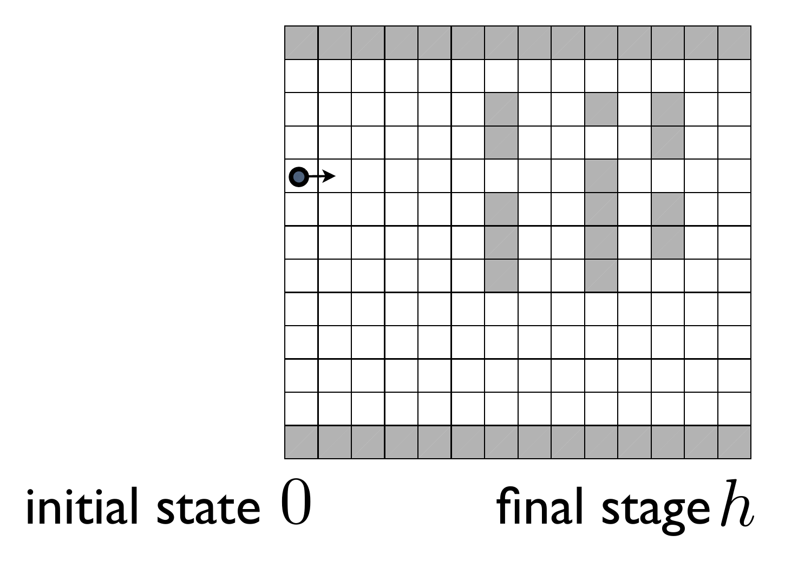{width="38%" fig-align="center"}

Consider the deterministic problem introduced before but now assume that for regular nodes (no obstacles) the evolution of the state is stochastic <u>for every stage and state</u>.

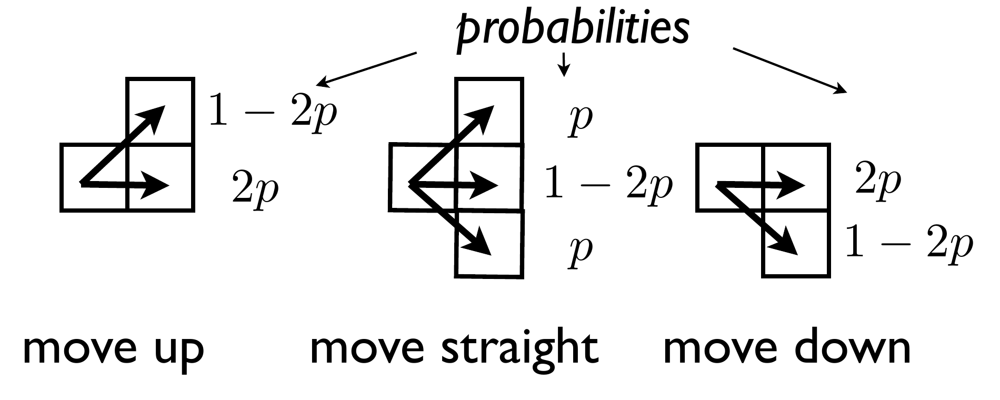{width="65%" fig-align="center"}

## Dynamic Programming equation

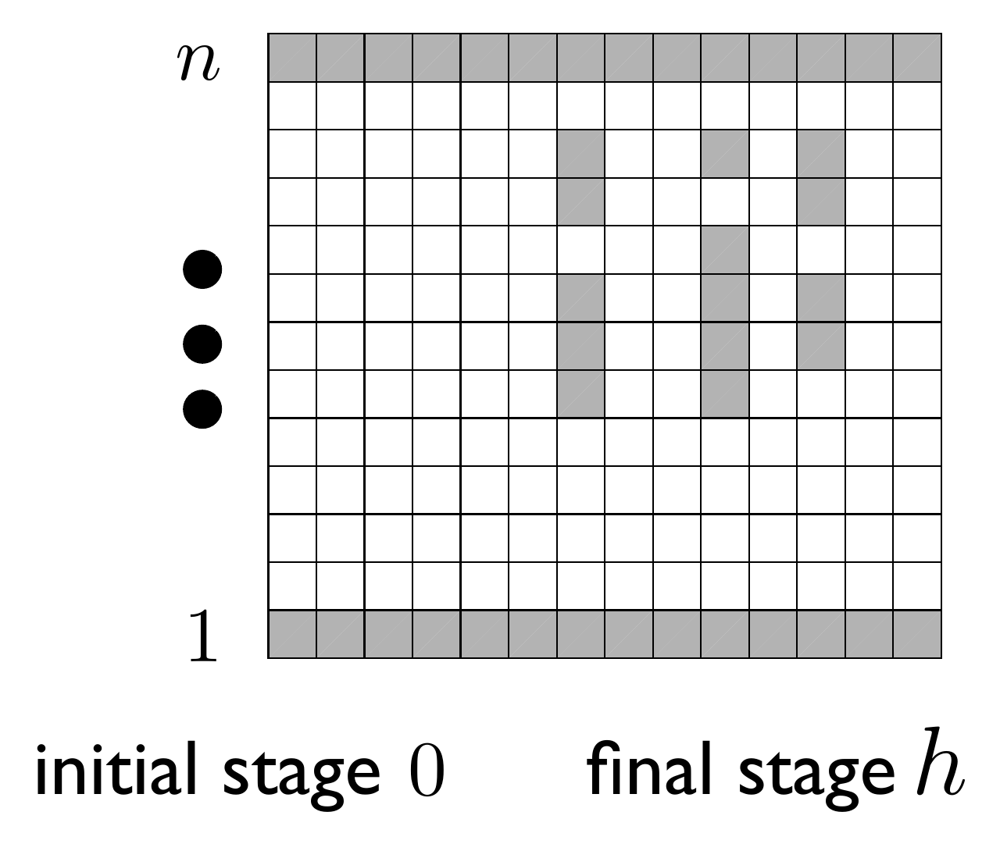{width="40%" fig-align="center"}

$$J_k(1) = \sqrt{2}+c+J_{k+1}(2)$$

$$J_k(n) = \sqrt{2}+c+J_{k+1}(n-1)$$

$$J_h(i) = 0 \qquad i \in \{1,\dots,n\}$$

$$J_k(i) = 1+c+J_{k+1}(i) \qquad \text{obstacle node}, \; i \in \{2,\dots,n-1\}$$

Stochastic:

$$J_k(i) = \min\{(1-2p)(1+J_{k+1}(i)) + p(\sqrt{2}+J_{k+1}(i+1)) + p(\sqrt{2}+J_{k+1}(i-1)),$$
$$2p(1+J_{k+1}(i)) + (1-2p)(\sqrt{2}+J_{k+1}(i+1)),$$
$$2p(1+J_{k+1}(i)) + (1-2p)(\sqrt{2}+J_{k+1}(i-1))\}, \quad i \in \{2,\dots,n-1\}$$

Compare with deterministic (computed before):

$$J_k(i) = \min\{1+J_{k+1}(i), \sqrt{2}+J_{k+1}(i+1), \sqrt{2}+J_{k+1}(i-1)\}$$

## Numerical example

$p = 0.1$, $c = 4$

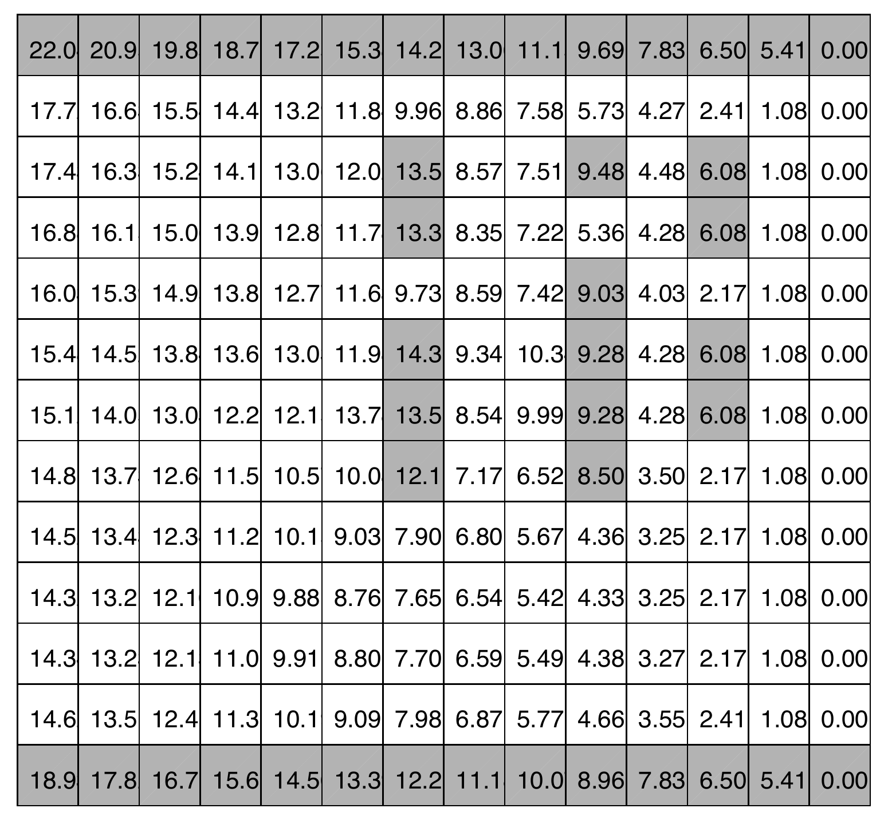{width="42%" fig-align="center"}
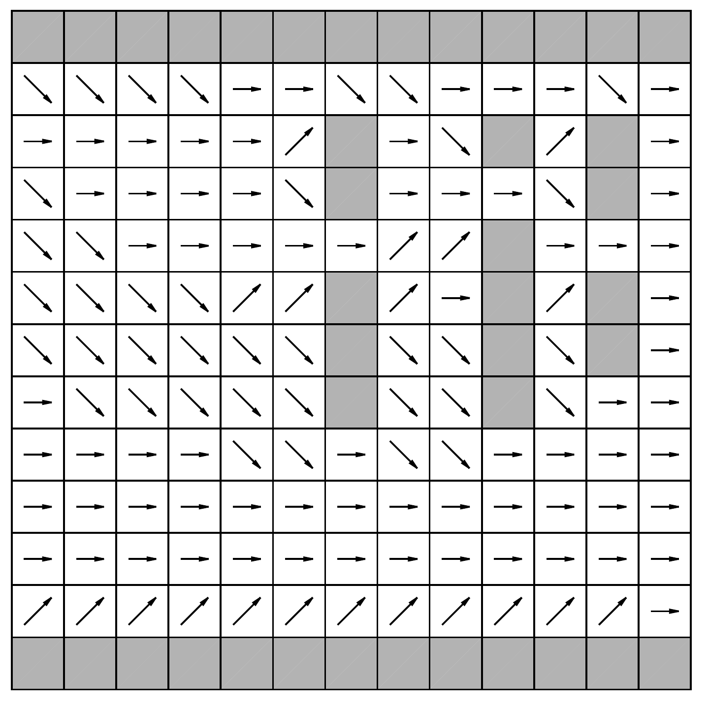{width="42%" fig-align="center"}

$$J_k(i) = \min\{(1-2p)(1+J_{k+1}(i)) + p(\sqrt{2}+J_{k+1}(i+1)) + p(\sqrt{2}+J_{k+1}(i-1)),$$
$$2p(1+J_{k+1}(i)) + (1-2p)(\sqrt{2}+J_{k+1}(i+1)),$$
$$2p(1+J_{k+1}(i)) + (1-2p)(\sqrt{2}+J_{k+1}(i-1))\}$$

## Comparison with deterministic

The optimal policy coping with uncertainty is intuitive: go around the obstacles!

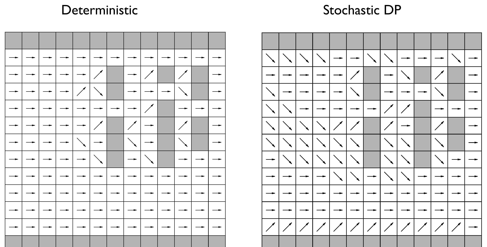{width="90%" fig-align="center"}

## Coping with disturbances

- **Open loop** - apply control inputs of optimal path
  - May not make sense, leads to poor performance or instability.
- **Feedback policy obtained from the DP algorithm neglecting disturbances**
  - Often followed in practice (specially in eng. contexts) due to the difficulty in obtaining a stochastic characterizing of disturbances.
  - Later we will call this policy certainty equivalent control.
- **Feedback policy obtained from the DP algorithm for stochastic models**
  - Important in operational research problems, games, etc., but limited use in practical control applications.

## Open loop

1. Compute optimal decisions for a given initial state assuming no disturbances
   - predicted cost 13.8
2. Blindly apply these decisions
   - cost of perturbed path in the picture: 26.66
   - average cost of 1000 perturbed paths: 22.04

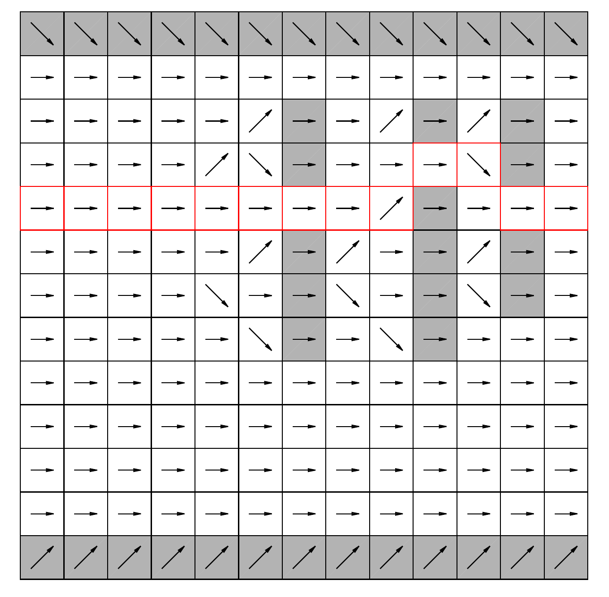{width="34%" fig-align="center"}
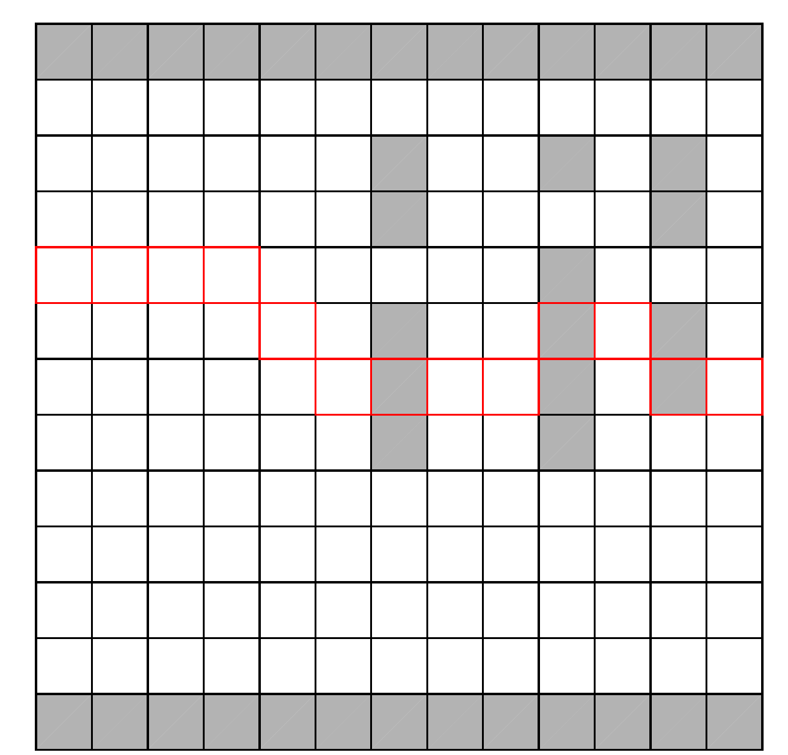{width="34%" fig-align="center"}

(open-loop decisions applied only at regular nodes, at obstacle and wall nodes the options are unique)

## Closed loop with deterministic DP

1. Compute optimal policy assuming no disturbances
2. Re-decide online based on the policy
   - cost of perturbed path in the picture: 19.07
   - average cost of 1000 perturbed paths: 17.51

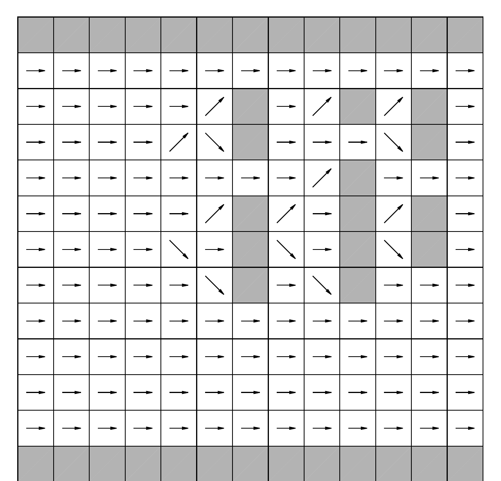{width="34%" fig-align="center"}
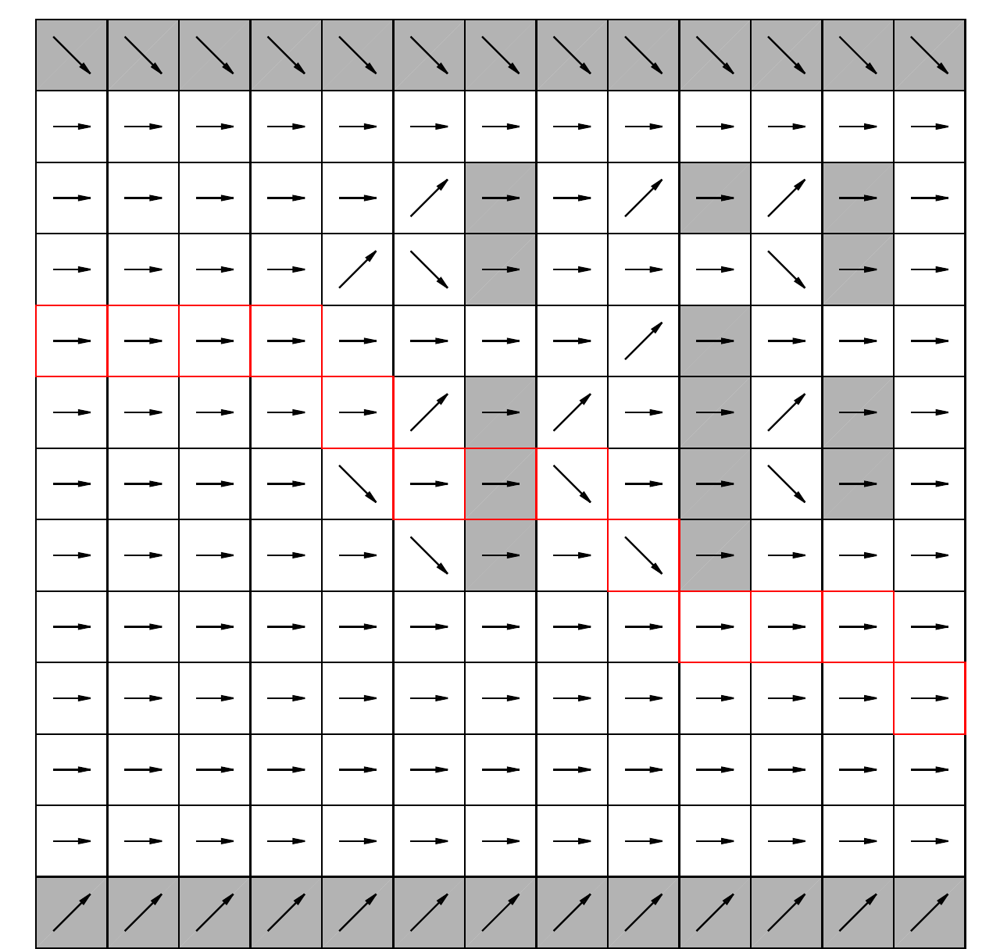{width="34%" fig-align="center"}

## Closed loop with stochastic DP

1. Compute optimal policy coping with disturbances
2. Re-decide online based on the policy
   - cost of perturbed path in the picture: 15.48
   - average cost of 1000 perturbed paths: 15.96

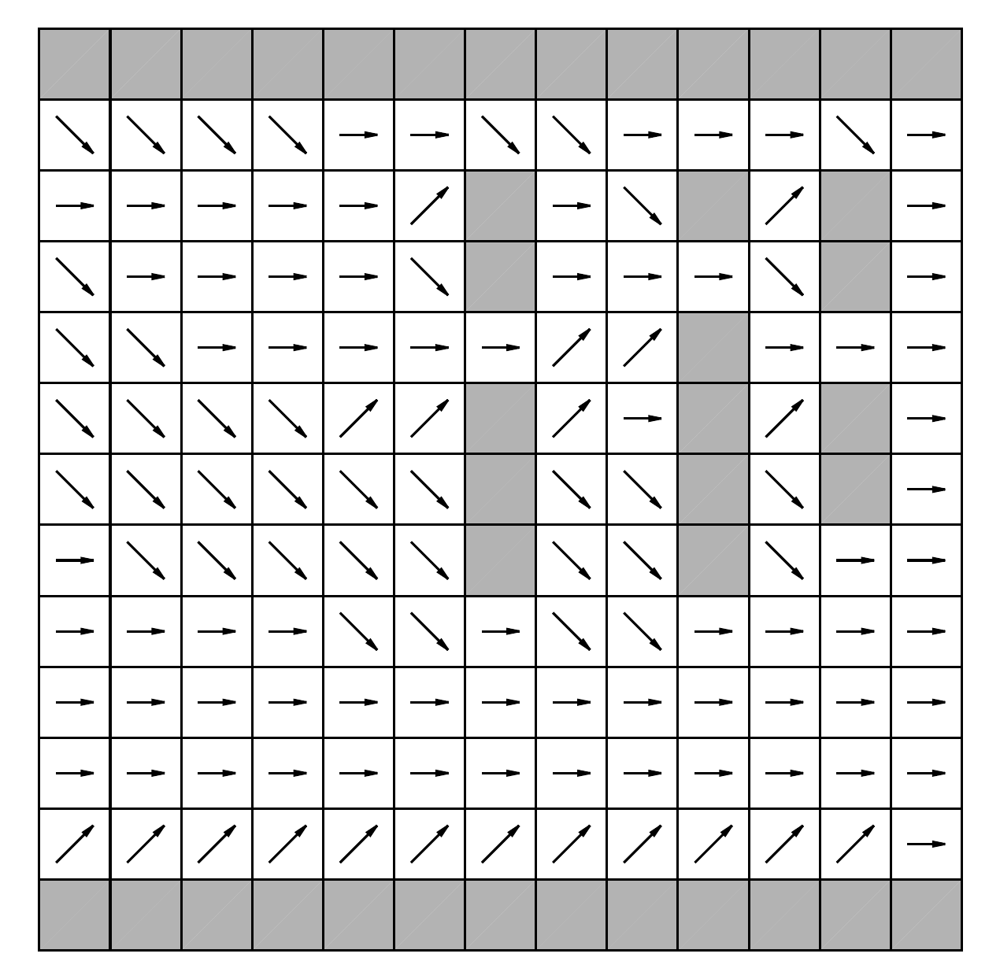{width="34%" fig-align="center"}
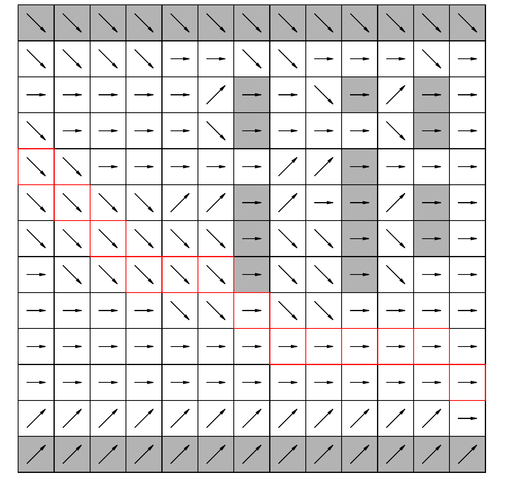{width="34%" fig-align="center"}

## Equivalent formulation

Often it is simpler to specify the model $x_{k+1} = f_k(x_k, u_k, w_k)$ in terms of matrices

::: {.dp-box}
$$[P_k(j)]_{ri} = \text{Prob}[x_{k+1} = r \mid x_k=i, u_k=j]$$
:::

called the transition probabilities.

**Example.** Suppose that the dynamical model is

$$x_{k+1} = \min\{\max\{x_k+u_k+w_k, 1\}, c_k\}$$

with $c_k = \begin{cases}2 & \text{if } k \text{ is odd}\\3 & \text{if } k \text{ is even}\end{cases}$, $u_k \in \{1,2\}$, $\text{Prob}[w_k=0]=2/3$, $\text{Prob}[w_k=-1]=1/3$

Then

For odd $k$: $P_k(1) = \begin{bmatrix}1/3 & 1\\2/3 & 0\end{bmatrix}$, $P_k(2) = \begin{bmatrix}0 & 0\\1 & 1\end{bmatrix}$.

For even $k$: $P_k(1) = \begin{bmatrix}1/3 & 0 & 0\\2/3 & 1/3 & 0\\0 & 2/3 & 1\end{bmatrix}$, $P_k(2) = \begin{bmatrix}0 & 0 & 0\\1/3 & 0 & 0\\2/3 & 1 & 0\end{bmatrix}$.

## Equivalent formulation

Given the transition probabilities we can construct a trivial model that represents the system

$$x_{k+1} = w_k$$

$$\text{Prob}[w_k = j \mid x_k=i, u_k=\ell] = P_{ji}(\ell)$$

The running cost remains the same if it only depends on state and inputs and if it also depends on disturbances it is adjusted to

$$\sum_{k=0}^{h-1} \mathbb{E}[g_k(x_k,u_k,w_k) + g_h(x_h)] \longrightarrow \sum_{k=0}^{h-1} \mathbb{E}[\tilde{g}(x_k,u_k) + g_h(x_h)] \quad \tilde{g}(i,u) = \sum_j P_{ji}(u) g_k(i,u,j)$$

The dynamic programming equations can be written in this formulation as

$$J_k(i) = \min_u \tilde{g}(i,u) + \sum_j P_{ji}(u) J_{k+1}(j) \qquad J_h(i) = g_h(i)$$

for every $i$.

## Outline

- Stochastic dynamic programming
- <u>Applications</u>

## Discussion

- Stochastic dynamic programming has a large number of applications in management, finance, games, operational research and other areas requiring decisions in the presence of uncertainty.
- Here we focus on:
  - One interesting class of problems are <u>optimal stopping problems</u> where at each stage one must decide either to stop or continue a given process (possibly at a given cost). This is one of the simplest applications.
  - Planning in the presence of uncertainty: spending a day in Efteling.

## The car parking problem

Juliet is taking her boyfriend Romeo to watch a movie in a crowded local cinema. They are late and need to find a parking place.

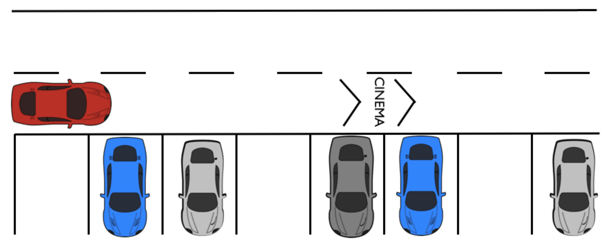{width="75%" fig-align="center"}

- If they park $k \in \{1,\dots,h\}$ places away from the cinema they loose $ck$ minutes of the movie.
- Each parking place is free with probability $p_k = 1-\alpha^k$, $0 < \alpha < 1$
- If they reach the cinema without having parked they have to wait in the parking queue of the cinema, which typically takes about $C$ minutes.

When should they park (stop searching) to minimize expected delay?

## Dynamic programming formulation

- $h$ - # parking places, stage $\ell \in \{0,1,\dots,h-1\}$, $k = h-\ell$.
- State $x_\ell \in \{F,S,O\}$ parking spot $\ell$ free - $F$, occupied - $O$, car is already parked - $S$.
- Terminal state $x_h = E$.
- When $x_\ell = F$, $u \in \{P, DP\}$, park ($P$) cost $ck$, don't park ($DP$) cost $0$; when $x_\ell = O$, $u_\ell = DP$.
- If $u_\ell = DP$, $x_{\ell+1} = F$ with probability $1-\alpha^{(h-(\ell+1))}$ and $x_{\ell+1}=O$ with probability $\alpha^{(h-(\ell+1))}$
- If the decision is not to park at the final stage, the cost is $C$.

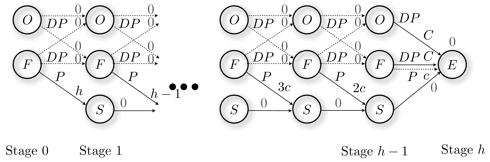{width="95%" fig-align="center"}

## Dynamic programming algorithm

$p_k = 1-\alpha^k$, $q_k = \alpha^k$

Stage $h$: $J_h(E) = 0$.

Stage $h-1$: $J_{h-1}(O) = C$, $J_{h-1}(F) = \min\{C, c\}$

Stage $h-2$:

$$J_{h-2}(O) = p_1 J_{h-1}(F) + q_1 J_{h-1}(O) = p_1 \min\{C,c\} + q_1 C,$$
$$J_{h-2}(F) = \min\{p_1 J_{h-1}(F) + q_1 J_{h-1}(O), 2c\} = \min\{p_1\min\{C,c\}+q_1 C, 2c\}$$

$\dots$

Stage $h-(k+1)$:

$$J_{h-(k+1)}(O) = p_k J_{h-k}(F) + q_k J_{h-k}(O)$$
$$= p_k\min\{p_{k-1}J_{h-(k-1)}(F) + q_{k-1}J_{h-(k-1)}(O), ck\} + q_k(p_{k-1}J_{h-(k-1)}(F) + q_{k-1}J_{h-(k-1)}(O)),$$
$$J_{h-(k+1)}(F) = \min\{p_k J_{h-k}(F) + q_k J_{h-k}(O), c(k+1)\}$$

## Numerical example

$\alpha = 0.8$, $h=4$, $C=3$, $c=1$

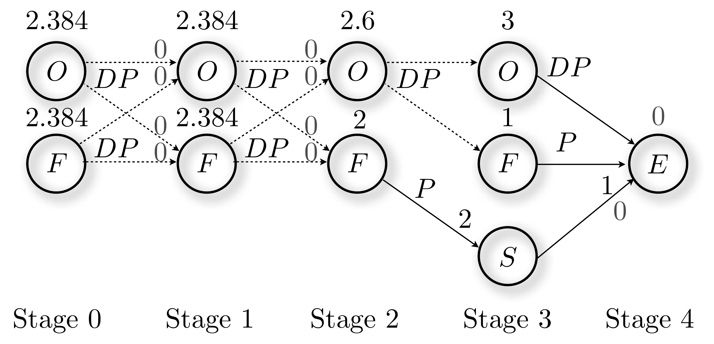{width="90%" fig-align="center"}

Simple optimal rule: park if there are parking places at distance two or one away from the cinema, otherwise do not park.

## Planning with uncertainty

How to plan your afternoon in Efteling to maximize your additive rewards in your favourite attractions given (stochastic) models of waiting times in queues?

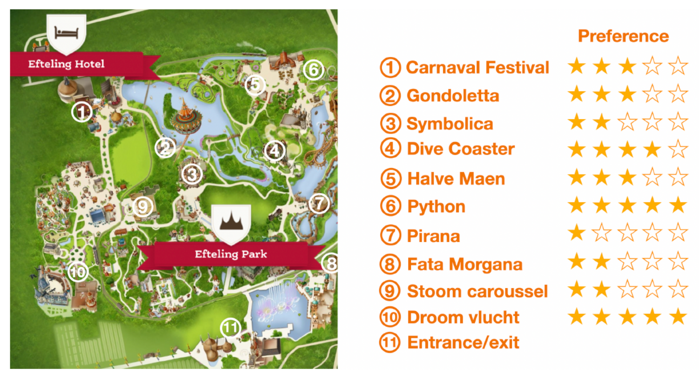{width="85%" fig-align="center"}

::: {style="text-align: center; font-size: 0.7em;"}
Visitors preferences
:::

## Model

The time period is from 14h00 until 19h00 and is divided into $T$ time slots of 5 minutes from $k=1$ (14h00-14h05) until $k=T=60$ (18h55-19h00).

Time to walk from one attraction to another (and to and from the entrance/exit) are deterministic and given in Figure 2. There are $M=10$ attractions plus the entrance/exit 11. Estimated times also include the time to travel to and from the entrance/exit.

The visitor does not desire to visit each of the attractions more than once.

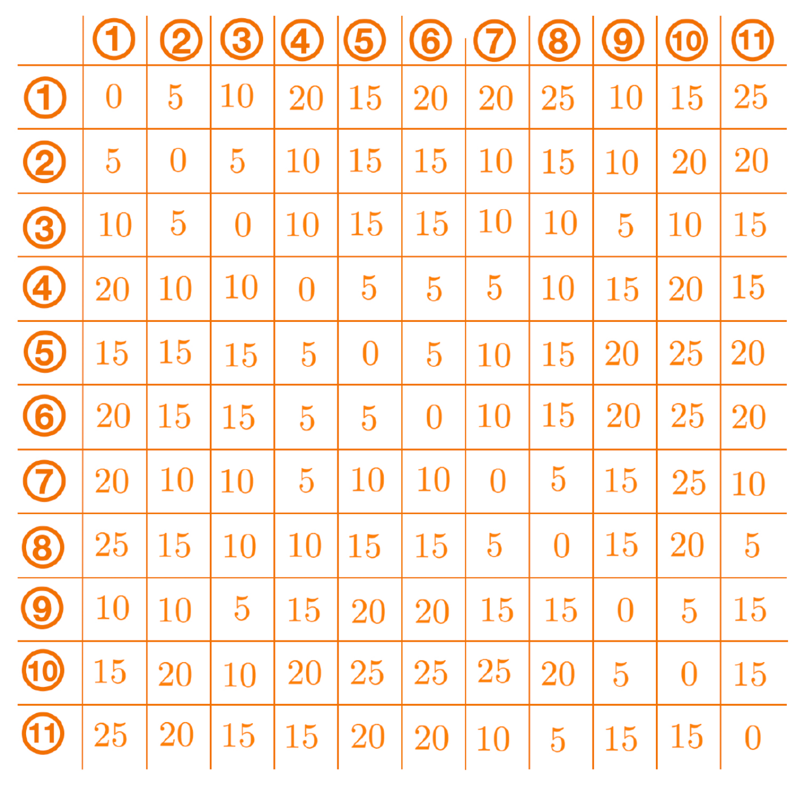{width="55%" fig-align="center"}

::: {style="text-align: center; font-size: 0.7em;"}
Walking time between attractions & exit
:::

## Goal

Suppose that we know the waiting distribution as a function of time.

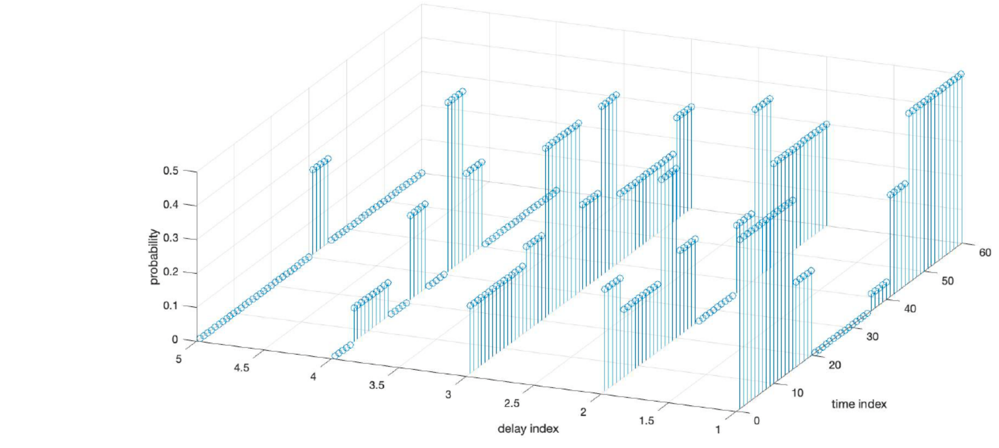{width="75%" fig-align="center"}

::: {style="text-align: center; font-size: 0.7em;"}
Stochastic waiting time distribution as a function of time
:::

Let the state be

1. a unique label representing the attractions visited so far $a_M a_{M-1} \dots a_2 a_1$, $a_i \in \{0,1\}$
2. time index
3. Last visited attraction $c \in \{1,\dots,M\}$, in particular $a_c = 1$

Find a policy that for each state provides the next attraction to go to.

## Stochastic dynamic programming

Consider a very large number of possible iteration $T$ and consider

$g_T(x_T) = \infty$ if terminal state is not feasible.

$g_T(x_T) = 0$ if terminal state is feasible.

A feasible terminal state is such that given the last visited attraction and the current time one still has enough time to exit.

Intuitively at the terminal stage $T$ we assume that one will exit the park even if one has time.

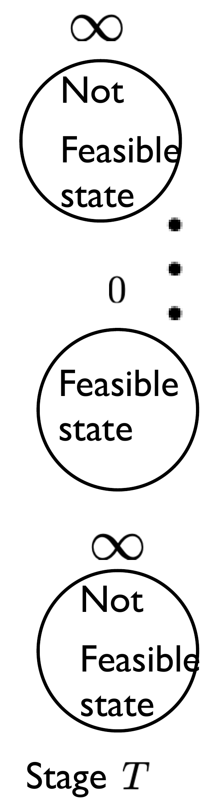{width="16%" fig-align="center"}

## Stochastic dynamic programming

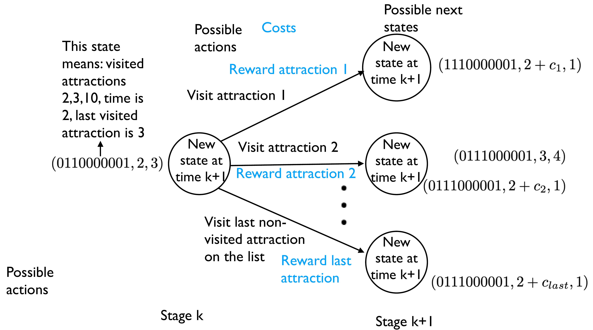{width="90%" fig-align="center"}

$c_i$ - time to walk to attraction $i$ + random waiting time at attraction $i$

Cost of each arrow are the reverse rewards of the coming attraction (visible in the state).

## Optimal policy

After setting up the problem one runs DP. If the horizon is long enough one can show that DP converges (both the costs-to-go and the policy) and we have an optimal policy (we will later justify this in the course).

Example: if the state is $(1111100000, 25, 2)$

optimal policy might determine to move to attraction 10.

## Other applications

See internship theses of former TU/e students at the repository

*Autonomous Parking Spot Ranking*, Jeroen Vanhegelsom, 2022

A thesis developed at company Lightyear, Eindhoven, using stochastic dynamic programming for planning dynamic parking strategies for solar panels powered cars to optimized sun exposition.

*Optimal planning strategies balancing sensing and acting under uncertainty and partial observability*, Femke Voogt, 2026

A thesis developed at company VBTI, Eindhoven, using stochastic dynamic programming for planning leaf harvest.

## Concluding remarks

### Summary

- We introduced a different but equivalent formalism with respect to transition diagrams.
- Stochastic DP: if one has a stochastic characterization of uncertainty one can use it to improve (in terms of expected cost) open-loop policies and even the closed-loop policy obtained with dynamic programming assuming deterministic behavior.
- We gave two examples: games and stopping times.

## Appendix A {.center style="text-align: center;"}

### Stochastic dynamic programming for the inventory control example {style="text-align: center;"}

## Inventory control example

Applying the dynamic programming algorithm to the inventory control example with uncertain demand at stage 2, $\text{Prob}[d_2=0]=0.5$, $\text{Prob}[d_2=1]=0.5$ we obtain (see Lecture 1)

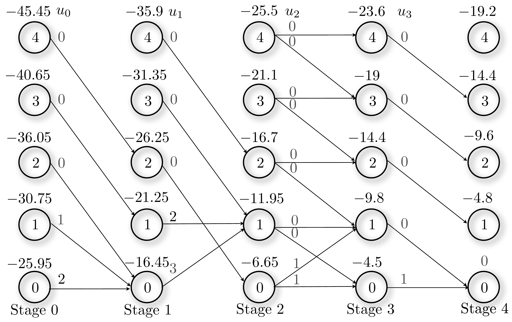{width="85%" fig-align="center"}

## Computing the optimal policy

- Notice that since there is only one disturbance at stage 2 the costs-to-go at stage 3 match the ones obtained before in the deterministic case.
- Decisions at stage 2 are the ones that minimize the expected cost-to-go. We have seen that for state 0 $u_2=1$ is better than $u_2=2$ and actually it is the optimal decision.
- Another example:

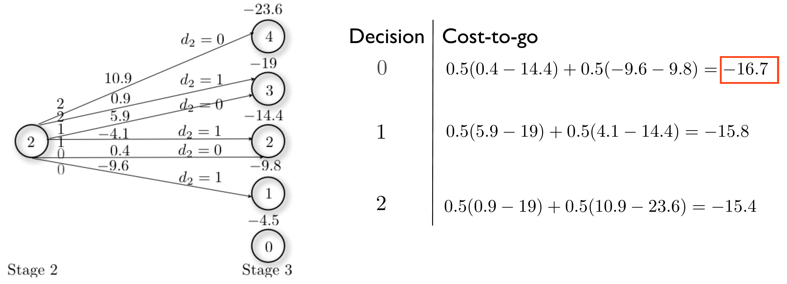{width="80%" fig-align="center"}

- For stage 0 and stages 1 there is no uncertainty. To obtain the respective costs-to-go one can apply the dynamic programming algorithm considering the expected costs-to-go at stage 2.

## Appendix B {.center style="text-align: center;"}

### Another stopping time problem: asset selling {style="text-align: center;"}

## Asset selling

When to accept an offer for an asset, e.g., a house, in other to maximize terminal expected revenue?

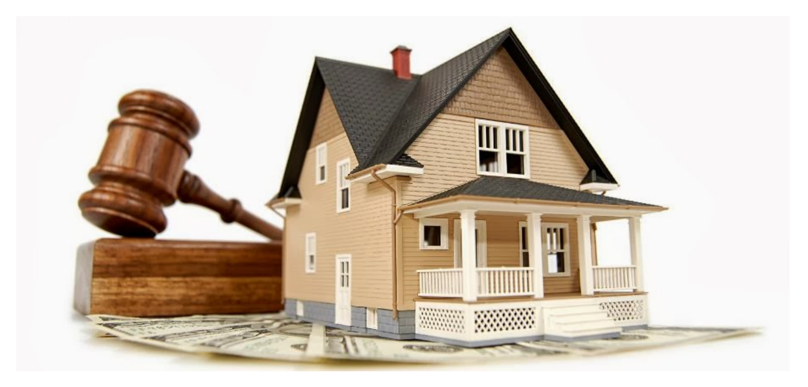{width="42%" fig-align="center"}

**Assumptions:**

- Independent offers, denoted by $w_0,w_1,\dots,w_{N-1}$, occur in $N$ periods of time.
- The offers take values in a finite set $w_k \in \{a_1,a_2,\dots,a_M\}$, $\text{Prob}[w_k=a_i]=p_i$
- $w_k=0$ models the case where there is no offer in period $N$.
- If an offer is accepted, the money is invested at a rate $r$ until the $N$th period.
- Offers rejected are not renewed, and the last offer $w_{N-1}$ must be accepted.

## Asset selling

Let $x_k$, for $k \geq 1$, equal the most recent offer $w_{k-1}$ and pick a terminal state $x_k = T$ to denote that the house has already been sold. Let also $u_k=1$ for $k \geq 1$ if one decides to accept offer $w_{k-1}$ (sell) and $x_0 := 0$ (zero initial offer). Then:

$$x_{k+1} = \begin{cases}T & \text{if } x_k=T, \text{ or if } x_k \neq T \text{ and } u_k=1 \text{(sell)},\\w_k & \text{otherwise.}\end{cases}$$

and the expected selling price is

$$\mathbb{E}_{w_k}\Big[g_N(x_N) + \sum_{k=0}^{N-1} g_k(x_k,u_k,w_k)\Big]$$

where $g_k(x_k,u_k,w_k) = \begin{cases}(1+r)^{N-k}x_k & \text{if } x_k \neq T \text{ and } u_k=1\text{(sell)}\\0 & \text{otherwise.}\end{cases}$

$$g_N(x_N) = \begin{cases}x_N & \text{if } x_N \neq T,\\0 & \text{if } x_N = T\end{cases}$$

## Asset selling

Applying the dynamic programming algorithm we conclude that

$$J_N(x_N) = \begin{cases}x_N & \text{if } x_N \neq T,\\0 & \text{if } x_N = T\end{cases}$$

$$J_k(x_k) = \begin{cases}\max\big[(1+r)^{N-k}x_k,\; \mathbb{E}[J_{k+1}(w_k)]\big] & \text{if } x_k \neq T\\0 & \text{if } x_k = T\end{cases}$$

**Policy**

accept the offer $x_k$ if $x_k > \alpha_k$

reject the offer $x_k$ if $x_k \leq \alpha_k$

$$\alpha_k = \mathbb{E}[J_{k+1}(w_k)] = \frac{\sum_{i=1}^M p_i J_{k+1}(a_i)}{(1+r)^{N-k}}$$

## Appendix C {.center style="text-align: center;"}

### A simple game {style="text-align: center;"}

## A simple game

Two players ($A$ and $B$), repetitively play two fair games:

- Player $A$ tosses a coin of $1$ money unit: if the outcome is 'heads' he/she gains $1$ point (Player $B$ looses $1$ point); otherwise he/she looses $1$ point (Player $B$ gains $1$ point).
- Player $A$ tosses a coin of $2$ money units: if the outcome is 'heads' he/she gains $2$ points (Player $B$ looses $2$ points), otherwise he/she looses $2$ points (Player $B$ gains $2$ points).
- The game ends if one of the players achieves $L$ or $L+1$ points in which case that player receives $L$ money units from the other player.
- If none of the players reaches $L$ points during $h$ stages the game stops and the players do not win or loose anything.

Suppose $h=2$, $L=3$ and both players have zero points at the initial stage.

Can player $A$ gain money in expectation by deciding at each stage which coin to toss?

## DP formulation

Dynamic model $\quad x_{k+1} = f(x_k,u_k,w_k)$

$x_k$ - #points of player $A$

$u_k \in \{1,2\}$ - decision

$w_k \in \{-1,1\}$, tails $\to -1$, heads $\to 1$

$k \in \{0,\dots,h-1\}$

$$f(x_k,u_k,w_k) = \begin{cases}x_k+1 & \text{if } u_k=1 \text{ and } w_k=1\\x_k+2 & \text{if } u_k=2 \text{ and } w_k=1\\x_k-1 & \text{if } u_k=1 \text{ and } w_k=-1\\x_k-2 & \text{if } u_k=2 \text{ and } w_k=-1\\x_k & \text{if } x_k \in \{L, L+1, -L, -(L+1)\} \text{ (game has ended but wait for the last stage)}\end{cases}$$

Cost $\quad \min \sum_{k=0}^{h-1} g(x_k,u_k) + g_h(x_h)$

$g(x_k,u_k) = 0$ for every $x_k, u_k$

$g_h(x_h) = \begin{cases}-L & \text{if } x_h = L \text{ or } x_h = L+1\\L & \text{if } x_h=-L \text{ or } x_h=-(L+1)\\0 & \text{otherwise}\end{cases}$

(note that profit = -cost)

## DP algorithm

DP algorithm $\quad J_h(x_h) = g_h(x_h)$

$$J_k(x_k) = \min_{u_k} \mathbb{E}[g(x_k,u_k) + J_{k+1}(x_{k+1}) \mid x_k] \quad k \in \{h-1,h-2,\dots,0\}$$

Using the expression for $f(x_k,u_k,w_k)$ we obtain

$$J_k(x_k) = \begin{cases}\min\Big\{\dfrac{J_{k+1}(x_k+1)+J_{k+1}(x_k-1)}{2}, \dfrac{J_{k+1}(x_k+2)+J_{k+1}(x_k-2)}{2}\Big\}, & \text{otherwise}\\J_{k+1}(x_k), & \text{if } x_k \in \{-(L+1),-L,L,(L+1)\}\end{cases}$$

$$J_h(x_h) = \begin{cases}-L & \text{if } x_h=L \text{ or } x_h=L+1\\L & \text{if } x_h=-L \text{ or } x_h=-(L+1)\\0 & \text{otherwise}\end{cases}$$

## Optimal policy and cost

Iterating this equation we get the costs-to-go and optimal decisions indicated in the diagram

(circles correspond to states and are labeled with the number of points at a given stage, cost-to-go on top and decision next to them).

For the zero initial condition the average cost is $-3/4$ and so the profit is $3/4$.

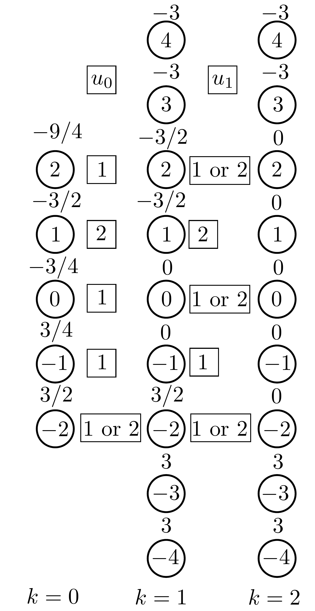{width="32%" fig-align="center"}
