## Unit 3 {.center style="text-align: center;"}

<!--
Converted from Lecture3.key (exported to PDF, 50 slides) on 2026-08-10,
following the exact conventions finalized on Lectures 1-2:
- Standard title-slide block reused verbatim (only "Unit N" and the
  subtitle change).
- Plain x_k/u_k/J notation used throughout.
- Slides that are mostly text/bullets/equations are rewritten natively.
  Slides built around a hand-drawn diagram, grid, tree, iteration table, or
  photo are kept as an embedded image of the original slide region (title
  cropped out) rather than redrawn, for the same reason as Lectures 1-2:
  redrawing ~25 dense diagrams/tables accurately without verifying them
  against you first risked introducing errors. Figures live in
  figures/lecture3/, named pgNN.png (matching the original PDF page
  number, same convention as figures/lecture2/).

FIRST-PASS CAVEAT (same as Lecture 2's first pass): given the size of this
deck (50 slides, 3 appendices, many dense iteration tables), this pass
prioritizes correct title/structure/text/equation content and faithful
image crops, over pixel-perfect cropping of every figure (titles are
cropped out since they're retyped natively, but stray corner page-numbers
were NOT individually cleaned up this pass -- same deferred cleanup as
Lecture 2's first pass). Expect a slide-by-slide refinement round.

COPYRIGHT: pg04.png's "Applications" montage originally included a
recognizable photo of Mark Zuckerberg; that panel has been replaced with
an original, generated social-network icon graphic (no real person, no
license needed). pg31.png ("Edsger W. Dijkstra" historical note) uses the
well-known portrait credited to Hamilton Richards (UT Austin), CC BY-SA
3.0, via Wikimedia Commons -- credited under the image below. This
attribution was added from web search without being able to re-verify the
exact file against Commons directly (tool access issue at the time), so
it's worth a quick manual check before wide distribution.
Two other slides cite "source: wikipedia" already (pg18, pg26 -- the
Dijkstra/A* wavefront illustrations) but the actual license of those
specific images wasn't re-verified.

Also NOT carried over from the original slides (matching the Lecture 2
precedent of dropping pure decorative flourish from natively-rewritten
slides): the three small cartoon icons (ostrich / mechanic / scientist) on
the "Discussion" slide about certainty-equivalent control (original pg35).
Say the word if you'd like them added back as small images.

Two live-script (.mlx) links on the original slides point to files not
seen yet in this pass (LiveScript/Lecture3/...); kept as plain-text
references, same as Lecture 1/2's convention, pending a code/unit3/ pass
analogous to code/unit1/ and code/unit2/ (JupyterNotebooks/A_3_*.ipynb
appear to be the Python equivalents, by the same naming convention
established for A_1_/A_2_ -- not yet confirmed against this deck's content).
-->

### Search Methods in Graphs {style="text-align: center;"}

{width="15%" fig-align="center"}

::: {.title-slide-meta}
4SC000, Q2 2026-2027

Duarte Antunes
:::

## Outline

- Shortest paths in graphs
  - <u>Dynamic programming</u>
  - Dijkstra's and A* algorithms
- Online replanning policy

## Graph

**Weighted graph**

- Nodes: $\mathcal{V} := \{1,\dots,n\}$
- Edges: $\mathcal{E} := \{(i_1,j_1),\dots,(i_r,j_r) \mid i_1,\dots i_r, j_1,\dots,j_r \in \mathcal{V}\}$
- Weights: $w_{ij} \geq 0$, $(i,j)\in\mathcal{E}$
- Undirected if $w_{ij} = w_{ji}$

e.g. $\mathcal{E} = \{(3,6),(2,3),\dots\}$, $w_{36}=7$, $w_{23}=5,\dots$

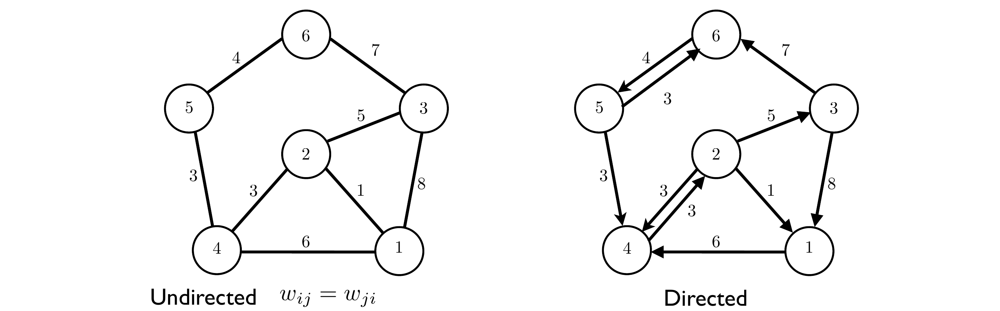{width="95%" fig-align="center"}

## Applications

Graphs model networks (road, social, transportation, etc.) and can be found in numerous applications.

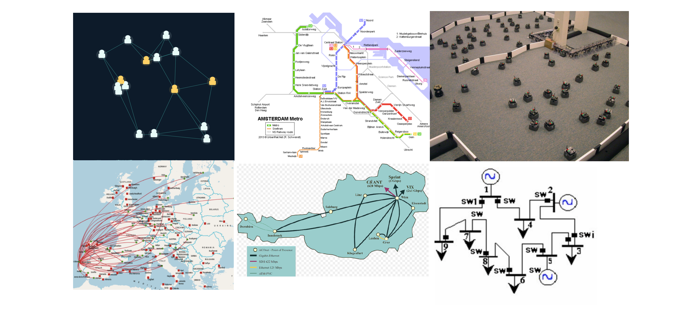{width="90%" fig-align="center"}

## Shortest path problem

Find a path from an initial node to a destination node in a weighted graph, with minimum length (sum of the weights of its edges).

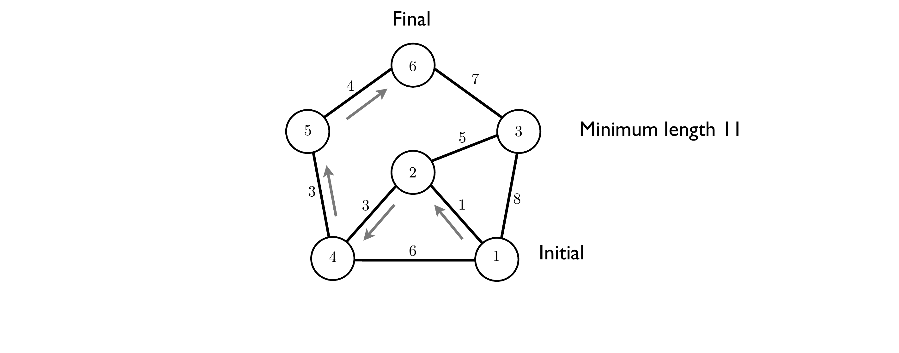{width="80%" fig-align="center"}

Can we use the DP algorithm to find the shortest path?

## Discussion

Computing an optimal path in a transition diagram can be seen as computing the shortest path from the nodes at stage $0$ to the node at stage $h+1$ of a weighted graph built by chaining the per-stage cost matrices $c^k_{ij}$ together, plus an artificial terminal node collecting the terminal costs $c^h_{i}$.

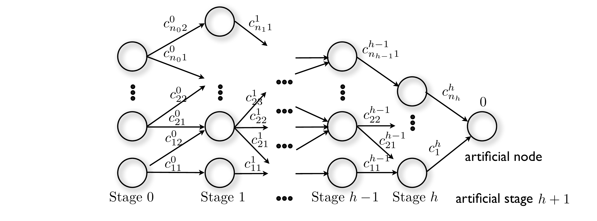{width="95%" fig-align="center"}

- For graphs with this layered structure we already know how to use DP to compute shortest paths.
- Adjustments are needed for general graphs (e.g. cycles may occur), but DP can still be used to provide the shortest path, as shown next.

## Dynamic programming formulation

Given a weighted graph, construct a transition diagram:

- $h = n-1$ stages, $n$ states at decision stages, and only the destination at the terminal stage.
- Set $c^k_{ij} = w_{ij}$, with $w_{ij}=\infty$ if there is no link from $i$ to $j$, and $w_{ii}=0$.

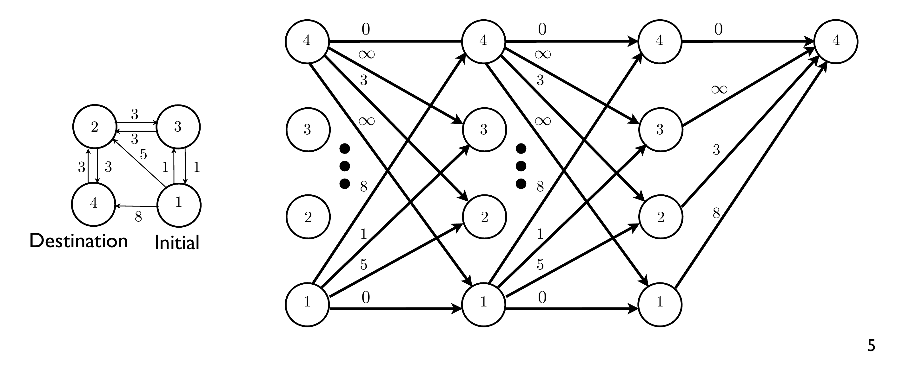{width="95%" fig-align="center"}

## Dynamic programming solution

Apply the DP algorithm to this transition diagram.

- Costs-to-go at a stage $k$ are the costs of the shortest path with $n-1-k$ hops. In particular, costs-to-go at the initial stage are the optimal costs for each initial condition.
- To find an optimal path, follow the policy for a given initial state.
- The cost-to-go at stage $0$ of a given state is infinite if there is no path from that initial state to the destination.

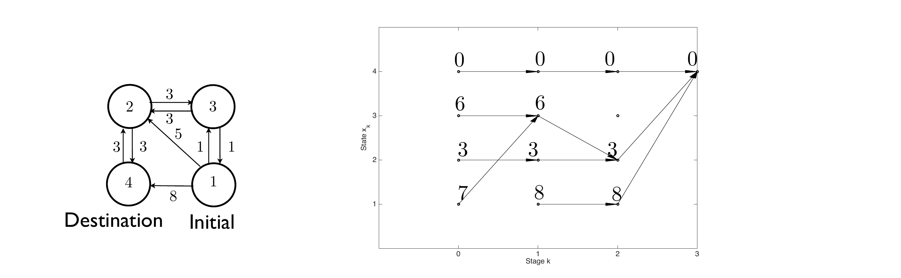{width="95%" fig-align="center"}

The implementation can be made more efficient, e.g. one does not need to first construct the transition diagram. Moreover, one can stop when the costs-to-go remain unchanged.

## Example

Another example, for an undirected 6-node graph.

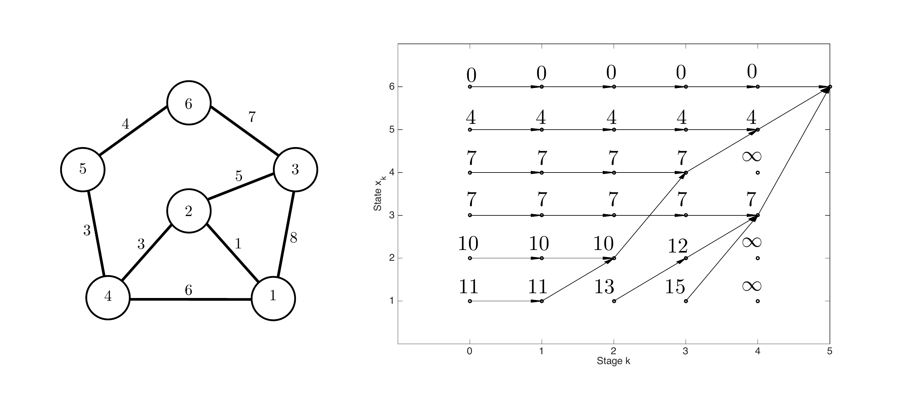{width="90%" fig-align="center"}

## Shortest paths in road networks

What is the shortest distance from Bucharest to Lugoj?

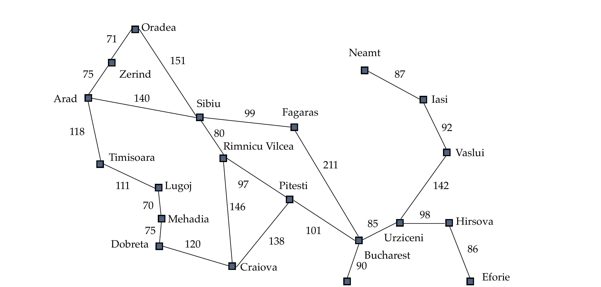{width="90%" fig-align="center"}

## Shortest paths in road networks

**504 km** (Route: Bucharest, Pitesti, Craiova, Dobreta, Mehadia, and Lugoj)

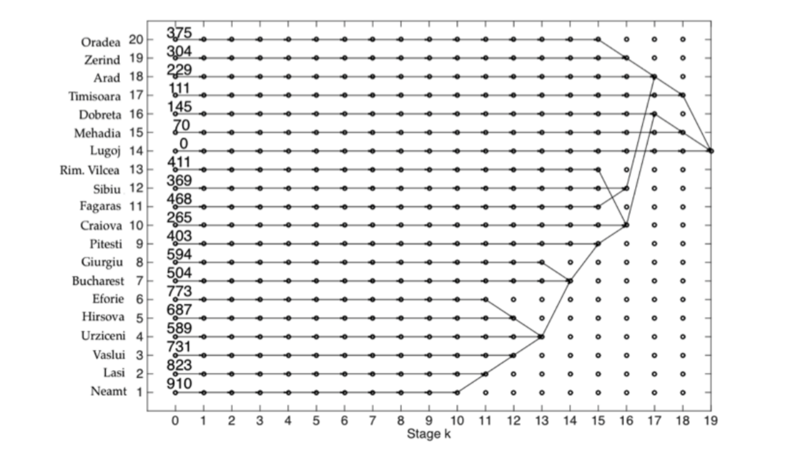{width="80%" fig-align="center"}

## Robot path planning

What is the shortest path for a robot to go from point A to B in a grid map representation of the world?

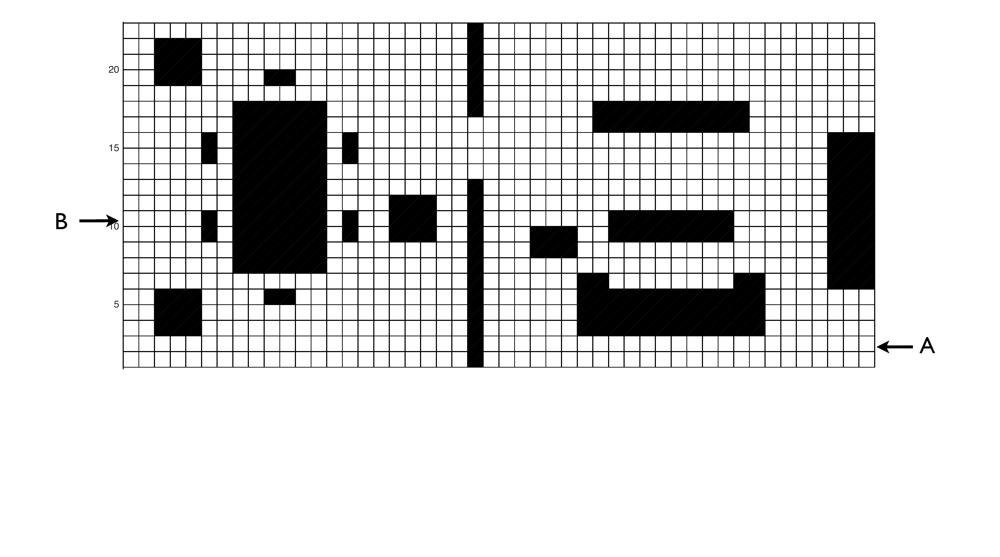{width="85%" fig-align="center"}

## Assumptions

- It takes $1$ distance unit to move horizontally or vertically between adjacent nodes and $\sqrt{2}$ units to move diagonally.
- Distances to obstacle nodes are infinite.
- Distance between two diagonally adjacent nodes, both adjacent to the same obstacle node, is infinite.

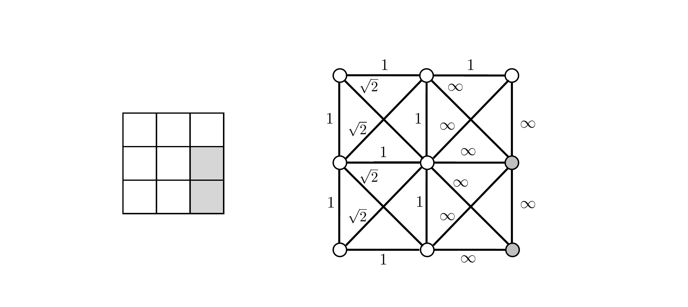{width="90%" fig-align="center"}

## Robot path planning

What is the shortest path for a robot to go from point A to B?

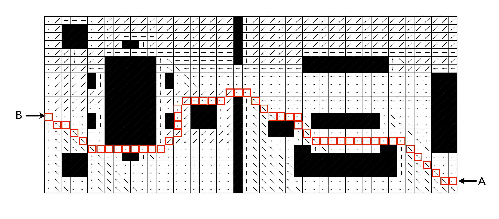{width="85%" fig-align="center"}

## Robot path planning

Simpler example to show the costs-to-go.

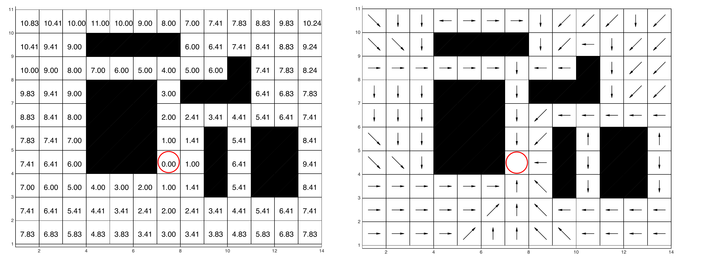{width="80%" fig-align="center"}

Side remark: the cost-to-go can be viewed as a Lyapunov function, and the policy can be obtained by following the direction of maximum decrease of this function plus the stage cost.

## Discussion

DP can be quite inefficient when computing an optimal path in enough generality.

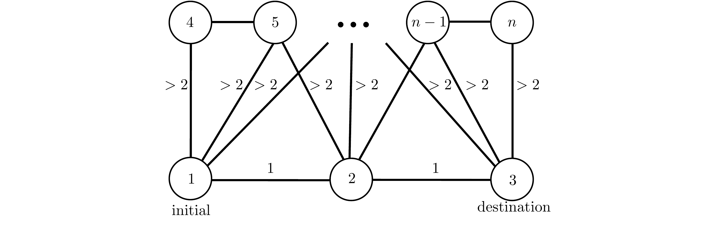{width="70%" fig-align="center"}

Example in figure: DP searches the full space -- not necessary to compute the optimal path (e.g. the direct edge $1\to2\to3$ already achieves cost $2$, but DP still explores every node from $4$ to $n$, each connected to $1$, $2$, and $3$ with cost $>2$).

For shortest path problems in graphs, there are many alternative algorithms. We describe next the Dijkstra's and the A* algorithms.

## Outline

- Shortest paths in graphs
  - Dynamic programming
  - <u>Dijkstra's and A* algorithms</u>
- Online replanning policy

## Dijkstra's algorithm

**Main ideas**

- Iteratively generate shorter paths from the origin to every node.
- Updates a list of nodes (the **wavefront**) which can be explored next.
- New nodes are added to the wavefront based on cost: neighbors of the node with the smallest distance to the origin.

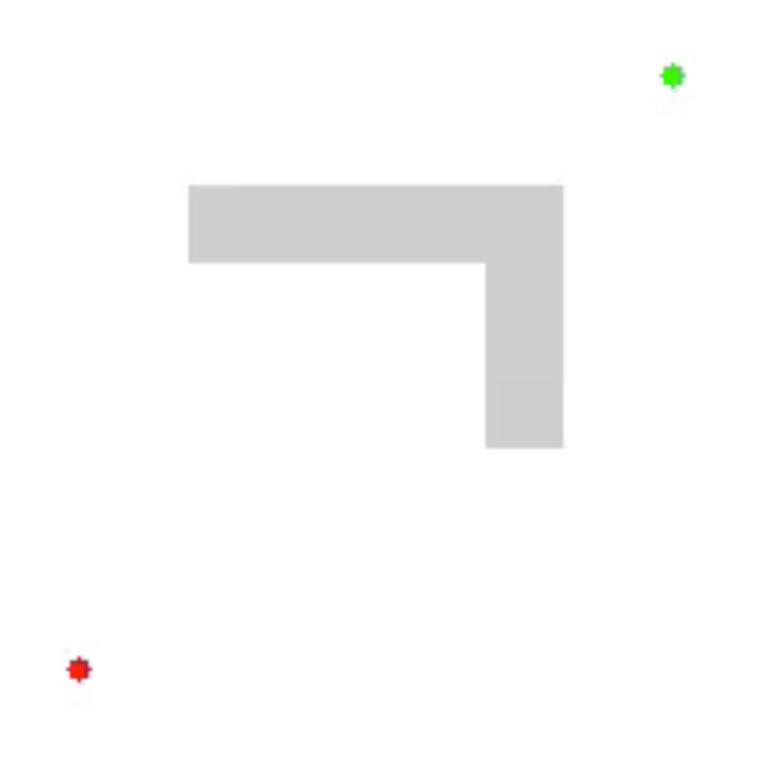{width="45%" fig-align="center"}

::: {style="text-align: center; font-size: 0.4em;"}
Source: Wikipedia.
:::

## Dijkstra's algorithm

**Initialization**

- $d_i = \infty$ for $i \in \mathcal{V}-\{p\}$, $d_p=0$, and $\text{OPEN}=\{p\}$, where $p$ is the initial node and $t$ the final node.

**Steps**

1. Remove a node $i$ from OPEN with the smallest estimate $d_i$. If $i=t$, stop; otherwise execute step 2 for every node $j$ for which there is a path (arrow) from $i$ to $j$.
2. If $d_i+w_{ij} < d_j$: set $d_j=d_i+w_{ij}$, set $\beta(j)=i$, place $j$ in OPEN if it is not there already. Otherwise, do not update $d_j,\beta(j)$.
3. After executing Step 2 for all the nodes $j$ corresponding to out-neighbors of $i$, go to step 1.

**Optimal path**

- To keep track of the shortest paths it suffices to save, for every node $i$, the next node $\beta(i)$ along the optimal path (discovered so far) leading to the initial node.
- The optimal path is given by $(i_0,i_1,\dots,i_L)$ for $i_L=t$, $i_{L-1}=\beta(t),\dots,i_0=\beta(i_1)$, or equivalently $i_{\ell-1}=\beta(i_\ell)$, $\ell\in\{1,\dots,L\}$, where $L$ is such that $i_0=p$.
- If OPEN is empty at a given step of the algorithm, there is no path to the destination.

## Example I

Dijkstra's algorithm requires only three iterations for this example.

::: {layout-ncol="2"}
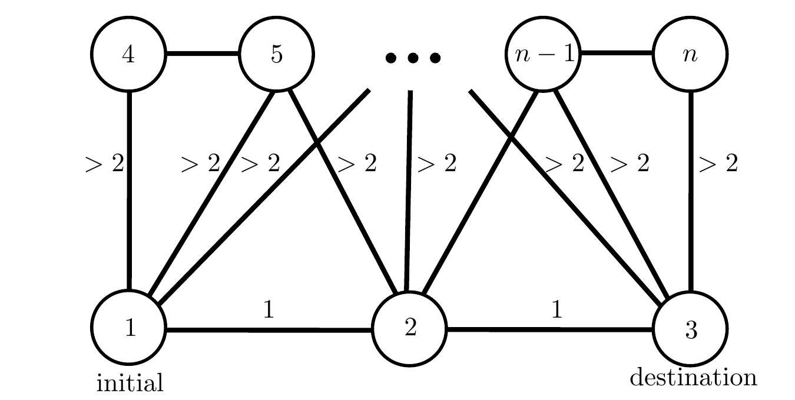

| Iteration | Pairs $(i,d_i)$, $i\in\text{OPEN}$ |
|---|---|
| $0$ | $(1,0)$ |
| $1$ | $(2,1)$ + other pairs pertaining to other neighbors of node $1$, $\beta(2)=1$ |
| $2$ | $(3,2)$ + other pairs pertaining to other neighbors of nodes $1$ & $2$, $\beta(3)=2$ |
| $3$ | Destination/final node removed from OPEN -- terminate |
:::

## Example II

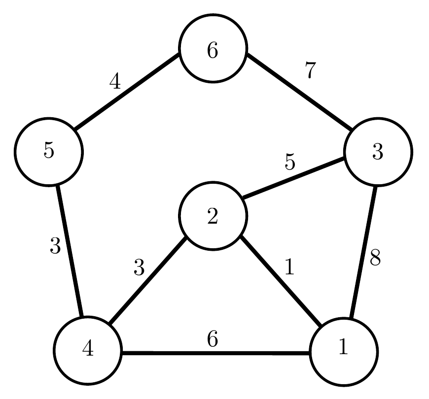{width="30%" fig-align="center"}

| Iteration | Pairs $(i,d_i)$, $i\in\text{OPEN}$ | |
|---|---|---|
| $0$ | $(1,0)$ | |
| $1$ | $(2,1),(3,8),(4,6)$ | $\beta(2)=1,\ \beta(3)=1,\ \beta(4)=1$ |
| $2$ | $(3,6),(4,4)$ | $\beta(3)=2,\ \beta(4)=2$ |
| $3$ | $(3,6),(5,7)$ | $\beta(5)=4$ |
| $4$ | $(5,7),(6,13)$ | $\beta(6)=3$ |
| $5$ | $(6,11)$ | $\beta(6)=5$ |

Optimal path (from end to start): $(6,\beta(6),\beta(\beta(6)),\dots,1) = (6,5,4,2,1)$.

## Shortest paths in road networks

What is the shortest distance from Bucharest to Lugoj?

{width="90%" fig-align="center"}

## Example III

Shortest path from Bucharest to Lugoj, using Dijkstra's algorithm directly on the road network (rather than DP on the full transition diagram).

| Iteration | Pairs $\{i,d_i\}$, $i \in \text{OPEN}$ |
|---|---|
| $0$ | $\{\text{Lugoj},0\}$ |
| $1$ | $\{\text{Mehadia},70\}, \{\text{Timisoara},111\}$ |
| $2$ | $\{\text{Timisoara},111\}, \{\text{Dobreta},145\}$ |
| $3$ | $\{\text{Dobreta},145\}, \{\text{Arad},229\}$ |
| $4$ | $\{\text{Arad},229\}, \{\text{Craiova},265\}$ |
| $5$ | $\{\text{Craiova},265\}, \{\text{Sibiu},369\}, \{\text{Zerind},304\}$ |
| $6$ | $\{\text{Sibiu},369\}, \{\text{Zerind},304\}, \{\text{Pitesti},403\}, \{\text{Rimnicu Vilcea},411\}$ |
| $7$ | $\{\text{Sibiu},369\}, \{\text{Pitesti},403\}, \{\text{Rimnicu Vilcea},411\}, \{\text{Oradea},375\}$ |
| $8$ | $\{\text{Pitesti},403\}, \{\text{Rimnicu Vilcea},411\}, \{\text{Oradea},375\}, \{\text{Fagaras},468\}$ |
| $9$ | $\{\text{Pitesti},403\}, \{\text{Rimnicu Vilcea},411\}, \{\text{Fagaras},468\}$ |
| $10$ | $\{\text{Rimnicu Vilcea},411\}, \{\text{Fagaras},468\}, \{\text{Bucharest},504\}$ |
| $11$ | $\{\text{Fagaras},468\}, \{\text{Bucharest},504\}$ |
| $12$ | $\{\text{Bucharest},504\}$ |

From this data we can obtain $\beta$ and compute the optimal path -- matching the $504$ km found earlier with DP.

## A*

- Similar to Dijkstra's algorithm, but an **estimate** (heuristic) $h(i)$ of the distance to the destination for each node $i\in\mathcal{V}$ is also taken into account when picking the node to explore next. New nodes are added to the wavefront based on $d_i+h(i)$.
- If the heuristic is (i) smaller than the optimal cost from that node to the destination, and (ii) such that $h(i) \leq w_{ij}+h(j)$ for every $i,j$, then the optimal path is found. Otherwise, no optimality guarantees.
- To run the A* algorithm under these two assumptions:
  1. Change the weights to $\bar w_{ij} = w_{ij}+h(j)-h(i)$.
  2. Run Dijkstra's algorithm and get the optimal path.
  3. Obtain the optimal cost in the original graph with weights $w_{ij}$.
- The general algorithm (which works with or without these assumptions) is given next.

## A*

**Initialization**

- $d_i=\infty$ for $i\in\mathcal{V}-\{p\}$, $d_p=0$, and $\text{OPEN}=\{p\}$, where $p$ is the initial node and $t$ the final node.

**Steps**

1. Remove a node $i$ from OPEN with the smallest $d_i+h(i)$. If $i=t$, stop; otherwise execute step 2 for every node $j$ for which there is a path (arrow) from $i$ to $j$.
2. If $d_i+w_{ij} < d_j$: set $d_j=d_i+w_{ij}$, set $\beta(j)=i$, place $j$ in OPEN if it is not there already. Otherwise do not update $d_j,\beta(j)$.
3. After executing Step 2 for all the nodes $j$ corresponding to out-neighbors of $i$, go to step 1.

(Same algorithm as Dijkstra's, except for the ranking key $d_i+h(i)$; same remarks on finding the optimal path.)

## A* and Dijkstra's algorithm

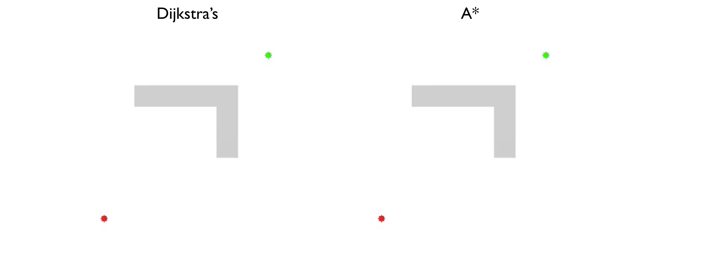{width="90%" fig-align="center"}

::: {style="text-align: center; font-size: 0.4em;"}
Source: Wikipedia.
:::

A* is typically much faster if we have a good heuristic (which might not be easy to find, especially if we require it to satisfy the two conditions discussed before).

## Example

Straight-line distance to Bucharest, $h(i)$, used as the A* heuristic.

::: {layout-ncol="2"}

| City | $h(i)$ | City | $h(i)$ |
|---|---|---|---|
| Neamt | 234 | Giurgiu | 77 |
| Iasi | 226 | Pitesti | 98 |
| Vaslui | 199 | Craiova | 160 |
| Urziceni | 80 | Fagaras | 178 |
| Hirsova | 151 | Sibiu | 253 |
| Eforie | 161 | Rimnicu Vilcea | 193 |
| Bucharest | 0 | Lugoj | 244 |
| | | Mehadia | 241 |
| | | Dobreta | 242 |
| | | Timisoara | 329 |
| | | Arad | 366 |
| | | Zerind | 374 |
| | | Oradea | 380 |
:::

## Example

Running A* from Lugoj to Bucharest with the heuristic above:

1. Change the weights to $\bar w_{ij}=w_{ij}+h(j)-h(i)$.
2. Run Dijkstra's algorithm and get the optimal path.
3. Obtain the optimal cost in the original graph with weights $w_{ij}$.

| Iteration | Pairs $\{i,d_i\}$ in OPEN |
|---|---|
| $0$ | $\{\text{Lugoj},0\}$ |
| $1$ | $\{\text{Mehadia},67\}, \{\text{Timisoara},196\}$ |
| $2$ | $\{\text{Timisoara},196\}, \{\text{Dobreta},143\}$ |
| $3$ | $\{\text{Timisoara},196\}, \{\text{Craiova},181\}$ |
| $4$ | $\{\text{Timisoara},196\}, \{\text{Pitesti},257\}, \{\text{Rim. Vilcea},360\}$ |
| $5$ | $\{\text{Pitesti},257\}, \{\text{Rim. Vilcea},360\}, \{\text{Arad},351\}$ |
| $6$ | $\{\text{Rim. Vilcea},360\}, \{\text{Arad},351\}, \{\text{Bucharest},260\}$ |

From this data we can obtain $\beta$ and compute the optimal path.

## Discussion

- For large graphs one cannot even store the number of nodes and initialize $d_i$, but we can still run the algorithm if we keep track of a list of **closed** nodes (removed in step 1) so that they are not visited again (this is assured by $d_i+w_{ij}<d_j$).
- If optimality is not a requirement, there are many more graph search algorithms, e.g. breadth-first search, depth-first search (see label-correcting methods in Bertsekas' book, Ch. 2).
- For robot motion planning, Dijkstra and A* are in general naive:
  - construct nodes as we move along (so the graph is only implicit);
  - random placement of nodes is in general better.
  - A popular method that improves upon these two remarks is Rapidly-exploring Random Tree (RRT).

## Discussion

- The Dijkstra's algorithm and other search algorithms (e.g. A*) are typically computationally more efficient than DP to compute optimal paths.
- DP explores every node, providing the optimal paths from **every** node to the destination. This is inefficient when one is interested in **one** optimal path.
- Why then dynamic programming? It provides a **policy**, which allows coping with disturbances -- see Unit 2.
- We discuss next how to use Dijkstra's algorithm to provide the optimal policy in real time (online).
- In Appendix A, Dijkstra's algorithm is used to obtain the same optimal policy obtained in Unit 1 with DP.
- Thus, again, why DP then? Stochastic DP! (something that Dijkstra's algorithm cannot achieve) plus other advantages.

## Edsger W. Dijkstra

**Historical note**

- Edsger W. Dijkstra was a professor at TU/Eindhoven from 1962 to 1984.

{width="76%" fig-align="center"}

::: {style="text-align: center; font-size: 0.4em;"}
Photo: Hamilton Richards, University of Texas at Austin, CC BY-SA 3.0, via Wikimedia Commons.
:::

"What's the shortest way to travel from Rotterdam to Groningen? It is the algorithm for the shortest path, which I designed in about 20 minutes. One morning I was shopping in Amsterdam with my young fiancée, and tired, we sat down on the café terrace to drink a cup of coffee and I was just thinking about whether I could do this, and I then designed the algorithm for the shortest path. As I said, it was a 20-minute invention. In fact, it was published in 1959, three years later. The publication is still quite nice. One of the reasons that it is so nice was that I designed it without pencil and paper. Without pencil and paper you are almost forced to avoid all avoidable complexities. Eventually that algorithm became, to my great amazement, one of the cornerstones of my fame." -- Edsger W. Dijkstra (1930-2002)

## Outline

- Shortest paths in graphs
  - Dynamic programming
  - Dijkstra's and A* algorithms
- <u>Online replanning policy</u>

## Shortest paths in graphs and policies

- A transition diagram is just a weighted graph, and therefore we can compute optimal paths with methods to compute shortest paths in graphs (e.g. Dijkstra's algorithm, A*).

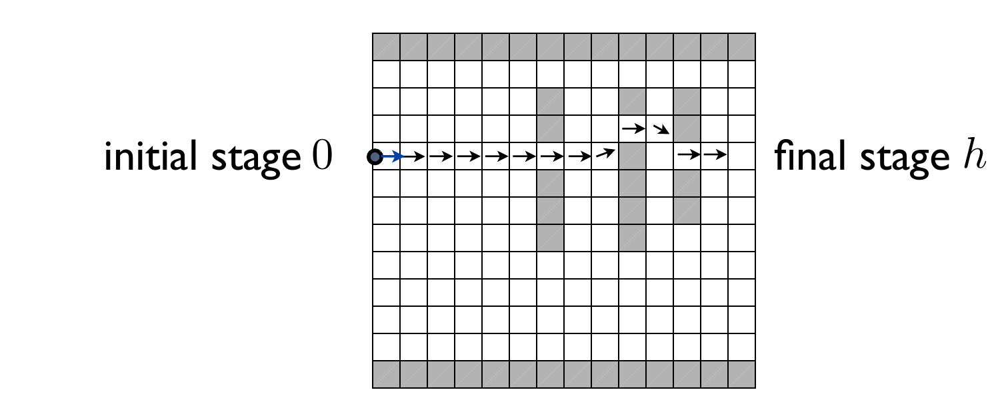{width="55%" fig-align="center"}

- Doing this for every stage and every state, and taking the first decision of each optimal path, we obtain the **optimal policy**! (A function that, for each state, gives the first decision of the optimal path from that state to the last stage.)

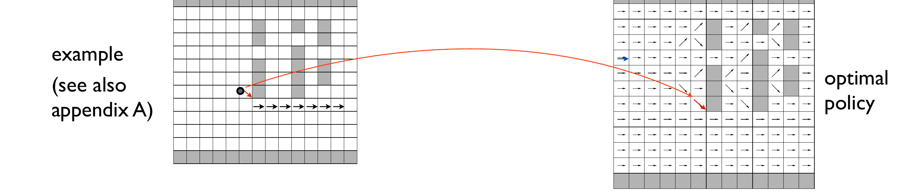{width="70%" fig-align="center"}

- However, this is typically computationally less efficient than DP.

## Online replanning policy

Yet, we can implement the method just described (using e.g. Dijkstra's algorithm) **online**:

1. Compute the optimal path for the initial state and take the first decision.

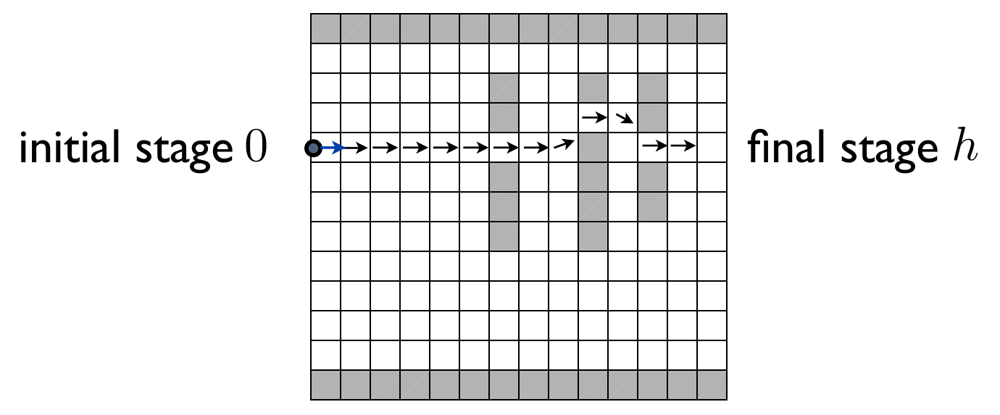{width="55%" fig-align="center"}

2. If no disturbance occurred, use the next decision along the optimal path; otherwise **recompute (online!)** and apply the first decision of the new optimal path.

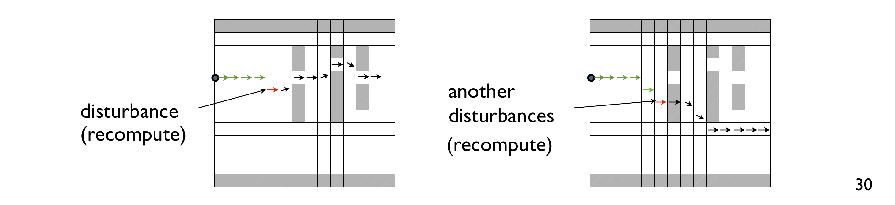{width="90%" fig-align="center"}

## Discussion

- Doing this we end up with the same policy as DP, neglecting disturbances considered in Unit 2.
- The policy obtained with DP is **explicit**, whereas this new (equivalent) one is **implicit** and requires online computations.
- In the literature this (equivalent) policy is also called **certainty equivalent control**, and is very related to **model predictive control** (to be addressed later).

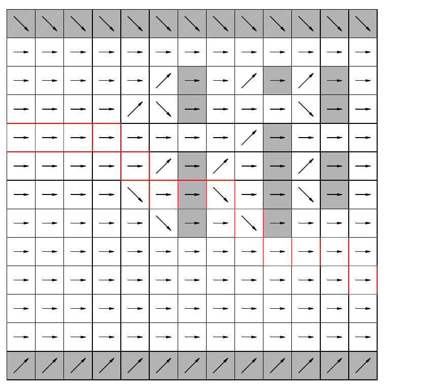{width="30%" fig-align="center"}

**To summarize:**

| | |
|---|---|
| **Optimal paths** | ✓ DP ✓ Dijkstra's (more efficient) |
| **Online replanning policy** | ✓ DP (might be computationally hard) ✓ Dijkstra's offline (less efficient) ✓ Dijkstra's online (requires online computations) |
| **Stochastic DP** | ✓ Stochastic DP ✗ Dijkstra |

## Concluding remarks

**Summary**

- DP can be used to solve shortest paths in graphs.
- Discussed alternative methods: Dijkstra's and A*.
- Introduced the online replanning policy.
- Main message: there are other methods to compute optimal paths and optimal policies (except stochastic DP!) -- (dis)advantages depend on the application (e.g. can we use online computations?).

## Appendix A {.center style="text-align: center;"}

### Solving a DP problem with Dijkstra's algorithm {style="text-align: center;"}

## Example

Consider the same initial transition diagram considered in Unit 1, and follow steps 1-2:

1. Add an artificial terminal node, with a cost to arrive to it at the final stage coinciding with the terminal cost.
2. Compute the optimal paths (using Dijkstra's algorithm) for each state to the artificial terminal node, and keep track, for each initial state, of the first decision of the optimal path (these decisions belong to the optimal policy).

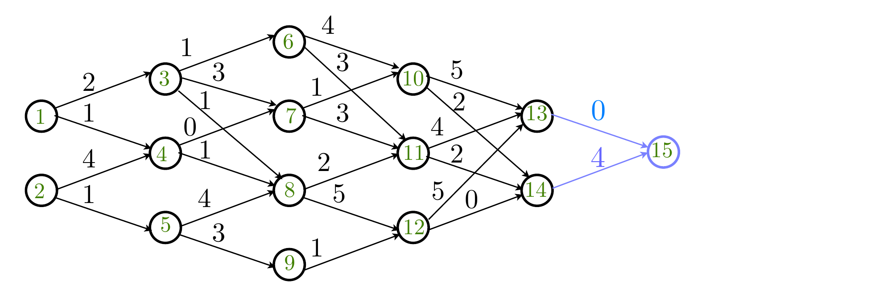{width="80%" fig-align="center"}

## Example

For each initial state, Dijkstra's algorithm is run to the artificial terminal node (15); the dotted arrow marks the first decision, which belongs to the optimal policy.

::: {layout-ncol="2"}
**Initial state 1**

| Iteration | Pairs $(i,d_i)$, $i\in\text{OPEN}$ |
|---|---|
| $0$ | $(1,0)$ |
| $1$ | $(3,2),(4,1)$ |
| $2$ | $(3,2),(7,1),(8,2)$ |
| $3$ | $(3,2),(10,2),(11,4),(8,2)$ |
| $4$ | $(6,3),(10,2),(11,4),(8,2)$ |
| $5$ | $(6,3),(10,2),(11,4),(12,7)$ |
| $6$ | $(6,3),(14,4),(13,7),(11,4),(12,7)$ |
| $7$ | $(14,4),(13,7),(11,4),(12,7)$ |
| $8$ | $(15,4),(13,7),(11,4),(12,7)$ |
| $9$ | $(15,8),(13,7),(11,4),(12,7)$ |
| $10$ | $(15,8),(13,6),(12,7)$ |
| $11$ | $(15,6),(12,7)$ |

Path $1\to4\to7\to10\to13\to15$ belongs to the optimal policy: states $4,7,10$ inherit this same first decision.

**Initial state 2**

| Iteration | Pairs $(i,d_i)$, $i\in\text{OPEN}$ |
|---|---|
| $0$ | $(2,0)$ |
| $1$ | $(4,4),(5,1)$ |
| $2$ | $(4,4),(9,4),(8,5)$ |
| $3$ | $(7,4),(9,4),(8,5)$ |
| $4$ | $(10,5),(11,7),(9,4),(8,5)$ |
| $5$ | $(10,5),(11,7),(12,5),(8,5)$ |
| $6$ | $(10,5),(11,7),(14,5),(8,5),(13,10)$ |
| $7$ | $(10,5),(11,7),(15,9),(8,5),(13,10)$ |
| $8$ | $(10,5),(11,7),(15,9),(13,10)$ |
| $9$ | $(11,7),(15,9),(13,10)$ |
| $10$ | $(15,9),(13,10)$ |

Path $2\to5\to9\to12\to14\to15$ belongs to the optimal policy: states $5,9,12,14$ inherit this same first decision.
:::

## Example

::: {layout-ncol="2"}
**Initial state 3**

| Iteration | Pairs $(i,d_i)$, $i\in\text{OPEN}$ |
|---|---|
| $0$ | $(3,0)$ |
| $1$ | $(6,1),(7,3),(8,1)$ |
| $2$ | $(10,5),(11,4),(7,3),(8,1)$ |
| $3$ | $(10,5),(11,3),(7,3),(12,6)$ |
| $4$ | $(10,4),(11,3),(12,6)$ |
| $5$ | $(10,4),(13,7),(14,6),(12,6)$ |
| $6$ | $(13,7),(14,6),(12,6)$ |
| $7$ | $(13,7),(15,10),(12,6)$ |
| $8$ | $(15,7),(12,6)$ |
| $9$ | $(15,7),(14,6)$ |
| $10$ | $(15,7)$ |

Path $3\to8\to11\to13\to15$ belongs to the optimal policy: states $8,11,13$ inherit this same first decision.

**Initial state 6**

| Iteration | Pairs $(i,d_i)$, $i\in\text{OPEN}$ |
|---|---|
| $0$ | $(6,0)$ |
| $1$ | $(10,4),(11,3)$ |
| $2$ | $(10,4),(13,7),(14,5)$ |
| $3$ | $(13,7),(14,5)$ |
| $4$ | $(13,7),(15,9)$ |
| $5$ | $(13,7)$ |

Path $6\to11\to13\to15$ belongs to the optimal policy: states $11,13$ inherit this same first decision.
:::

It is clear that, e.g. for initial state 1, if we consider states $4,7,10$ as initial states instead, the transitions (arrows) along the same path are also optimal first decisions for those states -- i.e. they belong to the optimal policy (and likewise for the other three runs above).

## Example

Combining the first decisions leading to the end stage for each node, we obtain the optimal policy -- the same one obtained with the DP algorithm in Unit 1.

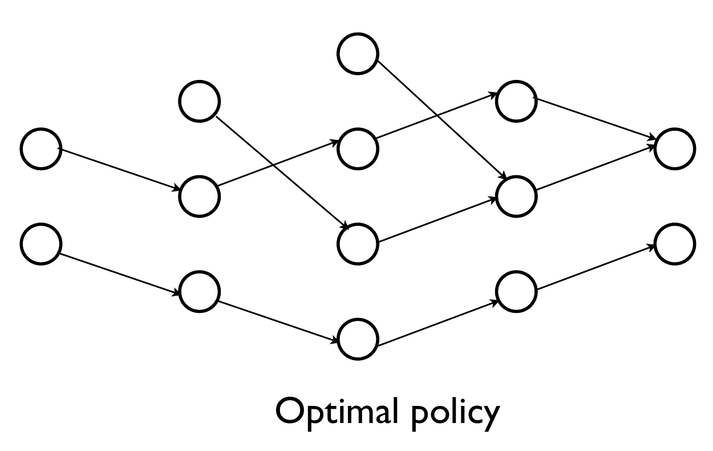{width="60%" fig-align="center"}

## Appendix B {.center style="text-align: center;"}

### DP with Terminal Constraints {style="text-align: center;"}

## DP with terminal constraints

Suppose that we want to reach a given state at the final stage of a transition diagram, starting at a given initial state, with minimum cost (as opposed to simply reaching the final stage).

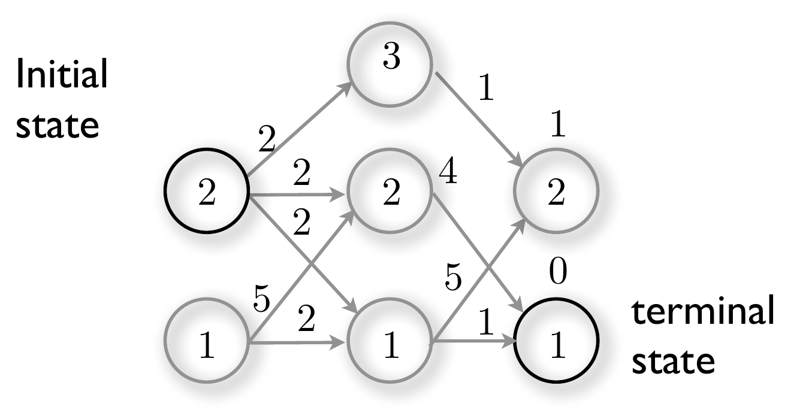{width="55%" fig-align="center"}

Then we can (i) set the cost of all other nodes at the terminal state to infinity, and (ii) apply DP.

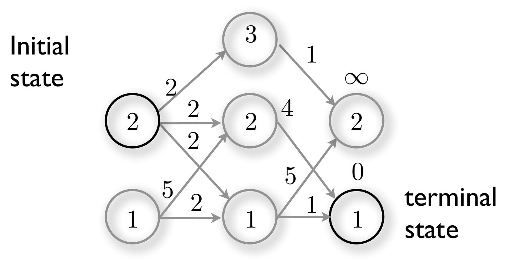{width="55%" fig-align="center"}

## DP with terminal constraints

(ii) Apply DP.

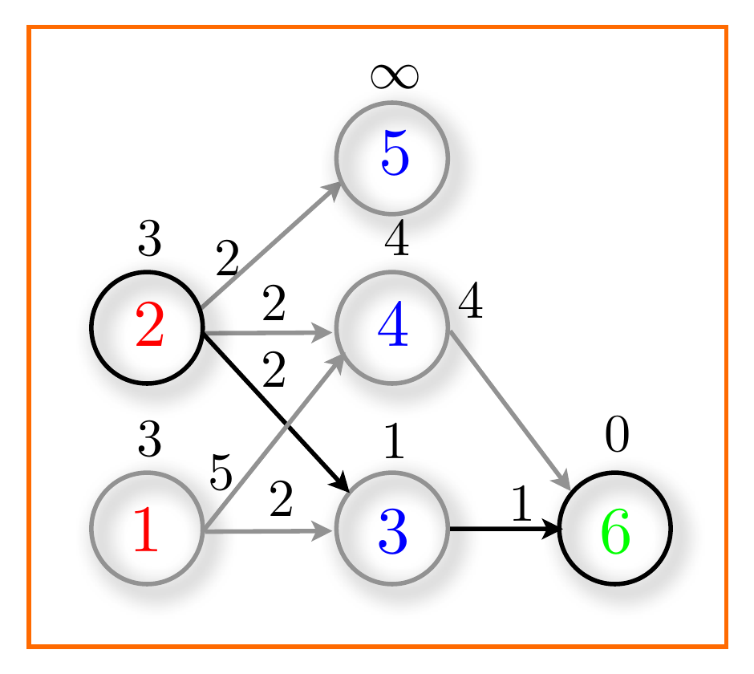{width="45%" fig-align="center"}

## Appendix C {.center style="text-align: center;"}

### Time-Varying Graphs {style="text-align: center;"}

## Time-varying graphs

How to find a shortest path from A to B when the obstacles are moving?

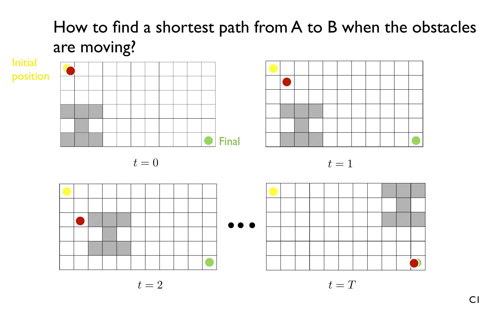{width="80%" fig-align="center"}

## Time-varying graphs

1. Consider the set of static graphs for each time step.

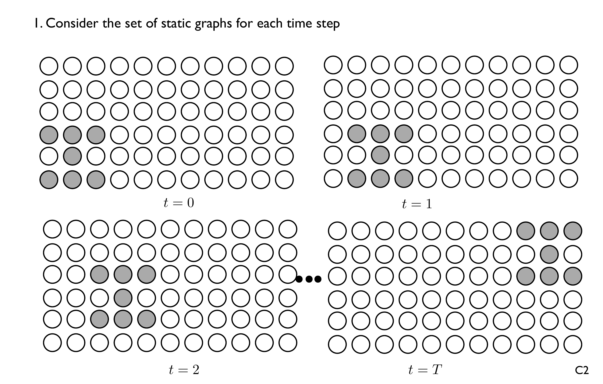{width="80%" fig-align="center"}

## Time-varying graphs

2. Build a **time-invariant** graph in 3D (stacking the per-time-step graphs, with edges only allowed to connect a node at time $t$ to a node at time $t+1$).

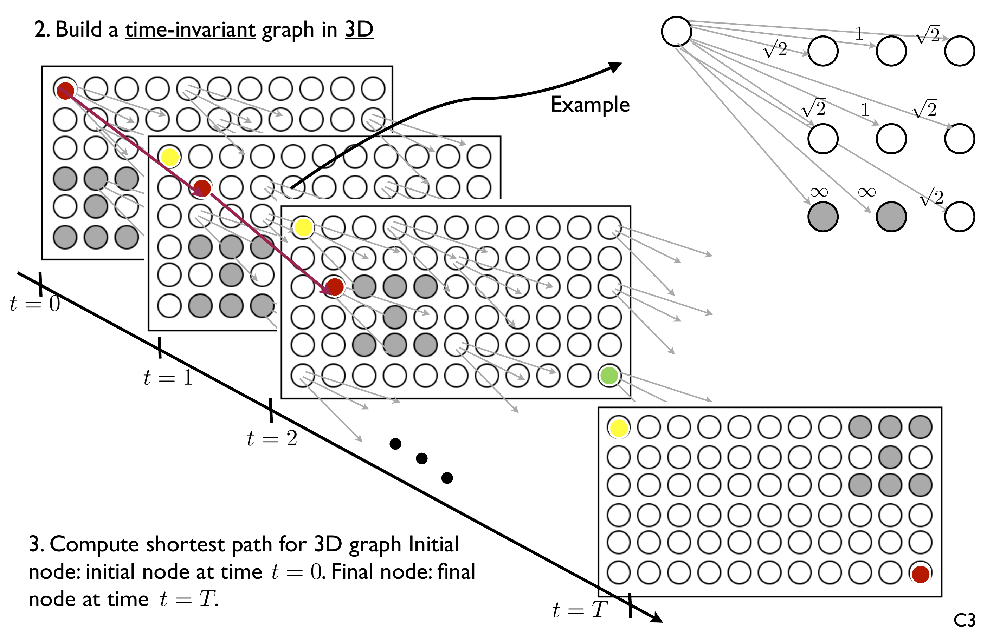{width="80%" fig-align="center"}

3. Compute the shortest path for the 3D graph: initial node is the initial node at time $t=0$; final node is the final node at time $t=T$.
