## Unit 4 {.center style="text-align: center;"}

<!--
Converted from Lecture4.pdf (58 slides) on 2026-08-10, following the
conventions finalized on Lectures 1-3.

Per your standing feedback after Lecture 3 (most recurring mistakes were
cropping and unwanted captions):
- NO image captions are added anywhere in this file. Every figure is a bare
  {width="X%" fig-align="center"} with no caption text and no
  credit div, unless you ask for one.
- Every crop below was produced with the row/column pixel-band-detection
  method (finding exact content boundaries before cropping) and visually
  verified after cropping, rather than shipped as a first guess.

Slides that are mostly text/bullets/equations are rewritten natively.
Slides built around a diagram, grid, tree, table-as-image, or photo are kept
as an embedded, tightly-cropped image of just that diagram (title, body
text, and stray Keynote page numbers cropped out -- body text is retyped
natively instead). Figures live in figures/lecture4/, named pgNN-slug.png
(matching the original PDF page number NN).

Two photos are kept as-is (pg26 GPS-tunnel graphic is an original Keynote
vector illustration; pg28 robot-dog/plant-segmentation photos illustrate a
cited TU/e MSc thesis, Sander Doodman 2024) -- flag if you'd like either
replaced. The Thomas Bayes portrait (pg32) is the standard 18th-century
public-domain engraving, cropped directly from the original slide, same as
the Dijkstra/Bellman portraits in Lectures 1 and 3. The Monty-Hall door
photos (pg37) are generic stock imagery (goats/car), kept as in the
original slide.

The two video slides (pg24/pg25, "LEC4sensor1.mp4" / "LEC4sensor2.mp4") had
no video files available in the course folder, so they are represented as a
plain text note rather than a screenshot placeholder -- happy to embed the
actual clips if you share them.

FIRST-PASS CAVEAT: this is a first pass prioritizing correct structure,
faithful transcription of every equation, and precise figure crops. Expect
a slide-by-slide refinement round, same as Lectures 1-3.
-->

### Partially Observable Markov Decision Processes and the Bayes' Filter {style="text-align: center;"}

{width="15%" fig-align="center"}

::: {.title-slide-meta}
4SC000, Q2 2026-2027

Duarte Antunes
:::

## Introduction

- In several control problems only an output (subset of the states) is available for feedback.
- For example, when controlling the position of a mass on a surface using only position sensors, the state (which includes velocity) is not fully known.
- More generally, the output might not provide full information about the state but only partial information.
- In this lecture we discuss Partially Observable Markov Decision Processes (POMDP) and the crucial Bayes' filter. Most of the lecture will focus on the Bayes' filter.

## Outline

- Formulation of POMDP
- Bayes' filter
- Applications of the Bayes Filter
- Solving POMDPs

## Problem formulation

**Dynamic model** $\quad x_{k+1} = f_k(x_k, u_k, w_k)$

**Cost** $\quad \displaystyle\sum_{k=0}^{h-1} g_k(x_k, u_k, w_k) + g_h(x_h)$

**Output** $\quad y_k = h_k(x_k, n_k)$

**Information set** $\quad I_0 = (y_0), \quad I_k = (y_0, y_1, \dots, y_k, u_0, u_1, \dots, u_{k-1}), \quad k \geq 1$

The state, input and disturbances live in the sets defined in Lecture 2 (slides 3, 16); the output and noise live in finite spaces $Y_k := \{1,\dots,q_{k,i}\}$, $N_k := \{1,\dots,\nu_{k,i}\}$, respectively, and in general dependent on state $x_k = i$.

**Problem.** Find policy $\pi = \{\mu_0,\dots,\mu_{h-1}\}$, $u_k = \mu_k(I_k)$ that minimizes

$$J_\pi = \mathbb{E}\Big[\sum_{k=0}^{h-1} g_k(x_k, \mu_k(I_k), w_k) + g_h(x_h)\Big]$$

## First approach

We can reformulate a partial information optimal control problem as a standard full information optimal control problem by considering the state to be the information set. The problem is that the number of possible states increases exponentially with time.

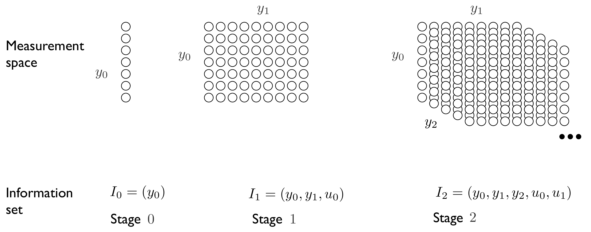{width="90%" fig-align="center"}

## Second approach

It is possible to show that the knowledge of the probability distribution of the state given the information obtained so far, denoted by $P_{x_k|I_k}$, is sufficient to determine optimal decisions $u_k = \mu_k(P_{x_k|I_k})$.

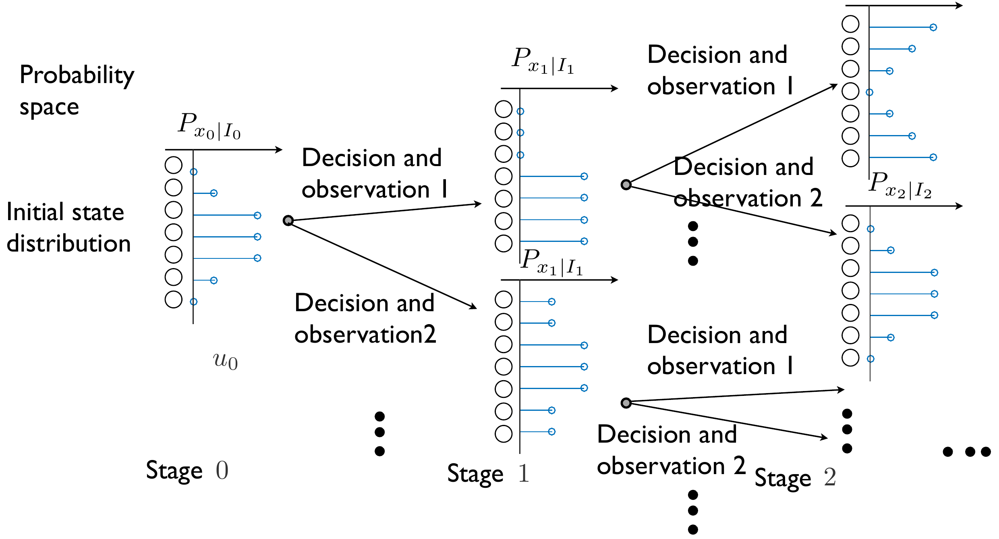{width="85%" fig-align="center"}

## Decomposition of the optimal policy

Then the structure of the optimal decision-maker is (see Bertsekas' book, Section 5.4):

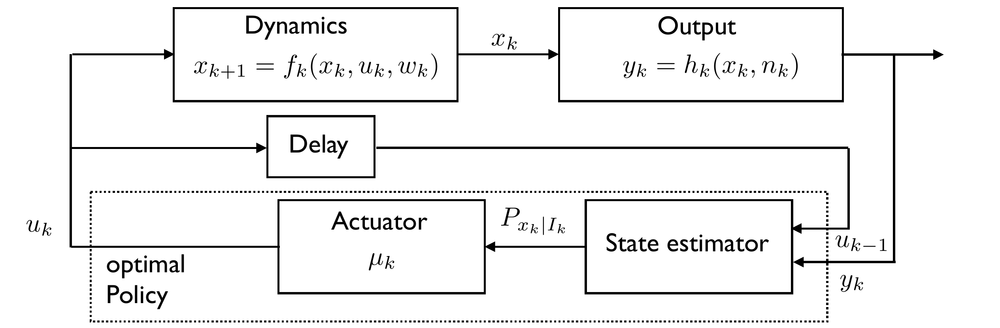{width="85%" fig-align="center"}

That is, the optimal policy can be decomposed into: an estimator of $P_{x_k|I_k}$ and a map from $P_{x_k|I_k}$ to actions.

## Discussion

- The first approach is typically impractical for applications.
- To compute $P_{x_k|I_k}$ a crucial step is the Bayes' rule, and the state estimator is the Bayes filter.
- The Bayes filter is important per se and we will focus on studying it.
- Solving POMDPs will then be briefly addressed.
- It will be more convenient to work with the transition probabilities introduced in Lecture 2.
  $$[P_k(j)]_{ri} = \text{Prob}[x_{k+1} = r \mid x_k = i, u_k = j]$$
- If there is no input and the model is time-invariant we can consider just one matrix $P$.
- Likewise we can represent the output model ($y_k = h_k(x_k, n_k)$) with matrices
  $$[R_k]_{\ell i} = \text{Prob}[y_k = \ell \mid x_k = i]$$
  and if the output is time-invariant we only need one matrix $R$.

## Summary and dimensions

For simplicity, we assume that the input, disturbance, output, and noise spaces do not change with the state (but can still depend on time)

$$x_k \in \{1,\dots,\bar n_k\} \qquad u_k \in \{1,\dots,m_k\} \qquad w_k \in \{1,\dots,\omega_k\}$$

$$y_k \in \{1,\dots,\bar q_k\} \qquad n_k \in \{1,\dots,\nu_k\}$$

The dynamic and output maps can be defined in terms of the following matrices, for each $j \in \{1,\dots,m_k\}$ and each $k \in \{0,\dots,h-1\}$:

|  | dimensions | Components |
|---|:---:|---|
| state transition matrices $P_k(j)$ | $\bar n_{k+1} \times \bar n_k$ | $[P_k(j)]_{ri} = \text{Prob}[x_{k+1}=r \mid x_k=i, u_k=j]$ |
| output matrices $R_k$ | $\bar q_k \times \bar n_k$ | $[R_k]_{\ell i} = \text{Prob}[y_k = \ell \mid x_k=i]$ |

## Outline

- Formulation of POMDP
- <u>Bayes' filter</u>
- Applications of the Bayes Filter
- Solving POMDPs

## Bayes' rule

The Bayes filter relies on the basic Bayes' rule. Suppose $x \in \{1,\dots,n\}$, $y \in \{1,\dots,m\}$ are random variables. Then:

::: {.dp-box}
$$\text{Prob}[x=i \mid y=j] = \frac{\text{Prob}[y=j\mid x=i]\,\text{Prob}[x=i]}{\text{Prob}[y=j]} = \frac{\text{Prob}[y=j\mid x=i]\,\text{Prob}[x=i]}{\sum_{\ell=1}^n \text{Prob}[y=j\mid x=\ell]\,\text{Prob}[x=\ell]}$$
:::

**Example:**

- Think of $y$ as a sensor measurement and think of $x$ as the state (see figure).

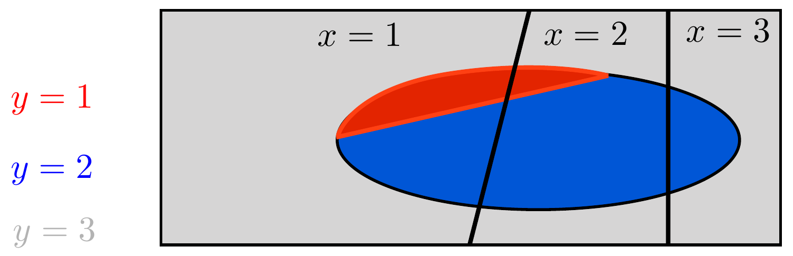{width="50%" fig-align="center"}

- The Bayes' rule allows us to infer something about the state a posteriori of the sensor measurement $\text{Prob}[x=i\mid y=j]$ from a priori information $\text{Prob}[y=j\mid x=i]$, $\text{Prob}[x=i]$.

## Example

A robot can be at one of 8 positions in a floor with a door. It moves in a circular fashion with some slip, characterised as

$$\text{Prob}[p_{k+1}=i\mid p_k=i] = 0.1, \qquad \text{Prob}[p_{k+1}=i\oplus 2\mid p_k=i] = 0.2, \qquad \text{Prob}[p_{k+1}=i\oplus 1\mid p_k=i] = 0.7$$

$$i \oplus r = ((i-1+r)\bmod 8) + 1$$

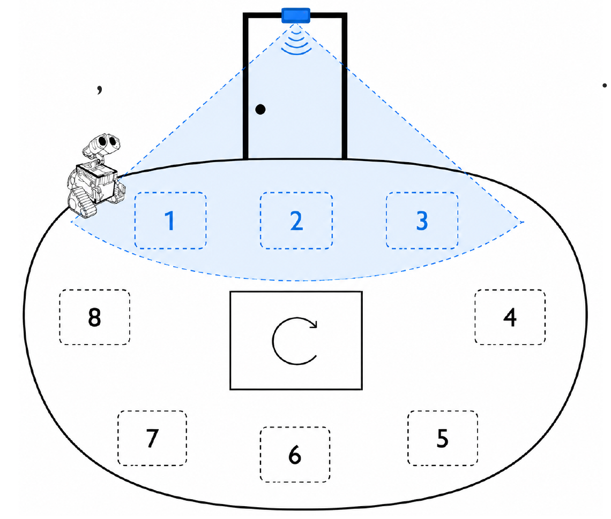{width="42%" fig-align="center"}

If the robot is close to the door a sensor might detect it ($y_k=1$) with

$$\text{Prob}[y_k=1\mid p_k=2] = 1, \qquad \text{Prob}[y_k=1\mid p_k=1] = \text{Prob}[y_k=1\mid p_k=3] = 0.4$$

if $p_k \neq 1,2,3$ then $y_k=0$ with probability one.

Compute: $\quad \text{Prob}[p_2\mid p_0=1] \qquad \text{Prob}[p_2\mid p_0=1, y_2=1]$

## Example

Compute: $\text{Prob}[p_2\mid p_0=1]$

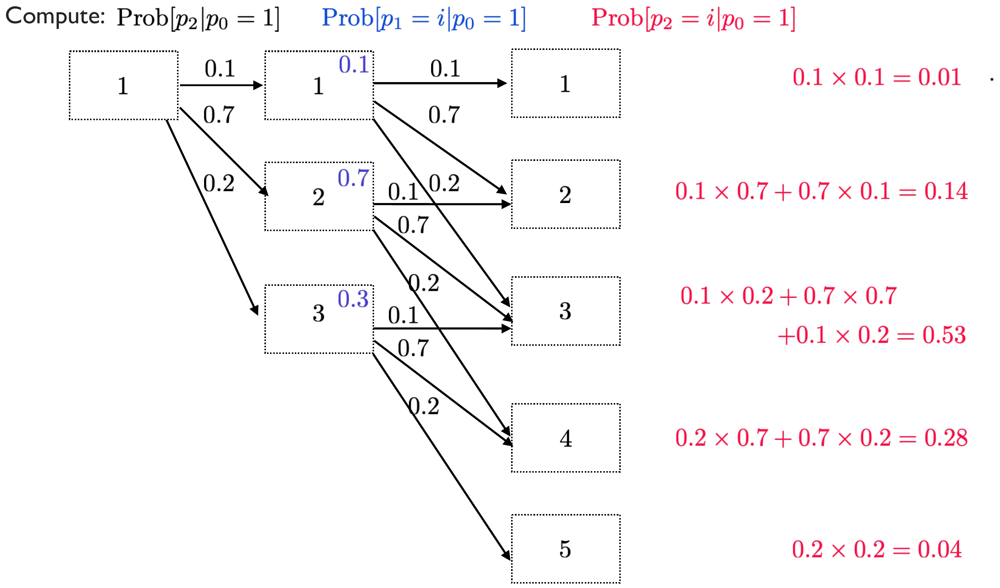{width="85%" fig-align="center"}

## Example

Note that we can compute the probabilities in the previous slide by defining the following matrices

$$P_{ij} = \text{Prob}[x_{k+1}=i\mid x_k=j] \qquad P = \begin{bmatrix}0.1&0&0&0&0&0&0&0\\0.7&0.1&0&0&0&0&0&0\\0.2&0.7&0.1&0&0&0&0&0\\0&0.2&0.7&0.1&0&0&0&0\\0&0&0.2&0.7&0.1&0&0&0\\0&0&0&0.2&0.7&0.1&0&0\\0&0&0&0&0.2&0.7&0.1&0\\0&0&0&0&0&0.2&0.7&0.1\end{bmatrix}$$

$$p_k = \begin{bmatrix}\text{Prob}[x_k=1\mid x_0=1]\\\text{Prob}[x_k=2\mid x_0=1]\\\vdots\\\text{Prob}[x_k=7\mid x_0=1]\\\text{Prob}[x_k=8\mid x_0=1]\end{bmatrix} \quad p_0=\begin{bmatrix}1\\0\\\vdots\\0\\0\end{bmatrix} \quad p_1=\begin{bmatrix}0.1\\0.7\\0.3\\0\\0\\0\\0\\0\end{bmatrix} \quad p_2=\begin{bmatrix}0.01\\0.14\\0.53\\0.28\\0.04\\0\\0\\0\end{bmatrix}$$

And iterating $\quad p_{k+1} = Pp_k$

## Example

Compute: $\text{Prob}[p_2\mid p_0=1, y_2=1]$ &nbsp;&nbsp; (normalizing factor $\alpha = \text{Prob}[y_2=1]$)

$$\text{Prob}[p_2=i\mid p_0=1,y_2=1] = \frac{1}{\alpha}\,\text{Prob}[y_2=1\mid p_0=1,p_2=i]\,\text{Prob}[p_2=i\mid p_0=1]$$

$$= \frac{1}{\alpha}\begin{bmatrix}0.4&0&0&0&0&0&0&0\\0&1&0&0&0&0&0&0\\0&0&0.4&0&0&0&0&0\\0&0&0&0&0&0&0&0\\0&0&0&0&0&0&0&0\\0&0&0&0&0&0&0&0\\0&0&0&0&0&0&0&0\\0&0&0&0&0&0&0&0\end{bmatrix}\begin{bmatrix}0.01\\0.14\\0.53\\0.28\\0.04\\0\\0\\0\end{bmatrix} = \frac{1}{\alpha}\begin{bmatrix}0.004\\0.14\\0.212\\0\\0\\0\\0\\0\end{bmatrix} = \begin{bmatrix}0.0112\\0.3933\\0.5955\\0\\0\\0\\0\\0\end{bmatrix}$$

$$\alpha = 0.004 + 0.14 + 0.212 = 0.3560$$

Multiply by $\quad D(y_k) = \begin{bmatrix}[R]_{y_k1} & 0 & 0 & \dots & 0\\0 & [R]_{y_k2} & 0 & \dots & 0\\\vdots & \vdots & \ddots & \ddots & \vdots\\0 & 0 & \dots & 0 & [R]_{y_k\bar n}\end{bmatrix}$ &nbsp; apart from normalizing factor

## Bayes' filter (no input, time-invariant)

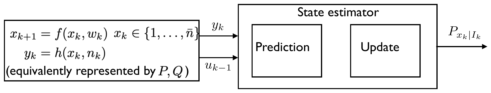{width="85%" fig-align="center"}

$(x_{k+1}=f(x_k,w_k), \; x_k \in \{1,\dots,\bar n\}, \; y_k=h(x_k,n_k)$, equivalently represented by $P,Q)$

$P_{x_k|I_k}$ is represented by the vector $p_k = \begin{bmatrix}p_{k,1} & \dots & p_{k,\bar n}\end{bmatrix}^\top$, $\quad p_{k,i} = \text{Prob}[x_k=i\mid I_k]$

**Prediction** $\quad \bar p_{k+1} = Pp_k$

**Correction** $\quad q_{k+1} = D(y_{k+1})\bar p_{k+1} \qquad p_{k+1} = \dfrac{q_{k+1}}{\mathbb{1}^\top q_{k+1}}$

**Initial condition** $\quad p_0 = \dfrac{q_0}{\mathbb{1}^\top q_0} \qquad q_0 = D(y_0)\tilde p_0 \qquad \tilde p_{0,i} = \text{Prob}[x_0=i]$

## Bayes' filter (general case)

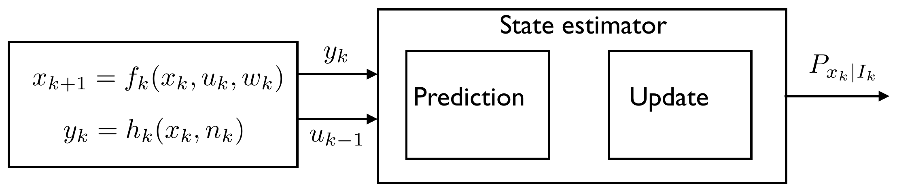{width="80%" fig-align="center"}

$P_{x_k|I_k}$ is represented by the vector $p_k = \begin{bmatrix}p_{k,1} & \dots & p_{k,\bar n_k}\end{bmatrix}^\top$, $\quad p_{k,i} = \text{Prob}[x_k=i\mid I_k]$

**Prediction** $\quad \bar p_{k+1} = P_k(u_k)p_k$

**Correction** $\quad q_{k+1} = D(y_{k+1})\bar p_{k+1} \qquad p_{k+1} = \dfrac{q_{k+1}}{\mathbb{1}^\top q_{k+1}}$

**Initial condition** $\quad p_0 = \dfrac{q_0}{\mathbb{1}^\top q_0} \qquad q_0 = D(y_0)\tilde p_0 \qquad \tilde p_{0,i} = \text{Prob}[x_0=i]$

## Outline

- Formulation of POMDP
- Bayes' filter
- <u>Applications of the Bayes Filter</u>
- Solving POMDPs

## Tracking a robot in a grid world

This is a similar but more involved example. We wish to estimate the position of a robot in a given environment. We assign a label $i \in \{1,\dots,n\}$ to each cell in the environment and $x_k=i$ indicates that the robot's position coincides with the centre of cell $i$.

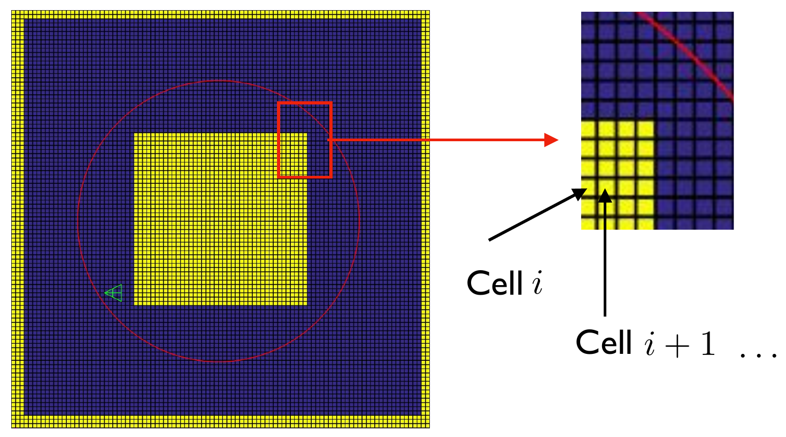{width="55%" fig-align="center"}

The robot moves according to a given control policy (autonomous system)$^\dagger$

$$x_{k+1} = f(x_k, w_k) \qquad \text{(disturbances)}$$

::: {style="font-size: 0.6em;"}
$^\dagger$ The derivations of the Bayes filter can be easily specialised to this case (no control input).
:::

## Vector field

Vector field with no disturbances:

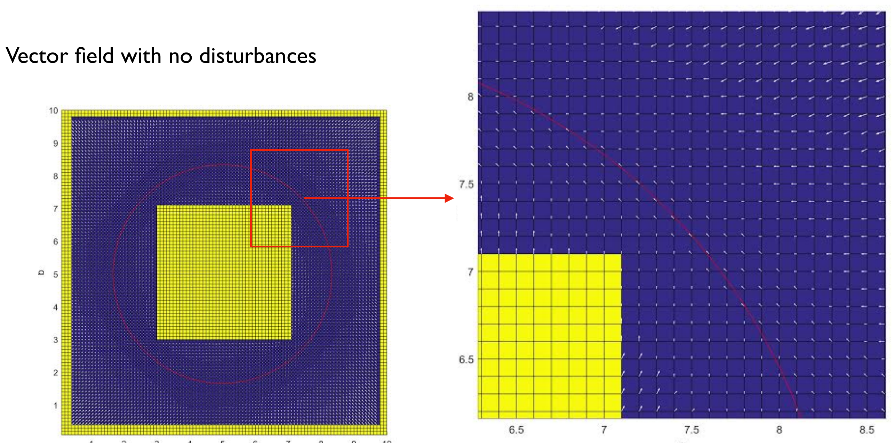{width="85%" fig-align="center"}

## Disturbance model

At each step $k$, for a given state $x_k$, the new state $x_{k+1}=f(x_k,w_k)$ is uncertain and can take values in a neighbourhood of the state obtained with a deterministic model $x_{k+1}=f(x_k,0)$, according to the probability values given in the grid below.

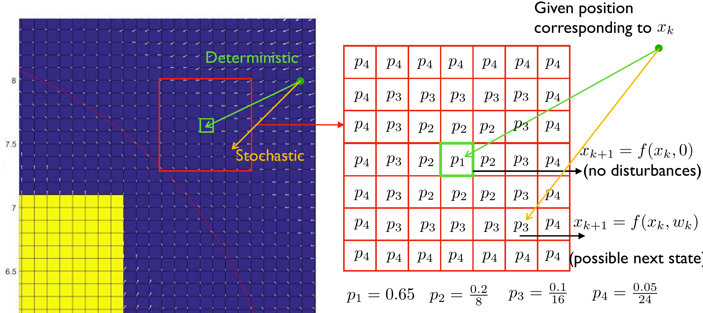{width="95%" fig-align="center"}

## Sensor model I

At each step $k$, for a given state $x_k$, the measurement $y_k=h(x_k,n_k)$ is uncertain and can take values in a neighbourhood of the state $x_k$ according to the probability values given in the grid.

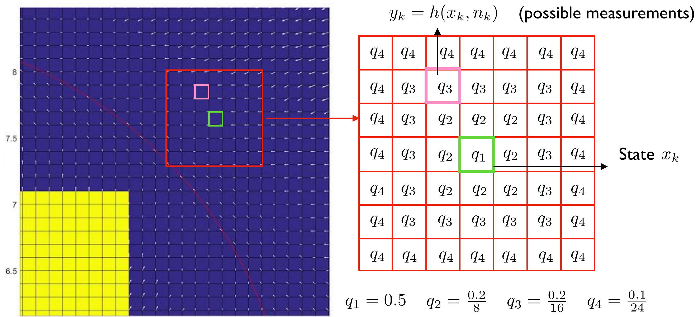{width="95%" fig-align="center"}

## Sensor model II

At each step $k$, for a given state $x_k$, the measurement $y_k=h(x_k)$ is deterministic and indicates if there are objects/walls (represented in yellow) within an euclidian distance, a multiple $M=5$ of the length of each cell, of the robot. If so it indicates if the closest object/wall is to the left (L), right (R), up (U) or down (D), otherwise it indicates no object close (NO).

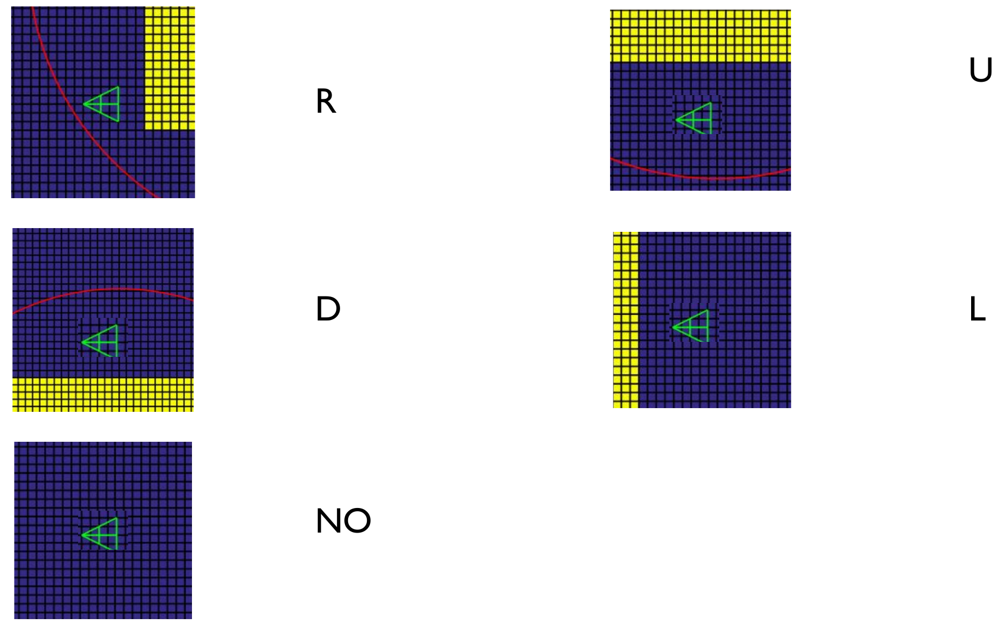{width="75%" fig-align="center"}

## Results

Video: `LEC4sensor1.mp4`

## Results

Video: `LEC4sensor2.mp4`

## GPS denied environments

Estimate the position of a car in a GPS denied tunnel.

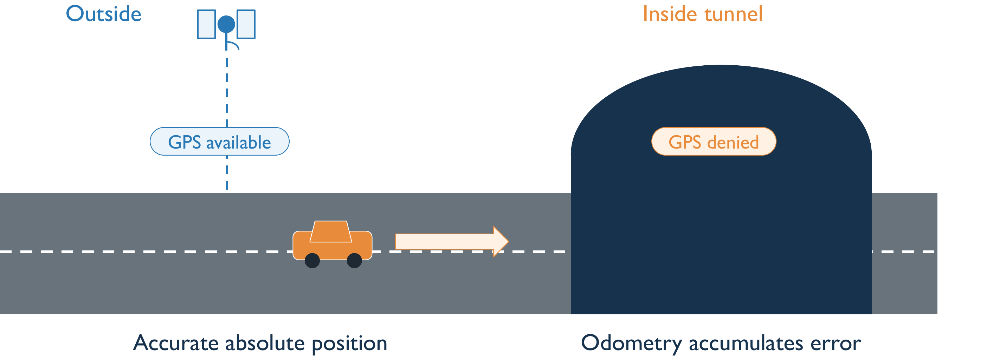{width="95%" fig-align="center"}

## Model

Position cells along the lane $\quad q_k \in \{1,\dots,n\}$

{width="55%" fig-align="center"}

Velocity levels expressed in cell jump units for simplicity $\quad v_k \in \{0,1,\dots,m\}$

Internal velocimeter estimates velocity, providing measurement

$$\tilde v_k = v_k - w_k \qquad \text{Disturbances } w_k \in \{-n_w,\dots,-1,0,1,n_w\}$$

Dynamical model $\quad q_{k+1} = q_k + \underbrace{\tilde v_k + w_k}_{v_k}$

GPS measurements $\quad y_k = p_k + n_k \qquad n_k \in \{-n_v,\dots,-1,0,1,n_v\}$

Details omitted as similar to previous examples, link to AI generated animation [here]{.underline}

## Estimation of plant attributes

Bayes filter is often used to keep track of a world model. See the MSc thesis *Semantic SLAM for Autonomous Robots in Precision Farming Using Bayesian Inference*, Sander Doodman, 2024, where it is used to keep track of the attributes of plants in an agricultural field based on camera measurements of a robot dog.

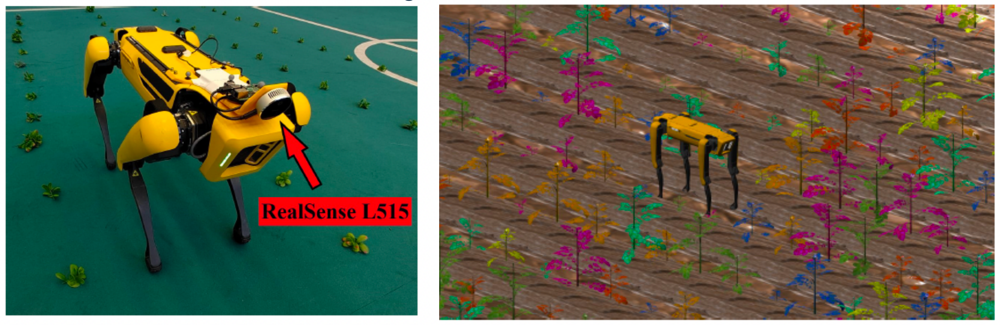{width="90%" fig-align="center"}

## Outline

- Formulation of POMDP
- Bayes' filter
- Applications of the Bayes Filter
- <u>Solving POMDPs</u>

## POMDP optimal policy structure

**Dynamic model** $\quad x_{k+1} = f_k(x_k, u_k, w_k)$

**Cost** $\quad \displaystyle\sum_{k=0}^{h-1} g_k(x_k, u_k, w_k) + g_h(x_h)$

**Output** $\quad y_k = h_k(x_k, n_k)$

**Information set** $\quad I_0 = (y_0) \qquad I_k = (y_0, y_1, \dots, y_k, u_0, u_1, \dots, u_{k-1}), \quad k \geq 1$

A general result (see Appendix A) is that the optimal cost-to-go function and policy can be written as

$$J_k(p_k) = \min\{\alpha_k^1{}^\top p_k, \alpha_k^2{}^\top p_k, \dots, \alpha_k^{a_k}{}^\top p_k\} \qquad J_h(p_h) = \alpha_h^1{}^\top p_h$$

$$\mu_k(p_k) = \arg\min_{u_k} \mathbb{E}[g_k(x_k, u_k) + J_{k+1}(p_{k+1})]$$

for $n$-dimensional vectors $\alpha_k^1, \alpha_k^2, \dots, \alpha_k^{a_k}$ (which are determined from the equations in Appendix A18).

## Solving POMDPs

1. Obtain a priori $\alpha_k^1, \alpha_k^2, \dots, \alpha_k^{a_k}$ as implicitly determined from the equations in Appendix A18. These define linear functions in the belief space of $n$-dimensional probability distributions $p$ (we remove the $k$ dependency). If we use the parameterization $p = (q, 1 - \mathbb{1}^\top q)$ these become affine.

   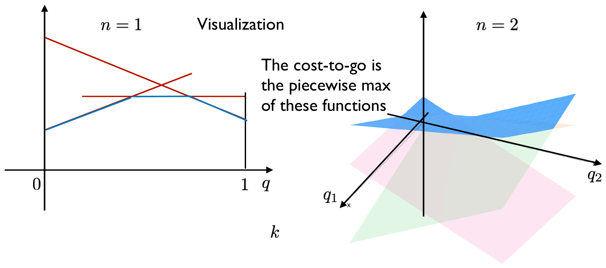{width="90%" fig-align="center"}

2. Based on the measurements up to time $k$, compute $p_k$ with the Bayes filter.
3. Take decision
   $$\mu_k(p_k) = \arg\min_{u_k} \mathbb{E}[g_k(x_k,u_k) + J_{k+1}(p_{k+1})] \qquad J_k(p_k) = \min\{\alpha_k^1{}^\top p_k, \dots, \alpha_k^{a_k}{}^\top p_k\}$$

Examples and derivation given in the appendix.

## Thomas Bayes

**Historical note**

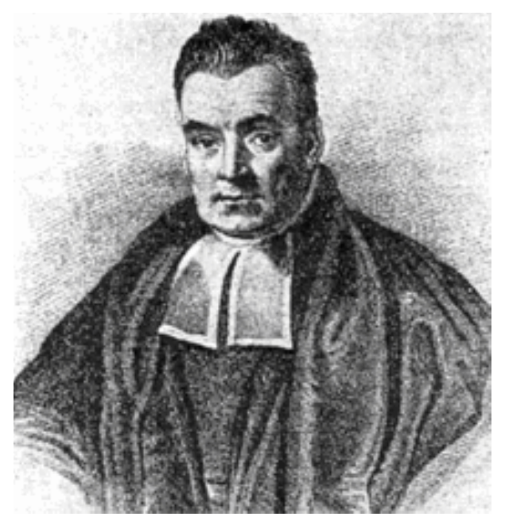{width="22%" fig-align="center"}

Thomas Bayes (1701 – 1761) was an English statistician, philosopher and Presbyterian minister who is known for having formulated a specific case of the theorem that bears his name: Bayes' theorem. Bayes never published what would eventually become his most famous accomplishment; his notes were edited and published after his death (source wikipedia).

## Concluding remarks

**Summary**

- The optimal controller for a POMDP can be divided into a state estimator, computing the probability distribution of the state, and a decision maker.
- The state estimator relies on the Bayes' filter, which is interesting per se in several contexts.

**After this lecture, you should be able to:**

- Apply the Bayes' filter.

**Additional Live Scripts**

- Angle estimation `LiveScript/Lecture4/angleestimationbayes.mlx`
- Position estimation in a grid world `LiveScript/Lecture4/gridworldBayes.mlx`
- Remote temperature sensing `LiveScript/Lecture4/RemoteTempSensingBayes.mlx`
- IMU estimation `LiveScript/Lecture4/BayesIMU.mlx`

## Appendix A {.center style="text-align: center;"}

### POMDP {style="text-align: center;"}

## Solution of a POMDP*

- The POMDP problem we introduced can always be solved exactly.
- In fact, as we shall see, the costs-to-go take the general form of piecewise affine functions of the probability distribution of the state.
- However, the complexity of these functions typically grows exponentially with the number of stages, and therefore this result has mostly theoretical interest. In practice, heuristics are used to approach POMDPs.
- We will study first two examples (Monty Hall, and machine repair) and then establish this general fact.

::: {style="font-size: 0.55em;"}
\*This part of the course (POMDP) is just instructive, and it will not appear in the exam and in the problem sets.
:::

## Monty Hall problem

- The first approach is typically impractical for applications.
- The second approach is often used in robotics (google POMDP) and is will also be used to derive LQG control.
- A nice example of these two approaches is given in Bertsekas' book Chapter 5, Machine repair Sec 5.4 and Example 5.4.2.
- For illustration purposes we solve the Monty Hall problem using the second approach (the first approach would actually be similar).

Video: `https://www.youtube.com/watch?v=Q5nCtgcL4jU` ("21" explains the Monty Hall problem)

## Example: Monty hall problem

> Monty Hall problem. Suppose you're on a game show, and you're given the choice of three doors: Behind one door is a car; behind the others, goats. You pick a door, say No 1, and the host, who knows what's behind the doors, opens another door, say No. 3, which has a goat. He then says to you, "Do you want to pick door No. 2?" Is it to your advantage to switch your choice?
>
> Whitaker, Craig F. (9 September 1990, Parade Magazine: 16, source wikipedia.)

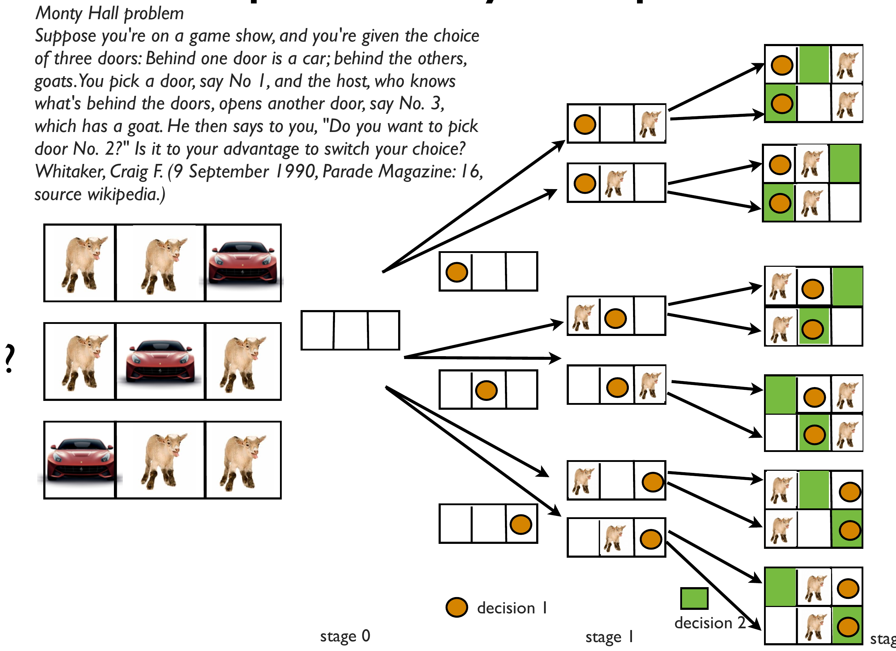{width="78%" fig-align="center"}

## Formulation

**Dynamic model**

control input: two decision stages $k \in \{0,1,2\}$, decisions $u_0 \in \{1,2,3\}$ (doors selected) $u_1 \in \{1,2,3\}$

**State.** Two "components":

$$\bar x_{k+1} = \bar x_k \quad \text{(door where the car is)} \qquad \bar x_0 \text{ unknown, no disturbances} \qquad \text{Prob}[\bar x_0=1]=\text{Prob}[\bar x_0=2]=\text{Prob}[\bar x_0=3]=\tfrac{1}{3}$$

$$\tilde x_{k+1} = u_k \quad \text{keeps track of previous decision} \qquad \tilde x_0 = 1 \text{ (not relevant)}$$

We can think of the overall state as $x_k = (\bar x_k, \tilde x_k)$, although formally $x_k \in \{1,2,\dots,9\}$ corresponds to the nine possible combinations of $\bar x_k \in \{1,2,3\}$, $\tilde x_k \in \{1,2,3\}$. Note that from $x_k$ we can extract $\tilde x_k, \bar x_k$ and vice-versa.

## Formulation

**Cost** $\quad g_0(x_0,u_0)=0 \qquad g_1(x_1,u_1) = \begin{cases}1, & \text{if } \bar x_1 = u_1\\0, & \text{otherwise}\end{cases} \qquad g_2(x_2)=0$

**Output and information sets** $\quad y_0 = \emptyset \qquad I_0 = (\emptyset)$

$$y_1 = h_1(x_1,n_1) = \begin{cases}\{1,2,3\}\setminus\{\bar x_1,\tilde x_1\} & \text{if } \bar x_1 \neq \tilde x_1\\\{1,2,3\}\setminus\{\bar x_1,n_1\} & \text{if } \bar x_1 = \tilde x_1\end{cases} \qquad I_1 = (y_1, u_0)$$

where $n_1$ is a random variable taking one of two values in the set $\{1,2,3\}\setminus\{\bar x_1\}$ with equal probability ($1/2$).

## Conditional probability

- To apply DP, start at stage 1 and compute $P_{\bar x_1|I_1}$ for every possible value of $I_1 = (y_1, u_0)$.
- Given $I_1$ it is trivial to compute $\tilde x_1 = u_0$ and therefore it suffices to compute $P_{\bar x_1|I_1}$.
- Let us do this for $(y_1,u_0)=(3,1)$. It is obvious that

$$\text{Prob}[\bar x_1=3\mid (y_1,u_0)=(3,1)] = 0$$

How to compute $\text{Prob}[\bar x_1=2\mid (y_1,u_0)=(3,1)]$, $\text{Prob}[\bar x_1=1\mid (y_1,u_0)=(3,1)]$?

**Bayes' rule!**

## Computing $P_{\bar x_1|I_1}$

$$\text{Prob}[\bar x_1=2\mid y_1=3,u_0=1] = \alpha\,\text{Prob}[y_1=3\mid \bar x_1=2,u_0=1]\,\text{Prob}[\bar x_1=2\mid u_0=1] = \alpha \cdot 1 \times \tfrac{1}{3} = \tfrac{2}{3}$$

$$\text{Prob}[\bar x_1=1\mid y_1=3,u_0=1] = \alpha\,\text{Prob}[y_1=3\mid \bar x_1=1,u_0=1]\,\text{Prob}[\bar x_1=1\mid u_0=1] = \alpha \cdot \tfrac{1}{2} \times \tfrac{1}{3} = \tfrac{1}{3}$$

$$\alpha = \frac{1}{\text{Prob}[y_1=3\mid u_0=1]} = \frac{1}{\tfrac{1}{2}\times\tfrac{1}{2} + 1\times\tfrac{1}{3}} = 2$$

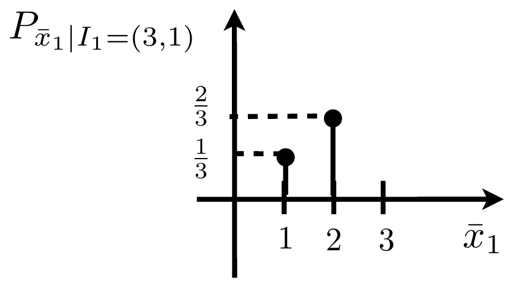{width="30%" fig-align="center"}

## Optimal decision

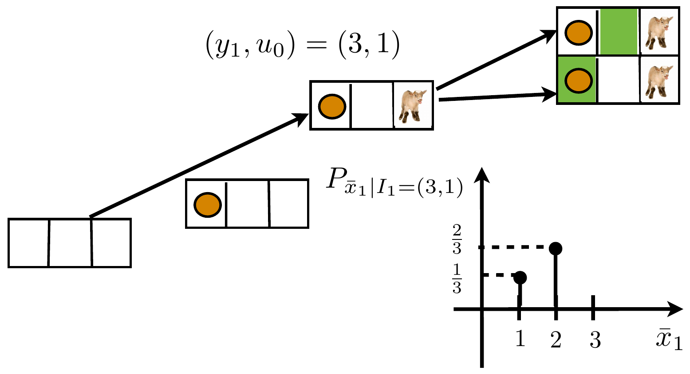{width="55%" fig-align="center"}

The optimal decision is the one that minimizes $\mathbb{E}[g_1(x_1,u_1)]$, $\quad g_1(x_1,u_1) = \begin{cases}-1, & \text{if } \bar x_1 = u_1\\0, & \text{otherwise}\end{cases}$

$$\mathbb{E}[g_1(x_1,u_1)] = -1\times\text{Prob}[\bar x_1=u_1] + 0\times\text{Prob}[\bar x_1\neq u_1] = -\text{Prob}[\bar x_1=u_1]$$

This is achieved for $\bar x_1=2$ and is given by $\text{Prob}[\bar x_1=2] = \tfrac{2}{3}$.

## Optimal Policy

The optimal policy is to pick any door at stage 0 and switch at stage 1, and the probability of winning is $\tfrac{2}{3}$.

::: {layout-ncol="2"}
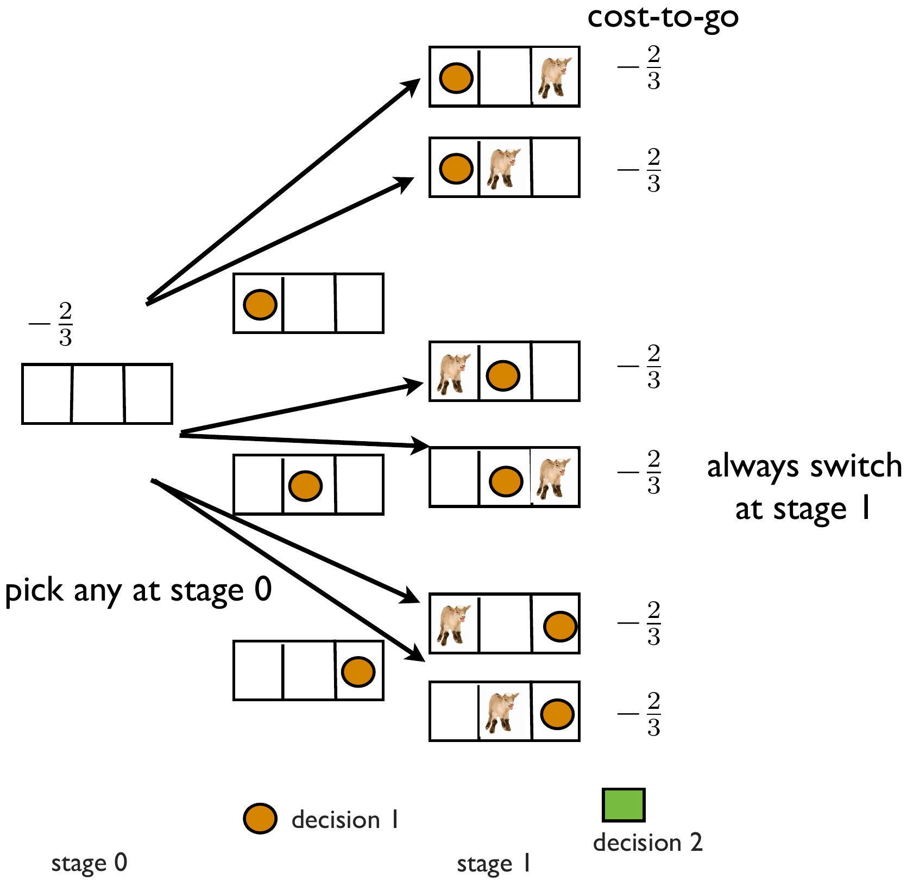{width="95%" fig-align="center"}

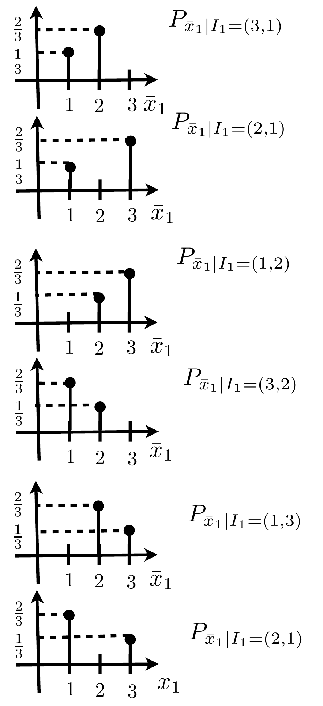{width="65%" fig-align="center"}
:::

## Example: Machine repair*

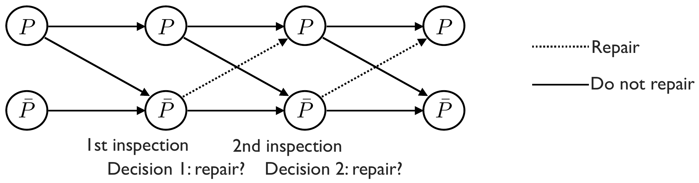{width="90%" fig-align="center"}

- A machine can be in one of two states $P$ (proper condition) or $\bar P$ (improper condition).
- In each time period, if it starts at $\bar P$ it stays in $\bar P$; if it starts at $P$ it stays at $P$ with probability $2/3$ and it moves to $\bar P$ with probability $1/3$.
- It operates over 3 periods and initially it is in state $P$.
- At the end of the first and second periods there is an inspection, with possible outcomes positive $G$ and negative $B$, with $\text{Prob}[G|P] = \text{Prob}[B|\bar P] = 3/4$, $\text{Prob}[B|P] = \text{Prob}[G|\bar P] = 1/4$.
- There are two possible actions after each inspection: continue operation $C$ or stop and repair $S$. Continue will not change the state and repair will change the state to $P$ if in $\bar P$.
- Action $C$ has a cost $0$ and action $S$ has a cost $1$. Each period that the state is $\bar P$ incurs a cost $2$.

::: {style="font-size: 0.55em;"}
\*[Bertsekas's book Section 5.1]
:::

## Dynamic programming formulation

**Dynamics** $\quad x_{k+1} = w_k \qquad k \in \{0,1\} \qquad x_k \in \{P,\bar P\} \qquad u_k \in \{C,S\}$

$$\text{Prob}[x_0=P]=\tfrac{2}{3} \qquad \text{Prob}[x_0=\bar P]=\tfrac{1}{3}$$

$$\text{Prob}[w_k=P\mid x_k=P,u_k=C]=\tfrac{2}{3} \qquad \text{Prob}[w_k=P\mid x_k=\bar P,u_k=C]=0$$

$$\text{Prob}[w_k=P\mid x_k=P,u_k=S]=\tfrac{2}{3} \qquad \text{Prob}[w_k=P\mid x_k=\bar P,u_k=S]=\tfrac{2}{3}$$

$$\text{Prob}[w_k=\bar P\mid \dots] = 1 - \text{Prob}[w_k=P\mid\dots]$$

**Measurements** $\quad y_k = v_k \qquad \text{Prob}[v_k=G\mid x_k=P]=\tfrac{3}{4} \qquad \text{Prob}[v_k=G\mid x_k=\bar P]=\tfrac{1}{4} \qquad \text{Prob}[v_k=B\mid\dots] = 1-\text{Prob}[v_k=G\mid\dots]$

**Cost** $\quad g(x_0,u_0)+g(x_1,u_1) \qquad g(P,C)=0 \quad g(P,S)=1 \quad g(\bar P,C)=2 \quad g(\bar P,S)=1$

**Information set** $\quad I_0=(y_0) \qquad I_1=(y_0,y_1,u_0)$

**Goal** Find $\mu_0(I_0), \mu_1(I_1)$ to minimize $\mathbb{E}[g(x_0,\mu_0(I_0)) + g(x_1,\mu_1(I_1))]$

## Dynamic programming algorithm

**$k=1$**

At the last decision stage, assume that we know $p_1 = \text{Prob}[x_1=\bar P\mid I_1]$ (then $\text{Prob}[x_1=P\mid I_1] = 1-p_1$).

For a given "state" $p_1$ the cost-to-go is $J_1 = \min_{u_1}\mathbb{E}[g(x_1,u_1)\mid I_1]$.

- $u_1=S$ — cost-to-go is $1$, since $g(P,S)=1$, $g(\bar P,S)=1$.
- $u_1=C$ — cost-to-go is $2p_1$, since $\mathbb{E}[g(x_1,u_1)\mid I_1] = \underbrace{g(\bar P,C)}_{=2}\text{Prob}[x_1=\bar P\mid I_1] + \underbrace{g(P,C)}_{=0}\underbrace{\text{Prob}[x_1=P\mid I_1]}_{1-p_1}$

Therefore

$$\mu_1(p_1) = \begin{cases}S & \text{if } p_1 > \tfrac{1}{2}\\C & \text{if } p_1 \leq \tfrac{1}{2}\end{cases} \qquad J_1(p_1) = \min(2p_1, 1)$$

## Dynamic programming algorithm

**$k=0$**

At the first decision stage assume that we know $p_0 = \text{Prob}[x_0=\bar P\mid I_0]$.

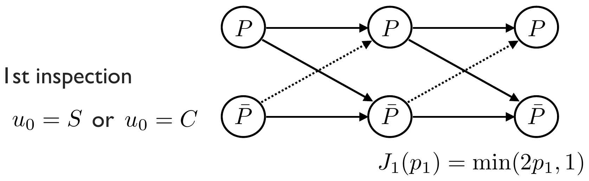{width="65%" fig-align="center"}

To determine how decision $u_0$ can influence the cost-to-go we need to understand how the state probability distribution at $k=1$, parameterised by $p_1$, depends on $u_0$, taking into account that there will be a measurement $y_1$.

## Dynamic programming algorithm

There are then four options, each leading to a probability distribution characterised by

$$p_1 = \phi_1(p_0,u_0,y_1) = \begin{cases}\tfrac{1}{7} & \text{if } u_0=S, y_1=G\\[4pt] \tfrac{3}{5} & \text{if } u_0=S, y_1=B\\[4pt] \tfrac{1+2p_0}{7-4p_0} & \text{if } u_0=C, y_1=G\\[4pt] \tfrac{3+6p_0}{5+4p_0} & \text{if } u_0=C, y_1=B\end{cases}$$

For example, for $u_0=S$, $y_1=G$, $p_1 = \text{Prob}[x_1=\bar P\mid u_0=S,y_1=G]$ is given by

$$p_1 = \frac{\text{Prob}[y_1=G\mid u_0=S,x_1=\bar P]\underbrace{\text{Prob}[x_1=\bar P\mid u_0=S]}_{1/3}}{\text{Prob}[y_1=G\mid u_0=S,x_1=\bar P]\text{Prob}[x_1=\bar P\mid u_0=S] + \text{Prob}[y_1=G\mid u_0=S,x_1=P]\underbrace{\text{Prob}[x_1=P\mid u_0=S]}_{2/3}} = 1/7$$

using $\text{Prob}[y_1=G\mid u_0=S,x_1=\bar P]=1/4$, $\text{Prob}[y_1=G\mid u_0=S,x_1=P]=3/4$.

Other example, $u_0=C$, $y_1=B$: $\quad p_1 = \dfrac{\text{Prob}[y_1=B\mid u_0=C,x_1=\bar P]\,(p_0 + (1-p_0)/3)}{\text{Prob}[y_1=B\mid u_0=C,x_1=\bar P](p_0+(1-p_0)/3) + \text{Prob}[y_1=B\mid u_0=C,x_1=P]\,(1-p_0)2/3} = \dfrac{3+6p_0}{5+4p_0}$

## Dynamic programming algorithm

Therefore

$$J_0(p_0) = \min\Big[2p_0 + \text{Prob}[y_1=G\mid p_0,u_0=C]J_1(\phi_1(p_0,C,G)) + \text{Prob}[y_1=B\mid p_0,u_0=C]J_1(\phi_1(p_0,C,B)),$$
$$1 + \text{Prob}[y_1=G\mid p_0,u_0=S]J_1(\phi_1(p_0,S,G)) + \text{Prob}[y_1=B\mid p_0,u_0=S]J_1(\phi_1(p_0,S,B))\Big]$$

where one can compute

$$\text{Prob}[y_1=G\mid p_0,u_0=C] = \frac{7-4p_0}{12} \qquad \text{Prob}[y_1=B\mid p_0,u_0=C] = \frac{5+4p_0}{12}$$

$$\text{Prob}[y_1=G\mid p_0,u_0=S] = \frac{7}{12} \qquad \text{Prob}[y_1=B\mid p_0,u_0=S] = \frac{5}{12}$$

Then

$$J_0(p_0) = \min\Big[2p_0 + \tfrac{7-4p_0}{12}J_1(\tfrac{1+2p_0}{7-4p_0}) + \tfrac{5+4p_0}{12}J_1(\tfrac{3+6p_0}{5+4p_0}), \; 1 + \tfrac{7}{12}J_1(\tfrac{1}{7}) + \tfrac{5}{12}J_1(\tfrac{3}{5})\Big]$$

which can be simplified to

$$J_0(p_0) = \begin{cases}\tfrac{19}{12}, & \tfrac{3}{8} \leq p_0 \leq 1\\[4pt] \tfrac{7}{12} + \tfrac{32p_0}{8}, & 0 \leq p_0 \leq \tfrac{3}{8}\end{cases} \qquad \mu_0(p_0) = \begin{cases}C, & p_0 \leq \tfrac{3}{8}\\S, & \text{if } p_0 > \tfrac{3}{8}\end{cases} \quad \text{(optimal policy)}$$

## General case

**Dynamic model** $\quad x_{k+1} = f_k(x_k, u_k, w_k)$

**Cost** $\quad \displaystyle\sum_{k=0}^{h-1} g_k(x_k, u_k, w_k) + g_h(x_h)$

**Output** $\quad y_k = h_k(x_k, n_k)$

**Information set** $\quad I_0 = (y_0) \qquad I_k = (y_0, y_1, \dots, y_k, u_0, u_1, \dots, u_{k-1}), \quad k \geq 1$

Then there exist $n$-dimensional vectors $\alpha_k^1, \alpha_k^2, \dots, \alpha_k^{a_k}$, for each $k$, such that

$$J_k(p_k) = \min\{\alpha_k^1{}^\top p_k, \alpha_k^2{}^\top p_k, \dots, \alpha_k^{a_k}{}^\top p_k\} \qquad J_h(p_h) = \alpha_h^1{}^\top p_h$$

$$\mu_k(p_k) = \arg\min_{u_k}\mathbb{E}[g_k(x_k,u_k) + J_{k+1}(p_{k+1})]$$

## Justification

For simplicity assume the running cost is $g(x_k,u_k)$ and it does not depend on time and on the disturbances, and that the state, input and output live in fixed sets over time: $x_k \in \{1,\dots,n\}$, $u_k \in \{1,\dots,m\}$, $y_k \in \{1,\dots,q\}$.

The statement is true for the last stage since, defining $\alpha_h^1 = \begin{bmatrix}g_h(1) & g_h(2) & \dots & g_h(n)\end{bmatrix}^\top$,

$$J_h(p_h) = \mathbb{E}[g_h(x_h)\mid I_h] = \sum_{i=1}^n g_h(i)\underbrace{\text{Prob}[x_h=i\mid I_h]}_{p_{h,i}} = \alpha_h^1{}^\top p_h$$

And, assuming it is true for $k+1$, note that

$$J_k(p_k) = \min_{u_k}\mathbb{E}[g(x_k,u_k) + J_{k+1}(p_{k+1})\mid I_k] = \min_{u_k}\bar\alpha(u_k)^\top p_k + \mathbb{E}[J_{k+1}(p_{k+1})\mid I_k] \qquad \big(\bar\alpha(u_k) = \begin{bmatrix}g(1,u_k)&\dots&g(n,u_k)\end{bmatrix}^\top\big)$$

$$= \min_{u_k}\bar\alpha(u_k)^\top p_k + \sum_{\ell=1}^q \mathbb{E}[J_{k+1}(p_{k+1})\mid I_k, y_{k+1}=\ell]\text{Prob}[y_{k+1}=\ell\mid I_k] \quad \text{(condition on } y_{k+1}\text{)}$$

From slide 15 (Bayes' filter), $\;p_{k+1} = \dfrac{q_{k+1}}{\text{Prob}[y_{k+1}=\ell\mid I_k]}\;$ where $q_{k+1} = D(y_{k+1})P_k(u_k)p_k$.

## Justification

Replacing this expression and noticing that

$$J_{k+1}(p_{k+1}) = \min\{\alpha_{k+1}^1{}^\top p_{k+1}, \alpha_{k+1}^2{}^\top p_{k+1}, \dots, \alpha_{k+1}^{a_{k+1}}{}^\top p_{k+1}\}$$

we obtain

$$J_k(p_k) = \min_{u_k \in \{1,\dots,m\}} \bar\alpha(u_k)^\top p_k + \sum_{\ell=1}^q \Big\{\alpha_{k+1}^1{}^\top D(\ell)P_k(u_k)p_k, \; \alpha_{k+1}^2{}^\top D(\ell)P_k(u_k)p_k, \; \dots, \; \alpha_{k+1}^{a_{k+1}}{}^\top D(\ell)P_k(u_k)p_k\Big\}$$

which can be written as

$$J_k(p_k) = \min\{\alpha_k^1{}^\top p_k, \alpha_k^2{}^\top p_k, \dots, \alpha_k^{a_k}{}^\top p_k\}$$

for some $\alpha_k^1, \dots, \alpha_k^{a_k}$.

## Appendix B {.center style="text-align: center;"}

### Another example of the Bayes filter {style="text-align: center;"}

## Another example

An international student is deciding if it is worthwhile to install a hobby alarm (using an ultrasound sensor close to the door), like his dorm mates, to detect burglars when she goes to her home country to spend Christmas. The alarm is faulty and characterised by

|  | Burglar breaks in $B$ | Burglar does not break in $\neg B$ |
|---|:---:|:---:|
| Alarm does not go off $A$ | $\text{Prob}[\neg A\mid B] = 0.01$ | $\text{Prob}[\neg A\mid \neg B] = 0.9$ |
| Alarm goes off $\neg A$ | $\text{Prob}[A\mid B] = 0.99$ | $\text{Prob}[A\mid \neg B] = 0.1$ |

and historical data reveals that 2 out of 100 rooms are robbed each Christmas, i.e., $\text{Prob}[B]=0.02$, $\text{Prob}[\neg B]=0.98$.

Her total belongings in the room amount to 2000 euros, and asking a security agency to check her room whenever she calls (after the alarm indicates a break in) costs 300 euros; therefore she will only call if $\text{Prob}[B\mid A]\cdot 2000 > 300$, or equivalently $\text{Prob}[B\mid A] > 0.15$.

**Shall she buy the alarm?**

## Computing $\text{Prob}[B|A]$

We can simply use the a priori probabilities

$$\text{Prob}[B\mid A] = \frac{\text{Prob}[A\mid B]\text{Prob}[B]}{\text{Prob}[A]} = \frac{0.99\times 0.02}{\text{Prob}[A]}$$

and compute $\text{Prob}[A]$ from the fact that $\text{Prob}[B\mid A] + \text{Prob}[\neg B\mid A] = 1$, where

$$\text{Prob}[\neg B\mid A] = \frac{\text{Prob}[A\mid \neg B]\text{Prob}[\neg B]}{\text{Prob}[A]} = \frac{0.1\times 0.98}{\text{Prob}[A]}$$

Thus

$$\text{Prob}[A] = 0.1\times 0.98 + 0.99\times 0.02 = 0.1178 \qquad \text{Prob}[B\mid A] = 0.1681 \quad \text{(yes, buy!)}$$

Equivalently we can directly apply the formula

$$\text{Prob}[B\mid A] = \frac{\text{Prob}[A\mid B]\text{Prob}[B]}{\text{Prob}[A\mid B]\text{Prob}[B] + \text{Prob}[A\mid \neg B]\text{Prob}[\neg B]}$$

## Appendix C {.center style="text-align: center;"}

### Derivation of the Bayes filter {style="text-align: center;"}

## Derivation of the Bayes' filter (I)

**Prediction step**

Define $\bar p_k = \begin{bmatrix}\bar p_{k,1} & \dots & \bar p_{k,\bar n_k}\end{bmatrix}^\top$, $\quad \bar p_{k,i} = \text{Prob}[x_k=i\mid I_{k-1},u_{k-1}]$

Then

$$\bar p_{k+1,i} = \text{Prob}[x_{k+1}=i\mid I_k,u_k] = \sum_{\tau=1}^{\bar n_k}\text{Prob}[x_{k+1}=i\mid x_k=\tau,I_k,u_k]\text{Prob}[x_k=\tau\mid I_k,u_k] \quad \text{(condition on } x_k\text{)}$$

$$= \sum_{\tau=1}^{\bar n_k}\text{Prob}[x_{k+1}=i\mid x_k=\tau,I_k,u_k]\text{Prob}[x_k=\tau\mid I_k] \quad (x_k \text{ independent of } u_k)$$

$$= \sum_{\tau=1}^{\bar n_k}\text{Prob}[x_{k+1}=i\mid x_k=\tau,u_k]\text{Prob}[x_k=\tau\mid I_k] \quad \text{(Markov property)}$$

$$= \sum_{\tau=1}^{\bar n_k}[P_k(u_k)]_{i\tau}\,p_{k,\tau}$$

In matrix form: $\quad \bar p_{k+1} = P_k(u_k)p_k$

## Derivation of the Bayes' filter (II)

**Correction step**

Suppose there is a measurement $y_{k+1} = \theta$.

Define $q_{k+1,i} = \text{Prob}[y_{k+1}=\theta\mid x_{k+1}=i,I_k,u_k]\,\text{Prob}[x_{k+1}=i\mid I_k,u_k]$

$$p_{k+1,i} = \text{Prob}[x_{k+1}=i\mid I_k,y_{k+1}=\theta,u_k]$$

$$= \alpha\,\text{Prob}[y_{k+1}=\theta\mid I_k,x_{k+1}=i,u_k]\,\text{Prob}[x_{k+1}=i\mid I_k,u_k] \quad \text{(Bayes' rule*)}$$

$$= \alpha\,\text{Prob}[y_{k+1}=\theta\mid x_{k+1}=i]\,\text{Prob}[x_{k+1}=i\mid I_k,u_k] \quad \text{(Markov property)} \qquad \alpha = \frac{1}{\text{Prob}[y_{k+1}=\theta\mid I_k,u_k]}$$

In matrix form: $\quad p_{k+1} = \alpha q_{k+1} \qquad q_{k+1} = D(y_{k+1})\bar p_{k+1}$

Since the probability vector must add up to one, $\alpha = \dfrac{1}{\mathbb{1}^\top q_{k+1}}$ and

$$p_{k+1} = \frac{q_{k+1}}{\mathbb{1}^\top q_{k+1}}$$

::: {style="font-size: 0.55em;"}
\*Bayes' rule holds when conditioning on a third variable: $\text{Prob}[x=i\mid y=j,z=r] = \dfrac{\text{Prob}[y=j\mid x=i,z=r]\text{Prob}[x=i\mid z=r]}{\text{Prob}[y=j\mid z=r]}$
:::
