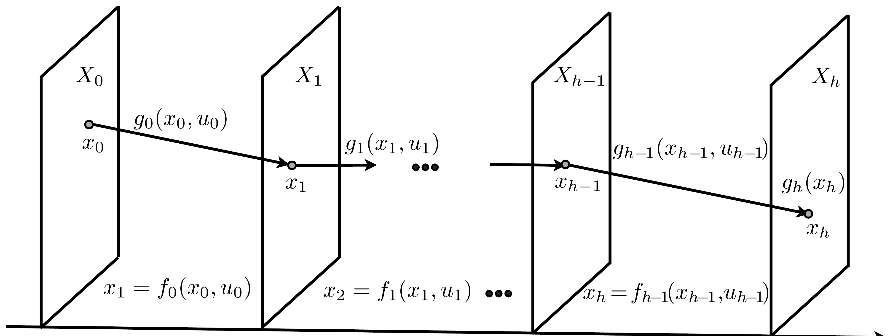
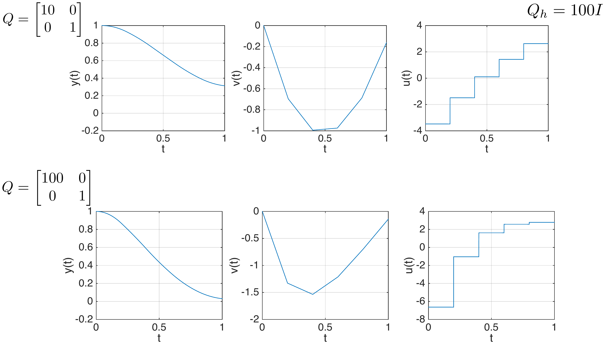
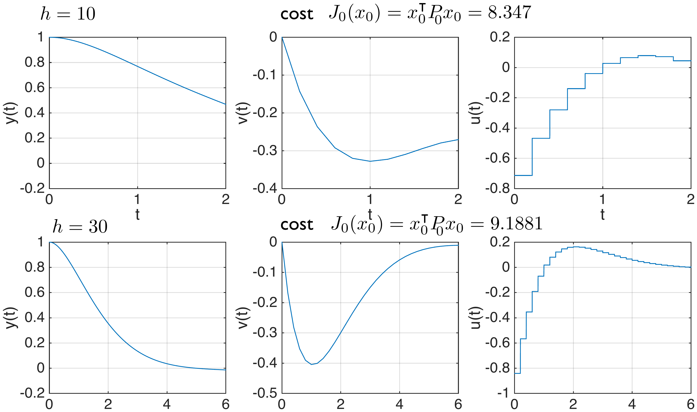
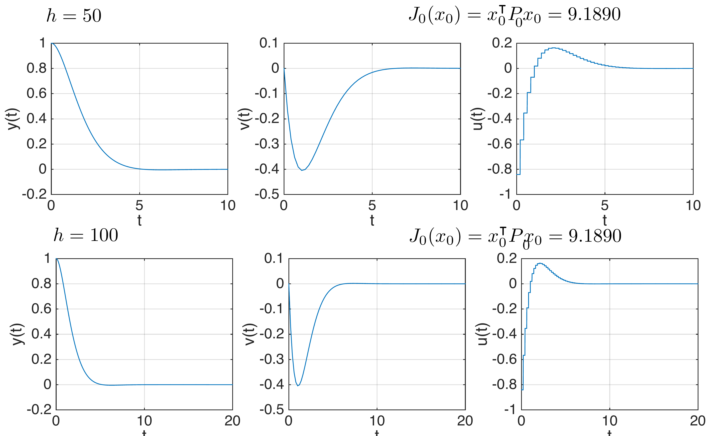
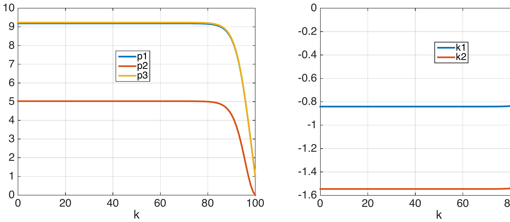
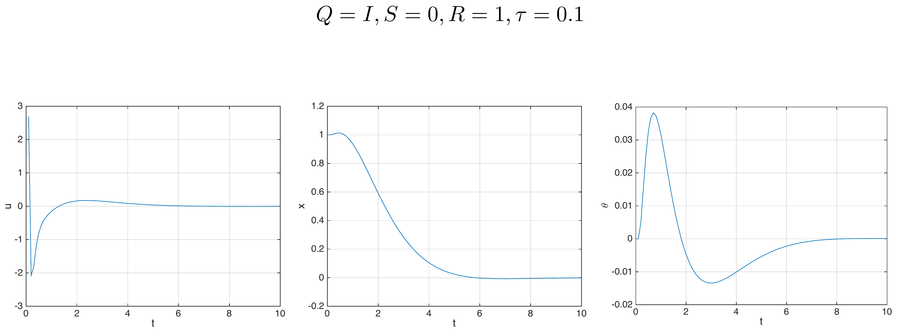

## Unit 5 {.center style="text-align: center;"}

<!--
Converted from Slides/Lecture5.pdf (50 slides) on 2026-08-11, following the
conventions finalized on Lectures 1-4 (see lecture04's header comment for
the full rationale). Quick recap of the standing rules applied throughout:
- No image captions anywhere; every figure is a bare
  {width="X%" fig-align="center"} with no caption/credit text.
- Every crop was produced with the row/column pixel-band-detection method,
  targeting a vertical band that excludes the slide title (top) and the
  Keynote page number (bottom), then visually spot-checked.
- Slides that are pure text/bullets/equations are retyped natively as
  Quarto/LaTeX. Slides built around a genuine diagram or a numerical plot
  are kept as a tightly-cropped image; any table-as-image slide (the
  "Goals of part II" table on slide 4) is instead rebuilt as a native
  Markdown table for crisper text.
- The stock photo of a person on a Segway (slide 42, "Inverted pendulum")
  was dropped -- purely decorative and not needed to convey the diagram;
  only the pendulum/cart schematic is kept as an image.
- Figures live in figures/lecture5/, named pgNN-slug.png (matching the
  original PDF page number NN, 1-indexed from the title slide).

This lecture opens "Part II: Stage decision problems" of the course (as
shown on slide 4's table): Units 1-4 covered discrete optimization
problems (transition diagrams, DP algorithm, Dijkstra/A*, Bayes filter);
Units 5-6 cover stage decision problems with dynamic-system state/input
spaces (DP equation, static optimization, Kalman filter), specialized to
the case of linear dynamics and quadratic costs.

FIRST-PASS CAVEAT: this is a first pass prioritizing correct structure,
faithful transcription of every equation, and careful figure crops. Expect
a slide-by-slide refinement round, same as Lectures 1-4.
-->

### Stage Decision Problems and the Linear Quadratic Regulator {style="text-align: center;"}

{width="15%" fig-align="center"}

::: {.title-slide-meta}
4SC000, Q2 2026-2027

Duarte Antunes
:::

## Recap

**Optimal control formulation**

- Dynamic model & cost function (transition diagram for discrete optimization problems).
- Computing an optimal policy vs computing an optimal path.

**Dynamic programming algorithm**

- Allows to compute policies (to deal with uncertainty).
- Equivalent way to write it: DP equation.
- Stochastic dynamic programming: computes a policy that minimizes an expected cost.

**Alternative algorithms**

- To compute optimal paths, alternative algorithms (e.g. Dijkstra's) may be more efficient.

**Partial information**

- When there is only partial information about the state rely on the Bayes filter.

## Goals of part II

Introduce optimal control concepts for <u>stage decision problems</u>.

|  | **Discrete optimization problems** | **Stage decision problems** |
|---|---|---|
| **Formulation** | Transition diagram | Dynamic system & additive cost function |
| **DP algorithm & Stochastic DP** | Graphical DP algorithm & DP equation | DP equation |
| **Alternative algorithms** | Dijkstra's algorithm | Static optimization |
| **Partial information** | Bayes filter | Kalman filter |
| **Application focus** | Operational research & Computer science | Digital control |

## Outline

- Dynamic programming for stage decision problems
- Linear quadratic regulator

## Stage decision problems

**Dynamic model**

$$x_{k+1} = f_k(x_k, u_k) \qquad k \in \{0,\dots,h-1\}$$

**Cost function**

$$\sum_{k=0}^{h-1} g_k(x_k, u_k) + g_h(x_h)$$

- State $x_k \in X_k$ and input $u_k \in U_k(x_k)$ live in arbitrary spaces.
- If these spaces are discrete this is a discrete optimization problem.
- Typically $x_k \in \mathbb{R}^n$ and $u_k \in \mathbb{R}^m$ for every $k \in \{0,\dots,h-1\}$.
- Goals: find an optimal path and find an optimal policy.

## Optimal path

{width="90%" fig-align="center"}

Stage 0, Stage 1, $\dots$, Stage $h-1$, Stage $h$.

- Given an initial condition $x_0$, a path is a set of decisions $\{u_0, u_1, \dots, u_{h-1}\}$ such that $u_k \in U_k(x_k)$ and $\{(x_0,u_0),\dots,(x_{h-1},u_{h-1})\}$ satisfy the equations of the dynamic model.
- A path is said to be optimal if there does not exist another path with a strictly smaller cost.

## Optimal policy

**Policy.** A policy is a set of $h$ functions $\pi = \{\mu_0,\dots,\mu_{h-1}\}$, $\mu_k : X_k \to U_k$.

**Optimal policy.** A policy is said to be optimal if for every state $x_\ell$ at every stage $\ell \in \{0,\dots,h-1\}$, $\mu_\ell(x_\ell)$ is the first action of an optimal path for the tail subproblem which considers only stages $\{\ell,\ell+1,\dots,h\}$ with initial condition $x_\ell$ and cost

$$\sum_{k=\ell}^{h-1} g_k(x_k,u_k) + g_h(x_h)$$

## Dynamic programming algorithm

::: {style="border: 2px solid #333; border-radius: 8px; padding: 1em;"}
Start with $J_h(x_h) = g_h(x_h)$ for every $x_h \in X_h$ and for each decision stage, starting at the last and moving backwards, $k \in \{h-1,h-2,\dots,0\}$, compute $\mu_k$ and $J_k$ from

$$J_k(x_k) = \min_{u_k \in U_k(x_k)} g_k(x_k,u_k) + J_{k+1}(f_k(x_k,u_k)) \quad \text{(DP equation)}$$

and

$$\mu_k(x_k) = u_k$$

where $u_k$ is a minimizer in the DP equation, i.e.,

$$J_k(x_k) = g_k(x_k,\mu_k(x_k)) + J_{k+1}(f_k(x_k,\mu_k(x_k)))$$

Then $\{\mu_0,\dots,\mu_{h-1}\}$ is an optimal policy.
:::

::: {style="border: 2px solid #333; border-radius: 8px; padding: 0.6em; margin-top: 0.5em;"}
**Theorem** The policy obtained with the DP algorithm is an optimal policy (proof in the appendix).
:::

## Simple integrator example

Consider the following simple example of a stage-decision problem.

**Dynamic model** $\quad x_{k+1} = x_k + u_k \qquad k \in \{0,1\}$

**Cost** $\quad \displaystyle\sum_{k=0}^1 x_k^2 + u_k^2 + g_2(x_2)$

**Terminal cost**

- Quadratic: $g_2(x_2) = x_2^2$
- Non-quadratic: $g_2(x_2) = e^{x_2}$

## Quadratic terminal cost

**Step 1** $\quad x_2 = x_1 + u_1$

$$J_1(x_1) = \min_{u_1} g_1(x_1,u_1) + g_2(x_2) = \min_{u_1} x_1^2+u_1^2+x_2^2 = \min_{u_1} \underbrace{2(x_1^2+u_1^2+x_1u_1)}_{Q_{x_1}(u_1),\ \text{quadratic function of } u_1}$$

How to compute the minimum? Differentiate and equate to zero to find the minimizer!

{width="45%" fig-align="center"}

$$\frac{d}{du_1}Q_{x_1}(u_1)=0 \iff 2(2u_1+x_1)=0 \iff u_1=-\frac{1}{2}x_1$$

Replacing in $Q_{x_1}(u_1)$ we obtain the cost-to-go $J_1(x_1) = \frac{3}{2}x_1^2$

## Quadratic terminal cost {.smaller}

**Step 2** $\quad x_1 = x_0+u_0$

$$J_0(x_0) = \min_{u_0} g_0(x_0,u_0)+J_1(x_1) = \min_{u_0} x_0^2+u_0^2+\frac{3}{2}x_1^2 = \min_{u_0} \frac{5}{2}x_0^2+3u_0x_0+\frac{5}{2}u_0^2$$

Differentiating and equating to zero we obtain a function belonging to the optimal policy

$$u_0 = -\frac{3}{5}x_0$$

which leads to the cost-to-go

$$J_0(x_0) = \frac{8}{5}x_0^2$$

## Optimal policy and optimal path

**Optimal policy**

$$u_0=-\frac{3}{5}x_0 \qquad u_1=-\frac{1}{2}x_1$$

**Optimal path**

$$x_0=1 \quad u_0=-\frac{3}{5} \qquad\qquad u_1=-\frac{1}{5}$$
$$x_0=1 \quad x_1=\frac{2}{5} \qquad\qquad x_2=\frac{1}{5}$$

Computed by using $x_{k+1}=x_k+u_k$, $k \in \{0,1\}$.

**Optimal cost**

$$J_0(1) = \frac{8}{5}$$

## Non-quadratic terminal cost

Let us try to apply the dynamic programming algorithm considering a non-quadratic terminal cost $g_2(x_2)=e^{x_2}$.

**Step 1** $\quad x_2=x_1+u_1$

$$J_1(x_1) = \min_{u_1} g_1(x_1,u_1)+g_2(x_2) = \min_{u_1} x_1^2+u_1^2+e^{x_2}$$

Differentiating and equating to zero, we obtain

$$2u_1+e^{x_1+u_1}=0$$

**We cannot find an analytical solution**

- this equation implicitly determines $u_1$ from $x_1$ but there is not an explicit form.
- This implies that it is not easy to determine $u_1=\mu_1(x_1)$ and move to step 2.

## Discussion

**Linear dynamic models, quadratic cost**

- For these problems, we can explicitly obtain the optimal policy as shown next.

**Non-linear dynamic models and/or non-quadratic cost**

- Very hard to apply DP and hence obtain optimal policies.
- This leads to approximation techniques such as discretization.
- Another class of approximation techniques will be addressed in the next lectures.

## Outline

- Dynamic programming for stage decision problems
- <u>Linear quadratic regulator</u>

## Linear quadratic regulator {.smaller}

**Given**

Dynamic model $\quad x_{k+1}=A_kx_k+B_ku_k \qquad k \in \{0,\dots,h-1\}$

Cost function $\quad \displaystyle\sum_{k=0}^{h-1} \begin{bmatrix}x_k^\intercal & u_k^\intercal\end{bmatrix}\begin{bmatrix}Q_k & S_k \\ S_k^\intercal & R_k\end{bmatrix}\begin{bmatrix}x_k \\ u_k\end{bmatrix} + x_h^\intercal Q_h x_h$

**Find**

Optimal policy $\quad u_k=\mu_k(x_k) \qquad k \in \{0,\dots,h-1\}$

- This is the finite-horizon linear quadratic optimal control problem in discrete-time.
- The solution when $h$ approaches infinity and the matrices in the dynamic model and cost function are time-invariant is the linear quadratic regulator.

## Remarks {.smaller}

- The linear quadratic regulator is one of the celebrated results in control theory and one of the main achievements of optimal control.
- Assumptions: $Q_k, R_k$ are symmetric, $\begin{bmatrix}Q_k & S_k \\ S_k^\intercal & R_k\end{bmatrix} \geq 0$, $Q_h \geq 0$, $R_k > 0$.
- Model and cost are often time-invariant, i.e., $x_{k+1}=Ax_k+Bu_k$ and $\sum_{k=0}^{h-1}\begin{bmatrix}x_k^\intercal & u_k^\intercal\end{bmatrix}\begin{bmatrix}Q & S \\ S^\intercal & R\end{bmatrix}\begin{bmatrix}x_k \\ u_k\end{bmatrix} + x_h^\intercal Q_h x_h$
- Cost function can result from a continuous-time problem.
- However, in general the cost is specified in discrete-time and used as a tuning knob to obtain desired specifications (e.g. overshoot, etc).
- We focus on the stabilization problem, i.e., driving the state to zero.
- For the reference tracking problem check the notes, exercises and jupyter notebooks.

## Dynamic programming algorithm {.smaller}

**Step 1** $\quad x_h = A_{h-1}x_{h-1}+B_{h-1}u_{h-1}$

$$J_{h-1}(x_{h-1}) = \min_{u_{h-1}} \begin{bmatrix}x_{h-1}^\intercal & u_{h-1}^\intercal\end{bmatrix}\begin{bmatrix}Q_{h-1} & S_{h-1} \\ S_{h-1}^\intercal & R_{h-1}\end{bmatrix}\begin{bmatrix}x_{h-1} \\ u_{h-1}\end{bmatrix} + \underbrace{J_h(x_h)}_{x_h^\intercal Q_h x_h}$$

terminal cost: $J_h(A_{h-1}x_{h-1}+B_{h-1}u_{h-1}) = (A_{h-1}x_{h-1}+B_{h-1}u_{h-1})^\intercal Q_h (A_{h-1}x_{h-1}+B_{h-1}u_{h-1})$

Then

$$J_{h-1}(x_{h-1}) = \min_{u_{h-1}} x_{h-1}^\intercal(A_{h-1}^\intercal Q_h A_{h-1}+Q_{h-1})x_{h-1}$$
$$+\ 2u_{h-1}^\intercal(S_{h-1}^\intercal+B_{h-1}^\intercal Q_h A_{h-1})x_{h-1} + \underbrace{u_{h-1}^\intercal(B_{h-1}^\intercal Q_h B_{h-1}+R_{h-1})u_{h-1}}_{\text{quadratic function of } u_{h-1}}$$

## Minimizing a quadratic function in $\mathbb{R}^n$

{width="45%" fig-align="center"}

$$\min_{u \in \mathbb{R}^n} J(u) \qquad J(u) = u^\intercal Xu+2u^\intercal y+z \qquad X>0$$

Unique minimizer $\quad \nabla J(u)=0 \iff 2Xu+2y=0 \iff u=-X^{-1}y$

Minimum $\quad J(-X^{-1}y) = y^\intercal X^{-1}XX^{-1}y-2y^\intercal X^{-1}y+z = z-y^\intercal X^{-1}y$

## Dynamic Programming {.smaller}

**Step 1** (continued)

$$J_{h-1}(x_{h-1}) = \min_{u_{h-1}} x_{h-1}^\intercal \underbrace{(A_{h-1}^\intercal Q_h A_{h-1}+Q_{h-1})}_{z} x_{h-1}$$
$$+\ 2u_{h-1}^\intercal \underbrace{(S_{h-1}^\intercal+B_{h-1}^\intercal Q_h A_{h-1})}_{y} x_{h-1} + u_{h-1}^\intercal \underbrace{(B_{h-1}^\intercal Q_h B_{h-1}+R_{h-1})}_{X} u_{h-1}$$

**Policy**

$$u_{h-1} = -X^{-1}y = -\big(B_{h-1}^\intercal Q_h B_{h-1}+R_{h-1}\big)^{-1}\big(S_{h-1}^\intercal+B_{h-1}^\intercal Q_h A_{h-1}\big)x_{h-1}$$

**Cost-to-go**

$$J_{h-1}(x_{h-1}) = z-y^\intercal X^{-1}y$$
$$= x_{h-1}^\intercal\Big[A_{h-1}^\intercal Q_h A_{h-1}+Q_{h-1} - (S_{h-1}+A_{h-1}^\intercal Q_h B_{h-1})(B_{h-1}^\intercal Q_h B_{h-1}+R_{h-1})^{-1}(S_{h-1}^\intercal+B_{h-1}^\intercal Q_h A_{h-1})\Big]x_{h-1}$$

## Dynamic Programming {.smaller}

**Step 2** $\quad x_{h-1}=A_{h-2}x_{h-2}+B_{h-2}u_{h-2}$

$$J_{h-2}(x_{h-2}) = \min_{u_{h-2}} \begin{bmatrix}x_{h-2}^\intercal & u_{h-2}^\intercal\end{bmatrix}\begin{bmatrix}Q_{h-2} & S_{h-2} \\ S_{h-2}^\intercal & R_{h-2}\end{bmatrix}\begin{bmatrix}x_{h-2} \\ u_{h-2}\end{bmatrix} + \underbrace{J_{h-1}(x_{h-1})}_{x_{h-1}^\intercal P_{h-1} x_{h-1}}$$

Since the cost-to-go is quadratic (as the terminal cost) we can apply the same reasoning and obtain

$$u_{h-2} = K_{h-2}x_{h-2}$$

$$J_{h-2}(x_{h-2}) = x_{h-2}^\intercal P_{h-2}x_{h-2}$$

$$K_{h-2} = -\big(B_{h-2}^\intercal P_{h-1}B_{h-2}+R_{h-2}\big)^{-1}\big(S_{h-2}^\intercal+B_{h-2}^\intercal P_{h-1}A_{h-2}\big)$$

$$P_{h-2} = A_{h-2}^\intercal P_{h-1}A_{h-2}+Q_{h-2} - \big(S_{h-2}+A_{h-2}^\intercal P_{h-1}B_{h-2}\big)\big(B_{h-2}^\intercal P_{h-1}B_{h-2}+R_{h-2}\big)^{-1}\big(S_{h-2}^\intercal+B_{h-2}^\intercal P_{h-1}A_{h-2}\big)$$

## Dynamic Programming {.smaller}

**Step $h-k$** $\quad x_{k+1}=A_kx_k+B_ku_k$

$$J_k(x_k) = \min_{u_k} \begin{bmatrix}x_k^\intercal & u_k^\intercal\end{bmatrix}\begin{bmatrix}Q_k & S_k \\ S_k^\intercal & R_k\end{bmatrix}\begin{bmatrix}x_k \\ u_k\end{bmatrix} + \underbrace{J_{k+1}(x_{k+1})}_{x_{k+1}^\intercal P_{k+1} x_{k+1}}$$

$$u_k = K_kx_k \qquad J_k(x_k) = x_k^\intercal P_k x_k$$

$$K_k = -\big(B_k^\intercal P_{k+1}B_k+R_k\big)^{-1}\big(S_k^\intercal+B_k^\intercal P_{k+1}A_k\big)$$

::: {style="border: 2px solid #2b6cb0; border-radius: 6px; padding: 0.5em;"}
$$P_k = A_k^\intercal P_{k+1}A_k+Q_k - \big(S_k+A_k^\intercal P_{k+1}B_k\big)\big(B_k^\intercal P_{k+1}B_k+R_k\big)^{-1}\big(S_k^\intercal+B_k^\intercal P_{k+1}A_k\big)$$
:::

**(Riccati equation)**

Thus, simply iterate these equations for $k \in \{h-1,\dots,1,0\}$ starting with $P_h=Q_h$ to obtain the optimal policy $u_k=K_kx_k$.

The optimal cost for a given initial condition is $J_0(x_0)=x_0^\intercal P_0 x_0$.

## Example: double integrator

Consider a double integrator

{width="70%" fig-align="center"}

$$\ddot y(t) = \frac{F(t)}{m}$$

**Continuous-time model**

$$\begin{bmatrix}\dot y(t) \\ \dot v(t)\end{bmatrix} = \begin{bmatrix}0 & 1 \\ 0 & 0\end{bmatrix}\begin{bmatrix}y(t) \\ v(t)\end{bmatrix} + \begin{bmatrix}0 \\ 1\end{bmatrix}u(t) \qquad x(t)=[y(t)\ \ v(t)]^\intercal$$

**Discretization**

$$x_{k+1} = e^{\begin{bmatrix}0&1\\0&0\end{bmatrix}\tau}x_k + \int_0^\tau e^{\begin{bmatrix}0&1\\0&0\end{bmatrix}r}dr\begin{bmatrix}0\\1\end{bmatrix}u_k = \begin{bmatrix}1 & \tau \\ 0 & 1\end{bmatrix}x_k + \begin{bmatrix}\frac{\tau^2}{2} \\ \tau\end{bmatrix}u_k$$

## Example: double integrator

**Dynamic model** $\quad x_{k+1} = \begin{bmatrix}1 & \tau \\ 0 & 1\end{bmatrix}x_k + \begin{bmatrix}\frac{\tau^2}{2} \\ \tau\end{bmatrix}u_k \qquad \tau=0.2$

Qualitative goal: drive the mass to position zero in a fast way but with reasonable actuation values.

To achieve this goal let us start with this cost function

$$\sum_{k=0}^{h-1} x_k^\intercal Qx_k+u_k^\intercal Ru_k+x_h^\intercal Q_hx_h$$

$$Q=\begin{bmatrix}1&0\\0&1\end{bmatrix} \qquad R=1 \qquad h=5 \qquad Q_h=\begin{bmatrix}10&0\\0&10\end{bmatrix}$$

and then tune these parameters to improve the results.

## Dynamic programming {.smaller}

Iterate the following equations to obtain the optimal policy

$$K_k = -\big(B_k^\intercal P_{k+1}B_k+R_k\big)^{-1}\big(S_k^\intercal+B_k^\intercal P_{k+1}A_k\big)$$

$$P_k = A_k^\intercal P_{k+1}A_k+Q_k - \big(S_k+A_k^\intercal P_{k+1}B_k\big)\big(B_k^\intercal P_{k+1}B_k+R_k\big)^{-1}\big(S_k^\intercal+B_k^\intercal P_{k+1}A_k\big)$$

$$P_5=Q_5=\begin{bmatrix}10&0\\0&10\end{bmatrix} \qquad k \in \{4,3,2,1,0\}$$

**First iteration**

$$K_4 = -\Big(\begin{bmatrix}0.02 & 0.2\end{bmatrix}\begin{bmatrix}10&0\\0&10\end{bmatrix}\begin{bmatrix}0.02\\0.2\end{bmatrix}+1\Big)^{-1}\begin{bmatrix}0.02&0.2\end{bmatrix}\begin{bmatrix}10&0\\0&10\end{bmatrix}\begin{bmatrix}1&0.2\\0&1\end{bmatrix} = \begin{bmatrix}-0.1425 & -1.4530\end{bmatrix}$$

$$P_4 = \begin{bmatrix}1&0.2\\0&1\end{bmatrix}^\intercal\begin{bmatrix}10&0\\0&10\end{bmatrix}\begin{bmatrix}1&0.2\\0&1\end{bmatrix} + \begin{bmatrix}1&0\\0&1\end{bmatrix} - \begin{bmatrix}1&0.2\\0&1\end{bmatrix}^\intercal\begin{bmatrix}10&0\\0&10\end{bmatrix}\begin{bmatrix}0.02\\0.2\end{bmatrix}(-K_4) = \begin{bmatrix}10.9715 & 1.7094\\1.7094 & 8.4359\end{bmatrix}$$

## Dynamic programming {.smaller}

**Next iterations**

$$P_0=\begin{bmatrix}12.121&5.702\\5.702&9.085\end{bmatrix} \quad P_1=\begin{bmatrix}12.295&5.165\\5.165&8.675\end{bmatrix} \quad P_2=\begin{bmatrix}12.188&4.311\\4.311&8.2725\end{bmatrix} \quad P_3=\begin{bmatrix}11.739&3.144\\3.144&8.0782\end{bmatrix}$$

$$K_0=[-0.918\ \ -1.503] \quad K_1=[-0.807\ \ -1.432] \quad K_2=[-0.638\ \ -1.368] \quad K_3=[-0.414\ \ -1.353]$$

**Optimal policy** $\quad u_k=K_kx_k, \ k \in \{0,1,\dots,4\}$

**Optimal path** for initial condition $x_0=[1\ \ 0]^\intercal$ (iterate $x_{k+1}=Ax_k+Bu_k$, $u_k=K_kx_k$)

$$(x_0,u_0) = ([1\ \ 0]^\intercal, -0.918) \qquad (x_3,u_3) = ([0.8724\ \ {-0.330}]^\intercal, 0.085)$$
$$(x_1,u_1) = ([0.982\ \ {-0.184}]^\intercal, -0.529) \qquad (x_4,u_4) = ([0.8082\ \ {-0.313}]^\intercal, 0.339)$$
$$(x_2,u_2) = ([0.934\ \ {-0.289}]^\intercal, -0.200) \qquad x_5 = [0.7525\ \ {-0.2448}]^\intercal$$

## Plots and tuning

Transitory responses are still far from qualitative specifications

{width="85%" fig-align="center"}

**Guidelines to tune the cost**

- By increasing the terminal cost one expects that the response gets closer to the desired final position.
- Same is expected by penalizing more the position error relatively to the velocity error.
- Decreasing the penalty on the control action will allow more control authority to reach the origin.

## Increasing terminal cost

Final position error improved by increasing terminal cost

{width="78%" fig-align="center"}

## Changing state cost

Increasing position cost leads to smaller position error and larger velocity

{width="82%" fig-align="center"}

## Changing control cost

Decreasing control penalty leads to fast responses, but large actuation!

{width="82%" fig-align="center"}

## Cheap control

As $R \to 0$ we obtain deadbeat control: zero state is achieved in 2 steps

{width="85%" fig-align="center"}

Can we then always drive a mass to zero in two sampling periods?

- No, because this typically requires very large unfeasible actuations.
- Actuators have limitations which were not incorporated in our linear model.
- In this LQR framework the solution is to increasingly penalize the control input until actuation constraints are met. More on this point later.

## Increasing the horizon

Let us increase the horizon considering $Q=Q_h=I$, $R=1$, $x_0=[1\ \ 0]^\intercal$

{width="80%" fig-align="center"}

$h=10$: cost $J_0(x_0)=x_0^\intercal P_0 x_0 = 8.347$ $\qquad$ $h=30$: cost $J_0(x_0)=x_0^\intercal P_0 x_0 = 9.1881$

## Increasing the horizon

{width="80%" fig-align="center"}

$h=50$: cost $J_0(x_0)=x_0^\intercal P_0 x_0 = 9.1890$ $\qquad$ $h=100$: cost $J_0(x_0)=x_0^\intercal P_0 x_0 = 9.1890$

The cost converges to a constant as the time horizon increases.

## Discussion {.smaller}

- Since the cost is positive-definite, if the horizon is large the optimal input should drive the state to zero to stop paying cost.
- This explains why the cost converges as the horizon increases.

$$\sum_{k=0}^{h_0} g_k(x_k,K_ku_k) + \underbrace{\sum_{k=h_0+1}^{h-1} g_k(x_k,K_ku_k)+g_T(x_T,u_T)}_{\approx\ 0 \text{ since } x_k\approx 0 \text{ and } u_k=K_kx_k}$$

- This reasoning is valid for every initial condition. Thus if $x_0^\intercal P_0 x_0$ converges as $h\to\infty$ then $P_0$ converges, where $P_0$ results from the recursion

$$P_k = A^\intercal P_{k+1}A+Q - (S+A^\intercal P_{k+1}B)(B^\intercal P_{k+1}B+R)^{-1}(S^\intercal+B^\intercal P_{k+1}A) \qquad k \in \{h-1,h-2,\dots,0\}$$

- Note that we are now considering time-invariant $A_k, B_k, Q_k, R_k, S_k$.

## Discussion

For the double integrator example with $Q=Q_h=I$, $R=1$:

{width="80%" fig-align="center"}

$P_k=\begin{bmatrix}p_{1,k}&p_{2,k}\\p_{2,k}&p_{3,k}\end{bmatrix} \qquad K_k=\begin{bmatrix}K_{1,k}&K_{2,k}\end{bmatrix}$

Let $\bar P$ denote the limit $P_0$ of the recursion; $P_k = A^\intercal P_{k+1}A+Q-(S+A^\intercal P_{k+1}B)(B^\intercal P_{k+1}B+R)^{-1}(S^\intercal+B^\intercal P_{k+1}A)$, then $\bar P = A^\intercal \bar P A+Q-(S+A^\intercal \bar P B)(B^\intercal \bar P B+R)^{-1}(S^\intercal+B^\intercal \bar P A)$

Moreover, $K_k \to \bar K$, $\quad \bar K = -\big(B^\intercal \bar P B+R\big)^{-1}\big(S^\intercal+B^\intercal \bar P A\big)$

## Infinite horizon LQR {.smaller}

::: {style="border: 2px solid #333; border-radius: 8px; padding: 0.8em;"}
**Proposition** (special case of [Bertsekas, Sec. 4., Proposition 4.4.1]) The optimal policy for the stage decision problem with infinite number of stages with dynamic model

$$x_{k+1}=Ax_k+Bu_k \qquad (A,B) \text{ controllable}$$

and cost function

$$\sum_{k=0}^\infty x_k^\intercal Qx_k+2x_k^\intercal Su_k+u_k^\intercal Ru_k \qquad \begin{bmatrix}Q&S\\S^\intercal&R\end{bmatrix}>0$$

is given by

$$u_k=\bar K x_k \qquad \bar K = -\big(B^\intercal \bar P B+R\big)^{-1}\big(S^\intercal+B^\intercal \bar P A\big)$$

where $\bar P$ is the unique positive definite solution to the algebraic Riccati equation

::: {style="border: 2px solid #2b6cb0; border-radius: 6px; padding: 0.4em;"}
$$\bar P = A^\intercal \bar P A+Q - \big(S+A^\intercal \bar P B\big)\big(B^\intercal \bar P B+R\big)^{-1}\big(S^\intercal+B^\intercal \bar P A\big)$$
:::

Furthermore the closed-loop $x_{k+1}=(A+BK)x_k$ is exponentially stable.
:::

## Discussion {.smaller}

- For simplicity, throughout the discussion, we assume $S=0$.
- As mentioned in [Bertsekas, Sec. 4.1], we can relax the assumptions $(A,B)$ is controllable and $Q$ is positive definite.
- In fact, if $(A,B)$ is controllable, $R$ is positive definite, $Q=NN^\intercal$ for a full rank $N \in \mathbb{R}^{n\times r}$ (not necessarily positive definite if $r<n$) and $(A,N)$ is observable, then the previous theorem still holds.
- Moreover, if we further relax the assumptions to $R$ is positive definite, $(A,B)$ is stabilizable, $N$ full rank and $(A,N)$ is detectable then the theorem still holds except that $P$ is not necessarily positive definite.
- Actually according to "Linear optimal control", B. O. Andersson, J. B. Moore, Sec 14.1, we just need to assure that $B^\intercal QB+R$ is positive definite and $(A,N)$ is observable to guarantee stability of the closed-loop.
- Therefore, we can for instance pick $R=0$ and $Q$ positive definite and the closed-loop is stable (this will not be the case for continuous-time optimal control problems).

## Inverted pendulum {.smaller}

{width="42%" fig-align="center"}

**Linearized model** (see [1, p. 32])

$$(I+m\ell^2)\ddot\theta - mg\ell\theta = m\ell\ddot x \qquad (M+m)\ddot x+b\dot x-m\ell\ddot\theta = u$$

**State space**

$$\frac{d}{dt}\begin{bmatrix}x\\\dot x\\\theta\\\dot\theta\end{bmatrix} = \begin{bmatrix}0&1&0&0\\0&-\frac{(I+m\ell^2)b}{q}&\frac{m^2g\ell^2}{q}&0\\0&0&0&1\\0&-\frac{m\ell b}{q}&\frac{mg\ell(M+m)}{q}&0\end{bmatrix}\begin{bmatrix}x\\\dot x\\\theta\\\dot\theta\end{bmatrix} + \begin{bmatrix}0\\\frac{I+m\ell^2}{q}\\0\\\frac{m\ell}{q}\end{bmatrix}u(t) \qquad q=(I+m\ell^2)(M+m)-m^2\ell^2$$

[1] Feedback control of dynamic systems, Franklin, Powell, Emani-Naeini

## Time responses

$Q=I, S=0, R=1, \tau=0.1$

{width="90%" fig-align="center"}

## Tuning the parameters

{width="85%" fig-align="center"}

## Concluding remarks

**To summarize:**

- Stage decision problems are extensions of discrete optimization problems for which state and input spaces can be arbitrary.
- In practice, it may be hard to obtain expressions for the costs-to-go.
- When the cost is quadratic and the system is linear we obtain a framework for state feedback control design for any linear plant.

## Appendix A {.center style="text-align: center;"}

### Proof of optimality of dynamic programming {style="text-align: center;"}

## Proof of optimality

::: {style="border: 2px solid #333; border-radius: 8px; padding: 0.8em;"}
**Theorem**

The policy obtained with the DP algorithm is an optimal policy.
:::

::: {style="border: 2px solid #333; border-radius: 8px; padding: 0.8em; margin-top: 0.5em;"}
**Proof**

We shall prove using induction that $\pi^k := \{\mu_k,\dots,\mu_{h-1}\}$ obtained by the DP algorithm is an optimal policy for the subproblem from stage $k$ to stage $h-1$ and that $J_k(x_k)$ is the cost of the optimal path starting at $x_k$.

- Step I: Prove this for $k=h-1$.
- Step II: Assume that the induction hypothesis holds for a given $k-1$ and prove it for $k$.
:::

## Step I

- By construction $\pi^{h-1}=\{\mu_{h-1}\}$ is an optimal policy as it is the first decision of the optimal path from stage $h-1$ to stage $h$ since

$$\min_{u_{h-1}\in U_{h-1}(x_{h-1})} g_{h-1}(x_{h-1},u_{h-1})+J_h(f_{h-1}(x_{h-1},u_{h-1})) = g_{h-1}(x_{h-1},\mu_{h-1}(x_{h-1}))+J_h(f_{h-1}(x_{h-1},\mu_{h-1}(x_{h-1})))$$

- It is also clear that

$$J_{h-1}(x_{h-1}) = \min_{u_{h-1}\in U_{h-1}(x_{h-1})} g_{h-1}(x_{h-1},u_{h-1})+J_h(f_{h-1}(x_{h-1},u_{h-1}))$$

is the optimal cost for the subproblem with initial condition $x_{h-1}$ at stage $h-1$.

## Step II

- Assume now that $\pi^{k+1} := \{\mu_{k+1},\dots,\mu_{h-1}\}$ is an optimal policy and $J_{k+1}(x_{k+1})$ is the cost of the optimal path which starts at initial state $x_{k+1}$. We shall prove using contradiction that $\pi^k := \{\mu_k,\dots,\mu_{h-1}\}$ is an optimal policy and $J_k(x_k)$ is the cost of an optimal path which starts at initial state $x_k$.

- Argument using contradiction: if $\pi^k$ is not optimal then there must exist a state such that $\mu_k(x_k)$ is not the first action $\tilde u_k (\neq \mu_k(x_k))$ of the optimal path from stage $k$ to stage $h$ denoted by

$$\tilde\gamma = \{(\tilde x_k,\tilde u_k), (\tilde x_{k+1},\tilde u_{k+1}), \dots, \tilde x_h)\} \qquad \tilde x_k = x_k$$

- Since we are assuming that $\pi^{k+1} := \{\mu_{k+1},\dots,\mu_{h-1}\}$ is an optimal policy we must have

$$\tilde u_{\ell+1} = \mu_{\ell+1}(\tilde x_{\ell+1}) \quad \text{for every } \ell \in \{k+1,\dots,h-2\}$$

## Step II

- The cost of such a path is

$$\bar J = \sum_{\ell=k}^{h-1} g_\ell(\tilde x_\ell,\tilde u_\ell)+g_h(\tilde x_h) = g_k(\tilde x_k,\tilde u_k) + \sum_{\ell=k+1}^{h-1} g_\ell(\tilde x_\ell,\mu_\ell(\tilde x_\ell))+g_h(\tilde x_h) = g_k(\tilde x_k,\tilde u_k)+J_{k+1}(f(\tilde x_k,\tilde u_k))$$

- However, the cost of the path which has $\mu_k(x_k)$ as the first decision is less than or equal to the cost above (contradiction)

$$J_k(x_k) = \min_{u_k} g_k(\tilde x_k,\tilde u_k)+J_{k+1}(f(\tilde x_k,\tilde u_k)) = g_k(\tilde x_k,\mu_k(x_k))+J_{k+1}(f(\tilde x_k,\mu_k(x_k)))$$
$$\leq g_k(\tilde x_k,\tilde u_k)+J_{k+1}(f(\tilde x_k,\tilde u_k)) = \bar J$$
