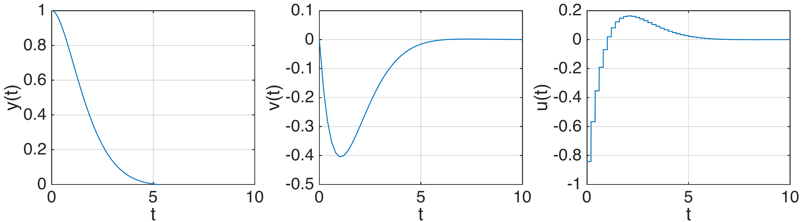
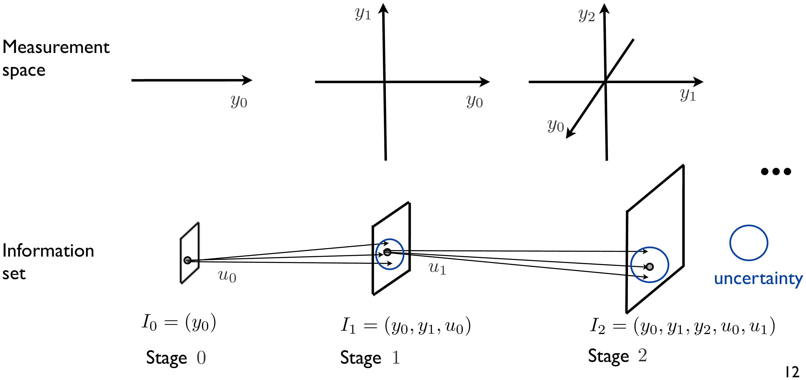
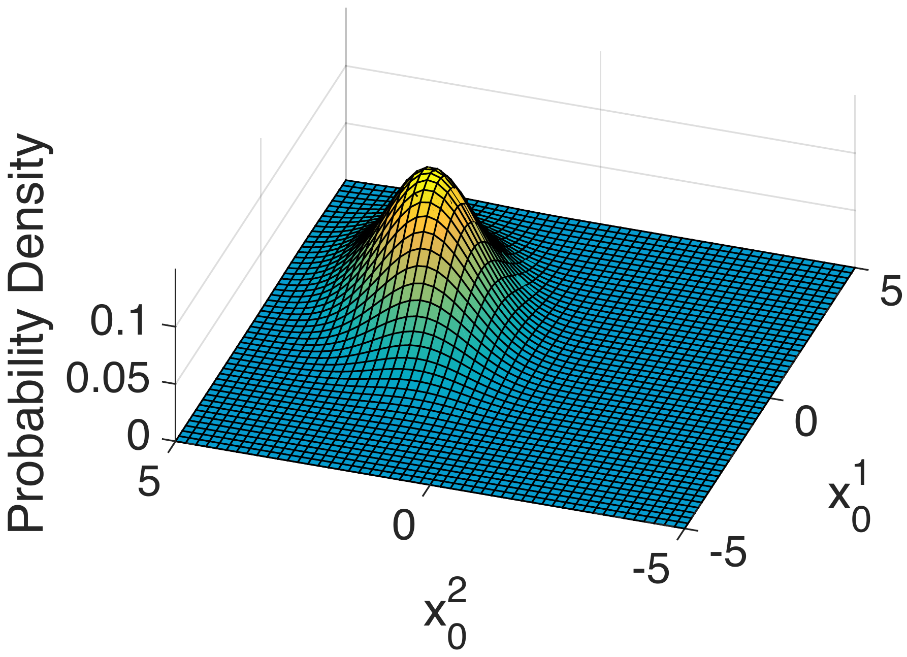
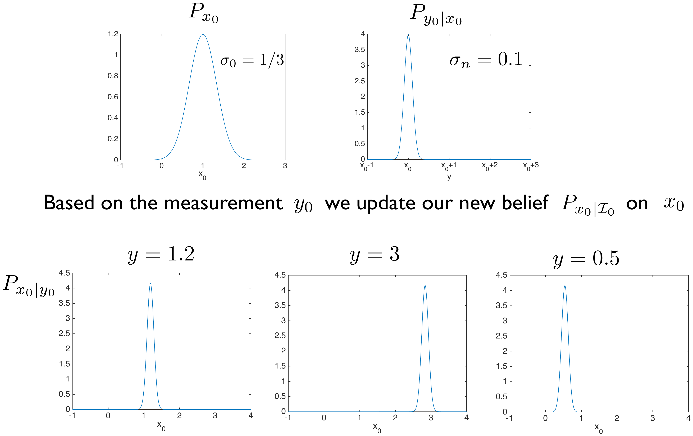
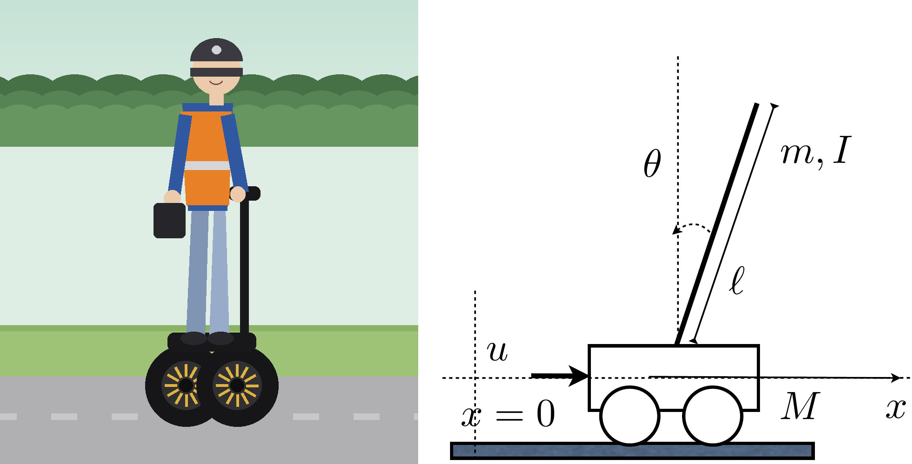
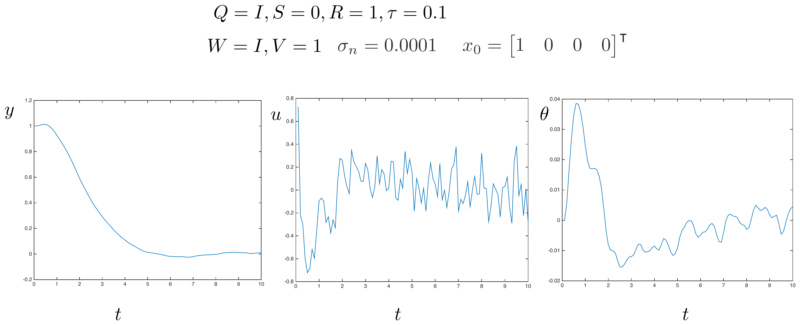
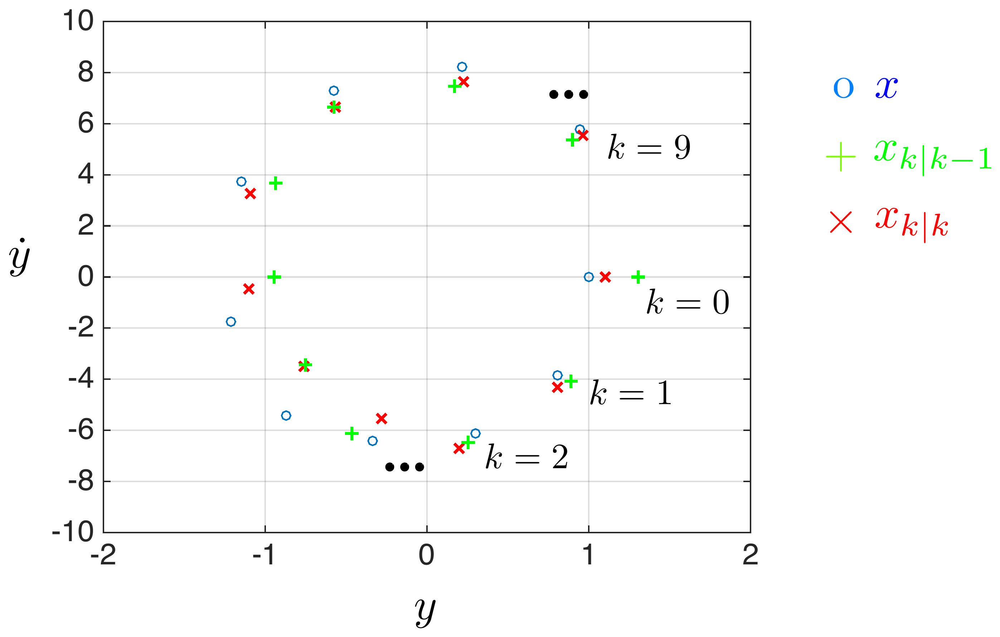

## Unit 6 {.center style="text-align: center;"}

<!--
Converted from Slides/Lecture6.pdf (61 slides) on 2026-08-11, following the
conventions finalized on Lectures 1-5 (see lecture04/lecture05's header
comments for the full rationale). Quick recap:
- No image captions anywhere; every figure is a bare
  {width="X%" fig-align="center"} with no caption/credit text.
- Every crop was produced with the row/column pixel-band-detection method,
  targeting a vertical band that excludes the slide title (top) and the
  Keynote page number (bottom), then visually spot-checked; a couple of
  crops were redone after a first pass grabbed the wrong region (verified
  against the page's own printed corner label, e.g. "C4", "D1", "E2").
- Slides that are pure text/bullets/equations are retyped natively as
  Quarto/LaTeX. Slides built around a genuine diagram or a numerical plot
  are kept as a tightly-cropped image.
- Decorative cartoon icons (graduation cap / student figures used on
  slide 7 to illustrate "open loop vs closed loop", and the small
  "LQR ≡ LQE" icon pair on slide 22) are dropped; only the substantive
  diagrams and plots are kept as images. Slide 10's ostrich/penguin/wizard
  icons (illustrating "open loop" / "closed loop") are likewise dropped,
  keeping only the two rows of time-response plots.
- The Kalman photo (slide 31, Rudolf Kálmán receiving the National Medal
  of Science from President Obama, 2009) is an official White House photo
  (public domain, taken by a federal employee in the course of duty),
  kept the same way the Bayes/Dijkstra/Bellman portraits were kept in
  earlier lectures.
- Figures live in figures/lecture6/, named pgNN-slug.png (matching the
  original PDF page number NN, 1-indexed from the title slide).

This lecture continues "Part II: Stage decision problems" (see Lecture 5):
it extends the deterministic LQR to (a) stochastic disturbances (still
full state feedback) and (b) partial/noisy state information via the
Kalman filter, culminating in the separation principle and the LQG
(linear-quadratic-Gaussian) controller.

FIRST-PASS CAVEAT: this is a first pass prioritizing correct structure,
faithful transcription of every equation, and careful figure crops. Expect
a slide-by-slide refinement round, same as Lectures 1-5.
-->

### Stochastic and Output-Feedback Linear Quadratic Control: the Kalman Filter and LQG {style="text-align: center;"}

{width="15%" fig-align="center"}

::: {.title-slide-meta}
4SC000, Q2 2026-2027

Duarte Antunes
:::

## Outline

- Stochastic dynamic programming and linear quadratic control
- Output feedback linear quadratic control
  - Separation principle
  - Kalman filter
  - LQG design

## Stochastic formulation

**Dynamic model** $\quad x_{k+1} = f_k(x_k,u_k,w_k) \qquad w_k \in \mathbb{R}^{n_w} \text{ (stochastic disturbances)}$

**Cost** $\quad \displaystyle\sum_{k=0}^{h-1} g_k(x_k,u_k,w_k) + g_h(x_h)$

Find a policy $\pi=\{\mu_0,\dots,\mu_{h-1}\}$, $u_k=\mu_k(x_k)$, that minimizes

$$J_\pi(x_0) = \mathbb{E}\Big[\sum_{k=0}^{h-1} g_k(x_k,\mu_k(x_k),w_k) + g_h(x_h)\Big]$$

We assume that the stochastic disturbances have zero mean and are statistically independent (white).

## Stochastic dynamic programming algorithm {.smaller}

::: {style="border: 2px solid #333; border-radius: 8px; padding: 0.8em;"}
Start with $J_h(x_h)=g_h(x_h)$ for every $x_h \in X_h$ and for each decision stage, starting at the last and moving backwards, $k \in \{h-1,h-2,\dots,0\}$, compute $\mu_k$ and $J_k$ from

$$J_k(x_k) = \min_{u_k \in U_k(x_k)} \mathbb{E}_{w_k}\big[g_k(x_k,u_k,w_k) + J_{k+1}(f_k(x_k,u_k,w_k))\big] \quad \text{(DP equation)}$$

and

$$\mu_k(x_k) = u_k$$

where $u_k$ is the minimizer in the DP equation. Then $\{\mu_0,\dots,\mu_{h-1}\}$ is an optimal policy.
:::

To be more precise we can write the right hand side of the DP equation as

$$\mathbb{E}_{w_k}\big[g_k(x_k,u_k,w_k)+J_{k+1}(f_k(x_k,u_k,w_k))\,|\,x_k\big]$$

which reinforces the fact that $x_k$ is assumed to be constant when computing the expected value and evaluating the minimum.

## Linear quadratic control {.smaller}

**Dynamic model** $\quad x_{k+1}=A_kx_k+B_ku_k+w_k \qquad k\in\{0,\dots,h-1\} \qquad \mathbb{E}[w_k]=0 \text{ and white}$

**Cost function** $\quad \displaystyle\sum_{k=0}^{h-1} \begin{bmatrix}x_k^\intercal & u_k^\intercal\end{bmatrix}\begin{bmatrix}Q_k & S_k \\ S_k^\intercal & R_k\end{bmatrix}\begin{bmatrix}x_k \\ u_k\end{bmatrix} + x_h^\intercal Q_h x_h$

Find a policy $\pi=\{\mu_0,\dots,\mu_{h-1}\}$, $u_k=\mu_k(x_k)$, that minimizes

$$\mathbb{E}\Big[\sum_{k=0}^{h-1} \begin{bmatrix}x_k^\intercal & u_k^\intercal\end{bmatrix}\begin{bmatrix}Q_k & S_k \\ S_k^\intercal & R_k\end{bmatrix}\begin{bmatrix}x_k \\ u_k\end{bmatrix} + x_h^\intercal Q_h x_h\Big]$$

## Optimal policy {.smaller}

::: {style="border: 2px solid #333; border-radius: 8px; padding: 0.8em;"}
**Theorem.** The optimal policy for the linear quadratic control problem is

$$u_k = K_kx_k \qquad k \in \{0,\dots,h-1\}$$

where

$$K_k = -\big(B_k^\intercal P_{k+1}B_k+R_k\big)^{-1}\big(S_k^\intercal+B_k^\intercal P_{k+1}A_k\big)$$

$$P_k = A_k^\intercal P_{k+1}A_k+Q_k - \big(S_k+A_k^\intercal P_{k+1}B_k\big)\big(B_k^\intercal P_{k+1}B_k+R_k\big)^{-1}\big(S_k^\intercal+B_k^\intercal P_{k+1}A_k\big)$$

$$P_h=Q_h \qquad k\in\{h-1,\dots,0\} \qquad \text{(Riccati iterations)}$$

and the resulting expected cost is given by

$$J_0(x_0) = x_0^\intercal P_0 x_0 + \sum_{k=0}^{h-1} \text{trace}\big(P_{k+1}\mathbb{E}[w_kw_k^\intercal]\big)$$
:::

Proof: see Appendix A.

## Discussion

- The optimal policy is exactly the same as in the case $w_k=0$.
- Recall the approaches to cope with stochastic disturbances: open loop (use the decisions of the optimal path), closed-loop (use the policy from deterministic DP), closed-loop (use the policy from stochastic DP).
- The result of the previous slide says that when the dynamic model is linear and the cost is quadratic, the following holds: these three approaches coincide.
- When this happens we say that we have **certainty equivalence**.
- The cost increases when we consider disturbances (intuitive!)

$$J_0(x_0) = \underbrace{x_0^\intercal P_0 x_0}_{\text{cost without disturbances}} + \underbrace{\sum_{k=0}^{h-1}\text{trace}(P_{k+1}\mathbb{E}[w_kw_k^\intercal])}_{\text{additional cost}}$$

## Discussion {.smaller}

- The result carries over if we consider an infinite horizon cost, under the same assumptions that we have considered in the deterministic case

$$\mathbb{E}\Big[\sum_{k=0}^\infty x_k^\intercal Qx_k+2x_k^\intercal Su_k+u_k^\intercal Ru_k\Big]$$

(optimal policy $u_k=\bar Kx_k$, $\bar K=-(B^\intercal \bar P B+R)^{-1}(S^\intercal+B^\intercal \bar P A)$ where $\bar P$ satisfies the algebraic Riccati equation).

- However, now we need the extra assumption that the cost is bounded. If this is the case (e.g. if $w_\ell=0$, $\ell>L>0$) it is given by

$$x_0^\intercal \bar P x_0 + \sum_{k=0}^\infty \text{trace}(\bar P \mathbb{E}[w_kw_k^\intercal])$$

- If the cost is not bounded we can consider an alternative (average) cost

$$\lim_{T\to\infty} \frac{1}{T}\mathbb{E}\Big[\sum_{k=0}^{T-1} x_k^\intercal Qx_k+2x_k^\intercal Su_k+u_k^\intercal Ru_k\Big]$$

which converges to $\text{trace}(\bar P W)$, assuming $W=\mathbb{E}[w_kw_k^\intercal]\ \forall k$.

## Example

Double integrator considered previously

$$x_{k+1} = \begin{bmatrix}1&\tau\\0&1\end{bmatrix}x_k + \begin{bmatrix}\frac{\tau^2}{2}\\\tau\end{bmatrix}u_k \qquad \tau=0.2$$

$$\sum_{k=0}^{h-1}(x_k^\intercal Qx_k+u_k^\intercal Ru_k)+x_h^\intercal Q_hx_h \qquad Q=\begin{bmatrix}1&0\\0&1\end{bmatrix} \qquad R=1$$

Optimal policy $u_k=Kx_k$, $k\geq 0$ $\qquad K=\begin{bmatrix}-0.8412 & -1.54\end{bmatrix}$

Optimal control input and states for $x_0=[y_0\ \ v_0]^\intercal=[1\ \ 0]^\intercal$

{width="75%" fig-align="center"}

## Effects of disturbances {.smaller}

Consider now a disturbance at time 2 sec ($k=10$)

$$x_{k+1} = \begin{bmatrix}1&\tau\\0&1\end{bmatrix}x_k + \begin{bmatrix}\frac{\tau^2}{2}\\\tau\end{bmatrix}u_k+w_k \qquad w_k = \begin{cases}\begin{bmatrix}0\\0\end{bmatrix}, & \text{if } k\in\mathbb{N}_0\setminus\{10\} \\ \begin{bmatrix}0\\a\end{bmatrix}, & \text{if } k=10\end{cases}$$

where $a$ is a uniform random variable in the interval $[-0.5\ \ 0.5]$.

**Open loop** (top row) / **Closed loop** (bottom row)

{width="70%" fig-align="center"}

## Computing the expected cost {.smaller}

We can compute the expected cost based on the expression

$$x_0^\intercal \bar P x_0+\sum_{k=0}^\infty \text{trace}\big(\bar P\,\mathbb{E}[w_kw_k^\intercal]\big) = x_0^\intercal \bar P x_0+\text{trace}\Big(\bar P\begin{bmatrix}0&0\\0&\mathbb{E}[a^2]\end{bmatrix}\Big)$$

where $\bar P$ is the solution to the algebraic Riccati equation which for the considered parameters is

$$\bar P = \begin{bmatrix}9.1890 & 5.0249\\5.0249 & 9.2324\end{bmatrix}$$

and we used the fact that $w_k=\begin{cases}\begin{bmatrix}0\\0\end{bmatrix}, & \text{if } k\in\mathbb{N}_0\setminus\{10\} \\ \begin{bmatrix}0\\a\end{bmatrix}, & \text{if } k=10\end{cases}$

Since $x_0=[0\ \ 1]^\intercal$ and $\mathbb{E}[a^2]=\int_{-0.5}^{0.5} t^2dt = 1/12$ we obtain the cost $9.95$.

## Computing the expected value

{width="80%" fig-align="center"}

average cost of 5000 simulations: $9.95$

## Outline

- Stochastic dynamic programming and linear quadratic control
- <u>Output feedback linear quadratic control</u>
  - Separation principle
  - Kalman filter
  - LQG design

## Problem formulation

**Dynamic model** $\quad x_{k+1}=f_k(x_k,u_k,w_k) \qquad$ (stochastic disturbances, initial state unknown)

**Cost** $\quad \displaystyle\sum_{k=0}^{h-1} g_k(x_k,u_k,w_k)+g_h(x_h)$

**Output** $\quad y_k=h_k(x_k,u_{k-1},n_k) \qquad$ (noise)

**Information set** $\quad I_0=(y_0), \quad I_k=(y_0,y_1,\dots,y_k,u_0,u_1,\dots,u_{k-1}), \quad k\geq 1$

Find a policy $\pi=\{\mu_0,\dots,\mu_{h-1}\}$, $u_k=\mu_k(I_k)$, which minimizes

$$J_\pi = \mathbb{E}\Big[\sum_{k=0}^{h-1} g_k(x_k,\mu_k(I_k),w_k) + g_h(x_h)\Big]$$

We assume that the initial state, the stochastic disturbances and the output noise have zero mean, are statistically independent and have a known probability distribution.

## First approach

We can reformulate a partial information optimal control problem as a standard full information optimal control problem by considering the state to be the information set. The problem is that the state space dimension increases exponentially.

{width="90%" fig-align="center"}

## Second approach

It is possible to show that the knowledge of the probability distribution of the state given the information obtained so far, denoted by $P_{x_k|I_k}$, is sufficient to determine optimal decisions.

$$u_k = \mu_k(P_{x_k|I_k})$$

{width="85%" fig-align="center"}

The state space dimension is now fixed. However, it is typically not easy to store $P_{x_k|I_k}$.

## Problem formulation {.smaller}

**Dynamic model** $\quad x_{k+1}=Ax_k+Bu_k+w_k \qquad k\in\{0,\dots,h-1\} \qquad$ (zero mean $\mathbb{E}[w_k]=0$ and independent)

**Cost function** $\quad \displaystyle\sum_{k=0}^{h-1}\begin{bmatrix}x_k^\intercal & u_k^\intercal\end{bmatrix}\begin{bmatrix}Q&S\\S^\intercal&R\end{bmatrix}\begin{bmatrix}x_k\\u_k\end{bmatrix}+x_h^\intercal Q_hx_h$

**Output equation** $\quad y_k=Cx_k+n_k \qquad$ (noise: zero mean and independent)

**Information set** $\quad I_k=(y_0,y_1,\dots,y_k,u_0,u_1,\dots,u_{k-1})$

Find a policy $\pi=\{\mu_0,\dots,\mu_{h-1}\}$, $u_k=\mu_k(I_k)$, which minimizes

$$\mathbb{E}\Big[\sum_{k=0}^{h-1}\begin{bmatrix}x_k^\intercal & u_k^\intercal\end{bmatrix}\begin{bmatrix}Q&S\\S^\intercal&R\end{bmatrix}\begin{bmatrix}x_k\\u_k\end{bmatrix}+x_h^\intercal Q_hx_h\Big]$$

## Problem formulation {.smaller}

- The initial condition follows a Gaussian (or Normal) distribution with mean $\bar x_0$ and covariance $\bar\Phi_0=\mathbb{E}[(x_0-\bar x_0)(x_0-\bar x_0)^\intercal]$, denoted $x_0 \sim \mathcal{N}(\bar x_0,\bar\Phi_0)$

{width="42%" fig-align="center"}

$$f(x) = \frac{1}{\sqrt{(2\pi)^k\det(\Sigma)}}e^{-\frac{1}{2}(x-\bar x_0)^\intercal \bar\Phi_0^{-1}(x-\bar x_0)} \qquad \text{Prob}[x_0\in A] = \int_A f(x)dx$$

Example: $x_0=[1\ \ 2]^\intercal$, $\bar\Phi_0=\begin{bmatrix}2&0.5\\0.5&2\end{bmatrix}$

- The noise variables $n_k$ are independent random variables following a Gaussian distribution with zero mean and covariance $V=\mathbb{E}[n_kn_k^\intercal]$, i.e., $n_k\sim\mathcal{N}(0,V)$.
- The disturbances variables $w_k$ are independent random variables following a Gaussian distribution with zero mean and covariance $W=\mathbb{E}[w_kw_k^\intercal]$, i.e., $w_k\sim\mathcal{N}(0,W)$.
- For simplicity we consider time-invariant matrices for the model and cost.

## Outline

- Stochastic dynamic programming and linear quadratic control
- Output feedback linear quadratic control
  - <u>Separation principle</u>
  - Kalman filter
  - LQG design

## General solution structure

From our general discussion, we know that we can first estimate $P_{x_k|I_k}$ and then make decisions (control)

{width="65%" fig-align="center"}

## Solution {.smaller}

It turns out that (see Appendix D):

- $P_{x_k|I_k}$ is Gaussian, characterized by mean $\hat x_{k|k}$ and covariance $\Phi_{k|k}=\mathbb{E}[(x_k-\hat x_{k|k})(x_k-\hat x_{k|k})^\intercal|I_k]$ which can be obtained by the Kalman filter.
- The decision maker is the linear quadratic controller $u_k=K_k\hat x_{k|k}$ with the state replaced by the estimate where the gains are obtained from the Riccati equations.

{width="58%" fig-align="center"}

## Discussion {.smaller}

- This is one of the most beautiful & most useful results in control theory! The controller is called linear quadratic Gaussian (LQG) compensator.
- Separation principle: LQG = LQR + LQE.\*
  - As we have seen the LQR is the optimal controller when full state feedback is available.
  - For a linear system with the dynamic and output models above and known input, the Kalman filter can be shown to be the optimal estimator in the sense that for $F\in\mathbb{R}^{1\times n}$ and output $z_k=Fx_k$, the estimate $\hat z_k=F\hat x_{k|k}$ minimises, for every $k$, the cost $\mathbb{E}[(z_k-\hat z_k)^2|I_k]$.
  - The LQG is the optimal controller among all the possible controllers (including non-linear controllers) when the noise, disturbances and initial conditions are Gaussian (non-Gaussian noise mentioned later).
- Resulting optimal cost is (see appendix D):

$$J_0(I_0) = \underbrace{\mathbb{E}[x_0^\intercal P_0x_0|I_0]}_{\text{full state \& no disturbances}} + \underbrace{\sum_{k=0}^{h-1}\text{trace}(P_{k+1}\mathbb{E}[w_kw_k^\intercal])}_{\text{additional cost of disturbances}} + \underbrace{\sum_{k=0}^{h-1}\text{trace}(X_k\mathbb{E}[(x_k-\hat x_{k|k})(x_k-\hat x_{k|k})^\intercal|I_k])}_{\text{additional cost of partial information}}$$

\*LQE: linear quadratic estimator, other term for the Kalman filter. $X_k=A^\intercal P_{k+1}B(R+B^\intercal P_{k+1}B)^{-1}B^\intercal P_{k+1}A$

## Discussion {.smaller}

- The separation principle also holds for the infinite horizon problem where we consider the average cost

$$\lim_{T\to\infty}\frac{1}{T}\sum_{k=0}^{T-1}\mathbb{E}\Big[\begin{bmatrix}x_k^\intercal & u_k^\intercal\end{bmatrix}\begin{bmatrix}Q&S\\S^\intercal&R\end{bmatrix}\begin{bmatrix}x_k\\u_k\end{bmatrix}\Big]$$

- In this case the observer is the so-called stationary Kalman filter and the control is the LQR controller with static gains.

{width="65%" fig-align="center"}

## Outline

- Stochastic dynamic programming and linear quadratic control
- Output feedback linear quadratic control
  - Separation principle
  - <u>Kalman filter</u>
  - LQG design

## Kalman filter {.smaller}

**Given:**

Dynamic model $\ x_{k+1}=Ax_k+Bu_k+w_k$, $x_0\sim\mathcal{N}(\bar x_0,\bar\Phi_0)$ $\qquad$ Output equation $\ y_k=Cx_k+n_k$, $n_k\sim\mathcal{N}(0,V)$, $w_k\sim\mathcal{N}(0,W)$

Information set $\ I_k=(y_0,y_1,\dots,y_k,u_0,u_1,\dots,u_{k-1})$, $k\geq 0$

**Then:** $P_{x_k|I_k} \sim \mathcal{N}(\hat x_{k|k},\Phi_{k|k})$ is Gaussian with mean and covariance iteratively computed by:

$$\hat x_{k|k} = \hat x_{k|k-1}+L_k(y_k-C\hat x_{k|k-1}) \qquad \hat x_{k+1|k}=A\hat x_{k|k}+Bu_k$$

$$\Phi_{k|k} = \Phi_{k|k-1}-\Phi_{k|k-1}C^\intercal(C\Phi_{k|k-1}C^\intercal+V)^{-1}C\Phi_{k|k-1} \qquad \Phi_{k+1|k}=A\Phi_{k|k}A^\intercal+W$$

$$L_k = \Phi_{k|k-1}C^\intercal(C\Phi_{k|k-1}C^\intercal+V)^{-1}$$

Initial condition: $\hat x_{0|-1}=\bar x_0$, $\Phi_{0|-1}=\bar\Phi_0$

## Justification

Why is $P_{x_k|I_k}\sim\mathcal{N}(\hat x_{k|k},\Phi_{k|k})$ Gaussian? Bayes' rule!

Let us consider a simple example. General case is discussed in Appendix B.

Consider the initial stage, $x_0\in\mathbb{R}$, $y_0=x_0+n_0$, and let the a priori probability distributions be

$$f_{x_0}(x_0) = \frac{1}{\sqrt{2\pi}\sigma_0}e^{-\frac{(x_0-\bar x_0)^2}{2\sigma_0^2}} \qquad f_{y_0|x_0}(y_0) = \frac{1}{\sqrt{2\pi}\sigma_n}e^{-\frac{(y_0-x_0)^2}{2\sigma_n^2}}$$

{width="70%" fig-align="center"}

Think of $x_0$ as the position of a robot and $y_0$ as a sensor measurement.

## Justification {.smaller}

Then, from Bayes' rule

$$\text{Prob}[x_0\in A|y_0\in B] = \alpha\,\text{Prob}[y_0\in B|x_0\in A]\,\text{Prob}[x_0\in A]$$

or in terms of probability densities

$$f_{x_0|y_0}(x_0) = \alpha f_{y_0|x_0}(y_0)f_{x_0}(x_0) \qquad \alpha \text{ -- function of } \bar x_0, y_0$$

$$= \alpha\frac{1}{\sqrt{2\pi}\sigma_n}e^{-\frac{(y_0-x_0)^2}{2\sigma_n^2}}\frac{1}{\sqrt{2\pi}\sigma_0}e^{-\frac{(x_0-\bar x_0)^2}{2\sigma_0^2}} = \frac{1}{\sqrt{2\pi}\sigma_{0|0}}e^{-\frac{(x_0-\hat x_{0|0})^2}{2\sigma_{0|0}^2}} \quad \text{(after some calculations)}$$

also Gaussian!

$$\hat x_{0|0} = \bar x_0+L_0(y_0-\bar x_0) \qquad \sigma_{0|0}^2 = \sigma_0^2-\frac{\sigma_0^4}{\sigma_0^2+\sigma_n^2} \qquad L_0=\frac{\sigma_0^2}{\sigma_0^2+\sigma_n^2}$$

## Justification

$P_{x_0}$, $P_{y_0|x_0}$ (as above), and, based on the measurement $y_0$, we update our new belief $P_{x_0|I_0}$ on $x_0$:

{width="80%" fig-align="center"}

Shown for three example measurements $y=1.2$, $y=3$, $y=0.5$.

## Justification

What about $P_{x_1|I_1}$?

- $x_1$ is a sum of Gaussian random variables when conditioned on $u_0,y_0$

$$x_1 = ax_0+bu_0+w$$

and therefore $P_{x_1|u_0,y_0}$ is Gaussian.

- Apply again Bayes' rule to prove that $P_{x_1|I_1}$ is Gaussian.

If we continue this procedure we obtain that $P_{x_k|I_k}$ is Gaussian for every $k$.

## Updating the pdf

Special case of the Bayes' filter: the Kalman filter (Gaussian) state distributions are updated recursively.

{width="80%" fig-align="center"}

## Rudolf E. Kalman

**Historical note**

{width="45%" fig-align="center"}

*Photo: President Obama presenting Kalman with the National Medal of Science, White House East Room, October 7, 2009 -- official White House photograph, public domain (17 U.S.C. § 105, work of a federal employee).*

Rudolf E. Kalman (1930 -- 2016). Kalman's ideas on filtering were initially met with vast skepticism, so much so that he was forced to do the first publication of his results in mechanical engineering, rather than in electrical engineering or systems engineering. Kálmán had more success in presenting his ideas, however, while visiting Stanley F. Schmidt at the NASA Ames Research Center in 1960. This led to the use of Kálmán filters during the Apollo program, and furthermore, in the NASA Space Shuttle, in Navy submarines, and in unmanned aerospace vehicles and weapons, such as cruise missiles (source: wikipedia).

## Outline

- Stochastic dynamic programming and linear quadratic control
- Output feedback linear quadratic control
  - Separation principle
  - Kalman filter
  - <u>LQG design</u>

## LQG design {.smaller}

**Given:** $\ x_{k+1}=Ax_k+Bu_k+w_k$, $x_0\sim\mathcal{N}(\bar x_0,\bar\Phi_0)$ $\qquad$ $y_k=Cx_k+n_k$, $n_k\sim\mathcal{N}(0,V)$, $w_k\sim\mathcal{N}(0,W)$

**Cost function** $\quad \displaystyle\lim_{T\to\infty}\frac{1}{T}\sum_{k=0}^{T-1}\mathbb{E}\Big[\begin{bmatrix}x_k^\intercal & u_k^\intercal\end{bmatrix}\begin{bmatrix}Q&S\\S^\intercal&R\end{bmatrix}\begin{bmatrix}x_k\\u_k\end{bmatrix}\Big]$

**Obtain:**

Controller gains $\quad \bar P=A^\intercal \bar PA+Q-(S+A^\intercal \bar PB)(B^\intercal \bar PB+R)^{-1}(S^\intercal+B^\intercal \bar PA) \qquad \bar K=-(B^\intercal \bar PB+R)^{-1}(S^\intercal+B^\intercal \bar PA)$

Observer gains $\quad \bar\Phi=A\bar\Phi A^\intercal-A\bar\Phi C^\intercal(C\bar\Phi C^\intercal+V)^{-1}C\bar\Phi A^\intercal+W \qquad \bar L=\bar\Phi C^\intercal(C\bar\Phi C^\intercal+V)^{-1}$

**LQG controller:**

$$\hat x_{k+1|k}=A\hat x_{k|k}+Bu_k \qquad \hat x_{k|k}=\hat x_{k|k-1}+\bar L(y_k-C\hat x_{k|k-1}) \qquad u_k=\bar K\hat x_{k|k}$$

## Remarks {.smaller}

- According to our convention $u_k$ depends on $y_k$. This means that we assume that at instant $k$, the sensor measurement $y_k$ is acquired, the control input is computed, and the actuation is updated.
- Since there are inevitably computation delays it is common practice to make $u_k=\bar K\hat x_{k|k-1}$ which can be computed between time steps $k$ and $k+1$.
- In the latter case we only need to run the following equations (Luenberger observer)

$$\hat x_{k+1|k} = A\hat x_{k|k-1}+Bu_k+\tilde L(y_k-C\hat x_{k|k-1}) \qquad u_k=\bar K\hat x_{k|k-1}$$

where $\tilde L=A\bar L$.

- To use our implementation with Matlab function `kalman.m` used option 'current', and for this other implementation use 'delayed'.
- Using either implementation one can show that the closed-loop is stable due to stability of $A+B\bar K$, $A+\tilde LC$.
- The average cost function has now the value (which can be concluded by dividing the finite horizon cost by the horizon, taking the limit as $T\to\infty$)

$$\text{trace}(\bar PW)+\text{trace}(\bar X\bar\Phi) \qquad \bar X=A^\intercal \bar PB(R+B^\intercal \bar PB)^{-1}B^\intercal \bar PA$$

## Inverted pendulum {.smaller}

{width="40%" fig-align="center"}

**Linearized model** (see [1, p. 32]) $\quad (I+m\ell^2)\ddot\theta-mg\ell\theta=m\ell\ddot x \qquad (M+m)\ddot x+b\dot x-m\ell\ddot\theta=u$

**State space**

$$\frac{d}{dt}\begin{bmatrix}x\\\dot x\\\theta\\\dot\theta\end{bmatrix} = \begin{bmatrix}0&1&0&0\\0&-\frac{(I+m\ell^2)b}{q}&\frac{m^2g\ell^2}{q}&0\\0&0&0&1\\0&-\frac{m\ell b}{q}&\frac{mg\ell(M+m)}{q}&0\end{bmatrix}\begin{bmatrix}x\\\dot x\\\theta\\\dot\theta\end{bmatrix} + \begin{bmatrix}0\\\frac{I+m\ell^2}{q}\\0\\\frac{m\ell}{q}\end{bmatrix}u(t) \qquad q=(I+m\ell^2)(M+m)-m^2\ell^2$$

$$y_k = \begin{bmatrix}1&0&0&0\end{bmatrix}\begin{bmatrix}x(k\tau)\\\dot x(k\tau)\\\theta(k\tau)\\\dot\theta(k\tau)\end{bmatrix} + n_k \qquad n_k\sim\mathcal{N}(0,\sigma_n) \qquad \tau \text{ -- sampling period}$$

[1] Feedback control of dynamic systems, Franklin, Powell, Emani-Naeini

## Time responses

$Q=I, S=0, R=1, \tau=0.1 \qquad W=I, V=1 \qquad \sigma_n=0.0001 \qquad x_0=[1\ \ 0\ \ 0\ \ 0]^\intercal$

{width="90%" fig-align="center"}

## Tuning

- In practice the matrices $V=\mathbb{E}[n_kn_k^\intercal]$, $W=\mathbb{E}[w_kw_k^\intercal]$ are used as tuning knobs to improve the state estimation.
- To facilitate the tuning, these matrices are typically chosen as diagonal matrices.
- If the filter is too "nervous", i.e. it reacts very fast, and consequently the estimates are very noisy -- in this case, pick weights to trust less the sensors and more the model, that is, increase $V$ and decrease $W$.
- If it reacts too slow (although it filters out noise), it adds a delay in the control loop which is in general bad. In this case decrease $V$ and increase $W$.

## Concluding remarks

**Summary**

- We considered output feedback linear quadratic control. In this case, and assuming that the disturbances are Gaussian: use the Kalman filter to compute $P_{x_k|I_k}$; use the optimal linear state-feedback controller (LQR infinite horizon cost); output feedback controller = LQR + LQE (separation principle).

## Appendix A {.center style="text-align: center;"}

### Proof of Theorem 1 {style="text-align: center;"}

## Proof of linear quadratic control result {.smaller}

Let us prove by induction that the cost-to-go, at a given time step $k$, obtained by applying the stochastic dynamic programming algorithm to the linear quadratic control problem is

$$J_k(x_k) = x_k^\intercal P_kx_k+c_k \qquad c_k = \sum_{\ell=k}^{h-1} \text{trace}(P_{\ell+1}\mathbb{E}[w_\ell w_\ell^\intercal])$$

This holds for $k=h$ since $J_h(x_h)=x_h^\intercal Q_hx_h$ ($c_h=0$).

Assuming that it holds for a given step $k+1$, i.e., $J_{k+1}(x_{k+1}) = x_{k+1}^\intercal P_{k+1}x_{k+1}+c_{k+1}$, we have for step $k$

$$J_k(x_k) = \min_{u_k} \mathbb{E}_{w_k}\big[x_k^\intercal Q_kx_k+u_k^\intercal R_ku_k+2x_k^\intercal S_ku_k+x_{k+1}^\intercal P_{k+1}x_{k+1}+c_{k+1}\,|\,x_k\big]$$

Replacing $x_{k+1}=A_kx_k+B_ku_k+w_k$ we obtain:

$$\underbrace{J_k(x_k)}_{} = \underbrace{\mathbb{E}_{w_k}\big[w_k^\intercal P_{k+1}(A_kx_k+B_ku_k)+(A_kx_k+B_ku_k)^\intercal P_{k+1}w_k+w_k^\intercal P_{k+1}w_k\big]+c_{k+1}}_{\text{new terms with respect to deterministic DP}}$$
$$+\ \underbrace{\min_{u_k}\big[x_k^\intercal Q_kx_k+u_k^\intercal R_ku_k+2x_k^\intercal S_ku_k+(A_kx_k+B_ku_k)^\intercal P_{k+1}(A_kx_k+B_ku_k)\big]}_{\text{the same terms obtained with deterministic DP}}$$

## Proof of linear quadratic control result {.smaller}

Note that the first two terms are zero since

$$\mathbb{E}_{w_k}\big[w_k^\intercal P_{k+1}(A_kx_k+B_ku_k)\big] = \underbrace{\mathbb{E}_{w_k}[w_k]}_{=0}^\intercal P_{k+1}(A_kx_k+B_ku_k)$$

and the third term is $\mathbb{E}[w_k^\intercal Pw_k] = \mathbb{E}[\text{trace}(w_k^\intercal Pw_k)] = \text{trace}(P_{k+1}\mathbb{E}[w_kw_k^\intercal])$.

For the same terms obtained with the deterministic DP, from the previous lecture we know that the minimisation will result in the cost $x_k^\intercal P_kx_k$ and the control input minimiser is $u_k=K_kx_k$.

An important conclusion is that this is also the optimal policy obtained by the stochastic DP algorithm. Then,

$$J_k(x_k) = x_k^\intercal P_kx_k + \underbrace{c_{k+1}+\text{trace}(P_{k+1}\mathbb{E}[w_kw_k^\intercal])}_{c_k}$$

concluding the induction proof. The expression for the cost is then $J_0(x_0)=x_0^\intercal P_0x_0+c_0$.

## Appendix B {.center style="text-align: center;"}

### Derivation of the Kalman filter {style="text-align: center;"}

## Derivation of the Kalman filter {.smaller}

The following lemma, which can be found in Astrom's book, Section 5.3, will be useful.

::: {style="border: 2px solid #333; border-radius: 8px; padding: 0.6em;"}
**Lemma:** If $\begin{bmatrix}x\\y\end{bmatrix} \sim \mathcal{N}\Big(\begin{bmatrix}\bar x\\\bar y\end{bmatrix}, \begin{bmatrix}R_{xx}&R_{xy}\\R_{yx}&R_{yy}\end{bmatrix}\Big)$ then $P_{x|y}$ is Gaussian with mean $\bar x+R_{xy}R_y^{-1}(y-\bar y)$ and covariance $R_{xx}-R_{xy}R_{yy}^{-1}R_{yx}$.
:::

At the initial step we have $x_0\sim\mathcal{N}(\hat x_{0|-1},\Phi_{0|-1})$, $y_0=Cx_0+n_0$, $n_k\sim\mathcal{N}(0,V)$. Then both $y_0,x_0$ are Gaussian and

$$\mathbb{E}\Big[\begin{bmatrix}x_0\\y_0\end{bmatrix}\Big] = \begin{bmatrix}\hat x_{0|-1}\\C\hat x_{0|-1}\end{bmatrix}, \qquad \mathbb{E}\Big[\begin{bmatrix}x_0-\hat x_{0|-1}\\y_0-C\hat x_{0|-1}\end{bmatrix}\begin{bmatrix}x_0-\hat x_{0|-1}\\y_0-C\hat x_{0|-1}\end{bmatrix}^\intercal\Big] = \begin{bmatrix}\Phi_{0|-1} & \Phi_{0|-1}C^\intercal \\ C\Phi_{0|-1} & C\Phi_{0|-1}C^\intercal+V\end{bmatrix}$$

Using the Lemma above, we conclude that $P_{x_0|y_0}$ is Gaussian with mean

$$\hat x_{0|0} = \hat x_{0|-1} + \underbrace{\Phi_{0|-1}C^\intercal(C\Phi_{0|-1}C^\intercal+V)^{-1}}_{L_0}(y_0-C\hat x_{0|-1})$$

and covariance $\quad \Phi_{0|0} = \Phi_{0|-1}-\Phi_{0|-1}C^\intercal(C\Phi_{0|-1}C^\intercal+V)^{-1}C\Phi_{0|-1}$

Astrom's book: Introduction to stochastic control theory, K. Astrom, 1970.

## Derivation of the Kalman filter

Since $x_1=Ax_0+Bu_0+w_0$, $x_1$ is a sum of Gaussian random variables when conditioned on $u_0,y_0$.

Therefore $P_{x_1|u_0,y_0}$ is Gaussian with mean

$$\hat x_{1|0} = A\hat x_{0|0}+Bu_0$$

and covariance

$$\Phi_{1|0} = A\Phi_{0|0}A^\intercal+W$$

With a similar argument to the one used in the previous slide one can conclude that $P_{x_1|I_1}$ is Gaussian with mean $\hat x_{1|1}$ and covariance $\Phi_{1|1}$ and an induction argument allows to conclude the desired result.

## Appendix C {.center style="text-align: center;"}

### Example: Kalman filter {style="text-align: center;"}

## Example: Kalman filter

Consider a mass spring system with unitary mass

$$\ddot y(t) = -k_sy(t)$$

$$\dot x(t) = \underbrace{\begin{bmatrix}0&1\\-\omega_n^2&0\end{bmatrix}}_{A_c}x(t) \qquad x(t)=\begin{bmatrix}y(t)\\\dot y(t)\end{bmatrix}$$

with natural period of one second ($\omega_n=2\pi$) and suppose that we wish to obtain an estimate of the state at a rate $\tau=0.1$ from sensor measurements of position.

`LiveScript/Lecture6/Kalman.mlx`

## Discretization

To this effect we discretize the system, obtaining

$$x_{k+1} = \underbrace{\begin{bmatrix}0.8090 & 0.0935\\-3.6932 & 0.8090\end{bmatrix}}_{A=e^{A_c\tau}}x_k + \underbrace{\begin{bmatrix}0\\\sigma_w\end{bmatrix}}_{w_k}d_k$$

where the $d_k$ are independent Gaussian random variables with unitary variance modeling disturbances.

The output equation is

$$y_k = \underbrace{\begin{bmatrix}1&0\end{bmatrix}}_{C}x_k + \underbrace{\sigma_n v_k}_{n_k} \qquad \sigma_n=0.1 \qquad \sigma_w=0.5$$

where the $v_k$ are independent Gaussian random variables with unitary variance.

Thus, $W=\mathbb{E}[w_kw_k^\intercal]=\begin{bmatrix}0&0\\0&\sigma_w^2\end{bmatrix} \qquad V=\mathbb{E}[n_kn_k^\intercal]=\sigma_n^2$

## Iterations

Assume that the covariance on the initial state $\bar\Phi_0=\mathbb{E}[(x_0-\bar x_0)(x_0-\bar x_0)^\intercal]$ is given by

$$\Phi_{0|-1} = \bar\Phi_0 = \begin{bmatrix}1&0\\0&1\end{bmatrix}$$

Then we can iterate

$$\Phi_{k|k} = \Phi_{k|k-1}-\Phi_{k|k-1}C^\intercal(C\Phi_{k|k-1}C^\intercal+V)^{-1}C\Phi_{k|k-1}$$

$$\Phi_{k+1|k} = A\Phi_{k|k}A^\intercal+W$$

and obtain the gains $\quad L_k = \Phi_{k|k-1}C^\intercal(C\Phi_{k|k-1}C^\intercal+V)^{-1}$

## Iterations {.smaller}

For $k=0$:

$$\Phi_{0|0} = \begin{bmatrix}1&0\\0&1\end{bmatrix} - \begin{bmatrix}1&0\\0&1\end{bmatrix}\begin{bmatrix}1\\0\end{bmatrix}\Big(\begin{bmatrix}1&0\end{bmatrix}\begin{bmatrix}1&0\\0&1\end{bmatrix}\begin{bmatrix}1\\0\end{bmatrix}+0.01\Big)^{-1}\begin{bmatrix}1&0\end{bmatrix}\begin{bmatrix}1&0\\0&1\end{bmatrix} = \begin{bmatrix}0.0099&0\\0&1\end{bmatrix}$$

$$L_0 = \begin{bmatrix}1&0\\0&1\end{bmatrix}\begin{bmatrix}1\\0\end{bmatrix}\Big(\begin{bmatrix}1&0\end{bmatrix}\begin{bmatrix}1&0\\0&1\end{bmatrix}\begin{bmatrix}1\\0\end{bmatrix}+0.01\Big)^{-1} = \begin{bmatrix}0.9901\\0\end{bmatrix}$$

$$\Phi_{1|0} = \begin{bmatrix}0.8090&0.0935\\-3.6932&0.8090\end{bmatrix}\begin{bmatrix}0.0099&0\\0&1\end{bmatrix}\begin{bmatrix}0.8090&0.0935\\-3.6932&0.8090\end{bmatrix}^\intercal + \begin{bmatrix}0&0\\0&0.25\end{bmatrix} = \begin{bmatrix}0.0152&0.0461\\0.0461&1.0396\end{bmatrix}$$

## Iterations {.smaller}

For $k=1$:

$$\Phi_{1|1} = \begin{bmatrix}0.0152&0.0461\\0.0461&1.0396\end{bmatrix} - \begin{bmatrix}0.0152&0.0461\\0.0461&1.0396\end{bmatrix}\begin{bmatrix}1\\0\end{bmatrix}\Big(\begin{bmatrix}1&0\end{bmatrix}\begin{bmatrix}0.0152&0.0461\\0.0461&1.0396\end{bmatrix}\begin{bmatrix}1\\0\end{bmatrix}+0.01\Big)^{-1}\begin{bmatrix}1&0\end{bmatrix}\begin{bmatrix}0.0152&0.0461\\0.0461&1.0396\end{bmatrix} = \begin{bmatrix}0.0060&0.0183\\0.0183&0.9553\end{bmatrix}$$

$$L_1 = \begin{bmatrix}1\\0\end{bmatrix}^\intercal\!\Big/\Big(\begin{bmatrix}1&0\end{bmatrix}\begin{bmatrix}0.0152&0.0461\\0.0461&1.0396\end{bmatrix}\begin{bmatrix}1\\0\end{bmatrix}+0.01\Big) \to L_1=\begin{bmatrix}0.6037\\1.8271\end{bmatrix}$$

$$\Phi_{2|1} = \begin{bmatrix}0.8090&0.0935\\-3.6932&0.8090\end{bmatrix}\begin{bmatrix}0.0060&0.0183\\0.0183&0.9553\end{bmatrix}\begin{bmatrix}0.8090&0.0935\\-3.6932&0.8090\end{bmatrix}^\intercal + \begin{bmatrix}0&0\\0&0.25\end{bmatrix} = \begin{bmatrix}0.0151&0.0599\\0.0599&0.8484\end{bmatrix}$$

For $k=2,\dots$

## Expected value

Suppose that the true initial condition is $x_0=\begin{bmatrix}1\\0\end{bmatrix}$ and that the mean of the initial estimate is $\hat x_{0|-1}=\bar x_0=\begin{bmatrix}1.3\\0\end{bmatrix}$

We can then iterate

$$\hat x_{k|k} = \hat x_{k|k-1}+L_k(y_k-C\hat x_{k|k-1})$$

$$\hat x_{k+1|k} = A\hat x_{k|k}$$

## Iterations {.smaller}

For an output $y_0=1.0979$:

$$\hat x_{0|0} = \begin{bmatrix}1.3\\0\end{bmatrix}+\begin{bmatrix}0.9901\\0\end{bmatrix}(1.0979-1.3) = \begin{bmatrix}1.0999\\0\end{bmatrix} \qquad \hat x_{1|0} = \begin{bmatrix}0.8090&0.0935\\-3.6932&0.8090\end{bmatrix}\begin{bmatrix}1.0999\\0\end{bmatrix} = \begin{bmatrix}0.8899\\-4.0623\end{bmatrix}$$

For an output $y_1=0.7542$:

$$\hat x_{1|1} = \begin{bmatrix}0.8899\\-4.0623\end{bmatrix}+\begin{bmatrix}0.6037\\1.8271\end{bmatrix}(0.7542-0.8899) = \begin{bmatrix}0.8080\\-4.3102\end{bmatrix} \qquad \hat x_{2|1} = \begin{bmatrix}0.8090&0.0935\\-3.6932&0.8090\end{bmatrix}\begin{bmatrix}0.8080\\-4.3102\end{bmatrix} = \begin{bmatrix}0.2504\\-6.4710\end{bmatrix}$$

## Iterations

$k\in\{0,\dots,9\}$: estimated trajectory $x_{k|k-1}$ (prediction, +) and $x_{k|k}$ (correction, $\times$) versus the true state $x_k$ (o), in the $(y,\dot y)$ plane.

{width="55%" fig-align="center"}

## Iterations

Uncertainty ellipses $\{\frac{1}{4}\sqrt{\Phi_{k|k-1}}x \mid \|x\|=1\}$ (green, prediction) and $\{\frac{1}{4}\sqrt{\Phi_{k|k}}x\mid\|x\|=1\}$ (red, correction), for $k=0$ and $k=1$.

{width="65%" fig-align="center"}

## Appendix D {.center style="text-align: center;"}

### Derivation of the LQG controller {style="text-align: center;"}

## Derivation of LQG controller {.smaller}

Recall that we can view $I_k$ as the state. Therefore, these are now the costs-to-go:

$$J_\ell(I_\ell) = \mathbb{E}\Big[\sum_{k=\ell}^{h-1} x_k^\intercal Qx_k+u_k^\intercal Ru_k+x_h^\intercal Q_hx_h\,\Big|\,I_\ell\Big]$$

when $u_k=\mu_k(I_k)$ is the optimal policy.

Let us prove by induction that

$$J_\ell(I_\ell) = \mathbb{E}[x_\ell^\intercal P_\ell x_\ell|I_\ell]+a_\ell \qquad a_\ell = \sum_{k=\ell}^{h-1}\text{trace}(P_{k+1}W)+\sum_{k=\ell}^{h-1}\text{trace}(X_k\Phi_k)$$

This holds for $\ell=h$ with $a_h=0$; let us assume it holds for $\ell+1$ and let us prove it for $\ell$.

From the stochastic DP algorithm we have

$$J_\ell(I_\ell) = \min_{u_\ell=\mu_\ell(I_\ell)} \mathbb{E}\big[x_\ell^\intercal Qx_\ell+u_\ell^\intercal Ru_\ell+\underbrace{J_{\ell+1}(I_{\ell+1})}_{\mathbb{E}[x_{\ell+1}^\intercal P_{\ell+1}x_{\ell+1}|I_{\ell+1}]+a_{\ell+1}}\,\big|\,I_{\ell+1}\big]$$

From the tower property $\mathbb{E}[\mathbb{E}[x_{\ell+1}^\intercal P_{\ell+1}x_{\ell+1}|I_{\ell+1}]|I_\ell]=\mathbb{E}[x_{\ell+1}^\intercal P_{\ell+1}x_{\ell+1}|I_\ell]$, therefore

$$J_\ell(I_\ell) = \min_{u_\ell=\mu_\ell(I_\ell)} \mathbb{E}\big[x_\ell^\intercal Qx_\ell+u_\ell^\intercal Ru_\ell+x_{\ell+1}^\intercal P_{\ell+1}x_{\ell+1}\,\big|\,I_\ell\big]+a_{\ell+1}$$

## Derivation of LQG controller {.smaller}

Using similar derivations to the case of full state feedback ($w_k$ independent of $I_k$)

$$\mathbb{E}\big[x_\ell^\intercal(A^\intercal P_{\ell+1}A+Q)x_\ell+u_\ell^\intercal(R+B^\intercal P_{\ell+1}B)u_\ell+2u_\ell^\intercal B^\intercal P_{\ell+1}Ax_\ell\,|\,I_\ell\big] + \text{trace}\big(P_{\ell+1}\underbrace{\mathbb{E}[w_\ell w_\ell^\intercal|I_\ell]}_{W}\big)$$

Since $u_\ell$ are constant given $I_\ell$ the minimisation boils down to

$$\min_{u_\ell} u_\ell^\intercal(R+B^\intercal P_{\ell+1}B)u_\ell+2u_\ell^\intercal B^\intercal P_{\ell+1}A\,\mathbb{E}[x_\ell|I_\ell]$$

whose optimal solution is

$$u_\ell = -(R+B^\intercal P_{\ell+1}B)^{-1}B^\intercal P_{\ell+1}A\,\mathbb{E}[x_\ell|I_\ell]$$

Replacing this expression in the expression for the cost-to-go, and noting that $\mathbb{E}[x_\ell|I_\ell]=x_\ell+(\mathbb{E}[x_\ell|I_\ell]-x_\ell)$, and that $\mathbb{E}[x_\ell^\intercal Y(\mathbb{E}[x_\ell|I_\ell]-x_\ell)|I_\ell]=0$ for any $Y$,

$$J_\ell(I_\ell) = \mathbb{E}\Big[x_\ell^\intercal\underbrace{(A^\intercal P_{\ell+1}A+Q-X_\ell)}_{P_\ell}x_\ell\,\Big|\,I_\ell\Big] + \underbrace{\text{trace}\Big(X_\ell\mathbb{E}\big[(x_\ell-\mathbb{E}[x_\ell|I_\ell])(x_\ell-\mathbb{E}[x_\ell|I_\ell])^\intercal\big]\Big)+a_{\ell+1}+\text{trace}(P_{\ell+1}W)}_{a_\ell}$$

as desired.

## Derivation of LQG controller

The optimal policy is

$$u_\ell = -(R+B^\intercal P_{\ell+1}B)^{-1}B^\intercal P_{\ell+1}A\,\mathbb{E}[x_\ell|I_\ell] = K_k\hat x_{k|k}$$

The optimal cost is

$$J_0(I_0) = \mathbb{E}[x_0^\intercal P_0x_0|I_0] + \sum_{k=0}^{h-1}\text{trace}(P_{k+1}\mathbb{E}[w_kw_k^\intercal]) + \sum_{k=0}^{h-1}\text{trace}\big(X_k\underbrace{\mathbb{E}[(x_k-\hat x_{k|k})(x_k-\hat x_{k|k})^\intercal|I_k]}_{\Phi_{k|k}}\big)$$

## Appendix E {.center style="text-align: center;"}

### Further insights on the Kalman filter {style="text-align: center;"}

## Remarks {.smaller}

- The Kalman filter can be divided into two steps with the following interpretation.
- **Prediction step**

$$\hat x_{k+1|k} = A\hat x_{k|k}+Bu_k \qquad \Phi_{k+1|k} = A\Phi_{k|k}A^\intercal+W$$

Based on the previous estimate predict in open loop the state at the next step.

- **Correction/innovation/update step**

$$\hat x_{k|k} = \hat x_{k|k-1} + \underbrace{L_k(y_k-C\hat x_{k|k-1})}_{\text{Innovation}} \qquad \Phi_{k|k} = \Phi_{k|k-1}-\Phi_{k|k-1}C^\intercal(C\Phi_{k|k-1}C^\intercal+V)^{-1}C\Phi_{k|k-1}$$

Based on the new measurements update the estimate.

- Note that in the innovation step the covariance decreases and in the prediction step the covariance (typically) increases.

## Remarks {.smaller}

- Albeit counter-intuitive, the covariance matrices do not depend on the measurements and on the control input and can be computed a priori.
- (Duality) The equations to update $\Phi_{k+1|k}$

$$\Phi_{k+1|k} = A\Phi_{k|k-1}A^\intercal - A\Phi_{k|k-1}C^\intercal(C\Phi_{k|k-1}C^\intercal+V)^{-1}C\Phi_{k|k-1}A^\intercal+W$$

coincide with the Riccati equations from last lecture if we replace $(A,B,Q,R) \to (A^\intercal,C^\intercal,W,V)$, $S=0$.

- In particular we know that $\Phi_{k+1|k}\to\bar\Phi$ as $k\to\infty$, and $L_k\to\bar L$

$$\bar\Phi = A\bar\Phi A^\intercal - A\bar\Phi C^\intercal(C\bar\Phi C^\intercal+V)^{-1}C\bar\Phi A^\intercal+W \qquad \bar L = \bar\Phi C^\intercal(C\bar\Phi C^\intercal+V)^{-1}$$

where $A+\tilde LC$ is stable if $(A,C)$ observable\*, $\tilde L=A\bar L$.

- Thus, the equations for the state estimator become

$$\hat x_{k+1|k} = A\hat x_{k|k} + Bu_k \qquad \hat x_{k|k} = \hat x_{k|k-1}+\bar L(y_k-C\hat x_{k|k-1})$$

\*less stringent conditions for convergence can be inferred from the conditions for the dual problem (slide 34, Lec. 5).
