## Unit 7 {.center style="text-align: center;"}

<!--
Converted from Slides/Lecture7.pdf (50 slides) on 2026-08-11, following the
conventions finalized on Lectures 1-6 (see lecture06's header comment for
the full rationale). Quick recap:
- No image captions anywhere; every figure is a bare
  {width="X%" fig-align="center"} with no caption/credit text.
- Every crop was produced with the row/column pixel-band-detection method,
  targeting a vertical (and sometimes horizontal) band that excludes the
  slide title and the Keynote page number, then visually spot-checked.
- Slides that are pure text/bullets/equations are retyped natively as
  Quarto/LaTeX. Slides built around a genuine diagram or a numerical plot
  are kept as a tightly-cropped image.
- Figures live in figures/lecture7/, named pgNN-slug.png (matching the
  original PDF page number NN, 1-indexed from the title slide).
- The deck's title slide literally says "Lecture 7" and its own outline
  lists "Discretization (lecture 7) / Static optimization (lecture 8) /
  Approximate dynamic programming (lecture 9)" -- but the deck itself
  (all 50 pages) covers BOTH discretization AND static optimization, so
  this single file is Unit 7 and covers both topics. Lecture8.pdf (this
  course's Unit 8) internally mislabels itself "Lecture 9" and covers
  approximate dynamic programming / MPC / rollout / switched systems --
  see that file's header comment.
- Several "Solution" and "Results" slides repeat the same title across
  consecutive slides (progressive build in the original Keynote, each
  step showing a different parameter value); each kept as its own slide
  here, matching the pattern used for Lecture 6's "Iterations" slides.
- One small hand-drawn illustration is kept as an image since it's
  original line-art (not a photo, no copyright concern): the block-on-a
  ramp diagram (slide 9). (The truck-on-a-hilly-road sketch was the other
  one, in Appendix A -- see the 2026-10-01 note below.)

ROUND 3 (2026-10-01): Appendix A ("Application: minimum energy control of
a vehicle", original slides 45-50) removed at Duarte's request. The
material is not lost: it is written out in full in the collapsible
callout at the end of the discretization half of notes/unit7-notes.qmd,
which also keeps the four figures (pg46-truck-illustration,
pg47-torque-heatmap, pg48-approach-lattice, pg49-terminal-lattice) -- so
those image files are still referenced and must not be deleted.

FIRST-PASS CAVEAT: this is a first pass prioritizing correct structure,
faithful transcription of every equation, and careful figure crops. Expect
a slide-by-slide refinement round, same as Lectures 1-6.

ROUND 2 (2026-08-11): removed the "(see LaValle's book)" aside on the
second "Results" slide (kept "This statement can be formalised but we do
not pursue this here."); re-cropped the block-on-a-ramp diagram (slide 9)
to exclude the equations baked into the original image (those equations
are already given natively in LaTeX right below it); added the
previously-missing discretization graph image to the first
"Discretization" slide (slide 3); enlarged the trellis figure on "Example:
discretization" (slide 5); and replaced the native-LaTeX/arrow
reconstruction of the second "Discretization" slide (slide 10) with a
single cropped image of the original three-panel diagram, since retyping
it as separate text blocks and arrows rendered awkwardly; and merged the
two "Discussion on temporal discretization" slides (slides 16-17) into
one, per the user's note that the split across two slides was a mistake
in the original deck rather than an intentional build.
-->

### Beyond Exact Dynamic Programming: Discretization and Static Optimization {style="text-align: center;"}

{width="15%" fig-align="center"}

::: {.title-slide-meta}
4SC000, Q2 2026-2027

Duarte Antunes
:::

## Outline

- Discretization
- Unconstrained optimization

## Introduction

- We have seen in the two previous lectures (5, 6) that for stage decision problems with quadratic costs and linear models we can compute analytically the costs-to-go of the DP algorithm and the optimal policy.
- However, linear models and quadratic costs is one of the few cases where this happens. In fact, we typically cannot run DP analytically.

Example of slide 11, lecture 5:

$$\text{Cost:} \quad \sum_{k=0}^1 x_k^2+u_k^2+g_2(x_2) \qquad g_2(x_2)=e^{x_2} \qquad \text{Model:} \ \ x_{k+1}=x_k+u_k$$

- In the next three lectures we will discuss three alternative methods and their pros and cons:
  - Discretization (lecture 7)
  - Static optimization (lecture 8)
  - Approximate dynamic programming (lecture 9)

## Discretization

**Stage decision problems** $\quad \longrightarrow \quad$ **Discrete optimization problems**

$$x_{k+1}=f_k(x_k,u_k) \qquad \sum_{k=0}^{h-1}g_k(x_k,u_k)+g_h(x_h)$$

via **state and input discretization**.

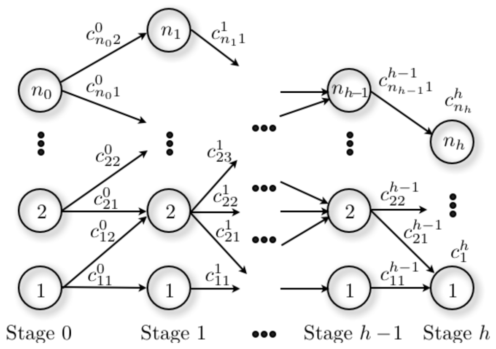{width="55%" fig-align="center"}

Stage decision problems can be approximated by a process called discretization (also denoted by sampling or quantization).

## Example

$$\sum_{k=0}^1 x_k^2+u_k^2+g_2(x_2) \qquad x_{k+1}=x_k+u_k \qquad k\in\{0,1\}$$

$$g_2(x_2) = e^{x_2}$$

When $g_2(x_2)=x_2^2$ we obtained (see lecture 5) the optimal policy and the optimal costs-to-go

$$u_0=-\frac{3}{5}x_0 \qquad u_1=-\frac{1}{2}x_1$$

$$J_0(x_0)=\frac{8}{5}x_0^2 \qquad J_1(x_1)=\frac{3}{2}x_1^2$$

We will now recover these functions using an alternative method (discretization) and then apply it to the problem with a non-quadratic terminal cost.

## Example: discretization

**Stage-decision problem** $\quad \displaystyle\sum_{k=0}^1 x_k^2+u_k^2+g_2(x_2) \qquad x_{k+1}=x_k+u_k \quad k\in\{0,1\}$

**Discretization**

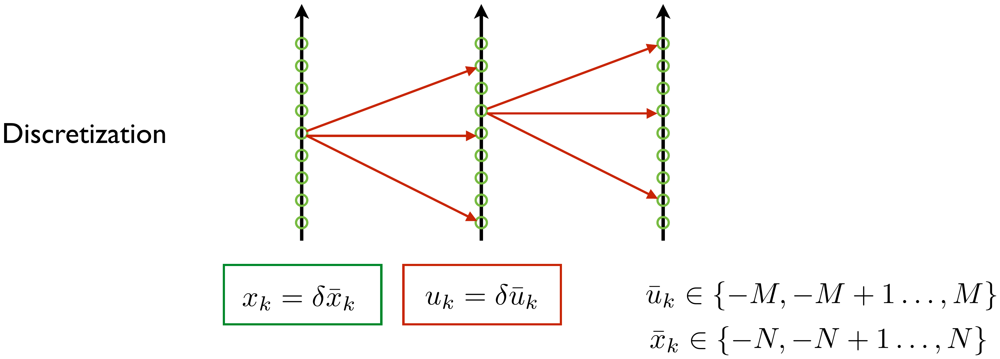{width="85%" fig-align="center"}

$$\bar u_k \in \{-M,-M+1\dots,M\} \qquad \bar x_k \in \{-N,-N+1\dots,N\}$$

**Discrete optimization problem** $\quad \delta^2\big(\sum_{k=0}^1 \bar x_k^2+\bar u_k^2\big)+g_2(\delta\bar x_2) \qquad \bar x_{k+1}=\bar x_k+\bar u_k \quad k\in\{0,1\}$

## Results

When $g_2(x_2)=x_2^2$ we indeed recover (approximately) the optimal policy

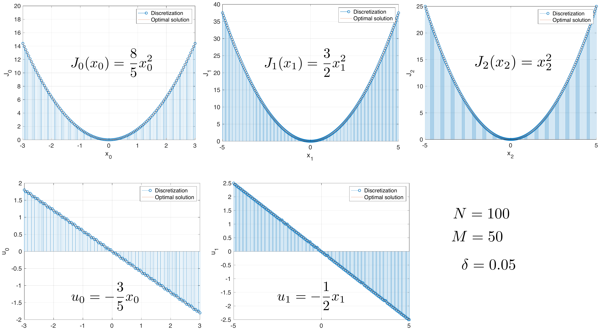{width="85%" fig-align="center"}

## Results

Which encourages us to think that the optimal policy when $g_2(x_2)=e^{x_2}$ can be (approximately) obtained with the same method

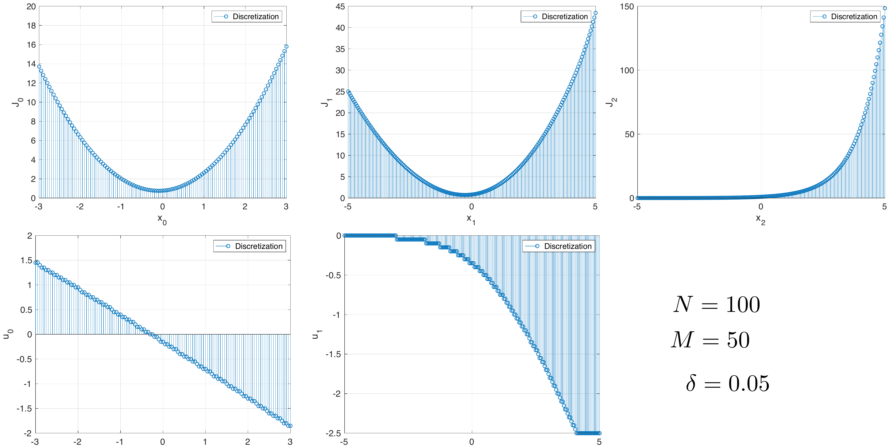{width="85%" fig-align="center"}

This statement can be formalised but we do not pursue this here.

## Results

Note that the cost if the initial state $x_0=1$ is $2.64$

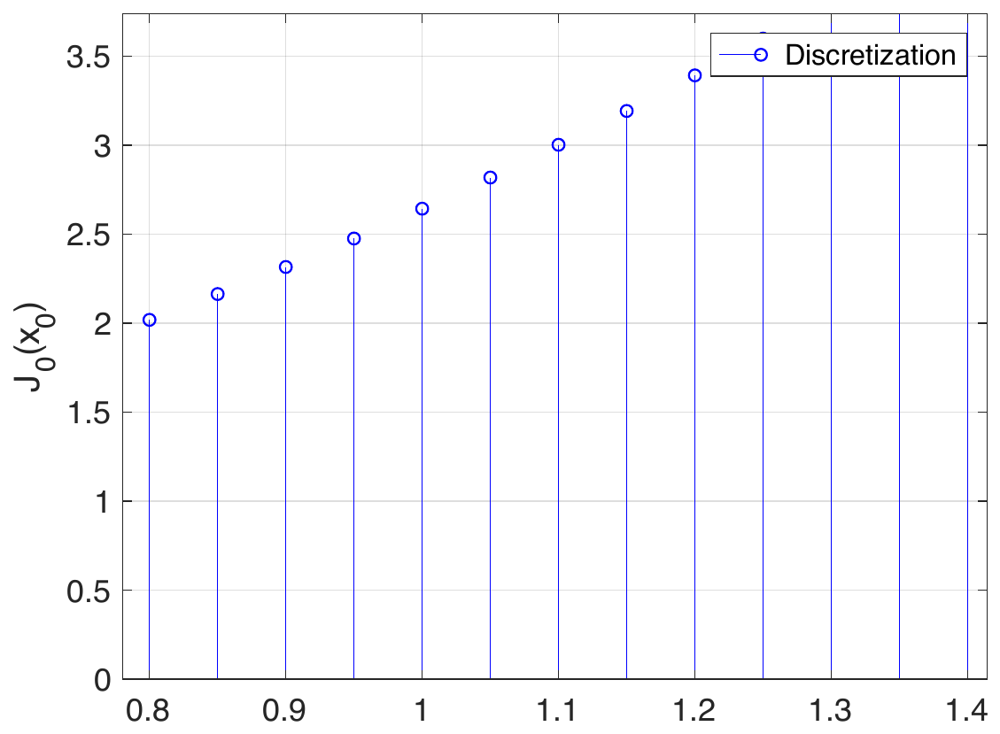{width="35%" fig-align="center"}

and corresponds to an initial control $u_0=-0.7$ leading to state $x_1=0.3$ and in turn to the control $u_1=-0.45$

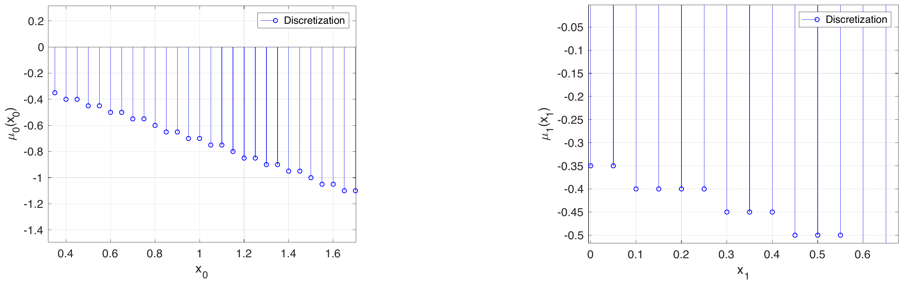{width="70%" fig-align="center"}

We will (approximately) obtain these values later with a different method!

## Discussion

- We discuss next how to extend the discretisation method to the general case where the state belongs to $\mathbb{R}^n$ with the help of the following example.
- Consider the following toy problem: compute the force to move a unitary mass 1 meter along a flat surface from rest to rest in 1 second with minimum energy.

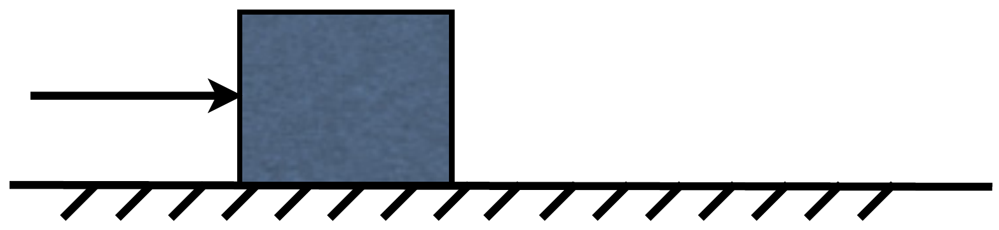{width="55%" fig-align="center"}

$$\ddot z(t)=u(t) \qquad z(0)=0 \quad z(1)=1 \qquad \min\int_0^1 u(t)^2dt \qquad \dot z(0)=\dot z(1)=0$$

- Later in the course we will learn the tools to find an optimal solution to this problem which is $u(t)=6-12t$, resulting in $v(t)=6t-6t^2$, $x(t)=3t^2-2t^3$.
- To convert from continuous to discrete time we also need temporal discretization.

## Discretization

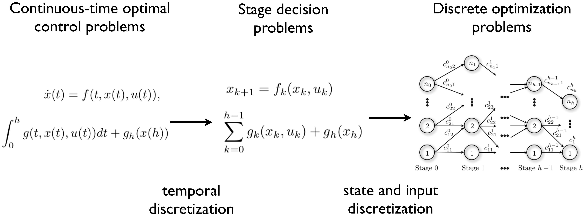{width="95%" fig-align="center"}

## Digital control

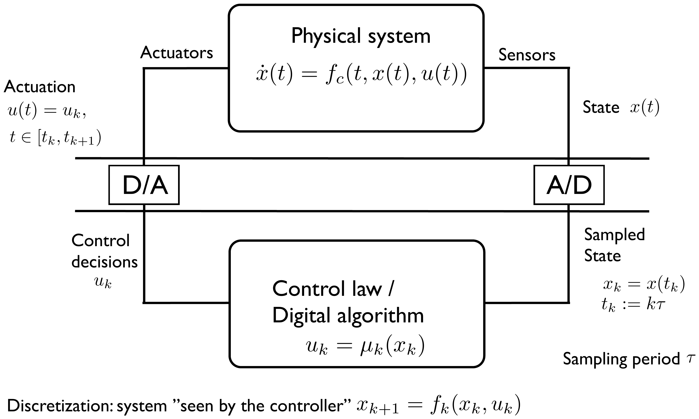{width="80%" fig-align="center"}

**Discretization:** system "seen by the controller" $x_{k+1}=f_k(x_k,u_k)$

## Temporal discretization

- Solve the differential equation $\dot x(t)=f_c(t,x(t),u(t))$ in $t\in[t_k,t_{k+1})$ for an initial condition $x(t_k)=x_k$ and a constant control input $u(t)=u_k$ and evaluate at $t=t_{k+1}$

$$x_k=x(t_k) \qquad x_{k+1}=x(t_{k+1})=f(x_k,u_k)$$

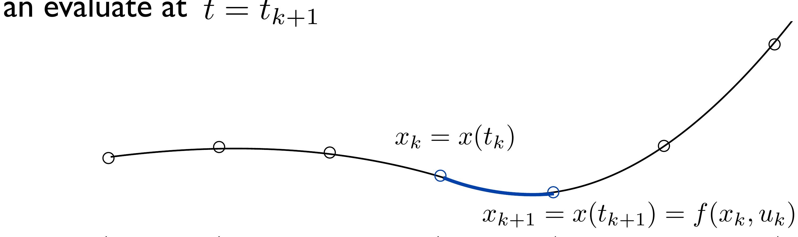{width="55%" fig-align="center"}

- For example if $\dot x(t)=Ax(t)+Bu(t)$, use the variation of constants formula $x(t)=e^{A(t-t_k)}x(t_k)+\int_{t_k}^t e^{A(t-s)}Bu(s)ds$ to conclude that

$$x_{k+1}=A_dx_k+B_du_k \qquad A_d=e^{A\tau}, \ \ B_d=\int_0^\tau e^{As}ds\,B$$

## Double integrator {.smaller}

**Model** $\quad \begin{bmatrix}\dot z(t)\\ \dot v(t)\end{bmatrix}=\begin{bmatrix}0&1\\0&0\end{bmatrix}\begin{bmatrix}z(t)\\v(t)\end{bmatrix}+\begin{bmatrix}0\\1\end{bmatrix}u(t) \quad\longrightarrow\quad \begin{bmatrix}z_{k+1}\\v_{k+1}\end{bmatrix}=\begin{bmatrix}1&\tau\\0&1\end{bmatrix}\begin{bmatrix}z_k\\v_k\end{bmatrix}+\begin{bmatrix}\tau^2/2\\\tau\end{bmatrix}u_k$

$$u(t)=u_k, \ \ t\in[t_k,t_{k+1}) \qquad z_k=z(t_k) \quad v_k=v(t_k) \qquad K\tau=1 \quad t_{k+1}-t_k=\tau$$

**Cost** $\quad \displaystyle\int_0^1 u(t)^2dt = \sum_{k=0}^{K-1}\int_{t_k}^{t_{k+1}} u_k^2\,dt \quad\longrightarrow\quad \tau\sum_{k=0}^{K-1}u_k^2$

**Initial and terminal conditions** $\quad z(0)=0, \ z(1)=1, \ \dot z(0)=\dot z(1)=0 \quad\longrightarrow\quad z_0=v_0=v_K=0, \ z_K=1$

**Optimal solution (can be obtained by LQR)**

$$u_k=-R^{-1}B^\intercal\big((A^\intercal)^{-1}\big)^{k+1}\lambda_0 \qquad \lambda_0=M_{12}^{-1}\begin{bmatrix}1\\0\end{bmatrix} \qquad \begin{bmatrix}M_{11}&M_{12}\\M_{21}&M_{22}\end{bmatrix}=\begin{bmatrix}A&-BR^{-1}B^\intercal(A^\intercal)^{-1}\\0&(A^\intercal)^{-1}\end{bmatrix}^K$$

## Solution

$\tau=0.2$ and $\tau=0.1$

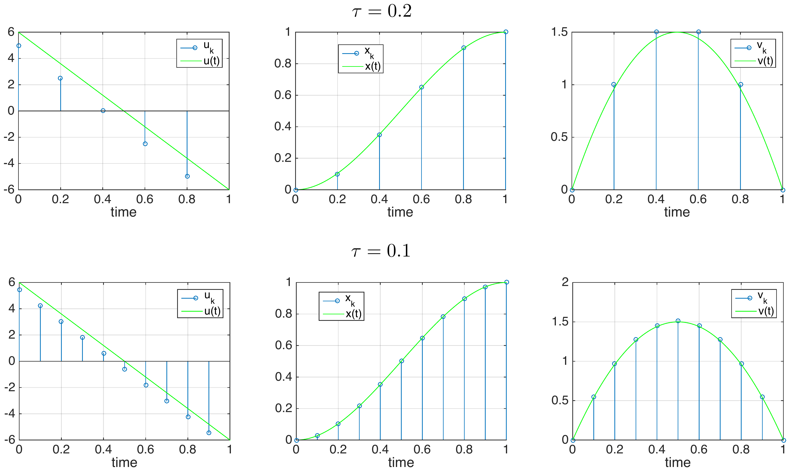{width="90%" fig-align="center"}

## Solution

$\tau=0.05$ and $\tau=0.025$

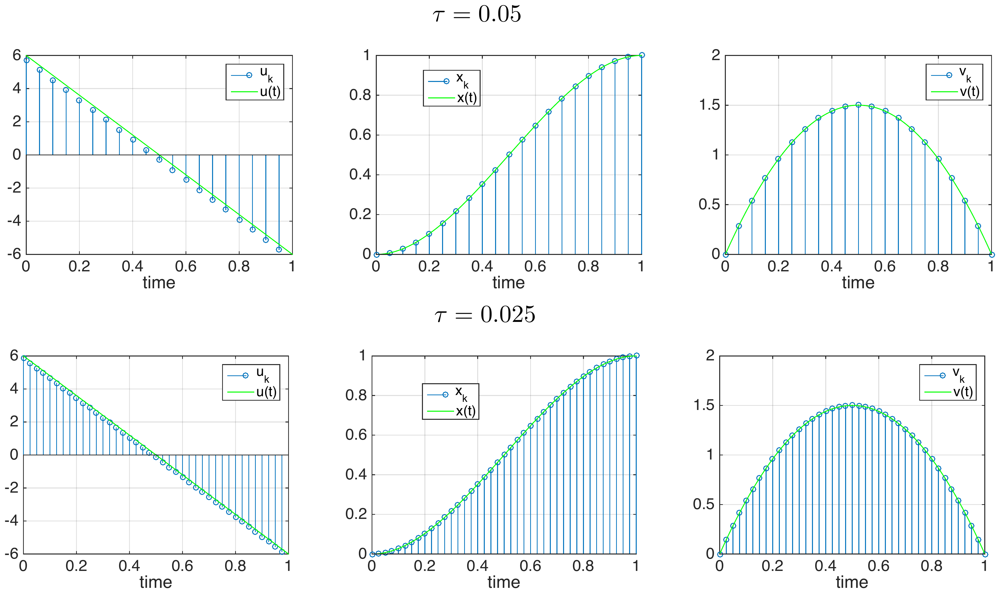{width="90%" fig-align="center"}

## Discussion on temporal discretization {.smaller}

**Dynamic model**

- For non-linear systems discretization may be hard. A numerical method (e.g. Euler) is typically used

$$x_{k+1}=x_k+\tau f(t_k,x_k,u_k)$$

**Cost function**

- In the problem formulation, the state and input variables may already be penalized at sampling times.

$$\sum_{k=0}^{h-1}g_k(x(t_k),u(t_k))+g_h(x(T)) = \sum_{k=0}^{h-1}g_k(x_k,u_k)+g_h(x_h)$$

- Cost may result from discretizing a continuous-time cost function

$$\int_0^T g_c(t,x(t),u(t))dt = \sum_{k=0}^{h-1}\underbrace{\int_{t_k}^{t_{k+1}} g_c(t,x(t),u(t))dt}_{g_k(x_k,u_k)}$$

- We can also use the approximation

$$\int_0^T g_c(t,x(t),u(t))dt \approx \sum_{k=0}^{h-1}\tau\, g_c(k\tau,x_k,u_k)$$

## State space $\mathbb{R}^n$ and input space $\mathbb{R}^m$

For a general stage decision problem

$$g_0(x_0,u_0) \quad g_1(x_1,u_1) \quad \dots \quad g_{h-1}(x_{h-1},u_{h-1}) \quad g_h(x_h)$$

$$x_1=f_0(x_0,u_0) \qquad x_2=f_1(x_1,u_1) \qquad \dots \qquad x_h=f_{h-1}(x_{h-1},u_{h-1})$$

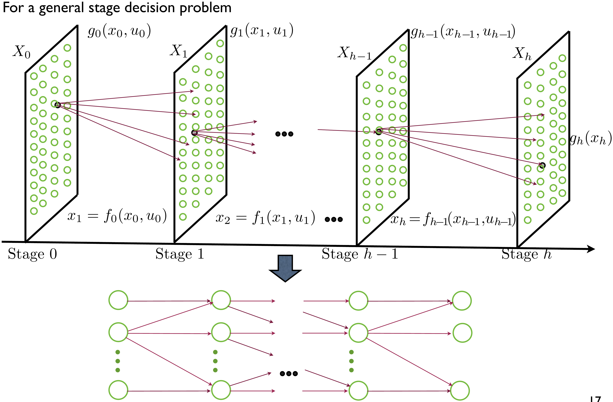{width="70%" fig-align="center"}

## Example: discretization

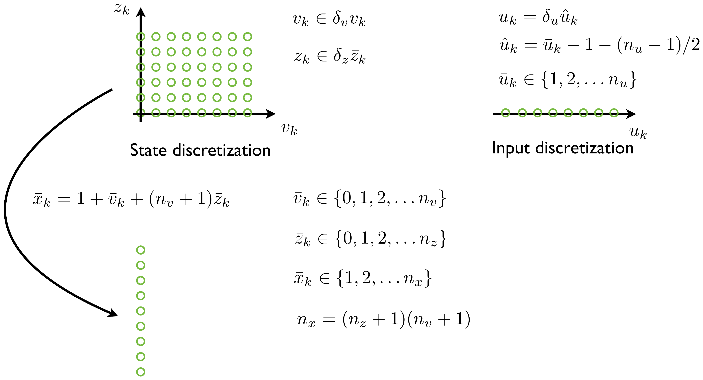{width="85%" fig-align="center"}

## Example: model {.smaller}

$$\begin{bmatrix}z_{k+1}\\v_{k+1}\end{bmatrix}=\begin{bmatrix}1&\tau\\0&1\end{bmatrix}\begin{bmatrix}z_k\\v_k\end{bmatrix}+\begin{bmatrix}\tau^2/2\\\tau\end{bmatrix}u_k \quad\text{if}\quad \delta_z=\delta_u\tau^2/2, \ \ \delta_v=\delta_u\tau$$

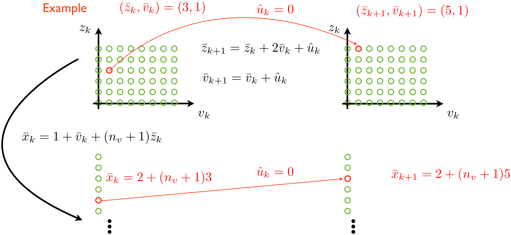{width="80%" fig-align="center"}

with this procedure we can obtain $\bar x_{k+1}=f(\bar x_k,\bar u_k)$

## Example: cost and terminal conditions

**Cost** $\quad \displaystyle\tau\sum_{k=0}^{K-1}u_k^2 \quad\longrightarrow\quad \tau\delta_u^2\sum_{k=0}^{K-1}\bar u_k^2 \qquad \bar u_k=\bar u_k-1-(n_u-1)/2$

The terminal conditions can be imposed by making

$$J_h(\bar x_h) = \begin{cases}\infty & \text{otherwise} \\ 0 & \text{if } \bar x_h=1+0+(n_v+1)(n_z)\end{cases}$$

**Initial condition** $\quad \bar x_0=1+0+(n_v+1)(0)=1$

## Solution

$\tau=0.2$, $\delta_u=1$ and $\delta_u=0.5$

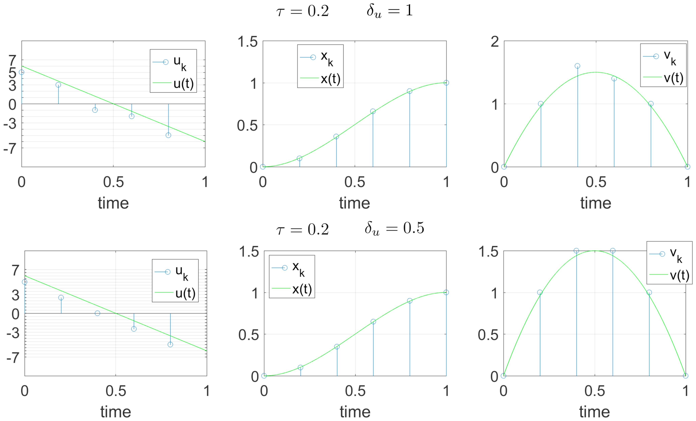{width="90%" fig-align="center"}

## Solution

$\tau=0.2$, $\delta_u=0.1$ and $\tau=0.1$, $\delta_u=0.1$

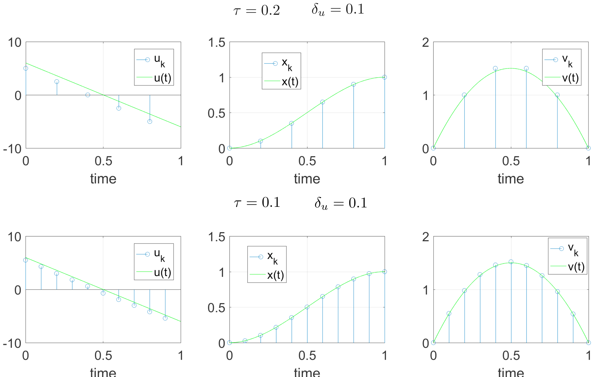{width="90%" fig-align="center"}

## Solution

$\tau=0.05$, $\delta_u=0.2$ and $\delta_u=0.1$

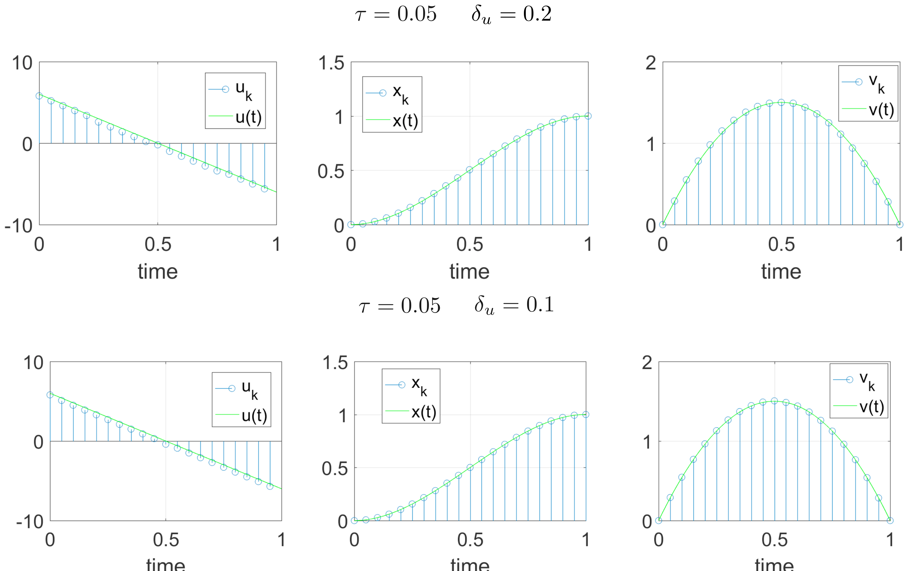{width="90%" fig-align="center"}

## Discussion {.smaller}

- One can always use discretization for a general stage decision problem although it might be hard to circumvent some issues (as it might not be possible to obtain the final desired state exactly).
- Is DP then so powerful that we can solve any stage decision problem? (note that most digital control problems are stage decision problems).
- The answer is no: the discretization of state and input spaces is only computationally feasible when these spaces have a small dimension.
- Suppose that $x_k\in\mathbb{R}^n$ and $u_k\in\mathbb{R}^m$ and we discretize each component of the state with $N$ values and each component of the input with $M$ values. Then we need around $N^n$ states per stage and around $M^m$ decisions (arrows) per state.
- For example for the control of a quadcopter $n=12$ and $m=4$. Picking $N=M=100$ we would need $N^n=10^{24}$ states and $M^m=10^8$ decisions per state per stage!
- Bellman called this **the curse of dimensionality**.

## Outline

- Discretization
- Unconstrained optimization

## Recap

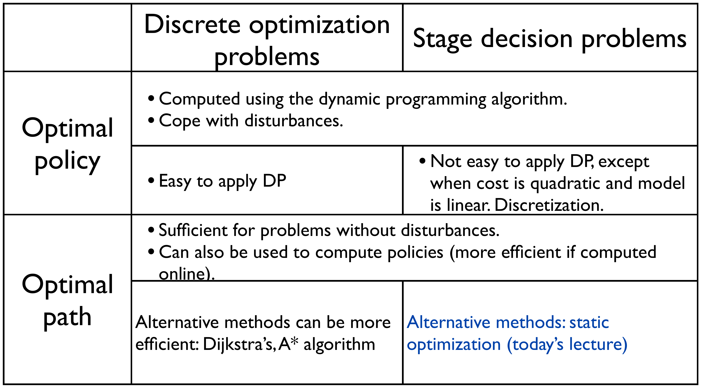{width="90%" fig-align="center"}

## Motivation

We can write the problem we started with

$$\sum_{k=0}^1 x_k^2+u_k^2+g_2(x_2) \qquad g_2(x_2)=e^{x_2} \qquad x_{k+1}=x_k+u_k \qquad k\in\{0,1\} \qquad x_0=1$$

as an optimisation problem

::: {style="text-align: center;"}
::: {style="border: 2px solid #333; border-radius: 8px; padding: 0.6em; display: inline-block;"}
$$\min_{y\in\mathbb{R}^n} c(y)$$
:::
:::

In fact, writing

$$x_1=x_0+u_0 \qquad x_2=x_1+u_1=x_0+u_0+u_1$$

we can reformulate the cost

$$x_0^2+u_0^2+x_1^2+u_1^2+e^{x_2} = x_0^2+u_0^2+(x_0+u_0)^2+u_1^2+e^{(x_0+u_0+u_1)}$$

which takes the desired form by making $y=(u_0,u_1)$.

## Unconstrained optimization

$$\min_{y\in\mathbb{R}^n} c(y)$$

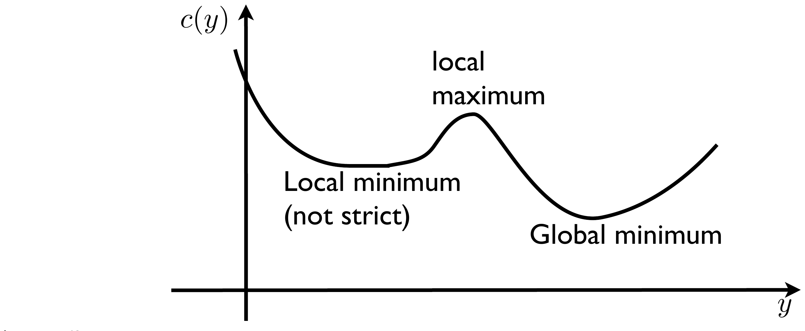{width="55%" fig-align="center"}

$y^*\in\mathbb{R}^n$ is a:

- **local minimum** if there exists $\epsilon>0$ such that for all $y\in\mathbb{R}^n$ such that $\|y-y^*\|<\epsilon$ we have

$$c(y^*)\leq c(y) \tag{1}$$

- **strict minimum** if (1) holds with strict inequality.
- **global minimum** if (1) holds for every $y\in\mathbb{R}^n$.

Local, strict, and global maximum are defined similarly.

## First order conditions {.smaller}

If $c\in\mathcal{C}^1$, a necessary condition for $y^*$ to be a minimum is that the gradient of $c$ at $y^*$ is zero

$$\nabla c(y^*)=0$$

that is, the $n$ variables $(y_1^*,\dots,y_n^*)$ must satisfy the $n$ equations

$$\nabla c(y^*) = \begin{bmatrix}\frac{\partial}{\partial y_1}c(y_1^*,\dots,y_n^*) & \dots & \frac{\partial}{\partial y_n}c(y_1^*,\dots,y_n^*)\end{bmatrix} = \begin{bmatrix}0 & \dots & 0\end{bmatrix}$$

**Notation**

- with some abuse of notation $\nabla c(y^*)$ shall indicate $\nabla c(y)|_{y=y^*}$
- when convenient we will use $\frac{\partial c}{\partial y}(y^*) \equiv \nabla c(y^*)$ or $c_y(y^*) \equiv \nabla c(y^*)$
- Note that by convention the gradient is a row vector.

## Example

$$c(y)=y_1e^{-y_1^2-y_2^2} \qquad \nabla c(y)=e^{-y_1^2-y_2^2}\begin{bmatrix}-2y_1^2+1 & -2y_1y_2\end{bmatrix}$$

$\nabla c(y)=0$ when

$$(y_1,y_2)=\Big(\tfrac{1}{\sqrt2},0\Big) \quad \text{maximum} \qquad (y_1,y_2)=\Big(-\tfrac{1}{\sqrt2},0\Big) \quad \text{minimum}$$

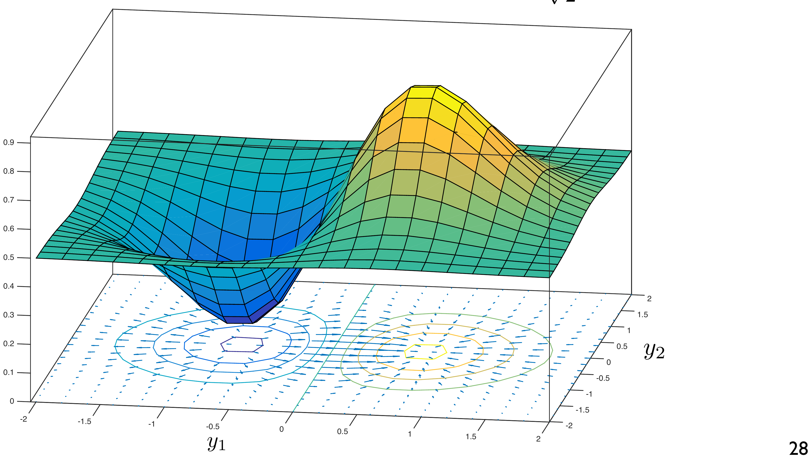{width="55%" fig-align="center"}

## Second order conditions {.smaller}

**Necessary conditions**

If $c\in\mathcal{C}^2$, a necessary condition for $y^*$ to be a local minimum is that the Hessian is positive semi-definite

$$\nabla^2c(y^*)\geq0 \qquad \nabla^2c(y) = \begin{bmatrix}\frac{d^2c}{dy_1^2}(y) & \dots & \frac{d^2c}{dy_1dy_n}(y) \\ \dots & \dots & \dots \\ \frac{d^2c}{dy_ndy_1}(y) & \dots & \frac{d^2c}{dy_n^2}(y)\end{bmatrix}$$

**Sufficient conditions**

If $c\in\mathcal{C}^2$ a sufficient condition for $y^*$ to be a strict local minimum is

$$\nabla^2c(y^*)>0$$

**Examples**

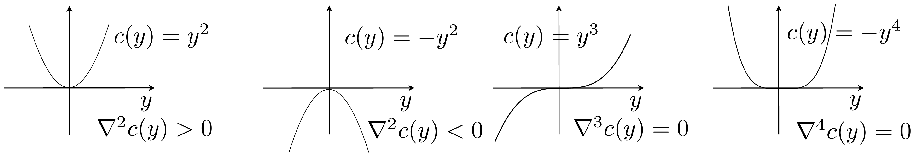{width="95%" fig-align="center"}

## Convex functions

A function $c:\mathbb{R}^n\to\mathbb{R}$ is convex if for every $y_1\in\mathbb{R}^n$, $y_2\in\mathbb{R}^n$, $\alpha\in[0,1]$, we have

$$c(\alpha y_1+(1-\alpha)y_2) \leq \alpha c(y_1)+(1-\alpha)c(y_2)$$

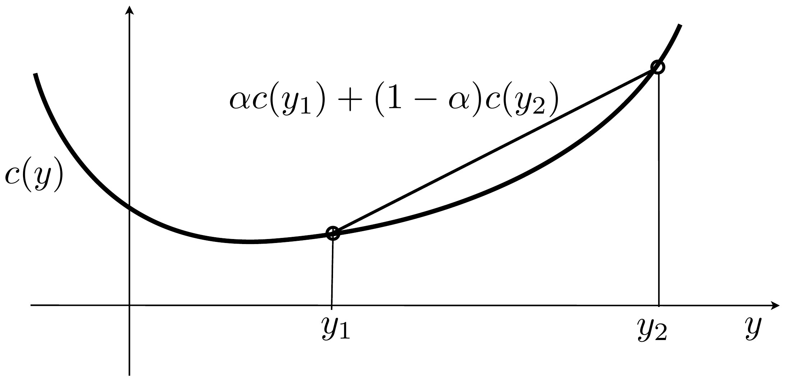{width="50%" fig-align="center"}

- If $c\in\mathcal{C}^2$ then convexity is equivalent to $\nabla^2c(y)\geq0, \ \forall y\in\mathbb{R}^n$.
- For convex functions $c\in\mathcal{C}^1$, $\nabla c(y^*)=0$ is (necessary and) sufficient for $y^*$ to be a **global** minimum.

## Gradient method, unconstrained opt.

$$\min_{y\in\mathbb{R}^n} c(y)$$

::: {style="border: 2px solid #333; border-radius: 8px; padding: 0.8em;"}
Given an initial estimate $x_0$, iterate the method

$$x_{k+1} = x_k - \epsilon_k \nabla c(y)^\intercal|_{y=x_k}$$

until a certain stopping criterion is met (e.g. $k>k_{\max}$ or $\|\nabla c(y)|_{y=x_k}\|<\delta$)
:::

**Choice of the step $\epsilon_k$**

- Ideally $\epsilon_k$ is taken as the solution to $\min_{\alpha\in\mathbb{R}_{\geq0}} c(x_k-\alpha\nabla c(y)^\intercal|_{y=x_k})$ but this requires a line search which might be computationally demanding
- The simplest choice would be $\epsilon_k=\bar\epsilon$ but in general we need $\epsilon_k\to0$, otherwise the method will (in the best case!) oscillate around the minimum. Small $\bar\epsilon$: many iterations needed to get close to the minimum, large $\bar\epsilon$: method might diverge.
- In practice a heuristic may be used guaranteeing that $c(x_{k+1})<c(x_k)$ (e.g. Armijo's rule)

**Newton's method (much faster)**

- Choose the following descend direction $[\nabla^2c(y)]^{-1}\nabla c(y)^\intercal$ instead of $\nabla c(y)^\intercal$

## Discussion {.smaller}

- These methods work very well for convex problems (cost and constraint functions are convex). For non-convex problems it is very hard to compute the minimum and the numerical methods have many issues (e.g. get stuck in local minima).
- There are many other numerical methods. For example for unconstrained problems, Newton and Quasi-Newton methods, conjugate gradient methods, etc. For constrained problems, Penalty, Barrier, and Augmented Lagrangian methods.
- A class of problems that can be solved very efficiently is quadratic programming

$$\min_x \ q(x)=\tfrac12 x^\intercal Gx+x^\intercal d \qquad \text{subject to} \quad a_i^\intercal x=b_i, \ \ i\in\mathcal{E}, \qquad a_i^\intercal x\geq b_i, \ \ i\in\mathcal{I}$$

and this allows to model linear quadratic control problems with input and state constraints.

- Two very good references if you want to know more about numerical optimization:

*Numerical optimization*. Jorge Nocedal, Stephen Wright, Springer, 1999

*Convex optimization*. Stephen Boyd, Lieven Vandenberghe, Cambridge University Press, 2004

## Application to optimal control

Finding an optimal path for a stage decision problem

$$\min_{x,u} \ \sum_{k=0}^{h-1}g_k(x_k,u_k)+g_h(x_h) \qquad \text{s.t. } x_{k+1}=f(x_k,u_k) \quad k\in\{0,\dots,h-1\}$$

can be formulated as an unconstrained optimization problem, by writing the state variables in terms of the control inputs $u=(u_0,u_1,\dots,u_{h-1})$ and the initial state $x_0$ (which is given)

$$x_1=f(x_0,u_0)=F_1(x_0,u_0)=\bar F_1(x_0,u)$$
$$x_2=f(f(x_0,u_0),u_1)=F_2(x_0,u_0,u_1)=\bar F_2(x_0,u)$$
$$x_3=f(f(f(x_0,u_0),u_1),u_2)=F_3(x_0,u_0,u_1,u_2)=\bar F_3(x_0,u)$$
$$\vdots$$
$$x_h=f(f(\dots,f(x_0,u_0),u_1),u_2,\dots,u_{h-1})=F_h(x_0,u_0,\dots,u_{h-1})=\bar F_h(x_0,u)$$

Then we can consider the unconstrained optimization problem

$$\min_u c(u) \qquad c(u)=\sum_{k=0}^{h-1}g_k(\bar F_k(x_0,u),u_k)+g_h(\bar F_h(x_0,u)) \qquad \bar F_0(x_0,u)=x_0$$

## Example

Consider again the following simple example

**Dynamic model** $\quad x_{k+1}=x_k+u_k \quad k\in\{0,1\}$

**Cost** $\quad \displaystyle\sum_{k=0}^1 x_k^2+u_k^2+g_2(x_2)$

| Terminal cost | |
|---|---|
| Quadratic | $g_2(x_2)=x_2^2$ |
| Non-quadratic I | $g_2(x_2)=e^{x_2}$ |
| Non-quadratic II | $g_2(x_2)=\sqrt{|x_2|}$ |

**Initial condition** $\quad x_0=1$

## Quadratic terminal cost

**Step 1.** Write the state variable as a function of the control inputs

$$x_1=x_0+u_0 \qquad x_2=x_1+u_1=x_0+u_0+u_1$$

**Step 2.** Write the cost function as a function of the control inputs

$$x_0^2+u_0^2+x_1^2+u_1^2+x_2^2 = x_0^2+u_0^2+(x_0+u_0)^2+(x_0+u_0+u_1)^2+u_1^2$$

$$= \begin{bmatrix}u_0\\u_1\end{bmatrix}^\intercal\begin{bmatrix}3&1\\1&2\end{bmatrix}\begin{bmatrix}u_0\\u_1\end{bmatrix}+x_0\begin{bmatrix}4&2\end{bmatrix}\begin{bmatrix}u_0\\u_1\end{bmatrix}+3x_0^2$$

**Step 3.** Find the optimal values of the control inputs $u_0,u_1$ by differentiating and setting the derivative to zero

$$\begin{bmatrix}u_0\\u_1\end{bmatrix} = -\frac12\begin{bmatrix}3&1\\1&2\end{bmatrix}^{-1}\begin{bmatrix}4\\2\end{bmatrix}x_0 = \begin{bmatrix}-\frac35\\-\frac15\end{bmatrix}x_0 = \begin{bmatrix}-\frac35\\-\frac15\end{bmatrix} \quad (\text{when } x_0=1)$$

**Step 4.** Replace the values of $u_0,u_1$ in the expression for the cost, leading to the value:

$$\text{cost:} \ \frac85$$

## Non-quadratic terminal cost I

**Step 1.** Write the state variables as a function of the control inputs

$$x_1=x_0+u_0 \qquad x_2=x_1+u_1=x_0+u_0+u_1$$

**Step 2.** Write the cost function as a function of the control inputs

$$x_0^2+u_0^2+x_1^2+u_1^2+e^{x_2} = x_0^2+u_0^2+(x_0+u_0)^2+u_1^2+e^{(x_0+u_0+u_1)}$$

**Step 3.** Find the optimal values of the control inputs

- differentiating and setting the derivative to zero would lead to a system of non-linear equations - one could apply a numerical method to solve it, but in general this is difficult.
- One can apply the gradient method to find the optimal control input.
- Since there are only two scalar control inputs to be determined, one can simply plot the function.

## Non-quadratic terminal cost I

**Plot** $\quad h(u_0,u_1)=1+u_0^2+(1+u_0)^2+u_1^2+e^{1+u_0+u_1}$ (convex function!)

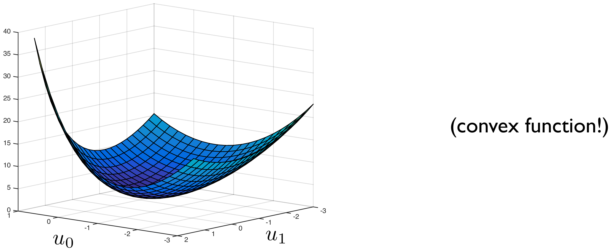{width="45%" fig-align="center"}

**Gradient method with line search**

$$u^{(k+1)}=u^{(k)}-\alpha_k\frac{\partial J}{\partial u}(u^{(k)}) \qquad \alpha_k=\underset{\alpha\in[0,1)}{\arg\min} \ J(u^{(k)}-\alpha a), \ \ a=\frac{\partial J}{\partial u}(u^{(k)}) \qquad u^{(k)}=[u_0^{(k)} \ \ u_1^{(k)}]$$

Numerical values using Matlab for two initial guesses ($u^{(0)}=(1,1)$ and $u^{(0)}=(0.1,1.5)$): both converge to $u^{(6)}\approx(-0.7157,-0.4315)$.

**Step 4.** Replace the values of $u_0,u_1$ in the expression for the cost: $h(-0.7157,-0.4315)=2.6424$

## Non-quadratic terminal cost II

**Plot** $\quad 1+u_0^2+(1+u_0)^2+u_1^2+\sqrt{|1+u_0+u_1|}$ (non-convex function!)

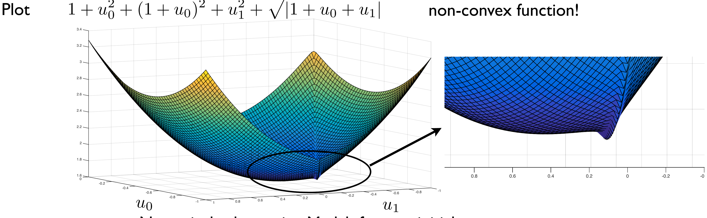{width="80%" fig-align="center"}

**Gradient method with line search.** Numerical values using Matlab for two initial guesses: $u^{(0)}=(1,1) \to h(-0.5695,-0.1376)=1.6910$ and $u^{(0)}=(-0.9,-0.6) \to h(-0.6667,-0.3333)=1.6669$.

For non-convex functions we may not be able to obtain the minimum with the gradient method!

## Discussion {.smaller}

**Optimal paths**

- We were able to solve a problem (although numerically) that we could not solve analytically with DP - this relied on the convexity of the cost function. However, for non-convex functions it would be hard to solve it.
- We could have used discretization with DP to solve this problem, which is also a numerical method.
- Discretization is limited by the curse of dimensionality while static optimization problems can get stuck in local minima and are only guaranteed to work properly when the function is convex.

**Conclusion**

| dimension | convexity | DP discretization | Static optimization |
|---|---|---|---|
| small $n\leq3$ | convex | ✓ | ✓ |
| small $n\leq3$ | non-convex | ✓ | ✗ |
| large | convex | ✗ | ✓ |
| large | non-convex | ✗ | ✗ |

## Concluding remarks

- State and input discretization: allows to transform any stage-decision problem into a discrete optimization problem.
- It is not feasible for problems with large input and state dimensions - curse of dimensionality.
- For linear systems we can exactly and easily obtain temporal discretizations.
