## Unit 8 {.center style="text-align: center;"}

<!--
Converted from Slides/Lecture8.pdf (57 slides) on 2026-08-11, following the
conventions finalized on Lectures 1-7 (see lecture07's header comment for
the full rationale). Quick recap:
- No image captions anywhere; every figure is a bare
  {width="X%" fig-align="center"} with no caption/credit text.
- Every crop was produced with the row/column (and sometimes column-only)
  pixel-band-detection method, targeting a band that excludes the slide
  title and the Keynote page number, then visually spot-checked.
- Slides that are pure text/bullets/equations are retyped natively as
  Quarto/LaTeX. Slides built around a genuine diagram or a numerical plot
  are kept as a tightly-cropped image.
- Figures live in figures/lecture8/, named pgNN-slug.png (matching the
  original PDF page number NN, 1-indexed from the title slide).
- Per feedback established on Lectures 5-7, the Concluding remarks slide's
  "After this lecture, you should be able to" and "Additional live
  scripts" bullet blocks are dropped entirely (not transcribed), and all
  inline mid-slide LiveScript/*.mlx references are dropped too.
- IMPORTANT NUMBERING NOTE: this deck's own title slide says "Lecture 9",
  and every inline LiveScript path says "LiveScript/Lecture9/...". This
  is evidently a leftover from a prior renumbering of the course (the
  deck's own first slide recaps "last two lectures" as discretization and
  static optimization, i.e. this Unit's own Lecture 7, confirming this
  file's content picks up right where Unit 7 left off). Since the file is
  named Lecture8.pdf and the user calls it Unit 8, this qmd is Unit 8;
  the "Lecture 9" label is treated as a source typo and not repeated in
  the title slide text.
- Three real photographs appear in this deck: a lab fluid-mixing
  apparatus/camera-image (slide 39, cited to "V.S. Dolk MSc thesis"),
  a generic hands-kneading-dough stock photo (slide 40, illustrating the
  "stretching and folding" mixing analogy), and an OMRON SCARA robot
  product photo (slide 56). All three are used for identification /
  illustrative purposes in an internal teaching slide deck (nominative
  fair use), matching how the Kalman/Obama and other real photos were
  handled in earlier lectures -- flagged here rather than silently kept.

ROUND 2 (2026-10-01): the two "cost of periodic / cost of rollout" figures
on the resource-aware example slides were $16.4974$ and $12.4969$; they are
now $16.1330$ and $12.7055$. Recomputed from the parameters stated on the
slide itself (Ac, Bc, Qbar=I, Rbar=0.01, tau=0.1, x0, periodic base policy)
with the infinite-horizon LQR gain K = [-9.0556 -7.0543], the periodic cost
taken from the exact periodic-Lyapunov solution and the rollout cost from
simulating the one-step-lookahead policy to convergence; two independent
implementations (numpy/scipy and the javascript behind the interactive panel
in notes/unit8-notes.qmd) agree to four decimals, and the resulting schedule
reproduces the table on the next slide exactly. The improvement is therefore
about a fifth rather than about a quarter. Changed on Duarte's instruction
after he was shown both sets of numbers.

FIRST-PASS CAVEAT: this is a first pass prioritizing correct structure,
faithful transcription of every equation, and careful figure crops. Expect
a slide-by-slide refinement round, same as Lectures 1-7.
-->

### Approximate Dynamic Programming {style="text-align: center;"}

{width="15%" fig-align="center"}

::: {.title-slide-meta}
4SC000, Q2 2026-2027

Duarte Antunes
:::

## Motivation {.smaller}

- Last two lectures we discussed two alternative methods to DP for stage decision problems: discretisation and static optimization.
- Discretization allows to obtain an optimal policy (approximately) when the dimension of the problem (state and input dimension) is small and static optimisation allows to obtain an optimal path when the problem is convex

| dimension | convexity | DP discretization | Static optimization |
|---|---|---|---|
| small $n\leq3$ | convex | ✓ | ✓ |
| small $n\leq3$ | non-convex | ✓ | ✗ |
| large | convex | ✗ | ✓ |
| large | non-convex | ✗ | ✗ |

**In this lecture:**

- we show how to obtain optimal policies using static optimisation and online replanning policies (lec 3, slide 33) applying this to solve linear quadratic control with input constraints.
- discuss related approximate dynamic programming techniques such as MPC and rollout applying it to a non-convex, large dimensional problem (control of switched linear systems).

## Outline

- Approximate dynamic programming
- Linear quadratic control with inequality constraints
- Control of switched systems

## Challenge

Iterating the dynamic programming algorithm for stage decision problems is hard since it is hard to compute the costs-to-go (see e.g. slide 11 of lecture 5).

$$J_k(x_k) = \min_{u_k} \ g_k(x_k,u_k)+J_{k+1}(f_k(x_k,u_k))$$

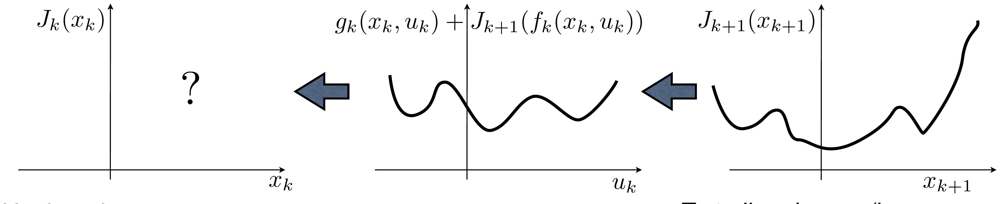{width="75%" fig-align="center"}

- Moreover:
  - discretization is only possible if the state and input spaces are not large.
  - static optimisation only assures optimality for convex problems and only allows to compute optimal paths.
  - How to obtain (sub)optimal policy?

## Idea I -- Online replanning policy

Compute optimal path online starting from the current state and apply the first decision

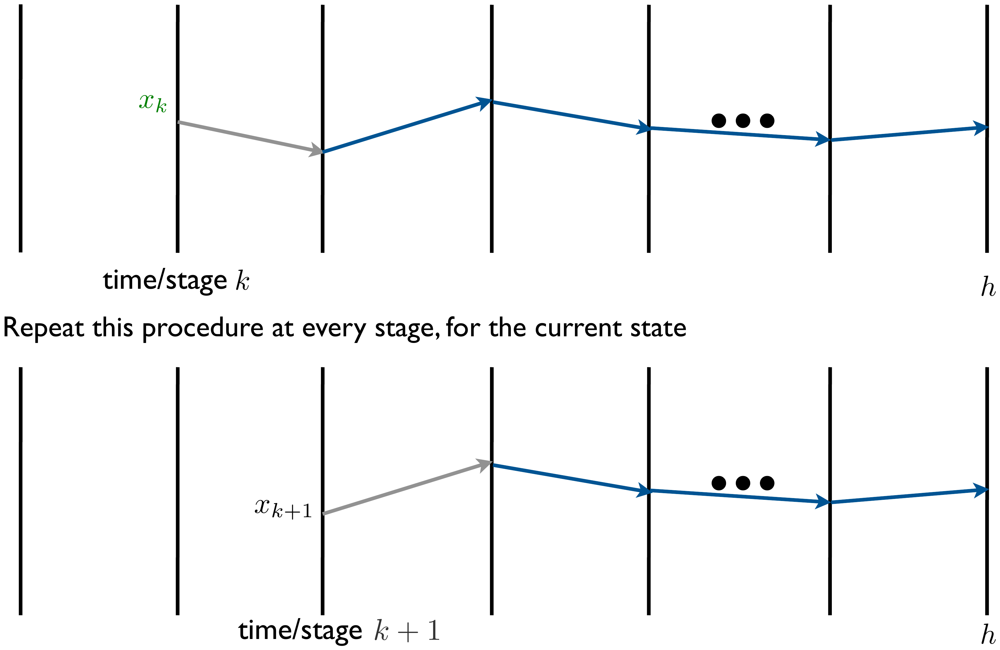{width="70%" fig-align="center"}

Repeat this procedure at every stage, for the current state

## Idea II -- MPC

Similar to Idea I but compute decisions only in a (short) horizon $H$.

Compute optimal path over horizon starting from the current state and apply first decision

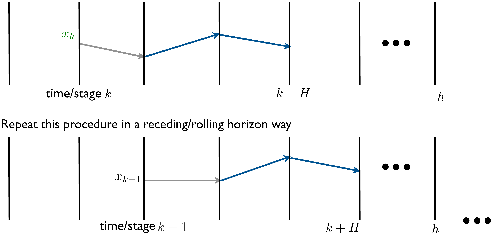{width="70%" fig-align="center"}

Repeat this procedure in a receding/rolling horizon way

- Optimization problem to solve at each stage is then much simpler and makes the algorithm feasible to run online. This is the fundamental idea of Model Predictive Control (MPC).
- Note that this is (in general) not optimal, not even for problems without disturbances.

## Idea III -- Rollout

Similar to Ideas I, II but after the optimization horizon use a base policy. Apply the first decision of the optimization procedure.

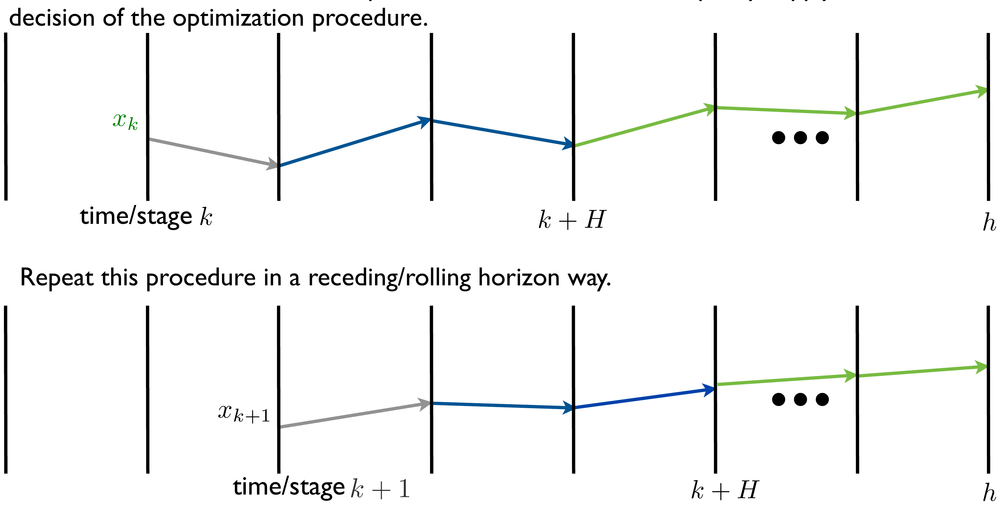{width="70%" fig-align="center"}

Repeat this procedure in a receding/rolling horizon way.

- Optimization problem to solve at each stage is then much simpler and makes the algorithm feasible to run online. This is the fundamental idea of Rollout.
- Note that this is (in general) not optimal, not even for problems without disturbances.

## Approximate dynamic programming

Approximate the cost-to-go and use the solution $u_k$ of the following equation as the control input (in general different from optimal control input!)

$$J_k(x_k) = \min_{u_k} \ g_k(x_k,u_k)+\tilde J_{k+1}(f_k(x_k,u_k))$$

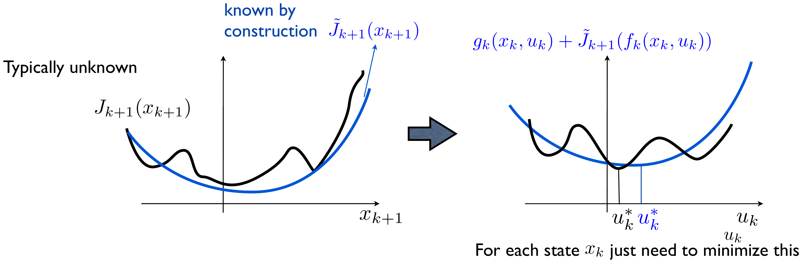{width="80%" fig-align="center"}

For each state $x_k$ just need to minimize this function and compute one action.

More general than previous ideas!

## Discussion {.smaller}

- Ideas I, II, III can be seen as special cases of approximate dynamic programming.
- Idea I -- for problems with disturbances, the true cost (requiring the computation of expected values) is approximated by a deterministic cost. For problems without disturbances idea I yields the same policy as DP.
- Idea II -- approximation is the deterministic cost over a short horizon. This is an approximation even for problems without disturbances.
- Idea III -- approximation is the cost of the base policy when $H=1$, and it is the cost over a short horizon plus the cost of the base policy if the horizon is larger than one. Again this is an approximation even for problems without disturbances.
- Although we mainly consider finite horizon costs the ideas extend naturally to infinite horizon costs.

We formalize these statements next.

## Online replanning policy {.smaller}

Online replanning policy leads to the following implicit policy for a stage decision problem:

$$x_{k+1}=f_k(x_k,u_k,w_k) \qquad \sum_{k=0}^{h-1}g_k(x_k,u_k)+g_h(x_h)$$

1. At each stage $k$ (initially $k=0$), assuming that the full state $x_k$ is measured, solve the following problem (for initial condition $x_k$), assuming no disturbances ($w_k=0,w_{k+1}=0,\dots$)

$$\sum_{\ell=k}^{h-1}g_\ell(x_\ell,u_\ell)+g_h(x_h) \qquad x_{\ell+1}=f_\ell(x_\ell,u_\ell,0) \quad \ell\in\{k,k+1,\dots,h-1\}$$

and obtain estimates of the optimal control inputs $u_k,u_{k+1},\dots,u_{h-1}$

2. Take the first decision $u_k$ and apply it to the process (the system will evolve to $x_{k+1}=f_k(x_k,u_k,w_k)$, in general different from $x_{k+1}=f_k(x_k,u_k,0)$ due to disturbances). Repeat (go to 1.)

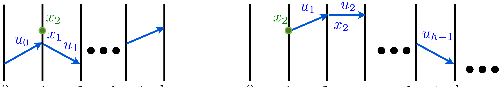{width="70%" fig-align="center"}

## Online replanning policy {.smaller}

For problems with no disturbances, this is equivalent to

$$\min_{u_k} \ g_k(x_k,u_k)+\tilde J_{k+1}(x_{k+1}) \qquad x_{\ell+1}=f_\ell(x_\ell,u_\ell,0) \quad \ell\in\{k,k+1,\dots,h-1\} \tag{1}$$

$$\tilde J_{k+1}(x_{k+1}) = \min_{u_{k+1},\dots,u_{h-1}} \ \sum_{\ell=k+1}^{h-1} g_\ell(x_\ell,u_\ell) \quad \text{s.t. (1), initial condition } x_{k+1}$$

and select the first $u_k$ and apply it.

Note that, for problems without disturbances, $\tilde J_k$ are the optimal costs-to-go and satisfy the DP equation

$$\tilde J_k(x_k) = \min_{u_k} \ g_k(x_k,u_k)+\tilde J_{k+1}(x_{k+1})$$

For problems with stochastic disturbances $\tilde J_k$ are approximations of optimal costs-to-go

$$J_k(x_k) = \min_{u_k} \ g_k(x_k,u_k)+\mathbb{E}[J_{k+1}(x_{k+1})] \qquad x_{\ell+1}=f_\ell(x_\ell,u_\ell,w_\ell) \quad \ell\in\{k,k+1,\dots,h-1\}$$

$$\underbrace{\phantom{J_k(x_k) = \min_{u_k} \ g_k(x_k,u_k)+\mathbb{E}[J_{k+1}(x_{k+1})]}}_{\text{approximated by } \tilde J_{k+1}(x_{k+1})}$$

## Model Predictive Control

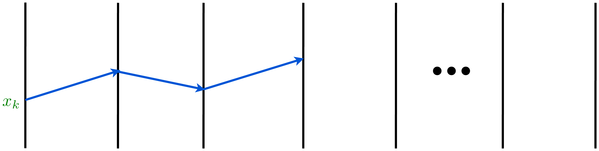{width="60%" fig-align="center"}

- At each time $k$ consider the optimal control problem only in a horizon $H$

$$\min_{u_k,u_{k+1},\dots,u_{k+H-1}} \ \sum_{\ell=k}^{k+H-1}g_\ell(x_\ell,u_\ell) \quad \text{s.t.} \quad x_{\ell+1}=f_\ell(x_\ell,u_\ell) \quad \ell\in\{k,k+1,\dots,k+H-1\} \tag{1}$$

and select the first control input $u_k$ resulting from this optimization.

- Equivalent to $\displaystyle\min_{u_k} \ g_k(x_k,u_k)+\tilde J_{k+1}(x_{k+1})$

$$\tilde J_{k+1}(x_{k+1}) = \min_{u_{k+1},\dots,u_{k+H-1}} \ \sum_{\ell=k+1}^{k+H-1}g_\ell(x_\ell,u_\ell) \quad \text{s.t. (1)}$$

## Model Predictive Control

- Note that at the last decision stages $k\in\{h-H,h-H-1,\dots,h\}$ the cost function is slightly different for finite horizon problems, including also the terminal cost

$$\min_{u_k,u_{k+1},\dots,u_{k+H-1}} \ \sum_{\ell=k}^{k+H-1}g_\ell(x_\ell,u_\ell)+g_h(x_h) \quad \text{s.t. (1),} \ \ell\in\{k,k+1,\dots,h-1\}$$

- There are several variants of Model Predictive Control and in particular some variants use a terminal constraint (this is useful to prove stability). For example, impose that the state after the horizon must be zero $x_{k+H}=0$ (for finite-horizon problems at the last stages $x_h=0$).

## Rollout {.smaller}

- Similar to MPC but use a base policy $u_k=\bar\mu(x_k)$ after the horizon

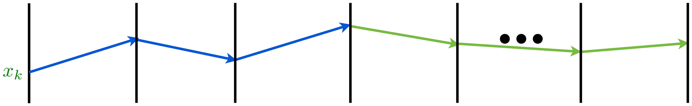{width="60%" fig-align="center"}

- At each time consider the optimal control problem in a horizon $H$ assuming that after the horizon a base policy is used

$$\min_{u_k,u_{k+1},\dots,u_{k+H-1}} \ \sum_{\ell=k}^{k+H-1}g_\ell(x_\ell,u_\ell) + \sum_{\ell=k+H}^{h-1}g_\ell(x_\ell,\bar\mu_\ell(x_\ell)) + g_h(x_h) \quad \text{s.t. (1)}$$

and select the first control input $u_k$ resulting from this optimization.

- Equivalent to $\displaystyle\min_{u_k} \ g_k(x_k,u_k)+\tilde J_{k+1}(x_{k+1})$

$$\tilde J_{k+1}(x_{k+1}) = \min_{u_{k+1},\dots,u_{k+H-1}} \ \sum_{\ell=k+1}^{k+H-1}g_\ell(x_\ell,u_\ell) + \sum_{\ell=k+H}^{h-1}g_\ell(x_\ell,\bar\mu_\ell(x_\ell)) + g_h(x_h)$$

## Further remarks on ADP {.smaller}

- Quality of an approximation is measured by how "good" $u_k^*$ is, or how close it is from optimal $u_k^*$, and not by how "good" is the approximation $\tilde J_{k+1}(x_{k+1})$ of $J_{k+1}(x_{k+1})$.
- Decisions only need to be computed (in real-time) for the value of the present state (do not need to iterate the cost-to-go).
- There are several variants to approximate the costs-to-go.
- Due to the heuristic nature of the approximation, it is very hard to quantify when a specific approximation method is good and to establish formal results.
- For example we have seen that the optimal policy for the infinite horizon linear quadratic regulator problem makes the closed-loop of a linear system stable. This is typically very hard to establish for approximate methods.

## Outline

- Approximate dynamic programming
- <u>Linear quadratic control with inequality constraints</u>
- Control of switched systems

## Problem formulation

**Dynamic model** $\quad x_{k+1}=Ax_k+Bu_k+w_k \qquad u_k\in\mathbb{R} \ \text{(for simplicity)}$

$w_k$ -- possible disturbances

**Cost function** $\quad \displaystyle\sum_{k=0}^{h-1}x_k^\intercal Qx_k+u_k^\intercal Ru_k+x_h^\intercal Q_hx_h$

**Input constraints** $\quad u_k\in[-c,c] \ \ \forall k \qquad (\text{given } c>0)$

Find a policy $\pi=\{\mu_0,\dots,\mu_{h-1}\}$, $u_k=\mu_k(x_k)$, which minimizes the cost function.

Let us focus first on obtaining an optimal path and then we will find a control policy with online replanning and MPC.

## Quadratic programming formulation {.smaller}

Define $\bar x=[x_1^\intercal \ x_2^\intercal \ \dots \ x_h^\intercal]^\intercal \qquad \bar u=[u_0^\intercal \ u_1^\intercal \ \dots \ u_{h-1}^\intercal]^\intercal$

**Cost function** $\quad (\bar A x_0+\bar B\bar u)^\intercal \bar Q(\bar Ax_0+\bar B\bar u)+\bar u^\intercal \bar R\bar u$

**Dynamic model (equality constraints)** $\quad \bar x=\bar Ax_0+\bar B\bar u$

**Inequality constraints** $\quad \begin{bmatrix}I\\-I\end{bmatrix}\bar u \leq c\begin{bmatrix}1\\\vdots\\1\end{bmatrix}$

$$
\bar A=\begin{bmatrix}A\\A^2\\\vdots\\A^h\end{bmatrix} \quad
\bar B=\begin{bmatrix}B&0&0&0&\cdots&0\\AB&B&0&0&\cdots&0\\A^2B&AB&B&0&\cdots&0\\A^3B&A^2B&AB&B&\cdots&0\\\vdots&\ddots&\ddots&\ddots&\ddots&\vdots\\A^{h-1}B&A^{h-2}B&A^{h-3}B&\cdots&AB&B\end{bmatrix} \quad
\bar Q=\begin{bmatrix}Q&0&0&\cdots&0\\0&Q&0&\cdots&0\\\vdots&\ddots&\ddots&\ddots&\vdots\\0&0&0&\cdots&Q_h\end{bmatrix} \quad
\bar R=\begin{bmatrix}R&0&0&\cdots&0\\0&R&0&\cdots&0\\\vdots&\ddots&\ddots&\ddots&\vdots\\0&0&0&\cdots&R\end{bmatrix}
$$

Standard quadratic programming problem (see, e.g., *Convex optimization*, Stephen Boyd, Lieven Vandenberghe) implemented in Matlab with `quadprog.m`. Convex problem!

This allows us already to obtain an optimal path.

## Example

**Double integrator** (model slide 20, Lec. 5)

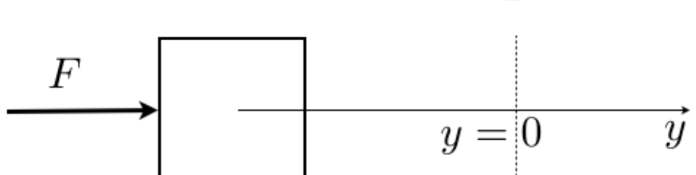{width="55%" fig-align="center"}

$$x = [y \ \ v]^\intercal \ \text{(Position, Velocity)}$$

Optimal path no constraints (slide 30, Lec 5), parameters $Q=Q_h=I$, $R=1$, $x_0=[1 \ \ 0]^\intercal$, $\tau=0.2$, $h=50$

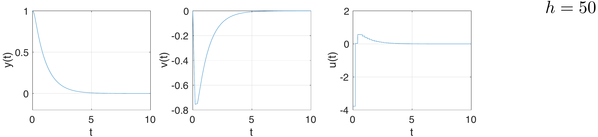{width="85%" fig-align="center"}

Optimal path with constraints $u_k\in[-L,L]$, $L=0.25$

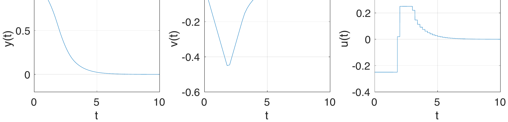{width="85%" fig-align="center"}

## Example

What if there are disturbances? Desired behaviour far from expected!

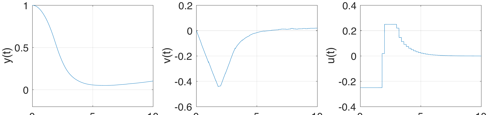{width="85%" fig-align="center"}

We want an optimal **policy**! CEC! (and MPC)

## Online replanning policy {.smaller}

At each stage define $\bar x=[x_{k+1}^\intercal \ x_{k+2}^\intercal \ \dots \ x_h^\intercal]^\intercal \qquad \bar u=[u_k^\intercal \ u_{k+1}^\intercal \ \dots \ u_{h-1}^\intercal]^\intercal$

**Cost function** $\quad \displaystyle\sum_{\ell=k}^{h-1}x_\ell^\intercal Qx_\ell+u_\ell^\intercal Ru_\ell+x_h^\intercal Q_hx_h = (\bar Ax_k+\bar B\bar u)^\intercal \bar Q(\bar Ax_k+\bar B\bar u)+\bar u^\intercal \bar R\bar u$

**Dynamic model (equality constraints)** $\quad \bar x=\bar Ax_k+\bar B\bar u$

**Inequality constraints** $\quad \begin{bmatrix}I\\-I\end{bmatrix}\bar u \leq c\begin{bmatrix}1\\\vdots\\1\end{bmatrix}$

$$
\bar A=\begin{bmatrix}A\\A^2\\\vdots\\A^{h-k}\end{bmatrix} \quad
\bar B=\begin{bmatrix}B&0&0&0&\cdots&0\\AB&B&0&0&\cdots&0\\A^2B&AB&B&0&\cdots&0\\A^3B&A^2B&AB&B&\cdots&0\\\vdots&\ddots&\ddots&\ddots&\ddots&\vdots\\A^{h-1-k}B&A^{h-2-k}B&A^{h-3-k}B&\cdots&AB&B\end{bmatrix} \quad
\bar Q=\begin{bmatrix}Q&0&0&\cdots&0\\0&Q&0&\cdots&0\\\vdots&\ddots&\ddots&\ddots&\vdots\\0&0&0&\cdots&Q_h\end{bmatrix} \quad
\bar R=\begin{bmatrix}R&0&0&\cdots&0\\0&R&0&\cdots&0\\\vdots&\ddots&\ddots&\ddots&\vdots\\0&0&0&\cdots&R\end{bmatrix}
$$

Take the first component of $\bar u$, that is, $u_k$, and apply it to the plant.

## Example

Considering disturbances affecting the system

$$x_{k+1}=Ax_k+Bu_k+w_k$$

and applying online replanning we obtain

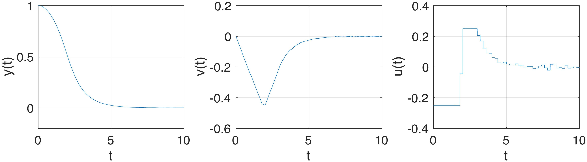{width="85%" fig-align="center"}

## Discussion {.smaller}

- CEC allowed to transform an algorithm to compute optimal paths (using `quadprog.m`) into an algorithm that computes optimal policies.
- The fact that it works so well follows from the fact that the problem is convex: a problem with inequality constraints is convex if the cost is convex and the set of feasible solutions is convex, which can be shown to be the case for this problem.
- Although `quadprog.m` is quite efficient in problems with a large sampling rate or a large time horizon of interest, it might not be possible to run `quadprog.m`, and this motivates MPC.
- Another motivation for MPC is that the model is typically not extremely accurate and considering a short horizon might even lead to better results.
- We shall try MPC imposing that the final state after the prediction horizon is zero. See Bertsekas' book, Ch. 6, for the close connection with Rollout (after the horizon the base policy is to apply zero control input!).

## MPC {.smaller}

At each stage define $\bar x=[x_{k+1}^\intercal \ x_{k+2}^\intercal \ \dots \ x_{k+H-1}^\intercal]^\intercal \qquad \bar u=[u_k^\intercal \ u_{k+1}^\intercal \ \dots \ u_{k+H-1}^\intercal]^\intercal$

**Cost function** $\quad \displaystyle\sum_{\ell=k}^{k+H-1}x_\ell^\intercal Qx_\ell+u_\ell^\intercal Ru_\ell = (\bar Ax_k+\bar B\bar u)^\intercal \bar Q(\bar Ax_k+\bar B\bar u)+\bar u^\intercal \bar R\bar u$

**Dynamic model (equality constraints)** $\quad \bar x=\bar Ax_k+\bar B\bar u$

**Inequality constraints** $\quad \begin{bmatrix}I\\-I\end{bmatrix}\bar u \leq c\begin{bmatrix}1\\\vdots\\1\end{bmatrix}$

$$
\bar A=\begin{bmatrix}A\\A^2\\\vdots\\A^{H-1}\end{bmatrix} \quad
\bar B=\begin{bmatrix}B&0&0&0&\cdots&0\\AB&B&0&0&\cdots&0\\A^2B&AB&B&0&\cdots&0\\\vdots&\ddots&\ddots&\ddots&\ddots&\vdots\\A^{H-2}B&A^{H-3}B&\cdots&\cdots&B&0\end{bmatrix} \quad
\bar Q=\begin{bmatrix}Q&0&0&\cdots&0\\0&Q&0&\cdots&0\\\vdots&\ddots&\ddots&\ddots&\vdots\\0&0&0&\cdots&Q\end{bmatrix} \quad
\bar R=\begin{bmatrix}R&0&0&\cdots&0\\0&R&0&\cdots&0\\\vdots&\ddots&\ddots&\ddots&\vdots\\0&0&0&\cdots&R\end{bmatrix}
$$

Take the first component of $\bar u$, that is, $u_k$, and apply it to the plant.

## Example

First iteration (no disturbances). This is the state and input that is predicted

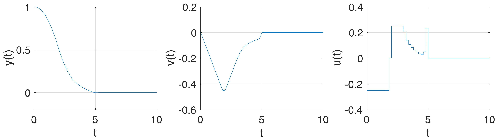{width="85%" fig-align="center"}

Applying the first control input $u_0=-0.25$ leads to the state $x_1=\begin{bmatrix}0.995\\-0.05\end{bmatrix}$ and the process is repeated.

## Example

**End result**

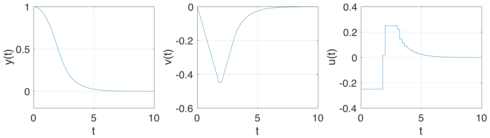{width="85%" fig-align="center"}

Note that the end result is different from the one predicted at iteration 0 because the state and input predictions change over time.

## Example

**Results with disturbances**

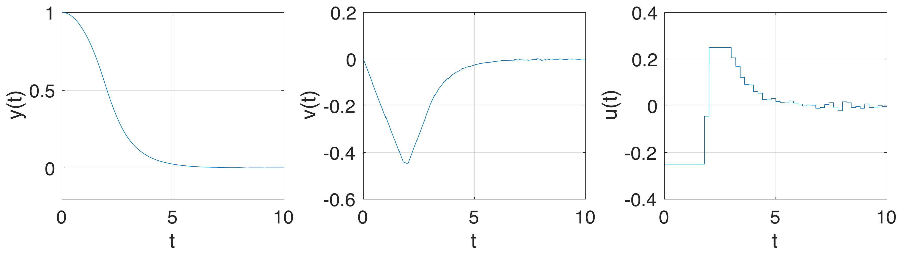{width="85%" fig-align="center"}

## Reference tracking

The ideas of the previous slides extend to the reference tracking problem of having the state follow a desired trajectory $\{r_k \mid k\in\{0,1,\dots,h\}\}$:

**Dynamic model** $\quad x_{k+1}=Ax_k+Bu_k+w_k \qquad u_k\in\mathbb{R} \ \text{(for simplicity)}$

**Cost function** $\quad \displaystyle\sum_{k=0}^{h-1}(x_k-r_k)^\intercal Q(x_k-r_k)+u_k^\intercal Ru_k+(x_h-r_h)^\intercal Q_h(x_h-r_h)$

**Input constraints** $\quad u_k\in[-c,c] \ \ \forall k \qquad (\text{given } c>0)$

Find a policy $\pi=\{\mu_0,\dots,\mu_{h-1}\}$, $u_k=\mu_k(x_k)$, which minimizes the cost function.

## Quadratic programming formulation

Define $\bar x=[x_1^\intercal \dots x_h^\intercal]^\intercal \qquad \bar u=[u_0^\intercal \dots u_{h-1}^\intercal]^\intercal \qquad \bar r=[r_1^\intercal \dots r_h^\intercal]^\intercal$

**Cost function** $\quad (\bar Ax_0+\bar B\bar u+\bar r)^\intercal \bar Q(\bar Ax_0+\bar B\bar u+\bar r)+\bar u^\intercal \bar R\bar u$

**Dynamic model (equality constraints)** $\quad \bar x=\bar Ax_0+\bar B\bar u$

**Inequality constraints** $\quad \begin{bmatrix}I\\-I\end{bmatrix}\bar u \leq c\begin{bmatrix}1\\\vdots\\1\end{bmatrix}$

$\bar A,\bar B,\bar Q,\bar R$ as in slide 15.

MPC and online replanning ideas can be developed similarly to the stabilization problem.

## Application

MPC for reference tracking is applied in the MSc thesis *"Quadrotor Trajectory Tracking using Cascaded Model Predictive Control and Attitude Control on $S^2\times S^1$"*, Dave Kooijman, to control a quadcopter.

As explained there, MPC has several advantages with respect to a standard feedback plus feedforward policy:

(i) it allows to meet input and state constraints;

(ii) it integrates feedforward and feedback;

(iii) it anticipates future references.

The advantages are explained now resorting to experimental results.

## Application {.smaller}

PD+FF vs. MPC

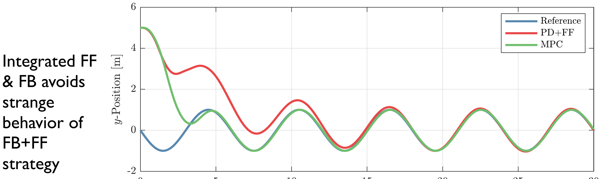{width="60%" fig-align="center"}

Integrated FF & FB avoids strange behavior of the FB+FF strategy.

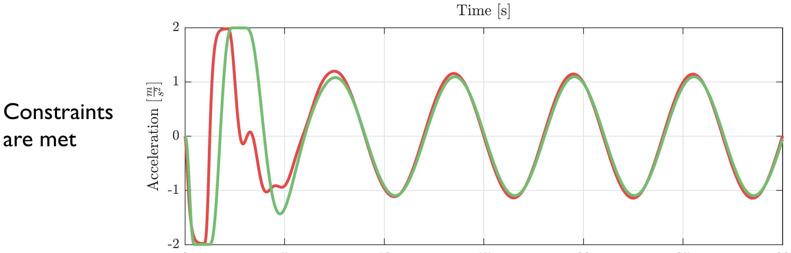{width="60%" fig-align="center"}

Constraints are met.

## Application

Constant velocity square trajectory, $0.4$ m/s and $0.8$ m/s: PD+FF vs. MPC

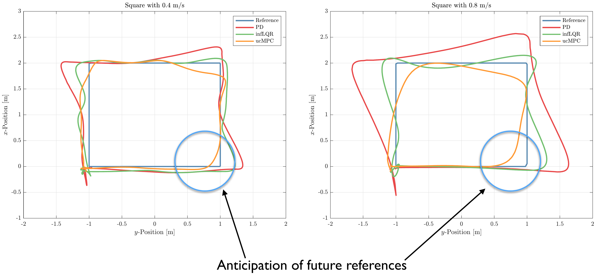{width="85%" fig-align="center"}

Anticipation of future references.

## Outline

- Approximate dynamic programming
- Linear quadratic control with inequality constraints
- <u>Control of switched systems</u>

## Switched linear systems

**Dynamic model** $\quad x_{k+1}=A_{\sigma_k}x_k \qquad \sigma_k\in\{1,\dots,m\} \qquad x_k\in\mathbb{R}^n$

**Cost function** $\quad \displaystyle\sum_{k=0}^{h-1}x_k^\intercal Q_{\sigma_k}x_k+x_h^\intercal \bar Q_hx_h$

**Goal:** Find an optimal path (or policy) for the control input $u_k=\sigma_k$ for a given initial condition $x_0$.

- Applying the dynamic programming algorithm would lead to a combinatorial problem.
- Let us apply approximate dynamic programming.

## CEC {.smaller}

**Step 1.** At step $k$ compute all the possible control sequences

$$(\sigma_k,\sigma_{k+1},\sigma_{k+2},\dots,\sigma_{h-1})$$

**Step 2.** Compute the cost $\displaystyle\sum_{\ell=k}^{h-1}x_\ell^\intercal Q_{\sigma_\ell}x_\ell+x_h^\intercal \bar Q_hx_h$ for each of these control sequences, and pick a sequence $(\tilde\sigma_k,\tilde\sigma_{k+1},\tilde\sigma_{k+2},\dots,\tilde\sigma_{h-1})$ with minimum cost.

**Step 3.** Apply the first element $\sigma_k=\tilde\sigma_k$, set $k=k+1$ and go again to step 1 if $k\neq h$.

Still combinatorial!

## MPC {.smaller}

**Step 1.** At step $k$ compute all possible control sequences in the prediction horizon

$$(\sigma_k,\sigma_{k+1},\dots,\sigma_{k+H-1}) \ \text{ if } 0\leq k\leq h-H \qquad (\sigma_k,\sigma_{k+1},\dots,\sigma_{h-1}) \ \text{ otherwise}$$

**Step 2.** Compute the cost

$$\sum_{\ell=k}^{k+H-1}x_\ell^\intercal Q_{\sigma_\ell}x_\ell \ \text{ if } 0\leq k\leq h-H \qquad \sum_{\ell=k}^{h-1}x_\ell^\intercal Q_{\sigma_\ell}x_\ell+x_h^\intercal \bar Q_hx_h \ \text{ otherwise}$$

for each of these control sequences and pick a sequence $(\tilde\sigma_k,\dots,\tilde\sigma_{k+H-1})$ or $(\tilde\sigma_k,\dots,\tilde\sigma_{h-1})$ (as above) with minimum cost.

**Step 3.** Apply the first element $\sigma_k=\tilde\sigma_k$, set $k=k+1$ and go again to step 1 if $k\neq h$.

## Rollout {.smaller}

Pick a base policy $(\bar\sigma_0,\bar\sigma_1,\dots,\bar\sigma_{h-1})$, $H>0$, and start with $k=0$

1. At step $k$ compute all the control sequences with free $\sigma_k,\dots,\sigma_{k+H-1}$ taking the form

$$(\sigma_k,\dots,\sigma_{k+H-1},\bar\sigma_0,\bar\sigma_1,\dots,\bar\sigma_{h-1-k-H}) \ \text{ if } 0\leq k\leq h-H \qquad (\sigma_k,\sigma_{k+1},\dots,\sigma_{h-1}) \ \text{ otherwise}$$

2. Compute the cost $\displaystyle\sum_{\ell=k}^{h-1}x_\ell^\intercal Q_{\sigma_\ell}x_\ell+x_h^\intercal \bar Q_hx_h$ for each of these control sequences, and pick a sequence $(\tilde\sigma_k,\tilde\sigma_{k+1},\tilde\sigma_{k+2},\dots,\tilde\sigma_{h-1})$ with minimum cost.

3. Apply the first element $\sigma_k=\tilde\sigma_k$, set $k=k+1$ and go again to step 1 if $k\neq h$.

## Mixing

How to mix two fluids in minimum time?[^dolk]

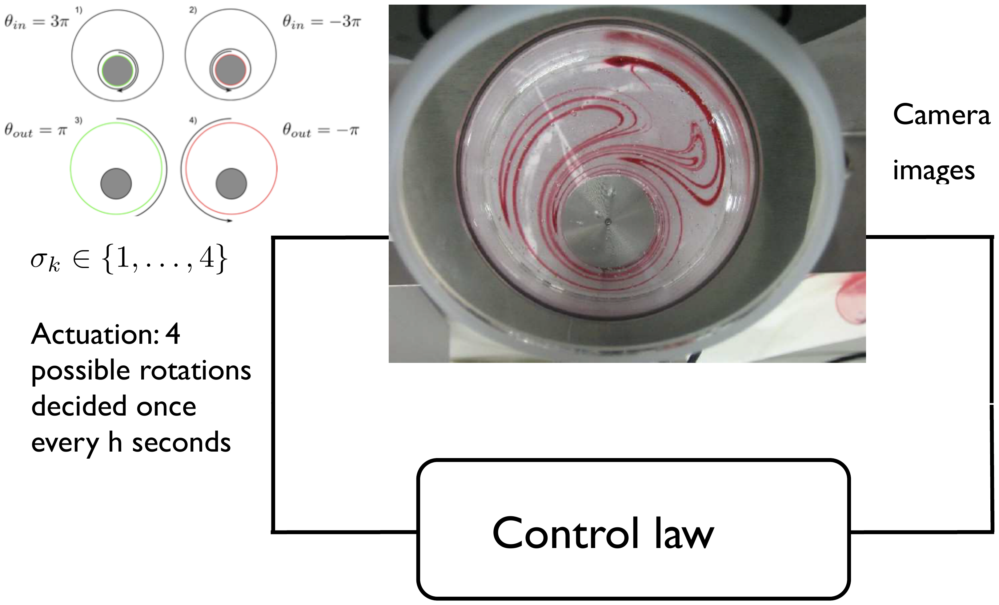{width="70%" fig-align="center"}

$\sigma_k\in\{1,\dots,4\}$. Actuation: 4 possible rotations decided once every $h$ seconds.

[^dolk]: Mixing and switching, V.S. Dolk MSc thesis

## Periodic open loop policy

Basic mechanism for effective mixing is repetitive **stretching** & **folding**

{width="80%" fig-align="center"}

Basic mechanism can be seen as a periodic open-loop strategy.

Can a closed-loop strategy perform better?

## Model

Divide the domain into $N$ subdomains and denote by $x_k^i$, $i\in\{1,\dots,N\}$, the concentration of fluid at time $k\tau$

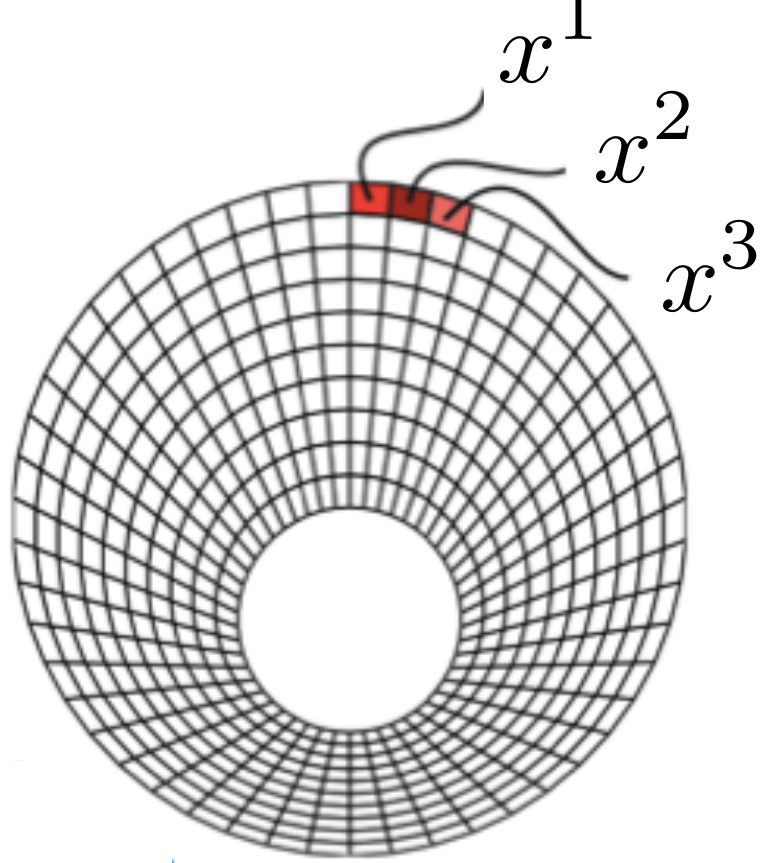{width="30%" fig-align="center"}

Then the following equation describes how the concentrations evolve as a function of the control action $\sigma_k\in\{1,\dots,4\}$

$$x_{k+1} = A_{\sigma_k}x_k$$

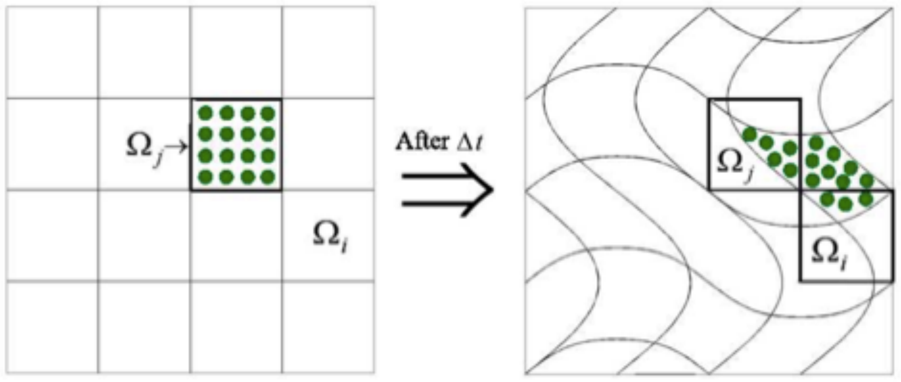{width="55%" fig-align="center"}

## Cost function {.smaller}

- The concentrations for each subdomain will be equal to a given constant $c$ when homogeneity is achieved. This means that the following error will converge to zero

$$e_k := x_k - c\begin{bmatrix}1\\1\\\vdots\\1\end{bmatrix} \qquad c = \frac1N\begin{bmatrix}1 & 1 & \dots & 1\end{bmatrix}x_0$$

- The intensity of segregation is defined as

$$e_k^\intercal e_k$$

and measures how far the concentration is from homogeneity.

- We are interested in minimizing the intensity of segregation for every time step

$$\sum_{k=0}^h e_k^\intercal e_k$$

## Results

**Rollout** vs. **Periodic**

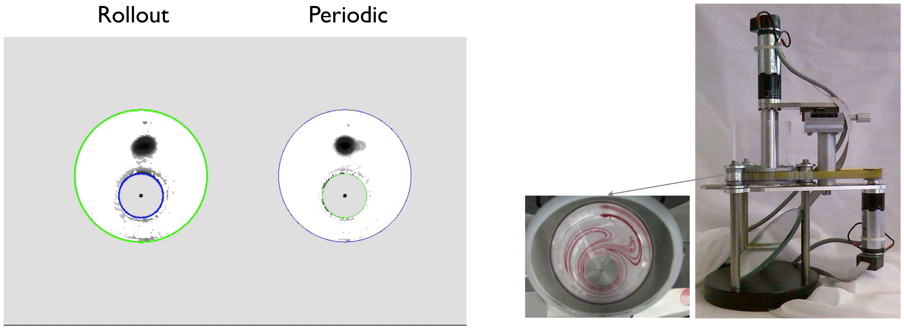{width="85%" fig-align="center"}

- The periodic sequence consists of alternating a rotation of the outer cylinder and a clockwise rotation of the inner cylinder.
- The rollout strategy consists of optimizing in a horizon of length 4, assuming that afterwards this periodic policy is used.

## Results

- An MPC approach with horizon $H=2$ boils down to picking the decision minimizing the (squared) norm of the error at the next iteration (minimum error "greedy" strategy)

$$\underset{\sigma_k}{\arg\min} \ e_k^\intercal e_k+e_{k+1}^\intercal e_{k+1} = \underset{\sigma_k}{\arg\min} \ e_k^\intercal e_k+e_k^\intercal A_{\sigma_k}^\intercal A_{\sigma_k}e_k = \underset{\sigma_k}{\arg\min} \ \underbrace{e_k^\intercal A_{\sigma_k}^\intercal A_{\sigma_k}e_k}_{e_{k+1}^\intercal e_{k+1}}$$

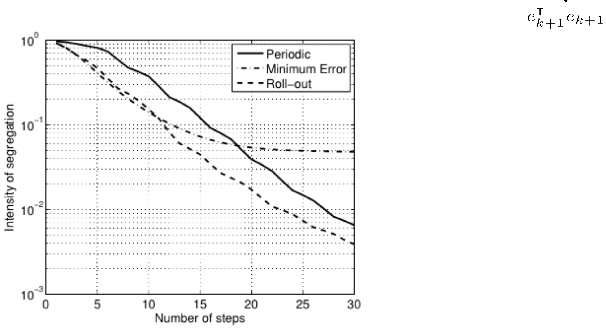{width="55%" fig-align="center"}

- In this case MPC with $H=2$ leads to worse results.

## Introduction

- We show next that for switched linear systems, we can write explicit rollout and MPC policies.
- Although finite-horizon costs can be considered, this is actually easier if we consider infinite-horizon costs

$$x_{k+1}=A_{\sigma_k}x_k \qquad \sum_{k=0}^\infty x_k^\intercal Q_{\sigma_k}x_k$$

- Note that online replanning in the case of infinite horizon switched systems problems would entail computing an infinite number of options and therefore it is not viable.

## Cost of base policy {.smaller}

- Suppose that the base policy corresponds to a constant switching $\sigma_k=j$, $\forall k$. Then it is easy to show that

$$\sum_{k=\ell}^\infty x_k^\intercal Q_jx_k = x_\ell^\intercal M^jx_\ell \quad \text{when} \quad x_{k+1}=A_jx_k$$

where $M^j=\sum_{k=0}^\infty (A_j^\intercal)^kQ_j(A_j)^k$ is the solution to the linear (Lyapunov) system

$$A_j^\intercal M^jA_j - M^j = -Q_j$$

- If the base policy corresponds to periodic switching a similar expression can be obtained.
- For example if $m=2$, $\sigma_k\in\{1,2\}$ and $(\sigma_\ell,\sigma_{\ell+1},\sigma_{\ell+2},\sigma_{\ell+3},\sigma_{\ell+4},\dots)=(1,2,1,2,1,\dots)$ then

$$\sum_{k=\ell}^\infty x_k^\intercal Q_{\sigma_k}x_k = x_\ell^\intercal \bar M^1x_\ell$$

where $A_1^\intercal \bar M^2A_1-\bar M^1=-Q_1 \qquad A_2^\intercal \bar M^1A_2-\bar M^2=-Q_2$

## Explicit rollout policy {.smaller}

Note that in the prediction horizon there are $m^H$ options to be considered.

Suppose that we index all these options $i\in\{1,2,3,\dots,m^H\}$.

Then each $i$ corresponds to a unique set of free schedules at each iteration

$$(\sigma_k,\sigma_{k+1},\dots,\sigma_{k+H-1}) = (\bar\sigma_0^i,\bar\sigma_1^i,\bar\sigma_2^i,\dots,\bar\sigma_{H-1}^i)$$

and a unique set of costs can be obtained

$$x_k^\intercal P^ix_k = \sum_{\ell=k}^{k+H-1}x_\ell^\intercal Q_{\sigma_\ell}x_\ell + \sum_{\ell=k+H}^\infty x_\ell^\intercal Q_{\bar\sigma_\ell}x_\ell$$

Then an explicit expression for the rollout policy is

$$\iota(x_k) = \underset{i}{\arg\min} \ x_k^\intercal P^ix_k \qquad \sigma_k=\pi(\iota(x_k))$$

where $\pi$ is a map that extracts the first component of the scheduling associated with $i$: $\pi(i)=\bar\sigma_0^i$.

## Example {.smaller}

If $m=2$ and $H=2$:

| $i$ | $\bar\sigma_0$ | $\bar\sigma_1$ | $\pi(i)$ | $P^i$ |
|---|---|---|---|---|
| 1 | 1 | 1 | 1 | $P^1=Q_1+A_1^\intercal Q_1A_1+(A_1A_1)^\intercal \bar M(A_1A_1)$ |
| 2 | 1 | 2 | 1 | $P^2=Q_1+A_1^\intercal Q_2A_1+(A_2A_1)^\intercal \bar M(A_2A_1)$ |
| 3 | 2 | 1 | 2 | $P^3=Q_2+A_2^\intercal Q_1A_2+(A_1A_2)^\intercal \bar M(A_1A_2)$ |
| 4 | 2 | 2 | 2 | $P^4=Q_2+A_2^\intercal Q_2A_2+(A_2A_2)^\intercal \bar M(A_2A_2)$ |

## Resource-aware control

How to efficiently control several dynamical systems via a wireless network by deciding how to schedule transmissions?

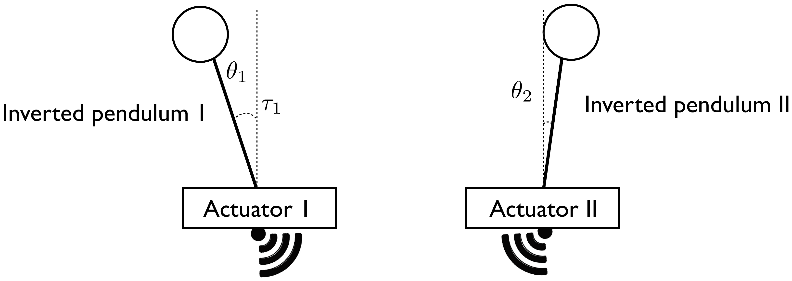{width="80%" fig-align="center"}

(only one user can transmit at a given time)

## Model {.smaller}

- The two processes are identical and modeled by

$$x_{k+1}^i = \bar Ax_k^i+\bar Bu_k^i \qquad i\in\{1,2\}$$

- Each system has an identical cost

$$J_i = \sum_{k=0}^\infty (x_k^i)^\intercal \bar Qx_k^i+(u_k^i)^\intercal \bar Ru_k^i$$

and we wish to minimize $J_1+J_2$.

- If each system could update the control law at every time instant, the optimal control law would take the form (LQR problem) $u_k^i=K_ix_k^i$.
- Instead, since each system can only update the control input at mutually exclusive times, we have

$$u_k^1 = \begin{cases}K_1x_k^1, & \text{if } \sigma_k=1\\v_k^1, & \text{if } \sigma_k=2\end{cases} \qquad u_k^2 = \begin{cases}K_2x_k^2, & \text{if } \sigma_k=2\\v_k^2, & \text{if } \sigma_k=1\end{cases} \qquad v_k^i=u_{k-1}^i, \ \ i\in\{1,2\}$$

## Model {.smaller}

- If we let $\displaystyle x_k = \begin{bmatrix}x_k^1\\v_k^1\\x_k^2\\v_k^2\end{bmatrix}$ we can write

**model** $\quad x_{k+1}=A_{\sigma_k}x_k \qquad$ **cost** $\quad \displaystyle\sum_{k=0}^\infty x_k^\intercal Q_{\sigma_k}x_k$

where

$$A_1=\begin{bmatrix}\bar A+\bar BK & 0 & 0 & 0\\K & 0 & 0 & 0\\0 & 0 & \bar A & \bar B\\0 & 0 & 0 & I\end{bmatrix} \qquad A_2=\begin{bmatrix}\bar A & \bar B & 0 & 0\\0 & I & 0 & 0\\0 & 0 & \bar A+\bar BK & 0\\0 & 0 & K & 0\end{bmatrix}$$

$$Q_1=\begin{bmatrix}\bar Q+K^\intercal \bar RK & 0 & 0 & 0\\0 & 0 & 0 & 0\\0 & 0 & \bar Q & 0\\0 & 0 & 0 & \bar R\end{bmatrix} \qquad Q_2=\begin{bmatrix}\bar Q & 0 & 0 & 0\\0 & \bar R & 0 & 0\\0 & 0 & \bar Q+K^\intercal \bar RK & 0\\0 & 0 & 0 & 0\end{bmatrix}$$

## Example {.smaller}

**Parameters** $\quad \bar A=e^{A_c\tau} \qquad \bar B=\int_0^\tau e^{A_cs}ds\,B_c \qquad A_c=\begin{bmatrix}0&1\\3&0\end{bmatrix} \qquad B_c=\begin{bmatrix}0\\1\end{bmatrix}$

$$\bar Q=I \qquad \bar R=0.01 \qquad \tau=0.1 \qquad x_0=\begin{bmatrix}-0.1\\0\\0\\1\\0\\0\end{bmatrix} \qquad \text{base policy } (1,2,1,2,1,\dots)$$

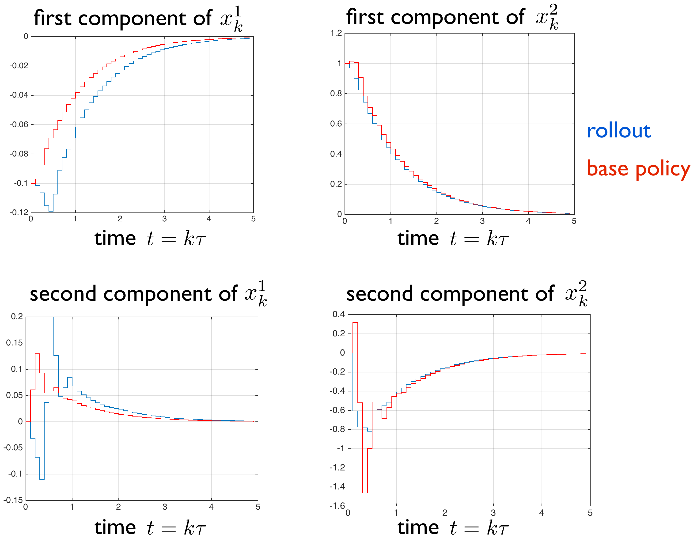{width="80%" fig-align="center"}

cost of periodic (base): $16.1330$ &nbsp;&nbsp;&nbsp; cost of rollout: $12.7055$

## Example {.smaller}

Given the initial condition, paying more attention to system 2 leads to better results!

| $k$ | 1 | 2 | 3 | 4 | 5 | 6 | 7 | 8 | 9 | 10 |
|---|---|---|---|---|---|---|---|---|---|---|
| $\sigma_k$ | 2 | 2 | 2 | 1 | 2 | 1 | 2 | 1 | 2 | 1 |

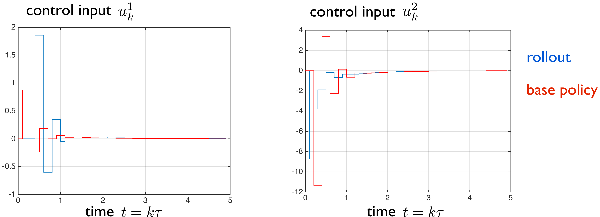{width="80%" fig-align="center"}

cost of periodic (base): $16.1330$ &nbsp;&nbsp;&nbsp; cost of rollout: $12.7055$

## Resource-aware control

How to control the two arms of a SCARA robot with only one amplifier to track a trajectory for the tip with minimum error?[^scara]

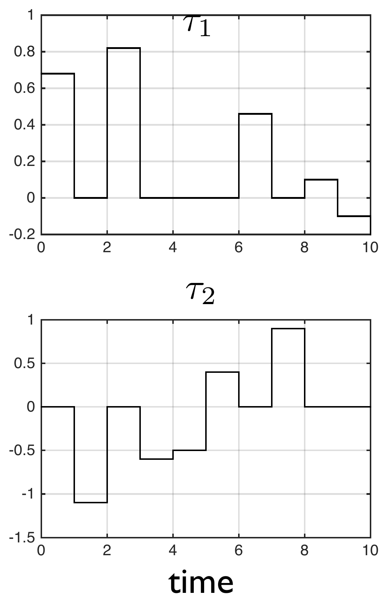{width="90%" fig-align="center"}

Only torque $\tau_1$ or $\tau_2$ can be applied at each time instant.

[^scara]: Control of a SCARA robot with a reduced number of amplifiers, Internship report TU/e, VDL, Yuri Steinbuch, 2015

## Concluding remarks {.smaller}

**To summarize:**

- When discretization is not feasible, approximate dynamic programming (e.g. CEC, rollout, MPC) can be a practical way to provide a policy. However, it is suboptimal.
- Must see case by case if it can be used -- for switched linear systems it works very well (although suboptimal!)

| dimension | convexity | DP discretization | Static optimization | ADP | ADP (switched systems) |
|---|---|---|---|---|---|
| small | convex | ✓ | ✓ | ? | ✓ |
| small | non-convex | ✓ | ✗ | ? | ✓ |
| large | convex | ✗ | ✓ | ? | ✓ |
| large | non-convex | ✗ | ✗ | ? | ✓ |
