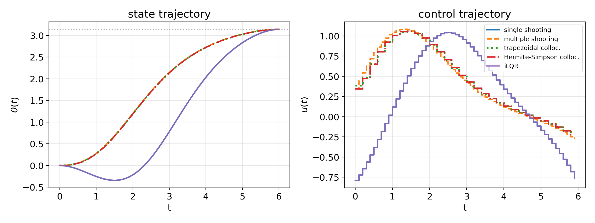
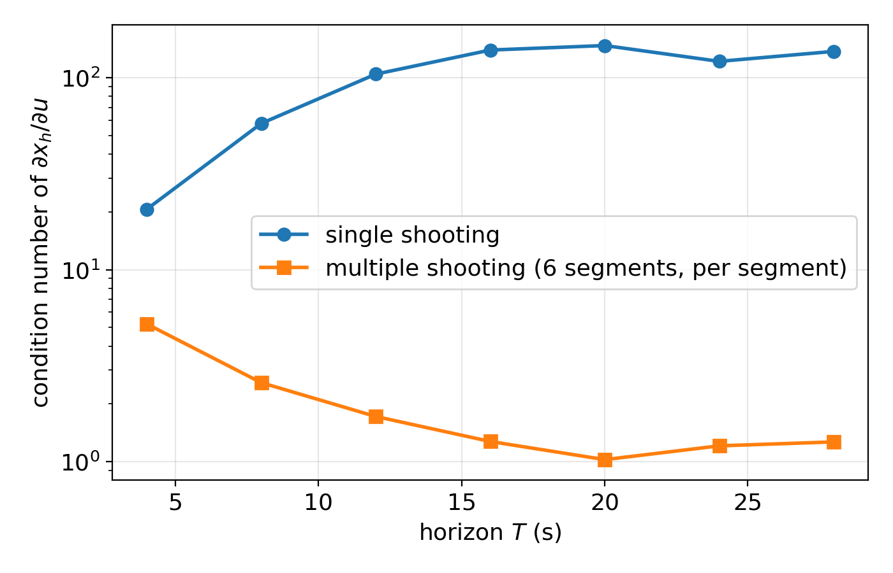
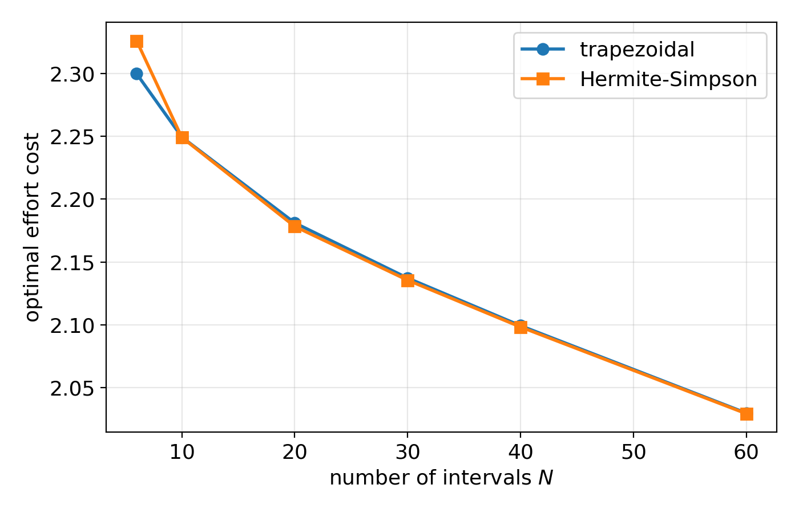
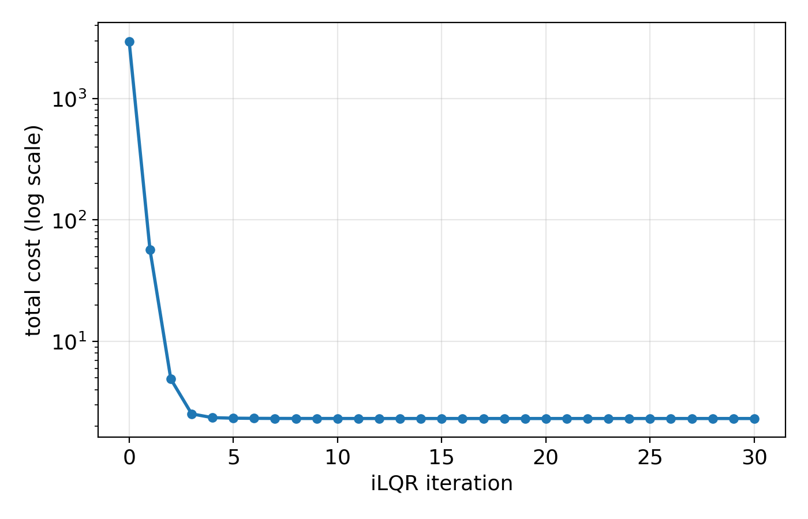

## Unit 9 {.center style="text-align: center;"}

<!--
New unit, written from scratch on 2026-08-11 (unlike Units 1-8, there is
no Lecture9.pdf/.key to convert -- Lecture9.key does not exist among the
Keynote source files, and the "Lecture 9" label that appears internally in
Lecture8.pdf is a leftover renumbering typo, not this unit; see
lecture08's header comment). Built after an in-chat brainstorm + outline
discussion with the user: overview of numerical methods in optimal
control, then direct methods (shooting, collocation) in detail, then
DDP/iLQR as an explicit bridge back to Unit 5 (Riccati), Unit 7 (static
optimization = single shooting), Unit 8 (MPC/rollout), and forward to
Unit 10 (reinforcement learning).

Running numerical example throughout: minimum-effort swing-up of a
torque-driven pendulum, solved by every method covered, all via the
numpy-only companion code in code/unit9/ (shooting.py, collocation.py,
ilqr.py -- see that folder's README.md). Every number quoted on these
slides was produced by running those scripts directly, not hand-derived.
Figures (figures/lecture9/):
- conditioning.png: condition number of the shooting sensitivity Jacobian
  vs. horizon length, single vs. multiple shooting.
- trajectory_comparison.png: theta(t) and u(t) for all five solvers on
  the same swing-up problem. Note iLQR converges to a different (higher-
  cost, "dip back before swinging up") local optimum than the others --
  this is discussed explicitly on its own slide, not hidden.
- collocation_accuracy.png: optimal cost vs. number of intervals N,
  trapezoidal vs. Hermite-Simpson.
- ilqr_convergence.png: iLQR's cost per iteration (log scale), showing
  its fast convergence relative to the shooting/collocation NLP solves.

Conventions carried over from Units 1-8: no image captions, plain bullet
lists (never numbered) on Outline slides, "**Step N.**" bold-label prose
instead of native ordered lists for derivations, <u>...</u> for the
current-section item on recurring Outline slides, Concluding remarks has
no "After this lecture" / "Additional live scripts" blocks.

FIRST-PASS CAVEAT: this is a first pass built directly from the agreed
outline; expect a slide-by-slide refinement round, same as every other
unit.
-->

### Numerical Methods in Optimal Control {style="text-align: center;"}

{width="15%" fig-align="center"}

::: {.title-slide-meta}
4SC000, Q2 2026-2027

Duarte Antunes
:::

## Outline

- Overview: direct vs. indirect, the numerical-methods landscape
- Direct methods: shooting
- Direct methods: collocation
- Differential dynamic programming / iLQR

## Motivation {.smaller}

- So far: exact solutions via DP over a discrete/discretized state space (Units 1-4), the exact Riccati recursion for the linear-quadratic case (Units 5-6), discretization and static optimization via gradient descent (Unit 7), MPC as a QP and approximate DP (Unit 8).
- All of this relied on either a small/discretizable state space, or on the dynamics being **linear** and the cost **quadratic**.
- Real systems are typically nonlinear, with general costs and path or state constraints: the Riccati recursion no longer gives an exact answer, and the state space is continuous and usually far too large to discretize (curse of dimensionality, Unit 7).
- This unit: numerical methods to compute optimal trajectories -- and, via DDP/iLQR, local feedback policies -- for general nonlinear optimal control problems.

## Problem setup {.smaller}

- Discrete-time nonlinear dynamic model $x_{k+1}=f(x_k,u_k)$, $k\in\{0,\dots,h-1\}$, $x_0$ given
- Cost function $\displaystyle\sum_{k=0}^{h-1}g(x_k,u_k)+g_h(x_h)$
- Possibly path constraints $u_k\in U$, $x_k\in X$, and/or a terminal constraint $x_h=x_{\text{target}}$
- Goal: compute $u_0,\dots,u_{h-1}$ (and, for DDP/iLQR, a local feedback policy around them) minimizing the cost
- **Running example for this whole lecture**: swing-up of a torque-driven pendulum, $x=[\theta,\dot\theta]$, $\dot x=[\dot\theta,\ -\sin\theta+u]$, from hanging down $x_0=[0,0]$ to inverted $x_h=[\pi,0]$ over a fixed horizon $T$, minimizing effort $\sum_k \tau u_k^2$

## Two philosophies

- **Direct methods**: discretize first, then optimize. Turn the optimal control problem into a finite-dimensional nonlinear program (NLP) and hand it to a general-purpose (or purpose-built) NLP solver.
- **Indirect methods**: optimize first, then discretize. Apply Pontryagin's Minimum Principle to derive necessary conditions -- a two-point boundary value problem in states and costates -- then solve that numerically.
- Indirect methods characterize the optimum more precisely (via the analytic necessary conditions), but are harder to set up and notoriously sensitive to the initial guess for the costates. Direct methods dominate in practice, and are the focus of this lecture.

## The landscape {.smaller}

- **Direct methods**
  - Shooting: single shooting, multiple shooting
  - Collocation: trapezoidal, Hermite-Simpson, pseudospectral
- **Indirect methods**: Pontryagin's Minimum Principle + a boundary-value problem, itself solved by shooting or collocation on the costate system
- **DP-based methods**: differential dynamic programming (DDP), iterative LQR (iLQR) -- exploit the sequential/DP structure directly, rather than treating the problem as a generic NLP
- Today: direct shooting, direct collocation, and DDP/iLQR

## Where this fits {.smaller}

- Unit 5: the exact Riccati recursion -- but only for *linear* dynamics and *quadratic* cost.
- Unit 7: the static optimization formulation -- substitute the dynamics into the cost and minimize over the controls alone. We'll see shortly that this is exactly **single shooting**, specialized to the linear case.
- Unit 8: MPC as a QP -- still linear dynamics (or one re-linearized at every step, in nonlinear MPC).
- This unit: drop the linearity assumption entirely, and build the general-purpose machinery underneath all of the above.

## A word on solvers {.smaller}

- Once an OCP is transcribed into an NLP (direct methods) or a nonlinear root-finding problem (indirect shooting), it is solved by a general-purpose numerical optimization routine.
- Sequential Quadratic Programming (SQP) and interior-point methods are the two standard families -- both, at their core, repeatedly build a local (quadratic, for SQP) model of the problem and take a Newton-type step, exactly like the Levenberg-Marquardt solver used throughout this lecture's companion code.
- In practice you would use a mature package rather than write your own (see the Concluding remarks) -- we roll our own here, `numpy`-only, purely to see exactly what is being solved.

## Outline

- Overview
- <u>Direct methods: shooting</u>
- Direct methods: collocation
- Differential dynamic programming / iLQR

## Setup

- Decision variables: the controls $u_0,\dots,u_{h-1}$ only.
- Given $u$, the states are entirely determined by forward simulation: $x_{k+1}=f(x_k,u_k)$, $x_0$ given.
- So $x_k=\phi_k(u_0,\dots,u_{k-1})$ for some (generally nonlinear) map $\phi_k$, and the cost becomes a function of $u$ alone:

$$J(u)=\sum_{k=0}^{h-1}g(\phi_k(u),u_k)+g_h(\phi_h(u))$$

- This is **single shooting**: "shoot" a trajectory from $x_0$ under a guessed $u$, see where it lands, and adjust $u$.

## You already did this! {.smaller}

- Recall Unit 7's static optimization formulation: for the linear model $x_{k+1}=Ax_k+Bu_k$ and a quadratic cost, we substituted the dynamics into the cost to get an unconstrained problem in $u$ alone, and solved it by gradient descent (`gradient_method.py`).
- That is *exactly* single shooting, specialized to linear dynamics -- there, $\phi_k$ is linear, so $J(u)$ is exactly quadratic and gradient descent converges nicely.
- Today: same idea, general nonlinear $f$. Now $\phi_k$ is no longer linear, $J(u)$ is no longer quadratic, and even computing the gradient needs a bit more care.

## Computing the gradient {.smaller}

- As in Unit 7, differentiate through the simulation via the chain rule. Let $A_k=\dfrac{\partial f}{\partial x}(x_k,u_k)$, $B_k=\dfrac{\partial f}{\partial u}(x_k,u_k)$ -- now state- and time-varying, since $f$ is nonlinear.
- Sensitivity recursion: $\dfrac{\partial x_{k+1}}{\partial u}=A_k\dfrac{\partial x_k}{\partial u}+B_ke_k^\intercal$ (where $e_k$ is the $k$-th standard basis vector), starting from $\dfrac{\partial x_0}{\partial u}=0$.
- Propagating this forward alongside the simulation gives $\partial x_h/\partial u$, and hence $\nabla J(u)$ by the chain rule -- the same idea as Unit 7's `rollout_grad`, generalized to nonlinear, state-varying $A_k,B_k$.

## Solving the NLP {.smaller}

- With a terminal constraint $x_h=x_{\text{target}}$, single shooting becomes a *constrained* problem in $u$. Here we soften it to a penalty,

$$J(u)+\rho\|x_h(u)-x_{\text{target}}\|^2,$$

and solve it with a damped Gauss-Newton (Levenberg-Marquardt) step built directly from the sensitivity above.

- In practice, hard equality constraints would instead be handled by a proper constrained NLP solver (SQP or interior-point) -- but the penalty view is enough to see the numerical issue we're about to run into.

## Example: pendulum swing-up

- Torque-driven pendulum, $x_0=[0,0]\to x_h=[\pi,0]$, $T=6$s, minimizing effort.
- Single shooting (`shooting.py`, `single_shooting_solve`) reaches $\theta_h=3.138$ (target $\pi=3.1416$), effort cost $2.31$.

{width="95%" fig-align="center"}

## Why single shooting struggles {.smaller}

- The pendulum's *upright* equilibrium is unstable: small perturbations grow. As the swing-up trajectory spends more of the horizon near the top, the sensitivity of the final state to the *early* controls grows -- an early nudge gets amplified all the way to the end.
- Concretely, the condition number of $\partial x_h/\partial u$ grows sharply with the horizon length $T$:

{width="70%" fig-align="center"}

- An ill-conditioned Jacobian makes Newton-type steps numerically fragile -- exactly the failure mode multiple shooting is designed to avoid.

## Multiple shooting {.smaller}

- Idea: break the horizon into $S$ segments of $m=h/S$ steps each. Each segment gets its **own** free initial state $z_i$ (a new decision variable), simulated forward under its own controls.
- Decision variables: $u_0,\dots,u_{h-1}$ **and** $z_1,\dots,z_{S-1}$ (with $z_0:=x_0$ fixed).
- Continuity ("defect") constraints tie the segments together: the simulated end of segment $i$ must equal $z_{i+1}$.
- Terminal constraint on the last segment's end state, same as before.

## Why it's better conditioned {.smaller}

- Sensitivities now only ever propagate **within** one segment (see `simulate_segment`): a control in segment 3 has no direct effect on segment 6's defect, only an indirect one through the (now decision-variable, not simulated) states $z_4,z_5,z_6$.
- Each segment is short, so its own sensitivity Jacobian stays well conditioned regardless of how long the overall horizon is (the flat curve in the conditioning figure two slides back).
- The price: more decision variables (the $z_i$'s) and more constraints (the defects) -- but the resulting NLP, while larger, is *sparse* and much better behaved numerically.

## Example, continued {.smaller}

- Multiple shooting (`shooting.py`, `multiple_shooting_solve`, $S=6$ segments) on the same swing-up problem: $\theta_h=3.140$, effort cost $2.22$ -- matching single shooting's answer (both are local solutions of the same nonconvex problem), but reached far more robustly as the horizon grows.
- Rule of thumb: single shooting is fine for short horizons and mildly nonlinear or stable dynamics; multiple shooting (or collocation, next) is the default choice otherwise.

## Discussion {.smaller}

- Shooting methods keep the NLP small (only controls, or controls plus a handful of segment states) -- attractive when dynamics simulations are cheap and the decision-variable count should stay small.
- Both variants still require *simulating* the dynamics, which can itself be expensive or numerically delicate for stiff systems.
- Next: collocation, which avoids simulation altogether by making the states decision variables everywhere.

## Outline

- Overview
- Direct methods: shooting
- <u>Direct methods: collocation</u>
- Differential dynamic programming / iLQR

## Direct transcription {.smaller}

- Idea: parametrize **both** states and controls at every node of a time grid $t_0,\dots,t_N$ ($N$ intervals, step $\tau$).
- The dynamics no longer determine the states by simulation -- instead they appear as **equality constraints** ("defects") tying consecutive nodes together, derived from a numerical quadrature of the ODE $x(t+\tau)-x(t)=\int_t^{t+\tau}f(x,u)\,dt$.
- Everything is optimized *simultaneously*: this is why collocation NLPs are much larger than shooting NLPs, but also why they tend to be much better conditioned (no long simulation chains) and can directly enforce state/path constraints at every node.

## Trapezoidal collocation {.smaller}

- Approximate the integral by the trapezoidal rule: $x_{k+1}-x_k\approx \dfrac{\tau}{2}\big(f(x_k,u_k)+f(x_{k+1},u_{k+1})\big)$.
- **Defect constraint**, for each $k\in\{0,\dots,N-1\}$:

$$x_{k+1}-x_k-\frac{\tau}{2}\big(f(x_k,u_k)+f(x_{k+1},u_{k+1})\big)=0$$

- Cost, by the same quadrature rule:

$$J\approx \sum_{k=0}^{N-1}\frac{\tau}{2}\big(g(x_k,u_k)+g(x_{k+1},u_{k+1})\big)+g_h(x_N)$$

- 2nd-order accurate, and simple enough to implement directly: the decision vector, the defects, and the cost all follow immediately from the two formulas above.

## Hermite-Simpson collocation {.smaller}

- Interpolate the state within each interval by the cubic Hermite polynomial matching $x_k,f_k$ at $t_k$ and $x_{k+1},f_{k+1}$ at $t_{k+1}$; its midpoint value is

$$x_{\text{mid}}=\frac{x_k+x_{k+1}}{2}+\frac{\tau}{8}\big(f(x_k,u_k)-f(x_{k+1},u_{k+1})\big), \qquad u_{\text{mid}}=\frac{u_k+u_{k+1}}{2}$$

- Collocate the dynamics at that midpoint and apply Simpson's rule over the interval:

$$x_{k+1}-x_k-\frac{\tau}{6}\big(f(x_k,u_k)+4f(x_{\text{mid}},u_{\text{mid}})+f(x_{k+1},u_{k+1})\big)=0$$

- 4th-order accurate: two extra function evaluations per interval (at the midpoint) buy two extra orders of accuracy over trapezoidal.

## Example: pendulum swing-up, again {.smaller}

- Both schemes (`collocation.py`), $N=30$ intervals, same swing-up problem: trapezoidal reaches $\theta_h=3.1405$, effort $2.14$; Hermite-Simpson reaches $\theta_h=3.1405$, effort $2.14$ -- matching shooting's answer (see the trajectory figure a few slides back: all four direct-method curves overlap almost exactly).

## Accuracy as the grid is refined {.smaller}

- Both methods' optimal cost should converge to the same value as $N\to\infty$; Hermite-Simpson should need fewer intervals to reach a given accuracy, by construction (4th vs. 2nd order).

{width="70%" fig-align="center"}

- For this particular (mild) example the two curves stay close at every $N$ shown -- the accuracy gap is real but modest here; it becomes far more pronounced for stiffer dynamics or trajectories with rapid transients within a single interval.

## Shooting vs. collocation {.smaller}

- Shooting: few decision variables, dense Jacobian, but conditioning degrades with horizon length; simulation errors compound.
- Collocation: many decision variables, but the Jacobian is **sparse and banded** (each defect only touches its own two nodes) and stays well conditioned regardless of horizon length; state/path constraints are trivial to add at any node.
- In practice, general-purpose collocation solvers exploit that sparsity directly (interior-point or SQP with sparse linear algebra), making collocation the default choice in most modern trajectory-optimization software, even though the raw problem size is much larger than shooting's.

## Pseudospectral collocation {.smaller}

- Instead of a *local*, piecewise low-order polynomial per interval, use a single **global** polynomial (Legendre or Chebyshev basis) over the whole horizon, collocated at a special set of nodes (Gauss, Radau, or Lobatto points, clustered near the interval endpoints).
- For smooth problems this gives **spectral convergence**: error decreasing faster than any polynomial rate in the number of nodes, often reaching high accuracy with a handful of nodes where a local scheme would need hundreds.
- The basis for production aerospace trajectory-optimization tools (e.g. GPOPS-II). Not derived here -- just worth knowing it exists and when to reach for it: smooth, well-behaved dynamics; a poor fit when the optimal trajectory itself has kinks (e.g. from active inequality constraints).

## Discussion {.smaller}

- Collocation is the most broadly used direct method in practice, precisely because of the sparsity/conditioning trade-off above.
- Trapezoidal is simple enough to code by hand (as we just did) and a reasonable default; Hermite-Simpson is the standard "next step up" in accuracy for similar implementation cost.
- Both, like shooting, only ever converge to a **local** optimum of what is generally a nonconvex NLP -- the solution found depends on the initial guess.

## Outline

- Overview
- Direct methods: shooting
- Direct methods: collocation
- <u>Differential dynamic programming / iLQR</u>

## Motivation {.smaller}

- Shooting and collocation both treat the OCP as a generic NLP, handed to a general-purpose solver that knows nothing about its sequential/DP structure.
- But we *do* know this structure, and already exploited it: Unit 5's Riccati recursion solves the LQ problem *exactly* via a backward DP pass, in one shot, no iterative NLP solve needed.
- Can we get something like a Riccati recursion for the nonlinear case? Not exactly -- there's no closed form -- but we can *iterate* it: linearize/quadratize around a nominal trajectory, solve that LQ problem exactly by Riccati, use the result to improve the nominal trajectory, repeat.

## The iLQR idea {.smaller}

- Start from a nominal trajectory $(\bar x_k,\bar u_k)$ (e.g. all-zero controls, simulated forward).
- At each iteration:

**Step 1.** **Linearize** the dynamics, $A_k=\partial f/\partial x$, $B_k=\partial f/\partial u$, at $(\bar x_k,\bar u_k)$.

**Step 2.** **Quadratize** the cost around the same point.

**Step 3.** Solve the resulting time-varying LQ problem *exactly* by a backward Riccati-like pass, giving a local feedback policy $\delta u_k=k_k+K_k(x_k-\bar x_k)$.

**Step 4.** **Forward-simulate** under this policy (with a line search on a step size $\alpha$, for robustness) to get an improved nominal trajectory. Repeat.

- This is exactly **DDP without the second-order dynamics terms** ($\partial^2f/\partial x^2$, etc.); full DDP keeps those terms for faster local convergence, at the cost of more derivatives.

## Backward pass {.smaller}

- Value function locally quadratic around $\bar x_k$: $V_k(\delta x)\approx V_k+V_{x,k}^\intercal \delta x+\tfrac12\delta x^\intercal V_{xx,k}\delta x$. Define, at each stage,

$$Q_x=g_x+A_k^\intercal V_{x,k+1}, \quad Q_u=g_u+B_k^\intercal V_{x,k+1}$$
$$Q_{xx}=g_{xx}+A_k^\intercal V_{xx,k+1}A_k, \quad Q_{uu}=g_{uu}+B_k^\intercal V_{xx,k+1}B_k, \quad Q_{ux}=g_{ux}+B_k^\intercal V_{xx,k+1}A_k$$

- Feedforward and feedback gains: $k_k=-Q_{uu}^{-1}Q_u$, $K_k=-Q_{uu}^{-1}Q_{ux}$.
- Value function update: $V_{x,k}=Q_x-K_k^\intercal Q_{uu}k_k$, $V_{xx,k}=Q_{xx}-K_k^\intercal Q_{uu}K_k$.
- **Compare to Unit 5's Riccati recursion**: exactly the same structure, with $Q_{xx},Q_{uu},Q_{ux}$ playing the role of $Q,R$ -- now built from *local* linearizations, and re-derived from scratch every iteration rather than solved once for a globally linear system.

## Forward pass {.smaller}

- Simulate $x_{k+1}=f(x_k,u_k)$ from $x_0$, with $u_k=\bar u_k+\alpha k_k+K_k(x_k-\bar x_k)$.
- The feedback term $K_k(x_k-\bar x_k)$ keeps the new trajectory close to where the linearization is valid; the feedforward term $\alpha k_k$ is the actual update, scaled by a step size $\alpha\in(0,1]$.
- Backtrack $\alpha$ (try $1,\tfrac12,\tfrac14,\dots$) until the new trajectory's cost is actually lower -- the same idea as the line search inside Levenberg-Marquardt, now applied to a whole feedback policy instead of a single step.

## Example: pendulum swing-up, once more {.smaller}

- Same problem, `ilqr.py`: converges from an all-zero initial guess in about 4-5 iterations (of a full backward + forward pass) to $\theta_h=3.138$.

{width="65%" fig-align="center"}

- Far fewer iterations than the shooting/collocation Levenberg-Marquardt solves needed -- a direct benefit of exploiting the DP structure instead of treating the problem as a generic dense NLP.

## A cautionary note {.smaller}

- Look again at the trajectory comparison: iLQR's $\theta(t)$ **dips backward** before swinging up, unlike every other method here, which swings up directly.

{width="95%" fig-align="center"}

- Both are valid local optima of the same nonconvex problem (iLQR's costs slightly more: effort $2.31$ vs. $\sim2.14$) -- iLQR simply found a *different* one, from its particular all-zero-control initial guess.
- This is the fundamental limitation shared by every method in this lecture: **all of them only find local optima**, and which one you get depends on where you start. Good initial guesses (e.g. from a coarse collocation solve) matter in practice.

## Bridge to Unit 8 {.smaller}

- Run iLQR's forward pass for only **one** step, then re-linearize and repeat at the next time step, using the freshly measured state as the new $x_0$: this is **receding-horizon iLQR**, and it is essentially nonlinear MPC.
- Unit 8's MPC solved a single QP per step because the dynamics were linear; here the "QP" is itself the by-product of one iLQR backward pass around the current nominal trajectory.
- The backward pass is a *local, model-based* approximation of one Bellman recursion step -- the same computation, in spirit, behind Unit 8's rollout and approximate DP, just carried out analytically (via linearization) instead of by explicit enumeration over a grid or a lookahead horizon.

## Bridge to Unit 10 {.smaller}

- iLQR/DDP still need to *know* $f$, $g$, $g_h$ exactly, and to differentiate them.
- What if the dynamics (or the cost) are unknown, and all we can do is interact with the system and observe outcomes? That is exactly the setting the course turns to next: **reinforcement learning**.
- Keep the backward-pass/Bellman-recursion parallel in mind: much of what follows can be read as "the same DP idea, but learned from data instead of computed from a known model".

## Discussion {.smaller}

- iLQR/DDP: very fast local convergence (exploits structure), a natural bridge to both MPC and RL, gives a feedback policy "for free" (not just an open-loop trajectory) -- but only locally convergent, and, in the simplified form shown here, does not natively handle hard inequality constraints the way collocation does.
- Collocation: robust, handles constraints natively, the default choice in most modern software.
- Shooting: simplest to implement, fine for short/well-behaved horizons, still a useful mental model -- and, as we saw, exactly what Unit 7 was already doing.

## Recap {.smaller}

| Method | Core idea | Pros | Cons |
|---|---|---|---|
| Single shooting | Eliminate states by simulation, optimize over $u$ | Few variables, simple | Ill-conditioned over long/unstable horizons |
| Multiple shooting | Segment the horizon, free interior states | Well conditioned, still moderate size | More variables/constraints than single shooting |
| Trapezoidal collocation | States+controls at every node, trapezoidal defect | Simple, sparse, handles constraints | 2nd-order accuracy |
| Hermite-Simpson collocation | As above, cubic Hermite + Simpson defect | 4th-order accuracy | Slightly more complex defects |
| Pseudospectral | Global polynomial + Gauss/Radau/Lobatto nodes | Spectral convergence for smooth problems | Poor fit for non-smooth optimal trajectories |
| DDP / iLQR | Iterate local LQ approximations via a Riccati-like backward pass | Fast convergence, feedback policy, bridges to MPC/RL | Only local convergence, constraints less natural |

## Software landscape {.smaller}

- **CasADi**: symbolic framework for building and differentiating OCPs, with direct interfaces to the solvers below -- the most common starting point in research and teaching.
- **IPOPT**, **SNOPT**: general-purpose interior-point / SQP NLP solvers, the workhorses behind most collocation and multiple-shooting implementations.
- **GPOPS-II**: pseudospectral trajectory optimization, widely used in aerospace.
- **Drake**: a full robotics/trajectory-optimization toolbox including collocation, iLQR/DDP, and more.
- Everything in this lecture was implemented from scratch in plain `numpy` (`code/unit9/`) precisely to make the mechanics behind these packages transparent -- in practice, use the packages.

## Concluding remarks {.smaller}

- Numerical methods for optimal control fall into three families: **direct** (shooting, collocation -- discretize then optimize), **indirect** (Pontryagin's Minimum Principle + boundary value problem -- optimize then discretize), and **DP-based** (DDP/iLQR -- exploit the sequential structure directly).
- Direct collocation is the most broadly used in practice; shooting is the simplest mental model and, in its single-shooting form, is exactly what Unit 7's static optimization was already doing.
- DDP/iLQR bridges directly back to Unit 5's Riccati recursion and Unit 8's MPC/rollout, and forward to the reinforcement-learning units next: same Bellman-recursion idea, computed locally from a known model here, learned from data there.
- All of these methods, without exception, only find *local* optima of a generally nonconvex problem -- a good initial guess is not a technicality, it is often the deciding factor in which solution (and whether a good one at all) you get.
