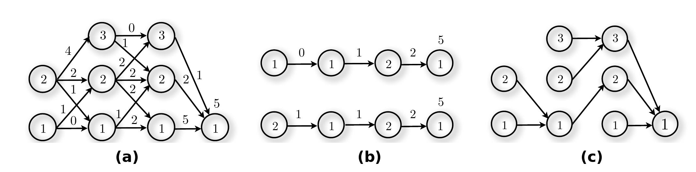
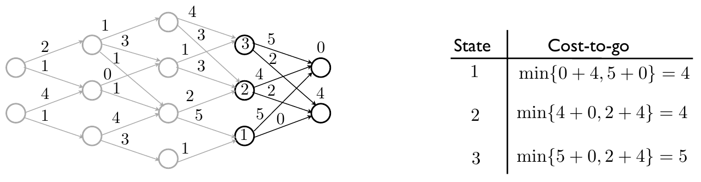
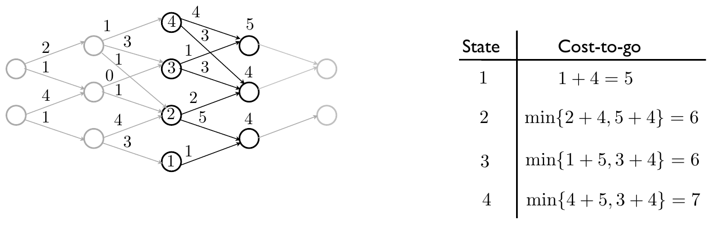
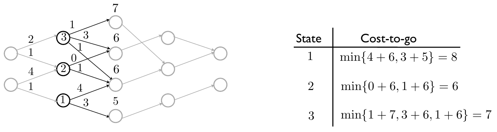
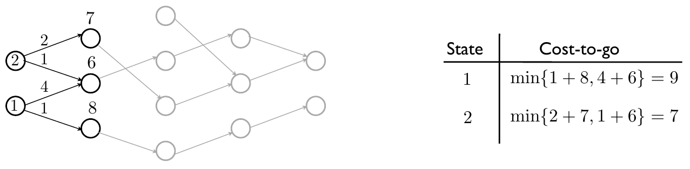

<!--
Textbook-prose companion to lectures/lecture01-introduction-and-dp.qmd,
intended as a booklet chapter for readers who did not attend the lecture.
Same content and figures as the slides, but written as connected prose
rather than bullet points, so it can stand on its own. Figures are the
same ones already cropped/verified for the slide deck, referenced from
../lectures/figures/lecture1v3/ rather than duplicated.
-->

[Slides](../lectures/lecture01-introduction-and-dp.html) &middot; [Exercises](../exercises/unit1-exercises.html) &middot; [Jupyter notebooks](../code/unit1/notebooks.html)

## Optimal control

Optimality is a useful design principle in many engineering contexts: we
size a refrigerator to minimize its energy use, tune an engine to minimize
a car's fuel consumption, shape an aircraft wing to minimize drag, and
schedule elevators in a building to minimize passenger waiting time. It
is also a principle nature itself
seems to follow -- many physical laws can be derived from optimality
arguments -- and, arguably, a principle we apply informally every day
whenever we weigh a decision.

*Optimal control* gives this idea a precise mathematical form for a broad
class of problems. These are problems in which optimal decisions, or
control actions, are chosen over a period of time so as to minimize a
cost that reflects a final objective and, often, intermediate objectives
along the way. Optimal control
problems arise in the
control of physical systems -- mechanical, electrical, biological -- but
also in economics, computer science, game theory, and many other fields.
@fig-domains gives a sense of this breadth, from robotics to logistics to
biology.

::: {style="text-align: center;"}
{#fig-domains width="97%" fig-align="center" fig-pos="b"}
:::

It is worth contrasting optimal control with the more familiar setting of
*static optimization*, which asks for a single optimal decision -- for
instance, the price of a product, or the slope of a line that best fits a
data set. Optimal control differs from static optimization in two
important respects. First, it asks for several optimal decisions, made
sequentially over time. Second, because the system's future state cannot
be predicted with certainty, a good decision at each point in time should
be allowed to depend on the state actually observed at that point, rather
than being fixed in advance; that is, the decisions form a *control law*
that can react to disturbances. Given the current state, previous
decisions are irrelevant to determining future decisions. This gives
optimal control problems a special structure, which the solution methods
developed later in the course exploit. Driving a car around a race track,
positioning the tip of a robot arm despite external disturbances, or
playing chess are all optimal control problems in this sense: not a
single choice, but a sequence of choices, each informed by how the
situation has evolved.

### Formulating an optimal control problem

Every optimal control problem in this course is built from two
ingredients: a *dynamic model* and a *cost function*.

The dynamic model specifies the rules of the problem, or the governing
equations of the physical system under control. Central to it is the
notion of *state*: a summary of all the information relevant to making
future decisions. *Control actions* are the decisions available to the
controller at each point in time; they influence how the state evolves.
That evolution may be deterministic, or it may be stochastic, driven by
disturbances outside the controller's influence.

The cost function encapsulates the goals of the problem. It is typically
additive over time -- a sum of costs incurred at each decision stage -- and,
by convention, the objective is to minimize it (a reward to be maximized
can always be recast as a cost to be minimized by negating it).

The goal of the problem is then to find a *control policy* minimizing the
cost: a policy being a set of functions, one per time instant, mapping the
current state to an action. A closely related, and often easier, question
is to compute a single *optimal path* -- a sequence of optimal decisions
over time -- for one specific, given initial condition, rather than a
policy valid for every possible initial condition. (In continuous-state
settings, introduced shortly, the same idea is usually called an *optimal
trajectory* instead.)

### Classes of optimal control problems and applications

The course begins with problems where the state and action spaces belong
to *discrete* spaces (e.g. $\{1,2,\dots,n\}$), and later moves to
*continuous* spaces ($\mathbb{R}^n$). Time, throughout the course, is
always taken to be discrete; continuous-time
decision problems will appear occasionally, but whenever they do, we will
convert them into stage-decision or discrete optimization problems rather
than treating continuous time directly.

When a discrete- or continuous-state problem is additionally subject to
stochastic disturbances, it is called a *Markov Decision Process* (MDP).
This gives four broad classes of problems that recur throughout the
course:

| | State space | Stochastic disturbances |
|---|---|---|
| Discrete decision problems | Discrete | No |
| Discrete MDPs | Discrete | Yes |
| Continuous decision/control problems | Continuous | No |
| Continuous MDPs | Continuous | Yes |

The sections that follow make several of these problems concrete, since
they will recur as running examples through the course -- including
settings where uncertainty is explicitly present.

#### Discrete decision problems

Discrete decision problems and discrete MDPs arise naturally in
operational research, management, and finance, where optimal control
ideas govern inventory control, the control of a queue, or the control of
data and traffic networks. In computer science, closely related problems
include finding shortest paths in graphs, scheduling, games, and selection
problems, among other applications.

A discrete decision problem is naturally specified by a *transition
diagram* with $h-1$ decision stages: circles represent the possible states
at each stage, arrows represent the actions that lead from a state at one
stage to a state at the next, and each arrow carries a cost $c^k_{i,j}$,
the cost of taking action $j$ from state $i$ at stage $k$; at the terminal
stage $h$, each state $i$ carries a terminal cost $c^h_i$.

{#fig-transition-diagram width="85%" fig-align="center"}

Working with such diagrams typically raises two challenges, illustrated
below with the small example of @fig-transition-challenges (a): (i)
determining an optimal path for a given initial state, minimizing the sum
of costs incurred at every stage, including the terminal stage (b); and
(ii) determining an optimal policy that specifies, for every state, the
first decision of the optimal path from that state to the terminal stage
(c). Together, these motivate the need for a systematic algorithm, rather
than exhaustive enumeration of every path.

{#fig-transition-challenges width="90%" fig-align="center"}

A first running example throughout the course is *inventory control*: how
should a shop manage the supply of a product over time? Overstocking is
costly -- it ties up physical space and risks technological obsolescence --
while understocking undermines sales; the optimal policy must balance the
two (@fig-applications-examples (a), below).

A second is *shortest paths in graphs*: given a road network, what is the
shortest route from one city to another -- for instance, from Bucharest to
Lugoj in the map below?

::: {.callout-important collapse="false" title="Teaser: Can you find an optimal path planning algorithm in 20 minutes?"}

Can you find the optimal path from Bucharest to Lugoj yourself? Can you
devise an algorithm that would always find optimal paths in graphs,
efficiently? As we will see in Unit 3, Dijkstra came up with such an
algorithm in just 20 minutes.

:::

{#fig-romania-map width="80%" fig-align="center"}

A closely related problem is *robot path planning*: finding the shortest
path for a robot moving through a grid from a starting point to a target
(@fig-applications-examples (b)). Discrete decision problems with uncertainty appear naturally in
*games* such as blackjack, where the goal is to play so as to make a
profit in expectation (@fig-applications-examples (c)); and in planning a day at an amusement
park, where a visitor uses stochastic models of queueing times at each
attraction to decide how to maximize time spent at their favorite
attractions (@fig-applications-examples (d)).

{#fig-applications-examples width="90%" fig-align="center"}

::: {.callout-tip collapse="false" title="Quick exercise: robot path planning as a road map problem"}

Can you formulate the robot planning problem in a grid world, as shown in
@fig-applications-examples (b), where cells are either free or obstacles,
as a road-map problem? Assume the distance between two horizontally or
vertically adjacent cells is $1$, and the distance between two diagonally
adjacent cells is $\sqrt{2}$.

:::

::: {.callout-note collapse="true" title="Solution"}

View each free cell as a city in a large road map. For two horizontally or
vertically adjacent free cells, the distance between them is simply $1$;
for two diagonally adjacent free cells, it is $\sqrt{2}$. There are no
roads from free cells to obstacle cells, nor between obstacle cells
(some "cities" are then isolated and can eventually be removed from the
road map).

:::

#### Continuous decision problems

The discrete framework generalizes naturally to problems with a general
state and input space, such as $\mathbb{R}^n$. A continuous decision
problem is described by a dynamic model
$$x_{k+1} = f_k(x_k,u_k), \qquad k\in\{0,\dots,h-1\},$$
where $x_k$ is the state and $u_k$ the control input at time $k$, together
with a cost function
$$\sum_{k=0}^{h-1} g_k(x_k,u_k) + g_h(x_h).$$
As before, there are two related goals: (i) find a policy
$\pi=\{\mu_0,\dots,\mu_{h-1}\}$, with $u_k=\mu_k(x_k)$, that achieves the
minimum cost for *every* initial condition, or (ii) find a single
*trajectory* $\{(x_0,u_0),(x_1,u_1),\dots,(x_{h-1},u_{h-1})\}$ achieving
the minimum cost for a *given* initial condition.

{#fig-continuous-stage width="75%" fig-align="center"}

The most prominent application of this framework is *digital control*: how
should one design a digital controller for a physical system, complete
with digital-to-analog and analog-to-digital converters, sensors, and
actuators? Variants of this problem include cases where the full state is
measured versus only a partial output, and cases with or without external
disturbances.

{#fig-digital-control width="85%" fig-align="center"}

Several concrete case studies illustrate the range of this framework.
Mixing two fluids in minimum time can be posed as a digital control
problem in which a camera observes the mixture and an actuator applies one
of four possible rotations once every $h$ seconds.

{#fig-mixing width="75%" fig-align="center"}

Digitally controlling a unicycle robot -- subject to constraints on its
speed and rotation rate -- to complete a maneuver in minimum time is
another instance (@fig-continuous-examples (a), below). So is
flying a quadcopter while taking wind-preview information into account
(@fig-continuous-examples (b)); moving a satellite between orbits with
minimum energy or fuel expenditure -- an important concern given the
limited fuel satellites carry (@fig-continuous-examples (c)); and moving
the tip of a robot arm from one configuration to another in minimum time
(@fig-continuous-examples (d)).

![Four further case studies within the digital control framework: (a) a race car cornering, illustrating a vehicle maneuvering under speed and turning-rate constraints in the same spirit as a digitally-controlled unicycle robot (photo: "FIA F1 Austria 2021 Nr. 4 Norris (corner)," Steffen Prößdorf ("Stepro"), CC BY-SA 4.0, Wikimedia Commons); (b) quadcopter control that takes wind-preview information into account; (c) minimum-energy orbital transfer for a satellite (photo: Hubble Space Telescope in orbit, ESA/Hubble, CC BY 2.0, Wikimedia Commons); (d) a robotic arm performing a task, similar in spirit to minimum-time robot-arm control (photo: "KUKA Industrial Robot Writer," Mirko Tobias Schäfer, CC BY 2.0, Wikimedia Commons).](../lectures/figures/lecture1v3/continuous-control-examples-composite.png){#fig-continuous-examples width="100%" fig-align="center"}

#### Continuous-time optimal control problems

Occasionally the underlying physical system is more naturally described in
continuous time, via a dynamic model
$$\dot{x}(t) = f(t,x(t),u(t)), \qquad x(0)=x_0, \quad t\in[0,h],$$
and a cost function
$$\int_0^h g(t,x(t),u(t))\,dt + g_h(x(h)),$$
with the same two goals as before: find a feedback policy minimizing the
cost for every initial condition, or find a single control input
minimizing the cost.

{#fig-continuous-time width="75%" fig-align="center"}

Most control-systems applications are naturally posed this way: in
traditional process control, they arise in stabilizing and regulating
systems such as an inverted pendulum, a mass-spring damper, a double
integrator, or a quadcopter; in aerospace, a canonical problem is the
minimum-fuel launch of a satellite. As noted above, whenever such problems arise
in this course we will approximate them as discrete-time decision or
optimal control problems, which is the setting the dynamic programming
algorithm developed below is built for.

::: {.callout-important collapse="false" title="Teaser: Find a useful optimal control problem for you!"}

Some of the problems above -- such as finding an optimal policy to visit
attractions at Efteling, or taking wind-preview information into account
in drone control -- were originally proposed by students. Can you
creatively think of a problem you would like to solve or work on, that
you believe can be cast as an optimal control problem? A couple of
suggestions to get you started: how would you schedule your tasks
throughout the week, given estimated completion times and estimated
rewards for accomplishing each one? Or, what is the optimal driving
policy for a solar-powered car trying to drive as far as possible, given
estimates of near-future cloud-shadow patterns?

:::

#### The reinforcement learning setting

A final, important variation on this theme arises when no dynamic model is
available at all -- only the real system itself, or a simulator that can be
run, is accessible. This is the *reinforcement learning* (RL) setting.

{#fig-rl-block width="85%" fig-align="center"}

Even though no explicit dynamic model is given, a model of the form
described above is still implicitly present for analysis purposes; the
difference is that it is unknown to the decision-maker. A reward or cost
function still encapsulates the goals of the problem, but it is now
obtained through the agent's interaction with the environment rather than
computed from a known model. This is, in fact, the key distinguishing
feature of reinforcement learning relative to the classical dynamic
programming setting introduced above: the transition dynamics are unknown
and must be *learned* from interaction, rather than given. The goal
becomes to find a control policy -- again, a function from states to
actions -- that minimizes cost based on data gathered through trial and
error.

Two examples illustrate this setting. Learning the optimal policy for a
ghost chasing Pacman -- deciding, at each step, whether to move up, down,
left, or right so as to catch Pacman in minimum time -- is a natural
discrete RL problem.

{#fig-pacman width="55%" fig-align="center"}

Learning to control a robot arm to perform a ball-balancing task is a
continuous analogue.

{#fig-ball-balancing width="45%" fig-align="center"}

::: {.callout-important collapse="true" title="Teaser: play against the ghost"}

You can run away from the ghost using the left, right, up, and down arrow
keys on your keyboard (click the game board first so that it can receive
your key presses). The ghost is following a smart policy, with a model of
the environment -- can you guess what it is? What if the ghost did not
have a model?

```{=html}
<div id="pacman-teaser-wrap" style="text-align:center; margin: 1em 0;">
  <canvas id="pacman-teaser-canvas" width="546" height="378"
    style="border:2px solid #333; background:#000; max-width:100%; touch-action:none; outline:none;"></canvas>
  <div style="margin-top:0.5em; font-size:0.9em;">
    <button id="pacman-teaser-reset" style="padding:4px 14px; font-size:0.9em;">Reset</button>
    <span id="pacman-teaser-status" style="margin-left:1em;"></span>
  </div>
  <div style="margin-top:0.5em; display:flex; flex-direction:column; align-items:center; gap:2px;">
    <button id="pacman-teaser-up" aria-label="up" style="width:2.4em;">&uarr;</button>
    <div style="display:flex; gap:2px;">
      <button id="pacman-teaser-left" aria-label="left" style="width:2.4em;">&larr;</button>
      <button id="pacman-teaser-down" aria-label="down" style="width:2.4em;">&darr;</button>
      <button id="pacman-teaser-right" aria-label="right" style="width:2.4em;">&rarr;</button>
    </div>
  </div>
</div>
<script>
(function () {
  // Walkable grid (1 = free cell, 0 = wall), matching the maze used in
  // Duarte's MATLAB playoptctrpacman.m (9 rows x 13 columns).
  const grid = [
    [1,1,1,1,1,1,1,1,1,1,1,1,1],
    [1,0,0,0,1,1,0,1,1,0,1,0,1],
    [1,0,1,1,1,1,0,1,1,0,0,1,1],
    [1,0,0,0,1,0,0,0,1,0,0,0,1],
    [1,1,1,1,1,1,1,1,1,1,1,1,1],
    [1,0,0,0,1,0,1,1,1,1,0,1,1],
    [1,0,0,0,1,0,0,0,1,1,0,1,1],
    [1,0,0,0,1,0,0,0,1,0,0,0,1],
    [1,1,1,1,1,1,1,1,1,1,1,1,1]
  ];
  const rows = grid.length, cols = grid[0].length, cell = 42;

  const canvas = document.getElementById('pacman-teaser-canvas');
  const ctx = canvas.getContext('2d');
  const statusEl = document.getElementById('pacman-teaser-status');

  let pac, gho, steps, over;

  function neighbours(p) {
    const deltas = [[-1,0],[1,0],[0,-1],[0,1]];
    const res = [];
    for (const [dr, dc] of deltas) {
      const r = p.r + dr, c = p.c + dc;
      if (r >= 0 && r < rows && c >= 0 && c < cols && grid[r][c] === 1) res.push({r, c});
    }
    return res;
  }

  // Breadth-first search from `from` to `to` (equivalent to Dijkstra on an
  // unweighted graph), returning the first step of a shortest path.
  function bfsNextStep(from, to) {
    if (from.r === to.r && from.c === to.c) return from;
    const key = p => p.r + ',' + p.c;
    const visited = new Set([key(from)]);
    const prev = new Map();
    const queue = [from];
    let qi = 0;
    while (qi < queue.length) {
      const cur = queue[qi++];
      if (cur.r === to.r && cur.c === to.c) break;
      for (const n of neighbours(cur)) {
        const k = key(n);
        if (!visited.has(k)) {
          visited.add(k);
          prev.set(k, cur);
          queue.push(n);
        }
      }
    }
    if (!prev.has(key(to))) return from; // no path found (should not happen)
    let cur = to;
    let parent = prev.get(key(cur));
    while (parent && key(parent) !== key(from)) {
      cur = parent;
      parent = prev.get(key(cur));
    }
    return cur;
  }

  // Row 0 of `grid` is row 1 of the original MATLAB `States` matrix, which
  // MATLAB plots at the *bottom* of the figure (larger row index = higher
  // up on screen). Canvas y grows downward, so row indices are flipped
  // here when drawing to match the original orientation.
  function screenRow(r) {
    return rows - 1 - r;
  }

  function draw() {
    ctx.clearRect(0, 0, canvas.width, canvas.height);
    for (let r = 0; r < rows; r++) {
      for (let c = 0; c < cols; c++) {
        ctx.fillStyle = grid[r][c] === 1 ? '#000' : '#1a1aff';
        ctx.fillRect(c * cell, screenRow(r) * cell, cell, cell);
      }
    }
    ctx.font = Math.floor(cell * 0.8) + 'px serif';
    ctx.textAlign = 'center';
    ctx.textBaseline = 'middle';
    ctx.fillText('🟡', pac.c * cell + cell / 2, screenRow(pac.r) * cell + cell / 2);
    ctx.fillText('👻', gho.c * cell + cell / 2, screenRow(gho.r) * cell + cell / 2);
  }

  function reset() {
    pac = {r: 8, c: 0};   // row 9, col 1 (1-indexed in the original script)
    gho = {r: 0, c: 12};  // row 1, col 13
    steps = 0;
    over = false;
    statusEl.textContent = 'Steps survived: 0';
    draw();
  }

  function move(dr, dc) {
    if (over) return;
    const oldPac = {r: pac.r, c: pac.c};
    const oldGho = {r: gho.r, c: gho.c};

    const nr = pac.r + dr, nc = pac.c + dc;
    if (nr >= 0 && nr < rows && nc >= 0 && nc < cols && grid[nr][nc] === 1) {
      pac = {r: nr, c: nc};
    }
    gho = bfsNextStep(gho, pac);
    steps++;

    const caught = (pac.r === gho.r && pac.c === gho.c) ||
      (pac.r === oldGho.r && pac.c === oldGho.c && gho.r === oldPac.r && gho.c === oldPac.c);

    draw();
    statusEl.textContent = caught
      ? 'Caught! You survived ' + steps + ' move' + (steps === 1 ? '' : 's') + ' -- click Reset to try again.'
      : 'Steps survived: ' + steps;
    over = caught;
  }

  // Grid rows are flipped on screen (see screenRow above), so moving "up"
  // on screen means *increasing* the internal row index, and vice versa.
  document.getElementById('pacman-teaser-reset').addEventListener('click', reset);
  document.getElementById('pacman-teaser-up').addEventListener('click', () => move(1, 0));
  document.getElementById('pacman-teaser-down').addEventListener('click', () => move(-1, 0));
  document.getElementById('pacman-teaser-left').addEventListener('click', () => move(0, -1));
  document.getElementById('pacman-teaser-right').addEventListener('click', () => move(0, 1));

  canvas.tabIndex = 0;
  canvas.addEventListener('click', () => canvas.focus());
  canvas.addEventListener('keydown', (e) => {
    const map = {ArrowUp: [1, 0], ArrowDown: [-1, 0], ArrowLeft: [0, -1], ArrowRight: [0, 1]};
    if (map[e.key]) {
      e.preventDefault();
      move(...map[e.key]);
    }
  });

  reset();
})();
</script>
```

:::

## The dynamic programming algorithm

Having introduced the range of problems optimal control addresses, we turn
to the first general-purpose method for solving them: *dynamic
programming* (DP). Dynamic programming allows us to find not just a single
optimal path, but entire policies -- functions mapping states to actions --
which can then be used to control a system in the presence of
disturbances. It can also be used to compute optimal paths or trajectories
directly, although, as we shall see later in the course, other methods can
be more efficient for that narrower task.

### The principle of optimality

Dynamic programming rests on a simple but powerful observation, known as
the *principle of optimality*. Consider a simple example: the shortest
route from Eindhoven to Paris happens to pass through Antwerp. The
principle of optimality then tells us that the portion of that route from
Antwerp to Paris must itself be the shortest route between those two
cities -- if a shorter route from Antwerp to Paris existed, splicing it in
would produce a shorter Eindhoven-to-Paris route, contradicting the
optimality of the original route.

{#fig-eindhoven-paris width="70%" fig-align="center"}

Stated more generally, for a discrete optimization problem: *the tail of
an optimal path is also optimal*. Given an optimal path from stage $0$ to
stage $h$, consider the state at some intermediate stage $j$ that lies on
this optimal path. Then the decisions along the optimal path from stage
$j$ onward to stage $h$ are themselves optimal for the subproblem that
starts at that state at stage $j$.

{#fig-principle-optimality width="90%" fig-align="center"}

The principle of optimality is not specific to discrete optimization
problems -- it applies equally to stage-decision problems and to
continuous-time optimal control problems -- and it is the foundation on
which the dynamic programming algorithm is built.

The argument sketched informally above for the Eindhoven-Antwerp-Paris
example is worked out precisely, by contradiction, in the following
exercise.

::: {.callout-tip collapse="false" title="Exercise: prove the principle of optimality"}

Consider an optimal path from stage $0$ to stage $h$, and an intermediate
stage $j$ that lies on this path. Prove, by contradiction, that the
portion of the path from stage $j$ onward to stage $h$ is itself optimal
for the subproblem that starts at that state at stage $j$.

:::

::: {.callout-note collapse="true" title="Solution"}

Split the cost of the optimal path into the cost of the portion before
stage $j$ and the cost of the portion from stage $j$ onward:
$$\text{cost} = \text{cost}_{[0,j)} + \text{cost}_{[j,h]}.$$

{#fig-proof-step1 width="55%" fig-align="center"}

Now suppose, for the sake of contradiction, that the portion of this path
from stage $j$ to stage $h$ is *not* optimal for the subproblem starting
at that state at stage $j$ -- that is, there exists an alternative
continuation with strictly smaller cost,
$$\underline{\text{cost}}_{[j,h]} < \text{cost}_{[j,h]}.$$

{#fig-proof-step2 width="55%" fig-align="center"}

Splicing this better continuation onto the original path's first portion
then produces a path from stage $0$ to stage $h$ with strictly smaller
total cost,
$$\text{cost}_{[0,j)} + \underline{\text{cost}}_{[j,h]} < \text{cost}_{[0,j)} + \text{cost}_{[j,h]},$$
contradicting the assumption that the original path was optimal. Hence the
tail of an optimal path must itself be optimal.

{#fig-proof-step3 width="55%" fig-align="center"}

:::

### The algorithm

The principle of optimality suggests a natural algorithm for discrete
decision problems: rather than search forward from stage $0$, compute
optimal decisions *backward* from the final stage. Concretely, the
dynamic programming algorithm proceeds as follows.

1. Start at the final decision stage $h$, and set the cost-to-go at stage
   $h$ equal to the terminal cost.
2. For every state at stage $k<h$, compute the optimal action by
   minimizing the sum of the immediate cost and the cost-to-go of the
   resulting next state; call the minimum value the cost-to-go at stage
   $k$ for that state.
3. Repeat step 2, moving backward through $k=h-1,h-2,\dots,0$.

Because each state at each stage only ever needs to look one stage ahead
(at the cost-to-go values already computed), the entire diagram can be
swept once, backward, rather than requiring an exhaustive search over all
possible forward paths.

### A worked example

@fig-dp-iterations shows the algorithm being applied stage by stage,
backward through a small transition diagram.

::: {#fig-dp-iterations layout-ncol="1"}

{#fig-dp-iter1}

{#fig-dp-iter2}

{#fig-dp-iter3}

{#fig-dp-iter4}

The algorithm applied stage by stage, backward through a small transition diagram: first computing the cost-to-go at stage 3 from the terminal cost (a), then propagating it back to stage 2 (b), stage 1 (c), and finally stage 0 (d), completing the backward sweep.

:::

Once the backward sweep is complete, both the optimal policy and the
optimal paths can be read directly off the diagram.

{#fig-dp-optimal-policy width="90%" fig-align="center"}

While running the algorithm, a decision is made at every state and every
stage in order to compute that state's cost-to-go; this decision is
precisely the decision specified by the optimal policy at that
state/stage. To obtain the optimal path for a *given* initial state,
simply follow the arrows selected by the policy from that initial state
through to the final stage. The cost-to-go computed at stage $0$ for that
initial state coincides exactly with the total cost of the resulting
optimal path.

::: {.callout-tip collapse="false" title="Quick exercise: a two-stage recursion by hand"}

Consider a discrete decision problem with $h=2$ stages, states
$x_0\in\{1,2\}$ at stage $0$, states $x_1\in\{1,2\}$ at stage $1$, and a
single terminal state $x_2$. The stage costs are: from $x_0=1$, cost $3$
to reach $x_1=1$ and cost $5$ to reach $x_1=2$; from $x_0=2$, cost $1$ to
reach $x_1=1$ and cost $4$ to reach $x_1=2$; from $x_1=1$, cost $2$ to
reach $x_2$; from $x_1=2$, cost $6$ to reach $x_2$. The terminal cost is
$g_2(x_2)=0$.

(a) Compute the cost-to-go $J_1(x_1)$ for each $x_1\in\{1,2\}$.

(b) Compute the cost-to-go $J_0(x_0)$ for each $x_0\in\{1,2\}$, and give
the optimal decision at each state.

:::

::: {.callout-note collapse="true" title="Solution"}

(a) At stage $1$ there is only one available action from each state, so
$J_1(1) = 2$ and $J_1(2) = 6$.

(b) At stage $0$:
$$J_0(1) = \min\{3+J_1(1),\ 5+J_1(2)\} = \min\{3+2,\ 5+6\} = \min\{5,11\} = 5,$$
achieved by moving to $x_1=1$; and
$$J_0(2) = \min\{1+J_1(1),\ 4+J_1(2)\} = \min\{1+2,\ 4+6\} = \min\{3,10\} = 3,$$
also achieved by moving to $x_1=1$. So the optimal policy sends both
$x_0=1$ and $x_0=2$ to $x_1=1$ at stage $0$, and from $x_1=1$ (the only
option) to $x_2$ at stage $1$. The optimal cost-to-go from $x_0=1$ is $5$;
from $x_0=2$ it is $3$.

:::

::: {.callout-note collapse="true" title="Python companion"}

As a companion to solving the recursion above by hand, here is the same
backward recursion implemented directly in Python. Unlike the surrounding
text, this code cell is *live*: Quarto executes it when the document is
rendered (given a Python/Jupyter environment), and the output shown below
the cell is produced by actually running the code, not typed in by hand.
The parameters describing the problem instance are kept in a clearly
marked block at the top, separate from the recursion logic: to try a
different transition diagram, edit only that block (add or remove stages,
states, or actions) and re-render -- the recursion below adapts
automatically, with no other changes needed.

```{python}
# --- parameters: edit these to try a different problem ---------------------
# cost[k] maps each state at stage k to a dict {next_state: arc_cost},
# describing the actions available from that state. Add/remove stages,
# states, or actions freely -- the recursion below adapts automatically.
cost = {
    0: {1: {1: 3, 2: 5}, 2: {1: 1, 2: 4}},
    1: {1: {"end": 2}, 2: {"end": 6}},
}
# terminal_cost maps each state at the final stage to its terminal cost g_h
terminal_cost = {"end": 0}
# -----------------------------------------------------------------------

# --- backward recursion (no need to edit below this line) ------------------
stages = sorted(cost.keys())      # decision stages, e.g. [0, 1, ...]
h = stages[-1] + 1                 # terminal stage index

J = {h: terminal_cost}             # cost-to-go, keyed by stage then state
policy = {}                        # optimal next state, keyed by stage then state

for k in reversed(stages):
    J[k], policy[k] = {}, {}
    for state, actions in cost[k].items():
        best_next, arc_cost = min(
            actions.items(), key=lambda item: item[1] + J[k + 1][item[0]]
        )
        J[k][state] = arc_cost + J[k + 1][best_next]
        policy[k][state] = best_next

for k in stages:
    for state in sorted(J[k], key=str):
        print(f"stage {k}, state {state}: J = {J[k][state]}, "
              f"optimal next state = {policy[k][state]}")
```

The printed values match the by-hand computation above exactly: $J_1(1)=2$,
$J_1(2)=6$, $J_0(1)=5$, $J_0(2)=3$, with both $x_0=1$ and $x_0=2$ optimally
routed through $x_1=1$. Because the recursion above only ever reads the
`cost` and `terminal_cost` dictionaries -- it never hardcodes the number of
stages or states -- you can extend the `parameters` block with a third
stage, extra states, or different costs, and the same code will compute
the correct backward recursion for that new problem.

:::

### Non-uniqueness

It can happen that, at some state and stage, more than one action achieves
the same minimum cost-to-go. When this occurs, any of the tied options may
be selected; the algorithm simply picks one of them (arbitrarily, or by
convention) and proceeds. The result is a single optimal policy, even
though, in general, several different optimal policies may exist -- all of
them achieving the same optimal cost-to-go, but potentially prescribing
different actions at the states and stages where a tie occurred.

{#fig-nonuniqueness width="90%" fig-align="center"}

::: {.callout-tip collapse="false" title="Quick exercise: counting optimal policies under ties"}

(a) Suppose that, while running the DP algorithm, a tie in the cost-to-go
between two actions occurs at $r$ different state-stage pairs (possibly at
different stages). How many optimal policies does the problem have?

(b) Suppose instead that ties occur at only two state-stage pairs, with
$3$ optimal actions available at the first and $4$ optimal actions
available at the second. How many optimal policies are there in total?

:::

::: {.callout-note collapse="true" title="Solution"}

(a) At each of the $r$ tied state-stage pairs, either of the two optimal
actions can be selected independently of the choices made at the other
tied pairs, and every such combination yields a distinct optimal policy
(all achieving the same optimal cost). There are therefore $2^r$ optimal
policies.

(b) By the same reasoning, the choice made at the first state-stage pair
(among $3$ optimal actions) is independent of the choice made at the
second (among $4$ optimal actions), so the total number of optimal
policies is $3 \times 4 = 12$.

:::

### Inventory control, revisited

We now return to the inventory control problem introduced earlier and
formulate it precisely, as a running example for the dynamic programming
algorithm. The problem is to control the supply of a single product over
time. The dynamic model is
$$x_{k+1} = \max\{x_k+u_k-d_k,0\}, \qquad u_k \in \{0,1,\dots,N-x_k\},$$
where $x_k$ is the number of items in stock, $u_k$ the supply ordered at
stage $k$, $d_k$ the demand at stage $k$, and $N$ the storage capacity.
The cost function is
$$\sum_{k=0}^{h-1} g_k(x_k,u_k) + g_h(x_h),$$
where the stage cost is
$$g_k(x_k,u_k) = \big(c_1(x_k) + c\,u_k + c_{tr}\lVert u_k\rVert_0\big) - p\min\{d_k,x_k+u_k\},$$
with $\lVert u_k\rVert_0$ equal to $0$ if $u_k=0$ and $1$ otherwise, $g_h$
the terminal cost, $p$ the selling price per item, $c$ the purchase price
per item, $c_{tr}$ the (fixed, per-order) transportation price, and $c_1$
the storage cost.

The corresponding transition diagram represents, at each stage, the
possible numbers of items in stock as states, with the chosen supplies
determining the transitions between them.

{#fig-inventory-transition width="90%" fig-align="center"}

To make this concrete, consider a numerical instance with $h=4$ stages and
capacity $N=4$, demand $d_0=d_1=2$, $d_2=d_3=1$, selling price $p=10$,
purchase price $c=5$, transportation price $c_{tr}=0.5$, storage cost
$c_1(i)=0.2i$ for $i\in\{0,\dots,N\}$, and terminal cost $g_4(i)=-r_{i+1}$ for
$i\in\{0,\dots,4\}$, with $r=[0\ 4.8\ 9.6\ 14.4\ 19.2]$. Applying the backward recursion to this instance
proceeds exactly as in the abstract worked example above.

{#fig-inventory-iter1 width="90%" fig-align="center"}

Once the recursion is complete, the resulting policy and the optimal path
for each possible initial state can be read off the diagram, exactly as
described above.

{#fig-inventory-iter2 width="70%" fig-align="center"}

A full Python implementation of this example -- reproducing the same
numbers, including the open-loop/closed-loop figures further below in
this section -- is available in [`code/unit1/inventory_control.py`](../code/unit1/inventory_control.py),
built on top of the general solver in
[`code/unit1/dp.py`](../code/unit1/dp.py); the original annotated notebooks
are also included there
([`A_1_inventorycontrol.ipynb`](../code/unit1/A_1_inventorycontrol.ipynb),
[`A_1_dp.ipynb`](../code/unit1/A_1_dp.ipynb)). These are ordinary Python
files meant to be downloaded and run locally, rather than live in-browser
snippets, since the general solver is a bit more involved than the short
examples embedded directly in this page.

### Coping with uncertainty {#sec-coping-uncertainty}

::: {.callout-note collapse="true" title="Optional: coping with uncertainty"}

The dynamic programming algorithm developed above assumes the demand
sequence $d_k$ is known in advance. In practice, of course, it is not: the
real value of $d_k$ only becomes known once stage $k$ is reached. This
section uses the inventory control example to illustrate the difference
between planning that ignores this uncertainty and planning that exploits
it -- a distinction that motivates the extension to *stochastic* dynamic
programming taken up in the next unit.

Consider again the inventory control example, and suppose the plan was
computed assuming an expected demand of $d_2=1$ at stage $2$, but the
realized demand turns out to be $d_2=2$ instead.

{#fig-inventory-disturbances width="55%" fig-align="center"}

Because the realized demand differs from what was planned for, the state
actually reached at stage $3$ is $x_3=0$ rather than the $x_3=1$ that had
been anticipated. Two ways of proceeding from here are worth
distinguishing:

- **Open loop**: ignore the discrepancy and blindly apply the action
  $u_3=0$ that had originally been planned for the anticipated state.
- **Closed loop**: instead, use the dynamic programming policy computed
  for the state actually observed, $x_3=0$, which prescribes $u_3=1$.

The two choices lead to different realized costs. For the open-loop
choice,
$$g_0(0,4)+g_1(2,0)+g_2(0,2)+g_3(0,0)+g_4(0) = 0.5 - 19.6 + (-9.5) + 0 + 0 = -28.6,$$
whereas for the closed-loop choice,
$$g_0(0,4)+g_1(2,0)+g_2(0,2)+g_3(0,1)+g_4(0) = 0.5 - 19.6 + (-9.5) + (-4.5) + 0 = -33.1.$$
The closed-loop cost is lower (recall costs here are net of revenue, so
more negative is better): by reacting to the observed state rather than
following a fixed plan, the closed-loop policy recovers some of the
value lost to the unexpected demand.

The same comparison can be made in expectation. If
$\text{Prob}[d_2=1]=0.5$ and $\text{Prob}[d_2=2]=0.5$, and the open-loop
and closed-loop costs when $d_2=1$ both equal $-28.4$ (the case that
matches what was planned for), then the expected costs are
$$\text{Open loop:} \quad 0.5\times(-28.4) + 0.5\times(-28.6) = -28.5,$$
$$\text{Closed loop:} \quad 0.5\times(-28.4) + 0.5\times(-33.1) = -30.75.$$
The closed-loop policy achieves a strictly lower expected cost, since it
is able to adapt its later decisions to the disturbance actually realized,
rather than committing to a fixed sequence of actions in advance. Making
this idea precise -- computing policies that directly minimize *expected*
cost under a known probability distribution over disturbances -- is exactly
the subject of Unit 2, stochastic dynamic programming.

::: {.callout-tip collapse="false" title="Quick exercise: open loop vs. closed loop without disturbances"}

True or false: if a discrete decision problem has no disturbances at all
(the dynamic model $x_{k+1}=f_k(x_k,u_k)$ is fully deterministic), then
the open-loop and closed-loop strategies always achieve exactly the same
cost, for any initial state. Justify your answer.

:::

::: {.callout-note collapse="true" title="Solution"}

True. The gap between open-loop and closed-loop only arises because a
disturbance can push the realized state away from the state that was
anticipated when the plan was made, so that re-optimizing from the
*actual* state (closed loop) can differ from -- and do better than --
blindly following the original plan (open loop). Without disturbances, the
state at every stage evolves exactly as predicted when the open-loop plan
was computed, so the "actual" state the closed-loop policy would react to
is, at every stage, precisely the state the open-loop plan already
assumed. The closed-loop policy therefore prescribes the same action as
the open-loop plan at every stage, the two strategies coincide exactly,
and so do their costs.

:::

:::

## Dynamic programming equations

### A more general formalism

The transition-diagram picture used so far is intuitive, but it is useful
to also express the dynamic programming algorithm in a more compact,
purely algebraic formalism -- equivalent to the one above, but easier to
generalize to the settings encountered later in the course (stochastic
disturbances, continuous state spaces, and so on).

As before, the dynamic model is $x_{k+1}=f_k(x_k,u_k)$ for
$k\in\{0,\dots,h-1\}$, and the cost is
$\sum_{k=0}^{h-1} g_k(x_k,u_k)+g_h(x_h)$.

{#fig-dp-formalism width="85%" fig-align="center"}

Concretely, at each stage $k$ the state takes values in a finite set,
$x_0\in\{1,\dots,n_0\}$, $x_1\in\{1,\dots,n_1\}$, ..., $x_h\in\{1,\dots,n_h\}$,
and the action available at state $x_k$ takes values in a set that may
depend on the state,
$u_0\in\{1,\dots,m_{0,x_0}\}$, $u_1\in\{1,\dots,m_{1,x_1}\}$, .... The
stage costs are simply the arrow costs from before, relabeled as
$g_0(x_0,u_0)=c^0_{x_0,u_0}$, $g_1(x_1,u_1)=c^1_{x_1,u_1}$, ..., and the
terminal cost as $g_h(x_h)=c^h_{x_h}$.

::: {.callout-tip collapse="false" title="Quick exercise: writing down $f_k$, $g_k$, and $g_h$ for a small example"}

Consider the small transition diagram at the top of @fig-nonuniqueness
above: one state at stage $0$, two states at stage $1$, and two
(terminal) states at stage $2$ ($h=2$). Write down the dynamics $f_k$,
the stage costs $g_k$, and the terminal cost $g_h$ for this problem, in
the general formalism introduced above.

:::

::: {.callout-note collapse="true" title="Solution"}

Label actions by the state they lead to, so that $f_k(x_k,u_k)=u_k$ at
every stage. There is a single state at stage $0$, $x_0=1$, with two
available actions:
$$g_0(1,1) = 3, \qquad g_0(1,2) = 2,$$
matching the two arrows leaving state $1$ in the diagram (to state $1$
and to state $2$ at stage $1$, respectively).

At stage $1$ there are two states, $x_1\in\{1,2\}$, each with two
available actions:
$$g_1(1,1) = 3, \qquad g_1(1,2) = 3, \qquad g_1(2,1) = 1, \qquad g_1(2,2) = 3,$$
again matching the four arrows from stage $1$ to stage $2$ in the
diagram.

Finally, the terminal cost at stage $h=2$ is
$$g_2(1) = 2, \qquad g_2(2) = 0.$$

As a check, the two optimal paths shown in @fig-nonuniqueness both have
total cost $5$: $g_0(1,2)+g_1(2,2)+g_2(2) = 2+3+0=5$, and
$g_0(1,2)+g_1(2,1)+g_2(1) = 2+1+2=5$.

:::

### The dynamic programming equations

In this formalism, the dynamic programming algorithm becomes a compact
pair of recursive equations. Denoting by $U_k(i)$ the set of actions
available at state $i$ and stage $k$, we initialize
$$J_h(i) = g_h(i)$$
for every state $i$, and then, for each stage starting from the last and
moving backward, compute
$$
J_k(i) = \min_{j\in U_k(i)} \; g_k(i,j) + J_{k+1}(j),
$$
together with the corresponding minimizer $\mu_k(i)=j^\star$. The function
$J_k$ is exactly the cost-to-go at stage $k$ from the diagram picture
above, and $\mu_k$ is exactly the optimal policy: at each state $i$ and
stage $k$, the policy prescribes the action $\mu_k(i)$ that achieves the
minimum in the recursion. These two equations -- the initialization at the
terminal stage and the backward recursion -- are what we will refer to as
the *dynamic programming equations* throughout the rest of the course; the
same two equations, suitably adapted, will reappear for stochastic,
continuous-state, and infinite-horizon problems.

The dynamic programming equations express a trade-off often encountered
in real life: should a decision be made to maximize immediate reward (the
function $g_k$), or should it instead favor the long-run reward (the
function $J_{k+1}$)? The dynamic programming equations naturally strike
this balance, by adding the two together and optimizing their sum at
every stage, rather than treating either one in isolation.

::: {.callout-tip collapse="false" title="Quick exercise: counting the data in a problem instance"}

In the formalism above, suppose a problem has $h=5$ stages, every state
space has exactly $n_k=4$ states, and every state has exactly $3$ actions
available. How many stage-cost values $c^k_{i,j}$ need to be specified in
total to fully describe the problem (excluding the terminal costs)?

:::

::: {.callout-note collapse="true" title="Solution"}

At each of the $k\in\{0,\dots,4\}$ stages (that is, $h=5$ stages), each of
the $4$ states has $3$ available actions, so $4\times 3 = 12$ cost values
are needed per stage. Across $5$ stages, that is $5\times 12 = 60$
stage-cost values $c^k_{i,j}$ in total (plus $4$ terminal costs $c^h_i$,
one per state at the terminal stage, which are not counted in the
question).

:::

::: {.callout-tip collapse="false" title="Quick exercise: computing costs-to-go for the same example"}

Using the functions $f_k$, $g_k$, and $g_h$ found in the earlier exercise
for the transition diagram on top of @fig-nonuniqueness, compute the
cost-to-go $J_k(i)$ at every state and stage, and the resulting optimal
policy, using the dynamic programming equations.

:::

::: {.callout-note collapse="true" title="Solution"}

At the terminal stage,
$$J_2(1) = g_2(1) = 2, \qquad J_2(2) = g_2(2) = 0.$$

At stage $1$:
$$J_1(1) = \min\{g_1(1,1)+J_2(1),\ g_1(1,2)+J_2(2)\} = \min\{3+2,\ 3+0\} = 3,$$
achieved uniquely by $\mu_1(1)=2$; and
$$J_1(2) = \min\{g_1(2,1)+J_2(1),\ g_1(2,2)+J_2(2)\} = \min\{1+2,\ 3+0\} = 3,$$
achieved by *both* $\mu_1(2)=1$ and $\mu_1(2)=2$ -- exactly the tie
already highlighted in @fig-nonuniqueness.

At stage $0$:
$$J_0(1) = \min\{g_0(1,1)+J_1(1),\ g_0(1,2)+J_1(2)\} = \min\{3+3,\ 2+3\} = 5,$$
achieved uniquely by $\mu_0(1)=2$.

The optimal cost starting from $x_0=1$ is therefore $J_0(1)=5$, obtained
by first moving to state $2$ at stage $1$, and then, because of the tie
at that state, either to state $2$ or to state $1$ at the terminal stage
-- matching the two optimal paths and two optimal policies shown in
@fig-nonuniqueness.

:::

### Historical note

Dynamic programming was proposed in the 1940s by the American
mathematician Richard E. Bellman, whose name is now attached to the
recursive equations above (the "Bellman equations") and to the principle
of optimality itself.

{#fig-bellman-portrait width="30%" fig-align="center"}

::: {style="text-align: center; font-size: 0.4em;"}
Photo: via Wikipedia.
:::

Bellman later reflected on the choice to pursue this line of research in
these terms:

> "I was intrigued by dynamic programming. It was clear to me that there
> was a good deal of good analysis there. Furthermore, I could see many
> applications. It was a clear choice. I could either be a traditional
> intellectual, or a modern intellectual using the results of my research
> for the problems of contemporary society."
>
> -- R. E. Bellman (1920-1984)

## Summary

This unit introduced optimal control as the problem of determining
several optimal decisions over time, each allowed to depend on the state
of the system, in contrast with static optimization's single decision. We
distinguished three broad classes of optimal control problems -- discrete
optimization, stage-decision, and continuous-time control -- and surveyed a
wide range of applications across engineering, operations research,
computer science, and reinforcement learning. We then introduced the
dynamic programming algorithm: a backward recursion, grounded in the
principle of optimality, that computes optimal decisions stage by stage
and yields both the optimal policy and the optimal cost-to-go at every
state and stage. The same recursion, expressed compactly as the dynamic
programming equations, will be extended throughout the rest of the course
to stochastic, continuous, and infinite-horizon settings.

::: {.callout-important collapse="false" title="Teaser: Room for improvement"}

While we have seen, in this unit, many optimal control problems that have
already been solved -- and whose optimal solutions we use nowadays (games,
inventory control, optimal robot motion, and so on) -- there remains a
large number of problems for which, sometimes surprisingly, the optimal
policy is not yet used in practice. For instance, have you ever thought
that the order in which we draw the individual strokes of our handwritten
letters could be optimized to write faster? See the video below, made by
Roy van Zuijlen, a teaching assistant of the course.

```{=html}
<div style="text-align:center; margin: 1em 0;">
  <video controls style="max-width:100%; width:600px;">
    <source src="../lectures/figures/lecture1v3/movie_writingpolicy.mp4" type="video/mp4">
    Your browser does not support embedded video. You can download the
    video directly instead.
  </video>
</div>
```

:::
