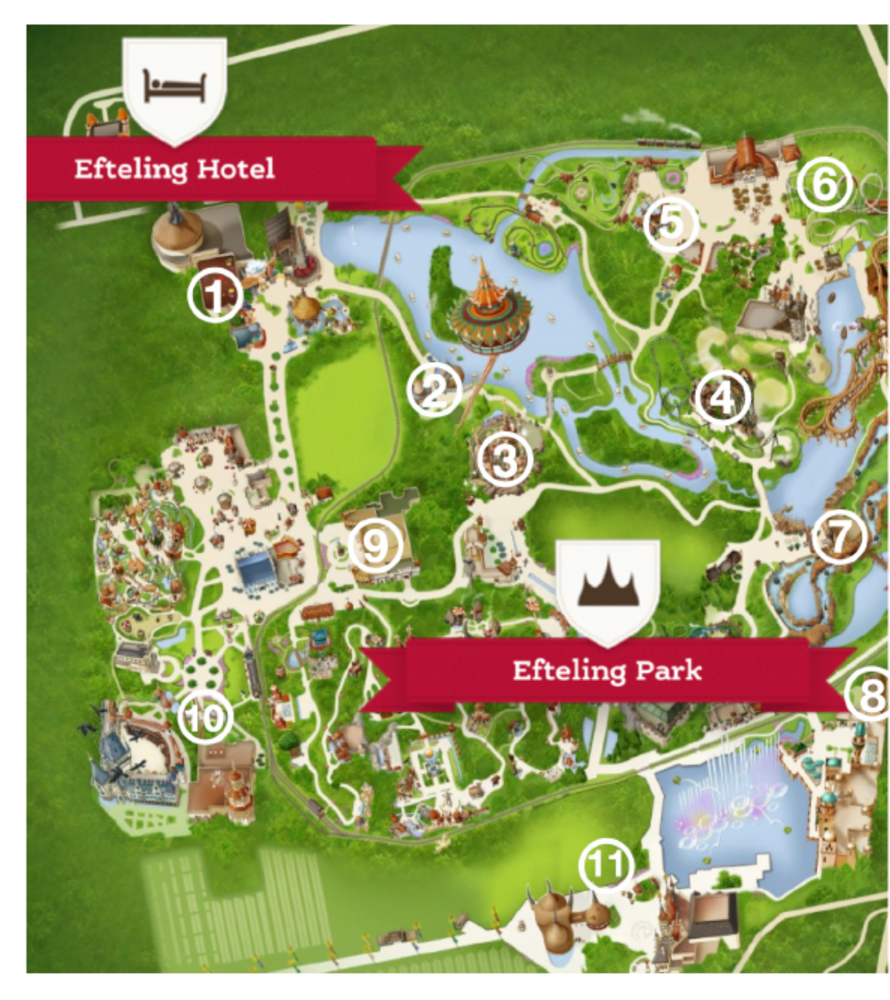
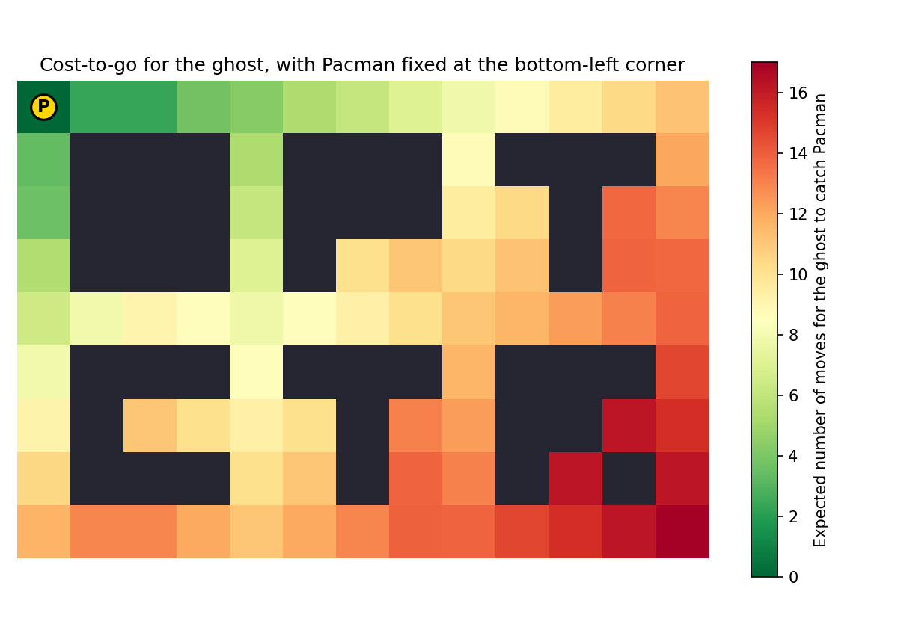
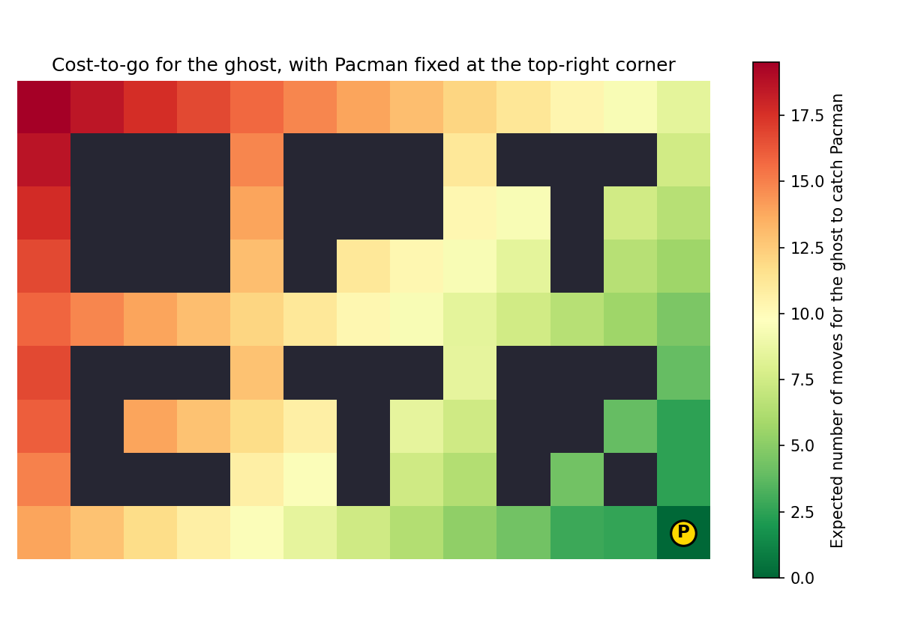

<!--
Textbook-prose companion to lectures/lecture02-stochastic-dp.qmd, intended
as a booklet chapter for readers who did not attend the lecture. First-pass
conversion (2026-08-18) applying the same conventions settled on for Unit 1:
prose rather than bullet points, descriptive Quarto figure labels/captions
(images still live in ../lectures/figures/lecture2/, named pgNN-xxx.png,
matching the original slide PDF page numbers), and the three slide
appendices folded into contextual collapsible callouts rather than kept as
trailing appendix sections. Expect the same kind of paragraph-by-paragraph
refinement round we did for Unit 1.
-->

[Slides](../lectures/lecture02-stochastic-dp.html) &middot; [Exercises](../exercises/unit2-exercises.html) &middot; [Jupyter notebooks](../code/unit2/notebooks.html)

## Stochastic dynamic programming

In Unit 1, the dynamic programming algorithm was developed for
*deterministic* problems: given a state, an action always leads to a
known, predictable next state. In practice, however, the evolution of a
system is often affected by disturbances that cannot be predicted in
advance. This unit extends the dynamic programming algorithm to problems
where such disturbances are present, assuming they can be captured by a
stochastic model. It illustrates the resulting *stochastic dynamic
programming* algorithm on several applications.

::: {.callout-important collapse="true" title="Teaser: can you find a profitable coin-tossing strategy?"}

Two players, $A$ and $B$, play the following game. At each of $h=2$
stages, player $A$ chooses to toss either a $1$€ coin or a $2$€ coin: on
"heads," $A$ gains that many points (and $B$ loses them); on "tails," $A$
loses that many points (and $B$ gains them). As soon as $A$'s point total
reaches $L=3$ or $L+1=4$, $A$ wins $L$ euros from $B$; if it reaches $-L$
or $-(L+1)$, $A$ pays $L$ euros to $B$; otherwise, after both stages, no
money changes hands.

Since both coins are fair, it is tempting to think that no strategy can
give player $A$ an edge -- any bet has zero expected value on its own.
Is that actually true? Play a few rounds below, choosing at each stage
which coin to toss, and see how your average payoff compares to zero.
We will formalize this game as a stochastic optimal control problem at
the end of Section 1.2, and solve it exactly with stochastic dynamic
programming at the end of Section 1.3 -- with the fully worked-out
solution revisited again in Section 2.3.

```{=html}
<div id="coin-game-wrap" style="text-align:center; margin: 1em 0; max-width:420px; margin-left:auto; margin-right:auto; border:1px solid #ccc; border-radius:8px; padding:1em;">
  <div style="font-size:1.05em; margin-bottom:0.6em;">
    Stage <span id="coin-stage">0</span> of 2 &nbsp;|&nbsp; Player A's points: <span id="coin-points">0</span>
  </div>
  <div style="margin-bottom:0.7em;">
    <button id="coin-bet1" style="padding:4px 12px; font-size:0.9em;">Toss the 1€ coin</button>
    <button id="coin-bet2" style="padding:4px 12px; font-size:0.9em; margin-left:0.4em;">Toss the 2€ coin</button>
  </div>
  <div id="coin-result" style="min-height:1.4em; font-size:1.05em; margin-bottom:0.3em;"></div>
  <div id="coin-log" style="font-size:0.9em; color:#555; min-height:1.2em; margin-bottom:0.7em;"></div>
  <button id="coin-reset" style="padding:4px 12px; font-size:0.9em;">New game</button>
  <table style="margin:0.7em auto 0; border-collapse:collapse; font-size:0.9em;">
    <thead>
      <tr>
        <th style="padding:2px 10px; border-bottom:1px solid #999;">Games played</th>
        <th style="padding:2px 10px; border-bottom:1px solid #999;">Average profit (€)</th>
      </tr>
    </thead>
    <tbody>
      <tr>
        <td id="coin-games" style="padding:2px 10px;">0</td>
        <td id="coin-avg" style="padding:2px 10px;">--</td>
      </tr>
    </tbody>
  </table>
</div>
<script>
(function () {
  const L = 3, H = 2;
  let x = 0, k = 0, over = false, games = 0, totalProfit = 0;

  const stageEl = document.getElementById('coin-stage');
  const pointsEl = document.getElementById('coin-points');
  const resultEl = document.getElementById('coin-result');
  const logEl = document.getElementById('coin-log');
  const gamesEl = document.getElementById('coin-games');
  const avgEl = document.getElementById('coin-avg');
  const bet1 = document.getElementById('coin-bet1');
  const bet2 = document.getElementById('coin-bet2');

  function isDecided(v) { return v >= L || v <= -L; }

  function refreshHeader() {
    stageEl.textContent = k;
    pointsEl.textContent = x;
    bet1.disabled = over;
    bet2.disabled = over;
  }

  function toss(u) {
    if (over) return;
    const heads = Math.random() < 0.5;
    if (!isDecided(x)) x = x + (heads ? u : -u);
    k++;
    resultEl.textContent = (heads ? 'Heads' : 'Tails') + ' -- points now: ' + x;
    if (k >= H) {
      over = true;
      let profit = 0;
      if (x >= L) profit = L; else if (x <= -L) profit = -L;
      games++;
      totalProfit += profit;
      gamesEl.textContent = games;
      avgEl.textContent = (totalProfit / games).toFixed(2);
      logEl.textContent = profit > 0
        ? 'Game over -- player A wins ' + profit + ' euros.'
        : (profit < 0 ? 'Game over -- player A pays ' + (-profit) + ' euros.' : 'Game over -- no payment.');
    }
    refreshHeader();
  }

  function reset() {
    x = 0; k = 0; over = false;
    resultEl.textContent = '';
    logEl.textContent = '';
    refreshHeader();
  }

  bet1.addEventListener('click', () => toss(1));
  bet2.addEventListener('click', () => toss(2));
  document.getElementById('coin-reset').addEventListener('click', reset);

  reset();
})();
</script>
```

:::

### Introducing disturbances through a motivating example

So far, when disturbances were mentioned at all, we used the policy
provided by the dynamic programming algorithm under the assumption of no
disturbances to cope with them. Is this procedure optimal in any sense?
In general, no. In fact, as the following example shows, in the presence
of disturbances it may not even be possible to define an optimal decision
in the first place, since the best choice would depend on the future
realization of the disturbance -- which, by definition, is not yet known
when the decision must be made.

Consider moving a robot from an initial stage $0$ to a final stage $h$ in
minimum time, on the grid shown in @fig-robot-grid-deterministic.

{#fig-robot-grid-deterministic width="65%" fig-align="center"}

We first consider a deterministic formulation, and introduce disturbances
afterward. If the robot is not stuck against an obstacle or a wall, it can
move up, straight, or down: moving straight from stage $i$ to stage $i+1$
takes $1$ time unit, and moving diagonally takes $\sqrt{2}$ time units. If
the robot is stuck against a wall or an obstacle, only one option remains,
and an additional penalty of $c$ time units is paid every time a wall or
an obstacle is hit.

This problem can be written in the dynamic programming framework by
building a transition diagram directly from these rules, as illustrated
in @fig-robot-transition-diagram.

{#fig-robot-transition-diagram fig-align="center"}

Labeling the rows of the grid $1,\dots,n$ from bottom to top, as shown in
@fig-robot-grid-deterministic, the terminal cost is $J_h(i)=0$ for every
$i\in\{1,\dots,n\}$, and, for every stage $k\in\{h-1,h-2,\dots,1,0\}$
moving backward, the cost-to-go satisfies
$$J_k(1) = \sqrt{2} + c + J_{k+1}(2), \qquad J_k(n) = \sqrt{2} + c + J_{k+1}(n-1)$$
at the two boundary rows (where the robot is forced against a wall), and
$$J_k(i) = \min\{1+J_{k+1}(i),\ \sqrt{2}+J_{k+1}(i+1),\ \sqrt{2}+J_{k+1}(i-1)\}$$
at every other, non-obstacle row, or
$$J_k(i) = 1 + c + J_{k+1}(i), \qquad i \in \{2,\dots,n-1\}$$
at an obstacle row, where the robot is forced to keep moving straight
through the obstacle.

@fig-robot-numerical-example shows this recursion worked out numerically,
with penalty $c=4$: the cost-to-go grid on the left, and the resulting
optimal policy on the right, obtained by applying the three equations
above at every cell and stage.

{#fig-robot-numerical-example width="85%" fig-align="center"}

Now suppose that at a particular position $A$ -- the cell at stage $5$,
row $9$, right before the free cell between the first two columns of
obstacles, with cost-to-go $8.83$ in @fig-robot-numerical-example -- there
*might* be a disturbance that pushes the robot one extra position down.

@fig-disturbance-outcomes shows the possible outcomes at position $A$,
depending on whether the disturbance occurs (in green) or not (in blue),
for each of the three possible decisions.

{#fig-disturbance-outcomes width="92%" fig-align="center"}

| decision | no disturbance | disturbance | &nbsp; | expected cost | worst-case cost |
|---|:---:|:---:|---|:---:|:---:|
| "up" | $11.4+\sqrt{2}$ | $7.83+1$ | | $(11.4+\sqrt{2})0.8+(7.83+1)0.2=12.02$ | $11.4+\sqrt{2}$ |
| "straight" | $7.83+1$ | $12.2+\sqrt{2}$ | | $(7.83+1)0.8+(12.2+\sqrt{2})0.2=9.79$ | $12.2+\sqrt{2}$ |
| "down" | $12.2+\sqrt{2}$ | $11.8+\sqrt{5}$ | | $(12.2+\sqrt{2})0.8+(11.8+\sqrt{5})0.2=13.69$ | $11.8+\sqrt{5}$ |

: Cost-to-go at position $A$ under each decision and disturbance realization (left), and the resulting expected and worst-case cost, assuming $\text{Prob}[\text{disturbance}]=0.2$ (right). {#tbl-position-a}

If the future disturbance value were known in advance, the best decision
would be "up" if a disturbance were about to occur, and "straight"
otherwise. But absent any further assumption on the disturbance, neither
decision can be said to be optimal -- the best choice depends on
information that is simply not available yet. This is the sense in which
*no optimal decision exists* at position $A$ without further assumptions
on the disturbance.

Two assumptions restore a well-defined notion of optimal decision.

Under a *stochastic* characterization of the disturbances, an optimal
policy can be defined as one that minimizes *expected* cost; the dynamic
programming framework extends naturally to provide such a policy, as
shown below. Under *worst-case* disturbances, instead, optimal control
problems are tackled within the framework of game theory, a topic not
addressed in this course.

Returning to the toy robot problem, suppose the disturbance at position
$A$ is stochastic, with $\text{Prob}[\text{disturbance}]=0.2$ and
$\text{Prob}[\text{no disturbance}]=0.8$. Weighting each outcome in
@tbl-position-a by its probability gives the expected cost shown in the
table's fifth column. The optimal decision is now well-defined: pick
"straight," which minimizes the expected cost.

Alternatively, weighting each outcome by its *worst case* rather than its
probability gives the worst-case cost shown in the table's last column.
Here too the optimal decision is well-defined: pick "up," the safe choice
that guarantees a cost of at most $11.4+\sqrt{2}$ no matter what the
disturbance turns out to be.

### The stochastic optimal control problem

Under a stochastic characterization of disturbances, the dynamic model
and cost take the form
$$x_{k+1} = f_k(x_k, u_k, w_k), \qquad \sum_{k=0}^{h-1} g_k(x_k, u_k, w_k) + g_h(x_h),$$
where the state and action still live in the same finite spaces as
before, and the disturbance belongs to a finite set
$w_k \in W_k(i,j) := \{1,\dots,\omega_{i,j,k}\}$ whenever $x_k=i$ and
$u_k=j$, characterized by the probabilities
$$p_\ell^{k,i,j} := \text{Prob}[w_k = \ell \mid x_k=i,\, u_k=j], \qquad \ell \in W_k(i,j).$$
Both the state and the cost are now random variables. This model is
commonly referred to as a *Markov Decision Process* (MDP).

Given a policy $\pi=\{\mu_0,\dots,\mu_{h-1}\}$, with $u_k=\mu_k(x_k)$, so
that $x_{k+1}=f_k(x_k,\mu_k(x_k),w_k)$, define the *expected* cost
$$J_\pi(x_0) = \mathbb{E}\Big[\sum_{k=0}^{h-1} g_k(x_k,\mu_k(x_k),w_k) + g_h(x_h)\Big],$$
a real number for each initial condition $x_0$. The goal is to find a
policy that minimizes $J_\pi$.

:::: {.callout-tip collapse="false" title="Quick exercise: formulating the robot planning problem in the stochastic nomenclature"}

Formulate the robot planning problem in Section 1.1 in the nomenclature
just introduced in the present section.

::::

:::: {.callout-note collapse="true" title="Solution"}

The state $x_k=i\in\{1,\dots,n\}$ is the row occupied by the robot at
stage $k$, and the action $u_k=j\in U_k(i)=\{\text{up},\text{straight},\text{down}\}$
is the robot's decision at that row (a singleton when the row is a wall
or obstacle row, since only one move is then possible).

Disturbances only enter at position $A$, i.e. at stage $k=5$, row $i=9$:
for every decision $j$ available there,
$$W_5(9,j) = \{0,1\}, \qquad p_0^{5,9,j}=0.8, \qquad p_1^{5,9,j}=0.2,$$
where $w_k=0$ means "no disturbance" and $w_k=1$ means "disturbance." At
every other state and stage there is no disturbance, i.e.
$W_k(i,j)=\{0\}$ with $p_0^{k,i,j}=1$.

The dynamics $f_k(i,j,w_k)$ return the nominal row reached by decision
$j$ (row $i+1$ for "up," $i$ for "straight," $i-1$ for "down," or the
single forced row at a wall or obstacle), shifted one further row down
whenever $w_k=1$. The cost $g_k(i,j,w_k)$ is the cost of the move
actually realized: $1$ for a straight move, $\sqrt{2}$ for a diagonal
move, plus the penalty $c$ whenever the realized move is forced by a
wall or obstacle. The terminal cost is $g_h(i)=0$ for every row
$i\in\{1,\dots,n\}$.

::::

:::: {.callout-tip collapse="false" title="Quick exercise: formulating the coin-tossing game"}

Formulate the coin-tossing game from the teaser at the start of this
unit, with $h=2$ stages and $L=3$, in the nomenclature just introduced
in the present section.

::::

:::: {.callout-note collapse="true" title="Solution"}

Let $x_k$ be player $A$'s point total after $k$ tosses, $u_k\in\{1,2\}$
the coin chosen at stage $k$ (worth $u_k$ euros), and $w_k\in\{-1,1\}$
the outcome of that toss (tails or heads), for $k\in\{0,1\}$, with
$$\text{Prob}[w_k=1] = \text{Prob}[w_k=-1] = \tfrac12,$$
independently of $x_k$ and $u_k$. Once the game is already decided, i.e.
once $x_k\in\{-4,-3,3,4\}$, no further toss changes $x_k$. The dynamic
model is therefore
$$
f_k(x_k,u_k,w_k) = \begin{cases}
x_k + u_k w_k & x_k \notin \{-4,-3,3,4\}\\
x_k & x_k \in \{-4,-3,3,4\}.
\end{cases}
$$
No cost is incurred along the way, $g_k(x_k,u_k,w_k)=0$; the terminal
cost, at $h=2$, is
$$
g_2(x_2) = \begin{cases}
-3 & x_2 \in \{3,4\}\\
3 & x_2 \in \{-3,-4\}\\
0 & \text{otherwise},
\end{cases}
$$
negative whenever the final score is a profit for $A$, since the
framework minimizes cost while $A$ wants to maximize profit.

::::

### The stochastic dynamic programming algorithm

The dynamic programming algorithm extends to this stochastic setting as
follows. Initialize $J_h(i)=g_h(i)$ for every state $i$, and then, for
each decision stage starting from the last and moving backward,
$k\in\{h-1,h-2,\dots,0\}$, compute
$$J_k(i) = \min_{j \in U_k(i)} \sum_{\ell \in W_k(i,j)} p_\ell^{k,i,j} \Big(g_k(i,j,\ell) + J_{k+1}\big(f_k(i,j,\ell)\big)\Big),$$
together with $\mu_k(i)=j$, where $j$ is a minimizer above. Then
$\{\mu_0,\dots,\mu_{h-1}\}$ is an optimal policy. Equivalently, the same
recursion can be written as
$$J_k(x_k) = \min_{u_k \in U_k(x_k)} \; \mathbb{E}_{w_k}\Big[g_k(x_k,u_k,w_k) + J_{k+1}\big(f_k(x_k,u_k,w_k)\big)\Big].$$

Each function $J_\ell(i)$ is now the *expected* cost-to-go when
$x_\ell=i$,
$$J_\ell(i) = \mathbb{E}\Big[\sum_{k=\ell}^{h-1} g_k(x_k,\mu_k(x_k),w_k) + g_h(x_h)\Big],$$
often also written as
$J_\ell(i) = \mathbb{E}\big[\sum_{k=\ell}^{h-1} g_k(x_k,\mu_k(x_k),w_k) + g_h(x_h) \mid x_\ell=i\big]$;
in particular, $J_0(i)$ is the expected optimal cost for initial condition
$x_0=i$.

::: {.callout-note collapse="false" title="Important Note: The Markov Property"}

The name "Markov Decision Process" comes from the fact that the dynamic
model has the so-called *Markov property*: intuitively, the probability
that the process moves to a new state depends only on the current state
and action, and, given these, the next state is conditionally independent
of all previous states and actions. Formally, for any function $f$,
$$\mathbb{E}[f(x_{k+1}) \mid x_k, u_k, x_{k-1}, u_{k-1}, \dots, x_0, u_0] = \mathbb{E}[f(x_{k+1}) \mid x_k, u_k],$$
a property that follows directly from the definition of the dynamic
model above.

:::

:::: {.callout-tip collapse="false" title="Quick exercise: solving the coin-tossing game with stochastic dynamic programming"}

Using the dynamic model found in the previous exercise, apply the
stochastic dynamic programming algorithm to the coin-tossing game and
determine whether player $A$ can profit in expectation and, if so, by
how much.

::::

:::: {.callout-note collapse="true" title="Solution"}

Initialize $J_2(x_2)=g_2(x_2)$ as given in the previous exercise, and,
for $k\in\{1,0\}$, apply
$$
J_k(x_k) = \begin{cases}
\displaystyle\min_{u_k\in\{1,2\}} \frac{J_{k+1}(x_k+u_k) + J_{k+1}(x_k-u_k)}{2} & x_k \notin \{-4,-3,3,4\}\\[6pt]
J_{k+1}(x_k) & x_k \in \{-4,-3,3,4\}.
\end{cases}
$$
Iterating this recursion backward from $J_2$ produces the costs-to-go
and optimal decisions shown in @fig-game-policy-tree in Section 2.3. In
particular, $J_0(0)=-3/4$, so choosing at each stage the coin prescribed
by this optimal policy lets player $A$ profit $3/4$ euros in
expectation -- even though every individual coin toss is fair. See
Section 2.3 for the full costs-to-go table and optimal policy.

::::

### A stochastic version of the robot-grid example

Return to the deterministic robot-grid problem introduced earlier
(@fig-robot-grid-deterministic), but now suppose that, at every regular
(non-obstacle) state and stage, the evolution of the state is stochastic.

@fig-stochastic-robot-probs shows the resulting transition probabilities:
attempting to move up succeeds with probability $1-2p$, but results in a
straight move with probability $2p$; attempting to move straight succeeds
with probability $1-2p$, but results in a move up or down, each with
probability $p$; and attempting to move down succeeds with probability
$1-2p$, but results in a straight move with probability $2p$.

{#fig-stochastic-robot-probs width="65%" fig-align="center"}

The boundary and obstacle equations are unaffected by the disturbance (a
wall or obstacle still forces the same move, deterministically, as in
@fig-robot-grid-deterministic):
$$J_k(1) = \sqrt{2}+c+J_{k+1}(2), \qquad J_k(n) = \sqrt{2}+c+J_{k+1}(n-1), \qquad J_h(i)=0,$$
$$J_k(i) = 1+c+J_{k+1}(i), \qquad \text{(obstacle)}, \; i \in \{2,\dots,n-1\},$$
but at every other state the cost-to-go now averages over the three
possible outcomes of each action:
$$
\begin{aligned}
J_k(i) = \min\Big\{\ &(1-2p)\big(1+J_{k+1}(i)\big) + p\big(\sqrt{2}+J_{k+1}(i+1)\big) + p\big(\sqrt{2}+J_{k+1}(i-1)\big), \\
&2p\big(1+J_{k+1}(i)\big) + (1-2p)\big(\sqrt{2}+J_{k+1}(i+1)\big), \\
&2p\big(1+J_{k+1}(i)\big) + (1-2p)\big(\sqrt{2}+J_{k+1}(i-1)\big)\ \Big\}, \qquad i \in \{2,\dots,n-1\},
\end{aligned}
$$
matching, term by term, the "straight," "up," and "down" actions of
@fig-stochastic-robot-probs. Compare with the deterministic recursion
obtained earlier for the same non-obstacle rows,
$J_k(i) = \min\{1+J_{k+1}(i),\ \sqrt{2}+J_{k+1}(i+1),\ \sqrt{2}+J_{k+1}(i-1)\}$:
as $p\to 0$, the stochastic recursion reduces exactly to the deterministic
one.

::: {#fig-stochastic-numerical layout-ncol="2"}

{#fig-stochastic-numerical-cost}

{#fig-stochastic-numerical-policy}

A numerical instance of the stochastic robot-grid problem, with $p=0.1$ and $c=4$: cost-to-go (a) and optimal policy (b).

:::

The resulting optimal policy (@fig-stochastic-numerical-policy, b), compared
with the deterministic one obtained earlier for the same grid
(@fig-robot-numerical-example, right), is quite intuitive: it steers well
clear of the obstacles rather than hugging them closely, since a move
adjacent to an obstacle now carries some probability of being pushed into
it.

### Coping with disturbances in practice

Three strategies can be followed once disturbances are present. The
first, *open loop*, applies the control inputs of a single precomputed
optimal path and ignores any disturbance realized along the way; this
may not make sense at all, and can lead to poor performance or even
instability. The second follows the feedback policy obtained from the
deterministic dynamic programming algorithm, simply neglecting
disturbances; this is often the strategy followed in practice, especially
in engineering contexts, owing to the difficulty of obtaining a reliable
stochastic characterization of the disturbances -- later in the course
this will be called *certainty-equivalent control*. The third follows the
feedback policy obtained from the dynamic programming algorithm for the
full stochastic model; this is important in operations research problems,
games, and similar settings, but sees more limited use in practical
control applications, again because a stochastic model of the
disturbances is often hard to obtain.

The three strategies can be compared numerically on the same
robot-grid instance and the same disturbance realizations.

Under the *open-loop* strategy, the optimal decisions are first computed
for a given initial state assuming no disturbances (predicted cost
$13.8$), and then blindly applied regardless of what actually happens: the
perturbed path shown in @fig-openloop has a realized cost of $26.66$, and
the average cost over $1000$ perturbed paths is $22.04$ (open-loop
decisions are applied only at regular cells; at obstacle and wall cells
the option is unique regardless).

::: {#fig-openloop layout-ncol="2"}

{#fig-openloop-policy}

{#fig-openloop-path}

Open-loop strategy: the precomputed policy (a, with the planned path highlighted) and the actually realized path under disturbances (b), which drifts into cells the plan did not anticipate.

:::

Under the *closed-loop, deterministic-DP* strategy, the optimal policy
assuming no disturbances is computed once, but the decision is re-made
online at every stage based on the state actually observed: the perturbed
path in @fig-closedloop-det has a realized cost of $19.07$, and the
average cost over $1000$ perturbed paths is $17.51$ -- already a marked
improvement over open loop.

::: {#fig-closedloop-det layout-ncol="2"}

{#fig-closedloop-det-policy}

{#fig-closedloop-det-path}

Closed-loop strategy using the deterministic policy, re-decided online: policy (a) and realized path (b).

:::

Finally, under the *closed-loop, stochastic-DP* strategy, the optimal
policy accounting for disturbances is computed once, and again re-decided
online at every stage: the perturbed path in @fig-closedloop-stoch has a
realized cost of $15.48$, and the average cost over $1000$ perturbed
paths is $15.96$ -- the best of the three strategies.

::: {#fig-closedloop-stoch layout-ncol="2"}

{#fig-closedloop-stoch-policy}

{#fig-closedloop-stoch-path}

Closed-loop strategy using the stochastic policy, re-decided online: policy (a) and realized path (b).

:::

### An equivalent formulation using transition probabilities

It is often more convenient to specify the dynamic model
$x_{k+1}=f_k(x_k,u_k,w_k)$ directly in terms of *transition
probabilities*,
$$[P_k(j)]_{ri} = \text{Prob}[x_{k+1}=r \mid x_k=i,\, u_k=j],$$
rather than through an explicit function $f_k$ and disturbance $w_k$. For
example, suppose
$$x_{k+1} = \min\{\max\{x_k+u_k+w_k,\,1\},\,c_k\}, \qquad c_k = \begin{cases}2 & k \text{ odd}\\3 & k \text{ even}\end{cases},$$
with $u_k\in\{1,2\}$, $\text{Prob}[w_k=0]=2/3$, and
$\text{Prob}[w_k=-1]=1/3$. Then, for odd $k$,
$$P_k(1) = \begin{bmatrix}1/3 & 1\\2/3 & 0\end{bmatrix}, \qquad P_k(2) = \begin{bmatrix}0 & 0\\1 & 1\end{bmatrix},$$
and for even $k$,
$$P_k(1) = \begin{bmatrix}1/3 & 0 & 0\\2/3 & 1/3 & 0\\0 & 2/3 & 1\end{bmatrix}, \qquad P_k(2) = \begin{bmatrix}0 & 0 & 0\\1/3 & 0 & 0\\2/3 & 1 & 0\end{bmatrix}.$$

Conversely, given a set of transition probabilities, a trivial dynamic
model reproducing them can always be constructed by taking $w_k$ to be the
next state itself, $x_{k+1}=w_k$, with
$\text{Prob}[w_k=j \mid x_k=i,\, u_k=\ell] = P_{ji}(\ell)$. If the running
cost depends only on state and action it is unchanged; if it also depends
on the disturbance, it is replaced by
$$\sum_{k=0}^{h-1} \mathbb{E}\big[g_k(x_k,u_k,w_k)+g_h(x_h)\big] \;\longrightarrow\; \sum_{k=0}^{h-1} \mathbb{E}\big[\tilde{g}(x_k,u_k)+g_h(x_h)\big], \qquad \tilde{g}(i,u) = \sum_j P_{ji}(u)\, g_k(i,u,j).$$
In this formulation, the dynamic programming equations read
$$J_k(i) = \min_u \; \tilde{g}(i,u) + \sum_j P_{ji}(u) J_{k+1}(j), \qquad J_h(i) = g_h(i),$$
for every state $i$.

::: {.callout-note collapse="true" title="Stochastic dynamic programming for the inventory control example, revisited"}

The stochastic dynamic programming algorithm can be applied to the
inventory control example of Unit 1, now with uncertain demand at stage
$2$: $\text{Prob}[d_2=0]=0.5$, $\text{Prob}[d_2=1]=0.5$.
@fig-inventory-stochastic-revisited shows the resulting cost-to-go and
decisions across all four stages.

{#fig-inventory-stochastic-revisited width="85%" fig-align="center"}

Since there is only a single disturbance realization affecting stage
$2$'s transitions, the costs-to-go at stage $3$ coincide with those
already obtained in the deterministic case of Unit 1. The decisions at
stage $2$ are the ones minimizing the *expected* cost-to-go: for state
$0$, decision $u_2=1$ is better than $u_2=2$, and is in fact optimal.
@fig-inventory-stochastic-example works out, for state $x_2=2$, the
expected cost-to-go under each of the three possible decisions.

{#fig-inventory-stochastic-example width="80%" fig-align="center"}

At stages $0$ and $1$ there is no uncertainty, so the corresponding
costs-to-go are obtained by applying the ordinary dynamic programming
algorithm, using the *expected* costs-to-go already computed at stage $2$
as the terminal values for that part of the recursion.

:::

## Applications

Stochastic dynamic programming has a large number of applications in
management, finance, games, operations research, and other areas
requiring decisions under uncertainty. This section focuses on two of
them: *optimal stopping problems*, where at every stage one must decide
either to stop or to continue a given process, possibly at a cost -- one
of the simplest applications of the framework -- and planning under
uncertainty, illustrated by the problem of spending a day at Efteling.

::: {.callout-important collapse="true" title="Teaser: when should Romeo and Juliet stop and park?"}

Below is a small playable version of the car parking problem described
next, with the same $\alpha=0.8$, search cost $c=1$ minute per block, and
cinema-queue cost $C=3$ minutes used later in @fig-parking-numerical --
except here you get to pick how many blocks away the search starts. Your
car (red) drives down the lane; below it, the row of parking bays shows
only whether each bay is empty or has a car in it, revealed one bay at a
time as you reach it, just as in @fig-parking-illustration. At an empty
bay, decide whether to park (game over, you lose $c\cdot d$ minutes for
parking $d$ blocks away) or keep driving toward the cinema; if a bay is
occupied, parking is simply not an option there. If you never park, you
pay the $C$-minute queue cost at the cinema instead. Try a few rounds
yourself in "Manual" mode, then switch to "Optimal stopping (stochastic
DP)" to watch the policy computed by the recursion below play instead,
and compare your average delay to its average delay over many games.

```{=html}
<div id="parking-game-wrap" style="text-align:center; margin: 1em 0;">
  <div style="margin-bottom:0.6em; font-size:0.9em;">
    <label for="parking-start-d">Starting distance (blocks from cinema):</label>
    <input id="parking-start-d" type="number" min="1" max="8" value="4" style="width:3.5em; margin-left:0.4em;">
  </div>

  <div id="parking-viewport" style="position:relative; width:520px; max-width:100%; margin:0 auto; border:2px solid #333; border-radius:6px; background:#fff; overflow:hidden;">
    <div id="parking-track" style="display:flex; align-items:stretch; transition: transform 0.4s ease;"></div>
    <div style="position:absolute; left:10px; top:4px; font-size:1.5em; z-index:2; transform:rotate(90deg); transform-origin:left top;">🚗</div>
  </div>

  <div id="parking-status" style="text-align:center; margin-top:0.6em; font-size:0.95em; min-height:1.4em;"></div>

  <div style="text-align:center; margin-top:0.4em; font-size:0.9em;">
    <label style="margin-right:1em;">
      <input type="radio" name="parking-mode" value="manual" checked> Manual
    </label>
    <label>
      <input type="radio" name="parking-mode" value="dp"> Optimal stopping (stochastic DP)
    </label>
  </div>

  <div style="text-align:center; margin-top:0.5em;">
    <button id="parking-park" style="padding:4px 12px; font-size:0.9em;">Park here</button>
    <button id="parking-continue" style="padding:4px 12px; font-size:0.9em; margin-left:0.4em;">Keep driving</button>
    <button id="parking-step" style="padding:4px 12px; font-size:0.9em; display:none;">Step</button>
    <button id="parking-play" style="padding:4px 12px; font-size:0.9em; display:none;">Play</button>
    <button id="parking-reset" style="padding:4px 12px; font-size:0.9em; margin-left:0.4em;">New game</button>
  </div>

  <table style="margin:0.8em auto 0; border-collapse:collapse; font-size:0.9em;">
    <thead>
      <tr>
        <th style="padding:2px 10px; border-bottom:1px solid #999;">Mode</th>
        <th style="padding:2px 10px; border-bottom:1px solid #999;">Games</th>
        <th style="padding:2px 10px; border-bottom:1px solid #999;">Avg. delay (min)</th>
      </tr>
    </thead>
    <tbody>
      <tr><td style="padding:2px 10px;">Manual</td><td id="parking-manual-games" style="padding:2px 10px;">0</td><td id="parking-manual-avg" style="padding:2px 10px;">--</td></tr>
      <tr><td style="padding:2px 10px;">Stochastic DP</td><td id="parking-dp-games" style="padding:2px 10px;">0</td><td id="parking-dp-avg" style="padding:2px 10px;">--</td></tr>
    </tbody>
  </table>
</div>
<script>
(function () {
  const ALPHA = 0.8, COST_PER_BLOCK = 1, QUEUE_COST = 3;
  const CELL_W = 90, LANE_H = 46, BAY_H = 78;

  // Solve the optimal-stopping recursion described in the text: for each
  // distance d = 1..H, whether parking is optimal at a free spot at
  // distance d (parkOptimal[d]). Well-defined for any horizon H, since
  // the recursion only ever looks one block closer to the cinema.
  function computePolicy(H) {
    const p = d => 1 - Math.pow(ALPHA, d), q = d => Math.pow(ALPHA, d);
    const JF = new Array(H + 1), JO = new Array(H + 1), parkOptimal = new Array(H + 1);
    JO[1] = QUEUE_COST;
    JF[1] = Math.min(QUEUE_COST, COST_PER_BLOCK * 1);
    parkOptimal[1] = COST_PER_BLOCK * 1 <= QUEUE_COST;
    for (let d = 2; d <= H; d++) {
      const cv = p(d - 1) * JF[d - 1] + q(d - 1) * JO[d - 1];
      JO[d] = cv;
      const parkCost = COST_PER_BLOCK * d;
      parkOptimal[d] = parkCost <= cv;
      JF[d] = Math.min(cv, parkCost);
    }
    return { parkOptimal };
  }

  const track = document.getElementById('parking-track');
  const statusEl = document.getElementById('parking-status');
  const startDInput = document.getElementById('parking-start-d');
  const parkBtn = document.getElementById('parking-park');
  const contBtn = document.getElementById('parking-continue');
  const stepBtn = document.getElementById('parking-step');
  const playBtn = document.getElementById('parking-play');

  let H, POLICY, mode = 'manual', d, cells, over, playing = false, playTimer = null;
  const stats = { manual: [], dp: [] };

  function fmt(n) { return n.toFixed(2); }
  function updateStatsTable() {
    const m = stats.manual, p = stats.dp;
    document.getElementById('parking-manual-games').textContent = m.length;
    document.getElementById('parking-manual-avg').textContent = m.length ? fmt(m.reduce((a, b) => a + b, 0) / m.length) : '--';
    document.getElementById('parking-dp-games').textContent = p.length;
    document.getElementById('parking-dp-avg').textContent = p.length ? fmt(p.reduce((a, b) => a + b, 0) / p.length) : '--';
  }

  function currentCell() { return cells[H - d]; }

  function buildTrack() {
    // Columns left to right: distance H (farthest) down to 1 (nearest), then the cinema.
    cells = [];
    for (let dist = H; dist >= 1; dist--) cells.push({ dist, revealed: false, status: null });
    cells.push({ dist: 0, revealed: true, status: 'cinema' });
    track.innerHTML = '';
    cells.forEach((cell) => {
      const col = document.createElement('div');
      col.style.cssText = 'flex:0 0 ' + CELL_W + 'px; width:' + CELL_W + 'px; box-sizing:border-box; display:flex; flex-direction:column;';
      const lane = document.createElement('div');
      lane.style.cssText = 'height:' + LANE_H + 'px; border-bottom:2px solid #333; background:#eef2f6; position:relative;';
      lane.innerHTML = '<div style="position:absolute; top:6px; left:50%; transform:translateX(-50%); width:26px; height:3px; background:#999;"></div>';
      const bay = document.createElement('div');
      bay.id = 'parking-bay-' + cell.dist;
      bay.style.cssText = 'height:' + BAY_H + 'px; border-right:2px solid #333; display:flex; flex-direction:column; align-items:center; justify-content:center; box-sizing:border-box;';
      col.appendChild(lane);
      col.appendChild(bay);
      track.appendChild(col);
    });
    renderCells();
    track.style.transform = 'translateX(0px)';
  }

  function renderCells() {
    cells.forEach((cell) => {
      const bay = document.getElementById('parking-bay-' + cell.dist);
      if (cell.status === 'cinema') {
        bay.innerHTML = '<div style="font-size:1.4em;">🎬</div><div style="font-size:0.65em; writing-mode:vertical-rl;">CINEMA</div>';
        bay.style.background = '#fff';
      } else if (!cell.revealed) {
        bay.innerHTML = '<div style="font-size:0.75em; color:#aaa;">d=' + cell.dist + '</div>';
        bay.style.background = '#fafafa';
      } else if (cell.status === 'free') {
        bay.innerHTML = '<div style="font-size:0.75em; color:#666;">d=' + cell.dist + '</div>';
        bay.style.background = '#eafbea';
      } else if (cell.status === 'occupied') {
        bay.innerHTML = '<div style="font-size:1.6em;">🚙</div><div style="font-size:0.65em; color:#666;">d=' + cell.dist + '</div>';
        bay.style.background = '#fdeaea';
      } else if (cell.status === 'parked') {
        bay.innerHTML = '<div style="font-size:1.6em;">🚗</div><div style="font-size:0.65em; color:#666;">d=' + cell.dist + '</div>';
        bay.style.background = '#eafbea';
      }
    });
  }

  function slideTo(dist) {
    const index = H - dist;
    track.style.transform = 'translateX(-' + (index * CELL_W) + 'px)';
  }

  function revealCell(cell) {
    if (!cell.revealed) {
      const pFree = 1 - Math.pow(ALPHA, cell.dist);
      cell.revealed = true;
      cell.status = Math.random() < pFree ? 'free' : 'occupied';
      renderCells();
    }
    return cell;
  }

  function statusForArrival(cell) {
    if (over) return;
    if (mode !== 'manual') return;
    statusEl.textContent = cell.status === 'free'
      ? ('Distance ' + d + ': bay is empty -- park (cost ' + fmt(COST_PER_BLOCK * d) + ' min) or keep driving?')
      : ('Distance ' + d + ': a car is already parked here -- you must keep driving.');
  }

  function setControls() {
    const cell = currentCell();
    const active = !over && mode === 'manual';
    parkBtn.disabled = !(active && cell.revealed && cell.status === 'free');
    contBtn.disabled = !active;
    stepBtn.style.display = mode === 'dp' ? 'inline-block' : 'none';
    playBtn.style.display = mode === 'dp' ? 'inline-block' : 'none';
    parkBtn.style.display = mode === 'manual' ? 'inline-block' : 'none';
    contBtn.style.display = mode === 'manual' ? 'inline-block' : 'none';
  }

  function arrive() {
    slideTo(d);
    const cell = revealCell(currentCell());
    renderCells();
    statusForArrival(cell);
    setControls();
  }

  function finishGame(cost, message) {
    over = true;
    stats[mode].push(cost);
    updateStatsTable();
    statusEl.textContent = message + ' Total delay: ' + fmt(cost) + ' minutes. Click "New game" to play again.';
    stopPlaying();
    setControls();
  }

  function decide(park) {
    if (over || mode !== 'manual') return;
    const cell = currentCell();
    if (park) {
      if (cell.status !== 'free') return;
      cell.status = 'parked';
      renderCells();
      finishGame(COST_PER_BLOCK * d, 'You parked ' + d + ' block' + (d === 1 ? '' : 's') + ' from the cinema.');
      return;
    }
    if (d === 1) {
      slideTo(0);
      finishGame(QUEUE_COST, 'You reached the cinema without parking.');
      return;
    }
    d = d - 1;
    arrive();
  }

  function dpStep() {
    if (over) return;
    const cell = revealCell(currentCell());
    renderCells();
    if (cell.status === 'free' && POLICY.parkOptimal[d]) {
      cell.status = 'parked';
      renderCells();
      statusEl.textContent = 'DP policy: parking at distance ' + d + '.';
      finishGame(COST_PER_BLOCK * d, 'Parked ' + d + ' block' + (d === 1 ? '' : 's') + ' from the cinema.');
      return;
    }
    statusEl.textContent = cell.status === 'free'
      ? ('DP policy: bay at distance ' + d + ' is empty, but keeps driving.')
      : ('DP policy: bay at distance ' + d + ' is occupied -- driving on.');
    if (d === 1) {
      slideTo(0);
      finishGame(QUEUE_COST, 'No luck finding a spot.');
      return;
    }
    d = d - 1;
    slideTo(d);
    setControls();
  }

  function stopPlaying() {
    playing = false;
    if (playTimer) { clearInterval(playTimer); playTimer = null; }
    playBtn.textContent = 'Play';
  }

  function reset() {
    H = Math.max(1, Math.min(8, parseInt(startDInput.value, 10) || 4));
    startDInput.value = H;
    POLICY = computePolicy(H);
    d = H;
    over = false;
    buildTrack();
    stopPlaying();
    arrive();
    statusEl.textContent = (mode === 'manual' ? 'Manual mode' : 'Stochastic DP mode') + ' -- starting ' + H + ' blocks from the cinema.';
  }

  parkBtn.addEventListener('click', () => decide(true));
  contBtn.addEventListener('click', () => decide(false));
  stepBtn.addEventListener('click', dpStep);
  playBtn.addEventListener('click', () => {
    if (over) return;
    if (playing) { stopPlaying(); return; }
    playing = true;
    playBtn.textContent = 'Pause';
    playTimer = setInterval(() => { dpStep(); if (over) stopPlaying(); }, 700);
  });
  document.getElementById('parking-reset').addEventListener('click', reset);
  document.querySelectorAll('input[name="parking-mode"]').forEach((radio) => {
    radio.addEventListener('change', (e) => { mode = e.target.value; reset(); });
  });

  reset();
})();
</script>
```

:::

### The car parking problem

Juliet is taking her boyfriend Romeo to watch a movie at a crowded local
cinema. They are running late and need to find a parking place
(@fig-parking-illustration). If they park $k\in\{1,\dots,h\}$ places away
from the cinema, they lose $ck$ minutes of the movie; each parking place
is free with probability $p_k=1-\alpha^k$, for some $0<\alpha<1$; and if
they reach the cinema without having parked, they must wait in the
cinema's parking queue, which typically takes about $C$ minutes. When
should they park -- that is, stop searching -- so as to minimize their
expected delay?

{#fig-parking-illustration width="75%" fig-align="center"}

Let $h$ be the number of parking places, with stage
$\ell\in\{0,1,\dots,h-1\}$ corresponding to distance $k=h-\ell$ from the
cinema. The state $x_\ell\in\{F,S,O\}$ records whether parking spot
$\ell$ is free ($F$), occupied ($O$), or the car is already parked ($S$),
with terminal state $x_h=E$. When $x_\ell=F$, the action is
$u\in\{P,DP\}$: park ($P$, cost $ck$) or don't park ($DP$, cost $0$); when
$x_\ell=O$, the only available action is $u_\ell=DP$. If $u_\ell=DP$, then
$x_{\ell+1}=F$ with probability $1-\alpha^{h-(\ell+1)}$ and $x_{\ell+1}=O$
with probability $\alpha^{h-(\ell+1)}$. If the decision is still not to
park at the very last stage, a cost of $C$ is incurred instead.
@fig-parking-dp-graph shows the resulting transition diagram.

{#fig-parking-dp-graph width="95%" fig-align="center"}

Writing $p_k=1-\alpha^k$ and $q_k=\alpha^k$, the dynamic programming
recursion is worked out stage by stage, starting from
$J_h(E)=0$ and $J_{h-1}(O)=C$, $J_{h-1}(F)=\min\{C,c\}$, then
$$J_{h-2}(O) = p_1 J_{h-1}(F) + q_1 J_{h-1}(O) = p_1\min\{C,c\}+q_1 C, \qquad J_{h-2}(F) = \min\{p_1 J_{h-1}(F) + q_1 J_{h-1}(O),\, 2c\},$$
and, in general, at stage $h-(k+1)$,
$$J_{h-(k+1)}(O) = p_k J_{h-k}(F) + q_k J_{h-k}(O), \qquad J_{h-(k+1)}(F) = \min\{p_k J_{h-k}(F) + q_k J_{h-k}(O),\, c(k+1)\}.$$

@fig-parking-numerical works out a numerical instance with $\alpha=0.8$,
$h=4$, $C=3$, $c=1$. The resulting rule is simple and intuitive: park if
there is a free parking place at distance one or two from the cinema,
and otherwise keep searching.

{#fig-parking-numerical width="90%" fig-align="center"}

::: {.callout-note collapse="true" title="Another stopping-time problem: selling an asset"}

A closely related stopping-time problem is deciding when to accept an
offer for an asset -- a house, say -- so as to maximize the expected
revenue at the end of a fixed horizon (@fig-asset-selling-house).

{#fig-asset-selling-house width="42%" fig-align="center"}

Suppose independent offers $w_0,w_1,\dots,w_{N-1}$ arrive over $N$
periods, taking values in a finite set
$w_k\in\{a_1,\dots,a_M\}$ with $\text{Prob}[w_k=a_i]=p_i$ ($w_k=0$ models
the case of no offer in period $k$); that an accepted offer is invested at
rate $r$ until period $N$; and that rejected offers are not renewed, while
the last offer $w_{N-1}$ must be accepted if nothing has been accepted
before.

Let $x_k$, for $k\geq 1$, be the most recent offer $w_{k-1}$, with a
terminal state $x_k=T$ once the asset has been sold, let $u_k=1$ denote
accepting offer $w_{k-1}$ at time $k\geq 1$, and set $x_0:=0$. Then
$$x_{k+1} = \begin{cases}T & \text{if } x_k=T,\ \text{or } x_k\neq T \text{ and } u_k=1 \text{ (sell)},\\w_k & \text{otherwise},\end{cases}$$
and the expected selling price is
$$\mathbb{E}_{w_k}\Big[g_N(x_N) + \sum_{k=0}^{N-1} g_k(x_k,u_k,w_k)\Big],$$
with
$$g_k(x_k,u_k,w_k) = \begin{cases}(1+r)^{N-k}x_k & \text{if } x_k\neq T \text{ and } u_k=1 \text{ (sell)}\\0 & \text{otherwise},\end{cases} \qquad g_N(x_N) = \begin{cases}x_N & \text{if } x_N\neq T\\0 & \text{if } x_N=T.\end{cases}$$

Applying the dynamic programming algorithm,
$$J_N(x_N) = \begin{cases}x_N & \text{if } x_N\neq T\\0 & \text{if } x_N=T,\end{cases} \qquad J_k(x_k) = \begin{cases}\max\big[(1+r)^{N-k}x_k,\ \mathbb{E}[J_{k+1}(w_k)]\big] & \text{if } x_k\neq T\\0 & \text{if } x_k=T,\end{cases}$$
which translates into a *threshold* policy: accept the offer $x_k$ if
$x_k>\alpha_k$, and reject it if $x_k\leq\alpha_k$, where
$$\alpha_k = \mathbb{E}[J_{k+1}(w_k)] = \frac{\sum_{i=1}^M p_i J_{k+1}(a_i)}{(1+r)^{N-k}}.$$

:::

### Planning a day at Efteling

A different flavor of application is planning under uncertainty:
how should an afternoon at the Efteling amusement park be planned so as
to maximize the additive reward collected from one's favorite attractions,
given a stochastic model of the queueing times (@fig-efteling-map)?

{#fig-efteling-map width="85%" fig-align="center"}

The visit is planned over the period from 14:00 to 19:00, divided into
$T=60$ time slots of $5$ minutes each, from $k=1$ (14:00-14:05) to $k=T=60$
(18:55-19:00). The walking time between any two attractions -- and to and
from the entrance/exit, treated as an $11$th location -- is deterministic
and given in @fig-efteling-walktimes; a visitor never wishes to visit the
same attraction more than once.

{#fig-efteling-walktimes width="55%" fig-align="center"}

Suppose the waiting-time distribution at each attraction is known as a
function of time of day (@fig-efteling-waitdist). The state is then taken
to be a triple: a unique label $a_M a_{M-1}\cdots a_2 a_1$, with
$a_i\in\{0,1\}$, recording which attractions have been visited so far; the
current time index; and the last attraction visited, $c\in\{1,\dots,M\}$
(with $a_c=1$). The goal is a policy that, for every state, prescribes the
next attraction to visit.

{#fig-efteling-waitdist width="75%" fig-align="center"}

There is a subtlety here that does not arise in the earlier examples in
this unit: the number of attractions visited is itself variable (a
visitor may see anywhere from $0$ to $M$ of them), so there is no fixed
number of *decisions* to index the stages by. The fix is to let the DP
*stage* be the time index $k$ itself, rather than the count of
attractions visited so far: the state at stage $k$ records the current
time, the current location, and the attractions visited so far, and the
terminal stage is simply $k=T$, the fixed closing time. The price to pay
is that this departs from the recursion used earlier in the unit, where
every action advances the stage by exactly one: here, visiting an
attraction advances the state from stage $k$ directly to stage
$k+c_i>k+1$ (skipping every intermediate time index), where $c_i$ is the
(random) time to walk to and experience attraction $i$; only the "exit"
action, or simply waiting, would advance $k$ by one at a time. The
backward recursion still runs from stage $T$ down to stage $1$ exactly as
before, just with these longer, state-dependent jumps. The terminal cost
is $g_T(x_T)=\infty$ if $x_T$ is infeasible, and $g_T(x_T)=0$ if it is
feasible, where a state is feasible whenever, given the last attraction
visited and the current time, there is still enough time left to exit
the park (@fig-efteling-terminal-states); intuitively, at the terminal
stage $T$ a visitor is assumed to exit the park even if time remains.

{#fig-efteling-terminal-states width="16%" fig-align="center"}

Because infeasible states carry cost $\infty$, and this propagates
backward through the expectation in the DP recursion, the optimal policy
automatically avoids any action that has even a small probability of
stranding the visitor in the park -- so a visitor following the optimal
policy is guaranteed to exit the park before closing time with
probability one, even though the individual waiting times are random.

@fig-efteling-tree illustrates one step of the resulting transition
diagram: from a given state, the possible actions are to visit any
not-yet-visited attraction, each leading to a new state at stage
$k+c_i$, with an arrow cost equal to *minus* the reward of the attraction
just visited (since the framework minimizes cost, while the visitor's
true objective is to maximize reward).

{#fig-efteling-tree width="90%" fig-align="center"}

After setting up the problem in this way, running the dynamic programming
algorithm produces the optimal policy -- provided the horizon $T$ is taken
long enough, in which case both the costs-to-go and the policy can be
shown to converge (a fact justified later in the course). For instance,
from the state $(1111100000,\, 25,\, 2)$, the optimal policy might
prescribe moving next to attraction $10$.

::: {.callout-important collapse="true" title="Interactive example: planning your own afternoon at Efteling"}

Below is a playable, simplified version of the planning problem above,
using the same $11$ locations and walking times as
@fig-efteling-walktimes, and the same shape of time-varying
waiting-time distribution as @fig-efteling-waitdist, applied here to
every attraction for simplicity (in reality different attractions would
have different distributions). Set your own preference for each
attraction below (the defaults are Duarte's own, from
@fig-efteling-map), then click "New game" to start touring the park from
the entrance at 14:00. At each step, click any attraction you have not
visited yet and can still reach in time; the walking time is known in
advance, but you only find out how long the wait once you arrive there,
exactly as in the model above. You can leave the park at any time by
clicking "Exit park now," and the game leaves for you automatically if
time runs out. Try a few rounds in "Manual" mode, then switch to
"Optimal (stochastic DP)" to watch the policy obtained by solving the
recursion above -- for your own preferences -- play instead, and compare
your total reward to its average.

```{=html}
<div id="efteling-game-wrap" style="margin: 1em 0;">
  <div style="text-align:center; font-size:0.9em; margin-bottom:0.4em;">
    Set your preferences (applied the next time you click "New game"):
  </div>
  <table style="margin:0 auto 0.8em; border-collapse:collapse; font-size:0.85em;">
    <thead>
      <tr>
        <th style="padding:2px 8px; border-bottom:1px solid #999;">#</th>
        <th style="padding:2px 8px; border-bottom:1px solid #999;">Attraction</th>
        <th style="padding:2px 8px; border-bottom:1px solid #999;">Preference (1-5)</th>
      </tr>
    </thead>
    <tbody id="efteling-pref-tbody"></tbody>
  </table>

  <div id="efteling-status" style="text-align:center; font-size:0.95em; margin-bottom:0.6em; min-height:2.6em;"></div>

  <table style="margin:0 auto 0.8em; border-collapse:collapse; font-size:0.85em; width:100%; max-width:640px;">
    <thead>
      <tr>
        <th style="padding:2px 8px; border-bottom:1px solid #999;">#</th>
        <th style="padding:2px 8px; border-bottom:1px solid #999;">Attraction</th>
        <th style="padding:2px 8px; border-bottom:1px solid #999;">★</th>
        <th style="padding:2px 8px; border-bottom:1px solid #999;">Travel</th>
        <th style="padding:2px 8px; border-bottom:1px solid #999;">Status</th>
        <th style="padding:2px 8px; border-bottom:1px solid #999;"></th>
      </tr>
    </thead>
    <tbody id="efteling-board-tbody"></tbody>
  </table>

  <div id="efteling-map-wrap" style="position:relative; width:320px; max-width:100%; margin:0 auto 0.8em;">
    
    <div id="efteling-map-overlays" style="position:absolute; top:0; left:0; width:100%; height:100%; pointer-events:none;"></div>
  </div>

  <div style="text-align:center; margin-bottom:0.5em; font-size:0.9em;">
    <label style="margin-right:1em;">
      <input type="radio" name="efteling-mode" value="manual" checked> Manual
    </label>
    <label>
      <input type="radio" name="efteling-mode" value="dp"> Optimal (stochastic DP)
    </label>
  </div>

  <div style="text-align:center; margin-bottom:0.6em;">
    <button id="efteling-exit" style="padding:4px 12px; font-size:0.9em;">Exit park now</button>
    <button id="efteling-step" style="padding:4px 12px; font-size:0.9em; display:none;">Step</button>
    <button id="efteling-play" style="padding:4px 12px; font-size:0.9em; display:none;">Play</button>
    <button id="efteling-reset" style="padding:4px 12px; font-size:0.9em; margin-left:0.4em;">New game</button>
  </div>

  <table style="margin:0.6em auto 0; border-collapse:collapse; font-size:0.9em;">
    <thead>
      <tr>
        <th style="padding:2px 10px; border-bottom:1px solid #999;">Mode</th>
        <th style="padding:2px 10px; border-bottom:1px solid #999;">Games</th>
        <th style="padding:2px 10px; border-bottom:1px solid #999;">Avg. total reward</th>
      </tr>
    </thead>
    <tbody>
      <tr><td style="padding:2px 10px;">Manual</td><td id="efteling-manual-games" style="padding:2px 10px;">0</td><td id="efteling-manual-avg" style="padding:2px 10px;">--</td></tr>
      <tr><td style="padding:2px 10px;">Stochastic DP</td><td id="efteling-dp-games" style="padding:2px 10px;">0</td><td id="efteling-dp-avg" style="padding:2px 10px;">--</td></tr>
    </tbody>
  </table>
</div>
<script>
(function () {
  const NAMES = ['Carnaval Festival','Gondoletta','Symbolica','Dive Coaster','Halve Maen','Python','Pirana','Fata Morgana','Stoom caroussel','Droom vlucht'];
  const DEFAULT_PREF = [3,3,2,5,4,5,1,2,2,5];
  const M = NAMES.length, T = 60, ENTRANCE = M; // index M = the 11th location (entrance/exit)

  // Walking times in minutes, 11x11 (attractions 0..9, entrance/exit = index 10), matching @fig-efteling-walktimes.
  const TIME_DIST = [
    [0,  5, 10, 20, 15, 20, 20, 25, 10, 15, 25],
    [5,  0,  5, 10, 15, 15, 10, 15, 10, 20, 20],
    [10, 5,  0, 10, 15, 15, 10, 10,  5, 10, 15],
    [20, 10, 10, 0,  5,  5,  5, 10, 15, 20, 15],
    [15, 15, 15, 5,  0,  5, 10, 15, 20, 25, 20],
    [20, 15, 15, 5,  5,  0, 10, 15, 20, 25, 20],
    [20, 10, 10, 5, 10, 10,  0,  5, 15, 25, 10],
    [25, 15, 10, 10, 15, 15,  5,  0, 15, 20,  5],
    [10, 10,  5, 15, 20, 20, 15, 15,  0,  5, 15],
    [15, 20, 10, 20, 25, 25, 25, 20,  5,  0, 15],
    [25, 20, 15, 15, 20, 20, 10,  5, 15, 15,  0],
  ];

  // Generic waiting-time distribution: probability of delay {5,10,15,20,25} min
  // (rows) as a function of a 12-block partition of the T=60 slots (columns),
  // matching the shape of @fig-efteling-waitdist.
  const WAIT_BLOCKS = [
    [0.5, 0.5, 0.5, 0.25, 0,    0,    0,    0.05, 0.3, 0.5, 0.5, 0.5],
    [0.3, 0.2, 0.2, 0.5,  0.25, 0,    0,    0.2,  0.5, 0.3, 0.3, 0.3],
    [0.2, 0.2, 0.2, 0.25, 0.5,  0.5,  0.25, 0.5,  0.2, 0.2, 0.2, 0.3],
    [0,   0.1, 0.1, 0,    0.25, 0,    0.5,  0.25, 0,   0,   0,   0  ],
    [0,   0,   0,   0,    0,    0,    0.25, 0,    0,   0,   0,   0  ],
  ];

  function waitDist(k) {
    const block = Math.min(11, Math.floor((k - 1) / 5));
    return WAIT_BLOCKS.map((row) => row[block]);
  }
  function maxDelayWithProb(k) {
    const dist = waitDist(k);
    let maxD = 0;
    for (let d = 1; d <= 5; d++) if (dist[d - 1] > 1e-9) maxD = d;
    return maxD;
  }
  function travelSlots(a, b) { return TIME_DIST[a][b] / 5; }
  function sampleDelay(dist) {
    let r = Math.random(), cum = 0;
    for (let d = 1; d <= 5; d++) { cum += dist[d - 1]; if (r <= cum) return d; }
    return 5;
  }
  function clockStr(k) {
    const totalMin = 14 * 60 + (k - 1) * 5;
    const hh = Math.floor(totalMin / 60), mm = totalMin % 60;
    return String(hh).padStart(2, '0') + ':' + String(mm).padStart(2, '0');
  }
  function fmt(n) { return n.toFixed(2); }

  // Solve the stochastic-DP recursion (time itself as the DP stage), memoized
  // by (mask, location, time index). An action is only offered if, even in
  // the worst case, the visitor can still exit the park by T -- so the
  // resulting policy always exits with probability one, as explained above.
  let PrefWorking = DEFAULT_PREF.slice();
  let memo;
  function solve(mask, loc, k) {
    const kk = mask + ',' + loc + ',' + k;
    if (memo.has(kk)) return memo.get(kk);
    memo.set(kk, { value: 0, action: -1 }); // placeholder to avoid infinite loop (DAG, so unused)
    let best = -Infinity, bestAction = -1;
    if (k + travelSlots(loc, ENTRANCE) <= T) { best = 0; bestAction = -1; }
    for (let j = 0; j < M; j++) {
      if (mask & (1 << j)) continue;
      const arrive = k + travelSlots(loc, j);
      if (arrive > T) continue;
      const maxD = maxDelayWithProb(arrive);
      if (maxD === 0 || arrive + maxD + travelSlots(j, ENTRANCE) > T) continue;
      const dist = waitDist(arrive);
      let expReward = 0;
      for (let d = 1; d <= 5; d++) {
        const p = dist[d - 1];
        if (p <= 1e-9) continue;
        const future = solve(mask | (1 << j), j, arrive + d);
        expReward += p * (PrefWorking[j] + future.value);
      }
      if (expReward > best) { best = expReward; bestAction = j; }
    }
    const result = { value: best, action: bestAction };
    memo.set(kk, result);
    return result;
  }

  // Marker positions (percent of map-image width/height), read off the map
  // in @fig-efteling-map after cropping away its preference-list legend;
  // index M (=ENTRANCE) is marker 11, the entrance/exit.
  const MARKER_POS = [
    [24.1, 29.5], [49.3, 38.6], [56.7, 45.8], [81.1, 39.6], [76.7, 23.8],
    [92.6, 18.4], [94.3, 53.6], [98.0, 69.0], [41.5, 54.5], [23.0, 71.7],
    [67.7, 86.1],
  ];

  const prefTbody = document.getElementById('efteling-pref-tbody');
  const boardTbody = document.getElementById('efteling-board-tbody');
  const statusEl = document.getElementById('efteling-status');
  const mapOverlays = document.getElementById('efteling-map-overlays');
  const exitBtn = document.getElementById('efteling-exit');
  const stepBtn = document.getElementById('efteling-step');
  const playBtn = document.getElementById('efteling-play');

  NAMES.forEach((name, j) => {
    const tr = document.createElement('tr');
    tr.innerHTML = '<td style="padding:2px 8px; text-align:center;">' + (j + 1) + '</td>' +
      '<td style="padding:2px 8px;">' + name + '</td>' +
      '<td style="padding:2px 8px; text-align:center;"><input type="number" min="1" max="5" value="' + DEFAULT_PREF[j] + '" id="efteling-pref-' + j + '" style="width:3em;"></td>';
    prefTbody.appendChild(tr);
  });

  let mode = 'manual', mask, loc, k, totalReward, over, playing = false, playTimer = null, bestValue = null;
  const stats = { manual: [], dp: [] };

  function updateStatsTable() {
    const m = stats.manual, p = stats.dp;
    document.getElementById('efteling-manual-games').textContent = m.length;
    document.getElementById('efteling-manual-avg').textContent = m.length ? fmt(m.reduce((a, b) => a + b, 0) / m.length) : '--';
    document.getElementById('efteling-dp-games').textContent = p.length;
    document.getElementById('efteling-dp-avg').textContent = p.length ? fmt(p.reduce((a, b) => a + b, 0) / p.length) : '--';
  }

  function locName(l) { return l === ENTRANCE ? 'the entrance' : NAMES[l]; }

  function refreshBoard() {
    boardTbody.innerHTML = '';
    NAMES.forEach((name, j) => {
      const visited = (mask & (1 << j)) !== 0;
      const arrive = k + travelSlots(loc, j);
      const maxD = maxDelayWithProb(Math.min(arrive, T));
      const feasible = !visited && !over && arrive <= T && maxD > 0 && arrive + maxD + travelSlots(j, ENTRANCE) <= T;
      const tr = document.createElement('tr');
      tr.style.background = (loc === j) ? '#eafbea' : (visited ? '#f5f5f5' : '');
      const statusText = (loc === j) ? 'you are here' : (visited ? 'visited' : (arrive <= T ? 'reachable' : 'too far'));
      const btnCell = (!visited && mode === 'manual')
        ? '<button data-go="' + j + '" ' + (feasible ? '' : 'disabled') + ' style="padding:2px 8px; font-size:0.85em;">Go</button>'
        : '';
      tr.innerHTML =
        '<td style="padding:2px 8px; text-align:center;">' + (j + 1) + '</td>' +
        '<td style="padding:2px 8px;">' + name + '</td>' +
        '<td style="padding:2px 8px; text-align:center;">' + PrefWorking[j] + '</td>' +
        '<td style="padding:2px 8px; text-align:center;">' + (TIME_DIST[loc][j]) + ' min</td>' +
        '<td style="padding:2px 8px; text-align:center;">' + statusText + '</td>' +
        '<td style="padding:2px 8px; text-align:center;">' + btnCell + '</td>';
      boardTbody.appendChild(tr);
    });
    boardTbody.querySelectorAll('button[data-go]').forEach((btn) => {
      btn.addEventListener('click', () => goTo(parseInt(btn.getAttribute('data-go'), 10)));
    });
    exitBtn.disabled = over;
    stepBtn.style.display = mode === 'dp' ? 'inline-block' : 'none';
    playBtn.style.display = mode === 'dp' ? 'inline-block' : 'none';
    refreshMap();
  }

  function refreshMap() {
    mapOverlays.innerHTML = '';
    // Grey out every attraction already visited.
    for (let j = 0; j < M; j++) {
      if (!(mask & (1 << j))) continue;
      const [px, py] = MARKER_POS[j];
      const dot = document.createElement('div');
      dot.style.cssText = 'position:absolute; left:' + px + '%; top:' + py + '%; width:7%; height:6.3%; ' +
        'transform:translate(-50%,-50%); border-radius:50%; background:rgba(90,90,90,0.72);';
      mapOverlays.appendChild(dot);
    }
    // Walking-man icon at the current location.
    const [cx, cy] = MARKER_POS[loc];
    const man = document.createElement('div');
    man.style.cssText = 'position:absolute; left:' + cx + '%; top:' + cy + '%; ' +
      'transform:translate(-50%,-50%); font-size:1.4em; line-height:1;';
    man.textContent = '🚶';
    mapOverlays.appendChild(man);
  }

  function refreshStatus(extra) {
    let text = 'Time: ' + clockStr(k) + ' -- at: ' + locName(loc) + ' -- total reward so far: ' + totalReward + '.';
    if (bestValue !== null) text += ' (Optimal expected total reward for these preferences: ' + fmt(bestValue) + '.)';
    if (extra) text = extra + '<br>' + text;
    statusEl.innerHTML = text;
  }

  function goTo(j) {
    if (over) return;
    const arrive = k + travelSlots(loc, j);
    const dist = waitDist(arrive);
    const delay = sampleDelay(dist);
    const newK = arrive + delay;
    mask |= (1 << j);
    totalReward += PrefWorking[j];
    loc = j; k = newK;
    refreshBoard();
    refreshStatus('Visited ' + NAMES[j] + ': arrived ' + clockStr(arrive) + ', waited ' + (delay * 5) + ' min, +' + PrefWorking[j] + ' reward.');
    if (k >= T || allDoneOrStuck()) finishGame();
  }

  function allDoneOrStuck() {
    for (let j = 0; j < M; j++) {
      if (mask & (1 << j)) continue;
      const arrive = k + travelSlots(loc, j);
      const maxD = maxDelayWithProb(Math.min(arrive, T));
      if (arrive <= T && maxD > 0 && arrive + maxD + travelSlots(j, ENTRANCE) <= T) return false;
    }
    return true;
  }

  function finishGame() {
    over = true;
    stats[mode].push(totalReward);
    updateStatsTable();
    refreshStatus('No more attractions can be reached in time -- exiting automatically.');
    stopPlaying();
    refreshBoard();
  }

  function exitNow() {
    if (over) return;
    over = true;
    stats[mode].push(totalReward);
    updateStatsTable();
    refreshStatus('You exited the park. Click "New game" to play again.');
    stopPlaying();
    refreshBoard();
  }

  function dpStep() {
    if (over) return;
    const { action } = solve(mask, loc, k);
    if (action === -1) { exitNow(); return; }
    goTo(action);
  }

  function stopPlaying() {
    playing = false;
    if (playTimer) { clearInterval(playTimer); playTimer = null; }
    playBtn.textContent = 'Play';
  }

  function reset() {
    PrefWorking = NAMES.map((_, j) => {
      const v = parseInt(document.getElementById('efteling-pref-' + j).value, 10);
      return Math.max(1, Math.min(5, isNaN(v) ? DEFAULT_PREF[j] : v));
    });
    memo = new Map();
    mask = 0; loc = ENTRANCE; k = 1; totalReward = 0; over = false;
    stopPlaying();
    refreshStatus('Computing the optimal policy for these preferences...');
    bestValue = solve(mask, loc, k).value;
    refreshBoard();
    refreshStatus((mode === 'manual' ? 'Manual mode.' : 'Stochastic DP mode.') + ' Starting at the entrance at 14:00.');
  }

  exitBtn.addEventListener('click', exitNow);
  stepBtn.addEventListener('click', dpStep);
  playBtn.addEventListener('click', () => {
    if (over) return;
    if (playing) { stopPlaying(); return; }
    playing = true;
    playBtn.textContent = 'Pause';
    playTimer = setInterval(() => { dpStep(); if (over) stopPlaying(); }, 500);
  });
  document.getElementById('efteling-reset').addEventListener('click', reset);
  document.querySelectorAll('input[name="efteling-mode"]').forEach((radio) => {
    radio.addEventListener('change', (e) => { mode = e.target.value; reset(); });
  });

  reset();
})();
</script>
```

:::

### Other applications

Stochastic dynamic programming has also been used in student projects
supervised at TU/e. *Autonomous Parking Spot Ranking*, by Jeroen
Vanhegelsom (2022), was developed at the company Lightyear in Eindhoven,
and uses stochastic dynamic programming to plan dynamic parking strategies
for solar-powered cars so as to optimize their sun exposure. *Optimal
planning strategies balancing sensing and acting under uncertainty and
partial observability*, by Femke Voogt (2026), was developed at the
company VBTI in Eindhoven, and uses stochastic dynamic programming to
plan leaf harvesting.

We close by returning, with full detail, to the coin-tossing game
introduced as a teaser at the start of this unit and already formulated
and solved piece by piece in the exercises of Sections 1.2 and 1.3.

::: {.callout-note collapse="true" title="A simple coin-tossing game, revisited"}

Two players, $A$ and $B$, repeatedly play two fair games. Player $A$
tosses a coin worth $1$ money unit: on "heads" he gains $1$ point (and
$B$ loses $1$ point), otherwise he loses $1$ point (and $B$ gains $1$
point). Alternatively, player $A$ tosses a coin worth $2$ money units,
gaining or losing $2$ points on the same terms. The game ends as soon as
one of the players reaches $L$ or $L+1$ points, in which case that player
receives $L$ money units from the other; if neither player reaches $L$
points within $h$ stages, the game ends with no payment. Suppose $h=2$,
$L=3$, and both players start with zero points. Can player $A$ gain money
in expectation by choosing, at each stage, which coin to toss?

Let the dynamic model be $x_{k+1}=f(x_k,u_k,w_k)$, where $x_k$ is player
$A$'s point total, $u_k\in\{1,2\}$ is the coin chosen, and
$w_k\in\{-1,1\}$ encodes tails ($-1$) or heads ($1$), for
$k\in\{0,\dots,h-1\}$:
$$
f(x_k,u_k,w_k) = \begin{cases}
x_k+1 & u_k=1,\ w_k=1\\
x_k+2 & u_k=2,\ w_k=1\\
x_k-1 & u_k=1,\ w_k=-1\\
x_k-2 & u_k=2,\ w_k=-1\\
x_k & x_k \in \{L,L+1,-L,-(L+1)\} \text{ (game already over, wait for the last stage)}.
\end{cases}
$$
With cost $\min \sum_{k=0}^{h-1} g(x_k,u_k) + g_h(x_h)$, where
$g(x_k,u_k)=0$ for every $x_k,u_k$ and
$$g_h(x_h) = \begin{cases}-L & x_h=L \text{ or } x_h=L+1\\L & x_h=-L \text{ or } x_h=-(L+1)\\0 & \text{otherwise}\end{cases}$$
(so that profit equals minus cost), the dynamic programming algorithm
gives $J_h(x_h)=g_h(x_h)$ and, for $k\in\{h-1,\dots,0\}$,
$$J_k(x_k) = \min_{u_k} \mathbb{E}\big[g(x_k,u_k) + J_{k+1}(x_{k+1}) \mid x_k\big],$$
which, using the expression for $f$ above, becomes
$$
J_k(x_k) = \begin{cases}
\min\Big\{\dfrac{J_{k+1}(x_k+1)+J_{k+1}(x_k-1)}{2},\ \dfrac{J_{k+1}(x_k+2)+J_{k+1}(x_k-2)}{2}\Big\} & \text{otherwise}\\[4pt]
J_{k+1}(x_k) & x_k \in \{-(L+1),-L,L,L+1\}.
\end{cases}
$$

Iterating this recursion produces the costs-to-go and optimal decisions
shown in @fig-game-policy-tree (circles are states, labeled with the
number of points at a given stage; the cost-to-go is shown above each
circle, and the optimal decision next to it). For the zero initial
condition, the optimal expected cost is $-3/4$, so player $A$'s expected
profit is $3/4$: yes, a suitably chosen coin-tossing strategy lets player
$A$ profit in expectation.

{#fig-game-policy-tree width="32%" fig-align="center"}

:::

::: {.callout-important collapse="true" title="Interactive example: chasing Pacman with stochastic dynamic programming"}

Recall the Pacman maze from Unit 1. There, the ghost chased Pacman using
a *shortest-path* policy, and you controlled Pacman yourself. Here the
roles are different: Pacman now moves on its own, according to a fixed
stochastic policy -- at every step, it tries to move right, but only
succeeds with probability $0.5$; the rest of the time it moves to one of
its other available neighboring cells, chosen uniformly at random (and if
moving right is not possible at all, Pacman picks uniformly among all its
neighbors). *You* control the ghost, and the goal is to catch Pacman in
as few moves as possible.

How well can you do? @fig-ghost-costtogo shows, for two fixed Pacman
positions, the expected number of moves the *optimal* ghost policy needs
to catch Pacman from every possible ghost starting position -- this is
exactly the cost-to-go $J$ of a stochastic dynamic programming problem
whose state is the pair (Pacman's cell, the ghost's cell), whose action
is the ghost's next move, and whose per-stage cost is $1$ for every move
until Pacman is caught (a *stochastic shortest path* problem). The
underlying dynamic programming recursion is exactly the one introduced
earlier in this unit, just applied to the joint state of both characters
rather than to a single robot.

::: {#fig-ghost-costtogo layout-ncol="2"}

{#fig-ghost-costtogo-bl}

{#fig-ghost-costtogo-tr}

Cost-to-go for the ghost -- the expected number of moves needed to catch Pacman -- as a function of the ghost's position, for two fixed Pacman positions (marked "P").

:::

Below, you can play the chasing game yourself in "Manual" mode using the
arrow keys, or watch the *optimal* stochastic-DP policy play in
"Stochastic DP" mode (the same policy used to produce the figure above).
Switching modes starts a new game. Every time Pacman is caught, the
number of moves it took is recorded below, separately for each mode, so
you can compare your own average performance against the optimal policy's
-- since the policy is optimal for this exact problem, you should not be
able to beat it *on average*, even though you might get lucky on any
single game.

```{=html}
<div id="chase-game-wrap" style="text-align:center; margin: 1em 0;">
  <canvas id="chase-game-canvas" width="546" height="378"
    style="border:2px solid #333; background:#000; max-width:100%; touch-action:none; outline:none;"></canvas>

  <div style="margin-top:0.6em; font-size:0.9em;">
    <label style="margin-right:1em;">
      <input type="radio" name="chase-mode" value="manual" checked> Manual (arrow keys)
    </label>
    <label>
      <input type="radio" name="chase-mode" value="dp"> Stochastic DP (optimal)
    </label>
  </div>

  <div style="margin-top:0.5em;">
    <button id="chase-reset" style="padding:4px 14px; font-size:0.9em;">New game</button>
    <button id="chase-step" style="padding:4px 14px; font-size:0.9em;">Step</button>
    <button id="chase-play" style="padding:4px 14px; font-size:0.9em;">Play</button>
    <span id="chase-status" style="margin-left:1em; font-size:0.9em;"></span>
  </div>

  <div style="margin-top:0.5em; display:flex; flex-direction:column; align-items:center; gap:2px;">
    <button id="chase-up" aria-label="up" style="width:2.4em;">&uarr;</button>
    <div style="display:flex; gap:2px;">
      <button id="chase-left" aria-label="left" style="width:2.4em;">&larr;</button>
      <button id="chase-down" aria-label="down" style="width:2.4em;">&darr;</button>
      <button id="chase-right" aria-label="right" style="width:2.4em;">&rarr;</button>
    </div>
  </div>

  <table id="chase-stats" style="margin:0.8em auto 0; border-collapse:collapse; font-size:0.9em;">
    <thead>
      <tr>
        <th style="padding:2px 10px; border-bottom:1px solid #999;">Mode</th>
        <th style="padding:2px 10px; border-bottom:1px solid #999;">Games</th>
        <th style="padding:2px 10px; border-bottom:1px solid #999;">Avg. moves to catch</th>
      </tr>
    </thead>
    <tbody>
      <tr><td style="padding:2px 10px;">Manual</td><td id="chase-manual-games" style="padding:2px 10px;">0</td><td id="chase-manual-avg" style="padding:2px 10px;">--</td></tr>
      <tr><td style="padding:2px 10px;">Stochastic DP</td><td id="chase-dp-games" style="padding:2px 10px;">0</td><td id="chase-dp-avg" style="padding:2px 10px;">--</td></tr>
    </tbody>
  </table>
</div>
<script>
(function () {
  // Maze layout (0 = wall, otherwise the original state number 1-77),
  // matching Duarte's MATLAB playoptctrpacman.m maze exactly.
  const STATE_GRID = [
    [1,2,3,4,5,6,7,8,9,10,11,12,13],
    [14,0,0,0,15,16,0,17,18,0,19,0,20],
    [21,0,22,23,24,25,0,26,27,0,0,28,29],
    [30,0,0,0,31,0,0,0,32,0,0,0,33],
    [34,35,36,37,38,39,40,41,42,43,44,45,46],
    [47,0,0,0,48,0,49,50,51,52,0,53,54],
    [55,0,0,0,56,0,0,0,57,58,0,59,60],
    [61,0,0,0,62,0,0,0,63,0,0,0,64],
    [65,66,67,68,69,70,71,72,73,74,75,76,77]
  ];
  const ROWS = STATE_GRID.length, COLS = STATE_GRID[0].length, CELL = 42;

  // Optimal ghost policy from a stochastic dynamic programming recursion
  // (minimizing the expected number of moves to catch Pacman), computed
  // offline exactly as in Duarte's stochdppolMatrix.m / stochdppol.m.
  // GHOST_POLICY[ghostState-1][pacmanState-1] = next ghost state.
  const GHOST_POLICY = [
[1,2,2,2,2,2,2,2,2,2,2,2,2,1,2,2,2,2,2,2,14,2,2,2,2,2,2,2,2,14,2,2,2,14,14,14,14,2,2,2,2,2,2,2,2,2,14,2,2,2,2,2,2,2,14,2,2,2,2,2,14,14,2,2,14,14,14,14,14,14,14,14,2,2,2,2,2],
[2,2,3,3,3,3,3,3,3,3,3,3,3,1,3,3,3,3,3,3,1,3,3,3,3,3,3,3,3,1,3,3,3,1,1,3,3,3,3,3,3,3,3,3,3,3,1,3,3,3,3,3,3,3,1,3,3,3,3,3,1,3,3,3,1,3,3,3,3,3,3,3,3,3,3,3,3],
[2,3,3,4,4,4,4,4,4,4,4,4,4,2,4,4,4,4,4,4,2,4,4,4,4,4,4,4,4,2,4,4,4,4,4,4,4,4,4,4,4,4,4,4,4,4,2,4,4,4,4,4,4,4,2,4,4,4,4,4,2,4,4,4,4,4,4,4,4,4,4,4,4,4,4,4,4],
[3,3,4,4,5,5,5,5,5,5,5,5,5,3,5,5,5,5,5,5,3,5,5,5,5,5,5,5,5,3,5,5,5,5,5,5,5,5,5,5,5,5,5,5,5,5,5,5,5,5,5,5,5,5,5,5,5,5,5,5,5,5,5,5,5,5,5,5,5,5,5,5,5,5,5,5,5],
[4,4,4,5,5,6,6,6,6,6,6,6,6,4,5,6,6,6,6,6,4,15,15,15,15,6,6,6,6,4,15,6,6,15,15,15,15,15,15,15,15,6,6,6,6,6,15,15,15,15,6,6,6,6,15,15,15,15,6,6,15,15,15,6,15,15,15,15,15,15,15,15,15,15,15,6,6],
[5,5,5,5,6,6,7,7,7,7,7,7,7,5,16,6,7,7,7,7,5,16,16,16,16,7,7,7,7,5,16,7,7,5,5,5,5,16,7,7,7,7,7,7,7,7,5,5,7,7,7,7,7,7,5,5,7,7,7,7,5,5,7,7,5,5,5,5,5,7,7,7,7,7,7,7,7],
[6,6,6,6,6,7,7,8,8,8,8,8,8,6,6,6,8,8,8,8,6,6,6,6,6,8,8,8,8,6,6,8,8,6,6,6,6,8,8,8,8,8,8,8,8,8,6,6,8,8,8,8,8,8,6,6,8,8,8,8,6,6,8,8,6,6,6,8,8,8,8,8,8,8,8,8,8],
[7,7,7,7,7,7,8,8,9,9,9,9,9,7,7,7,8,9,9,9,7,7,7,7,7,17,17,9,9,7,7,9,9,7,7,7,9,9,9,9,9,9,9,9,9,9,7,9,9,9,9,9,9,9,7,9,9,9,9,9,7,9,9,9,7,9,9,9,9,9,9,9,9,9,9,9,9],
[8,8,8,8,8,8,8,9,9,10,10,10,10,8,8,8,18,9,10,10,8,8,8,8,8,18,18,10,10,8,8,18,10,18,18,18,18,18,18,18,18,18,18,18,18,10,18,18,18,18,18,18,18,10,18,18,18,18,18,18,18,18,18,18,18,18,18,18,18,18,18,18,18,18,18,18,18],
[9,9,9,9,9,9,9,9,10,10,11,11,11,9,9,9,9,9,11,11,9,9,9,9,9,9,9,11,11,9,9,9,11,9,9,9,9,9,9,9,9,9,9,11,11,11,9,9,9,9,9,9,11,11,9,9,9,9,11,11,9,9,9,11,9,9,9,9,9,9,9,9,9,11,11,11,11],
[10,10,10,10,10,10,10,10,10,11,11,12,12,10,10,10,10,10,11,12,10,10,10,10,10,10,10,12,12,10,10,10,12,10,10,10,10,10,10,10,10,10,12,12,12,12,10,10,10,10,10,10,12,12,10,10,10,10,12,12,10,10,10,12,10,10,10,10,10,10,10,10,12,12,12,12,12],
[11,11,11,11,11,11,11,11,11,11,12,12,13,11,11,11,11,11,11,13,11,11,11,11,11,11,11,13,13,11,11,11,13,11,11,11,11,11,11,11,13,13,13,13,13,13,11,11,11,13,13,13,13,13,11,11,13,13,13,13,11,11,13,13,11,11,11,11,11,11,13,13,13,13,13,13,13],
[12,12,12,12,12,12,12,12,12,12,12,13,13,12,12,12,12,12,12,20,12,12,12,12,12,12,12,20,20,12,12,12,20,12,12,12,12,20,20,20,20,20,20,20,20,20,12,12,20,20,20,20,20,20,12,20,20,20,20,20,12,20,20,20,12,20,20,20,20,20,20,20,20,20,20,20,20],
[1,1,1,1,1,1,1,1,1,1,1,1,1,14,1,1,1,1,1,1,21,1,1,1,1,1,1,1,1,21,1,1,1,21,21,21,21,21,21,21,21,21,21,21,21,21,21,21,21,21,21,21,21,21,21,21,21,21,21,21,21,21,21,21,21,21,21,21,21,21,21,21,21,21,21,21,21],
[5,5,5,5,5,16,5,5,5,5,5,5,5,5,15,16,5,5,5,5,5,24,24,15,16,5,5,5,5,24,24,5,5,24,24,24,24,24,24,24,24,24,24,24,24,24,24,24,24,24,24,24,24,24,24,24,24,24,24,24,24,24,24,24,24,24,24,24,24,24,24,24,24,24,24,24,24],
[6,6,6,6,6,6,6,6,6,6,6,6,6,6,16,16,6,6,6,6,15,15,25,25,16,6,6,6,6,15,25,6,6,15,15,15,15,15,15,15,15,6,6,6,6,6,15,15,15,15,6,6,6,6,15,15,15,15,6,6,15,15,15,6,15,15,15,15,15,15,15,15,15,15,15,6,6],
[8,8,8,8,8,8,8,8,18,8,8,8,8,8,8,8,17,18,8,8,8,8,8,8,8,17,18,8,8,8,8,18,18,18,18,18,18,18,18,18,18,18,18,18,18,18,18,18,18,18,18,18,18,18,18,18,18,18,18,18,18,18,18,18,18,18,18,18,18,18,18,18,18,18,18,18,18],
[9,9,9,9,9,9,9,9,9,9,9,9,9,9,9,9,18,18,9,9,9,9,9,9,9,27,27,9,9,27,27,27,9,27,27,27,27,27,27,27,27,27,27,27,27,27,27,27,27,27,27,27,27,27,27,27,27,27,27,27,27,27,27,27,27,27,27,27,27,27,27,27,27,27,27,27,27],
[11,11,11,11,11,11,11,11,11,11,11,11,11,11,11,11,11,11,19,11,11,11,11,11,11,11,11,11,11,11,11,11,11,11,11,11,11,11,11,11,11,11,11,11,11,11,11,11,11,11,11,11,11,11,11,11,11,11,11,11,11,11,11,11,11,11,11,11,11,11,11,11,11,11,11,11,11],
[13,13,13,13,13,13,13,13,13,13,13,13,20,13,13,13,13,13,13,20,13,13,13,13,13,13,13,29,29,13,13,29,29,29,29,29,29,29,29,29,29,29,29,29,29,29,29,29,29,29,29,29,29,29,29,29,29,29,29,29,29,29,29,29,29,29,29,29,29,29,29,29,29,29,29,29,29],
[14,14,14,14,14,14,14,14,14,14,14,14,14,14,14,14,14,14,14,14,21,14,14,14,14,14,14,30,30,30,30,30,30,30,30,30,30,30,30,30,30,30,30,30,30,30,30,30,30,30,30,30,30,30,30,30,30,30,30,30,30,30,30,30,30,30,30,30,30,30,30,30,30,30,30,30,30],
[23,23,23,23,23,23,23,23,23,23,23,23,23,23,23,23,23,23,23,23,23,22,23,23,23,23,23,23,23,23,23,23,23,23,23,23,23,23,23,23,23,23,23,23,23,23,23,23,23,23,23,23,23,23,23,23,23,23,23,23,23,23,23,23,23,23,23,23,23,23,23,23,23,23,23,23,23],
[24,24,24,24,24,24,24,24,24,24,24,24,24,24,24,24,24,24,24,24,24,23,23,24,24,24,24,24,24,24,24,24,24,24,24,24,24,24,24,24,24,24,24,24,24,24,24,24,24,24,24,24,24,24,24,24,24,24,24,24,24,24,24,24,24,24,24,24,24,24,24,24,24,24,24,24,24],
[15,15,15,15,15,15,15,15,15,15,15,15,15,15,15,25,15,15,15,15,31,23,24,24,25,15,15,31,31,31,31,31,31,31,31,31,31,31,31,31,31,31,31,31,31,31,31,31,31,31,31,31,31,31,31,31,31,31,31,31,31,31,31,31,31,31,31,31,31,31,31,31,31,31,31,31,31],
[16,16,16,16,16,16,16,16,16,16,16,16,16,24,16,16,16,16,16,16,24,24,24,25,25,16,16,16,16,24,24,16,16,24,24,24,24,24,24,24,24,24,24,24,24,24,24,24,24,24,24,24,24,24,24,24,24,24,24,24,24,24,24,24,24,24,24,24,24,24,24,24,24,24,24,24,24],
[17,17,17,17,17,17,17,17,17,17,17,17,17,17,17,17,17,27,17,27,17,17,17,17,17,26,27,27,27,27,27,27,27,27,27,27,27,27,27,27,27,27,27,27,27,27,27,27,27,27,27,27,27,27,27,27,27,27,27,27,27,27,27,27,27,27,27,27,27,27,27,27,27,27,27,27,27],
[18,18,18,18,18,18,18,18,18,18,18,18,18,18,18,18,18,18,18,18,32,18,18,18,18,27,27,32,32,32,32,32,32,32,32,32,32,32,32,32,32,32,32,32,32,32,32,32,32,32,32,32,32,32,32,32,32,32,32,32,32,32,32,32,32,32,32,32,32,32,32,32,32,32,32,32,32],
[29,29,29,29,29,29,29,29,29,29,29,29,29,29,29,29,29,29,29,29,29,29,29,29,29,29,29,28,29,29,29,29,29,29,29,29,29,29,29,29,29,29,29,29,29,29,29,29,29,29,29,29,29,29,29,29,29,29,29,29,29,29,29,29,29,29,29,29,29,29,29,29,29,29,29,29,29],
[20,20,20,20,20,20,20,20,20,20,20,20,20,20,20,20,20,20,20,29,33,20,20,20,20,20,20,29,29,33,33,33,33,33,33,33,33,33,33,33,33,33,33,33,33,33,33,33,33,33,33,33,33,33,33,33,33,33,33,33,33,33,33,33,33,33,33,33,33,33,33,33,33,33,33,33,33],
[21,21,21,21,21,21,21,21,21,21,21,21,34,21,21,21,34,34,21,34,30,34,34,34,34,34,34,34,34,30,34,34,34,34,34,34,34,34,34,34,34,34,34,34,34,34,34,34,34,34,34,34,34,34,34,34,34,34,34,34,34,34,34,34,34,34,34,34,34,34,34,34,34,34,34,34,34],
[24,24,24,24,24,24,24,24,24,24,24,24,24,24,24,24,24,24,24,38,38,24,24,24,24,38,38,38,38,38,31,38,38,38,38,38,38,38,38,38,38,38,38,38,38,38,38,38,38,38,38,38,38,38,38,38,38,38,38,38,38,38,38,38,38,38,38,38,38,38,38,38,38,38,38,38,38],
[27,27,27,27,27,27,27,27,27,27,27,27,27,27,27,27,27,27,27,42,42,42,27,27,27,27,32,42,42,42,42,32,42,42,42,42,42,42,42,42,42,42,42,42,42,42,42,42,42,42,42,42,42,42,42,42,42,42,42,42,42,42,42,42,42,42,42,42,42,42,42,42,42,42,42,42,42],
[29,29,29,29,29,29,29,29,29,29,29,29,29,46,29,29,29,29,29,29,46,29,29,29,29,46,46,29,33,46,46,46,33,46,46,46,46,46,46,46,46,46,46,46,46,46,46,46,46,46,46,46,46,46,46,46,46,46,46,46,46,46,46,46,46,46,46,46,46,46,46,46,46,46,46,46,46],
[30,30,30,30,35,35,35,35,35,35,35,35,35,30,35,35,35,35,35,35,30,35,35,35,35,35,35,35,35,34,35,35,35,34,35,35,35,35,35,35,35,35,35,35,35,35,34,35,35,35,35,35,35,35,47,35,35,35,35,35,47,35,35,35,47,47,47,47,35,35,35,35,35,35,35,35,35],
[34,34,36,36,36,36,36,36,36,36,36,36,36,34,36,36,36,36,36,36,34,36,36,36,36,36,36,36,36,34,36,36,36,35,35,36,36,36,36,36,36,36,36,36,36,36,34,36,36,36,36,36,36,36,34,36,36,36,36,36,34,36,36,36,34,34,36,36,36,36,36,36,36,36,36,36,36],
[37,37,37,37,37,37,37,37,37,37,37,37,37,35,37,37,37,37,37,37,35,37,37,37,37,37,37,37,37,35,37,37,37,35,36,36,37,37,37,37,37,37,37,37,37,37,35,37,37,37,37,37,37,37,35,37,37,37,37,37,35,37,37,37,37,37,37,37,37,37,37,37,37,37,37,37,37],
[38,38,38,38,38,38,38,38,38,38,38,38,38,36,38,38,38,38,38,38,36,38,38,38,38,38,38,38,38,36,38,38,38,36,36,37,37,38,38,38,38,38,38,38,38,38,36,38,38,38,38,38,38,38,36,38,38,38,38,38,36,38,38,38,38,38,38,38,38,38,38,38,38,38,38,38,38],
[31,31,31,31,31,31,31,39,39,39,39,39,39,37,31,31,39,39,39,39,37,31,31,31,31,39,39,39,39,37,38,39,39,37,37,37,38,38,39,39,39,39,39,39,39,39,37,38,39,39,39,39,39,39,37,48,39,39,39,39,37,48,39,39,48,48,48,48,48,48,48,48,39,39,39,39,39],
[38,38,38,38,38,38,40,40,40,40,40,40,40,38,38,38,40,40,40,40,38,38,38,38,38,40,40,40,40,38,38,40,40,38,38,38,38,39,39,40,40,40,40,40,40,40,38,38,40,40,40,40,40,40,38,38,40,40,40,40,38,38,40,40,38,38,38,38,38,38,40,40,40,40,40,40,40],
[39,39,39,39,39,41,41,41,41,41,41,41,41,39,39,39,41,41,41,41,39,39,39,39,39,41,41,41,41,39,39,41,41,39,39,39,39,39,40,40,41,41,41,41,41,41,39,39,40,41,41,41,41,41,39,39,41,41,41,41,39,39,41,41,39,39,39,39,41,41,41,41,41,41,41,41,41],
[40,40,40,42,42,42,42,42,42,42,42,42,42,40,40,40,42,42,42,42,40,40,40,40,40,42,42,42,42,40,40,42,42,40,40,40,40,40,40,41,41,42,42,42,42,42,40,40,50,41,42,42,42,42,40,40,42,42,42,42,40,40,42,42,40,40,40,42,42,42,42,42,42,42,42,42,42],
[41,32,32,32,32,32,32,32,32,32,32,43,43,41,32,32,32,32,32,43,41,41,41,41,32,32,32,43,43,41,41,42,43,41,41,41,41,41,41,41,42,42,43,43,43,43,41,41,42,51,42,43,43,43,41,41,51,51,43,43,41,41,51,43,41,51,51,51,51,51,51,51,51,51,51,43,43],
[42,42,42,42,42,42,42,42,42,42,44,44,44,42,42,42,42,42,44,44,42,42,42,42,42,42,42,44,44,42,42,42,44,42,42,42,42,42,42,42,42,43,43,44,44,44,42,42,42,43,52,43,44,44,42,42,52,52,44,44,42,42,52,44,42,42,42,42,42,42,42,42,52,42,44,44,44],
[43,43,43,43,43,43,43,43,43,45,45,45,45,43,43,43,43,43,45,45,43,43,43,43,43,43,43,45,45,43,43,43,45,43,43,43,43,43,43,43,43,43,44,44,45,45,43,43,43,43,43,43,45,45,43,43,43,43,45,45,43,43,43,45,43,43,43,43,43,43,43,43,43,45,45,45,45],
[44,44,44,44,44,44,44,44,46,46,46,46,46,44,44,44,44,44,46,46,44,44,44,44,44,44,44,46,46,44,44,44,46,44,44,44,44,44,44,44,44,44,44,45,45,46,44,44,44,44,44,44,53,46,44,44,44,44,53,53,44,44,44,46,44,44,44,44,44,44,44,46,46,46,46,46,46],
[45,45,45,33,33,33,33,33,33,33,33,33,33,45,45,45,45,45,33,33,45,45,45,45,45,45,45,33,33,45,45,45,46,45,45,45,45,45,45,45,45,45,45,45,46,46,45,45,45,45,45,45,54,54,45,45,45,45,54,54,45,45,45,54,45,45,45,45,45,54,54,54,54,54,54,54,54],
[34,34,34,34,34,34,34,34,34,34,34,34,34,34,34,34,34,34,34,34,34,34,34,34,34,34,34,34,34,34,34,34,34,34,34,34,34,34,34,34,34,34,34,34,34,34,47,34,34,34,34,34,34,34,47,34,34,34,34,34,55,34,34,34,55,55,55,55,55,55,55,55,55,55,55,34,34],
[38,38,38,38,38,38,38,38,38,38,38,38,38,38,38,38,38,38,38,38,38,38,38,38,38,38,38,38,38,38,38,38,38,38,38,38,38,38,38,38,38,38,38,38,38,38,38,48,38,38,38,38,38,38,38,48,38,38,38,38,56,56,38,38,56,56,56,56,56,56,56,56,56,56,56,56,38],
[40,40,40,40,40,40,40,40,40,40,40,40,40,40,40,40,40,40,40,40,40,40,40,40,40,40,40,40,40,40,40,50,40,40,40,40,40,40,40,40,50,50,50,50,50,40,40,40,49,50,50,50,40,40,40,40,50,50,40,50,40,40,50,50,40,40,40,50,50,50,50,50,50,50,50,50,50],
[41,41,41,41,41,41,41,41,41,41,41,41,41,41,41,41,41,41,41,41,41,41,41,41,41,41,41,41,41,41,41,41,41,41,41,41,41,41,41,41,41,51,51,51,41,41,41,41,50,50,51,51,41,41,41,41,51,51,41,41,41,41,51,51,41,51,51,51,51,51,51,51,51,51,51,51,51],
[42,42,42,42,42,42,42,42,42,42,42,42,42,42,42,42,42,42,42,42,42,42,42,42,42,42,42,42,42,42,42,42,42,42,42,42,42,42,42,42,42,42,52,42,42,42,42,42,50,51,51,52,42,42,42,42,51,52,42,42,42,57,57,42,57,57,57,57,57,57,57,57,57,57,57,57,57],
[43,43,43,43,43,43,43,43,43,43,43,43,43,43,43,43,43,43,43,43,43,43,43,43,43,43,43,43,43,43,43,43,43,43,43,43,43,43,43,51,43,43,43,43,43,43,43,43,51,51,52,52,43,43,43,51,58,52,43,43,51,51,58,43,51,51,51,51,51,51,51,51,51,51,51,43,43],
[45,45,45,45,45,45,45,45,45,45,45,45,45,45,45,45,45,45,45,45,45,45,45,45,45,45,45,45,45,45,45,45,54,45,45,45,45,45,45,45,45,45,45,45,53,54,45,45,45,45,45,45,53,54,45,45,45,45,53,54,45,45,45,54,45,45,45,45,45,54,54,54,54,54,54,54,54],
[46,46,46,46,46,46,46,46,46,46,46,46,46,46,46,46,46,46,46,46,46,46,46,46,46,46,46,46,46,46,46,46,46,46,46,46,46,46,46,46,46,46,46,46,46,54,46,46,46,46,46,46,54,54,46,46,46,46,60,54,46,60,46,60,60,60,60,60,60,60,60,60,60,60,60,60,60],
[47,47,47,47,47,47,47,47,47,47,47,47,47,47,47,47,47,47,47,47,47,47,47,47,47,47,47,47,47,47,47,47,47,47,47,47,47,47,47,47,47,47,47,47,47,47,47,47,47,47,47,47,47,47,55,47,47,47,47,47,61,61,61,61,61,61,61,61,61,61,61,61,61,61,61,61,61],
[48,48,48,48,48,48,48,48,48,48,48,48,48,48,48,48,48,48,48,48,48,48,48,48,48,48,48,48,48,48,48,48,48,48,48,48,48,48,48,48,48,48,48,48,48,48,48,48,48,48,48,48,48,48,48,56,48,48,48,48,62,62,62,62,62,62,62,62,62,62,62,62,62,62,62,62,62],
[51,51,51,51,51,51,51,51,51,51,51,51,51,51,51,51,51,51,51,51,51,51,51,51,51,51,51,51,51,51,51,51,51,51,51,51,51,51,51,51,51,51,51,51,51,51,51,51,51,51,51,58,51,51,51,51,57,58,51,51,63,63,57,63,63,63,63,63,63,63,63,63,63,63,63,63,63],
[52,52,52,52,52,52,52,52,52,52,52,52,52,52,52,52,52,52,52,52,52,52,52,52,52,52,52,52,52,52,52,52,52,52,52,52,52,52,52,52,52,52,52,52,52,52,52,52,52,52,52,52,52,52,57,57,58,58,52,52,57,57,57,52,57,57,57,57,57,57,57,57,57,57,57,57,57],
[53,53,53,53,53,53,53,53,53,53,53,53,53,53,53,53,53,53,53,53,53,53,53,53,53,53,53,53,53,53,53,53,53,53,53,53,53,53,53,53,53,53,53,53,53,53,53,53,53,53,53,53,53,60,53,53,53,53,59,60,53,60,53,60,60,60,60,60,60,60,60,60,60,60,60,60,60],
[54,54,54,54,54,54,54,54,54,54,54,54,54,54,54,54,54,54,54,54,54,54,54,54,54,54,54,54,54,54,54,54,54,54,54,54,54,54,54,54,54,54,54,54,54,54,54,54,54,54,54,54,54,54,54,54,54,54,60,60,64,64,64,60,64,64,64,64,64,64,64,64,64,64,64,64,64],
[55,55,55,55,55,55,55,55,55,55,55,55,55,55,55,55,55,55,55,55,55,55,55,55,55,55,55,55,55,55,55,55,55,55,55,55,55,55,55,55,55,55,55,55,55,55,55,55,55,55,55,55,65,65,55,65,65,65,65,65,61,65,65,65,65,65,65,65,65,65,65,65,65,65,65,65,65],
[56,56,56,56,56,56,56,56,56,56,56,56,56,56,56,56,56,56,56,56,56,56,56,56,56,56,56,56,56,56,56,56,56,56,56,56,56,56,56,56,56,56,56,56,56,56,56,56,56,56,56,56,69,69,69,56,69,69,69,69,69,62,69,69,69,69,69,69,69,69,69,69,69,69,69,69,69],
[57,57,57,57,57,57,57,57,57,57,57,57,57,57,57,57,57,57,57,57,57,57,57,57,57,57,57,57,57,57,57,57,57,57,57,57,57,57,57,57,57,57,57,57,57,57,57,57,57,57,57,57,57,57,73,73,57,57,73,73,73,73,63,73,73,73,73,73,73,73,73,73,73,73,73,73,73],
[60,60,60,60,60,60,60,60,60,60,60,60,60,60,60,60,60,60,60,60,60,60,60,60,60,60,60,60,60,60,60,60,60,60,60,60,60,60,60,60,60,60,60,60,60,60,77,60,60,60,60,60,60,60,77,77,60,60,60,60,77,77,77,64,77,77,77,77,77,77,77,77,77,77,77,77,64],
[61,61,61,61,61,61,66,66,66,66,66,66,66,61,61,61,66,66,66,66,61,66,66,66,66,66,66,66,66,61,66,66,66,61,61,61,61,66,66,66,66,66,66,66,66,66,61,66,66,66,66,66,66,66,61,66,66,66,66,66,65,66,66,66,65,66,66,66,66,66,66,66,66,66,66,66,66],
[65,67,67,67,67,67,67,67,67,67,67,67,67,65,67,67,67,67,67,67,65,67,67,67,67,67,67,67,67,65,67,67,67,65,65,67,67,67,67,67,67,67,67,67,67,67,65,67,67,67,67,67,67,67,65,67,67,67,67,67,65,67,67,67,66,66,67,67,67,67,67,67,67,67,67,67,67],
[68,68,68,68,68,68,68,68,68,68,68,68,68,66,68,68,68,68,68,68,66,68,68,68,68,68,68,68,68,66,68,68,68,68,68,68,68,68,68,68,68,68,68,68,68,68,66,68,68,68,68,68,68,68,66,68,68,68,68,68,66,68,68,68,66,67,67,68,68,68,68,68,68,68,68,68,68],
[69,69,69,69,69,69,69,69,69,69,69,69,69,69,69,69,69,69,69,69,69,69,69,69,69,69,69,69,69,69,69,69,69,69,69,69,69,69,69,69,69,69,69,69,69,69,67,69,69,69,69,69,69,69,67,69,69,69,69,69,67,69,69,69,67,67,68,68,69,69,69,69,69,69,69,69,69],
[62,62,62,62,62,62,62,62,62,62,70,70,70,62,62,62,62,70,62,70,62,62,62,62,62,70,70,70,70,62,62,70,70,62,62,62,62,62,62,62,70,70,70,70,70,70,68,62,70,70,70,70,70,70,68,62,70,70,70,70,68,69,70,70,68,68,68,69,69,70,70,70,70,70,70,70,70],
[69,69,69,69,69,69,71,71,71,71,71,71,71,69,69,69,71,71,71,71,69,69,69,69,69,71,71,71,71,69,69,71,71,69,69,69,69,69,71,71,71,71,71,71,71,71,69,69,71,71,71,71,71,71,69,69,71,71,71,71,69,69,71,71,69,69,69,69,70,70,71,71,71,71,71,71,71],
[70,70,70,70,72,72,72,72,72,72,72,72,72,70,70,70,72,72,72,72,70,70,70,70,70,72,72,72,72,70,70,72,72,70,70,70,70,72,72,72,72,72,72,72,72,72,70,70,72,72,72,72,72,72,70,70,72,72,72,72,70,70,72,72,70,70,70,70,70,71,71,72,72,72,72,72,72],
[71,73,73,73,73,73,73,73,73,73,73,73,73,71,73,73,73,73,73,73,71,71,71,71,71,73,73,73,73,71,73,73,73,71,71,73,73,73,73,73,73,73,73,73,73,73,71,71,73,73,73,73,73,73,71,71,73,73,73,73,71,71,73,73,71,71,71,71,71,71,72,72,73,73,73,73,73],
[63,63,63,63,63,63,63,63,63,63,63,63,63,63,63,63,63,63,63,63,63,63,63,63,63,63,63,74,74,63,63,63,74,63,63,63,63,63,63,63,63,63,63,63,74,74,72,72,63,63,63,63,74,74,72,72,63,63,74,74,72,72,73,74,72,72,72,72,72,72,72,73,73,74,74,74,74],
[73,73,73,73,73,73,73,73,73,73,75,75,75,73,73,73,73,73,75,75,73,73,73,73,73,73,73,75,75,73,73,73,75,73,73,73,73,73,73,73,73,73,73,75,75,75,73,73,73,73,73,73,75,75,73,73,73,73,75,75,73,73,73,75,73,73,73,73,73,73,73,73,74,74,75,75,75],
[74,74,74,74,74,74,74,74,76,76,76,76,76,74,74,74,74,74,76,76,74,74,74,74,74,74,74,76,76,74,74,74,76,74,74,74,74,74,74,74,74,74,76,76,76,76,74,74,74,74,74,74,76,76,74,74,74,74,76,76,74,74,74,76,74,74,74,74,74,74,74,74,74,75,75,76,76],
[75,75,75,75,75,75,75,77,77,77,77,77,77,75,75,75,75,75,77,77,75,75,75,75,75,75,75,77,77,75,75,75,77,75,75,75,75,75,75,75,77,77,77,77,77,77,75,75,75,75,75,75,77,77,75,75,75,75,77,77,75,75,75,77,75,75,75,75,75,75,75,75,75,75,76,76,77],
[64,64,64,64,64,64,64,64,64,64,64,64,64,76,64,64,64,64,64,64,76,76,64,64,64,64,64,64,64,76,76,64,64,76,76,76,76,64,64,64,64,64,64,64,64,64,76,76,64,64,64,64,64,64,76,76,76,76,64,64,76,76,76,64,76,76,76,76,76,76,76,76,76,76,76,77,77]
  ];

  // Build state -> {r,c} lookup (0-indexed) from STATE_GRID.
  const STATE_TO_POS = new Array(78);
  for (let r = 0; r < ROWS; r++) {
    for (let c = 0; c < COLS; c++) {
      if (STATE_GRID[r][c] !== 0) STATE_TO_POS[STATE_GRID[r][c]] = {r, c};
    }
  }

  const canvas = document.getElementById('chase-game-canvas');
  const ctx = canvas.getContext('2d');
  const statusEl = document.getElementById('chase-status');

  let gho, pac, steps, over, mode = 'manual', playing = false, playTimer = null;
  const stats = { manual: [], dp: [] };

  function neighbours(p) {
    const deltas = [[-1,0],[1,0],[0,-1],[0,1]];
    const res = [];
    for (const [dr, dc] of deltas) {
      const r = p.r + dr, c = p.c + dc;
      if (r >= 0 && r < ROWS && c >= 0 && c < COLS && STATE_GRID[r][c] !== 0) res.push({r, c});
    }
    return res;
  }

  // Pacman's fixed stochastic policy: try to move right with probability
  // 0.5; otherwise (or if moving right is impossible) move to one of the
  // other available neighbors, chosen uniformly at random.
  function pacmanStep(p) {
    const nbrs = neighbours(p);
    const rightValid = p.c + 1 < COLS && STATE_GRID[p.r][p.c + 1] !== 0;
    if (!rightValid) {
      return nbrs[Math.floor(Math.random() * nbrs.length)];
    }
    const right = {r: p.r, c: p.c + 1};
    if (Math.random() < 0.5) return right;
    const others = nbrs.filter(n => !(n.r === right.r && n.c === right.c));
    return others[Math.floor(Math.random() * others.length)];
  }

  // Optimal ghost move under the stochastic DP policy.
  function ghostDPStep(g, p) {
    const sGho = STATE_GRID[g.r][g.c], sPac = STATE_GRID[p.r][p.c];
    const nextState = GHOST_POLICY[sGho - 1][sPac - 1];
    return STATE_TO_POS[nextState];
  }

  // Screen rendering uses the same row flip as the Unit 1 game (row 0 of
  // STATE_GRID is plotted at the bottom, matching the original MATLAB
  // orientation).
  function screenRow(r) { return ROWS - 1 - r; }

  function draw() {
    ctx.clearRect(0, 0, canvas.width, canvas.height);
    for (let r = 0; r < ROWS; r++) {
      for (let c = 0; c < COLS; c++) {
        ctx.fillStyle = STATE_GRID[r][c] !== 0 ? '#000' : '#1a1aff';
        ctx.fillRect(c * CELL, screenRow(r) * CELL, CELL, CELL);
      }
    }
    ctx.font = Math.floor(CELL * 0.8) + 'px serif';
    ctx.textAlign = 'center';
    ctx.textBaseline = 'middle';
    ctx.fillText('🟡', pac.c * CELL + CELL / 2, screenRow(pac.r) * CELL + CELL / 2);
    ctx.fillText('👻', gho.c * CELL + CELL / 2, screenRow(gho.r) * CELL + CELL / 2);
  }

  function fmt(n) { return n.toFixed(2); }

  function updateStatsTable() {
    const m = stats.manual, d = stats.dp;
    document.getElementById('chase-manual-games').textContent = m.length;
    document.getElementById('chase-manual-avg').textContent = m.length ? fmt(m.reduce((a,b)=>a+b,0)/m.length) : '--';
    document.getElementById('chase-dp-games').textContent = d.length;
    document.getElementById('chase-dp-avg').textContent = d.length ? fmt(d.reduce((a,b)=>a+b,0)/d.length) : '--';
  }

  function reset() {
    pac = {r: 8, c: 0};   // same start as the Unit 1 game
    gho = {r: 0, c: 12};
    steps = 0;
    over = false;
    stopPlaying();
    statusEl.textContent = (mode === 'manual' ? 'Manual mode' : 'Stochastic DP mode') + ' -- moves so far: 0';
    draw();
  }

  function finishIfCaught(oldGho, oldPac) {
    const caught = (gho.r === pac.r && gho.c === pac.c) ||
      (gho.r === oldPac.r && gho.c === oldPac.c && pac.r === oldGho.r && pac.c === oldGho.c);
    if (caught) {
      over = true;
      stats[mode].push(steps);
      updateStatsTable();
      statusEl.textContent = 'Caught in ' + steps + ' move' + (steps === 1 ? '' : 's') + '! Click "New game" to play again.';
      stopPlaying();
    } else {
      statusEl.textContent = (mode === 'manual' ? 'Manual mode' : 'Stochastic DP mode') + ' -- moves so far: ' + steps;
    }
    return caught;
  }

  function manualMove(dr, dc) {
    if (over || mode !== 'manual') return;
    const oldGho = {...gho}, oldPac = {...pac};
    const nr = gho.r + dr, nc = gho.c + dc;
    if (nr >= 0 && nr < ROWS && nc >= 0 && nc < COLS && STATE_GRID[nr][nc] !== 0) {
      gho = {r: nr, c: nc};
    }
    if (!(gho.r === pac.r && gho.c === pac.c)) {
      pac = pacmanStep(pac);
    }
    steps++;
    draw();
    finishIfCaught(oldGho, oldPac);
  }

  function dpStep() {
    if (over || mode !== 'dp') return;
    const oldGho = {...gho}, oldPac = {...pac};
    gho = ghostDPStep(gho, pac);
    if (!(gho.r === pac.r && gho.c === pac.c)) {
      pac = pacmanStep(pac);
    }
    steps++;
    draw();
    finishIfCaught(oldGho, oldPac);
  }

  function stopPlaying() {
    playing = false;
    if (playTimer) { clearInterval(playTimer); playTimer = null; }
    document.getElementById('chase-play').textContent = 'Play';
  }

  document.getElementById('chase-play').addEventListener('click', () => {
    if (mode !== 'dp' || over) return;
    if (playing) { stopPlaying(); return; }
    playing = true;
    document.getElementById('chase-play').textContent = 'Pause';
    playTimer = setInterval(() => { dpStep(); if (over) stopPlaying(); }, 350);
  });
  document.getElementById('chase-step').addEventListener('click', dpStep);
  document.getElementById('chase-reset').addEventListener('click', reset);

  document.querySelectorAll('input[name="chase-mode"]').forEach(radio => {
    radio.addEventListener('change', (e) => {
      mode = e.target.value;
      reset();
    });
  });

  document.getElementById('chase-up').addEventListener('click', () => manualMove(1, 0));
  document.getElementById('chase-down').addEventListener('click', () => manualMove(-1, 0));
  document.getElementById('chase-left').addEventListener('click', () => manualMove(0, -1));
  document.getElementById('chase-right').addEventListener('click', () => manualMove(0, 1));

  canvas.tabIndex = 0;
  canvas.addEventListener('click', () => canvas.focus());
  canvas.addEventListener('keydown', (e) => {
    const map = {ArrowUp: [1, 0], ArrowDown: [-1, 0], ArrowLeft: [0, -1], ArrowRight: [0, 1]};
    if (map[e.key]) {
      e.preventDefault();
      manualMove(...map[e.key]);
    }
  });

  reset();
})();
</script>
```

:::

::: {.callout-important collapse="true" title="Interactive example: playing blackjack against stochastic dynamic programming"}

As a last, very different-looking example, consider a simplified version
of blackjack. The player and the dealer are each dealt two cards from a
deck where every card is drawn independently and uniformly from the $13$
ranks $\{\text{A},2,3,\dots,9,10,\text{J},\text{Q},\text{K}\}$ (an "infinite
deck," equivalent to drawing with replacement, so unlike a real deck the
probabilities never change as cards are removed); $2$ through $9$ count
at face value, $10$, $\text{J}$, $\text{Q}$, and $\text{K}$ all count as
$10$, and an ace counts as either $1$ or $11$, whichever is more
favorable without causing the hand to exceed $21$ ("busting"). Only one
of the dealer's two cards is shown to the player. The player then
repeatedly chooses to *hit* (take another card) or *stand* (stop); if the
player's total exceeds $21$, the player immediately loses. Once the
player stands, the dealer reveals the hidden card and hits, by a fixed
rule, as long as the dealer's total is below $17$, then stands; if the
dealer busts, the player wins, otherwise whoever has the higher total
wins, and equal totals push. If either player or dealer is dealt a
natural ($21$ on the first two cards), the hand ends immediately: a
natural beats any non-natural total, and two naturals push. Winning pays
$+1$, losing pays $-1$, and a push pays $0$; for simplicity, this version
has no bet sizing, doubling down, splitting pairs, insurance, or bonus
payout for a natural, and the dealer always stands on every $17$
(including a "soft" $17$ with a usable ace).

This looks nothing like the earlier examples in this unit, yet it fits
the same framework, using the same trick introduced for the Efteling
example: the DP *stage* is not a fixed decision count, but a quantity
that only ever moves in one direction along the way to a natural
stopping point. Here, the player's hand total $x_k\in\{2,\dots,21\}$
plays that role, since every hit strictly increases it (never decreases
or repeats a value); the *state* is the pair $(x_k, a_k)$, where
$a_k\in\{0,1\}$ records whether the hand currently has a *usable* ace
(one still counted as $11$), together with the dealer's showing card
$d\in\{\text{A},2,\dots,10\}$, which stays fixed throughout the player's
turn; the *action* is $u_k\in\{\text{hit},\text{stand}\}$; hitting draws
a card $w_k$ from the $13$-value distribution above and moves to
$x_{k+1}=x_k+w_k$ (or $x_k+11$ instead of $x_k+1$ if an ace is drawn and
doing so keeps the total at or below $21$), while standing ends the
player's turn. Because $x_k$ only increases, the backward recursion runs
from the largest hand totals down to the smallest, exactly as in every
other example in this unit -- just with "totals" in place of "time" or
"distance to the cinema" as the stage variable.

Solving it exactly takes two steps. First, since the dealer's play is a
*fixed*, known rule (not a decision), the distribution of the dealer's
final outcome given the showing card $d$ can be computed by the same
kind of backward recursion applied to the dealer's own hand: if the
dealer's current total is $17$ or more, the outcome is that total for
certain; otherwise, average over the next card exactly as below,
recursing on hands with strictly larger totals until they terminate.
Doing this once for each dealer card $d$, and averaging over the unknown
hidden card, gives the dealer's outcome distribution
$p_d(\cdot)$ -- a probability over $\{17,18,19,20,21,\text{bust}\}$ --
entirely independently of what the player does.

Second, with $p_d(\cdot)$ in hand, define $J(x,a)$ as the player's
expected payoff from state $(x,a)$ onward under the optimal policy. The
value of standing is
$$
J^{\text{stand}}(x) = \sum_{y\in\{17,\dots,21\}} p_d(y)\,\text{sign}(x-y) + p_d(\text{bust}),
$$
(win $+1$, lose $-1$, push $0$, using $\text{sign}(0)=0$), and the value
of hitting is
$$
J^{\text{hit}}(x,a) = \sum_{w} \text{Prob}[w]\,\Big(\mathbb{1}[x'>21]\cdot(-1) + \mathbb{1}[x'\leq 21]\cdot J(x',a')\Big),
$$
where $(x',a')$ is the state obtained by adding card $w$ to $(x,a)$.
Then
$$
J(x,a) = \max\{J^{\text{stand}}(x),\ J^{\text{hit}}(x,a)\},
$$
with the maximizer giving the optimal action -- precisely the dynamic
programming equation from earlier in this unit, applied with the hand
total as the stage. Solving it (for every dealer card $d$) recovers
exactly the "basic strategy" tables familiar from blackjack strategy
cards: for instance, hit any hard total of $11$ or less (hitting can
never bust from there), and, against a dealer showing $7$ through
ace, keep hitting stiff totals of $12$ through $16$, while against a
dealer showing $4$, $5$, or $6$, stand on any total of $12$ or more
instead. Even under this optimal policy, however, the game remains
unfavorable to the player: averaging over all starting hands, the
expected payoff per hand is about $-0.044$ -- the dealer's structural
advantage of acting last cannot be fully undone by playing well, only
minimized (and real casino blackjack, which also offers doubling down
and splitting, narrows this further, typically down to about $-0.005$).

Below, you can play a few hands yourself in "Manual" mode, or let
"Optimal (stochastic DP)" play using the policy obtained by solving the
recursion above, and compare your own average payoff per hand to its
average.

```{=html}
<div id="bj-game-wrap" style="margin: 1em 0; text-align:center;">
  <div id="bj-dealer" style="font-size:1em; margin-bottom:0.3em;"></div>
  <div id="bj-player" style="font-size:1em; margin-bottom:0.5em;"></div>
  <div id="bj-status" style="font-size:0.95em; margin-bottom:0.6em; min-height:2.2em;"></div>

  <div style="margin-bottom:0.5em; font-size:0.9em;">
    <label style="margin-right:1em;">
      <input type="radio" name="bj-mode" value="manual" checked> Manual
    </label>
    <label>
      <input type="radio" name="bj-mode" value="dp"> Optimal (stochastic DP)
    </label>
  </div>

  <div style="margin-bottom:0.6em;">
    <button id="bj-hit" style="padding:4px 12px; font-size:0.9em;">Hit</button>
    <button id="bj-stand" style="padding:4px 12px; font-size:0.9em; margin-left:0.4em;">Stand</button>
    <button id="bj-step" style="padding:4px 12px; font-size:0.9em; display:none;">Step</button>
    <button id="bj-play" style="padding:4px 12px; font-size:0.9em; display:none;">Play</button>
    <button id="bj-reset" style="padding:4px 12px; font-size:0.9em; margin-left:0.4em;">New hand</button>
  </div>

  <table style="margin:0 auto; border-collapse:collapse; font-size:0.9em;">
    <thead>
      <tr>
        <th style="padding:2px 10px; border-bottom:1px solid #999;">Mode</th>
        <th style="padding:2px 10px; border-bottom:1px solid #999;">Hands</th>
        <th style="padding:2px 10px; border-bottom:1px solid #999;">Avg. payoff</th>
      </tr>
    </thead>
    <tbody>
      <tr><td style="padding:2px 10px;">Manual</td><td id="bj-manual-games" style="padding:2px 10px;">0</td><td id="bj-manual-avg" style="padding:2px 10px;">--</td></tr>
      <tr><td style="padding:2px 10px;">Stochastic DP</td><td id="bj-dp-games" style="padding:2px 10px;">0</td><td id="bj-dp-avg" style="padding:2px 10px;">--</td></tr>
    </tbody>
  </table>
</div>
<script>
(function () {
  const CARD_PROB = [1,1,1,1,1,1,1,1,1,4].map((w) => w / 13); // index0=Ace..index8=9, index9=10(/J/Q/K)
  const CARD_VALUES = [1,2,3,4,5,6,7,8,9,10];

  function drawCard() {
    let r = Math.random(), cum = 0;
    for (let i = 0; i < 10; i++) { cum += CARD_PROB[i]; if (r <= cum) return i + 1; }
    return 10;
  }
  // Cards are drawn from a 13-rank, suitless model (see the text above);
  // a suit is attached only for a more realistic-looking display and has
  // no effect whatsoever on the game.
  const SUITS = [{ s: '♠', c: '#1a1a1a' }, { s: '♥', c: '#c0392b' }, { s: '♦', c: '#c0392b' }, { s: '♣', c: '#1a1a1a' }];
  function drawCardObj() { return { value: drawCard(), suit: SUITS[Math.floor(Math.random() * 4)] }; }
  function rankLabel(card) { return card.value === 1 ? 'A' : String(card.value); }
  function cardHTML(card) {
    return '<div style="display:inline-flex; flex-direction:column; align-items:center; justify-content:center; ' +
      'width:38px; height:54px; margin:2px; border:1px solid #999; border-radius:5px; background:#fff; ' +
      'box-shadow:1px 1px 3px rgba(0,0,0,0.25); font-family:Georgia,serif; color:' + card.suit.c + '; vertical-align:middle;">' +
      '<div style="font-size:0.95em; font-weight:bold; line-height:1;">' + rankLabel(card) + '</div>' +
      '<div style="font-size:1.1em; line-height:1;">' + card.suit.s + '</div>' +
      '</div>';
  }
  function cardBackHTML() {
    return '<div style="display:inline-flex; width:38px; height:54px; margin:2px; border:1px solid #999; border-radius:5px; ' +
      'background:repeating-linear-gradient(45deg,#2c5f8a,#2c5f8a 4px,#204d74 4px,#204d74 8px); ' +
      'box-shadow:1px 1px 3px rgba(0,0,0,0.25); vertical-align:middle;"></div>';
  }
  function handHTML(label, cards, total, usableAce, hideLast) {
    let row = cards.map((c, i) => (hideLast && i === cards.length - 1) ? cardBackHTML() : cardHTML(c)).join('');
    const totalText = hideLast ? ('showing ' + rankLabel(cards[0])) : ('total: ' + total + (usableAce ? ' soft' : ''));
    return '<div style="font-size:0.85em; margin-bottom:2px;">' + label + '</div>' +
      '<div>' + row + '</div>' +
      '<div style="font-size:0.85em; margin-top:2px;">' + totalText + '</div>';
  }
  // Add one card to a hand, keeping track of whether an ace is currently
  // "usable" (counted as 11); see the explanation above.
  function addCard(sum, usableAce, card) {
    let hardSum = usableAce ? sum - 10 : sum;
    hardSum += card;
    const hasAceAvailable = usableAce || card === 1;
    if (hasAceAvailable && hardSum + 10 <= 21) return { sum: hardSum + 10, usableAce: true };
    return { sum: hardSum, usableAce: false };
  }

  // Dealer's outcome distribution given its current (fixed-policy) hand.
  const dealerMemo = new Map();
  function dealerDist(sum, usableAce) {
    if (sum > 21) return { bust: 1 };
    if (sum >= 17) return { [String(sum)]: 1 };
    const key = sum + '_' + usableAce;
    if (dealerMemo.has(key)) return dealerMemo.get(key);
    const result = {};
    CARD_VALUES.forEach((c, i) => {
      const p = CARD_PROB[i];
      const { sum: ns, usableAce: nu } = addCard(sum, usableAce, c);
      const sub = ns > 21 ? { bust: 1 } : dealerDist(ns, nu);
      for (const k in sub) result[k] = (result[k] || 0) + p * sub[k];
    });
    dealerMemo.set(key, result);
    return result;
  }
  // Marginalize over the hidden hole card to get the outcome distribution
  // as seen from the player, given only the dealer's showing card.
  const dealerStartMemo = new Map();
  function dealerOutcomeDist(showing) {
    if (dealerStartMemo.has(showing)) return dealerStartMemo.get(showing);
    const s1 = addCard(0, false, showing);
    const result = {};
    CARD_VALUES.forEach((c, i) => {
      const p = CARD_PROB[i];
      const s2 = addCard(s1.sum, s1.usableAce, c);
      const sub = s2.sum > 21 ? { bust: 1 } : dealerDist(s2.sum, s2.usableAce);
      for (const k in sub) result[k] = (result[k] || 0) + p * sub[k];
    });
    dealerStartMemo.set(showing, result);
    return result;
  }
  function standValue(playerSum, dealerShowing) {
    const dist = dealerOutcomeDist(dealerShowing);
    let ev = 0;
    for (const k in dist) {
      const p = dist[k];
      ev += p * (k === 'bust' ? 1 : (playerSum > +k ? 1 : playerSum === +k ? 0 : -1));
    }
    return ev;
  }
  // Player's optimal value/action, memoized; recursion always moves to a
  // strictly larger hand total, so this terminates like every other
  // backward recursion in this unit.
  const playerMemo = new Map();
  function playerValue(sum, usableAce, dealerShowing) {
    const key = sum + '_' + usableAce + '_' + dealerShowing;
    if (playerMemo.has(key)) return playerMemo.get(key);
    const vStand = standValue(sum, dealerShowing);
    let vHit;
    if (sum >= 21) {
      vHit = -1;
    } else {
      let acc = 0;
      CARD_VALUES.forEach((c, i) => {
        const p = CARD_PROB[i];
        const { sum: ns, usableAce: nu } = addCard(sum, usableAce, c);
        acc += p * (ns > 21 ? -1 : playerValue(ns, nu, dealerShowing).value);
      });
      vHit = acc;
    }
    const value = Math.max(vStand, vHit);
    const result = { value: value, action: vHit > vStand ? 'hit' : 'stand' };
    playerMemo.set(key, result);
    return result;
  }

  const dealerEl = document.getElementById('bj-dealer');
  const playerEl = document.getElementById('bj-player');
  const statusEl = document.getElementById('bj-status');
  const hitBtn = document.getElementById('bj-hit');
  const standBtn = document.getElementById('bj-stand');
  const stepBtn = document.getElementById('bj-step');
  const playBtn = document.getElementById('bj-play');

  let mode = 'manual', playerCards, playerSum, playerUsableAce;
  let dealerCards, dealerSum, dealerUsableAce, dealerShowing, holeRevealed, over;
  let playing = false, playTimer = null;
  const stats = { manual: [], dp: [] };

  function fmt(n) { return n.toFixed(3); }
  function updateStatsTable() {
    const m = stats.manual, p = stats.dp;
    document.getElementById('bj-manual-games').textContent = m.length;
    document.getElementById('bj-manual-avg').textContent = m.length ? fmt(m.reduce((a, b) => a + b, 0) / m.length) : '--';
    document.getElementById('bj-dp-games').textContent = p.length;
    document.getElementById('bj-dp-avg').textContent = p.length ? fmt(p.reduce((a, b) => a + b, 0) / p.length) : '--';
  }

  function refreshBoard() {
    playerEl.innerHTML = handHTML('Your hand', playerCards, playerSum, playerUsableAce, false);
    dealerEl.innerHTML = handHTML('Dealer hand', dealerCards, dealerSum, dealerUsableAce, !holeRevealed);
    const active = !over;
    hitBtn.disabled = !active || mode !== 'manual';
    standBtn.disabled = !active || mode !== 'manual';
    hitBtn.style.display = mode === 'manual' ? 'inline-block' : 'none';
    standBtn.style.display = mode === 'manual' ? 'inline-block' : 'none';
    stepBtn.style.display = mode === 'dp' ? 'inline-block' : 'none';
    playBtn.style.display = mode === 'dp' ? 'inline-block' : 'none';
    stepBtn.disabled = over;
    playBtn.disabled = over;
  }

  function finish(reward, msg) {
    over = true;
    stats[mode].push(reward);
    updateStatsTable();
    statusEl.textContent = msg + ' (payoff: ' + (reward > 0 ? '+1' : reward) + '.) Click "New hand" to continue.';
    stopPlaying();
    refreshBoard();
  }

  function doHit() {
    if (over) return;
    const c = drawCardObj();
    playerCards.push(c);
    const r = addCard(playerSum, playerUsableAce, c.value);
    playerSum = r.sum; playerUsableAce = r.usableAce;
    if (playerSum > 21) {
      holeRevealed = true;
      finish(-1, 'You busted with ' + playerSum + '.');
    } else {
      refreshBoard();
      statusEl.textContent = 'You drew ' + rankLabel(c) + '.';
    }
  }

  function doStand() {
    if (over) return;
    holeRevealed = true;
    const log = [];
    while (dealerSum < 17) {
      const c = drawCardObj();
      dealerCards.push(c);
      const r = addCard(dealerSum, dealerUsableAce, c.value);
      dealerSum = r.sum; dealerUsableAce = r.usableAce;
      log.push('dealer draws ' + rankLabel(c));
      if (dealerSum > 21) break;
    }
    let reward, msg;
    if (dealerSum > 21) { reward = 1; msg = 'Dealer busts with ' + dealerSum + ' -- you win!'; }
    else if (playerSum > dealerSum) { reward = 1; msg = 'You win, ' + playerSum + ' to ' + dealerSum + '.'; }
    else if (playerSum === dealerSum) { reward = 0; msg = 'Push at ' + playerSum + '.'; }
    else { reward = -1; msg = 'Dealer wins, ' + dealerSum + ' to ' + playerSum + '.'; }
    finish(reward, (log.length ? log.join('; ') + '. ' : '') + msg);
  }

  function dpStep() {
    if (over) return;
    const { action } = playerValue(playerSum, playerUsableAce, dealerShowing);
    if (action === 'hit') doHit(); else doStand();
  }

  function stopPlaying() {
    playing = false;
    if (playTimer) { clearInterval(playTimer); playTimer = null; }
    playBtn.textContent = 'Play';
  }

  function reset() {
    stopPlaying();
    playerCards = [drawCardObj(), drawCardObj()];
    let p = addCard(0, false, playerCards[0].value); p = addCard(p.sum, p.usableAce, playerCards[1].value);
    playerSum = p.sum; playerUsableAce = p.usableAce;
    dealerCards = [drawCardObj(), drawCardObj()];
    let d = addCard(0, false, dealerCards[0].value); d = addCard(d.sum, d.usableAce, dealerCards[1].value);
    dealerSum = d.sum; dealerUsableAce = d.usableAce;
    dealerShowing = dealerCards[0].value;
    holeRevealed = false; over = false;

    const playerNatural = playerSum === 21, dealerNatural = dealerSum === 21;
    refreshBoard();
    if (playerNatural || dealerNatural) {
      holeRevealed = true;
      const reward = playerNatural && dealerNatural ? 0 : playerNatural ? 1 : -1;
      finish(reward, playerNatural && dealerNatural ? 'Both have a natural 21 -- push.' : playerNatural ? 'You have a natural 21 -- you win!' : 'Dealer has a natural 21 -- you lose.');
      return;
    }
    statusEl.textContent = (mode === 'manual' ? 'Manual mode.' : 'Stochastic DP mode.') + ' Dealer shows ' + rankLabel(dealerCards[0]) + '.';
  }

  hitBtn.addEventListener('click', () => { if (mode === 'manual') doHit(); });
  standBtn.addEventListener('click', () => { if (mode === 'manual') doStand(); });
  stepBtn.addEventListener('click', dpStep);
  playBtn.addEventListener('click', () => {
    if (over) return;
    if (playing) { stopPlaying(); return; }
    playing = true;
    playBtn.textContent = 'Pause';
    playTimer = setInterval(() => { dpStep(); if (over) stopPlaying(); }, 600);
  });
  document.getElementById('bj-reset').addEventListener('click', reset);
  document.querySelectorAll('input[name="bj-mode"]').forEach((radio) => {
    radio.addEventListener('change', (e) => { mode = e.target.value; reset(); });
  });

  reset();
})();
</script>
```

:::

::: {.callout-important collapse="true" title="Interactive example: the buzz-wire challenge"}

In the classic *buzz wire* game, a metal loop is guided by hand along a
bent wire, and a buzzer sounds the moment the loop touches it. Here the
loop is instead held by a robot arm, and the goal is to program a policy
that moves it from the start to the end of the wire as quickly as
possible without ever causing a buzz. The wire lies in a plane and is
described by a curve $y=f(x)$ that never bends back on itself. The loop
itself is modeled as two short parallel bars (shown in blue below), a
fixed length and gap apart, rigidly attached to a center point
$(p_x,p_y)$ at orientation angle $\theta\in(-\tfrac{\pi}{2},\tfrac{\pi}{2})$;
the loop touches the wire whenever either bar crosses it. A configuration
counts as valid only while the wire runs *between* the two bars: the loop
is threaded onto the wire, so drifting away from it altogether is a
failure in the same way that touching it is, not a safe place to be. Both
coordinates and the angle are discretized: $p_x\in\{1,\dots,N_x\}$,
$p_y\in\{1,\dots,N_y\}$, and $\theta$ takes one of $N_\theta$ evenly
spaced values in that range. The robot starts at $p_x=1$, in a
configuration that does not touch the wire, and the game ends the moment
$p_x=N_x$ is reached (again without ever touching the wire along the
way); the number of steps taken should be as small as possible.

At every stage $k$, the action is a triple $(u_{x,k},u_{y,k},u_{\theta,k})$
-- how far to move forward, how far to nudge vertically, and how far to
rotate -- bounded by $u_{x,k}\in\{0,\dots,M_x-1\}$ (forward or standing
still, never backward) and
$u_{y,k},u_{\theta,k}\in\{-\tfrac{M_y-1}{2},\dots,\tfrac{M_y-1}{2}\}$,
$\{-\tfrac{M_\theta-1}{2},\dots,\tfrac{M_\theta-1}{2}\}$ (for odd $M_y,M_\theta$).
In the purely kinematic, deterministic version of the problem, this
action is executed exactly:
$$
p_{x,k+1} = \text{clip}(p_{x,k}+u_{x,k}), \quad
p_{y,k+1} = \text{clip}(p_{y,k}+u_{y,k}), \quad
\theta_{k+1} = \text{clip}\Big(\theta_k+\tfrac{\pi}{N_\theta+1}u_{\theta,k}\Big),
$$
where $\text{clip}(\cdot)$ saturates each quantity to its allowed range.
Every step costs $1$ (the time taken), touching the wire is forbidden
(an infinite cost, exactly like the obstacle cells in the very first
robot-grid example of Unit 1), and reaching $p_x=N_x$ safely costs $0$
from then on -- so this deterministic version is again an ordinary
shortest-path problem, solvable by the dynamic programming algorithm (or
equivalently, since every step costs the same, by Dijkstra's algorithm).

In practice, the robot arm cannot execute a commanded move perfectly:
Duarte's original model adds a random disturbance to the *position* only
(the angle is assumed to be executed exactly),
$$
p_{x,k+1} = \text{clip}(p_{x,k}+u_{x,k}+d_{x,k}), \qquad
p_{y,k+1} = \text{clip}(p_{y,k}+u_{y,k}+d_{y,k}),
$$
with $(d_{x,k},d_{y,k})$ one of $9$ possible offsets in $\{-1,0,1\}^2$,
each with its own known probability (most likely no disturbance at all,
$(0,0)$, with probability $0.36$; each corner offset only $0.04$). Now a
touch of the wire can happen *by accident*, even when the commanded
action was perfectly safe -- so forbidding it outright (infinite cost)
would typically make every state's cost infinite, since a long enough
policy could always eventually get unlucky. Instead, a touch ends the
episode immediately and charges a large but *finite* penalty $C_W$,
exactly as for a real buzzer: annoying, but not catastrophic. The
resulting Bellman equation, at every non-terminal, non-colliding state
$(p_x,p_y,\theta)$, is
$$
J(p_x,p_y,\theta) = \min_{(u_x,u_y,u_\theta)} \; \sum_{(d_x,d_y)} \text{Prob}[(d_x,d_y)] \Big(c(p_x',p_y',\theta') + J(p_x',p_y',\theta')\Big),
$$
where $(p_x',p_y',\theta')$ is the resulting next state, and
$c(p_x',p_y',\theta')=C_W$ with $J\equiv 0$ afterward if that next state
touches the wire, $c=0$ with $J\equiv 0$ if it safely reaches $p_x=N_x$,
and $c=1$ otherwise. Because the action can leave $p_x$ unchanged
($u_x=0$, useful for re-aligning $p_y$ or $\theta$ before pressing on),
the stage can no longer be taken to be $p_x$ itself, unlike in the
Efteling or car-parking examples -- there is no quantity here that is
guaranteed to strictly increase at every step. This is exactly the
situation the *general* form of the dynamic programming algorithm is
built for: rather than a single backward sweep, the equation above is
applied repeatedly, over and over to every state simultaneously, each
time using the previous iteration's $J$ on the right-hand side, until
$J$ stops changing. This iterative fixed-point form is what Duarte's own
notebook implements (`dpspstoch`), and what the game below solves
exactly, live, for the wire shape shown.

Below, drive the loop yourself in "Manual" mode using the three
controls (how far forward, how far up/down, how much to rotate) and the
"Move" button, or let "Optimal (stochastic DP)" drive using the policy
obtained by solving the fixed-point equation above; disturbances are
applied in both modes, exactly as described. A run ends either in
success (reaching the end) or in a buzz (touching the wire, charged the
penalty $C_W$); the table tracks your average cost per attempt against
the DP policy's.

```{=html}
<div id="bw-game-wrap" style="margin: 1em 0; text-align:center;">
  <div id="bw-canvas-wrap" style="margin-bottom:0.5em;"></div>
  <div id="bw-status" style="font-size:0.95em; margin-bottom:0.6em; min-height:2.2em;"></div>

  <div style="margin-bottom:0.5em; font-size:0.9em;">
    <label style="margin-right:1em;">
      <input type="radio" name="bw-mode" value="manual" checked> Manual
    </label>
    <label>
      <input type="radio" name="bw-mode" value="dp"> Optimal (stochastic DP)
    </label>
  </div>

  <div id="bw-manual-controls" style="margin-bottom:0.6em; font-size:0.9em;">
    <label>forward
      <select id="bw-ux"><option value="0">0</option><option value="1" selected>1</option><option value="2">2</option></select>
    </label>
    <label style="margin-left:0.6em;">vertical
      <select id="bw-uy"><option value="-1">-1</option><option value="0" selected>0</option><option value="1">+1</option></select>
    </label>
    <label style="margin-left:0.6em;">rotate
      <select id="bw-ut"><option value="-1">-1</option><option value="0" selected>0</option><option value="1">+1</option></select>
    </label>
    <button id="bw-move" style="padding:4px 12px; font-size:0.9em; margin-left:0.6em;">Move</button>
  </div>

  <div style="margin-bottom:0.6em;">
    <button id="bw-step" style="padding:4px 12px; font-size:0.9em; display:none;">Step</button>
    <button id="bw-play" style="padding:4px 12px; font-size:0.9em; display:none;">Play</button>
    <button id="bw-reset" style="padding:4px 12px; font-size:0.9em; margin-left:0.4em;">New attempt</button>
  </div>

  <table style="margin:0 auto; border-collapse:collapse; font-size:0.9em;">
    <thead>
      <tr>
        <th style="padding:2px 10px; border-bottom:1px solid #999;">Mode</th>
        <th style="padding:2px 10px; border-bottom:1px solid #999;">Attempts</th>
        <th style="padding:2px 10px; border-bottom:1px solid #999;">Avg. cost</th>
      </tr>
    </thead>
    <tbody>
      <tr><td style="padding:2px 10px;">Manual</td><td id="bw-manual-games" style="padding:2px 10px;">0</td><td id="bw-manual-avg" style="padding:2px 10px;">--</td></tr>
      <tr><td style="padding:2px 10px;">Stochastic DP</td><td id="bw-dp-games" style="padding:2px 10px;">0</td><td id="bw-dp-avg" style="padding:2px 10px;">--</td></tr>
    </tbody>
  </table>
</div>
<script>
(function () {
  const NX = 20, NY = 18, NTHETA = 11;
  const MX = 3, MY = 3, MTHETA = 3; // ux in {0,1,2}; uy, utheta in {-1,0,1}
  // Bar length and gap between bars. This has to stay large relative to the
  // +-1 position disturbance, or threading the wire is impossible and the DP
  // just gives up (J == CW everywhere). Duarte's notebook uses 4.1 on a
  // 30 x 20 x 17 grid; 5.0 on this smaller grid keeps the same margin.
  const SPACING = 5.0;
  const CW = 14; // buzz penalty, matching Duarte's own notebook
  const P9 = [0.04, 0.12, 0.04, 0.12, 0.36, 0.12, 0.04, 0.12, 0.04]; // matches DCASES order below
  const DCASES = [[-1,1],[0,1],[1,1],[-1,0],[0,0],[1,0],[-1,-1],[0,-1],[1,-1]];

  // Same shape as the notebook's 10 + 5*sin(0.2x), rescaled to this grid.
  function wireFn(x) { return 9.0 + 3.0 * Math.sin(0.3 * x); }
  function clamp(v, lo, hi) { return Math.min(Math.max(v, lo), hi); }
  function stateIndex(ix, iy, it) { return (ix - 1) * NY * NTHETA + (iy - 1) * NTHETA + (it - 1); }
  function stateCoord(i) {
    const it = (i % NTHETA) + 1;
    const iy = (Math.floor(i / NTHETA) % NY) + 1;
    const ix = Math.floor(i / (NY * NTHETA)) + 1;
    return [ix, iy, it];
  }
  const N = NX * NY * NTHETA;
  const actions = [];
  for (let ux = 0; ux < MX; ux++) for (let uy = -1; uy <= 1; uy++) for (let ut = -1; ut <= 1; ut++) actions.push([ux, uy, ut]);
  const M = actions.length;

  // Does the loop, centered at (px,py) with angle index itIdx, touch the wire?
  function metalTouchesWire(px, py, itIdx) {
    const deltaTheta = Math.PI / (NTHETA + 1);
    const theta = itIdx * deltaTheta - Math.PI / 2;
    const wireY = wireFn(px);
    // The loop has to stay THREADED on the wire: the wire must pass between
    // the two bars. So being far from the wire is not a safe state, it is an
    // invalid one -- the loop has come off the wire. This matches
    // `metaltoucheswire` in Duarte's notebook, which returns 1 (touching)
    // in exactly this case. Returning false here instead made every state far
    // from the wire free, so the DP's cheapest policy was to drop to the
    // bottom of the grid and run along it, never risking a buzz.
    if (Math.abs(wireY - py) > SPACING) return true; // off the wire entirely
    const d = SPACING / 2;
    const cos = Math.cos(theta), sin = Math.sin(theta);
    function rot(dx, dy) { return [px + cos * dx - sin * dy, py + sin * dx + cos * dy]; }
    const pu1 = rot(-d, d), pu2 = rot(d, d), pl1 = rot(-d, -d), pl2 = rot(d, -d);
    function barClear(p1, p2, wantAbove) {
      const x1 = p1[0], y1 = p1[1], x2 = p2[0], y2 = p2[1];
      const xLo = Math.max(Math.min(x1, x2), 1), xHi = Math.min(Math.max(x1, x2), NX);
      if (xHi < xLo) return true;
      const steps = 8;
      for (let s = 0; s <= steps; s++) {
        const x = xLo + (xHi - xLo) * s / steps;
        const t = (x2 !== x1) ? (x - x1) / (x2 - x1) : 0;
        const y = y1 + (y2 - y1) * t;
        const wy = wireFn(x);
        if (wantAbove ? (y - wy <= 0) : (y - wy >= 0)) return false;
      }
      return true;
    }
    const upperClear = barClear(pu1, pu2, true);
    const lowerClear = barClear(pl1, pl2, false);
    return !(upperClear && lowerClear);
  }

  const collides = new Uint8Array(N);
  for (let i = 0; i < N; i++) { const [ix, iy, it] = stateCoord(i); collides[i] = metalTouchesWire(ix, iy, it) ? 1 : 0; }

  // Solve the fixed-point (value-iteration) form of the stochastic DP
  // equation above: repeatedly sweep every state until J stops changing.
  function solveStochastic() {
    const J = new Float64Array(N).fill(0);
    const nextJ = new Float64Array(N);
    const policy = new Int32Array(N).fill(0);
    for (let iter = 0; iter < 200; iter++) {
      let changed = false;
      for (let i = 0; i < N; i++) {
        const [ix, iy, it] = stateCoord(i);
        if (ix === NX && !collides[i]) { nextJ[i] = 0; continue; }
        let best = Infinity, bestA = 0;
        for (let a = 0; a < M; a++) {
          const [ux, uy, ut] = actions[a];
          let acc = 0;
          for (let l = 0; l < 9; l++) {
            const [dx, dy] = DCASES[l];
            const nx = clamp(ix + ux + dx, 1, NX), ny = clamp(iy + uy + dy, 1, NY), nt = clamp(it + ut, 1, NTHETA);
            const ni = stateIndex(nx, ny, nt);
            const stepCost = collides[ni] ? CW : 1;
            const contJ = collides[ni] ? 0 : J[ni];
            acc += P9[l] * (stepCost + contJ);
          }
          if (acc < best) { best = acc; bestA = a; }
        }
        nextJ[i] = best; policy[i] = bestA;
        if (Math.abs(best - J[i]) > 1e-9) changed = true;
      }
      J.set(nextJ);
      if (!changed) break;
    }
    return { J: J, policy: policy };
  }
  const SOLUTION = solveStochastic();

  // Start from the best threaded configuration at px = 1: among the states
  // that actually straddle the wire, take the one with the lowest cost-to-go.
  // (Scanning iy upwards and taking the first non-colliding state, as this
  // used to, put the loop at the bottom of the grid, nowhere near the wire.)
  function pickStart() {
    let best = null, bestJ = Infinity;
    for (let iy = 1; iy <= NY; iy++) {
      for (let it = 1; it <= NTHETA; it++) {
        const i = stateIndex(1, iy, it);
        if (collides[i]) continue;
        if (SOLUTION.J[i] < bestJ) { bestJ = SOLUTION.J[i]; best = { iy: iy, it: it }; }
      }
    }
    return best || { iy: Math.round(NY / 2), it: Math.ceil(NTHETA / 2) };
  }
  const START = pickStart();
  const startJ = SOLUTION.J[stateIndex(1, START.iy, START.it)];

  function drawDisturbance() {
    let r = Math.random(), cum = 0;
    for (let l = 0; l < 9; l++) { cum += P9[l]; if (r <= cum) return DCASES[l]; }
    return DCASES[8];
  }

  const canvasWrap = document.getElementById('bw-canvas-wrap');
  const statusEl = document.getElementById('bw-status');
  const uxSel = document.getElementById('bw-ux');
  const uySel = document.getElementById('bw-uy');
  const utSel = document.getElementById('bw-ut');
  const moveBtn = document.getElementById('bw-move');
  const stepBtn = document.getElementById('bw-step');
  const playBtn = document.getElementById('bw-play');
  const manualControls = document.getElementById('bw-manual-controls');

  let mode = 'manual', px, py, it, steps, over, playing = false, playTimer = null;
  const stats = { manual: [], dp: [] };

  function fmt(n) { return n.toFixed(2); }
  function updateStatsTable() {
    const m = stats.manual, d = stats.dp;
    document.getElementById('bw-manual-games').textContent = m.length;
    document.getElementById('bw-manual-avg').textContent = m.length ? fmt(m.reduce((a, b) => a + b, 0) / m.length) : '--';
    document.getElementById('bw-dp-games').textContent = d.length;
    document.getElementById('bw-dp-avg').textContent = d.length ? fmt(d.reduce((a, b) => a + b, 0) / d.length) : '--';
  }

  function renderSVG() {
    // One scale for both axes: the collision test treats the loop as a rigid
    // body, so drawing x and y at different scales would show it skewed.
    const W = 480, H = Math.round(W * (NY + 1) / (NX + 1));
    const cw = W / (NX + 1), ch = cw;
    function sx(gx) { return gx * cw; }
    function sy(gy) { return H - gy * ch; }
    let wirePts = '';
    const steps_ = 60;
    for (let s = 0; s <= steps_; s++) {
      const x = 1 + (NX - 1) * s / steps_;
      const y = wireFn(x);
      wirePts += (s === 0 ? 'M' : 'L') + sx(x).toFixed(1) + ',' + sy(y).toFixed(1) + ' ';
    }
    const deltaTheta = Math.PI / (NTHETA + 1);
    const theta = it * deltaTheta - Math.PI / 2;
    const d = SPACING / 2;
    const cos = Math.cos(theta), sin = Math.sin(theta);
    function rot(dx, dy) { return [px + cos * dx - sin * dy, py + sin * dx + cos * dy]; }
    const pu1 = rot(-d, d), pu2 = rot(d, d), pl1 = rot(-d, -d), pl2 = rot(d, -d);
    const barsSVG =
      '<line x1="' + sx(pu1[0]) + '" y1="' + sy(pu1[1]) + '" x2="' + sx(pu2[0]) + '" y2="' + sy(pu2[1]) + '" stroke="#2255cc" stroke-width="4" stroke-linecap="round"/>' +
      '<line x1="' + sx(pl1[0]) + '" y1="' + sy(pl1[1]) + '" x2="' + sx(pl2[0]) + '" y2="' + sy(pl2[1]) + '" stroke="#2255cc" stroke-width="4" stroke-linecap="round"/>' +
      '<circle cx="' + sx(px) + '" cy="' + sy(py) + '" r="4" fill="#173a70"/>';
    const svg = '<svg viewBox="0 0 ' + W + ' ' + H + '" width="100%" style="max-width:480px; display:block; margin:0 auto; background:#f4f4f4; border:1px solid #999; border-radius:4px;">' +
      '<line x1="' + sx(1) + '" y1="0" x2="' + sx(1) + '" y2="' + H + '" stroke="#4caf50" stroke-width="3"/>' +
      '<line x1="' + sx(NX) + '" y1="0" x2="' + sx(NX) + '" y2="' + H + '" stroke="#e67e22" stroke-width="3"/>' +
      '<path d="' + wirePts + '" stroke="#c0392b" stroke-width="3" fill="none"/>' +
      barsSVG +
      '</svg>';
    canvasWrap.innerHTML = svg;
  }

  function setControls() {
    manualControls.style.display = mode === 'manual' ? 'block' : 'none';
    stepBtn.style.display = mode === 'dp' ? 'inline-block' : 'none';
    playBtn.style.display = mode === 'dp' ? 'inline-block' : 'none';
    moveBtn.disabled = over;
    stepBtn.disabled = over;
    playBtn.disabled = over;
  }

  function finish(cost, msg) {
    over = true;
    stats[mode].push(cost);
    updateStatsTable();
    statusEl.textContent = msg + ' (cost: ' + cost + '.) Click "New attempt" to try again.';
    stopPlaying();
    setControls();
  }

  function doMove(ux, uy, ut) {
    if (over) return;
    const [dx, dy] = drawDisturbance();
    const nx = clamp(px + ux + dx, 1, NX), ny = clamp(py + uy + dy, 1, NY), nt = clamp(it + ut, 1, NTHETA);
    steps++;
    if (metalTouchesWire(nx, ny, nt)) {
      px = nx; py = ny; it = nt;
      renderSVG();
      finish(CW, 'Buzz! You touched the wire.');
      return;
    }
    px = nx; py = ny; it = nt;
    renderSVG();
    if (px === NX) {
      finish(steps, 'You reached the end in ' + steps + ' step' + (steps === 1 ? '' : 's') + '!');
    } else {
      statusEl.textContent = 'Step ' + steps + ': at (' + px + ', ' + py + ').';
    }
  }

  function dpStep() {
    if (over) return;
    const [ux, uy, ut] = actions[SOLUTION.policy[stateIndex(px, py, it)]];
    doMove(ux, uy, ut);
  }

  function stopPlaying() {
    playing = false;
    if (playTimer) { clearInterval(playTimer); playTimer = null; }
    playBtn.textContent = 'Play';
  }

  function reset() {
    stopPlaying();
    px = 1; py = START.iy; it = START.it; steps = 0; over = false;
    renderSVG();
    statusEl.textContent = (mode === 'manual' ? 'Manual mode.' : 'Stochastic DP mode.') +
      ' Optimal expected cost from here: ' + fmt(startJ) + '.';
    setControls();
  }

  moveBtn.addEventListener('click', () => {
    if (mode !== 'manual') return;
    doMove(parseInt(uxSel.value, 10), parseInt(uySel.value, 10), parseInt(utSel.value, 10));
  });
  stepBtn.addEventListener('click', dpStep);
  playBtn.addEventListener('click', () => {
    if (over) return;
    if (playing) { stopPlaying(); return; }
    playing = true;
    playBtn.textContent = 'Pause';
    playTimer = setInterval(() => { dpStep(); if (over) stopPlaying(); }, 500);
  });
  document.getElementById('bw-reset').addEventListener('click', reset);
  document.querySelectorAll('input[name="bw-mode"]').forEach((radio) => {
    radio.addEventListener('change', (e) => { mode = e.target.value; reset(); });
  });

  reset();
})();
</script>
```

:::

## Summary

This unit extended the dynamic programming algorithm to problems affected
by disturbances. We saw that, without further assumptions, an optimal
decision may not even be well-defined in the presence of disturbances,
and that a stochastic characterization of the disturbances restores a
well-defined notion of optimality, based on minimizing expected cost. We
introduced the resulting stochastic dynamic programming algorithm,
together with an equivalent formulation based directly on transition
probabilities rather than an explicit disturbance model. Two classes of
applications illustrated the framework: optimal stopping problems -- the
car parking problem and, in the appendix, selling an asset -- and planning
under uncertainty, illustrated by spending a day at Efteling. If a
stochastic characterization of the disturbances is available, it can
improve, in terms of expected cost, both open-loop policies and the
closed-loop policy obtained by dynamic programming under a deterministic
assumption.
