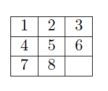
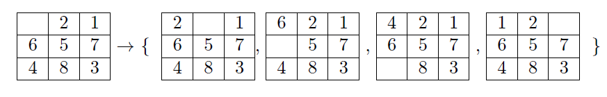

<!--
Textbook-prose companion to lectures/lecture03-graph-search.qmd, intended
as a booklet chapter for readers who did not attend the lecture. Same
content and figures as the slides, but written as connected prose rather
than bullet points, so it can stand on its own. Figures are the same ones
already cropped/verified for the slide deck, referenced from
../lectures/figures/lecture3/ rather than duplicated. First pass: same
scope as the original units 1 and 2 notes (straightforward prose
conversion with figures and math); interactive examples/exercises, if
wanted, would be added in a later pass. Appendices A, B and C are folded
into collapsible callouts placed near the main-text section they extend,
rather than kept as trailing appendix sections.
-->

[Slides](../lectures/lecture03-graph-search.html) &middot; [Exercises](../exercises/unit3-exercises.html) &middot; [Jupyter notebooks](../code/unit3/notebooks.html)

## Shortest paths in graphs

Many systems of interest are naturally described by a *weighted graph*: a
set of nodes $\mathcal{V}:=\{1,\dots,n\}$, a set of edges
$\mathcal{E}:=\{(i_1,j_1),\dots,(i_r,j_r)\}$ connecting pairs of nodes,
and a weight $w_{ij}\geq0$ attached to each edge $(i,j)\in\mathcal{E}$,
for instance $w_{36}=7$ or $w_{23}=5$ in @fig-graph-def. The graph is
undirected whenever $w_{ij}=w_{ji}$ for every edge.

::: {style="text-align: center;"}
{#fig-graph-def width="70%" fig-align="center"}
:::

Graphs of this kind model an enormous range of systems -- road networks,
social networks, transportation and logistics networks, teams of
communicating robots, communication and data networks, electrical
circuits -- and consequently graph algorithms are among the most widely
used tools in engineering and computer science (@fig-applications).

::: {style="text-align: center;"}
{#fig-applications width="100%" fig-align="center"}
:::

A basic and recurring question about such a graph is the *shortest path
problem*: given an initial node and a destination node, find a path
between them -- a sequence of edges -- whose total length, i.e., the sum
of the weights of the edges it uses, is as small as possible
(@fig-shortest-path-problem). Since Unit 1 and Unit 2 were entirely
devoted to an algorithm, dynamic programming, for computing optimal
decisions stage by stage, it is natural to ask: can dynamic programming
also solve the shortest path problem?

::: {style="text-align: center;"}
{#fig-shortest-path-problem width="60%" fig-align="center"}
:::

:::: {.callout-important collapse="true" title="Teaser: Solving shortest path problems with dynamic programming"}

The techniques we will use to solve the shortest path problem with
dynamic programming involve converting a weighted graph to an acyclic
graph, and then applying DP as we have in Unit 1 to the acyclic graph.
Can you guess which acyclic graph would make sense, bearing in mind we
want to work from the destination backwards?

::::

### Dynamic programming for shortest paths in graphs

The connection to dynamic programming is direct once we notice what a
transition diagram actually *is*. Recall from Unit 1 that computing an
optimal path in a transition diagram -- the diagram built from the
per-stage cost matrices $c^k_{ij}$ and, at the last stage, from the
terminal costs $c^h_i$ -- amounts to finding a shortest path from the
nodes at stage $0$ to an artificial terminal node at stage $h+1$ that
collects the terminal costs, in the weighted graph obtained by chaining
these per-stage cost matrices together. For graphs with this *layered*
structure -- one column of nodes per stage, edges only between
consecutive columns -- dynamic programming already computes shortest
paths, since that is exactly what the backward recursion of Unit 1 does.
What remains is to see how a *general* graph, which need not have this
layered structure and may contain cycles, can still be handled with
dynamic programming.

The trick is to build a transition diagram *from* the graph. Given a
weighted graph with $n$ nodes, construct a transition diagram with
$h=n-1$ stages, $n$ states at every decision stage, and only the
destination node present at the terminal stage; set $c^k_{ij}=w_{ij}$ for
every stage $k$, with $w_{ij}=\infty$ if there is no edge from $i$ to $j$
and $w_{ii}=0$. @fig-dp-formulation-example illustrates this construction
for a small four-node graph: the graph on the left is expanded into a
layered diagram of $n-1$ columns on the right, each column a copy of the
$n$ nodes, with the same edge weights (or $\infty$, or $0$ for staying
put) repeated at every stage.

::: {style="text-align: center;"}
{#fig-dp-formulation-example width="90%" fig-align="center"}
:::

Applying the ordinary dynamic programming algorithm to this transition
diagram then solves the shortest path problem. The cost-to-go of a state
at stage $k$ is the cost of the shortest path using at most $n-1-k$
edges (hops); in particular, the costs-to-go at stage $0$ are the optimal
path costs from every possible initial node, and the cost-to-go of a
node from which the destination cannot be reached is infinite. Following
the resulting policy from a given initial state traces out the shortest
path from that node. @fig-dp-solution-example shows the same four-node
example worked through: on the left, the layered diagram annotated with
the costs-to-go computed at every stage together with the optimal path
(bold arrows); on the right, the same costs-to-go plotted as a function
of the stage, which highlights that the cost-to-go can only decrease (or
stay the same) as the destination is approached. In practice, one does
not need to construct the transition diagram explicitly, and the
recursion can be stopped early once the costs-to-go stop changing from
one stage to the next.

::: {style="text-align: center;"}
{#fig-dp-solution-example width="90%" fig-align="center"}
:::

@fig-six-node-example works through a second, undirected example on six
nodes, to help build intuition for how the costs-to-go propagate through
a graph with several possible paths between each pair of nodes.

::: {style="text-align: center;"}
{#fig-six-node-example width="95%" fig-align="center"}
:::

::: {.callout-note collapse="true" title="DP with terminal constraints"}
The construction above finds the shortest path to *any* node present at
the terminal stage. Sometimes, however, we want the shortest path from a
given initial node to one *specific* terminal node, rather than to
whichever terminal-stage node happens to be cheapest to reach. This is
easy to accommodate: simply set the cost of every other terminal-stage
node to infinity, and apply dynamic programming as usual. Because a path
ending at any node with infinite terminal cost is never optimal, this
forces every optimal path to end at the desired terminal state.

@fig-appendixB-initial shows a small three-stage diagram with a specified
initial state (bold, left) and two candidate terminal states (right,
costs $1$ and $0$). Suppose we insist on ending at the terminal state
with cost $0$; @fig-appendixB-constrained shows the same diagram with the
*other* terminal state's cost changed to $\infty$, which forces every
path to end at the desired one. @fig-appendixB-result shows the outcome
on a slightly larger, six-node instance: two initial states (cost $3$
each) on the left, a single admissible terminal state (cost $0$) on the
right, and the resulting shortest constrained path highlighted.

::: {style="text-align: center;"}
{#fig-appendixB-initial width="55%" fig-align="center"}
:::

::: {style="text-align: center;"}
{#fig-appendixB-constrained width="55%" fig-align="center"}
:::

::: {style="text-align: center;"}
{#fig-appendixB-result width="45%" fig-align="center"}
:::
:::

::: {.callout-note collapse="true" title="Time-varying graphs"}
The dynamic programming construction above assumed a fixed, unchanging
graph, but it is also possible to plan directly for *known, predictable*
changes to the graph over time. A natural instance of this is a robot
navigating around *moving* obstacles: how should the shortest path from A
to B be computed when the obstacles' positions change from one time step
to the next (@fig-appendixC-grid)?

::: {style="text-align: center;"}
{#fig-appendixC-grid width="80%" fig-align="center"}
:::

The construction proceeds in two steps. First, consider a separate static
graph for each time step, reflecting the obstacle positions at that
particular time (@fig-appendixC-static-graphs).

::: {style="text-align: center;"}
{#fig-appendixC-static-graphs width="80%" fig-align="center"}
:::

Second, stack these per-time-step graphs into a single, time-*invariant*
three-dimensional graph, allowing edges only from a node at time $t$ to a
node at time $t+1$ (@fig-appendixC-3d-graph). The resulting graph is
exactly the kind of layered structure discussed above, so the shortest
path in it can again be computed with dynamic programming (or, as we
will see shortly, with Dijkstra's algorithm/A*): the initial node is the
robot's initial position at $t=0$, and the final node is its desired
position at $t=T$.

::: {style="text-align: center;"}
{#fig-appendixC-3d-graph width="80%" fig-align="center"}
:::
:::

### Worked examples

A classic illustration is the Romania road network in
@fig-romania-map: given the distances between neighboring cities, what
is the shortest distance from Bucharest to Lugoj? Applying dynamic
programming as described above -- computing, for every city, the
costs-to-go at every stage -- yields the answer **504 km**, via the
route Bucharest, Pitesti, Craiova, Dobreta, Mehadia, Lugoj
(@fig-romania-dp-costtogo).

::: {style="text-align: center;"}
{#fig-romania-map width="80%" fig-align="center"}
:::

::: {style="text-align: center;"}
{#fig-romania-dp-costtogo width="80%" fig-align="center"}
:::

A second classic instance is robot path planning on a grid: given a grid
representation of the world with obstacles, what is the shortest path for
a robot moving from a point A to a point B (@fig-robot-grid-ab)? Here
the nodes of the graph are grid cells, and a natural choice of weights
is: $1$ distance unit to move horizontally or vertically between adjacent
cells, and $\sqrt2$ units to move diagonally; the distance to (or through)
an obstacle cell is infinite, and so is the distance between two
diagonally adjacent cells that are both adjacent to the same obstacle
cell, since the robot cannot cut across the obstacle's corner
(@fig-robot-grid-assumptions).

::: {style="text-align: center;"}
{#fig-robot-grid-ab width="90%" fig-align="center"}
:::

::: {style="text-align: center;"}
{#fig-robot-grid-assumptions width="90%" fig-align="center"}
:::

@fig-robot-grid-example shows the dynamic programming solution for a
particular A-to-B instance -- an optimal path (highlighted) threading
between the obstacles -- while @fig-robot-grid-costtogo shows a smaller
instance with the costs-to-go and the resulting optimal decisions
(arrows) displayed at every cell. It is worth noting, as a side remark,
that the cost-to-go can be viewed as a Lyapunov function for the
resulting closed-loop system, in the sense that it decreases along
optimal trajectories; the optimal policy at each cell can then be
understood as following the direction of steepest decrease of this
function, adjusted for the stage cost of getting there.

::: {style="text-align: center;"}
{#fig-robot-grid-example width="85%" fig-align="center"}
:::

::: {style="text-align: center;"}
{#fig-robot-grid-costtogo width="90%" fig-align="center"}
:::

:::: {.callout-tip collapse="false" title="Quick exercise: converting a four-node graph to a DP problem"}

Consider a graph with the same four nodes as in @fig-dp-formulation-example,
$1$ (initial) and $4$ (destination), but with different links: edges
$\mathcal{E}=\{(1,2),(1,3),(2,3),(2,4),(3,4)\}$ (undirected, so
$w_{ij}=w_{ji}$), with weights
$$
w_{12}=2,\quad w_{13}=5,\quad w_{23}=1,\quad w_{24}=6,\quad w_{34}=2,
$$
and no edge between $1$ and $4$ directly ($w_{14}=\infty$).

(a) Following the construction in the previous section, convert this
shortest-path problem into a dynamic programming problem: state the
number of stages $h$, the states present at each stage, and the stage
costs $c^k_{ij}$.

(b) Solve the resulting DP problem by computing the costs-to-go
$J_k(i)$ at every stage, and use them to find the shortest path from
node $1$ to node $4$ and its cost.

::::

:::: {.callout-note collapse="true" title="Solution"}

**(a) DP formulation.** With $n=4$ nodes, take $h=n-1=3$ stages: states
$\{1,2,3,4\}$ at stages $0$, $1$, and $2$, and only the destination,
state $4$, at the terminal stage $3$. The stage costs are the same at
every stage, $c^k_{ij}=w_{ij}$ for $k=0,1,2$, with $w_{ii}=0$ and
$w_{14}=w_{41}=\infty$ (no edge):
$$
w = \begin{pmatrix} 0 & 2 & 5 & \infty \\ 2 & 0 & 1 & 6 \\ 5 & 1 & 0 & 2 \\ \infty & 6 & 2 & 0 \end{pmatrix},
\qquad \text{rows/columns ordered } 1,2,3,4.
$$

**(b) Costs-to-go.** Starting from $J_3(4)=0$ (the only state at the
terminal stage) and applying the backward recursion
$J_k(i)=\min_j\big[c^k_{ij}+J_{k+1}(j)\big]$:

| Stage $k$ | $J_k(1)$ | $J_k(2)$ | $J_k(3)$ | $J_k(4)$ |
|---|---|---|---|---|
| $3$ (terminal) | -- | -- | -- | $0$ |
| $2$ | $\infty$ | $6$ | $2$ | $0$ |
| $1$ | $7$ | $3$ | $2$ | $0$ |
| $0$ | $5$ | $3$ | $2$ | $0$ |

At stage $2$, only a direct move to the terminal node $4$ is available,
so $J_2(i)=w_{i4}$. At stage $1$, e.g. $J_1(3)=\min(w_{31}+J_2(1),\,w_{32}+J_2(2),\,w_{33}+J_2(3),\,w_{34}+J_2(4))=\min(\infty,\,7,\,2,\,2)=2$,
achieved (with a tie) either by moving straight to $4$ or by staying at
$3$ for one stage and moving to $4$ next -- both cost $2$, since the
extra stage is "absorbed" by a zero-cost self-loop; this kind of tie is
harmless and simply reflects that the true shortest path already takes
fewer than $h$ hops. Reading off $J_0(1)=5$, achieved via $j=2$, and then
continuing to follow the minimizing $j$ at each subsequent stage
($2\to3\to4$), the shortest path from $1$ to $4$ is
$$
1 \to 2 \to 3 \to 4, \qquad \text{cost } 2+1+2 = 5,
$$
matching $J_0(1)=5$. (Note this is shorter than either two-hop route,
$1\to2\to4$ at cost $8$ or $1\to3\to4$ at cost $7$.)

::::

### Dijkstra's algorithm

Dynamic programming solves the shortest path problem, but it can be quite
inefficient at it: it explores the *entire* graph, even when a much
smaller portion of it is relevant to the specific path we are after. The
example in @fig-dp-inefficiency makes this concrete: a direct route
$1\to2\to3$ already achieves a total cost of $2$, yet unmodified dynamic
programming still explores every node from $4$ to $n$, since each of
those nodes is connected to $1$, $2$, and $3$ with cost greater than $2$
and dynamic programming has no way, a priori, of knowing that exploring
them is unnecessary. This motivates two alternative algorithms for the
shortest path problem, Dijkstra's algorithm and A*, which we discuss
next.

::: {style="text-align: center;"}
{#fig-dp-inefficiency width="70%" fig-align="center"}
:::

Dijkstra's algorithm iteratively generates shorter and shorter paths from
the origin to every node it has reached so far. It maintains a list of
nodes still to be explored, often called the *wavefront* or the OPEN
list; at each step, new nodes are added to this list based on cost --
specifically, the neighbors of whichever node in the list currently has
the smallest distance estimate to the origin.

Try it yourself below, on a grid graph like the one used earlier for
robot path planning (@fig-robot-grid-assumptions): horizontal/vertical
moves cost $1$, diagonal moves cost $\sqrt2$, and a diagonal move is
disallowed whenever it would cut across the corner of an obstacle. Click
on any cell to add or remove an obstacle (the red and green cells, the
origin and destination, are fixed), then press **Run**. As the algorithm
proceeds, every node removed from OPEN -- i.e., *settled*, its shortest
distance finalized -- turns red, and every node newly added to OPEN --
the *fringe*, discovered but not yet finalized -- turns blue; once the
destination is settled, the optimal path found is traced in gold.

```{=html}
<div id="dijk-wrap" style="margin: 1em 0; text-align:center;">
  <div id="dijk-canvas-wrap" style="margin-bottom:0.5em;"></div>
  <div id="dijk-status" style="font-size:0.95em; margin-bottom:0.6em; min-height:1.4em;">Click cells to edit obstacles, then press Run.</div>
  <div style="margin-bottom:0.6em;">
    <button id="dijk-run" style="padding:4px 14px; font-size:0.9em;">Run</button>
    <button id="dijk-reset" style="padding:4px 14px; font-size:0.9em; margin-left:0.5em;">Reset grid</button>
  </div>
  <div style="font-size:0.8em; color:#555; line-height:1.6;">
    <span style="display:inline-block; width:12px; height:12px; background:#e74c3c; border-radius:2px; vertical-align:middle;"></span> origin / settled (removed from OPEN)
    &nbsp;&nbsp;
    <span style="display:inline-block; width:12px; height:12px; background:#3498db; border-radius:2px; vertical-align:middle;"></span> fringe (in OPEN)
    &nbsp;&nbsp;
    <span style="display:inline-block; width:12px; height:12px; background:#2ecc71; border-radius:2px; vertical-align:middle;"></span> destination
    &nbsp;&nbsp;
    <span style="display:inline-block; width:12px; height:12px; background:#2c3e50; border-radius:2px; vertical-align:middle;"></span> obstacle
    &nbsp;&nbsp;
    <span style="display:inline-block; width:16px; height:3px; background:#f1c40f; vertical-align:middle;"></span> optimal path
  </div>
</div>
<script>
(function () {
  const COLS = 20, ROWS = 13, CELL = 24;
  const START = { r: 6, c: 1 };
  const GOAL = { r: 6, c: 18 };

  function key(r, c) { return r + ',' + c; }

  function defaultObstacles() {
    const s = new Set();
    for (let r = 0; r <= 8; r++) s.add(key(r, 9));    // vertical stem of the L
    for (let c = 9; c <= 13; c++) s.add(key(8, c));   // horizontal foot of the L
    return s;
  }

  let obstacles = defaultObstacles();
  let state, running;

  function resetState() {
    state = { settled: new Set(), frontier: new Set(), path: null };
    running = false;
  }
  resetState();

  function neighbors(r, c, obstacleSet) {
    const out = [];
    const deltas = [
      [-1, 0, 1], [1, 0, 1], [0, -1, 1], [0, 1, 1],
      [-1, -1, Math.SQRT2], [-1, 1, Math.SQRT2], [1, -1, Math.SQRT2], [1, 1, Math.SQRT2]
    ];
    for (const [dr, dc, w] of deltas) {
      const nr = r + dr, nc = c + dc;
      if (nr < 0 || nr >= ROWS || nc < 0 || nc >= COLS) continue;
      if (obstacleSet.has(key(nr, nc))) continue;
      if (dr !== 0 && dc !== 0) {
        // disallow cutting across the corner of an obstacle
        if (obstacleSet.has(key(r + dr, c)) && obstacleSet.has(key(r, c + dc))) continue;
      }
      out.push([nr, nc, w]);
    }
    return out;
  }

  // Runs Dijkstra's algorithm to completion, logging every OPEN removal
  // ("settle") and every OPEN insertion/update ("frontier") in order, so
  // the animation below can replay them one at a time.
  function runDijkstra(start, goal, obstacleSet) {
    const N = ROWS * COLS;
    const idx = (r, c) => r * COLS + c;
    const dist = new Float64Array(N).fill(Infinity);
    const prev = new Int32Array(N).fill(-1);
    const settled = new Uint8Array(N);
    dist[idx(start.r, start.c)] = 0;
    const events = [];
    while (true) {
      let u = -1, best = Infinity;
      for (let i = 0; i < N; i++) if (!settled[i] && dist[i] < best) { best = dist[i]; u = i; }
      if (u === -1) break;
      settled[u] = 1;
      const ur = Math.floor(u / COLS), uc = u % COLS;
      events.push({ type: 'settle', r: ur, c: uc });
      if (u === idx(goal.r, goal.c)) break;
      for (const [nr, nc, w] of neighbors(ur, uc, obstacleSet)) {
        const v = idx(nr, nc);
        if (settled[v]) continue;
        const nd = dist[u] + w;
        if (nd < dist[v] - 1e-9) {
          dist[v] = nd; prev[v] = u;
          events.push({ type: 'frontier', r: nr, c: nc });
        }
      }
    }
    const gi = idx(goal.r, goal.c);
    let path = null;
    if (settled[gi] && dist[gi] < Infinity) {
      path = [];
      let cur = gi;
      while (cur !== -1) { path.push([Math.floor(cur / COLS), cur % COLS]); cur = prev[cur]; }
      path.reverse();
    }
    return { events: events, path: path, cost: (settled[gi] && dist[gi] < Infinity) ? dist[gi] : Infinity };
  }

  const canvasWrap = document.getElementById('dijk-canvas-wrap');
  const statusEl = document.getElementById('dijk-status');
  const runBtn = document.getElementById('dijk-run');
  const resetBtn = document.getElementById('dijk-reset');

  const canvas = document.createElement('canvas');
  canvas.width = COLS * CELL + 1;
  canvas.height = ROWS * CELL + 1;
  canvas.style.border = '1px solid #999';
  canvas.style.cursor = 'pointer';
  canvasWrap.appendChild(canvas);
  const ctx = canvas.getContext('2d');

  function draw() {
    ctx.clearRect(0, 0, canvas.width, canvas.height);
    for (let r = 0; r < ROWS; r++) {
      for (let c = 0; c < COLS; c++) {
        const k = key(r, c);
        let fill = '#ffffff';
        if (obstacles.has(k)) fill = '#2c3e50';
        else if (state.settled.has(k)) fill = '#e74c3c';
        else if (state.frontier.has(k)) fill = '#3498db';
        if (r === START.r && c === START.c) fill = '#e74c3c';
        if (r === GOAL.r && c === GOAL.c) fill = state.settled.has(k) ? '#e74c3c' : (state.frontier.has(k) ? '#3498db' : '#2ecc71');
        ctx.fillStyle = fill;
        ctx.fillRect(c * CELL + 1, r * CELL + 1, CELL - 1, CELL - 1);
      }
    }
    // grid lines
    ctx.strokeStyle = '#ccc';
    ctx.lineWidth = 1;
    for (let r = 0; r <= ROWS; r++) { ctx.beginPath(); ctx.moveTo(0, r * CELL + 0.5); ctx.lineTo(COLS * CELL, r * CELL + 0.5); ctx.stroke(); }
    for (let c = 0; c <= COLS; c++) { ctx.beginPath(); ctx.moveTo(c * CELL + 0.5, 0); ctx.lineTo(c * CELL + 0.5, ROWS * CELL); ctx.stroke(); }
    // start/goal rings + labels, so they stay identifiable regardless of fill color
    function ring(r, c, color, label) {
      const cx = c * CELL + CELL / 2, cy = r * CELL + CELL / 2;
      ctx.strokeStyle = color; ctx.lineWidth = 3;
      ctx.beginPath(); ctx.arc(cx, cy, CELL / 2 - 3, 0, 2 * Math.PI); ctx.stroke();
      ctx.fillStyle = '#fff'; ctx.font = 'bold 11px sans-serif'; ctx.textAlign = 'center'; ctx.textBaseline = 'middle';
      ctx.fillText(label, cx, cy);
    }
    ring(START.r, START.c, '#c0392b', 'S');
    ring(GOAL.r, GOAL.c, '#1e8449', 'G');
    // optimal path, on top of everything
    if (state.path) {
      ctx.strokeStyle = '#f1c40f'; ctx.lineWidth = 4; ctx.lineJoin = 'round'; ctx.lineCap = 'round';
      ctx.beginPath();
      state.path.forEach(([r, c], i) => {
        const x = c * CELL + CELL / 2, y = r * CELL + CELL / 2;
        if (i === 0) ctx.moveTo(x, y); else ctx.lineTo(x, y);
      });
      ctx.stroke();
    }
  }

  canvas.addEventListener('click', function (ev) {
    if (running) return;
    const rect = canvas.getBoundingClientRect();
    const c = Math.floor((ev.clientX - rect.left) / CELL);
    const r = Math.floor((ev.clientY - rect.top) / CELL);
    if (r < 0 || r >= ROWS || c < 0 || c >= COLS) return;
    if ((r === START.r && c === START.c) || (r === GOAL.r && c === GOAL.c)) return;
    const k = key(r, c);
    if (obstacles.has(k)) obstacles.delete(k); else obstacles.add(k);
    resetState();
    statusEl.textContent = 'Click cells to edit obstacles, then press Run.';
    draw();
  });

  function setControlsEnabled(enabled) {
    runBtn.disabled = !enabled;
    resetBtn.disabled = !enabled;
  }

  runBtn.addEventListener('click', function () {
    if (running) return;
    resetState();
    running = true;
    setControlsEnabled(false);
    statusEl.textContent = "Running Dijkstra's algorithm...";
    const result = runDijkstra(START, GOAL, obstacles);
    let i = 0;
    const timer = setInterval(function () {
      if (i >= result.events.length) {
        clearInterval(timer);
        if (result.path) {
          state.path = result.path;
          statusEl.textContent = 'Optimal path found -- cost ≈ ' + result.cost.toFixed(2) + ' (' + (result.path.length - 1) + ' steps).';
        } else {
          statusEl.textContent = 'No path exists between the red and green nodes with the current obstacles.';
        }
        draw();
        running = false;
        setControlsEnabled(true);
        return;
      }
      const ev = result.events[i++];
      const k = key(ev.r, ev.c);
      if (ev.type === 'settle') { state.settled.add(k); state.frontier.delete(k); }
      else { if (!state.settled.has(k)) state.frontier.add(k); }
      draw();
    }, 18);
  });

  resetBtn.addEventListener('click', function () {
    if (running) return;
    obstacles = defaultObstacles();
    resetState();
    statusEl.textContent = 'Click cells to edit obstacles, then press Run.';
    draw();
  });

  draw();
})();
</script>
```

More precisely, let $p$ be the initial node and $t$ the destination.
Initialize $d_i=\infty$ for every node $i\neq p$, $d_p=0$, and
$\text{OPEN}=\{p\}$. The algorithm then repeats the following steps:

1. Remove from OPEN a node $i$ with the smallest estimate $d_i$. If
   $i=t$, stop; otherwise, execute step 2 for every node $j$ reachable
   from $i$ by an edge.
2. If $d_i+w_{ij}<d_j$, update $d_j=d_i+w_{ij}$ and $\beta(j)=i$, and add
   $j$ to OPEN if it is not already there. Otherwise, leave $d_j$ and
   $\beta(j)$ unchanged.
3. Once step 2 has been applied for every out-neighbor of $i$, return to
   step 1.

The pointers $\beta(\cdot)$ recorded along the way encode the shortest
paths discovered so far: for every node $i$, $\beta(i)$ is the node that
precedes $i$ on the shortest path from $p$ found up to that point.
Consequently, once the algorithm stops at $i=t$, the optimal path is
obtained by walking these pointers backward from the destination,
$(i_0,i_1,\dots,i_L)$ with $i_L=t$ and $i_{\ell-1}=\beta(i_\ell)$ for
$\ell\in\{1,\dots,L\}$, until $i_0=p$. If OPEN ever becomes empty before
$t$ is reached, no path from $p$ to $t$ exists.

@fig-dijkstra-example-i shows the general shape of graph used in a small
worked example that requires only three iterations of Dijkstra's
algorithm: starting from the initial node with $(1,0)$, the first
iteration reaches a neighbor with pair $(2,1)$ (and updates $\beta(2)=1$,
along with other pairs from other neighbors of node $1$), the second
iteration reaches $(3,2)$ (updating $\beta(3)=2$), and at the third
iteration the destination is removed from OPEN and the algorithm
terminates.

::: {style="text-align: center;"}
{#fig-dijkstra-example-i width="60%" fig-align="center"}
:::

A second, larger worked example, on the six-node graph shown in
@fig-dijkstra-example-ii, illustrates the bookkeeping more fully. The
iterations proceed as follows, starting from initial node $1$:

| Iteration | Pairs $(i,d_i)$, $i\in\text{OPEN}$ | |
|---|---|---|
| $0$ | $(1,0)$ | |
| $1$ | $(2,1),(3,8),(4,6)$ | $\beta(2)=1,\ \beta(3)=1,\ \beta(4)=1$ |
| $2$ | $(3,6),(4,4)$ | $\beta(3)=2,\ \beta(4)=2$ |
| $3$ | $(3,6),(5,7)$ | $\beta(5)=4$ |
| $4$ | $(5,7),(6,13)$ | $\beta(6)=3$ |
| $5$ | $(6,11)$ | $\beta(6)=5$ |

Reading the $\beta$ pointers backward from the destination gives the
optimal path $(6,\beta(6),\beta(\beta(6)),\dots,1)=(6,5,4,2,1)$.

::: {style="text-align: center;"}
{#fig-dijkstra-example-ii width="45%" fig-align="center"}
:::

Returning to the Romania road network of @fig-romania-map, we can now
run Dijkstra's algorithm directly on the graph, rather than building and
searching the full dynamic programming transition diagram. Starting from
Lugoj, the iterations proceed as follows:

| Iteration | Pairs $\{i,d_i\}$, $i\in\text{OPEN}$ |
|---|---|
| $0$ | $\{\text{Lugoj},0\}$ |
| $1$ | $\{\text{Mehadia},70\}, \{\text{Timisoara},111\}$ |
| $2$ | $\{\text{Timisoara},111\}, \{\text{Dobreta},145\}$ |
| $3$ | $\{\text{Dobreta},145\}, \{\text{Arad},229\}$ |
| $4$ | $\{\text{Arad},229\}, \{\text{Craiova},265\}$ |
| $5$ | $\{\text{Craiova},265\}, \{\text{Sibiu},369\}, \{\text{Zerind},304\}$ |
| $6$ | $\{\text{Sibiu},369\}, \{\text{Zerind},304\}, \{\text{Pitesti},403\}, \{\text{Rimnicu Vilcea},411\}$ |
| $7$ | $\{\text{Sibiu},369\}, \{\text{Pitesti},403\}, \{\text{Rimnicu Vilcea},411\}, \{\text{Oradea},375\}$ |
| $8$ | $\{\text{Pitesti},403\}, \{\text{Rimnicu Vilcea},411\}, \{\text{Oradea},375\}, \{\text{Fagaras},468\}$ |
| $9$ | $\{\text{Pitesti},403\}, \{\text{Rimnicu Vilcea},411\}, \{\text{Fagaras},468\}$ |
| $10$ | $\{\text{Rimnicu Vilcea},411\}, \{\text{Fagaras},468\}, \{\text{Bucharest},504\}$ |
| $11$ | $\{\text{Fagaras},468\}, \{\text{Bucharest},504\}$ |
| $12$ | $\{\text{Bucharest},504\}$ |

The $\beta$ pointers recorded along the way recover the same $504$ km
optimal route found earlier with dynamic programming -- but reached in
only twelve iterations, without ever building the full transition
diagram or examining most of the map.

:::: {.callout-tip collapse="false" title="Quick exercise: a five-node shortest-path problem"}

Consider the weighted, undirected graph with nodes $\mathcal{V}=\{1,2,3,4,5\}$
and edges
$$
\mathcal{E}=\{(1,2),(1,3),(2,3),(2,4),(2,5),(3,4),(4,5)\},
$$
with weights
$$
w_{12}=4,\quad w_{13}=4,\quad w_{23}=3,\quad w_{24}=4,\quad w_{25}=6,\quad w_{34}=4,\quad w_{45}=5.
$$
Using Dijkstra's algorithm, find the shortest path and its cost from the
initial node $p=1$ to the destination $t=5$. As in the examples above,
show your work as a table of the pairs $(i,d_i)$, $i\in\text{OPEN}$, at
every iteration, together with the resulting $\beta$ pointers. (We will
revisit this exact graph with A* at the end of this section, so hold on
to your work.)

::::

:::: {.callout-note collapse="true" title="Solution"}

| Iteration | Pairs $(i,d_i)$, $i\in\text{OPEN}$ | |
|---|---|---|
| $0$ | $(1,0)$ | |
| $1$ | $(2,4),(3,4)$ | $\beta(2)=1,\ \beta(3)=1$ |
| $2$ | $(3,4),(4,8),(5,10)$ | $\beta(4)=2,\ \beta(5)=2$ |
| $3$ | $(4,8),(5,10)$ | ($4$ reached again via $3$ at cost $4+4=8$, not smaller, so $\beta(4)$ unchanged) |
| $4$ | $(5,10)$ | |
| $5$ | Destination removed from OPEN -- terminate | |

At iteration $1$, nodes $2$ and $3$ tie at $d=4$; removing node $2$ first
(the choice is arbitrary among ties) leads to relaxing $4$ and $5$ from
$2$. At iteration $2$, node $3$ is removed next; relaxing edge $(3,4)$
gives $d_3+w_{34}=4+4=8$, which is not strictly smaller than the current
$d_4=8$, so $\beta(4)$ stays equal to $2$ rather than switching to $3$.
The optimal path is recovered from $\beta$: $5\leftarrow\beta(5)=2\leftarrow\beta(2)=1$,
i.e. the path $(1,2,5)$, with optimal cost $10$.

::::

:::: {.callout-tip collapse="false" title="Exercise: why Dijkstra's algorithm is correct"}

In Dijkstra's algorithm, every node $i$ that is removed from OPEN in step
1 has, by construction, the smallest estimate $d_i$ among all nodes
currently in OPEN.

(a) Prove that such a node $i$ is never placed back into OPEN at any
later iteration.

(b) Prove that, at the moment $i$ is removed from OPEN, $d_i$ already
equals the true optimal cost (shortest-path distance) from the initial
node $p$ to $i$ -- i.e., the algorithm never has to revisit $i$ later to
correct its cost-to-come.

(Assume, as always, that every weight $w_{ij}\geq0$.)

::::

:::: {.callout-note collapse="true" title="Solution"}

Write $D(i)$ for the true shortest-path distance from $p$ to $i$, and
suppose nodes are removed from OPEN, i.e. *settled*, in the order
$i_1=p,i_2,i_3,\dots$ (so $d_{i_1}\leq d_{i_2}\leq d_{i_3}\leq\cdots$ at
the moments of removal, by the rule used in step 1).

**(a) A settled node is never re-added to OPEN.** A node $j$ is only
ever placed into OPEN by step 2, and only as a result of relaxing an edge
$(i',j)$ from a node $i'$ currently being processed in step 1, and only
when $d_{i'}+w_{i'j} < d_j$. Suppose, for contradiction, that some
already-settled node $i$ is relaxed again from a later-processed node
$i'$ (settled after $i$, so $d_{i'}\geq d_i$ by the non-decreasing order
of removal). Since $w_{i'i}\geq0$,
$$
d_{i'}+w_{i'i} \;\geq\; d_{i'} \;\geq\; d_i,
$$
so the relaxation condition $d_{i'}+w_{i'i}<d_i$ can never hold. Hence
$d_i$ is never decreased, and in particular $i$ is never placed back into
OPEN, after it is removed.

**(b) The cost-to-come at removal is optimal.** We show $d_i=D(i)$ for
every settled node $i$, by induction on the settling order
$i_1,i_2,\dots$.

*Base case:* $i_1=p$ is removed first with $d_p=0=D(p)$, which is
trivially optimal (no path can be shorter than the empty path from $p$
to itself, since all weights are non-negative).

*Inductive step:* suppose $d_{i_k}=D(i_k)$ for every node $i_k$ settled
before the current step, and let $i$ be the next node removed from OPEN.
Since $d_i$ is the length of the path traced by the $\beta$ pointers
from $p$ to $i$ (a valid path using only edges relaxed from already
correctly-settled nodes, by the inductive hypothesis), we have
$d_i\geq D(i)$: $d_i$ is the length of *some* path, and $D(i)$ is the
length of the *shortest* one.

Suppose, for contradiction, that $d_i > D(i)$, and consider a true
shortest path $P$ from $p$ to $i$, of length $D(i)$. Since $p$ is
already settled and $i$ is not, $P$ must contain a first node $y$ along
the path that is not yet settled at this step (possibly $y=i$ itself);
let $x$ be the node immediately before $y$ on $P$ (with $x=p$ if $y$ is
the first node of $P$). By the choice of $y$, $x$ is already settled, so
by the inductive hypothesis $d_x=D(x)$, and edge $(x,y)$ was relaxed when
$x$ was processed. Hence, at the current step,
$$
d_y \;\leq\; D(x)+w_{xy} \;=\; (\text{length of }P\text{ up to }y) \;\leq\; D(i),
$$
where the last inequality holds because the remaining portion of $P$
from $y$ to $i$ has non-negative length. Combined with the contradiction
hypothesis $D(i) < d_i$, this gives $d_y \leq D(i) < d_i$, with $y$ still
in OPEN. But $i$ was chosen in step 1 as the node in OPEN with the
*smallest* $d$-value -- contradicting $d_y<d_i$.

Hence no such shorter path $P$ exists, so $d_i\leq D(i)$, and together
with $d_i\geq D(i)$ from above, $d_i=D(i)$. This completes the induction,
and with it the proof that every node's cost-to-come is already optimal
the moment it leaves OPEN.

::::

### A*

A* refines Dijkstra's algorithm by taking into account, for every node
$i$, an *estimate* (heuristic) $h(i)$ of the remaining distance from $i$
to the destination. Instead of ranking OPEN purely by the distance-so-far
$d_i$, A* ranks it by $d_i+h(i)$, so that nodes which are both cheap to
reach and estimated to be close to the destination are explored first.

The heuristic guarantees an optimal path if it satisfies two conditions:
(i) *admissibility*, meaning $h(i)$ never overestimates the true optimal
cost from $i$ to the destination, and (ii) *consistency*, meaning
$h(i)\leq w_{ij}+h(j)$ for every edge $(i,j)$. When both conditions hold,
A* can in fact be reduced to a plain run of Dijkstra's algorithm: (1)
reweight every edge as $\bar w_{ij}=w_{ij}+h(j)-h(i)$ (consistency
ensures these reweighted costs are still non-negative); (2) run
Dijkstra's algorithm on the reweighted graph to obtain the optimal path;
(3) recover the optimal cost in the original graph from the path found.
The general A* algorithm given below, however, works whether or not
these two conditions hold, simply without the accompanying optimality
guarantee.

Concretely, A* proceeds exactly like Dijkstra's algorithm, with the
ranking key changed from $d_i$ to $d_i+h(i)$: initialize $d_i=\infty$ for
$i\neq p$, $d_p=0$, $\text{OPEN}=\{p\}$, and repeat:

1. Remove from OPEN a node $i$ with the smallest $d_i+h(i)$. If $i=t$,
   stop; otherwise execute step 2 for every out-neighbor $j$ of $i$.
2. If $d_i+w_{ij}<d_j$, update $d_j=d_i+w_{ij}$, $\beta(j)=i$, and add
   $j$ to OPEN if it is not already there; otherwise leave $d_j,\beta(j)$
   unchanged.
3. Once step 2 has been applied to every out-neighbor of $i$, return to
   step 1.

As before, the optimal path is recovered by following the $\beta$
pointers backward from the destination. With a good heuristic, A* is
typically much faster than plain Dijkstra's algorithm, since the
heuristic focuses the search toward the destination rather than
expanding outward uniformly in every direction -- though finding a
heuristic that is both informative and provably admissible/consistent is
not always easy.

Compare the two side by side below, on the same grid as before, now with
both panels sharing the same obstacles: click on either grid to add or
remove an obstacle (it is mirrored on both), then press **Run** to watch
Dijkstra's algorithm (left) and A* (right) search at the same time for
the shortest path from the red origin to the green destination. A*
here uses the straight-line (Euclidean) distance to the destination as
its heuristic $h(i)$ -- a valid, admissible choice on this grid, since
the straight-line distance between two cells is never larger than the
cost of any grid path between them. Watch how much smaller the red/blue
region typically grows on the right before A* finds the same optimal
path that Dijkstra's algorithm finds on the left.

```{=html}
<div id="cmp-wrap" style="margin: 1em 0; text-align:center;">
  <div style="display:flex; justify-content:center; gap:1.2em; flex-wrap:wrap;">
    <div>
      <div style="font-size:0.9em; font-weight:bold; margin-bottom:0.3em;">Dijkstra's algorithm</div>
      <div id="cmp-canvas-wrap-d" style="margin-bottom:0.3em;"></div>
      <div id="cmp-stats-d" style="font-size:0.8em; color:#555;">settled: 0</div>
    </div>
    <div>
      <div style="font-size:0.9em; font-weight:bold; margin-bottom:0.3em;">A* (straight-line heuristic)</div>
      <div id="cmp-canvas-wrap-a" style="margin-bottom:0.3em;"></div>
      <div id="cmp-stats-a" style="font-size:0.8em; color:#555;">settled: 0</div>
    </div>
  </div>
  <div id="cmp-status" style="font-size:0.95em; margin:0.6em 0; min-height:1.4em;">Click cells to edit obstacles, then press Run.</div>
  <div style="margin-bottom:0.6em;">
    <button id="cmp-run" style="padding:4px 14px; font-size:0.9em;">Run</button>
    <button id="cmp-reset" style="padding:4px 14px; font-size:0.9em; margin-left:0.5em;">Reset grid</button>
  </div>
  <div style="font-size:0.8em; color:#555; line-height:1.6;">
    <span style="display:inline-block; width:12px; height:12px; background:#e74c3c; border-radius:2px; vertical-align:middle;"></span> origin / settled (removed from OPEN)
    &nbsp;&nbsp;
    <span style="display:inline-block; width:12px; height:12px; background:#3498db; border-radius:2px; vertical-align:middle;"></span> fringe (in OPEN)
    &nbsp;&nbsp;
    <span style="display:inline-block; width:12px; height:12px; background:#2ecc71; border-radius:2px; vertical-align:middle;"></span> destination
    &nbsp;&nbsp;
    <span style="display:inline-block; width:12px; height:12px; background:#2c3e50; border-radius:2px; vertical-align:middle;"></span> obstacle
    &nbsp;&nbsp;
    <span style="display:inline-block; width:16px; height:3px; background:#f1c40f; vertical-align:middle;"></span> optimal path
  </div>
</div>
<script>
(function () {
  const COLS = 18, ROWS = 12, CELL = 20;
  const START = { r: 5, c: 1 };
  const GOAL = { r: 5, c: 16 };

  function key(r, c) { return r + ',' + c; }

  function defaultObstacles() {
    const s = new Set();
    for (let r = 0; r <= 7; r++) s.add(key(r, 8));    // vertical stem of the L
    for (let c = 8; c <= 11; c++) s.add(key(7, c));   // horizontal foot of the L
    return s;
  }

  let obstacles = defaultObstacles();
  let running = false;

  function neighbors(r, c, obstacleSet) {
    const out = [];
    const deltas = [
      [-1, 0, 1], [1, 0, 1], [0, -1, 1], [0, 1, 1],
      [-1, -1, Math.SQRT2], [-1, 1, Math.SQRT2], [1, -1, Math.SQRT2], [1, 1, Math.SQRT2]
    ];
    for (const [dr, dc, w] of deltas) {
      const nr = r + dr, nc = c + dc;
      if (nr < 0 || nr >= ROWS || nc < 0 || nc >= COLS) continue;
      if (obstacleSet.has(key(nr, nc))) continue;
      if (dr !== 0 && dc !== 0) {
        if (obstacleSet.has(key(r + dr, c)) && obstacleSet.has(key(r, c + dc))) continue;
      }
      out.push([nr, nc, w]);
    }
    return out;
  }

  // Runs Dijkstra's algorithm (useHeuristic=false) or A* with a
  // straight-line-distance heuristic (useHeuristic=true), logging every
  // OPEN removal ("settle") and OPEN insertion/update ("frontier") so the
  // animation can replay them one at a time.
  function runSearch(start, goal, obstacleSet, useHeuristic) {
    const N = ROWS * COLS;
    const idx = (r, c) => r * COLS + c;
    const dist = new Float64Array(N).fill(Infinity);
    const prev = new Int32Array(N).fill(-1);
    const settled = new Uint8Array(N);
    const h = (r, c) => useHeuristic ? Math.hypot(r - goal.r, c - goal.c) : 0;
    dist[idx(start.r, start.c)] = 0;
    const events = [];
    while (true) {
      let u = -1, best = Infinity;
      for (let i = 0; i < N; i++) {
        if (settled[i] || dist[i] === Infinity) continue;
        const r = Math.floor(i / COLS), c = i % COLS;
        const rank = dist[i] + h(r, c);
        if (rank < best) { best = rank; u = i; }
      }
      if (u === -1) break;
      settled[u] = 1;
      const ur = Math.floor(u / COLS), uc = u % COLS;
      events.push({ type: 'settle', r: ur, c: uc });
      if (u === idx(goal.r, goal.c)) break;
      for (const [nr, nc, w] of neighbors(ur, uc, obstacleSet)) {
        const v = idx(nr, nc);
        if (settled[v]) continue;
        const nd = dist[u] + w;
        if (nd < dist[v] - 1e-9) {
          dist[v] = nd; prev[v] = u;
          events.push({ type: 'frontier', r: nr, c: nc });
        }
      }
    }
    const gi = idx(goal.r, goal.c);
    let path = null;
    if (settled[gi] && dist[gi] < Infinity) {
      path = [];
      let cur = gi;
      while (cur !== -1) { path.push([Math.floor(cur / COLS), cur % COLS]); cur = prev[cur]; }
      path.reverse();
    }
    return { events: events, path: path, cost: (settled[gi] && dist[gi] < Infinity) ? dist[gi] : Infinity };
  }

  function makePanel(wrapId, statsId) {
    const wrap = document.getElementById(wrapId);
    const canvas = document.createElement('canvas');
    canvas.width = COLS * CELL + 1;
    canvas.height = ROWS * CELL + 1;
    canvas.style.border = '1px solid #999';
    canvas.style.cursor = 'pointer';
    wrap.appendChild(canvas);
    return { canvas: canvas, ctx: canvas.getContext('2d'), statsEl: document.getElementById(statsId), state: { settled: new Set(), frontier: new Set(), path: null } };
  }

  const panelD = makePanel('cmp-canvas-wrap-d', 'cmp-stats-d');
  const panelA = makePanel('cmp-canvas-wrap-a', 'cmp-stats-a');
  const statusEl = document.getElementById('cmp-status');
  const runBtn = document.getElementById('cmp-run');
  const resetBtn = document.getElementById('cmp-reset');

  function resetPanel(panel) {
    panel.state = { settled: new Set(), frontier: new Set(), path: null };
  }

  function draw(panel) {
    const ctx = panel.ctx, state = panel.state;
    ctx.clearRect(0, 0, panel.canvas.width, panel.canvas.height);
    for (let r = 0; r < ROWS; r++) {
      for (let c = 0; c < COLS; c++) {
        const k = key(r, c);
        let fill = '#ffffff';
        if (obstacles.has(k)) fill = '#2c3e50';
        else if (state.settled.has(k)) fill = '#e74c3c';
        else if (state.frontier.has(k)) fill = '#3498db';
        if (r === START.r && c === START.c) fill = '#e74c3c';
        if (r === GOAL.r && c === GOAL.c) fill = state.settled.has(k) ? '#e74c3c' : (state.frontier.has(k) ? '#3498db' : '#2ecc71');
        ctx.fillStyle = fill;
        ctx.fillRect(c * CELL + 1, r * CELL + 1, CELL - 1, CELL - 1);
      }
    }
    ctx.strokeStyle = '#ccc';
    ctx.lineWidth = 1;
    for (let r = 0; r <= ROWS; r++) { ctx.beginPath(); ctx.moveTo(0, r * CELL + 0.5); ctx.lineTo(COLS * CELL, r * CELL + 0.5); ctx.stroke(); }
    for (let c = 0; c <= COLS; c++) { ctx.beginPath(); ctx.moveTo(c * CELL + 0.5, 0); ctx.lineTo(c * CELL + 0.5, ROWS * CELL); ctx.stroke(); }
    function ring(r, c, color, label) {
      const cx = c * CELL + CELL / 2, cy = r * CELL + CELL / 2;
      ctx.strokeStyle = color; ctx.lineWidth = 2.5;
      ctx.beginPath(); ctx.arc(cx, cy, CELL / 2 - 2.5, 0, 2 * Math.PI); ctx.stroke();
      ctx.fillStyle = '#fff'; ctx.font = 'bold 9px sans-serif'; ctx.textAlign = 'center'; ctx.textBaseline = 'middle';
      ctx.fillText(label, cx, cy);
    }
    ring(START.r, START.c, '#c0392b', 'S');
    ring(GOAL.r, GOAL.c, '#1e8449', 'G');
    if (state.path) {
      ctx.strokeStyle = '#f1c40f'; ctx.lineWidth = 3; ctx.lineJoin = 'round'; ctx.lineCap = 'round';
      ctx.beginPath();
      state.path.forEach(([r, c], i) => {
        const x = c * CELL + CELL / 2, y = r * CELL + CELL / 2;
        if (i === 0) ctx.moveTo(x, y); else ctx.lineTo(x, y);
      });
      ctx.stroke();
    }
  }

  function onGridClick(ev, canvas) {
    if (running) return;
    const rect = canvas.getBoundingClientRect();
    const c = Math.floor((ev.clientX - rect.left) / CELL);
    const r = Math.floor((ev.clientY - rect.top) / CELL);
    if (r < 0 || r >= ROWS || c < 0 || c >= COLS) return;
    if ((r === START.r && c === START.c) || (r === GOAL.r && c === GOAL.c)) return;
    const k = key(r, c);
    if (obstacles.has(k)) obstacles.delete(k); else obstacles.add(k);
    resetPanel(panelD); resetPanel(panelA);
    panelD.statsEl.textContent = 'settled: 0'; panelA.statsEl.textContent = 'settled: 0';
    statusEl.textContent = 'Click cells to edit obstacles, then press Run.';
    draw(panelD); draw(panelA);
  }
  panelD.canvas.addEventListener('click', function (ev) { onGridClick(ev, panelD.canvas); });
  panelA.canvas.addEventListener('click', function (ev) { onGridClick(ev, panelA.canvas); });

  function setControlsEnabled(enabled) {
    runBtn.disabled = !enabled;
    resetBtn.disabled = !enabled;
  }

  function animatePanel(panel, result, label, onDone) {
    let i = 0;
    const timer = setInterval(function () {
      if (i >= result.events.length) {
        clearInterval(timer);
        if (result.path) panel.state.path = result.path;
        draw(panel);
        onDone();
        return;
      }
      const ev = result.events[i++];
      const k = key(ev.r, ev.c);
      if (ev.type === 'settle') { panel.state.settled.add(k); panel.state.frontier.delete(k); }
      else { if (!panel.state.settled.has(k)) panel.state.frontier.add(k); }
      panel.statsEl.textContent = 'settled: ' + panel.state.settled.size;
      draw(panel);
    }, 18);
  }

  runBtn.addEventListener('click', function () {
    if (running) return;
    resetPanel(panelD); resetPanel(panelA);
    running = true;
    setControlsEnabled(false);
    statusEl.textContent = "Running Dijkstra's algorithm and A* at the same time...";
    const resultD = runSearch(START, GOAL, obstacles, false);
    const resultA = runSearch(START, GOAL, obstacles, true);
    let doneCount = 0;
    function checkDone() {
      doneCount++;
      if (doneCount < 2) return;
      running = false;
      setControlsEnabled(true);
      if (resultD.path) {
        statusEl.textContent = 'Both found the optimal cost ≈ ' + resultD.cost.toFixed(2) +
          ' -- Dijkstra settled ' + panelD.state.settled.size + ' nodes, A* settled ' + panelA.state.settled.size + '.';
      } else {
        statusEl.textContent = 'No path exists between the red and green nodes with the current obstacles.';
      }
    }
    animatePanel(panelD, resultD, 'Dijkstra', checkDone);
    animatePanel(panelA, resultA, 'A*', checkDone);
  });

  resetBtn.addEventListener('click', function () {
    if (running) return;
    obstacles = defaultObstacles();
    resetPanel(panelD); resetPanel(panelA);
    panelD.statsEl.textContent = 'settled: 0'; panelA.statsEl.textContent = 'settled: 0';
    statusEl.textContent = 'Click cells to edit obstacles, then press Run.';
    draw(panelD); draw(panelA);
  });

  draw(panelD); draw(panelA);
})();
</script>
```

Returning once more to the Romania road network, a natural heuristic for
a search toward Bucharest is the straight-line distance to Bucharest,
$h(i)$, listed below for every city:

| City | $h(i)$ | City | $h(i)$ |
|---|---|---|---|
| Neamt | 234 | Giurgiu | 77 |
| Iasi | 226 | Pitesti | 98 |
| Vaslui | 199 | Craiova | 160 |
| Urziceni | 80 | Fagaras | 178 |
| Hirsova | 151 | Sibiu | 253 |
| Eforie | 161 | Rimnicu Vilcea | 193 |
| Bucharest | 0 | Lugoj | 244 |
| | | Mehadia | 241 |
| | | Dobreta | 242 |
| | | Timisoara | 329 |
| | | Arad | 366 |
| | | Zerind | 374 |
| | | Oradea | 380 |

Running A* from Lugoj to Bucharest with this heuristic -- via the
reduction to Dijkstra's algorithm on the reweighted graph
$\bar w_{ij}=w_{ij}+h(j)-h(i)$ -- gives:

| Iteration | Pairs $\{i,d_i\}$ in OPEN |
|---|---|
| $0$ | $\{\text{Lugoj},0\}$ |
| $1$ | $\{\text{Mehadia},67\}, \{\text{Timisoara},196\}$ |
| $2$ | $\{\text{Timisoara},196\}, \{\text{Dobreta},143\}$ |
| $3$ | $\{\text{Timisoara},196\}, \{\text{Craiova},181\}$ |
| $4$ | $\{\text{Timisoara},196\}, \{\text{Pitesti},257\}, \{\text{Rim. Vilcea},360\}$ |
| $5$ | $\{\text{Pitesti},257\}, \{\text{Rim. Vilcea},360\}, \{\text{Arad},351\}$ |
| $6$ | $\{\text{Rim. Vilcea},360\}, \{\text{Arad},351\}, \{\text{Bucharest},260\}$ |

Six iterations, against twelve for plain Dijkstra's algorithm on the same
network -- again, the same $\beta$ pointers recover the optimal path and,
after undoing the reweighting, the same $504$ km optimal cost.

:::: {.callout-tip collapse="false" title="Quick exercise: the same five-node problem, now with A*"}

Consider again the graph from the earlier exercise: nodes
$\mathcal{V}=\{1,2,3,4,5\}$, edges
$\mathcal{E}=\{(1,2),(1,3),(2,3),(2,4),(2,5),(3,4),(4,5)\}$, and weights
$w_{12}=4$, $w_{13}=4$, $w_{23}=3$, $w_{24}=4$, $w_{25}=6$, $w_{34}=4$,
$w_{45}=5$. As a heuristic, use the straight-line distance to the
destination $t=5$:

| $i$ | $1$ | $2$ | $3$ | $4$ | $5$ |
|---|---|---|---|---|---|
| $h(i)$ | $6.1$ | $3.0$ | $5.4$ | $3.6$ | $0$ |

(You can check that this heuristic is admissible and consistent: it is
the straight-line distance between the nodes' positions in the plane,
$1=(0,0)$, $2=(3,1)$, $3=(1,3)$, $4=(4,4)$, $5=(6,1)$, and every edge
weight above is at least as large as the straight-line distance between
its two endpoints.) Run A* from $p=1$ to $t=5$ with this heuristic, as a
table of the pairs $(i,d_i)$, $i\in\text{OPEN}$, ranked by $d_i+h(i)$.
Compare the number of iterations, and the set of nodes settled, to what
you found with plain Dijkstra's algorithm.

::::

:::: {.callout-note collapse="true" title="Solution"}

| Iteration | Pairs $(i,d_i)$, ranked by $d_i+h(i)$ | |
|---|---|---|
| $0$ | $(1,0)$, rank $6.1$ | |
| $1$ | $(2,4)$ rank $7.0$; $(3,4)$ rank $9.4$ | $\beta(2)=1,\ \beta(3)=1$ |
| $2$ | $(3,4)$ rank $9.4$; $(4,8)$ rank $11.6$; $(5,10)$ rank $10.0$ | $\beta(4)=2,\ \beta(5)=2$ |
| $3$ | $(4,8)$ rank $11.6$; $(5,10)$ rank $10.0$ | ($4$ reached again via $3$ at cost $8$, not smaller, so $\beta(4)$ unchanged) |
| $4$ | Destination removed from OPEN (smallest rank, $10.0<11.6$) -- terminate | |

The optimal path recovered from $\beta$ is again $(1,2,5)$, with cost
$10$ -- exactly matching Dijkstra's algorithm, as guaranteed by the
heuristic being admissible and consistent. The difference is in the
work done: A* stops after settling only *four* nodes ($1,2,3,5$), never
needing to settle node $4$ at all, whereas plain Dijkstra's algorithm
(see the earlier exercise) settled all five nodes before reaching $5$.
The heuristic $h(4)=3.6$ correctly signals that node $4$ is relatively
far from the destination, so it is never worth exploring once $5$ itself
becomes cheaper to reach.

::::

:::: {.callout-important collapse="true" title="Interactive example: the 8-puzzle on a torus"}

The classic 8-puzzle is a $3\times3$ frame holding eight numbered tiles
and one blank cell; a move slides a tile adjacent to the blank into the
blank's place, and the goal is to reach the ordered configuration below.

::: {style="text-align: center;"}

:::

Here we play a variant *on a torus*: the frame wraps around left-right
and top-bottom, so a tile at the edge can slide "off" one side and
reappear on the opposite side. As a result, the blank always has exactly
four possible moves, regardless of its position -- including the two
wrap-around ones illustrated below, from the same starting position:

::: {style="text-align: center;"}

:::

Every state of the puzzle is a node of a graph -- there are $9!=362{,}880$
of them, far too many to enumerate, exactly the kind of large, implicit
graph discussed above -- and every move is an edge of weight $1$, so
finding a shortest solution is a shortest-path problem, solvable with A*.
The heuristic used below is the one from Duarte's own notebook
(`A_3_K_Puzzle8.ipynb`): the sum, over the eight numbered tiles, of the
straight-line (torus) grid distance between each tile's current position
and its position in the goal configuration -- admissible and consistent,
since no single tile can be fixed in fewer slides than that.

Click **Shuffle** to scramble the puzzle, then either solve it yourself
by clicking any tile touching the blank cell, or click **Solve with A\***
to have the algorithm find and play out an optimal solution -- the
status line reports how many states it had to expand along the way.

```{=html}
<div id="puz-wrap" style="margin: 1em 0; text-align:center;">
  <div id="puz-grid" style="display:grid; grid-template-columns:repeat(3,56px); grid-template-rows:repeat(3,56px); gap:4px; justify-content:center; margin:0 auto 0.6em;"></div>
  <div id="puz-status" style="font-size:0.95em; margin-bottom:0.6em; min-height:1.4em;">Click Shuffle to scramble the puzzle.</div>
  <div style="margin-bottom:0.6em;">
    <button id="puz-shuffle" style="padding:4px 14px; font-size:0.9em;">Shuffle</button>
    <button id="puz-solve" style="padding:4px 14px; font-size:0.9em; margin-left:0.5em;">Solve with A*</button>
    <button id="puz-reset" style="padding:4px 14px; font-size:0.9em; margin-left:0.5em;">Reset to goal</button>
  </div>
  <div style="font-size:0.8em; color:#555;">Your moves: <span id="puz-moves">0</span></div>
</div>
<script>
(function () {
  const GOAL = "123456780";

  function neighborsIdx(p) {
    const r = Math.floor(p / 3), c = p % 3;
    return [
      ((r + 2) % 3) * 3 + c, // up
      ((r + 1) % 3) * 3 + c, // down
      r * 3 + ((c + 2) % 3), // left
      r * 3 + ((c + 1) % 3)  // right
    ];
  }
  function torusDist(p, q) {
    const r1 = Math.floor(p / 3), c1 = p % 3, r2 = Math.floor(q / 3), c2 = q % 3;
    let dr = Math.abs(r1 - r2); dr = Math.min(dr, 3 - dr);
    let dc = Math.abs(c1 - c2); dc = Math.min(dc, 3 - dc);
    return dr + dc;
  }
  function heuristic(state) {
    let h = 0;
    for (let tile = 1; tile <= 8; tile++) {
      h += torusDist(state.indexOf(String(tile)), GOAL.indexOf(String(tile)));
    }
    return h;
  }
  function swapAt(state, blank, n) {
    const arr = state.split('');
    const tmp = arr[blank]; arr[blank] = arr[n]; arr[n] = tmp;
    return arr.join('');
  }
  function neighborStates(state) {
    const blank = state.indexOf('0');
    return neighborsIdx(blank).map(n => swapAt(state, blank, n));
  }

  // Small binary min-heap, keyed by f = g + h (lazy deletion: stale
  // entries for an already-closed state are simply skipped when popped).
  function MinHeap() { this.data = []; }
  MinHeap.prototype.push = function (item) {
    this.data.push(item);
    let i = this.data.length - 1;
    while (i > 0) {
      const p = (i - 1) >> 1;
      if (this.data[p].f <= this.data[i].f) break;
      const t = this.data[p]; this.data[p] = this.data[i]; this.data[i] = t;
      i = p;
    }
  };
  MinHeap.prototype.pop = function () {
    const top = this.data[0];
    const last = this.data.pop();
    if (this.data.length > 0) {
      this.data[0] = last;
      let i = 0;
      while (true) {
        const l = 2 * i + 1, r = 2 * i + 2;
        let smallest = i;
        if (l < this.data.length && this.data[l].f < this.data[smallest].f) smallest = l;
        if (r < this.data.length && this.data[r].f < this.data[smallest].f) smallest = r;
        if (smallest === i) break;
        const t = this.data[i]; this.data[i] = this.data[smallest]; this.data[smallest] = t;
        i = smallest;
      }
    }
    return top;
  };

  // A* search over the (implicit) graph of all puzzle configurations.
  function astarSolve(start) {
    if (start === GOAL) return { path: [start], expanded: 0 };
    const gScore = new Map([[start, 0]]);
    const cameFrom = new Map();
    const heap = new MinHeap();
    heap.push({ state: start, f: heuristic(start) });
    const closed = new Set();
    let expanded = 0;
    while (heap.size ? heap.size() : heap.data.length) {
      const top = heap.pop();
      const state = top.state;
      if (closed.has(state)) continue;
      closed.add(state);
      expanded++;
      if (state === GOAL) {
        const path = [state];
        let cur = state;
        while (cameFrom.has(cur)) { cur = cameFrom.get(cur); path.push(cur); }
        path.reverse();
        return { path: path, expanded: expanded };
      }
      for (const nb of neighborStates(state)) {
        if (closed.has(nb)) continue;
        const tentativeG = gScore.get(state) + 1;
        if (!gScore.has(nb) || tentativeG < gScore.get(nb)) {
          gScore.set(nb, tentativeG);
          cameFrom.set(nb, state);
          heap.push({ state: nb, f: tentativeG + heuristic(nb) });
        }
      }
    }
    return null;
  }

  const gridEl = document.getElementById('puz-grid');
  const statusEl = document.getElementById('puz-status');
  const movesEl = document.getElementById('puz-moves');
  const shuffleBtn = document.getElementById('puz-shuffle');
  const solveBtn = document.getElementById('puz-solve');
  const resetBtn = document.getElementById('puz-reset');

  let state = GOAL;
  let moveCount = 0;
  let busy = false;
  const cells = [];
  for (let i = 0; i < 9; i++) {
    const cell = document.createElement('div');
    cell.style.display = 'flex';
    cell.style.alignItems = 'center';
    cell.style.justifyContent = 'center';
    cell.style.fontSize = '1.3em';
    cell.style.fontWeight = 'bold';
    cell.style.border = '1px solid #999';
    cell.style.borderRadius = '4px';
    cell.style.cursor = 'pointer';
    cell.style.userSelect = 'none';
    cell.addEventListener('click', function () { onTileClick(i); });
    gridEl.appendChild(cell);
    cells.push(cell);
  }

  function render() {
    for (let i = 0; i < 9; i++) {
      const v = state[i];
      cells[i].textContent = v === '0' ? '' : v;
      cells[i].style.background = v === '0' ? '#eee' : '#3498db';
      cells[i].style.color = v === '0' ? '#000' : '#fff';
    }
  }

  function onTileClick(i) {
    if (busy) return;
    const blank = state.indexOf('0');
    if (!neighborsIdx(blank).includes(i)) return;
    state = swapAt(state, blank, i);
    moveCount++;
    movesEl.textContent = moveCount;
    render();
    if (state === GOAL) statusEl.textContent = 'Solved! 🎉';
  }

  function setControlsEnabled(enabled) {
    shuffleBtn.disabled = !enabled;
    solveBtn.disabled = !enabled;
    resetBtn.disabled = !enabled;
  }

  shuffleBtn.addEventListener('click', function () {
    if (busy) return;
    let s = GOAL, last = -1;
    for (let i = 0; i < 25; i++) {
      const blank = s.indexOf('0');
      const opts = neighborsIdx(blank).filter(n => n !== last);
      const pick = opts[Math.floor(Math.random() * opts.length)];
      last = blank;
      s = swapAt(s, blank, pick);
    }
    state = s;
    moveCount = 0;
    movesEl.textContent = moveCount;
    statusEl.textContent = 'Scrambled -- click a tile touching the blank, or Solve with A*.';
    render();
  });

  solveBtn.addEventListener('click', function () {
    if (busy) return;
    if (state === GOAL) { statusEl.textContent = 'Already solved!'; return; }
    busy = true;
    setControlsEnabled(false);
    statusEl.textContent = "Running A*...";
    const result = astarSolve(state);
    if (!result) {
      statusEl.textContent = 'No solution found (this should not happen).';
      busy = false; setControlsEnabled(true);
      return;
    }
    const path = result.path;
    let i = 1;
    const timer = setInterval(function () {
      if (i >= path.length) {
        clearInterval(timer);
        statusEl.textContent = 'Solved by A* in ' + (path.length - 1) + ' moves, after expanding ' + result.expanded + ' states.';
        busy = false;
        setControlsEnabled(true);
        return;
      }
      state = path[i++];
      render();
    }, 450);
  });

  resetBtn.addEventListener('click', function () {
    if (busy) return;
    state = GOAL;
    moveCount = 0;
    movesEl.textContent = moveCount;
    statusEl.textContent = 'Click Shuffle to scramble the puzzle.';
    render();
  });

  render();
})();
</script>
```

::::

### Discussion

A few practical remarks are worth making about Dijkstra's algorithm and
A*. For very large graphs, it may not even be feasible to enumerate every
node up front to initialize $d_i=\infty$; the algorithm still works if
instead one maintains a list of *closed* nodes -- nodes already removed
from OPEN in step 1 -- so that they are never revisited, which is in any
case guaranteed not to help by the check $d_i+w_{ij}<d_j$. If optimality
is not required, many other graph search algorithms exist, such as
breadth-first and depth-first search (see the label-correcting methods
described in Chapter 2 of Bertsekas' textbook). For robot motion
planning specifically, Dijkstra's algorithm and A* are in general naive
choices: it is usually better to construct nodes as the robot moves along
-- leaving the graph implicit rather than fully enumerated in advance --
and to place new nodes randomly rather than on a fixed grid. Rapidly
exploring Random Trees (RRT) are a popular method built around these two
ideas.

More fundamentally, Dijkstra's algorithm and A* are typically much more
computationally efficient than dynamic programming at computing *one*
optimal path. Dynamic programming, by contrast, explores every node and
thereby produces the optimal path from *every* node to the destination
at once -- overkill if only a single path is needed, but exactly the
right output if what is needed is a *policy*, since a policy must specify
a good decision at every state, which is precisely what makes it able to
cope with the disturbances discussed in Unit 2. This raises a natural
question, addressed next: can Dijkstra's algorithm also be used, somehow,
to produce a policy rather than a single path? And if it can, why bother
with dynamic programming at all?

::: {.callout-note collapse="true" title="Solving a DP problem with Dijkstra's algorithm"}
As a concrete illustration, Dijkstra's algorithm can be used to recover
the very same optimal policy that dynamic programming produced in Unit 1,
by running it repeatedly. Take the Unit 1 transition diagram and: (1) add
an artificial terminal node, with the cost of arriving to it from each
terminal-stage node set equal to that node's terminal cost; (2) run
Dijkstra's algorithm from each candidate initial state to this artificial
terminal node, and record, for each initial state, only the *first*
decision of the resulting optimal path -- this first decision is exactly
what the optimal policy prescribes at that state.

@fig-appendixA-diagram shows the Unit 1 transition diagram with the new
artificial terminal node (node 15) added, collecting the terminal costs
of the two original terminal-stage nodes (0 from node 13, 4 from node
14).

::: {style="text-align: center;"}
{#fig-appendixA-diagram width="70%" fig-align="center"}
:::

Running Dijkstra's algorithm from initial state $1$:

| Iteration | Pairs $(i,d_i)$, $i\in\text{OPEN}$ |
|---|---|
| $0$ | $(1,0)$ |
| $1$ | $(3,2),(4,1)$ |
| $2$ | $(3,2),(7,1),(8,2)$ |
| $3$ | $(3,2),(10,2),(11,4),(8,2)$ |
| $4$ | $(6,3),(10,2),(11,4),(8,2)$ |
| $5$ | $(6,3),(10,2),(11,4),(12,7)$ |
| $6$ | $(6,3),(14,4),(13,7),(11,4),(12,7)$ |
| $7$ | $(14,4),(13,7),(11,4),(12,7)$ |
| $8$ | $(15,4),(13,7),(11,4),(12,7)$ |
| $9$ | $(15,8),(13,7),(11,4),(12,7)$ |
| $10$ | $(15,8),(13,6),(12,7)$ |
| $11$ | $(15,6),(12,7)$ |

giving the path $1\to4\to7\to10\to13\to15$: the first decision of this
path belongs to the optimal policy at state $1$, and states $4,7,10$
along the way inherit this same first decision (i.e., the same edge
direction) as *their* optimal first decision, since the tail of an
optimal path is itself optimal.

From initial state $2$:

| Iteration | Pairs $(i,d_i)$, $i\in\text{OPEN}$ |
|---|---|
| $0$ | $(2,0)$ |
| $1$ | $(4,4),(5,1)$ |
| $2$ | $(4,4),(9,4),(8,5)$ |
| $3$ | $(7,4),(9,4),(8,5)$ |
| $4$ | $(10,5),(11,7),(9,4),(8,5)$ |
| $5$ | $(10,5),(11,7),(12,5),(8,5)$ |
| $6$ | $(10,5),(11,7),(14,5),(8,5),(13,10)$ |
| $7$ | $(10,5),(11,7),(15,9),(8,5),(13,10)$ |
| $8$ | $(10,5),(11,7),(15,9),(13,10)$ |
| $9$ | $(11,7),(15,9),(13,10)$ |
| $10$ | $(15,9),(13,10)$ |

giving the path $2\to5\to9\to12\to14\to15$, with $5,9,12,14$ inheriting
the same first decision.

From initial state $3$:

| Iteration | Pairs $(i,d_i)$, $i\in\text{OPEN}$ |
|---|---|
| $0$ | $(3,0)$ |
| $1$ | $(6,1),(7,3),(8,1)$ |
| $2$ | $(10,5),(11,4),(7,3),(8,1)$ |
| $3$ | $(10,5),(11,3),(7,3),(12,6)$ |
| $4$ | $(10,4),(11,3),(12,6)$ |
| $5$ | $(10,4),(13,7),(14,6),(12,6)$ |
| $6$ | $(13,7),(14,6),(12,6)$ |
| $7$ | $(13,7),(15,10),(12,6)$ |
| $8$ | $(15,7),(12,6)$ |
| $9$ | $(15,7),(14,6)$ |
| $10$ | $(15,7)$ |

giving the path $3\to8\to11\to13\to15$, with $8,11,13$ inheriting the
same first decision.

From initial state $6$:

| Iteration | Pairs $(i,d_i)$, $i\in\text{OPEN}$ |
|---|---|
| $0$ | $(6,0)$ |
| $1$ | $(10,4),(11,3)$ |
| $2$ | $(10,4),(13,7),(14,5)$ |
| $3$ | $(13,7),(14,5)$ |
| $4$ | $(13,7),(15,9)$ |
| $5$ | $(13,7)$ |

giving the path $6\to11\to13\to15$, with $11,13$ inheriting the same
first decision.

Combining the first decisions obtained from these (and the remaining, not
shown here) runs of Dijkstra's algorithm for every node yields exactly
the same optimal policy that dynamic programming produced directly in
Unit 1 (@fig-appendixA-policy).

::: {style="text-align: center;"}
{#fig-appendixA-policy width="55%" fig-align="center"}
:::

So Dijkstra's algorithm *can* reproduce a dynamic-programming policy, at
the cost of running it once per state rather than once overall. This
still leaves the question from the main text open: since dynamic
programming's exploration of every node is what makes it comparatively
expensive, why use it at all, given that Dijkstra's algorithm and A* are
typically faster? The answer, as noted in the main text, is that dynamic
programming extends to *stochastic* dynamic programming (Unit 2), which
copes with random disturbances -- something Dijkstra's algorithm, built
around deterministic edge weights, cannot do.
:::

### Historical note

Edsger W. Dijkstra was a professor at TU/Eindhoven from 1962 to 1984.

::: {style="text-align: center;"}
{#fig-dijkstra-portrait width="65%" fig-align="center"}
:::

He later recalled designing his shortest-path algorithm in about twenty
minutes, without pencil or paper, on a café terrace in Amsterdam:

> "What's the shortest way to travel from Rotterdam to Groningen? It is
> the algorithm for the shortest path, which I designed in about 20
> minutes. One morning I was shopping in Amsterdam with my young fiancée,
> and tired, we sat down on the café terrace to drink a cup of coffee and
> I was just thinking about whether I could do this, and I then designed
> the algorithm for the shortest path. As I said, it was a 20-minute
> invention. In fact, it was published in 1959, three years later. The
> publication is still quite nice. One of the reasons that it is so nice
> was that I designed it without pencil and paper. Without pencil and
> paper you are almost forced to avoid all avoidable complexities.
> Eventually that algorithm became, to my great amazement, one of the
> cornerstones of my fame."
>
> -- Edsger W. Dijkstra (1930-2002)

## Online replanning policy

A transition diagram, as we have seen, is just a weighted graph, so
methods for computing shortest paths in graphs -- Dijkstra's algorithm,
A* -- apply directly to it (@fig-paths-and-policy-a). Doing so for
*every* stage and *every* state, and each time recording only the first
decision of the resulting optimal path, yields exactly the *optimal
policy*: a function that, for each state and stage, gives the first
decision of the optimal path from that state onward
(@fig-paths-and-policy-b). This is precisely the strategy worked through
in the callout above. As already noted, though, computing the optimal
policy this way -- one shortest-path computation per state -- is
typically less computationally efficient than obtaining it directly with
dynamic programming.

::: {style="text-align: center;"}
{#fig-paths-and-policy-a width="55%" fig-align="center"}
:::

::: {style="text-align: center;"}
{#fig-paths-and-policy-b width="70%" fig-align="center"}
:::

There is, however, a way to make this approach practical: instead of
precomputing the full policy, apply Dijkstra's algorithm (or A*) *online*.
The idea is simple. First, compute the optimal path for the current
initial state only, and take its first decision
(@fig-online-replanning-initial). Then, if no disturbance occurs, simply
continue to follow the next decision along this already-computed optimal
path; if a disturbance does occur, recompute the optimal path online,
from the new current state, and apply the first decision of this new
optimal path (@fig-online-replanning-disturbance).

::: {style="text-align: center;"}
{#fig-online-replanning-initial width="55%" fig-align="center"}
:::

::: {style="text-align: center;"}
{#fig-online-replanning-disturbance width="90%" fig-align="center"}
:::

Ignoring the disturbances explicitly modeled in Unit 2, this online
replanning strategy produces exactly the same policy as dynamic
programming. The two are nonetheless meaningfully different in character:
the dynamic-programming policy is *explicit* -- a lookup table computed
once, offline, for every state -- whereas the online replanning policy is
*implicit*, requiring a fresh shortest-path computation every time a
disturbance occurs. In the literature this implicit policy is also known
as *certainty equivalent control*, and it is closely related to *model
predictive control*, a topic addressed later in the course
(@fig-certainty-equivalent-icon).

::: {style="text-align: center;"}
{#fig-certainty-equivalent-icon width="30%" fig-align="center"}
:::

The following table summarizes which of the methods discussed in this
unit can be used for which task:

| | |
|---|---|
| **Optimal paths** | Dynamic programming, and Dijkstra's algorithm (more efficient) |
| **Online replanning policy** | Dynamic programming (might be computationally hard), Dijkstra's algorithm offline (less efficient), or Dijkstra's algorithm online (requires online computations) |
| **Stochastic dynamic programming** | Stochastic dynamic programming only -- Dijkstra's algorithm cannot handle stochastic disturbances |

## Summary

This unit revisited the shortest path problem in weighted graphs, first
showing that it can be solved with the dynamic programming algorithm
already developed in Units 1 and 2, by building a suitable transition
diagram from the graph. Because dynamic programming explores every node
and can therefore be inefficient when only a single path is needed, we
then introduced two alternative algorithms, Dijkstra's algorithm and A*,
which are typically much more efficient at computing one optimal path,
with A* further sped up by a heuristic estimate of the remaining
distance to the destination. We then showed how Dijkstra's algorithm
(and A*) can also be used, applied online after each disturbance, to
realize the same policy that dynamic programming computes explicitly and
offline -- a strategy known as online replanning, or certainty
equivalent control, closely related to model predictive control. The
main message of the unit is that several methods are available for
computing optimal paths and optimal policies in graphs, each with its
own trade-offs -- chief among them whether online computation is
feasible -- with one notable exception: only (stochastic) dynamic
programming extends to problems with stochastic disturbances.
