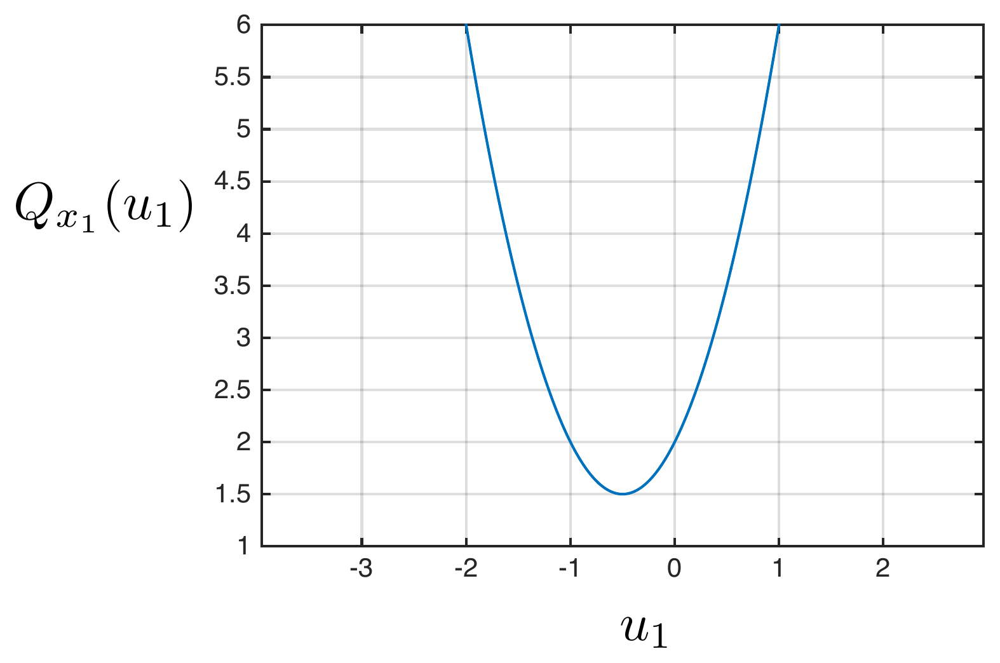
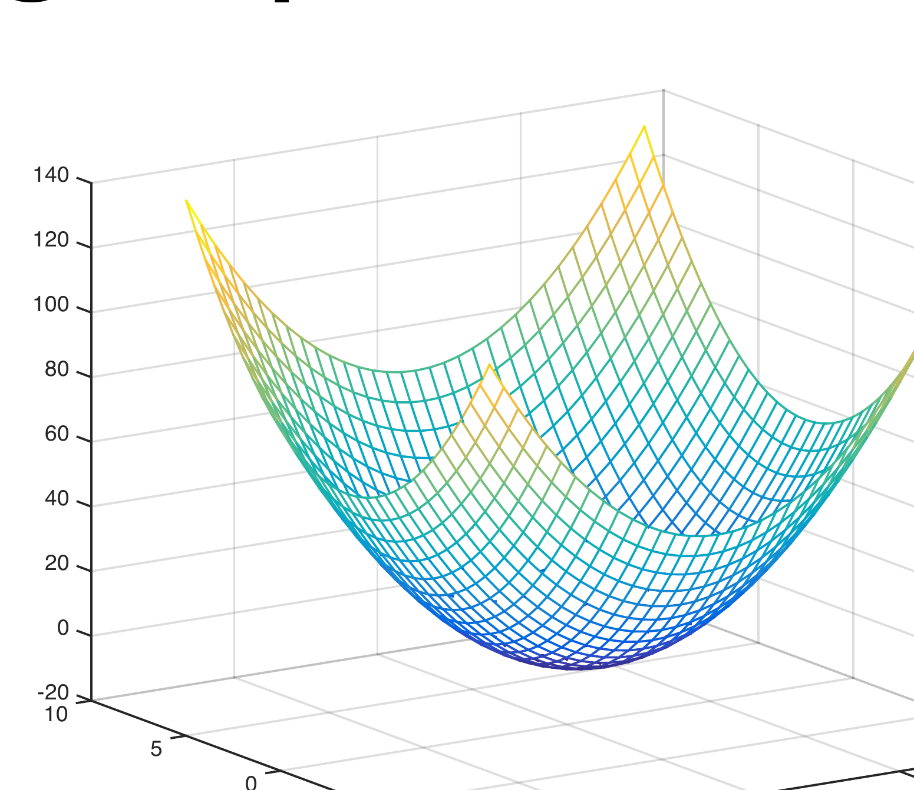
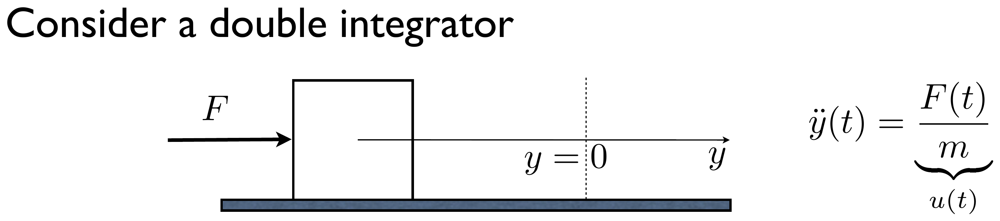
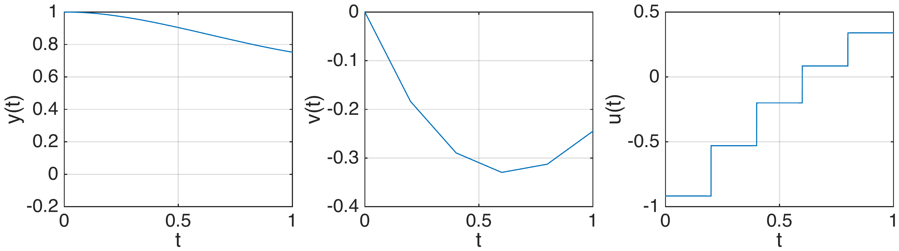
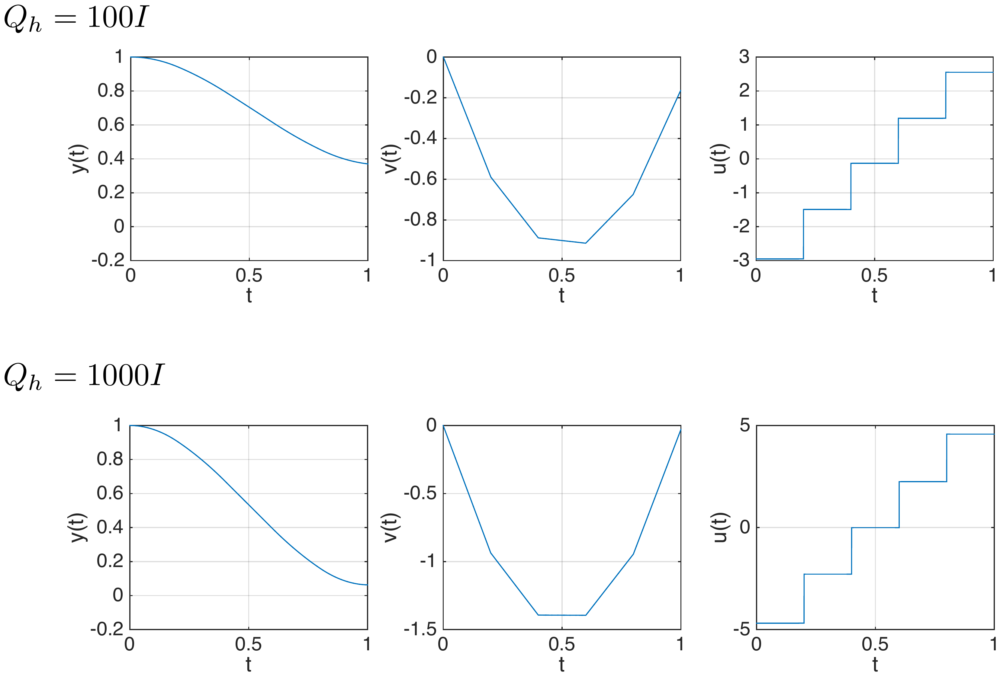
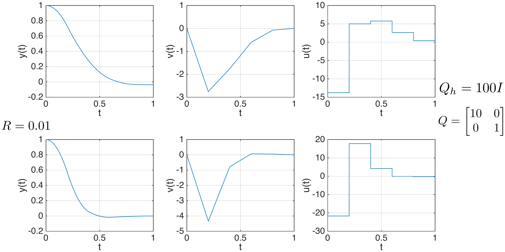
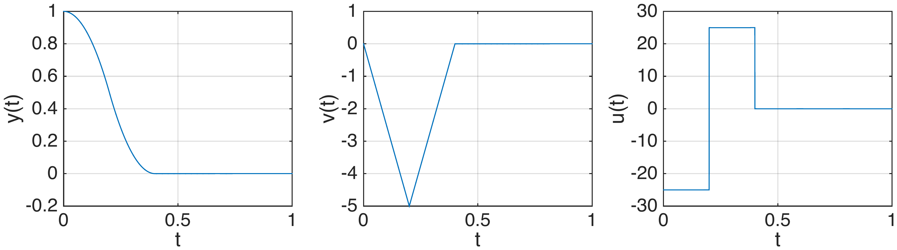
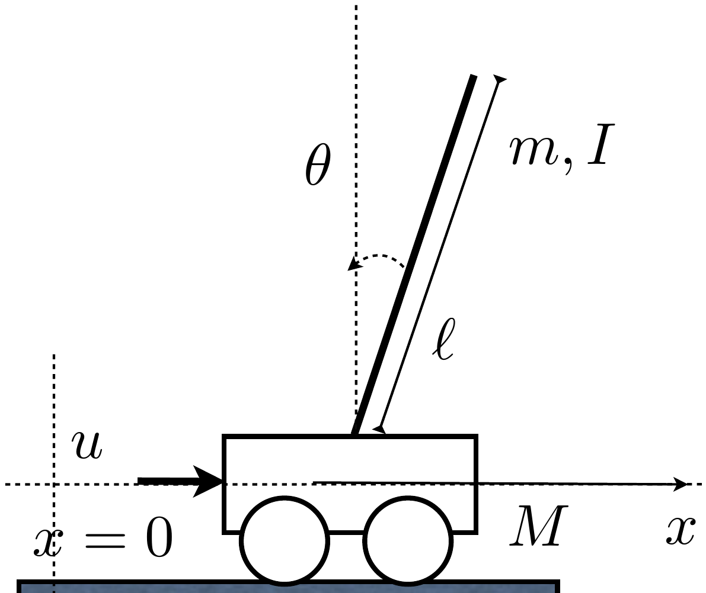
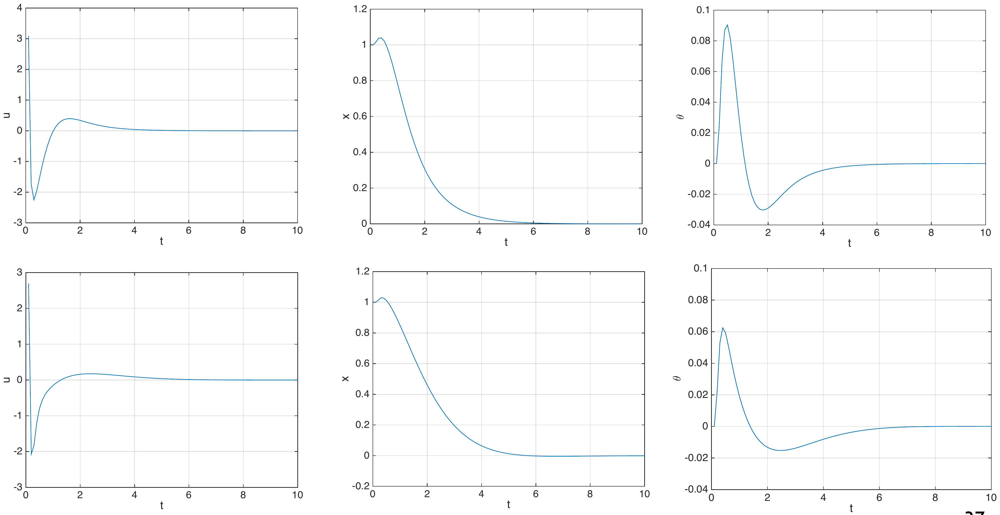

<!--
Textbook-prose companion to lectures/lecture05-lqr.qmd, intended as a
booklet chapter for readers who did not attend the lecture. Same content
and figures as the slides, but written as connected prose rather than
bullet points, so it can stand on its own. Figures are the same ones
already cropped/verified for the slide deck, referenced from
../lectures/figures/lecture5/ rather than duplicated. First pass: same
scope as units 1-4 notes (straightforward prose conversion with figures
and math); interactive examples/exercises, if wanted, would be added in a
later pass. Appendix A (the DP-optimality proof) is folded into a
collapsible callout placed near the statement of the DP-algorithm
theorem, rather than kept as a trailing appendix section. The "Goals of
part II" table (slide 4) is reproduced as a native Markdown table. The
decorative Segway stock photo (slide 42) is not included -- only the
pendulum/cart schematic is kept, as in the slides.
-->

[Slides](../lectures/lecture05-lqr.html) &middot; [Exercises](../exercises/unit5-exercises.html) &middot; [Jupyter notebooks](../code/unit5/notebooks.html)

## Stage decision problems

This unit opens Part II of the course. Units 1-4 dealt with *discrete
optimization problems*: the state and input spaces were finite or
countable, and a problem instance could be drawn as a transition diagram
and solved with the dynamic programming algorithm or, for shortest-path
problems, with Dijkstra's algorithm or A\*. Units 5-6 study *stage
decision problems*, where the state and input spaces can be arbitrary --
typically $\mathbb{R}^n$ and $\mathbb{R}^m$ -- so the underlying system is
a genuine dynamic system rather than a graph. The table below summarizes
how the concepts developed for discrete optimization problems carry over.

|  | **Discrete optimization problems** | **Stage decision problems** |
|---|---|---|
| **Formulation** | Transition diagram | Dynamic system & additive cost function |
| **DP algorithm & Stochastic DP** | Graphical DP algorithm & DP equation | DP equation |
| **Alternative algorithms** | Dijkstra's algorithm | Static optimization |
| **Partial information** | Bayes filter | Kalman filter |
| **Application focus** | Operational research & Computer science | Digital control |

This unit covers the first row and the DP-equation entry of the second
row, specialized to the most important tractable case: linear dynamics
and a quadratic cost, which leads to the *linear quadratic regulator*
(LQR), one of the cornerstone results of optimal control. Unit 6 covers
static optimization as an alternative to DP, and the Kalman filter, the
counterpart of the Bayes' filter for systems with continuous state.

### Dynamic model and cost function

A stage decision problem is described by a dynamic model

$$
x_{k+1} = f_k(x_k, u_k), \qquad k \in \{0,\dots,h-1\},
$$

and an additive cost function

$$
\sum_{k=0}^{h-1} g_k(x_k, u_k) + g_h(x_h).
$$

The state $x_k \in X_k$ and input $u_k \in U_k(x_k)$ live in arbitrary
spaces. Whenever these spaces are discrete, we recover the discrete
optimization problems of Units 1-4; here we are typically interested in
the case $x_k \in \mathbb{R}^n$ and $u_k \in \mathbb{R}^m$ for every stage
$k \in \{0,\dots,h-1\}$. As before, the two problems of interest are
computing an optimal path for a given initial condition, and computing an
optimal policy that works for every initial condition.

### Optimal paths and policies

::: {style="text-align: center;"}
{#fig-optimal-path width="90%" fig-align="center"}
:::

Given an initial condition $x_0$, a *path* is a set of decisions
$\{u_0,u_1,\dots,u_{h-1}\}$ such that $u_k \in U_k(x_k)$ for every $k$ and
the resulting state sequence $\{(x_0,u_0),\dots,(x_{h-1},u_{h-1})\}$
satisfies the equations of the dynamic model. A path is *optimal* if
there does not exist another path, with the same initial condition, that
has a strictly smaller cost.

A *policy* is a set of $h$ functions $\pi = \{\mu_0,\dots,\mu_{h-1}\}$,
$\mu_k : X_k \to U_k$, one for each stage: rather than fixing a sequence
of decisions, a policy tells the decision-maker what to do from any state
it might find itself in at any stage. A policy is *optimal* if, for every
state $x_\ell$ at every stage $\ell \in \{0,\dots,h-1\}$, the action
$\mu_\ell(x_\ell)$ is the first action of an optimal path for the *tail
subproblem* that considers only stages $\{\ell,\ell+1,\dots,h\}$, with
initial condition $x_\ell$ and cost

$$
\sum_{k=\ell}^{h-1} g_k(x_k,u_k) + g_h(x_h).
$$

This is exactly the same optimal-path/optimal-policy distinction used
throughout Units 1-2, now stated for arbitrary state and input spaces.

### The dynamic programming algorithm

The dynamic programming algorithm computes an optimal policy exactly as
it did for discrete optimization problems. Start with $J_h(x_h)=g_h(x_h)$
for every $x_h \in X_h$, and for each decision stage, starting at the
last and moving backwards, $k \in \{h-1,h-2,\dots,0\}$, compute $\mu_k$
and $J_k$ from the *DP equation*

$$
J_k(x_k) = \min_{u_k \in U_k(x_k)} g_k(x_k,u_k) + J_{k+1}(f_k(x_k,u_k)),
$$

and

$$
\mu_k(x_k) = u_k,
$$

where $u_k$ is a minimizer in the DP equation, i.e.,

$$
J_k(x_k) = g_k(x_k,\mu_k(x_k)) + J_{k+1}(f_k(x_k,\mu_k(x_k))).
$$

Then $\{\mu_0,\dots,\mu_{h-1}\}$ is an optimal policy.

**Theorem.** The policy obtained with the DP algorithm is an optimal
policy.

:::: {.callout-note collapse="true" title="Proof of optimality of dynamic programming"}
The proof is by induction on $k$, and shows that $\pi^k :=
\{\mu_k,\dots,\mu_{h-1}\}$, obtained from the DP algorithm, is an optimal
policy for the subproblem running from stage $k$ to stage $h-1$, and that
$J_k(x_k)$ is the cost of the optimal path starting at $x_k$.

**Step I ($k=h-1$).** By construction $\pi^{h-1}=\{\mu_{h-1}\}$ is an
optimal policy, since it is by definition the first (and only) decision
of the optimal path from stage $h-1$ to stage $h$:

$$
\min_{u_{h-1}\in U_{h-1}(x_{h-1})} g_{h-1}(x_{h-1},u_{h-1})+J_h(f_{h-1}(x_{h-1},u_{h-1})) = g_{h-1}(x_{h-1},\mu_{h-1}(x_{h-1}))+J_h(f_{h-1}(x_{h-1},\mu_{h-1}(x_{h-1}))).
$$

It is also clear that

$$
J_{h-1}(x_{h-1}) = \min_{u_{h-1}\in U_{h-1}(x_{h-1})} g_{h-1}(x_{h-1},u_{h-1})+J_h(f_{h-1}(x_{h-1},u_{h-1}))
$$

is the optimal cost of the subproblem with initial condition $x_{h-1}$ at
stage $h-1$.

**Step II (inductive step).** Assume that $\pi^{k+1} :=
\{\mu_{k+1},\dots,\mu_{h-1}\}$ is an optimal policy and that
$J_{k+1}(x_{k+1})$ is the cost of the optimal path starting at $x_{k+1}$.
We show, by contradiction, that $\pi^k := \{\mu_k,\dots,\mu_{h-1}\}$ is
an optimal policy and that $J_k(x_k)$ is the cost of an optimal path
starting at $x_k$.

Suppose $\pi^k$ is not optimal. Then there is a state $x_k$ for which
$\mu_k(x_k)$ is *not* the first action of an optimal path from stage $k$
to stage $h$. Call that optimal path

$$
\tilde\gamma = \{(\tilde x_k,\tilde u_k), (\tilde x_{k+1},\tilde u_{k+1}), \dots, \tilde x_h)\}, \qquad \tilde x_k = x_k, \quad \tilde u_k \neq \mu_k(x_k).
$$

Because $\pi^{k+1}$ is, by the induction hypothesis, an optimal policy
for the tail subproblem starting at stage $k+1$, the remainder of
$\tilde\gamma$ must in fact agree with it:

$$
\tilde u_{\ell+1} = \mu_{\ell+1}(\tilde x_{\ell+1}) \quad \text{for every } \ell \in \{k+1,\dots,h-2\}.
$$

The cost of $\tilde\gamma$ is therefore

$$
\bar J = \sum_{\ell=k}^{h-1} g_\ell(\tilde x_\ell,\tilde u_\ell)+g_h(\tilde x_h) = g_k(\tilde x_k,\tilde u_k) + \sum_{\ell=k+1}^{h-1} g_\ell(\tilde x_\ell,\mu_\ell(\tilde x_\ell))+g_h(\tilde x_h) = g_k(\tilde x_k,\tilde u_k)+J_{k+1}(f(\tilde x_k,\tilde u_k)).
$$

But by definition $\mu_k(x_k)$ minimizes exactly this quantity over
$u_k$, so

$$
J_k(x_k) = \min_{u_k} g_k(\tilde x_k, u_k)+J_{k+1}(f(\tilde x_k,u_k)) = g_k(\tilde x_k,\mu_k(x_k))+J_{k+1}(f(\tilde x_k,\mu_k(x_k))) \leq g_k(\tilde x_k,\tilde u_k)+J_{k+1}(f(\tilde x_k,\tilde u_k)) = \bar J,
$$

which contradicts the assumption that $\tilde\gamma$, with first action
$\tilde u_k \neq \mu_k(x_k)$, is strictly better than the path generated
by $\mu_k$. Hence $\pi^k$ is optimal and $J_k(x_k)$ is the optimal cost,
completing the induction.
::::

### A worked example: quadratic vs. non-quadratic terminal cost

To see the DP algorithm at work on a stage decision problem, and to
motivate why we will restrict attention to linear dynamics and quadratic
costs, consider the simple integrator

$$
x_{k+1} = x_k+u_k, \qquad k \in \{0,1\},
$$

with cost

$$
\sum_{k=0}^1 x_k^2+u_k^2 + g_2(x_2),
$$

and compare a quadratic terminal cost $g_2(x_2)=x_2^2$ with a
non-quadratic one, $g_2(x_2)=e^{x_2}$.

**Quadratic terminal cost.** At $k=1$, using $x_2=x_1+u_1$,

$$
J_1(x_1) = \min_{u_1} g_1(x_1,u_1)+g_2(x_2) = \min_{u_1} x_1^2+u_1^2+x_2^2 = \min_{u_1} \underbrace{2(x_1^2+u_1^2+x_1u_1)}_{Q_{x_1}(u_1),\ \text{quadratic function of } u_1}.
$$

For a fixed $x_1$, $Q_{x_1}(u_1)$ is a strictly convex parabola in $u_1$,
so its minimum can be found by differentiating and equating to zero, as
illustrated below for a particular value of $x_1$.

::: {style="text-align: center;"}
{#fig-quadratic-1d width="45%" fig-align="center"}
:::

$$
\frac{d}{du_1}Q_{x_1}(u_1)=0 \iff 2(2u_1+x_1)=0 \iff u_1=-\frac{1}{2}x_1.
$$

Substituting back into $Q_{x_1}(u_1)$ gives the cost-to-go
$J_1(x_1)=\frac{3}{2}x_1^2$, which is again quadratic in $x_1$. This is
the key feature that makes the recursion tractable: at $k=0$, using
$x_1=x_0+u_0$,

$$
J_0(x_0) = \min_{u_0} g_0(x_0,u_0)+J_1(x_1) = \min_{u_0} x_0^2+u_0^2+\frac{3}{2}x_1^2 = \min_{u_0} \frac{5}{2}x_0^2+3u_0x_0+\frac{5}{2}u_0^2,
$$

and differentiating and equating to zero gives a second function of the
optimal policy,

$$
u_0 = -\frac{3}{5}x_0, \qquad J_0(x_0) = \frac{8}{5}x_0^2.
$$

The optimal policy is therefore $u_0=-\tfrac{3}{5}x_0$,
$u_1=-\tfrac{1}{2}x_1$. Starting from $x_0=1$ and iterating
$x_{k+1}=x_k+u_k$ gives the optimal path

$$
x_0=1,\quad u_0=-\frac{3}{5}, \qquad x_1=\frac{2}{5},\quad u_1=-\frac{1}{5}, \qquad x_2=\frac{1}{5},
$$

with optimal cost $J_0(1)=\frac{8}{5}$.

**Non-quadratic terminal cost.** Repeat the same first step with
$g_2(x_2)=e^{x_2}$:

$$
J_1(x_1) = \min_{u_1} g_1(x_1,u_1)+g_2(x_2) = \min_{u_1} x_1^2+u_1^2+e^{x_2}.
$$

Differentiating and equating to zero now gives

$$
2u_1+e^{x_1+u_1}=0,
$$

an equation that implicitly determines $u_1$ in terms of $x_1$, but has
no closed-form solution. Consequently, we cannot write down
$u_1=\mu_1(x_1)$ in closed form, and so we cannot move on to the second
step of the DP recursion the way we could in the quadratic case.

This little example illustrates a general phenomenon. When the dynamic
model is linear and the cost is quadratic, the cost-to-go remains
quadratic at every stage, so the DP recursion reduces to simple algebra
on the coefficients of that quadratic form, and the optimal policy can be
obtained explicitly, as we show next. When the dynamic model is
non-linear and/or the cost is non-quadratic, applying DP explicitly is
generally very hard; one has to resort to approximation techniques such
as discretizing the state and input spaces (turning the problem back into
a discrete optimization problem), or other approximation techniques that
will be discussed in later lectures.

:::: {.callout-tip collapse="false" title="Quick exercise: the same recursion on a different problem"}

Repeat the quadratic calculation above for the stage decision problem

$$
x_{k+1} = 2x_k-u_k, \qquad k\in\{0,1\},
$$

with cost

$$
\sum_{k=0}^1 \Big(3x_k^2+\tfrac12 u_k^2\Big) + x_2^2 .
$$

Compute the optimal policy $u_0=\mu_0(x_0)$, $u_1=\mu_1(x_1)$ and the
costs-to-go $J_0$, $J_1$, and then the optimal path and its cost for the
initial condition $x_0=-2$.

::::

:::: {.callout-note collapse="true" title="Solution"}

**Stage $k=1$.** Substituting $x_2=2x_1-u_1$,

$$
J_1(x_1) = \min_{u_1}\ 3x_1^2+\tfrac12u_1^2+(2x_1-u_1)^2 = \min_{u_1}\ \underbrace{7x_1^2-4x_1u_1+\tfrac32u_1^2}_{\text{quadratic in } u_1},
$$

which is again a strictly convex parabola in $u_1$, so differentiating
and equating to zero gives

$$
-4x_1+3u_1 = 0 \iff u_1 = \tfrac43 x_1 .
$$

Substituting back,

$$
J_1(x_1) = \Big(7-\tfrac{16}{3}+\tfrac83\Big)x_1^2 = \tfrac{13}{3}x_1^2,
$$

quadratic in $x_1$, exactly as in the worked example.

**Stage $k=0$.** Substituting $x_1=2x_0-u_0$,

$$
J_0(x_0) = \min_{u_0}\ 3x_0^2+\tfrac12u_0^2+\tfrac{13}{3}(2x_0-u_0)^2 = \min_{u_0}\ \tfrac{61}{3}x_0^2-\tfrac{52}{3}x_0u_0+\tfrac{29}{6}u_0^2,
$$

and differentiating and equating to zero,

$$
-\tfrac{52}{3}x_0+\tfrac{29}{3}u_0 = 0 \iff u_0 = \tfrac{52}{29}x_0, \qquad J_0(x_0) = \tfrac{139}{29}x_0^2 .
$$

So the optimal policy is

$$
\mu_0(x_0)=\tfrac{52}{29}x_0, \qquad \mu_1(x_1)=\tfrac43 x_1 .
$$

Note that the gains are *positive* here: the open-loop dynamics
$x_{k+1}=2x_k$ are unstable and the input enters with a minus sign, so
the controller must push with the same sign as the state in order to
oppose the growth.

**Optimal path for $x_0=-2$.** Iterating $x_{k+1}=2x_k-u_k$,

$$
x_0 = -2, \quad u_0 = -\tfrac{104}{29} \approx -3.5862, \qquad x_1 = -\tfrac{12}{29} \approx -0.4138, \quad u_1 = -\tfrac{16}{29} \approx -0.5517, \qquad x_2 = -\tfrac{8}{29} \approx -0.2759,
$$

with optimal cost

$$
J_0(-2) = \tfrac{139}{29}\cdot 4 = \tfrac{556}{29} \approx 19.1724 .
$$

As a check, evaluating the cost directly along this path gives
$3(4)+\tfrac12\big(\tfrac{104}{29}\big)^2+3\big(\tfrac{12}{29}\big)^2+\tfrac12\big(\tfrac{16}{29}\big)^2+\big(\tfrac{8}{29}\big)^2=\tfrac{556}{29}$,
the same value.

::::

## The linear quadratic regulator

Motivated by the previous example, we now specialize to linear dynamics
and a quadratic cost. Given a dynamic model

$$
x_{k+1}=A_kx_k+B_ku_k, \qquad k \in \{0,\dots,h-1\},
$$

and a cost function

$$
\sum_{k=0}^{h-1} \begin{bmatrix}x_k^\intercal & u_k^\intercal\end{bmatrix}\begin{bmatrix}Q_k & S_k \\ S_k^\intercal & R_k\end{bmatrix}\begin{bmatrix}x_k \\ u_k\end{bmatrix} + x_h^\intercal Q_h x_h,
$$

the goal is to find an optimal policy $u_k=\mu_k(x_k)$,
$k\in\{0,\dots,h-1\}$. This is the finite-horizon, discrete-time linear
quadratic optimal control problem. When $h\to\infty$ and the matrices in
the model and cost are time-invariant, the resulting solution is called
the *linear quadratic regulator* (LQR) -- one of the celebrated results
of control theory, and one of the main achievements of optimal control.

Throughout, $Q_k$ and $R_k$ are assumed symmetric, with
$\begin{bmatrix}Q_k & S_k \\ S_k^\intercal & R_k\end{bmatrix} \geq 0$,
$Q_h \geq 0$ and $R_k>0$. The model and cost are often time-invariant,
i.e., $x_{k+1}=Ax_k+Bu_k$ and

$$
\sum_{k=0}^{h-1}\begin{bmatrix}x_k^\intercal & u_k^\intercal\end{bmatrix}\begin{bmatrix}Q & S \\ S^\intercal & R\end{bmatrix}\begin{bmatrix}x_k \\ u_k\end{bmatrix} + x_h^\intercal Q_h x_h.
$$

The cost function can arise from discretizing a continuous-time problem,
but in general it is directly specified in discrete time and used as a
tuning knob to obtain desired closed-loop specifications, such as
overshoot or settling time. We focus throughout on the *stabilization*
problem, i.e., driving the state to zero; for the reference-tracking
problem, see the accompanying notes, exercises and Jupyter notebooks.

### Deriving the Riccati recursion

We now apply the DP algorithm to this problem. At the last stage,
$x_h=A_{h-1}x_{h-1}+B_{h-1}u_{h-1}$, so

$$
J_{h-1}(x_{h-1}) = \min_{u_{h-1}} \begin{bmatrix}x_{h-1}^\intercal & u_{h-1}^\intercal\end{bmatrix}\begin{bmatrix}Q_{h-1} & S_{h-1} \\ S_{h-1}^\intercal & R_{h-1}\end{bmatrix}\begin{bmatrix}x_{h-1} \\ u_{h-1}\end{bmatrix} + \underbrace{J_h(x_h)}_{x_h^\intercal Q_h x_h}.
$$

Substituting $x_h=A_{h-1}x_{h-1}+B_{h-1}u_{h-1}$ into the terminal cost
and expanding, the expression above becomes

$$
J_{h-1}(x_{h-1}) = \min_{u_{h-1}} x_{h-1}^\intercal(A_{h-1}^\intercal Q_h A_{h-1}+Q_{h-1})x_{h-1} + 2u_{h-1}^\intercal(S_{h-1}^\intercal+B_{h-1}^\intercal Q_h A_{h-1})x_{h-1} + \underbrace{u_{h-1}^\intercal(B_{h-1}^\intercal Q_h B_{h-1}+R_{h-1})u_{h-1}}_{\text{quadratic function of } u_{h-1}}.
$$

Minimizing over $u_{h-1}$ therefore amounts to minimizing a general
quadratic function of a vector variable, so it is worth solving that
problem once and for all.

::: {style="text-align: center;"}
{#fig-quadratic-3d width="45%" fig-align="center"}
:::

For $J(u) = u^\intercal Xu+2u^\intercal y+z$ with $X>0$,

$$
\nabla J(u)=0 \iff 2Xu+2y=0 \iff u=-X^{-1}y,
$$

and this is the unique minimizer since $X>0$. The minimum value is

$$
J(-X^{-1}y) = y^\intercal X^{-1}XX^{-1}y-2y^\intercal X^{-1}y+z = z-y^\intercal X^{-1}y.
$$

Applying this with

$$
X = B_{h-1}^\intercal Q_h B_{h-1}+R_{h-1}, \qquad y = S_{h-1}^\intercal+B_{h-1}^\intercal Q_h A_{h-1}, \qquad z = A_{h-1}^\intercal Q_h A_{h-1}+Q_{h-1}
$$

(the last two understood as quadratic forms in $x_{h-1}$), we obtain the
policy

$$
u_{h-1} = -X^{-1}y = -\big(B_{h-1}^\intercal Q_h B_{h-1}+R_{h-1}\big)^{-1}\big(S_{h-1}^\intercal+B_{h-1}^\intercal Q_h A_{h-1}\big)x_{h-1}
$$

and the cost-to-go

$$
J_{h-1}(x_{h-1}) = x_{h-1}^\intercal\Big[A_{h-1}^\intercal Q_h A_{h-1}+Q_{h-1} - (S_{h-1}+A_{h-1}^\intercal Q_h B_{h-1})(B_{h-1}^\intercal Q_h B_{h-1}+R_{h-1})^{-1}(S_{h-1}^\intercal+B_{h-1}^\intercal Q_h A_{h-1})\Big]x_{h-1}.
$$

Crucially, $J_{h-1}$ is again a quadratic form, $J_{h-1}(x_{h-1}) =
x_{h-1}^\intercal P_{h-1} x_{h-1}$, with $P_{h-1}$ the bracketed matrix
above. This means the next step of the DP recursion, at $k=h-2$, has
exactly the same structure as the first one, with $Q_h$ replaced by
$P_{h-1}$:

$$
J_{h-2}(x_{h-2}) = \min_{u_{h-2}} \begin{bmatrix}x_{h-2}^\intercal & u_{h-2}^\intercal\end{bmatrix}\begin{bmatrix}Q_{h-2} & S_{h-2} \\ S_{h-2}^\intercal & R_{h-2}\end{bmatrix}\begin{bmatrix}x_{h-2} \\ u_{h-2}\end{bmatrix} + \underbrace{J_{h-1}(x_{h-1})}_{x_{h-1}^\intercal P_{h-1} x_{h-1}},
$$

so the same reasoning gives $u_{h-2}=K_{h-2}x_{h-2}$,
$J_{h-2}(x_{h-2})=x_{h-2}^\intercal P_{h-2}x_{h-2}$, with

$$
K_{h-2} = -\big(B_{h-2}^\intercal P_{h-1}B_{h-2}+R_{h-2}\big)^{-1}\big(S_{h-2}^\intercal+B_{h-2}^\intercal P_{h-1}A_{h-2}\big),
$$

$$
P_{h-2} = A_{h-2}^\intercal P_{h-1}A_{h-2}+Q_{h-2} - \big(S_{h-2}+A_{h-2}^\intercal P_{h-1}B_{h-2}\big)\big(B_{h-2}^\intercal P_{h-1}B_{h-2}+R_{h-2}\big)^{-1}\big(S_{h-2}^\intercal+B_{h-2}^\intercal P_{h-1}A_{h-2}\big).
$$

Since the cost-to-go stays quadratic at every stage, the same computation
repeats all the way back to $k=0$: at a generic stage $k$, with
$x_{k+1}=A_kx_k+B_ku_k$,

$$
u_k = K_kx_k, \qquad J_k(x_k) = x_k^\intercal P_k x_k,
$$

$$
K_k = -\big(B_k^\intercal P_{k+1}B_k+R_k\big)^{-1}\big(S_k^\intercal+B_k^\intercal P_{k+1}A_k\big),
$$

$$
P_k = A_k^\intercal P_{k+1}A_k+Q_k - \big(S_k+A_k^\intercal P_{k+1}B_k\big)\big(B_k^\intercal P_{k+1}B_k+R_k\big)^{-1}\big(S_k^\intercal+B_k^\intercal P_{k+1}A_k\big) \qquad \text{(Riccati equation)}.
$$

To compute the optimal policy, simply iterate these two equations
backwards for $k\in\{h-1,\dots,1,0\}$, starting from $P_h=Q_h$. The
optimal cost for a given initial condition is
$J_0(x_0)=x_0^\intercal P_0 x_0$.

### Example: the double integrator

Consider a mass sliding on a frictionless surface, actuated by a
horizontal force $F$, with position $y$ measured from a reference point:

::: {style="text-align: center;"}
{#fig-double-integrator width="70%" fig-align="center"}
:::

Taking $u(t)=F(t)/m$ as the control input, the continuous-time model in
state-space form, with $x(t)=[y(t)\ \ v(t)]^\intercal$, is

$$
\begin{bmatrix}\dot y(t) \\ \dot v(t)\end{bmatrix} = \begin{bmatrix}0 & 1 \\ 0 & 0\end{bmatrix}\begin{bmatrix}y(t) \\ v(t)\end{bmatrix} + \begin{bmatrix}0 \\ 1\end{bmatrix}u(t).
$$

Discretizing with sampling period $\tau$ gives the discrete-time model

$$
x_{k+1} = e^{\begin{bmatrix}0&1\\0&0\end{bmatrix}\tau}x_k + \int_0^\tau e^{\begin{bmatrix}0&1\\0&0\end{bmatrix}r}dr\begin{bmatrix}0\\1\end{bmatrix}u_k = \begin{bmatrix}1 & \tau \\ 0 & 1\end{bmatrix}x_k + \begin{bmatrix}\frac{\tau^2}{2} \\ \tau\end{bmatrix}u_k.
$$

Take $\tau=0.2$. The qualitative goal is to drive the mass to position
zero quickly, but with reasonable actuation. As a first attempt, use the
cost function

$$
\sum_{k=0}^{h-1} x_k^\intercal Qx_k+u_k^\intercal Ru_k+x_h^\intercal Q_hx_h, \qquad Q=\begin{bmatrix}1&0\\0&1\end{bmatrix}, \quad R=1, \quad h=5, \quad Q_h=\begin{bmatrix}10&0\\0&10\end{bmatrix},
$$

and tune the weights afterwards to improve the closed-loop behavior.

Iterating the Riccati recursion backwards from $P_5=Q_5=\begin{bmatrix}10&0\\0&10\end{bmatrix}$,
the first step gives

$$
K_4 = -\Big(\begin{bmatrix}0.02 & 0.2\end{bmatrix}\begin{bmatrix}10&0\\0&10\end{bmatrix}\begin{bmatrix}0.02\\0.2\end{bmatrix}+1\Big)^{-1}\begin{bmatrix}0.02&0.2\end{bmatrix}\begin{bmatrix}10&0\\0&10\end{bmatrix}\begin{bmatrix}1&0.2\\0&1\end{bmatrix} = \begin{bmatrix}-0.1425 & -1.4530\end{bmatrix},
$$

$$
P_4 = \begin{bmatrix}1&0.2\\0&1\end{bmatrix}^\intercal\begin{bmatrix}10&0\\0&10\end{bmatrix}\begin{bmatrix}1&0.2\\0&1\end{bmatrix} + \begin{bmatrix}1&0\\0&1\end{bmatrix} - \begin{bmatrix}1&0.2\\0&1\end{bmatrix}^\intercal\begin{bmatrix}10&0\\0&10\end{bmatrix}\begin{bmatrix}0.02\\0.2\end{bmatrix}(-K_4) = \begin{bmatrix}10.9715 & 1.7094\\1.7094 & 8.4359\end{bmatrix}.
$$

Continuing the recursion down to $k=0$ gives

$$
P_3=\begin{bmatrix}11.739&3.144\\3.144&8.0782\end{bmatrix}, \quad P_2=\begin{bmatrix}12.188&4.311\\4.311&8.2725\end{bmatrix}, \quad P_1=\begin{bmatrix}12.295&5.165\\5.165&8.675\end{bmatrix}, \quad P_0=\begin{bmatrix}12.121&5.702\\5.702&9.085\end{bmatrix},
$$

$$
K_3=[-0.414\ \ -1.353], \quad K_2=[-0.638\ \ -1.368], \quad K_1=[-0.807\ \ -1.432], \quad K_0=[-0.918\ \ -1.503],
$$

so the optimal policy is $u_k=K_kx_k$, $k\in\{0,1,\dots,4\}$. Starting
from $x_0=[1\ \ 0]^\intercal$ and iterating $x_{k+1}=Ax_k+Bu_k$,
$u_k=K_kx_k$, the optimal path is

$$
(x_0,u_0) = ([1\ \ 0]^\intercal, -0.918), \qquad (x_1,u_1) = ([0.982\ \ {-0.184}]^\intercal, -0.529), \qquad (x_2,u_2) = ([0.934\ \ {-0.289}]^\intercal, -0.200),
$$

$$
(x_3,u_3) = ([0.8724\ \ {-0.330}]^\intercal, 0.085), \qquad (x_4,u_4) = ([0.8082\ \ {-0.313}]^\intercal, 0.339), \qquad x_5 = [0.7525\ \ {-0.2448}]^\intercal.
$$

::: {style="text-align: center;"}
{#fig-tuning-plots width="85%" fig-align="center"}
:::

The following general guidelines help tune the cost weights: increasing
the terminal cost $Q_h$ should bring the response closer to the desired
final position; penalizing position error more heavily relative to
velocity error has a similar effect; and decreasing the penalty on the
control action $R$ gives the controller more authority to reach the
origin quickly. The next four figures illustrate each of these effects in
turn, always for the same double integrator and horizon $h=5$.

::: {style="text-align: center;"}
{#fig-terminal-cost-plots width="78%" fig-align="center"}
:::

::: {style="text-align: center;"}
{#fig-state-cost-plots width="82%" fig-align="center"}
:::

::: {style="text-align: center;"}
{#fig-control-cost-plots width="82%" fig-align="center"}
:::

Pushing the control penalty to its limit, as $R\to 0$ we obtain
*deadbeat control*: the state is driven very close to zero in just two
steps.

::: {style="text-align: center;"}
{#fig-cheap-control-plots width="85%" fig-align="center"}
:::

Can we always drive the state to zero in just two sampling periods? In
principle yes, but in practice this typically requires unreasonably large
actuation. Actuators have physical limits that are not captured by this
linear, unconstrained LQR formulation; within this framework, the usual
workaround is to increasingly penalize the control input until the
resulting actuation respects the actual constraints. This point is
revisited in later lectures.

::: {.callout-important collapse="true" title="Interactive example: tune the double integrator yourself"}

Rather than take these tuning guidelines on trust, it is worth turning
the knobs yourself. The demo below runs exactly the computation of this
section: it iterates the Riccati recursion backwards from $P_h=Q_h$,
applies $u_k=K_kx_k$ from $x_0=[1\ \ 0]^\intercal$, and draws the
resulting $y(t)$, $v(t)$ and $u(t)$ -- the continuous curves between
sampling instants are exact, since the input is constant on each
interval. The rectangle is the mass sliding on its track, with the red
arrow showing the force $u$ and the dashed green line marking the target
$y=0$.

With the values it starts from -- $Q=I$, $R=1$, $Q_h=10I$, $h=5$ -- it
reproduces the worked example above exactly: $K_0=[-0.9179\ \ -1.5030]$,
an optimal cost $J_0(x_0)=12.1214$ (which is just $x_0^\intercal P_0x_0$,
the $(1,1)$ entry of the $P_0$ printed above), and a mass that has only
crawled to $y\approx0.75$ by the end of the horizon.

From there, each of the three guidelines is one number away. Raise the
terminal weight to $Q_h=100I$ and the final position drops to $0.370$;
raise it to $1000I$ and it drops to $0.063$. Raise the position weight
$q_1$ relative to the velocity weight $q_2$ and the mass arrives sooner
while the velocity error grows. Lower $R$ and the controller buys speed
with actuation. Two further things are worth trying, both of which
anticipate the next section: push the horizon $h$ up and watch $K_0$
stop changing -- at $h=60$ it has settled on $[-0.8412\ \ -1.5460]$,
the infinite-horizon gain -- and push $R$ towards zero to see how much
actuation the controller will spend when nothing restrains it.

```{=html}
<div id="di-wrap" style="margin:1em 0; text-align:center;">
  <div style="margin-bottom:0.6em; font-size:0.9em;">
    <label>q&#8321; (position)
      <input id="di-q1" type="number" value="1" min="0" step="1" style="width:5em;">
    </label>
    <label style="margin-left:0.7em;">q&#8322; (velocity)
      <input id="di-q2" type="number" value="1" min="0" step="1" style="width:5em;">
    </label>
    <label style="margin-left:0.7em;">R
      <input id="di-R" type="number" value="1" min="0.00000001" step="0.1" style="width:5.5em;">
    </label>
    <label style="margin-left:0.7em;">Q&#8341; = q&#8341;I
      <input id="di-qh" type="number" value="10" min="0" step="10" style="width:5.5em;">
    </label>
    <label style="margin-left:0.7em;">h
      <input id="di-h" type="number" value="5" min="1" max="60" step="1" style="width:4em;">
    </label>
  </div>
  <div id="di-anim"></div>
  <div id="di-plots"></div>
  <div id="di-status" style="font-size:0.88em; margin:0.5em 0; min-height:1.3em;"></div>
  <div>
    <button id="di-play" style="padding:4px 12px;">Play</button>
    <button id="di-reset" style="padding:4px 12px; margin-left:0.4em;">Reset</button>
    <button id="di-default" style="padding:4px 12px; margin-left:0.4em;">Back to Q=I, R=1, Q&#8341;=10I, h=5</button>
  </div>
  <div style="font-size:0.8em; color:#555; margin-top:0.5em; line-height:1.6;">
    The cost minimized is
    &sum;<sub>k</sub> (q&#8321;y<sub>k</sub>&sup2; + q&#8322;v<sub>k</sub>&sup2; + Ru<sub>k</sub>&sup2;)
    + q&#8341;(y<sub>h</sub>&sup2; + v<sub>h</sub>&sup2;), with &tau; = 0.2 s and x&#8320; = [1, 0]&#7488;.
  </div>
</div>
<script>
(function () {
  const TAU = 0.2, X0 = [1, 0];
  const A = [[1, TAU], [0, 1]], B = [TAU * TAU / 2, TAU];
  const SUB = 12;                       // sub-samples per step, for the continuous curves

  let q1 = 1, q2 = 1, R = 1, qh = 10, h = 5;
  let sol = null, anim = 0, playing = false, raf = null;

  function riccati(Q, R, Qh, h) {
    const P = new Array(h + 1), K = new Array(h);
    P[h] = [[Qh[0][0], Qh[0][1]], [Qh[1][0], Qh[1][1]]];
    for (let k = h - 1; k >= 0; k--) {
      const Pn = P[k + 1];
      const PnB = [Pn[0][0] * B[0] + Pn[0][1] * B[1], Pn[1][0] * B[0] + Pn[1][1] * B[1]];
      const BPB = B[0] * PnB[0] + B[1] * PnB[1];
      const BPA = [B[0] * (Pn[0][0] * A[0][0] + Pn[0][1] * A[1][0]) + B[1] * (Pn[1][0] * A[0][0] + Pn[1][1] * A[1][0]),
                   B[0] * (Pn[0][0] * A[0][1] + Pn[0][1] * A[1][1]) + B[1] * (Pn[1][0] * A[0][1] + Pn[1][1] * A[1][1])];
      const den = BPB + R;
      K[k] = [-BPA[0] / den, -BPA[1] / den];
      const APnA = [[0, 0], [0, 0]];
      for (let i = 0; i < 2; i++) for (let j = 0; j < 2; j++) {
        let s = 0;
        for (let a = 0; a < 2; a++) for (let b = 0; b < 2; b++) s += A[a][i] * Pn[a][b] * A[b][j];
        APnA[i][j] = s;
      }
      const APnB = [A[0][0] * PnB[0] + A[1][0] * PnB[1], A[0][1] * PnB[0] + A[1][1] * PnB[1]];
      P[k] = [[0, 0], [0, 0]];
      for (let i = 0; i < 2; i++) for (let j = 0; j < 2; j++)
        P[k][i][j] = APnA[i][j] + Q[i][j] - APnB[i] * BPA[j] / den;
    }
    return { P, K };
  }

  function solve() {
    const Q = [[q1, 0], [0, q2]], Qh = [[qh, 0], [0, qh]];
    const { P, K } = riccati(Q, R, Qh, h);
    const xs = [X0.slice()], us = [];
    for (let k = 0; k < h; k++) {
      const x = xs[k], u = K[k][0] * x[0] + K[k][1] * x[1];
      us.push(u);
      xs.push([A[0][0] * x[0] + A[0][1] * x[1] + B[0] * u, A[1][0] * x[0] + A[1][1] * x[1] + B[1] * u]);
    }
    let J = 0;
    for (let k = 0; k < h; k++) {
      const x = xs[k];
      J += q1 * x[0] * x[0] + q2 * x[1] * x[1] + R * us[k] * us[k];
    }
    J += qh * (xs[h][0] * xs[h][0] + xs[h][1] * xs[h][1]);
    // exact continuous trajectory: within a step the input is constant
    const curve = [];
    for (let k = 0; k < h; k++) {
      for (let i = 0; i < SUB; i++) {
        const s = (i / SUB) * TAU;
        curve.push({ t: k * TAU + s, y: xs[k][0] + xs[k][1] * s + us[k] * s * s / 2,
                     v: xs[k][1] + us[k] * s, u: us[k] });
      }
    }
    curve.push({ t: h * TAU, y: xs[h][0], v: xs[h][1], u: us[h - 1] });
    return { P, K, xs, us, J, curve, Jp: P[0][0][0] * X0[0] * X0[0] + 2 * P[0][0][1] * X0[0] * X0[1] + P[0][1][1] * X0[1] * X0[1] };
  }

  const animWrap = document.getElementById('di-anim');
  const plotWrap = document.getElementById('di-plots');
  const statusEl = document.getElementById('di-status');
  function mk(wrap, w, hh) {
    const cv = document.createElement('canvas');
    cv.width = w; cv.height = hh; cv.style.maxWidth = '100%'; cv.style.border = '1px solid #ccc';
    cv.style.display = 'block'; cv.style.margin = '0 auto 6px';
    wrap.appendChild(cv); return cv;
  }
  const cvA = mk(animWrap, 660, 120), cvP = mk(plotWrap, 660, 300);
  const ctxA = cvA.getContext('2d'), ctxP = cvP.getContext('2d');

  function drawAnim(st) {
    const W = 660, H = 120;
    ctxA.clearRect(0, 0, W, H);
    // y in [-0.4, 1.3] maps across the canvas; the mass is a rectangle on a track
    const yMin = -0.5, yMax = 1.4;
    const px = yy => 50 + (yy - yMin) / (yMax - yMin) * (W - 100);
    const trackY = 76;
    ctxA.strokeStyle = '#90a4ae'; ctxA.lineWidth = 3;
    ctxA.beginPath(); ctxA.moveTo(30, trackY); ctxA.lineTo(W - 30, trackY); ctxA.stroke();
    // hatching under the track
    ctxA.strokeStyle = '#cfd8dc'; ctxA.lineWidth = 1;
    for (let x = 30; x < W - 30; x += 10) { ctxA.beginPath(); ctxA.moveTo(x, trackY); ctxA.lineTo(x - 7, trackY + 9); ctxA.stroke(); }
    // target y = 0
    ctxA.strokeStyle = '#2e7d32'; ctxA.setLineDash([4, 3]); ctxA.lineWidth = 1.5;
    ctxA.beginPath(); ctxA.moveTo(px(0), 22); ctxA.lineTo(px(0), trackY); ctxA.stroke(); ctxA.setLineDash([]);
    ctxA.fillStyle = '#2e7d32'; ctxA.font = '11px sans-serif'; ctxA.textAlign = 'center';
    ctxA.fillText('y = 0', px(0), 16);
    // the mass
    const bw = 44, bh = 30;
    ctxA.fillStyle = '#1565c0';
    ctxA.fillRect(px(st.y) - bw / 2, trackY - bh, bw, bh);
    ctxA.fillStyle = '#fff'; ctxA.font = 'bold 12px sans-serif';
    ctxA.fillText('m', px(st.y), trackY - bh / 2 + 4);
    // force arrow
    if (Math.abs(st.u) > 1e-6) {
      const L = Math.max(10, Math.min(70, Math.abs(st.u) * 14)) * Math.sign(st.u);
      const y0 = trackY - bh / 2, x0 = px(st.y) + Math.sign(st.u) * (bw / 2 + 2);
      ctxA.strokeStyle = '#c62828'; ctxA.lineWidth = 3;
      ctxA.beginPath(); ctxA.moveTo(x0, y0); ctxA.lineTo(x0 + L, y0); ctxA.stroke();
      ctxA.beginPath();
      ctxA.moveTo(x0 + L, y0); ctxA.lineTo(x0 + L - Math.sign(st.u) * 8, y0 - 5);
      ctxA.lineTo(x0 + L - Math.sign(st.u) * 8, y0 + 5); ctxA.closePath();
      ctxA.fillStyle = '#c62828'; ctxA.fill();
    }
    ctxA.fillStyle = '#37474f'; ctxA.font = '11px sans-serif'; ctxA.textAlign = 'left';
    ctxA.fillText('t = ' + st.t.toFixed(2) + ' s    y = ' + st.y.toFixed(3) + '    u = ' + st.u.toFixed(2), 34, H - 8);
  }

  function panel(ctx, x0, y0, w, hh, data, key, label, color, tMax) {
    let lo = Infinity, hi = -Infinity;
    for (const d of data) { if (d[key] < lo) lo = d[key]; if (d[key] > hi) hi = d[key]; }
    if (hi - lo < 1e-9) { hi = lo + 1; lo -= 1; }
    const pad = 0.12 * (hi - lo); lo -= pad; hi += pad;
    if (lo > 0) lo = 0; if (hi < 0) hi = 0;
    const PX = x => x0 + (x / tMax) * w, PY = v => y0 + hh - (v - lo) / (hi - lo) * hh;
    ctx.strokeStyle = '#e0e0e0'; ctx.lineWidth = 1;
    ctx.strokeRect(x0 + 0.5, y0 + 0.5, w, hh);
    ctx.strokeStyle = '#bdbdbd';
    ctx.beginPath(); ctx.moveTo(x0, PY(0)); ctx.lineTo(x0 + w, PY(0)); ctx.stroke();
    ctx.strokeStyle = color; ctx.lineWidth = 2; ctx.beginPath();
    data.forEach((d, i) => { const X = PX(d.t), Y = PY(d[key]); if (i === 0) ctx.moveTo(X, Y); else ctx.lineTo(X, Y); });
    ctx.stroke();
    ctx.fillStyle = '#455a64'; ctx.font = '11px sans-serif'; ctx.textAlign = 'left';
    ctx.fillText(label, x0 + 4, y0 + 12);
    ctx.textAlign = 'right';
    ctx.fillText(hi.toFixed(2), x0 - 4, y0 + 10);
    ctx.fillText(lo.toFixed(2), x0 - 4, y0 + hh);
    return PX;
  }

  function drawPlots(st) {
    const W = 660, H = 300;
    ctxP.clearRect(0, 0, W, H);
    const x0 = 44, w = W - 70, ph = 82, gap = 14, tMax = h * TAU;
    const c = sol.curve;
    // u as a staircase
    const stair = [];
    for (let k = 0; k < h; k++) { stair.push({ t: k * TAU, u: sol.us[k] }); stair.push({ t: (k + 1) * TAU, u: sol.us[k] }); }
    panel(ctxP, x0, 10, w, ph, c, 'y', 'y(t)   position', '#1565c0', tMax);
    panel(ctxP, x0, 10 + ph + gap, w, ph, c, 'v', 'v(t)   velocity', '#2e7d32', tMax);
    const PX = panel(ctxP, x0, 10 + 2 * (ph + gap), w, ph, stair, 'u', 'u(t)   control', '#c62828', tMax);
    // time cursor
    const X = PX(st.t);
    ctxP.strokeStyle = 'rgba(0,0,0,0.35)'; ctxP.lineWidth = 1;
    ctxP.beginPath(); ctxP.moveTo(X, 10); ctxP.lineTo(X, 10 + 3 * ph + 2 * gap); ctxP.stroke();
    ctxP.fillStyle = '#455a64'; ctxP.font = '11px sans-serif'; ctxP.textAlign = 'center';
    ctxP.fillText('t = 0', x0, H - 4);
    ctxP.fillText('t = ' + tMax.toFixed(1) + ' s', x0 + w, H - 4);
  }

  function render() {
    const c = sol.curve, i = Math.min(c.length - 1, Math.max(0, Math.round(anim)));
    drawAnim(c[i]); drawPlots(c[i]);
    const K0 = sol.K[0];
    statusEl.innerHTML =
      'K<sub>0</sub> = [' + K0[0].toFixed(4) + ', ' + K0[1].toFixed(4) + ']' +
      ' &nbsp;|&nbsp; optimal cost J<sub>0</sub>(x<sub>0</sub>) = <b>' + sol.J.toFixed(4) + '</b>' +
      ' &nbsp;|&nbsp; y(' + (h * TAU).toFixed(1) + ') = <b>' + sol.xs[h][0].toFixed(4) + '</b>' +
      ' &nbsp;|&nbsp; max |u| = <b>' + Math.max.apply(null, sol.us.map(Math.abs)).toFixed(2) + '</b>';
  }

  function recompute() { sol = solve(); anim = 0; render(); }

  const ids = ['di-q1', 'di-q2', 'di-R', 'di-qh', 'di-h'];
  function readParams() {
    const g = (id, dflt, lo, hi) => {
      const v = parseFloat(document.getElementById(id).value);
      return (isFinite(v) && v >= lo && v <= hi) ? v : dflt;
    };
    q1 = g('di-q1', 1, 0, 1e6); q2 = g('di-q2', 1, 0, 1e6);
    R = g('di-R', 1, 1e-8, 1e6); qh = g('di-qh', 10, 0, 1e9);
    h = Math.round(g('di-h', 5, 1, 60));
  }
  ids.forEach(id => document.getElementById(id).addEventListener('change', function () {
    stop(); readParams(); recompute();
  }));

  const playBtn = document.getElementById('di-play');
  const resetBtn = document.getElementById('di-reset');
  const defBtn = document.getElementById('di-default');
  function stop() { playing = false; if (raf) { clearInterval(raf); raf = null; } playBtn.textContent = 'Play'; }
  playBtn.addEventListener('click', function () {
    if (playing) { stop(); return; }
    if (anim >= sol.curve.length - 1) anim = 0;
    playing = true; playBtn.textContent = 'Pause';
    raf = setInterval(function () {
      anim += 1;
      if (anim >= sol.curve.length - 1) { anim = sol.curve.length - 1; render(); stop(); return; }
      render();
    }, 40);
  });
  resetBtn.addEventListener('click', function () { stop(); anim = 0; render(); });
  defBtn.addEventListener('click', function () {
    stop();
    document.getElementById('di-q1').value = '1'; document.getElementById('di-q2').value = '1';
    document.getElementById('di-R').value = '1';  document.getElementById('di-qh').value = '10';
    document.getElementById('di-h').value = '5';
    readParams(); recompute();
  });

  readParams(); recompute();
})();
</script>
```

:::

### Increasing the horizon and the infinite-horizon LQR

Consider now the effect of the horizon length $h$, fixing
$Q=Q_h=I$, $R=1$ and $x_0=[1\ \ 0]^\intercal$.

::: {style="text-align: center;"}
![Optimal trajectories for horizons $h=10$ (top, $t\in[0,2]$) and $h=30$ (bottom, $t\in[0,6]$). The optimal cost $J_0(x_0)=x_0^\intercal P_0x_0$ grows from $8.347$ ($h=10$) to $9.1881$ ($h=30$).](../lectures/figures/lecture5/pg36-horizon-plots-a.png){#fig-horizon-plots-a width="80%" fig-align="center"}
:::

::: {style="text-align: center;"}
![Optimal trajectories for horizons $h=50$ (top, $t\in[0,10]$) and $h=100$ (bottom, $t\in[0,20]$). The optimal cost is $9.1890$ in both cases: it has essentially converged.](../lectures/figures/lecture5/pg37-horizon-plots-b.png){#fig-horizon-plots-b width="80%" fig-align="center"}
:::

The cost converges to a constant as the horizon increases. This makes
sense: since the running cost is positive-definite, if the horizon is
long enough the optimal input should drive the state to (approximately)
zero well before the end of the horizon, simply to stop paying cost. That
is,

$$
\sum_{k=0}^{h_0} g_k(x_k,K_ku_k) + \underbrace{\sum_{k=h_0+1}^{h-1} g_k(x_k,K_ku_k)+g_h(x_h)}_{\approx\ 0 \text{ since } x_k\approx 0 \text{ for } k>h_0},
$$

so lengthening the horizon beyond $h_0$ adds almost nothing to the cost.
This reasoning holds for every initial condition, so if
$x_0^\intercal P_0 x_0$ converges as $h\to\infty$ for every $x_0$, then
$P_0$ itself converges, where $P_0$ is obtained from the (now
time-invariant, since we take $A_k,B_k,Q_k,R_k,S_k$ constant) recursion

$$
P_k = A^\intercal P_{k+1}A+Q - (S+A^\intercal P_{k+1}B)(B^\intercal P_{k+1}B+R)^{-1}(S^\intercal+B^\intercal P_{k+1}A), \qquad k \in \{h-1,h-2,\dots,0\}.
$$

::: {style="text-align: center;"}
{#fig-pk-kk-plots width="80%" fig-align="center"}
:::

Denoting by $\bar P$ the limit of $P_0$ as the horizon grows, $\bar P$
must satisfy the *algebraic Riccati equation*

$$
\bar P = A^\intercal \bar P A+Q-(S+A^\intercal \bar P B)(B^\intercal \bar P B+R)^{-1}(S^\intercal+B^\intercal \bar P A),
$$

and correspondingly $K_k \to \bar K$ with

$$
\bar K = -\big(B^\intercal \bar P B+R\big)^{-1}\big(S^\intercal+B^\intercal \bar P A\big).
$$

This is precisely the infinite-horizon linear quadratic regulator.

::: {.callout-important collapse="true" title="Interactive example: does the Riccati recursion always converge?"}

The figure above is one particular problem. The point worth internalizing
is that nothing about it was special: under mild conditions -- $(A,B)$
controllable, $R$ positive definite, and $(A,N)$ observable where
$Q=NN^\intercal$ -- the recursion converges, and converges *quickly*,
whatever $A$, $B$, $Q$ and $R$ you start from. The $P_k$ reach their
limit within a few tens of steps and then sit there; only the last
handful of stages before $k=h$ still remember the boundary condition
$P_h=Q_h$.

The demo below lets you check that for yourself. Enter any $A$, $B$,
$Q=\mathrm{diag}(q_1,q_2)$, $R$ and horizon $h$ (the terminal cost is
taken as $Q_h=Q$) and it iterates the same recursion backwards from
$k=h$, plotting the entries of $P_k$ and of $K_k$ against $k$ exactly as
in @fig-pk-kk-plots. Underneath it reports the limit $\bar P$, the limit
gain $\bar K$, how many steps back from $k=h$ the recursion took to
settle, and -- this is the part that anticipates the proposition below --
the spectral radius $\rho(A+B\bar K)$ of the resulting closed loop, which
comes out strictly less than one whenever the conditions hold.

Three things are worth trying. Start from the double integrator it opens
with and change the weights over orders of magnitude: $Q=10^4 I$, or
$R=10^{3}$, or $q_2=0$ -- the limit $\bar P$ changes completely but it is
always *reached*, and the closed loop is always stable. Then load the
very unstable plant $A=\begin{bmatrix}3&1\\0&2\end{bmatrix}$: convergence
is, if anything, faster -- about $16$ steps rather than $61$ -- since an
unstable plant is expensive to leave alone and the optimal gain is
decided quickly. Finally load the uncontrollable preset, where
$A=\mathrm{diag}(2,0.5)$ and $B=[0\ \ 1]^\intercal$ leave the unstable
mode $x_1$ untouched by the input: now $P_k$ simply runs away as the
recursion goes back, there is no finite $\bar P$, and the infinite-horizon
problem has no solution. That is the role the controllability assumption
plays in the proposition that follows.

```{=html}
<div id="ric-wrap" style="margin:1em 0; text-align:center;">
  <div style="font-size:0.88em; margin-bottom:0.6em;">
    <span style="display:inline-block; margin-right:1.1em;">A =
      <input id="ric-a11" type="number" step="0.1" value="1"   style="width:4.4em;">
      <input id="ric-a12" type="number" step="0.1" value="0.2" style="width:4.4em;">
      <input id="ric-a21" type="number" step="0.1" value="0"   style="width:4.4em;">
      <input id="ric-a22" type="number" step="0.1" value="1"   style="width:4.4em;">
    </span>
    <span style="display:inline-block; margin-right:1.1em;">B =
      <input id="ric-b1" type="number" step="0.01" value="0.02" style="width:4.4em;">
      <input id="ric-b2" type="number" step="0.01" value="0.2"  style="width:4.4em;">
    </span>
    <span style="display:inline-block; margin-right:1.1em;">Q = diag(
      <input id="ric-q1" type="number" step="1" min="0" value="1" style="width:4.4em;">,
      <input id="ric-q2" type="number" step="1" min="0" value="1" style="width:4.4em;">)
    </span>
    <span style="display:inline-block; margin-right:1.1em;">R =
      <input id="ric-R" type="number" step="0.1" min="0" value="1" style="width:4.8em;">
    </span>
    <span style="display:inline-block;">h =
      <input id="ric-h" type="number" step="10" min="2" max="400" value="100" style="width:4.8em;">
    </span>
  </div>
  <div style="display:flex; gap:10px; justify-content:center; flex-wrap:wrap;">
    <div id="ric-pk"></div>
    <div id="ric-kk"></div>
  </div>
  <div id="ric-status" style="font-size:0.86em; margin:0.6em 0; min-height:1.3em;"></div>
  <div id="ric-cond" style="font-size:0.86em; margin-bottom:0.6em;"></div>
  <div>
    <button id="ric-p1" style="padding:4px 10px; font-size:0.86em;">Double integrator</button>
    <button id="ric-p2" style="padding:4px 10px; font-size:0.86em; margin-left:0.4em;">Very unstable plant</button>
    <button id="ric-p3" style="padding:4px 10px; font-size:0.86em; margin-left:0.4em;">Uncontrollable unstable mode</button>
  </div>
</div>
<script>
(function () {
  let A = [[1, 0.2], [0, 1]], B = [0.02, 0.2], q1 = 1, q2 = 1, R = 1, h = 100;
  let sol = null;

  function riccati(A, B, Q, R, Qh, h) {
    const P = new Array(h + 1), K = new Array(h);
    P[h] = [[Qh[0][0], Qh[0][1]], [Qh[1][0], Qh[1][1]]];
    for (let k = h - 1; k >= 0; k--) {
      const Pn = P[k + 1];
      const PnB = [Pn[0][0] * B[0] + Pn[0][1] * B[1], Pn[1][0] * B[0] + Pn[1][1] * B[1]];
      const BPB = B[0] * PnB[0] + B[1] * PnB[1];
      const BPA = [B[0] * (Pn[0][0] * A[0][0] + Pn[0][1] * A[1][0]) + B[1] * (Pn[1][0] * A[0][0] + Pn[1][1] * A[1][0]),
                   B[0] * (Pn[0][0] * A[0][1] + Pn[0][1] * A[1][1]) + B[1] * (Pn[1][0] * A[0][1] + Pn[1][1] * A[1][1])];
      const den = BPB + R;
      K[k] = [-BPA[0] / den, -BPA[1] / den];
      const APnA = [[0, 0], [0, 0]];
      for (let i = 0; i < 2; i++) for (let j = 0; j < 2; j++) {
        let s = 0;
        for (let a = 0; a < 2; a++) for (let b = 0; b < 2; b++) s += A[a][i] * Pn[a][b] * A[b][j];
        APnA[i][j] = s;
      }
      const APnB = [A[0][0] * PnB[0] + A[1][0] * PnB[1], A[0][1] * PnB[0] + A[1][1] * PnB[1]];
      P[k] = [[0, 0], [0, 0]];
      for (let i = 0; i < 2; i++) for (let j = 0; j < 2; j++)
        P[k][i][j] = APnA[i][j] + Q[i][j] - APnB[i] * BPA[j] / den;
    }
    return { P, K };
  }
  function rho(A, B, K) {
    const M = [[A[0][0] + B[0] * K[0], A[0][1] + B[0] * K[1]], [A[1][0] + B[1] * K[0], A[1][1] + B[1] * K[1]]];
    const tr = M[0][0] + M[1][1], det = M[0][0] * M[1][1] - M[0][1] * M[1][0], d = tr * tr - 4 * det;
    if (d >= 0) { const s = Math.sqrt(d); return Math.max(Math.abs((tr + s) / 2), Math.abs((tr - s) / 2)); }
    return Math.sqrt(Math.abs(det));
  }
  const controllable = (A, B) =>
    Math.abs(B[0] * (A[1][0] * B[0] + A[1][1] * B[1]) - B[1] * (A[0][0] * B[0] + A[0][1] * B[1])) > 1e-12;
  function observable(A, q1, q2) {        // Q = N N^T, N = diag(sqrt q1, sqrt q2)
    const n1 = Math.sqrt(Math.max(q1, 0)), n2 = Math.sqrt(Math.max(q2, 0)), rows = [];
    if (n1 > 0) { rows.push([n1, 0]); rows.push([n1 * A[0][0], n1 * A[0][1]]); }
    if (n2 > 0) { rows.push([0, n2]); rows.push([n2 * A[1][0], n2 * A[1][1]]); }
    for (let i = 0; i < rows.length; i++) for (let j = i + 1; j < rows.length; j++)
      if (Math.abs(rows[i][0] * rows[j][1] - rows[i][1] * rows[j][0]) > 1e-12) return true;
    return false;
  }

  function solve() {
    const Q = [[q1, 0], [0, q2]];
    const { P, K } = riccati(A, B, Q, R, Q, h);
    let conv = null;
    for (let k = h - 1; k >= 0; k--) {
      const d = Math.max(Math.abs(P[k][0][0] - P[k + 1][0][0]),
                         Math.abs(P[k][0][1] - P[k + 1][0][1]),
                         Math.abs(P[k][1][1] - P[k + 1][1][1]));
      if (d < 1e-8) { conv = h - k; break; }
    }
    const finite = isFinite(P[0][0][0]) && isFinite(P[0][1][1]) && Math.abs(P[0][0][0]) < 1e30;
    return { P, K, conv, finite,
             ctrl: controllable(A, B), obs: observable(A, q1, q2), rpos: R > 0,
             r: finite ? rho(A, B, K[0]) : Infinity };
  }

  const wrapP = document.getElementById('ric-pk'), wrapK = document.getElementById('ric-kk');
  const statusEl = document.getElementById('ric-status'), condEl = document.getElementById('ric-cond');
  function mk(w) { const c = document.createElement('canvas'); c.width = 324; c.height = 210;
    c.style.border = '1px solid #ccc'; c.style.maxWidth = '100%'; w.appendChild(c); return c; }
  const cvP = mk(wrapP), cvK = mk(wrapK);
  const ctxP = cvP.getContext('2d'), ctxK = cvK.getContext('2d');

  function plot(ctx, series, title) {
    const W = 324, H = 210, L = 46, Rm = 8, T = 22, Bm = 26;
    ctx.clearRect(0, 0, W, H);
    let lo = Infinity, hi = -Infinity;
    for (const s of series) for (const v of s.data) {
      if (!isFinite(v)) continue;
      if (v < lo) lo = v; if (v > hi) hi = v;
    }
    if (!isFinite(lo)) { lo = 0; hi = 1; }
    if (hi - lo < 1e-12) { hi = lo + 1; lo -= 1; }
    const pad = 0.1 * (hi - lo); lo -= pad; hi += pad;
    const n = series[0].data.length;
    const PX = k => L + (k / Math.max(1, n - 1)) * (W - L - Rm);
    const PY = v => T + (H - T - Bm) - (v - lo) / (hi - lo) * (H - T - Bm);
    ctx.strokeStyle = '#e0e0e0'; ctx.strokeRect(L + 0.5, T + 0.5, W - L - Rm, H - T - Bm);
    if (lo < 0 && hi > 0) { ctx.strokeStyle = '#ddd'; ctx.beginPath(); ctx.moveTo(L, PY(0)); ctx.lineTo(W - Rm, PY(0)); ctx.stroke(); }
    series.forEach(s => {
      ctx.strokeStyle = s.color; ctx.lineWidth = 1.8; ctx.beginPath();
      s.data.forEach((v, k) => { const Y = PY(isFinite(v) ? v : hi);
        if (k === 0) ctx.moveTo(PX(k), Y); else ctx.lineTo(PX(k), Y); });
      ctx.stroke();
    });
    ctx.fillStyle = '#37474f'; ctx.font = 'bold 11px sans-serif'; ctx.textAlign = 'left';
    ctx.fillText(title, L, 14);
    ctx.font = '10px sans-serif'; ctx.textAlign = 'right';
    ctx.fillText(hi.toPrecision(3), L - 4, T + 8);
    ctx.fillText(lo.toPrecision(3), L - 4, H - Bm + 2);
    ctx.textAlign = 'center';
    ctx.fillText('k = 0', L + 10, H - 8);
    ctx.fillText('k = ' + h, W - Rm - 14, H - 8);
    // legend
    let x = L + 4;
    ctx.textAlign = 'left';
    series.forEach(s => {
      ctx.fillStyle = s.color; ctx.fillRect(x, H - 20, 9, 3);
      ctx.fillStyle = '#546e7a'; ctx.fillText(s.name, x + 12, H - 16);
      x += 12 + ctx.measureText(s.name).width + 10;
    });
  }

  function render() {
    const P = sol.P, K = sol.K;
    const p11 = [], p12 = [], p22 = [], k1 = [], k2 = [];
    for (let k = 0; k <= h; k++) { p11.push(P[k][0][0]); p12.push(P[k][0][1]); p22.push(P[k][1][1]); }
    for (let k = 0; k < h; k++) { k1.push(K[k][0]); k2.push(K[k][1]); }
    plot(ctxP, [{ name: 'p11', data: p11, color: '#1565c0' },
                { name: 'p12', data: p12, color: '#2e7d32' },
                { name: 'p22', data: p22, color: '#c62828' }], 'entries of P_k');
    plot(ctxK, [{ name: 'K1', data: k1, color: '#1565c0' },
                { name: 'K2', data: k2, color: '#c62828' }], 'entries of K_k');
    const f = v => isFinite(v) ? v.toFixed(4) : '--';
    if (sol.finite) {
      statusEl.innerHTML =
        'P&#772; &asymp; [' + f(P[0][0][0]) + ', ' + f(P[0][0][1]) + '; ' + f(P[0][0][1]) + ', ' + f(P[0][1][1]) + ']' +
        ' &nbsp;|&nbsp; K&#772; &asymp; [' + f(K[0][0]) + ', ' + f(K[0][1]) + ']' +
        ' &nbsp;|&nbsp; ' + (sol.conv === null ? 'still drifting after all ' + h + ' steps' : 'settled after <b>' + sol.conv + '</b> steps back from k = h') +
        ' &nbsp;|&nbsp; closed loop &rho;(A+BK&#772;) = <b>' + f(sol.r) + '</b> ' +
        (sol.r < 1 ? '<span style="color:#2e7d32;">(stable)</span>' : '<span style="color:#c62828;">(UNSTABLE)</span>');
    } else {
      statusEl.innerHTML = '<span style="color:#c62828;"><b>P<sub>k</sub> diverges</b> as the recursion runs back from k = h ' +
        '&mdash; no finite P&#772;, so there is no infinite-horizon solution here.</span>';
    }
    const ok = (b, t) => '<span style="color:' + (b ? '#2e7d32' : '#c62828') + ';">' + (b ? '&#10003; ' : '&#10007; ') + t + '</span>';
    condEl.innerHTML = ok(sol.ctrl, '(A,B) controllable') + ' &nbsp; ' +
                       ok(sol.obs, '(A,N) observable, Q = NN&#7488;') + ' &nbsp; ' + ok(sol.rpos, 'R > 0');
  }

  const F = ['ric-a11', 'ric-a12', 'ric-a21', 'ric-a22', 'ric-b1', 'ric-b2', 'ric-q1', 'ric-q2', 'ric-R', 'ric-h'];
  function readParams() {
    const g = (id, d) => { const v = parseFloat(document.getElementById(id).value); return isFinite(v) ? v : d; };
    A = [[g('ric-a11', 1), g('ric-a12', 0.2)], [g('ric-a21', 0), g('ric-a22', 1)]];
    B = [g('ric-b1', 0.02), g('ric-b2', 0.2)];
    q1 = Math.max(0, g('ric-q1', 1)); q2 = Math.max(0, g('ric-q2', 1));
    R = Math.max(0, g('ric-R', 1));
    h = Math.min(400, Math.max(2, Math.round(g('ric-h', 100))));
  }
  function refresh() { readParams(); sol = solve(); render(); }
  F.forEach(id => document.getElementById(id).addEventListener('change', refresh));

  function preset(vals) {
    const ids = ['ric-a11','ric-a12','ric-a21','ric-a22','ric-b1','ric-b2','ric-q1','ric-q2','ric-R','ric-h'];
    ids.forEach((id, i) => { document.getElementById(id).value = String(vals[i]); });
    refresh();
  }
  document.getElementById('ric-p1').addEventListener('click', () => preset([1, 0.2, 0, 1, 0.02, 0.2, 1, 1, 1, 100]));
  document.getElementById('ric-p2').addEventListener('click', () => preset([3, 1, 0, 2, 0, 1, 1, 1, 1, 100]));
  document.getElementById('ric-p3').addEventListener('click', () => preset([2, 0, 0, 0.5, 0, 1, 1, 1, 1, 100]));

  refresh();
})();
</script>
```

:::

**Proposition** (special case of [Bertsekas, Sec. 4, Proposition
4.4.1]). The optimal policy for the stage decision problem with an
infinite number of stages, dynamic model

$$
x_{k+1}=Ax_k+Bu_k, \qquad (A,B) \text{ controllable},
$$

and cost function

$$
\sum_{k=0}^\infty x_k^\intercal Qx_k+2x_k^\intercal Su_k+u_k^\intercal Ru_k, \qquad \begin{bmatrix}Q&S\\S^\intercal&R\end{bmatrix}>0,
$$

is given by

$$
u_k=\bar K x_k, \qquad \bar K = -\big(B^\intercal \bar P B+R\big)^{-1}\big(S^\intercal+B^\intercal \bar P A\big),
$$

where $\bar P$ is the unique positive definite solution of the algebraic
Riccati equation above. Furthermore, the closed-loop system
$x_{k+1}=(A+BK)x_k$ is exponentially stable.

The assumptions of this proposition can be relaxed considerably. As
noted in [Bertsekas, Sec. 4.1], for simplicity take $S=0$. If $(A,B)$ is
controllable, $R$ is positive definite, $Q=NN^\intercal$ for some full
rank $N\in\mathbb{R}^{n\times r}$ (so $Q$ need not itself be positive
definite when $r<n$), and $(A,N)$ is observable, the theorem still holds.
If we relax further -- $R$ positive definite, $(A,B)$ merely
*stabilizable*, $N$ full rank, and $(A,N)$ only *detectable* -- the
theorem still holds, except that $\bar P$ need not be positive definite.
In fact, following [B. O. Anderson, J. B. Moore, *Linear Optimal
Control*, Sec. 14.1], it suffices that $B^\intercal QB+R$ be positive
definite and $(A,N)$ observable to guarantee closed-loop stability. In
particular, one may take $R=0$ and $Q$ positive definite and still obtain
a stable closed-loop system -- a choice that would not be admissible for
the continuous-time version of this problem.

### Example: the inverted pendulum

As a more substantial example, consider the classic inverted pendulum on
a cart: a cart of mass $M$ moving on a track, actuated by a horizontal
force $u$, carrying a pendulum of mass $m$, moment of inertia $I$ and
length $\ell$, whose angle $\theta$ from the upright vertical is to be
stabilized at zero together with the cart position $x$.

::: {style="text-align: center;"}
{#fig-inverted-pendulum width="42%" fig-align="center"}
:::

The linearized equations of motion about the upright equilibrium are
(see [1, p. 32])

$$
(I+m\ell^2)\ddot\theta - mg\ell\theta = m\ell\ddot x, \qquad (M+m)\ddot x+b\dot x-m\ell\ddot\theta = u,
$$

which can be written in state-space form, with state
$[x\ \ \dot x\ \ \theta\ \ \dot\theta]^\intercal$, as

$$
\frac{d}{dt}\begin{bmatrix}x\\\dot x\\\theta\\\dot\theta\end{bmatrix} = \begin{bmatrix}0&1&0&0\\0&-\frac{(I+m\ell^2)b}{q}&\frac{m^2g\ell^2}{q}&0\\0&0&0&1\\0&-\frac{m\ell b}{q}&\frac{mg\ell(M+m)}{q}&0\end{bmatrix}\begin{bmatrix}x\\\dot x\\\theta\\\dot\theta\end{bmatrix} + \begin{bmatrix}0\\\frac{I+m\ell^2}{q}\\0\\\frac{m\ell}{q}\end{bmatrix}u(t), \qquad q=(I+m\ell^2)(M+m)-m^2\ell^2.
$$

[1] *Feedback Control of Dynamic Systems*, Franklin, Powell, Emami-Naeini.

Discretizing this model and applying the (finite-horizon) LQR design with
$Q=I$, $S=0$, $R=1$ and sampling period $\tau=0.1$ gives the closed-loop
response below, starting from a small initial displacement of the cart.

::: {style="text-align: center;"}
{#fig-time-responses width="90%" fig-align="center"}
:::

As with the double integrator, the closed-loop behavior can be reshaped
by tuning the cost weights: the figure below compares two further choices
of weights, illustrating the same trade-off between response speed and
actuation effort observed earlier.

::: {style="text-align: center;"}
{#fig-pendulum-tuning-plots width="85%" fig-align="center"}
:::

::: {.callout-important collapse="true" title="Interactive example: balance the inverted pendulum yourself"}

The figures above are fixed recordings of one design. The simulation
below lets you fly the same closed loop yourself, with the gain $K$
obtained by iterating the Riccati recursion to convergence -- the
infinite-horizon LQR of the previous section. It uses the same
inverted-pendulum-on-a-cart system as @fig-inverted-pendulum, with a
standard textbook parameter set (cart mass $M=0.5$ kg, pendulum
mass $m=0.2$ kg, pendulum inertia $I=0.006\ \text{kg}\!\cdot\!\text{m}^2$
about its own center of mass, pendulum length $\ell=0.3$ m to that
center of mass, cart friction $b=0.1$ N·s/m, and $g=9.8\ \text{m/s}^2$).
Choose a state weight $Q=qI$ and a control weight $R$ and click "Apply"
to design a gain $K$; then push the cart left or right and watch the
controller react. As long as the pushes stop, the closed loop -- being
stable -- always drives the cart and pendulum back to the upright
equilibrium, whatever $Q$ and $R$ you chose; larger $Q$ relative to $R$
reacts faster but spends more control effort, and vice versa.

```{=html}
<div id="pend-wrap" style="max-width:520px;margin:1.5em auto;border:1px solid #ccc;border-radius:8px;padding:1em;">
  <div style="display:flex;flex-wrap:wrap;gap:1.4em;margin-bottom:0.6em;">
    <label style="display:flex;flex-direction:column;font-size:0.9em;">
      State weight Q = <span id="pend-qval">1.00</span>
      <input id="pend-q" type="range" min="0.1" max="20" step="0.1" value="1" style="width:170px;">
    </label>
    <label style="display:flex;flex-direction:column;font-size:0.9em;">
      Control weight R = <span id="pend-rval">1.00</span>
      <input id="pend-r" type="range" min="0.02" max="5" step="0.02" value="1" style="width:170px;">
    </label>
  </div>
  <div style="margin-bottom:0.6em;">
    <button id="pend-apply" type="button">Apply Q, R &amp; (re)start</button>
    <button id="pend-push-left" type="button">&#8592; Push left</button>
    <button id="pend-push-right" type="button">Push right &#8594;</button>
  </div>
  <div id="pend-status" style="font-size:0.9em;color:#333;margin-bottom:0.5em;min-height:1.3em;"></div>
  <canvas id="pend-canvas" width="480" height="260" style="width:100%;max-width:480px;display:block;margin:0 auto;background:#fafafa;border:1px solid #eee;border-radius:4px;"></canvas>
  <div style="display:flex;flex-wrap:wrap;justify-content:center;gap:1.2em;margin:0.5em 0;font-size:0.88em;color:#333;">
    <div>cart position x = <span id="pend-x-readout">0.000</span> m</div>
    <div>pendulum angle &theta; = <span id="pend-theta-readout">0.0</span>&deg;</div>
    <div>control input u = <span id="pend-u-readout">0.00</span> N</div>
  </div>
  <div style="font-size:0.82em;color:#555;text-align:center;margin-bottom:0.3em;">control input u(t) over the last 6 seconds (green), zero line in gray</div>
  <canvas id="pend-chart" width="480" height="90" style="width:100%;max-width:480px;display:block;margin:0 auto;background:#fff;border:1px solid #eee;border-radius:4px;"></canvas>
</div>
<script>
(function () {
  const wrapEl = document.getElementById('pend-wrap');
  if (!wrapEl) return;

  // ---- cart-pole parameters (standard textbook set) ----
  const M = 0.5, mm = 0.2, bb = 0.1, II = 0.006, ll = 0.3, gg = 9.8;
  const qden = (II + mm * ll * ll) * (M + mm) - (mm * ll) * (mm * ll);
  const Ac = [
    [0, 1, 0, 0],
    [0, -(II + mm * ll * ll) * bb / qden, (mm * mm * gg * ll * ll) / qden, 0],
    [0, 0, 0, 1],
    [0, -(mm * ll * bb) / qden, (mm * gg * ll * (M + mm)) / qden, 0]
  ];
  const Bc = [0, (II + mm * ll * ll) / qden, 0, (mm * ll) / qden];

  function matMul(X, Y) { const R = [[0,0,0,0],[0,0,0,0],[0,0,0,0],[0,0,0,0]]; for (let i=0;i<4;i++) for (let j=0;j<4;j++){ let s=0; for(let k=0;k<4;k++) s+=X[i][k]*Y[k][j]; R[i][j]=s;} return R; }
  function matVec(X, v) { const r=[0,0,0,0]; for(let i=0;i<4;i++){ let s=0; for(let j=0;j<4;j++) s+=X[i][j]*v[j]; r[i]=s;} return r; }
  function matAdd(X, Y) { const R=[]; for(let i=0;i<4;i++){R.push([]); for(let j=0;j<4;j++) R[i].push(X[i][j]+Y[i][j]);} return R; }
  function matSub(X, Y) { const R=[]; for(let i=0;i<4;i++){R.push([]); for(let j=0;j<4;j++) R[i].push(X[i][j]-Y[i][j]);} return R; }
  function matScale(X, s) { return X.map(row => row.map(v => v * s)); }
  function vecAdd(a, b) { return a.map((v,i)=>v+b[i]); }
  function vecScale(v, s) { return v.map(x=>x*s); }
  function dot(a, b) { return a.reduce((s,v,i)=>s+v*b[i],0); }
  function identity() { return [[1,0,0,0],[0,1,0,0],[0,0,1,0],[0,0,0,1]]; }
  function outer(a, b) { return a.map(ai => b.map(bj => ai*bj)); }
  function transpose(X) { const R=[]; for(let i=0;i<4;i++){R.push([]); for(let j=0;j<4;j++) R[i].push(X[j][i]);} return R; }

  function discretize(A, B, dt, order) {
    order = order || 12;
    let Apow = identity();
    let Ad = identity();
    let Bd = vecScale(B, dt);
    let factK = 1, factK1 = 1;
    for (let k = 1; k <= order; k++) {
      Apow = matMul(Apow, A);
      factK *= k;
      factK1 *= (k + 1);
      Ad = matAdd(Ad, matScale(Apow, Math.pow(dt, k) / factK));
      Bd = vecAdd(Bd, vecScale(matVec(Apow, B), Math.pow(dt, k + 1) / factK1));
    }
    return { Ad, Bd };
  }

  function symmetrize(P) { const R=[]; for(let i=0;i<4;i++){R.push([]); for(let j=0;j<4;j++) R[i].push((P[i][j]+P[j][i])/2);} return R; }

  function riccatiStep(P, A, Bvec, Q, R) {
    const PB = matVec(P, Bvec);
    const AT = transpose(A);
    const y = matVec(AT, PB);
    const X = dot(Bvec, PB) + R;
    const ATPA = matMul(AT, matMul(P, A));
    const Pnew = matAdd(matSub(ATPA, matScale(outer(y, y), 1 / X)), Q);
    const K = y.map(v => -v / X);
    return { P: Pnew, K };
  }

  function solveLQR(Ad, Bd, Q, R, iters) {
    iters = iters || 300;
    let P = Q, K = [0, 0, 0, 0];
    for (let i = 0; i < iters; i++) {
      const res = riccatiStep(P, Ad, Bd, Q, R);
      P = symmetrize(res.P);
      K = res.K;
    }
    return { P, K };
  }

  const DT = 0.02;
  const { Ad, Bd } = discretize(Ac, Bc, DT, 12);

  const qSlider = document.getElementById('pend-q');
  const rSlider = document.getElementById('pend-r');
  const qVal = document.getElementById('pend-qval');
  const rVal = document.getElementById('pend-rval');
  const applyBtn = document.getElementById('pend-apply');
  const pushLeftBtn = document.getElementById('pend-push-left');
  const pushRightBtn = document.getElementById('pend-push-right');
  const statusEl = document.getElementById('pend-status');
  const xReadout = document.getElementById('pend-x-readout');
  const thetaReadout = document.getElementById('pend-theta-readout');
  const uReadout = document.getElementById('pend-u-readout');
  const canvas = document.getElementById('pend-canvas');
  const ctx = canvas.getContext('2d');
  const chartCanvas = document.getElementById('pend-chart');
  const chart = chartCanvas.getContext('2d');

  qSlider.addEventListener('input', () => { qVal.textContent = parseFloat(qSlider.value).toFixed(2); });
  rSlider.addEventListener('input', () => { rVal.textContent = parseFloat(rSlider.value).toFixed(2); });

  let K = [0, 0, 0, 0];
  let x = [0, 0, 0, 0];
  let disturbance = 0;
  let disturbanceUntilStep = -1;
  let stepCount = 0;
  const FMAG = 2.0;
  const TDIST = 0.2;
  const CHART_LEN = Math.round(6 / DT);
  let uHistory = new Array(CHART_LEN).fill(0);
  let running = false;
  let rafId = null;
  let lastTime = null;
  let accumulator = 0;

  function computeK() {
    const qv = Math.max(0.001, parseFloat(qSlider.value) || 1);
    const rv = Math.max(0.001, parseFloat(rSlider.value) || 1);
    const Q = [[qv,0,0,0],[0,qv,0,0],[0,0,qv,0],[0,0,0,qv]];
    const res = solveLQR(Ad, Bd, Q, rv, 300);
    return res.K;
  }

  function simStep() {
    const w = stepCount < disturbanceUntilStep ? disturbance : 0;
    const u = dot(K, x);
    x = vecAdd(matVec(Ad, x), vecScale(Bd, u + w));
    uHistory.push(u);
    uHistory.shift();
    stepCount++;
    return u;
  }

  function render(u) {
    const W = canvas.width, H = canvas.height;
    ctx.clearRect(0, 0, W, H);
    const trackY = H - 60;
    const centerX = W / 2;
    const scale = 180;
    ctx.strokeStyle = '#999';
    ctx.beginPath(); ctx.moveTo(20, trackY); ctx.lineTo(W - 20, trackY); ctx.stroke();

    let cartPx = centerX + x[0] * scale;
    cartPx = Math.max(50, Math.min(W - 50, cartPx));
    const cartW = 70, cartH = 34;
    ctx.fillStyle = '#2563eb';
    ctx.fillRect(cartPx - cartW / 2, trackY - cartH, cartW, cartH);

    const pivotX = cartPx, pivotY = trackY - cartH;
    const pendLen = 100;
    const theta = x[2];
    const tipX = pivotX + pendLen * Math.sin(theta);
    const tipY = pivotY - pendLen * Math.cos(theta);
    ctx.strokeStyle = '#111';
    ctx.lineWidth = 4;
    ctx.beginPath(); ctx.moveTo(pivotX, pivotY); ctx.lineTo(tipX, tipY); ctx.stroke();
    ctx.lineWidth = 1;
    ctx.fillStyle = '#dc2626';
    ctx.beginPath(); ctx.arc(tipX, tipY, 12, 0, 2 * Math.PI); ctx.fill();

    xReadout.textContent = x[0].toFixed(3);
    thetaReadout.textContent = (x[2] * 180 / Math.PI).toFixed(1);
    uReadout.textContent = u.toFixed(2);

    const CW = chartCanvas.width, CH = chartCanvas.height;
    chart.clearRect(0, 0, CW, CH);
    chart.strokeStyle = '#ccc';
    chart.beginPath(); chart.moveTo(0, CH / 2); chart.lineTo(CW, CH / 2); chart.stroke();
    const uMax = 8;
    chart.strokeStyle = '#16a34a';
    chart.lineWidth = 2;
    chart.beginPath();
    for (let i = 0; i < uHistory.length; i++) {
      const px = (i / (uHistory.length - 1)) * CW;
      const clamped = Math.max(-uMax, Math.min(uMax, uHistory[i]));
      const py = CH / 2 - (clamped / uMax) * (CH / 2 - 4);
      if (i === 0) chart.moveTo(px, py); else chart.lineTo(px, py);
    }
    chart.stroke();
    chart.lineWidth = 1;
  }

  function loop(now) {
    if (!running) return;
    if (lastTime === null) lastTime = now;
    let elapsed = (now - lastTime) / 1000;
    lastTime = now;
    if (elapsed > 0.25) elapsed = 0.25;
    accumulator += elapsed;
    let u = dot(K, x);
    while (accumulator >= DT) {
      u = simStep();
      accumulator -= DT;
    }
    render(u);
    rafId = requestAnimationFrame(loop);
  }

  function stopLoop() { running = false; if (rafId) { cancelAnimationFrame(rafId); rafId = null; } }

  function startFresh() {
    stopLoop();
    K = computeK();
    x = [0, 0, 0, 0];
    disturbance = 0;
    disturbanceUntilStep = -1;
    stepCount = 0;
    uHistory = new Array(CHART_LEN).fill(0);
    lastTime = null;
    accumulator = 0;
    running = true;
    statusEl.textContent = 'Running: LQR gain K = [' + K.map(v => v.toFixed(2)).join(', ') + ']. Try pushing the cart.';
    render(0);
    rafId = requestAnimationFrame(loop);
  }

  applyBtn.addEventListener('click', startFresh);
  pushLeftBtn.addEventListener('click', () => {
    disturbance = -FMAG;
    disturbanceUntilStep = stepCount + Math.round(TDIST / DT);
  });
  pushRightBtn.addEventListener('click', () => {
    disturbance = FMAG;
    disturbanceUntilStep = stepCount + Math.round(TDIST / DT);
  });

  K = computeK();
  render(0);
  statusEl.textContent = 'Set Q and R, then click "Apply & start" to begin.';
})();
</script>
```

:::

### Extensions and applications

The linear quadratic regulator is one of the very few cases in which the
value functions and the policy of the dynamic programming algorithm can
be computed *exactly* on a continuous state and input space. That is
unusual enough to be worth exploiting, and it is why the framework has so
many extensions and applications; several of them are explored in the
optional exercises. Here we look at two. The first extends the LQR from
*stabilization*, where the goal is to drive the state to zero, to
*reference tracking*, where it must follow a prescribed signal. The
second is a related and rather less obvious use of the same machinery:
generating smooth trajectories.

**Reference tracking.** Replace the cost of the stabilization problem by

$$
\sum_{k=0}^{h-1}\|Mx_k-r_k\|^2+u_k^\intercal Ru_k + \beta_h\|Mx_h-r_h\|^2,
$$

where $r_k$ is the reference for the output $Mx_k$. The cost is no longer
a pure quadratic form in $x$: it now has a linear term as well, so the
cost-to-go takes the affine-quadratic form
$J_k(x_k)=x_k^\intercal P_kx_k+2b_k^\intercal x_k+c_k$, and running the
same argument as before gives an optimal policy that is *affine* rather
than linear,

$$
u_k = K_kx_k+L_k,
$$

with the feedback gains $K_k$ given by exactly the Riccati recursion of
the stabilization problem with $Q=M^\intercal M$, and a feedforward term
$L_k=-(R+B^\intercal P_{k+1}B)^{-1}B^\intercal b_{k+1}$ driven by the
vector $b_k$, which runs backwards according to
$b_k=-M^\intercal r_k+(A+BK_k)^\intercal b_{k+1}$. The whole influence of
the reference is carried by $b_k$, and hence by $L_k$: the feedback gains
do not depend on $r$ at all.

```{=html}
<div id="trk-wrap" style="margin:1em 0; text-align:center;">
  <div style="font-size:0.88em; margin-bottom:0.6em;">
    reference
    <select id="trk-ref">
      <option value="step" selected>step</option>
      <option value="ramp">ramp</option>
      <option value="sine">sinusoid</option>
    </select>
    <label style="margin-left:0.8em;">R <input id="trk-R" type="number" value="0.5" min="0.000001" step="0.1" style="width:5em;"></label>
    <label style="margin-left:0.8em;">&beta;<sub>h</sub> <input id="trk-beta" type="number" value="50" min="0" step="10" style="width:5em;"></label>
    <label style="margin-left:0.8em;">h <input id="trk-h" type="number" value="80" min="10" max="300" step="10" style="width:5em;"></label>
  </div>
  <div id="trk-canvas"></div>
  <div id="trk-status" style="font-size:0.86em; margin-top:0.5em; min-height:1.3em;"></div>
  <div style="font-size:0.8em; color:#555; margin-top:0.4em;">
    Double integrator, &tau; = 0.1 s, output y = position, x&#8320; = 0.
    Switch the reference and watch K&#8321;, K&#8322; stay put while L changes completely.
  </div>
</div>
<script>
(function () {
  // ---- affine tracking LQR (shared by both demos) ----
  const zeros = (n, m) => Array.from({ length: n }, () => new Array(m).fill(0));
  function mul(X, Y) { const n = X.length, m = Y[0].length, p = Y.length, Z = zeros(n, m);
    for (let i = 0; i < n; i++) for (let k = 0; k < p; k++) { const v = X[i][k]; if (!v) continue;
      for (let j = 0; j < m; j++) Z[i][j] += v * Y[k][j]; } return Z; }
  const TR = X => X[0].map((_, j) => X.map(r => r[j]));
  const colv = v => v.map(x => [x]), flat = X => X.map(r => r[0]);
  function solveTrack(A, B, R, beta, refs, n, h) {
    const Bc = colv(B), Mo = [[1, ...new Array(n - 1).fill(0)]], MtM = mul(TR(Mo), Mo);
    const P = new Array(h + 1), b = new Array(h + 1), K = new Array(h), L = new Array(h);
    P[h] = MtM.map(r => r.map(v => v * beta));
    b[h] = new Array(n).fill(0); b[h][0] = -beta * refs[h];
    for (let k = h - 1; k >= 0; k--) {
      const Pn = P[k + 1], bn = b[k + 1];
      const PnB = flat(mul(Pn, Bc));
      const G = R + B.reduce((s, v, i) => s + v * PnB[i], 0);
      const BPA = mul(TR(Bc), mul(Pn, A))[0];
      K[k] = BPA.map(v => -v / G);
      L[k] = -B.reduce((s, v, i) => s + v * bn[i], 0) / G;
      const APnA = mul(TR(A), mul(Pn, A)), APnB = flat(mul(TR(A), colv(PnB)));
      P[k] = zeros(n, n);
      for (let i = 0; i < n; i++) for (let j = 0; j < n; j++)
        P[k][i][j] = MtM[i][j] + APnA[i][j] - APnB[i] * BPA[j] / G;
      const Acl = zeros(n, n);
      for (let i = 0; i < n; i++) for (let j = 0; j < n; j++) Acl[i][j] = A[i][j] + B[i] * K[k][j];
      b[k] = flat(mul(TR(Acl), colv(bn))); b[k][0] -= refs[k];
    }
    return { P, b, K, L };
  }
  function runTrack(A, B, K, L, x0, h) {
    const xs = [x0.slice()], us = [];
    for (let k = 0; k < h; k++) {
      const x = xs[k], u = K[k].reduce((s, v, i) => s + v * x[i], 0) + L[k];
      us.push(u);
      xs.push(A.map((row, i) => row.reduce((s, v, j) => s + v * x[j], 0) + B[i] * u));
    }
    return { xs, us };
  }
  const TAU = 0.1, N = 2, A = [[1, TAU], [0, 1]], B = [TAU * TAU / 2, TAU];
  let kind = 'step', R = 0.5, beta = 50, h = 80, sol = null, sim = null, refs = null;

  function buildRefs() {
    refs = new Array(h + 1);
    for (let k = 0; k <= h; k++) {
      const t = k * TAU;
      refs[k] = kind === 'step' ? (t < 1 ? 0 : 1)
              : kind === 'ramp' ? Math.min(1, Math.max(0, (t - 1) * 0.5))
              : Math.sin(1.2 * t);
    }
  }
  function recompute() {
    buildRefs();
    sol = solveTrack(A, B, R, beta, refs, N, h);
    sim = runTrack(A, B, sol.K, sol.L, [0, 0], h);
  }

  const wrap = document.getElementById('trk-canvas'), statusEl = document.getElementById('trk-status');
  const cv = document.createElement('canvas');
  cv.width = 660; cv.height = 330; cv.style.border = '1px solid #ccc'; cv.style.maxWidth = '100%';
  wrap.appendChild(cv);
  const ctx = cv.getContext('2d');

  function panel(y0, hh, series, title, tMax) {
    const L0 = 48, Rm = 10, W = 660;
    let lo = Infinity, hi = -Infinity;
    for (const s of series) for (const v of s.d) { if (v < lo) lo = v; if (v > hi) hi = v; }
    if (hi - lo < 1e-9) { hi = lo + 1; lo -= 1; }
    const pad = 0.12 * (hi - lo); lo -= pad; hi += pad;
    const PX = k => L0 + (k / tMax) * (W - L0 - Rm), PY = v => y0 + hh - (v - lo) / (hi - lo) * hh;
    ctx.strokeStyle = '#e8e8e8'; ctx.strokeRect(L0 + 0.5, y0 + 0.5, W - L0 - Rm, hh);
    if (lo < 0 && hi > 0) { ctx.strokeStyle = '#eee'; ctx.beginPath(); ctx.moveTo(L0, PY(0)); ctx.lineTo(W - Rm, PY(0)); ctx.stroke(); }
    series.forEach(s => {
      ctx.strokeStyle = s.c; ctx.lineWidth = s.w || 1.8;
      if (s.dash) ctx.setLineDash([5, 4]); else ctx.setLineDash([]);
      ctx.beginPath();
      s.d.forEach((v, k) => { const X = PX(k), Y = PY(v); if (k === 0) ctx.moveTo(X, Y); else ctx.lineTo(X, Y); });
      ctx.stroke(); ctx.setLineDash([]);
    });
    ctx.fillStyle = '#37474f'; ctx.font = 'bold 11px sans-serif'; ctx.textAlign = 'left';
    ctx.fillText(title, L0 + 4, y0 + 13);
    ctx.font = '10px sans-serif'; ctx.textAlign = 'right';
    ctx.fillText(hi.toPrecision(3), L0 - 4, y0 + 9); ctx.fillText(lo.toPrecision(3), L0 - 4, y0 + hh);
    let x = L0 + 4 + ctx.measureText(title).width + 16;
    ctx.textAlign = 'left';
    series.filter(s => s.n).forEach(s => {
      ctx.fillStyle = s.c; ctx.fillRect(x, y0 + 7, 10, 3);
      ctx.fillStyle = '#607d8b'; ctx.font = '10px sans-serif'; ctx.fillText(s.n, x + 13, y0 + 11);
      x += 13 + ctx.measureText(s.n).width + 12;
    });
  }

  function render() {
    ctx.clearRect(0, 0, 660, 330);
    const y = sim.xs.map(x => x[0]);
    panel(8, 92, [{ d: refs, c: '#90a4ae', dash: true, n: 'reference r' },
                  { d: y, c: '#1565c0', n: 'output y' }], 'tracking', h);
    panel(114, 92, [{ d: sim.us.concat([sim.us[h - 1]]), c: '#c62828', n: 'u' }], 'control input', h);
    panel(220, 92, [{ d: sol.K.map(k => k[0]).concat([sol.K[h - 1][0]]), c: '#2e7d32', n: 'K₁' },
                    { d: sol.K.map(k => k[1]).concat([sol.K[h - 1][1]]), c: '#66bb6a', n: 'K₂' },
                    { d: sol.L.concat([sol.L[h - 1]]), c: '#ef6c00', n: 'L (feedforward)' }],
          'gains', h);
    ctx.fillStyle = '#607d8b'; ctx.font = '10px sans-serif'; ctx.textAlign = 'center';
    ctx.fillText('k = 0', 56, 326); ctx.fillText('k = ' + h, 640, 326);
    let sq = 0; for (let k = 0; k <= h; k++) { const e = y[k] - refs[k]; sq += e * e; }
    statusEl.innerHTML = 'K<sub>0</sub> = [' + sol.K[0][0].toFixed(4) + ', ' + sol.K[0][1].toFixed(4) + ']' +
      ' &nbsp;|&nbsp; RMS tracking error = <b>' + Math.sqrt(sq / (h + 1)).toFixed(4) + '</b>' +
      ' &nbsp;|&nbsp; final error y<sub>h</sub> &minus; r<sub>h</sub> = <b>' + (y[h] - refs[h]).toFixed(4) + '</b>' +
      ' &nbsp;|&nbsp; max |u| = <b>' + Math.max.apply(null, sim.us.map(Math.abs)).toFixed(2) + '</b>';
  }

  function readAndDraw() {
    kind = document.getElementById('trk-ref').value;
    const g = (id, d) => { const v = parseFloat(document.getElementById(id).value); return isFinite(v) && v >= 0 ? v : d; };
    R = Math.max(1e-6, g('trk-R', 0.5)); beta = g('trk-beta', 50);
    h = Math.min(300, Math.max(10, Math.round(g('trk-h', 80))));
    recompute(); render();
  }
  ['trk-ref', 'trk-R', 'trk-beta', 'trk-h'].forEach(id =>
    document.getElementById(id).addEventListener('change', readAndDraw));
  readAndDraw();
})();
</script>
```

**Trajectory generation.** Now a less obvious application of the same
result. Suppose we are given a sequence of waypoints that a vehicle must
pass through, and we want a trajectory through them that is *smooth* --
with derivatives existing up to some order. Take as the model a chain of
integrators, so that the state collects the position and its first $n-1$
derivatives and the input $u_k$ is the top derivative, and take as the
reference $r_k$ the piecewise-linear interpolant through the waypoints.
Minimizing the tracking cost above then trades off staying close to that
interpolant against using a large top derivative, and the result is a
smooth curve passing near the waypoints. Trajectory design has become a
tracking problem, solved by exactly the recursion we already have.

In the demo below each axis is a chain of three integrators, so the input
is the jerk and the trajectory has continuous position, velocity and
acceleration. Click on the canvas to add waypoints; the dashed grey line
is the piecewise-linear interpolant and the blue curve is the trajectory
the LQR produces. The single knob is $R$: lower it and the curve is
pulled tightly onto the corners at the cost of large jerk, raise it and
the curve relaxes into a wide, smooth sweep that cuts the corners.

```{=html}
<div id="smo-wrap" style="margin:1em 0; text-align:center;">
  <div id="smo-canvas"></div>
  <div id="smo-status" style="font-size:0.86em; margin:0.5em 0; min-height:1.3em;"></div>
  <div style="font-size:0.88em;">
    <label>R = <span id="smo-Rval">1e-4</span>
      <input id="smo-R" type="range" min="-6" max="0" step="0.25" value="-4" style="width:200px; vertical-align:middle;">
    </label>
    <button id="smo-reset" style="padding:4px 10px; margin-left:0.8em;">Reset waypoints</button>
    <button id="smo-clear" style="padding:4px 10px; margin-left:0.4em;">Clear</button>
  </div>
</div>
<script>
(function () {
  // ---- affine tracking LQR (shared by both demos) ----
  const zeros = (n, m) => Array.from({ length: n }, () => new Array(m).fill(0));
  function mul(X, Y) { const n = X.length, m = Y[0].length, p = Y.length, Z = zeros(n, m);
    for (let i = 0; i < n; i++) for (let k = 0; k < p; k++) { const v = X[i][k]; if (!v) continue;
      for (let j = 0; j < m; j++) Z[i][j] += v * Y[k][j]; } return Z; }
  const TR = X => X[0].map((_, j) => X.map(r => r[j]));
  const colv = v => v.map(x => [x]), flat = X => X.map(r => r[0]);
  function solveTrack(A, B, R, beta, refs, n, h) {
    const Bc = colv(B), Mo = [[1, ...new Array(n - 1).fill(0)]], MtM = mul(TR(Mo), Mo);
    const P = new Array(h + 1), b = new Array(h + 1), K = new Array(h), L = new Array(h);
    P[h] = MtM.map(r => r.map(v => v * beta));
    b[h] = new Array(n).fill(0); b[h][0] = -beta * refs[h];
    for (let k = h - 1; k >= 0; k--) {
      const Pn = P[k + 1], bn = b[k + 1];
      const PnB = flat(mul(Pn, Bc));
      const G = R + B.reduce((s, v, i) => s + v * PnB[i], 0);
      const BPA = mul(TR(Bc), mul(Pn, A))[0];
      K[k] = BPA.map(v => -v / G);
      L[k] = -B.reduce((s, v, i) => s + v * bn[i], 0) / G;
      const APnA = mul(TR(A), mul(Pn, A)), APnB = flat(mul(TR(A), colv(PnB)));
      P[k] = zeros(n, n);
      for (let i = 0; i < n; i++) for (let j = 0; j < n; j++)
        P[k][i][j] = MtM[i][j] + APnA[i][j] - APnB[i] * BPA[j] / G;
      const Acl = zeros(n, n);
      for (let i = 0; i < n; i++) for (let j = 0; j < n; j++) Acl[i][j] = A[i][j] + B[i] * K[k][j];
      b[k] = flat(mul(TR(Acl), colv(bn))); b[k][0] -= refs[k];
    }
    return { P, b, K, L };
  }
  function runTrack(A, B, K, L, x0, h) {
    const xs = [x0.slice()], us = [];
    for (let k = 0; k < h; k++) {
      const x = xs[k], u = K[k].reduce((s, v, i) => s + v * x[i], 0) + L[k];
      us.push(u);
      xs.push(A.map((row, i) => row.reduce((s, v, j) => s + v * x[j], 0) + B[i] * u));
    }
    return { xs, us };
  }
  const TAU = 0.05, N = 3;
  const A = [[1, TAU, TAU * TAU / 2], [0, 1, TAU], [0, 0, 1]];
  const B = [TAU * TAU * TAU / 6, TAU * TAU / 2, TAU];
  const W = 620, H = 340, STEPS = 200;             // STEPS stages over the whole path
  let pts = [[0.12, 0.72], [0.34, 0.22], [0.58, 0.78], [0.80, 0.30]];
  let R = 1e-4;

  const wrap = document.getElementById('smo-canvas'), statusEl = document.getElementById('smo-status');
  const cv = document.createElement('canvas');
  cv.width = W; cv.height = H; cv.style.border = '1px solid #ccc'; cv.style.cursor = 'crosshair';
  cv.style.maxWidth = '100%'; wrap.appendChild(cv);
  const ctx = cv.getContext('2d');
  const PX = u => 20 + u * (W - 40), PY = v => 20 + v * (H - 40);

  // piecewise-linear interpolant through the waypoints, sampled on the stage grid
  function refsFor(axis) {
    const n = pts.length, out = new Array(STEPS + 1);
    if (n === 1) return out.fill(pts[0][axis]);
    const seg = STEPS / (n - 1);
    for (let k = 0; k <= STEPS; k++) {
      let i = Math.min(n - 2, Math.floor(k / seg));
      const t = (k - i * seg) / seg;
      out[k] = pts[i][axis] + (pts[i + 1][axis] - pts[i][axis]) * t;
    }
    return out;
  }
  function solveAxis(axis) {
    const refs = refsFor(axis);
    const s = solveTrack(A, B, R, 200, refs, N, STEPS);
    const r = runTrack(A, B, s.K, s.L, [refs[0], 0, 0], STEPS);
    return { refs, xs: r.xs, us: r.us };
  }

  function draw() {
    ctx.clearRect(0, 0, W, H);
    ctx.fillStyle = '#fafafa'; ctx.fillRect(0, 0, W, H);
    if (pts.length < 2) {
      ctx.fillStyle = '#607d8b'; ctx.font = '13px sans-serif'; ctx.textAlign = 'center';
      ctx.fillText('Click to place at least two waypoints.', W / 2, H / 2);
      pts.forEach(p => { ctx.fillStyle = '#c62828'; ctx.beginPath(); ctx.arc(PX(p[0]), PY(p[1]), 5, 0, 7); ctx.fill(); });
      statusEl.innerHTML = '';
      return;
    }
    const X = solveAxis(0), Y = solveAxis(1);
    // piecewise-linear interpolant
    ctx.strokeStyle = '#b0bec5'; ctx.lineWidth = 1.5; ctx.setLineDash([5, 4]); ctx.beginPath();
    pts.forEach((p, i) => { const x = PX(p[0]), y = PY(p[1]); if (i === 0) ctx.moveTo(x, y); else ctx.lineTo(x, y); });
    ctx.stroke(); ctx.setLineDash([]);
    // smoothed trajectory
    ctx.strokeStyle = '#1565c0'; ctx.lineWidth = 2.5; ctx.beginPath();
    for (let k = 0; k <= STEPS; k++) {
      const x = PX(X.xs[k][0]), y = PY(Y.xs[k][0]);
      if (k === 0) ctx.moveTo(x, y); else ctx.lineTo(x, y);
    }
    ctx.stroke();
    // waypoints
    pts.forEach((p, i) => {
      ctx.fillStyle = '#c62828'; ctx.beginPath(); ctx.arc(PX(p[0]), PY(p[1]), 5, 0, 7); ctx.fill();
      ctx.fillStyle = '#fff'; ctx.font = 'bold 9px sans-serif'; ctx.textAlign = 'center';
      ctx.fillText(String(i + 1), PX(p[0]), PY(p[1]) + 3);
    });
    // how far the smoothed path passes from each waypoint
    let worst = 0;
    const seg = STEPS / (pts.length - 1);
    pts.forEach((p, i) => {
      const k = Math.round(i * seg);
      worst = Math.max(worst, Math.hypot(X.xs[k][0] - p[0], Y.xs[k][0] - p[1]));
    });
    const jerk = Math.max(Math.max.apply(null, X.us.map(Math.abs)), Math.max.apply(null, Y.us.map(Math.abs)));
    statusEl.innerHTML = 'R = <b>' + R.toExponential(0) + '</b> &nbsp;|&nbsp; largest miss at a waypoint = <b>' +
      worst.toFixed(3) + '</b> &nbsp;|&nbsp; peak |u| (the jerk) = <b>' + jerk.toFixed(1) + '</b>' +
      ' &nbsp;|&nbsp; ' + pts.length + ' waypoints';
  }

  cv.addEventListener('click', function (ev) {
    const r = cv.getBoundingClientRect();
    const u = (ev.clientX - r.left) * (cv.width / r.width - 0) / cv.width;
    const v = (ev.clientY - r.top) * (cv.height / r.height) / cv.height;
    const uu = ((ev.clientX - r.left) / r.width * W - 20) / (W - 40);
    const vv = ((ev.clientY - r.top) / r.height * H - 20) / (H - 40);
    if (uu < -0.05 || uu > 1.05 || vv < -0.05 || vv > 1.05) return;
    if (pts.length >= 10) return;
    pts.push([Math.min(1, Math.max(0, uu)), Math.min(1, Math.max(0, vv))]);
    draw();
  });
  document.getElementById('smo-clear').addEventListener('click', function () { pts = []; draw(); });
  document.getElementById('smo-reset').addEventListener('click', function () {
    pts = [[0.12, 0.72], [0.34, 0.22], [0.58, 0.78], [0.80, 0.30]]; draw();
  });
  const slider = document.getElementById('smo-R'), lab = document.getElementById('smo-Rval');
  slider.addEventListener('input', function () {
    R = Math.pow(10, parseFloat(slider.value));
    lab.textContent = R.toExponential(0);
    draw();
  });
  lab.textContent = R.toExponential(0);
  draw();
})();
</script>
```

## Summary

Stage decision problems generalize the discrete optimization problems of
Units 1-4 to arbitrary state and input spaces, and the dynamic
programming algorithm carries over unchanged: it still computes an
optimal policy by working backwards from a terminal cost, one stage at a
time. In general, however, the cost-to-go $J_k$ can be an arbitrarily
complicated function of $x_k$, so applying the DP equation explicitly may
be intractable. The linear quadratic regulator is the important exception
to this rule: when the dynamic model is linear and the cost is quadratic,
the cost-to-go remains a quadratic form $x_k^\intercal P_k x_k$ at every
stage, and the DP recursion collapses into the Riccati recursion for
$P_k$ together with a linear state-feedback policy $u_k=K_kx_k$. As the
horizon grows, $P_k$ and $K_k$ converge to the solution of an algebraic
Riccati equation and to a fixed gain $\bar K$, yielding the
infinite-horizon LQR and a stabilizing linear feedback law for any
controllable (or merely stabilizable) linear plant -- as illustrated here
for the double integrator and the inverted pendulum, and as will be used
throughout the rest of the course as the standard state-feedback design
tool.
