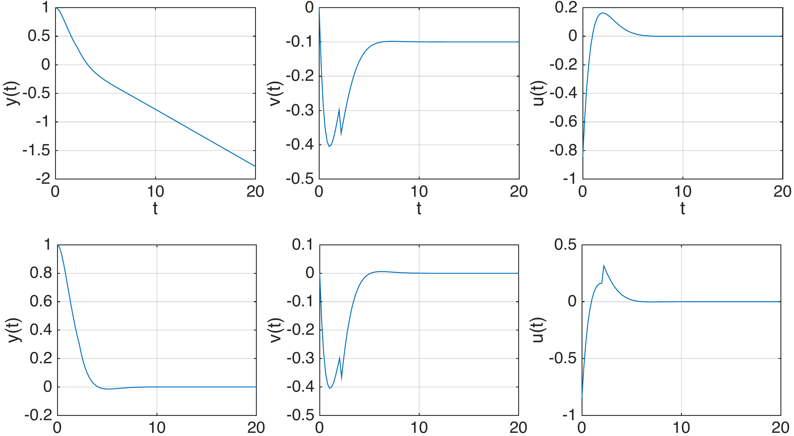
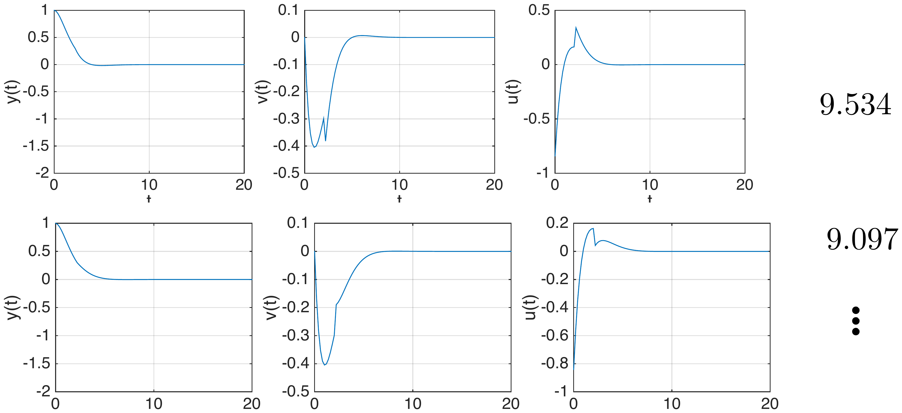
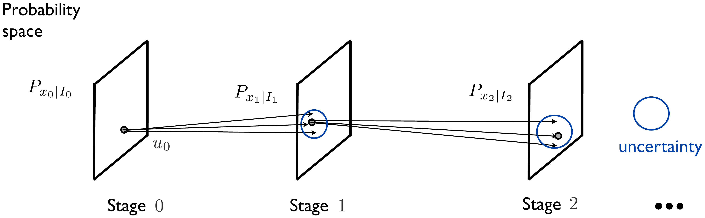
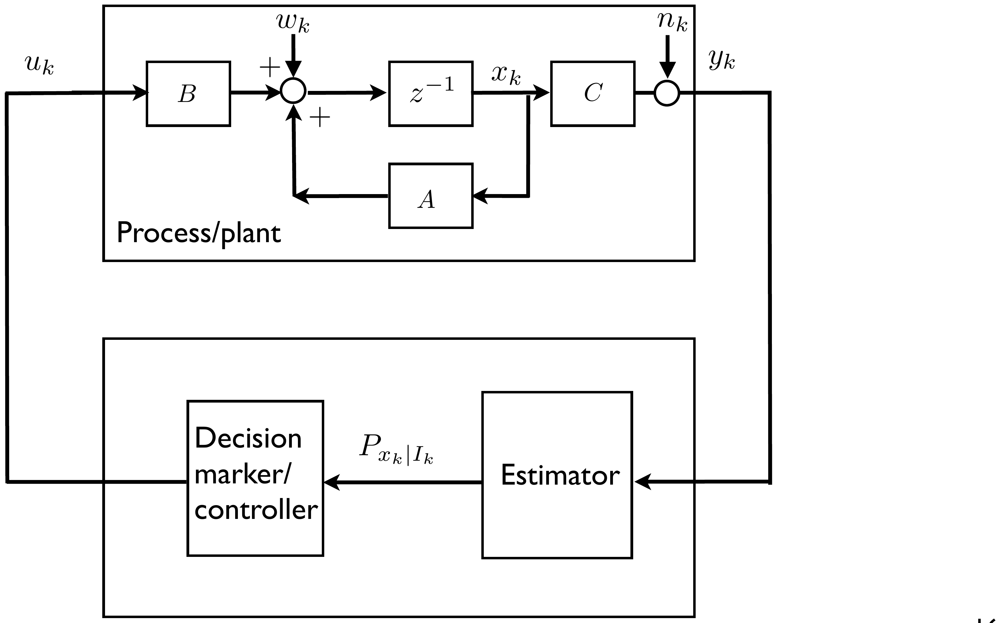
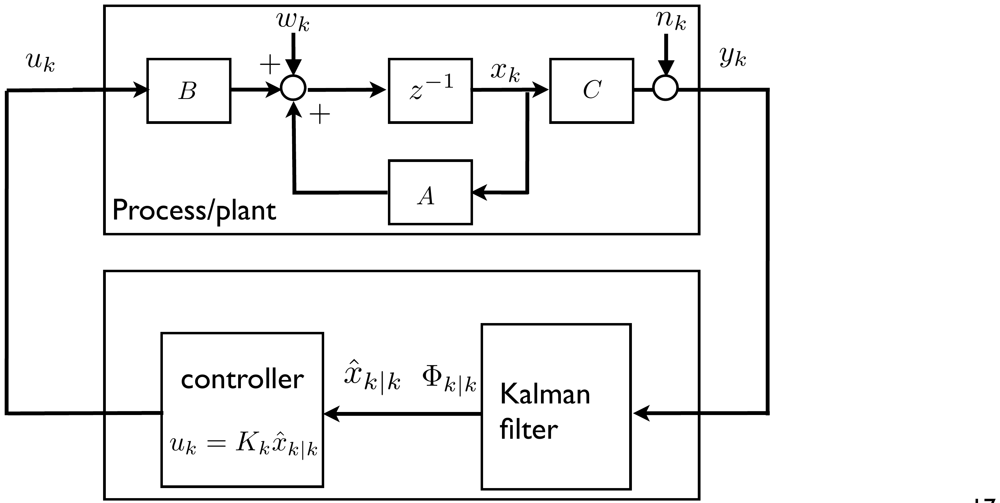
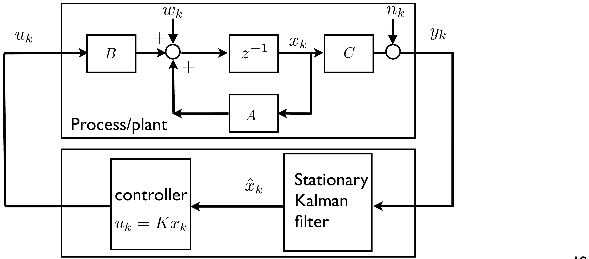
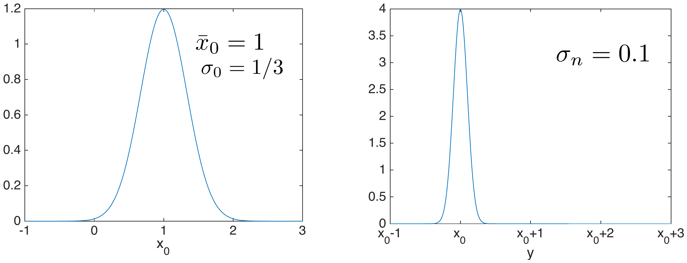
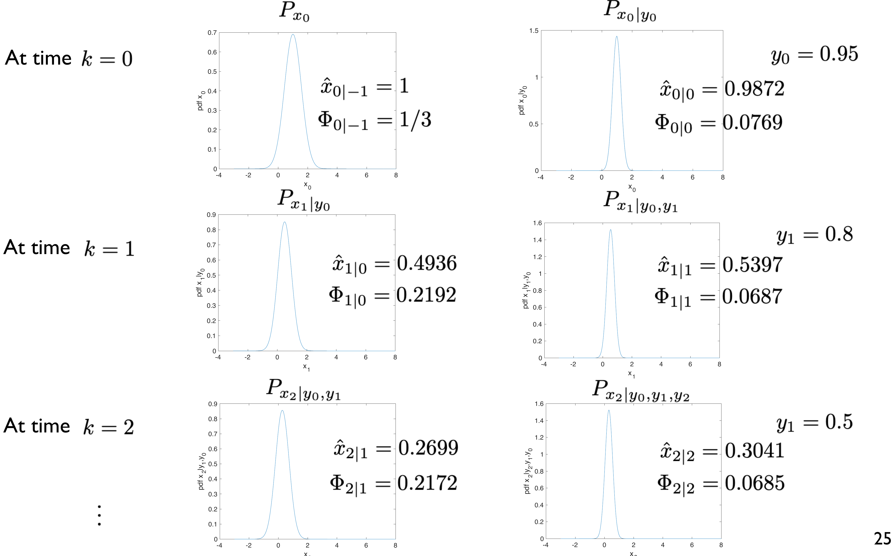
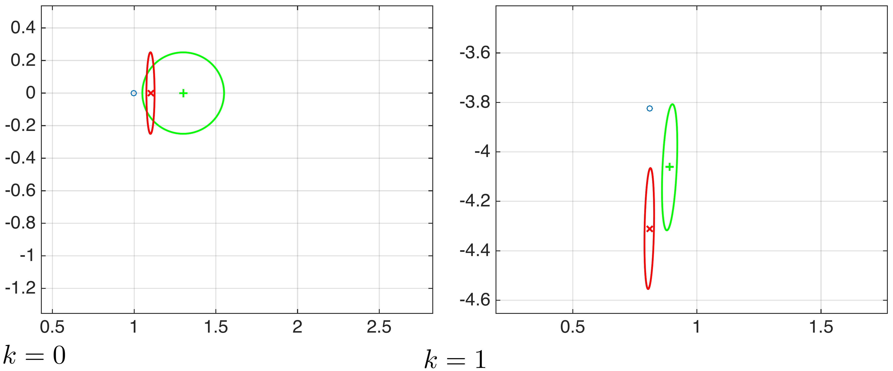

<!--
Textbook-prose companion to lectures/lecture06-kalman-lqg.qmd, intended as
a booklet chapter for readers who did not attend the lecture. Same
content and figures as the slides, but written as connected prose rather
than bullet points, so it can stand on its own. Figures are the same ones
already cropped/verified for the slide deck, referenced from
../lectures/figures/lecture6/ rather than duplicated. First pass: same
scope as units 1-5 notes (straightforward prose conversion with figures
and math); interactive examples/exercises, if wanted, would be added in a
later pass. This lecture has five appendices (A-E) in the slides; all
five are folded into collapsible callouts placed near the main-text
section they extend, rather than kept as trailing appendix sections. The
Kalman portrait (pg31) keeps its photo credit inline in the caption, as
in the other notes files (unlike the slides, which use a separate credit
div). Figure pg35 is a single pre-cropped image combining a decorative
Segway illustration with the inverted-pendulum-on-a-cart schematic
already used in Unit 5; both are described in the caption below, since
the file could not be re-cropped for this pass.
-->

[Slides](../lectures/lecture06-kalman-lqg.html) &middot; [Exercises](../exercises/unit6-exercises.html) &middot; [Jupyter notebooks](../code/unit6/notebooks.html)

## Stochastic linear quadratic control

Unit 5 developed the linear quadratic regulator for a deterministic
dynamic model. In practice, the state evolution is also affected by
random disturbances, and the state itself is often only partially
observed through noisy sensors. This unit removes both simplifications.
It first extends the LQR to a *stochastic* dynamic model, still assuming
full state feedback; it then tackles the general *partial-information*
problem, culminating in the Kalman filter and the linear-quadratic-
Gaussian (LQG) controller.

### The stochastic DP algorithm, revisited

Consider again a general stage decision problem, now with a stochastic
disturbance $w_k \in \mathbb{R}^{n_w}$ entering the dynamics,

$$
x_{k+1} = f_k(x_k,u_k,w_k), \qquad \text{cost} = \sum_{k=0}^{h-1} g_k(x_k,u_k,w_k) + g_h(x_h),
$$

where the disturbances are assumed zero-mean and statistically
independent (white). The goal is to find a policy
$\pi=\{\mu_0,\dots,\mu_{h-1}\}$, $u_k=\mu_k(x_k)$, minimizing the expected
cost

$$
J_\pi(x_0) = \mathbb{E}\Big[\sum_{k=0}^{h-1} g_k(x_k,\mu_k(x_k),w_k) + g_h(x_h)\Big].
$$

As in Unit 2, this is solved by the stochastic DP algorithm: start with
$J_h(x_h)=g_h(x_h)$ for every $x_h \in X_h$, and for
$k \in \{h-1,h-2,\dots,0\}$ compute

$$
J_k(x_k) = \min_{u_k \in U_k(x_k)} \mathbb{E}_{w_k}\big[g_k(x_k,u_k,w_k) + J_{k+1}(f_k(x_k,u_k,w_k))\big],
$$

with $\mu_k(x_k)$ a minimizer. It is worth spelling out that this
expectation is conditional on $x_k$,

$$
\mathbb{E}_{w_k}\big[g_k(x_k,u_k,w_k)+J_{k+1}(f_k(x_k,u_k,w_k))\,\big|\,x_k\big],
$$

which makes explicit that $x_k$ is held fixed while averaging over $w_k$
and minimizing over $u_k$.

### Linear quadratic control with stochastic disturbances

Specialize now to a linear model with additive disturbance,

$$
x_{k+1}=A_kx_k+B_ku_k+w_k, \qquad k\in\{0,\dots,h-1\}, \qquad \mathbb{E}[w_k]=0 \text{ and white},
$$

and the same quadratic cost as in Unit 5,

$$
\mathbb{E}\Big[\sum_{k=0}^{h-1} \begin{bmatrix}x_k^\intercal & u_k^\intercal\end{bmatrix}\begin{bmatrix}Q_k & S_k \\ S_k^\intercal & R_k\end{bmatrix}\begin{bmatrix}x_k \\ u_k\end{bmatrix} + x_h^\intercal Q_h x_h\Big].
$$

**Theorem.** The optimal policy for this stochastic linear quadratic
control problem is

$$
u_k = K_kx_k, \qquad k \in \{0,\dots,h-1\},
$$

with $K_k$ and $P_k$ given by exactly the same Riccati iterations as in
the deterministic case,

$$
K_k = -\big(B_k^\intercal P_{k+1}B_k+R_k\big)^{-1}\big(S_k^\intercal+B_k^\intercal P_{k+1}A_k\big),
$$

$$
P_k = A_k^\intercal P_{k+1}A_k+Q_k - \big(S_k+A_k^\intercal P_{k+1}B_k\big)\big(B_k^\intercal P_{k+1}B_k+R_k\big)^{-1}\big(S_k^\intercal+B_k^\intercal P_{k+1}A_k\big), \qquad P_h=Q_h,
$$

and the resulting expected cost is

$$
J_0(x_0) = x_0^\intercal P_0 x_0 + \sum_{k=0}^{h-1} \text{trace}\big(P_{k+1}\mathbb{E}[w_kw_k^\intercal]\big).
$$

:::: {.callout-note collapse="true" title="Proof: the stochastic LQ optimal policy and cost"}
We show by induction that the cost-to-go at every stage $k$ has the form

$$
J_k(x_k) = x_k^\intercal P_kx_k+c_k, \qquad c_k = \sum_{\ell=k}^{h-1} \text{trace}(P_{\ell+1}\mathbb{E}[w_\ell w_\ell^\intercal]),
$$

with $P_k$ given by the (deterministic) Riccati recursion of Unit 5. This
holds for $k=h$, since $J_h(x_h)=x_h^\intercal Q_hx_h$, i.e. $c_h=0$.
Assume it holds for $k+1$, i.e.
$J_{k+1}(x_{k+1}) = x_{k+1}^\intercal P_{k+1}x_{k+1}+c_{k+1}$. Then, at
step $k$,

$$
J_k(x_k) = \min_{u_k} \mathbb{E}_{w_k}\big[x_k^\intercal Q_kx_k+u_k^\intercal R_ku_k+2x_k^\intercal S_ku_k+x_{k+1}^\intercal P_{k+1}x_{k+1}+c_{k+1}\,|\,x_k\big].
$$

Substituting $x_{k+1}=A_kx_k+B_ku_k+w_k$ and expanding
$x_{k+1}^\intercal P_{k+1}x_{k+1}$, three new terms appear relative to
the deterministic case, involving $w_k^\intercal P_{k+1}(A_kx_k+B_ku_k)$,
its transpose, and $w_k^\intercal P_{k+1}w_k$. The cross terms vanish in
expectation, since

$$
\mathbb{E}_{w_k}\big[w_k^\intercal P_{k+1}(A_kx_k+B_ku_k)\big] = \underbrace{\mathbb{E}_{w_k}[w_k]}_{=0}^\intercal P_{k+1}(A_kx_k+B_ku_k) = 0,
$$

while the quadratic term contributes a constant (independent of $u_k$),

$$
\mathbb{E}[w_k^\intercal P_{k+1}w_k] = \mathbb{E}[\text{trace}(w_k^\intercal P_{k+1}w_k)] = \text{trace}(P_{k+1}\mathbb{E}[w_kw_k^\intercal]).
$$

What remains to be minimized over $u_k$ is exactly the same quadratic
expression as in the deterministic derivation of Unit 5,

$$
\min_{u_k}\big[x_k^\intercal Q_kx_k+u_k^\intercal R_ku_k+2x_k^\intercal S_ku_k+(A_kx_k+B_ku_k)^\intercal P_{k+1}(A_kx_k+B_ku_k)\big],
$$

which gives the same minimizer $u_k=K_kx_k$ and the same value
$x_k^\intercal P_kx_k$. Hence, the optimal policy for the stochastic
problem coincides with the deterministic one, and

$$
J_k(x_k) = x_k^\intercal P_kx_k + \underbrace{c_{k+1}+\text{trace}(P_{k+1}\mathbb{E}[w_kw_k^\intercal])}_{c_k},
$$

which completes the induction. At $k=0$ this gives
$J_0(x_0)=x_0^\intercal P_0x_0+c_0$, i.e. the expression stated above.
::::

### Certainty equivalence

This theorem has a remarkable consequence: the optimal policy is exactly
the same as in the noise-free case $w_k=0$. Recall the three ways of
coping with stochastic disturbances discussed earlier in the course --
open loop (execute the decisions of the optimal path computed ignoring
future disturbances), closed loop via deterministic DP (recompute the
policy pretending disturbances are zero), and closed loop via stochastic
DP (properly average over disturbances). The result above says that when
the dynamic model is linear and the cost is quadratic, all three
approaches coincide. This phenomenon is called *certainty equivalence*.
The cost, of course, does still increase in the presence of disturbances:

$$
J_0(x_0) = \underbrace{x_0^\intercal P_0 x_0}_{\text{cost without disturbances}} + \underbrace{\sum_{k=0}^{h-1}\text{trace}(P_{k+1}\mathbb{E}[w_kw_k^\intercal])}_{\text{additional cost}}.
$$

The result carries over to the infinite-horizon cost

$$
\mathbb{E}\Big[\sum_{k=0}^\infty x_k^\intercal Qx_k+2x_k^\intercal Su_k+u_k^\intercal Ru_k\Big],
$$

with optimal policy $u_k=\bar Kx_k$, $\bar K=-(B^\intercal \bar PB+R)^{-1}(S^\intercal+B^\intercal \bar PA)$,
where $\bar P$ solves the algebraic Riccati equation of Unit 5 -- under
the same assumptions used there. The extra ingredient needed here is that
the cost be bounded, e.g. because the disturbance sequence is eventually
zero ($w_\ell=0$ for $\ell>L$ for some $L>0$); in that case the cost is

$$
x_0^\intercal \bar P x_0 + \sum_{k=0}^\infty \text{trace}(\bar P \mathbb{E}[w_kw_k^\intercal]).
$$

If the cost is not bounded (e.g. persistent disturbances), one instead
considers the *average* cost

$$
\lim_{T\to\infty} \frac{1}{T}\mathbb{E}\Big[\sum_{k=0}^{T-1} x_k^\intercal Qx_k+2x_k^\intercal Su_k+u_k^\intercal Ru_k\Big],
$$

which, assuming $W=\mathbb{E}[w_kw_k^\intercal]$ is the same for every
$k$, converges to $\text{trace}(\bar P W)$.

### Example: the double integrator with a random disturbance

Return to the double integrator of Unit 5,

$$
x_{k+1} = \begin{bmatrix}1&\tau\\0&1\end{bmatrix}x_k + \begin{bmatrix}\frac{\tau^2}{2}\\\tau\end{bmatrix}u_k, \qquad \tau=0.2,
$$

with cost $\sum_{k=0}^{h-1}(x_k^\intercal Qx_k+u_k^\intercal Ru_k)+x_h^\intercal Q_hx_h$,
$Q=I$, $R=1$. As the horizon grows, the optimal policy converges to the
static gain $u_k=Kx_k$, $k\geq 0$, with $K=[-0.8412\ \ -1.54]$. The plot
below shows the resulting control input and states for
$x_0=[y_0\ \ v_0]^\intercal=[1\ \ 0]^\intercal$, with no disturbance.

::: {style="text-align: center;"}
![Position $y(t)$, velocity $v(t)$ and control $u(t)$ under the infinite-horizon optimal policy $u_k=Kx_k$, for the disturbance-free double integrator with $x_0=[1\ \ 0]^\intercal$.](../lectures/figures/lecture6/pg09-example-plots.png){#fig-example-plots width="75%" fig-align="center"}
:::

Now introduce a single disturbance at $k=10$ (i.e. $t=2$ s):

$$
x_{k+1} = \begin{bmatrix}1&\tau\\0&1\end{bmatrix}x_k + \begin{bmatrix}\frac{\tau^2}{2}\\\tau\end{bmatrix}u_k+w_k, \qquad w_k = \begin{cases}\begin{bmatrix}0\\0\end{bmatrix}, & k\in\mathbb{N}_0\setminus\{10\} \\ \begin{bmatrix}0\\a\end{bmatrix}, & k=10,\end{cases}
$$

where $a$ is uniform on $[-0.5,\ 0.5]$. The figure below contrasts an
*open-loop* strategy, which simply executes the pre-computed disturbance-
free control sequence, with the *closed-loop* strategy $u_k=Kx_k$.

::: {style="text-align: center;"}
{#fig-disturbance-plots width="70%" fig-align="center"}
:::

For the closed-loop (infinite-horizon) policy, the expected cost can be
computed directly from the formula above,

$$
x_0^\intercal \bar P x_0+\sum_{k=0}^\infty \text{trace}\big(\bar P\,\mathbb{E}[w_kw_k^\intercal]\big) = x_0^\intercal \bar P x_0+\text{trace}\Big(\bar P\begin{bmatrix}0&0\\0&\mathbb{E}[a^2]\end{bmatrix}\Big),
$$

where $\bar P$ solves the algebraic Riccati equation for this system,

$$
\bar P = \begin{bmatrix}9.1890 & 5.0249\\5.0249 & 9.2324\end{bmatrix}.
$$

Taking $x_0=[0\ \ 1]^\intercal$ (i.e. considering the cost contributed by
the disturbance alone) and $\mathbb{E}[a^2]=\int_{-0.5}^{0.5} t^2\,dt = 1/12$,
this evaluates to a cost of $9.95$. This can be checked against a Monte
Carlo simulation: the figure below shows two individual sample runs (with
their own realized cost), out of 5000 simulated trajectories, whose
average cost matches the analytical prediction almost exactly.

::: {style="text-align: center;"}
{#fig-montecarlo-plots width="80%" fig-align="center"}
:::

:::: {.callout-important collapse="true" title="Interactive example: when and how hard the disturbance hits"}
The panel below reproduces the example above and lets you change the two
things the analysis says should matter: **when** the disturbances occur and
**how large** they are, through their covariance
$W=\mathbb{E}[w_kw_k^\intercal]$. Everything else is as above: $\tau=0.2$,
$Q=I$, $R=1$, $x_0=[1\ \ 0]^\intercal$, and the stationary optimal gain
$\bar K=[-0.8412\ \ -1.5460]$ obtained from
$\bar P=\begin{bmatrix}9.1890&5.0249\\5.0249&9.2324\end{bmatrix}$.

The grey curves are 25 closed-loop sample paths, the blue curve is one
highlighted realization, and the red dashed curve is the *open-loop*
strategy on that same realization: it replays the control sequence computed
for the disturbance-free problem and therefore never reacts to $w_k$.
Costs are reported over the infinite horizon, by charging the tail beyond
the plotted window at its exact value $x_h^\intercal\bar Px_h$.

Three things are worth checking:

- Move the single disturbance from $k=10$ to $k=3$ or $k=30$. The
  trajectories change completely, but the expected cost does not: the term
  $\text{trace}(\bar PW)$ carries no $k$ in it. Each extra disturbance
  instant adds exactly the same amount.
- Scale $W_{22}$ up and down. The cost is *affine* in $W$, so doubling the
  covariance doubles the disturbance's contribution — it does not depend on
  the shape of the distribution, only on its second moment: switching
  between the uniform and the Gaussian noise leaves the expected cost
  unchanged.
- Push the disturbance into the position channel ($W_{11}>0$) and compare
  $\text{trace}(\bar PW)$ with the velocity case. Which channel is more
  expensive to be kicked in, and why does $\bar P$ tell you so before you
  simulate anything?

The open-loop average, shown for comparison, grows without bound as the
window is lengthened: certainty equivalence tells us the *optimal* policy
is the same $u_k=\bar Kx_k$ as in the deterministic problem, but it must be
applied as a feedback law, not as a precomputed sequence.

```{=html}
<div id="sd-wrap" style="margin:1em 0; text-align:center;">
  <div style="margin-bottom:0.5em; font-size:0.9em;">
    <label>disturbance times k
      <input id="sd-times" type="text" value="10" style="width:7em;">
    </label>
    <label style="margin-left:0.8em;">noise
      <select id="sd-dist">
        <option value="unif" selected>uniform</option>
        <option value="gauss">Gaussian</option>
      </select>
    </label>
    <label style="margin-left:0.8em;">window h
      <input id="sd-h" type="number" value="40" min="5" max="120" step="5" style="width:4.5em;">
    </label>
    <label style="margin-left:0.8em;">runs
      <input id="sd-n" type="number" value="3000" min="100" max="20000" step="500" style="width:6em;">
    </label>
  </div>
  <div style="margin-bottom:0.6em; font-size:0.9em;">
    W =
    <label><input id="sd-w11" type="number" value="0" min="0" step="0.02" style="width:5.5em;"></label>
    <label style="margin-left:0.3em;"><input id="sd-w12" type="number" value="0" step="0.02" style="width:5.5em;"></label>
    <label style="margin-left:0.3em;"><input id="sd-w22" type="number" value="0.0833" min="0" step="0.02" style="width:5.5em;"></label>
    <span style="color:#555; font-size:0.9em; margin-left:0.4em;">(W&#8321;&#8321;, W&#8321;&#8322;, W&#8322;&#8322;; the example has W&#8322;&#8322; = 1/12)</span>
  </div>
  <div id="sd-plots"></div>
  <div id="sd-cost" style="margin:0.4em 0;"></div>
  <div id="sd-note" style="font-size:0.85em; color:#6a1b9a; min-height:1.2em;"></div>
  <div>
    <button id="sd-new" style="padding:4px 12px;">New realization</button>
    <button id="sd-reset" style="padding:4px 12px; margin-left:0.4em;">Back to the example</button>
  </div>
  <div style="font-size:0.8em; color:#555; margin-top:0.5em; line-height:1.6;">
    Grey: 25 closed-loop sample paths &nbsp;&middot;&nbsp;
    <span style="color:#1565c0;">blue</span>: highlighted closed-loop realization &nbsp;&middot;&nbsp;
    <span style="color:#e53935;">red dashed</span>: open loop on the same realization &nbsp;&middot;&nbsp;
    <span style="color:#7e57c2;">dotted verticals</span>: disturbance instants.
  </div>
</div>
<script>
(function () {
  // ---- core maths, shared by the demo and the test harness -------------------
  const TAU = 0.2;
  const A = [[1, TAU], [0, 1]], B = [TAU * TAU / 2, TAU];
  const Q = [[1, 0], [0, 1]], R = 1;

  function are() {                       // infinite-horizon Riccati, by iteration
    let P = [[1, 0], [0, 1]];
    for (let it = 0; it < 20000; it++) {
      const PB = [P[0][0] * B[0] + P[0][1] * B[1], P[1][0] * B[0] + P[1][1] * B[1]];
      const den = B[0] * PB[0] + B[1] * PB[1] + R;
      const BPA = [B[0] * (P[0][0] * A[0][0] + P[0][1] * A[1][0]) + B[1] * (P[1][0] * A[0][0] + P[1][1] * A[1][0]),
                   B[0] * (P[0][0] * A[0][1] + P[0][1] * A[1][1]) + B[1] * (P[1][0] * A[0][1] + P[1][1] * A[1][1])];
      const APA = [[0, 0], [0, 0]];
      for (let i = 0; i < 2; i++) for (let j = 0; j < 2; j++) {
        let s = 0;
        for (let a = 0; a < 2; a++) for (let b = 0; b < 2; b++) s += A[a][i] * P[a][b] * A[b][j];
        APA[i][j] = s;
      }
      const APB = [A[0][0] * PB[0] + A[1][0] * PB[1], A[0][1] * PB[0] + A[1][1] * PB[1]];
      const N = [[0, 0], [0, 0]];
      let d = 0;
      for (let i = 0; i < 2; i++) for (let j = 0; j < 2; j++) {
        N[i][j] = APA[i][j] + Q[i][j] - APB[i] * BPA[j] / den;
        d = Math.max(d, Math.abs(N[i][j] - P[i][j]));
      }
      P = N;
      if (d < 1e-13) break;
    }
    const PB = [P[0][0] * B[0] + P[0][1] * B[1], P[1][0] * B[0] + P[1][1] * B[1]];
    const den = B[0] * PB[0] + B[1] * PB[1] + R;
    const BPA = [B[0] * (P[0][0] * A[0][0] + P[0][1] * A[1][0]) + B[1] * (P[1][0] * A[0][0] + P[1][1] * A[1][0]),
                 B[0] * (P[0][0] * A[0][1] + P[0][1] * A[1][1]) + B[1] * (P[1][0] * A[0][1] + P[1][1] * A[1][1])];
    return { P, K: [-BPA[0] / den, -BPA[1] / den] };
  }

  function chol(W) {                     // W = L L', 2x2, PSD-safe
    const l11 = Math.sqrt(Math.max(W[0][0], 0));
    const l21 = l11 > 1e-12 ? W[0][1] / l11 : 0;
    const l22 = Math.sqrt(Math.max(W[1][1] - l21 * l21, 0));
    return [[l11, 0], [l21, l22]];
  }
  function unitSample(kind) {             // zero mean, unit variance
    if (kind === 'gauss') {
      let u = 0, v = 0;
      while (u === 0) u = Math.random();
      v = Math.random();
      return Math.sqrt(-2 * Math.log(u)) * Math.cos(2 * Math.PI * v);
    }
    return (Math.random() * 2 - 1) * Math.sqrt(3);   // uniform on [-sqrt3, sqrt3]
  }
  function quad(P, x) {
    return P[0][0] * x[0] * x[0] + 2 * P[0][1] * x[0] * x[1] + P[1][1] * x[1] * x[1];
  }
  function step(x, u, w) {
    return [A[0][0] * x[0] + A[0][1] * x[1] + B[0] * u + w[0],
            A[1][0] * x[0] + A[1][1] * x[1] + B[1] * u + w[1]];
  }

  // nominal (disturbance-free) closed-loop trajectory and its input sequence
  function nominal(x0, K, h) {
    const xs = [x0.slice()], us = [];
    for (let k = 0; k < h; k++) {
      const u = K[0] * xs[k][0] + K[1] * xs[k][1];
      us.push(u);
      xs.push(step(xs[k], u, [0, 0]));
    }
    return { xs, us };
  }

  // one realization; returns closed-loop and open-loop paths + costs
  // cost = sum_{k<h} (x'Qx + Ru^2) + x_h' Pbar x_h   (exact infinite-horizon cost
  // for the closed loop; for the open loop it assumes the optimal policy takes
  // over at k = h)
  function run(x0, K, P, h, times, L, kind, ws) {
    const nom = nominal(x0, K, h);
    const W = ws || [];
    if (!ws) {
      for (let k = 0; k < h; k++) {
        if (times.indexOf(k) >= 0) {
          const z = [unitSample(kind), unitSample(kind)];
          W.push([L[0][0] * z[0], L[1][0] * z[0] + L[1][1] * z[1]]);
        } else W.push([0, 0]);
      }
    }
    const cx = [x0.slice()], cu = [], ox = [x0.slice()], ou = [];
    let Jc = 0, Jo = 0;
    for (let k = 0; k < h; k++) {
      const uc = K[0] * cx[k][0] + K[1] * cx[k][1];
      cu.push(uc);
      Jc += quad(Q, cx[k]) + R * uc * uc;
      cx.push(step(cx[k], uc, W[k]));
      const uo = nom.us[k];
      ou.push(uo);
      Jo += quad(Q, ox[k]) + R * uo * uo;
      ox.push(step(ox[k], uo, W[k]));
    }
    Jc += quad(P, cx[h]);
    Jo += quad(P, ox[h]);
    return { cx, cu, ox, ou, Jc, Jo, W, nom };
  }

  // ---------------- parsing / state ----------------
  const el = id => document.getElementById(id);
  let times = [10], Wm = [[0, 0], [0, 1 / 12]], kind = 'unif', h = 40, NMC = 3000;
  let sample = null, stats = null;
  const { P: Pbar, K: Kbar } = are();
  const X0 = [1, 0];

  function parseTimes(s) {
    const out = [];
    s.split(/[^0-9.\-]+/).forEach(t => {
      if (t === '') return;
      const v = Math.round(Number(t));
      if (isFinite(v) && v >= 0 && v < h && out.indexOf(v) < 0) out.push(v);
    });
    out.sort((a, b) => a - b);
    return out;
  }
  function num(id, dflt) { const v = Number(el(id).value); return isFinite(v) ? v : dflt; }

  function readInputs() {
    h = Math.max(5, Math.min(120, Math.round(num('sd-h', 40))));
    NMC = Math.max(100, Math.min(20000, Math.round(num('sd-n', 3000))));
    kind = el('sd-dist').value;
    times = parseTimes(el('sd-times').value);
    const w11 = Math.max(0, num('sd-w11', 0)), w22 = Math.max(0, num('sd-w22', 0));
    let w12 = num('sd-w12', 0);
    const lim = Math.sqrt(w11 * w22);
    let clipped = false;
    if (Math.abs(w12) > lim) { w12 = Math.sign(w12) * lim; clipped = true; }
    Wm = [[w11, w12], [w12, w22]];
    return clipped;
  }

  function compute() {
    const clipped = readInputs();
    const L = chol(Wm);
    const trPW = Pbar[0][0] * Wm[0][0] + 2 * Pbar[0][1] * Wm[0][1] + Pbar[1][1] * Wm[1][1];
    const Jan = quad(Pbar, X0) + times.length * trPW;
    let sc = 0, so = 0;
    const bundle = [];
    for (let i = 0; i < NMC; i++) {
      const r = run(X0, Kbar, Pbar, h, times, L, kind);
      sc += r.Jc; so += r.Jo;
      if (i < 25) bundle.push(r.cx);
    }
    sample = run(X0, Kbar, Pbar, h, times, L, kind);
    stats = { Jan, trPW, Jc: sc / NMC, Jo: so / NMC, bundle, clipped };
  }

  // ---------------- drawing ----------------
  const cv = document.createElement('canvas');
  cv.width = 690; cv.height = 390;
  cv.style.maxWidth = '100%'; cv.style.border = '1px solid #ccc';
  cv.style.display = 'block'; cv.style.margin = '0 auto 6px';
  el('sd-plots').appendChild(cv);
  const cx2 = cv.getContext('2d');

  function panel(idx) {                 // geometry of panel idx (0,1,2)
    const top = 10 + idx * 126, hgt = 100;
    return { x0: 52, x1: 672, y0: top, y1: top + hgt };
  }
  function drawPanel(idx, label, series, dmin, dmax) {
    const p = panel(idx);
    let lo = dmin, hi = dmax;
    if (lo === hi) { lo -= 1; hi += 1; }
    const pad = 0.12 * (hi - lo); lo -= pad; hi += pad;
    const X = k => p.x0 + (k / h) * (p.x1 - p.x0);
    const Y = v => p.y1 - (v - lo) / (hi - lo) * (p.y1 - p.y0);
    // frame + zero line
    cx2.strokeStyle = '#bbb'; cx2.lineWidth = 1;
    cx2.strokeRect(p.x0, p.y0, p.x1 - p.x0, p.y1 - p.y0);
    if (lo < 0 && hi > 0) {
      cx2.strokeStyle = '#ddd';
      cx2.beginPath(); cx2.moveTo(p.x0, Y(0)); cx2.lineTo(p.x1, Y(0)); cx2.stroke();
    }
    // disturbance instants
    cx2.strokeStyle = '#b39ddb'; cx2.setLineDash([3, 3]);
    times.forEach(k => { cx2.beginPath(); cx2.moveTo(X(k), p.y0); cx2.lineTo(X(k), p.y1); cx2.stroke(); });
    cx2.setLineDash([]);
    // series: {data, color, width, dash}
    series.forEach(s => {
      cx2.strokeStyle = s.color; cx2.lineWidth = s.width; cx2.setLineDash(s.dash || []);
      cx2.beginPath();
      s.data.forEach((v, k) => { if (k === 0) cx2.moveTo(X(k), Y(v)); else cx2.lineTo(X(k), Y(v)); });
      cx2.stroke(); cx2.setLineDash([]);
    });
    // labels
    cx2.fillStyle = '#333'; cx2.font = '12px sans-serif'; cx2.textAlign = 'right';
    cx2.fillText(hi.toFixed(2), p.x0 - 5, p.y0 + 10);
    cx2.fillText(lo.toFixed(2), p.x0 - 5, p.y1);
    cx2.textAlign = 'left';
    cx2.fillText(label, p.x0 + 6, p.y0 + 13);
    if (idx === 2) {
      cx2.textAlign = 'center';
      for (let k = 0; k <= h; k += Math.max(1, Math.round(h / 8))) cx2.fillText((k * TAU).toFixed(1), X(k), p.y1 + 15);
      cx2.fillText('t  [s]', (p.x0 + p.x1) / 2, p.y1 + 30);
    }
  }
  function draw() {
    cx2.clearRect(0, 0, cv.width, cv.height);
    const comp = [
      { lab: 'position  y', f: x => x[0], get: r => r.cx.map(x => x[0]), ol: sample.ox.map(x => x[0]), cl: sample.cx.map(x => x[0]) },
      { lab: 'velocity  v', f: x => x[1], get: r => r.cx.map(x => x[1]), ol: sample.ox.map(x => x[1]), cl: sample.cx.map(x => x[1]) }
    ];
    comp.forEach((c, i) => {
      let lo = Infinity, hi = -Infinity;
      const bundleSeries = stats.bundle.map(xs => {
        const d = xs.map(c.f);
        d.forEach(v => { lo = Math.min(lo, v); hi = Math.max(hi, v); });
        return { data: d, color: 'rgba(120,144,156,0.35)', width: 1 };
      });
      c.ol.concat(c.cl).forEach(v => { lo = Math.min(lo, v); hi = Math.max(hi, v); });
      drawPanel(i, c.lab, bundleSeries.concat([
        { data: c.ol, color: '#e53935', width: 2, dash: [6, 4] },
        { data: c.cl, color: '#1565c0', width: 2 }
      ]), lo, hi);
    });
    let lo = Infinity, hi = -Infinity;
    sample.ou.concat(sample.cu).forEach(v => { lo = Math.min(lo, v); hi = Math.max(hi, v); });
    drawPanel(2, 'control  u', [
      { data: sample.ou, color: '#e53935', width: 2, dash: [6, 4] },
      { data: sample.cu, color: '#1565c0', width: 2 }
    ], lo, hi);
  }

  function report() {
    const f = v => v.toFixed(3);
    el('sd-cost').innerHTML =
      '<table style="margin:0 auto; border-collapse:collapse; font-size:0.88em;">' +
      '<tr><td style="text-align:left; padding:1px 10px;">analytic expected cost &nbsp;' +
      'x&#8320;<sup>&#8868;</sup>P&#773;x&#8320; + m&middot;trace(P&#773;W)</td>' +
      '<td style="text-align:right; padding:1px 10px;"><b>' + f(stats.Jan) + '</b></td>' +
      '<td style="text-align:left; padding:1px 10px; color:#555;">= ' + f(quad(Pbar, X0)) +
      ' + ' + times.length + '&middot;' + f(stats.trPW) + '</td></tr>' +
      '<tr><td style="text-align:left; padding:1px 10px;">Monte Carlo average, closed loop u<sub>k</sub>=K&#773;x<sub>k</sub> (' +
      NMC + ' runs)</td><td style="text-align:right; padding:1px 10px;"><b>' + f(stats.Jc) + '</b></td>' +
      '<td style="text-align:left; padding:1px 10px; color:#555;">this sample path: ' + f(sample.Jc) + '</td></tr>' +
      '<tr><td style="text-align:left; padding:1px 10px;">Monte Carlo average, open loop</td>' +
      '<td style="text-align:right; padding:1px 10px;"><b>' + f(stats.Jo) + '</b></td>' +
      '<td style="text-align:left; padding:1px 10px; color:#555;">this sample path: ' + f(sample.Jo) + '</td></tr>' +
      '</table>';
    let msg = times.length === 0 ? 'No disturbance: the two strategies coincide.' : '';
    if (stats.clipped) msg += (msg ? ' ' : '') + 'W&#8321;&#8322; was clipped to keep W positive semidefinite.';
    el('sd-note').innerHTML = msg;
  }

  function refresh() { compute(); draw(); report(); }

  ['sd-times', 'sd-w11', 'sd-w12', 'sd-w22', 'sd-h', 'sd-n', 'sd-dist'].forEach(id => {
    el(id).addEventListener('change', () => refresh());
  });
  el('sd-new').addEventListener('click', () => refresh());
  el('sd-reset').addEventListener('click', () => {
    el('sd-times').value = '10'; el('sd-w11').value = '0'; el('sd-w12').value = '0';
    el('sd-w22').value = '0.0833'; el('sd-h').value = '40'; el('sd-n').value = '3000';
    el('sd-dist').value = 'unif';
    refresh();
  });
  refresh();
})();
</script>
```

::::

## Output-feedback linear quadratic control

So far we have assumed the controller has access to the full state
$x_k$. We now turn to the general partial-information setting already
introduced in Unit 4 for discrete problems: the state is driven by
disturbances and only an output $y_k$, corrupted by noise, is available.

### Problem formulation

The dynamic model, cost, and output equation are

$$
x_{k+1}=f_k(x_k,u_k,w_k), \qquad \sum_{k=0}^{h-1} g_k(x_k,u_k,w_k)+g_h(x_h), \qquad y_k=h_k(x_k,u_{k-1},n_k),
$$

with information set

$$
I_0=(y_0), \qquad I_k=(y_0,y_1,\dots,y_k,u_0,u_1,\dots,u_{k-1}), \quad k\geq 1.
$$

The goal is to find a policy $\pi=\{\mu_0,\dots,\mu_{h-1}\}$,
$u_k=\mu_k(I_k)$, minimizing
$J_\pi = \mathbb{E}\big[\sum_{k=0}^{h-1} g_k(x_k,\mu_k(I_k),w_k) + g_h(x_h)\big]$,
where the initial state, disturbances and output noise are all zero
mean, statistically independent, and have known probability
distributions.

**First approach: the information set as the state.** As in Unit 4, one
can reformulate this as a standard full-information problem by treating
the entire information set $I_k$ as the state at stage $k$. The problem
is that the dimension of $I_k$ -- and hence of the corresponding
measurement/information space -- grows with $k$, as illustrated below.

::: {style="text-align: center;"}
{#fig-first-approach width="90%" fig-align="center"}
:::

**Second approach: the belief state.** As in Unit 4, it is possible to
show that the conditional probability distribution of the state given
the information so far, $P_{x_k|I_k}$, is sufficient to determine optimal
decisions, $u_k=\mu_k(P_{x_k|I_k})$. Unlike $I_k$ itself, this
distribution lives in a fixed-dimensional space, though in general it can
still be hard to represent or store.

::: {style="text-align: center;"}
{#fig-second-approach width="85%" fig-align="center"}
:::

### The Gaussian, linear-quadratic case

To make this tractable we specialize, as in the deterministic case, to a
linear model and a quadratic cost, now with a linear, noisy output:

$$
x_{k+1}=Ax_k+Bu_k+w_k, \qquad \sum_{k=0}^{h-1}\begin{bmatrix}x_k^\intercal & u_k^\intercal\end{bmatrix}\begin{bmatrix}Q&S\\S^\intercal&R\end{bmatrix}\begin{bmatrix}x_k\\u_k\end{bmatrix}+x_h^\intercal Q_hx_h, \qquad y_k=Cx_k+n_k,
$$

with information set $I_k=(y_0,\dots,y_k,u_0,\dots,u_{k-1})$, and the
goal is again a policy $u_k=\mu_k(I_k)$ minimizing the expected cost.
Crucially, we now also assume every random quantity is *Gaussian*: the
initial state $x_0 \sim \mathcal{N}(\bar x_0,\bar\Phi_0)$, with
$\bar\Phi_0=\mathbb{E}[(x_0-\bar x_0)(x_0-\bar x_0)^\intercal]$ its
covariance and density

$$
f(x) = \frac{1}{\sqrt{(2\pi)^k\det(\Sigma)}}e^{-\frac{1}{2}(x-\bar x_0)^\intercal \bar\Phi_0^{-1}(x-\bar x_0)}, \qquad \text{Prob}[x_0\in A] = \int_A f(x)\,dx,
$$

illustrated below for $\bar x_0=[1\ \ 2]^\intercal$,
$\bar\Phi_0=\begin{bmatrix}2&0.5\\0.5&2\end{bmatrix}$; the output noise
$n_k\sim\mathcal{N}(0,V)$ and the disturbance $w_k\sim\mathcal{N}(0,W)$
are independent across time. For simplicity, the model and cost matrices
are taken time-invariant.

::: {style="text-align: center;"}
![The Gaussian probability density of the initial state $x_0=[x_0^1\ \ x_0^2]^\intercal$, for $\bar x_0=[1\ \ 2]^\intercal$ and $\bar\Phi_0=\begin{bmatrix}2&0.5\\0.5&2\end{bmatrix}$: a bell-shaped surface centered at $\bar x_0$, whose spread is controlled by $\bar\Phi_0$.](../lectures/figures/lecture6/pg18-gaussian-3d.png){#fig-gaussian-3d width="42%" fig-align="center"}
:::

:::: {.callout-important collapse="true" title="Interactive example: the shape of a Gaussian"}
Before using Gaussians to describe beliefs, it is worth getting a feel for
what the mean and the covariance actually do to the density. Pick the
one-dimensional case to see $f(x)$ for a scalar $x\sim\mathcal{N}(\mu,\sigma^2)$,
or the two-dimensional case to see the bell-shaped surface of the figure
above together with its contour plot, for
$x\sim\mathcal{N}(\bar x_0,\bar\Phi_0)$ with
$\bar\Phi_0=\begin{bmatrix}\Sigma_{11}&\Sigma_{12}\\\Sigma_{12}&\Sigma_{22}\end{bmatrix}$.
The panel starts at the values of @fig-gaussian-3d.

In the two-dimensional view the red curves are the level sets of the
exponent, i.e. the ellipses
$(x-\bar x_0)^\intercal\bar\Phi_0^{-1}(x-\bar x_0)=k^2$ for $k=1,2,3$; the
dashed green segments are the principal axes of $\bar\Phi_0$, with lengths
given by the square roots of its eigenvalues.

Things to try:

- Change the mean. Nothing about the shape changes, the whole density just
  translates: the mean says *where*, the covariance says *how uncertain*.
- In the 1D view, increase $\sigma^2$. The curve widens and, since the area
  under it must stay $1$, its peak drops as $1/\sigma$. The mass inside
  $\mu\pm\sigma$, $\mu\pm2\sigma$ and $\mu\pm3\sigma$ is reported below the
  plot and never moves from $68\%$, $95\%$, $99.7\%$ — the familiar reason
  why a covariance is such a compact summary of uncertainty.
- In the 2D view, set $\Sigma_{12}=0$ and make $\Sigma_{11}\neq\Sigma_{22}$:
  the ellipses are axis-aligned and the two components are independent. Now
  raise $\Sigma_{12}$ towards $\sqrt{\Sigma_{11}\Sigma_{22}}$. The ellipses
  tilt and collapse onto a line, the smaller eigenvalue goes to zero and the
  peak density blows up: knowing $x^1$ then tells you almost exactly what
  $x^2$ is. Note that the *marginals* printed below the plot do not change
  at all while you do this — correlation is information the individual
  components cannot see, and exploiting it is precisely what the estimator
  of the next sections does.
- Switch the sample cloud on. These are the realizations a Monte Carlo
  simulation would produce; roughly $39\%$ of them fall inside the innermost
  ellipse in 2D, not $68\%$ as in 1D.

```{=html}
<div id="g-wrap" style="margin:1em 0; text-align:center;">
  <div style="margin-bottom:0.6em; font-size:0.9em;">
    <label>dimension
      <select id="g-mode">
        <option value="1">1D</option>
        <option value="2" selected>2D</option>
      </select>
    </label>
    <span id="g-1d" style="margin-left:0.8em;">
      <label>&mu;
        <input id="g-mu" type="number" value="0" step="0.5" style="width:5em;">
      </label>
      <label style="margin-left:0.5em;">&sigma;&sup2;
        <input id="g-var" type="number" value="1" min="0.01" step="0.25" style="width:5em;">
      </label>
    </span>
    <span id="g-2d" style="margin-left:0.8em;">
      <label>&mu; = (
        <input id="g-mu1" type="number" value="1" step="0.5" style="width:4.5em;">
        <input id="g-mu2" type="number" value="2" step="0.5" style="width:4.5em;">)
      </label>
      <label style="margin-left:0.6em;">&Sigma; = (
        <input id="g-s11" type="number" value="2" min="0.01" step="0.25" style="width:4.5em;">
        <input id="g-s12" type="number" value="0.5" step="0.25" style="width:4.5em;">
        <input id="g-s22" type="number" value="2" min="0.01" step="0.25" style="width:4.5em;">)
      </label>
      <span style="color:#555; font-size:0.9em;">&Sigma;&#8321;&#8321;, &Sigma;&#8321;&#8322;, &Sigma;&#8322;&#8322;</span>
    </span>
  </div>
  <div id="g-plot"></div>
  <div id="g-info" style="margin:0.4em 0;"></div>
  <div id="g-note" style="font-size:0.85em; color:#6a1b9a; min-height:1.2em;"></div>
  <div>
    <label style="font-size:0.9em; margin-right:0.6em;">
      <input id="g-samp" type="checkbox" checked> show samples
    </label>
    <button id="g-new" style="padding:4px 12px;">New samples</button>
    <button id="g-reset" style="padding:4px 12px; margin-left:0.4em;">Back to the figure above</button>
  </div>
</div>
<script>
(function () {
  // ---------------- Gaussian utilities ----------------
  function chol2(S) {                       // S = L L', PSD-safe
    const l11 = Math.sqrt(Math.max(S[0][0], 0));
    const l21 = l11 > 1e-12 ? S[0][1] / l11 : 0;
    const l22 = Math.sqrt(Math.max(S[1][1] - l21 * l21, 0));
    return [[l11, 0], [l21, l22]];
  }
  function inv2(S) {
    const d = S[0][0] * S[1][1] - S[0][1] * S[1][0];
    return { det: d, M: [[S[1][1] / d, -S[0][1] / d], [-S[1][0] / d, S[0][0] / d]] };
  }
  function eig2(S) {                        // symmetric 2x2
    const a = S[0][0], b = S[0][1], c = S[1][1];
    const t = (a + c) / 2, r = Math.sqrt(Math.max(((a - c) / 2) ** 2 + b * b, 0));
    const l1 = t + r, l2 = t - r;
    let v1 = Math.abs(b) > 1e-12 ? [l1 - c, b] : (a >= c ? [1, 0] : [0, 1]);
    const n = Math.hypot(v1[0], v1[1]) || 1;
    v1 = [v1[0] / n, v1[1] / n];
    return { l1, l2, v1, ang: Math.atan2(v1[1], v1[0]) };
  }
  function dens2(S) {                       // returns f(x1,x2) for mean-centred offsets
    const { det, M } = inv2(S);
    const c = 1 / (2 * Math.PI * Math.sqrt(Math.max(det, 1e-300)));
    return (dx, dy) => c * Math.exp(-0.5 * (dx * (M[0][0] * dx + M[0][1] * dy) + dy * (M[1][0] * dx + M[1][1] * dy)));
  }
  function dens1(s2) {
    const c = 1 / Math.sqrt(2 * Math.PI * s2);
    return d => c * Math.exp(-0.5 * d * d / s2);
  }
  function randn() {
    let u = 0;
    while (u === 0) u = Math.random();
    return Math.sqrt(-2 * Math.log(u)) * Math.cos(2 * Math.PI * Math.random());
  }
  function erf(x) {                          // Abramowitz-Stegun 7.1.26
    const s = x < 0 ? -1 : 1; x = Math.abs(x);
    const t = 1 / (1 + 0.3275911 * x);
    const y = 1 - (((((1.061405429 * t - 1.453152027) * t) + 1.421413741) * t - 0.284496736) * t + 0.254829592) * t * Math.exp(-x * x);
    return s * y;
  }
  const massWithin = k => erf(k / Math.SQRT2);     // P[|x-mu| < k sigma] in 1D

  // ---------------- state ----------------
  const el = id => document.getElementById(id);
  const DEF = { mode: '2', mu1: 1, mu2: 2, s11: 2, s12: 0.5, s22: 2, mu: 0, var1: 1 };
  let st = Object.assign({}, DEF), clipped = false, samples = [];

  function num(id, d) { const v = Number(el(id).value); return isFinite(v) ? v : d; }
  function read() {
    st.mode = el('g-mode').value;
    st.mu = num('g-mu', 0);
    st.var1 = Math.max(1e-4, num('g-var', 1));
    st.mu1 = num('g-mu1', 0); st.mu2 = num('g-mu2', 0);
    st.s11 = Math.max(1e-4, num('g-s11', 1)); st.s22 = Math.max(1e-4, num('g-s22', 1));
    st.s12 = num('g-s12', 0);
    const lim = 0.999 * Math.sqrt(st.s11 * st.s22);
    clipped = Math.abs(st.s12) > lim;
    if (clipped) st.s12 = Math.sign(st.s12) * lim;
    el('g-1d').style.display = st.mode === '1' ? '' : 'none';
    el('g-2d').style.display = st.mode === '2' ? '' : 'none';
  }
  function drawSamples() { return el('g-samp').checked; }
  function resample() {
    samples = [];
    if (st.mode === '1') { for (let i = 0; i < 260; i++) samples.push(st.mu + Math.sqrt(st.var1) * randn()); }
    else {
      const L = chol2([[st.s11, st.s12], [st.s12, st.s22]]);
      for (let i = 0; i < 400; i++) {
        const z1 = randn(), z2 = randn();
        samples.push([st.mu1 + L[0][0] * z1, st.mu2 + L[1][0] * z1 + L[1][1] * z2]);
      }
    }
  }

  // ---------------- canvas ----------------
  const cv = document.createElement('canvas');
  cv.width = 690; cv.height = 330;
  cv.style.maxWidth = '100%'; cv.style.border = '1px solid #ccc';
  cv.style.display = 'block'; cv.style.margin = '0 auto 6px';
  el('g-plot').appendChild(cv);
  const c = cv.getContext('2d');
  const FS = '12px sans-serif';

  function heat(v) {                        // 0..1 -> white-blue-purple
    const t = Math.max(0, Math.min(1, v));
    const r = Math.round(255 - 215 * t), g = Math.round(255 - 185 * t), b = Math.round(255 - 60 * t);
    return 'rgb(' + r + ',' + g + ',' + b + ')';
  }

  function draw1D() {
    const W = 690, H = 330;
    c.clearRect(0, 0, W, H);
    const sg = Math.sqrt(st.var1), f = dens1(st.var1);
    const x0 = st.mu - 4.2 * sg, x1 = st.mu + 4.2 * sg;
    const px = x => 55 + (x - x0) / (x1 - x0) * 610;
    const fmax = f(0), py = v => 258 - v / (fmax * 1.12) * 228;
    // shaded bands
    const band = (k, col) => {
      c.fillStyle = col;
      c.beginPath(); c.moveTo(px(st.mu - k * sg), py(0));
      for (let i = 0; i <= 120; i++) { const x = st.mu - k * sg + i / 120 * 2 * k * sg; c.lineTo(px(x), py(f(x - st.mu))); }
      c.lineTo(px(st.mu + k * sg), py(0)); c.closePath(); c.fill();
    };
    band(2, 'rgba(21,101,192,0.10)'); band(1, 'rgba(21,101,192,0.22)');
    // axes
    c.strokeStyle = '#777'; c.lineWidth = 1;
    c.beginPath(); c.moveTo(55, py(0)); c.lineTo(665, py(0)); c.stroke();
    c.beginPath(); c.moveTo(55, 28); c.lineTo(55, py(0)); c.stroke();
    // density
    c.strokeStyle = '#1565c0'; c.lineWidth = 2; c.beginPath();
    for (let i = 0; i <= 400; i++) { const x = x0 + i / 400 * (x1 - x0); if (i === 0) c.moveTo(px(x), py(f(x - st.mu))); else c.lineTo(px(x), py(f(x - st.mu))); }
    c.stroke();
    // mean and +-sigma markers
    c.strokeStyle = '#e53935'; c.setLineDash([5, 4]); c.lineWidth = 1.5;
    c.beginPath(); c.moveTo(px(st.mu), py(0)); c.lineTo(px(st.mu), py(fmax)); c.stroke();
    c.strokeStyle = '#7e57c2';
    [-2, -1, 1, 2].forEach(k => { c.beginPath(); c.moveTo(px(st.mu + k * sg), py(0)); c.lineTo(px(st.mu + k * sg), py(f(k * sg))); c.stroke(); });
    c.setLineDash([]);
    // rug of samples
    if (drawSamples()) {
      c.strokeStyle = 'rgba(55,71,79,0.45)';
      samples.forEach(s => { const X = px(s); c.beginPath(); c.moveTo(X, 272); c.lineTo(X, 284); c.stroke(); });
      c.fillStyle = '#555'; c.font = '11px sans-serif'; c.textAlign = 'left';
      c.fillText('260 samples', 57, 296);
    }
    // ticks and labels
    c.fillStyle = '#333'; c.font = FS; c.textAlign = 'center';
    for (let k = -4; k <= 4; k++) {
      const x = st.mu + k * sg;
      c.fillText((Math.round(x * 100) / 100).toString(), px(x), py(0) + 15);
    }
    c.fillText('x', 360, 320);
    c.textAlign = 'left';
    c.fillText('f(x)', 60, 36);
    c.fillStyle = '#1565c0';
    c.fillText('peak 1/(σ√(2π)) = ' + fmax.toFixed(4), px(st.mu) + 8, py(fmax) - 4);
    c.fillStyle = '#7e57c2';
    c.textAlign = 'center';
    c.fillText('68.3%', px(st.mu), py(0) - 14);
    c.fillText('95.4%', px(st.mu + 1.5 * sg), py(0) - 14);
  }

  function draw2D() {
    const W = 690, H = 330;
    c.clearRect(0, 0, W, H);
    const S = [[st.s11, st.s12], [st.s12, st.s22]];
    const f = dens2(S), Lc = chol2(S), { M } = inv2(S), e = eig2(S);
    const sMax = Math.sqrt(Math.max(e.l1, 1e-12));
    const R = 3.4 * sMax;                       // isotropic half-window
    const X0 = 45, Y0 = 20, SIDE = 280;         // left panel, square
    const px = x => X0 + (x - (st.mu1 - R)) / (2 * R) * SIDE;
    const py = y => Y0 + SIDE - (y - (st.mu2 - R)) / (2 * R) * SIDE;
    // heat map
    const NG = 70, cell = SIDE / NG, fmax = f(0, 0);
    for (let i = 0; i < NG; i++) for (let j = 0; j < NG; j++) {
      const x = st.mu1 - R + (i + 0.5) / NG * 2 * R, y = st.mu2 - R + (j + 0.5) / NG * 2 * R;
      c.fillStyle = heat(f(x - st.mu1, y - st.mu2) / fmax);
      c.fillRect(X0 + i * cell, Y0 + SIDE - (j + 1) * cell, cell + 0.6, cell + 0.6);
    }
    // samples
    if (drawSamples()) {
      c.fillStyle = 'rgba(38,50,56,0.5)';
      samples.forEach(s => {
        const X = px(s[0]), Y = py(s[1]);
        if (X >= X0 && X <= X0 + SIDE && Y >= Y0 && Y <= Y0 + SIDE) { c.beginPath(); c.arc(X, Y, 1.4, 0, 2 * Math.PI); c.fill(); }
      });
    }
    // confidence ellipses
    c.lineWidth = 1.6;
    [[1, '#b71c1c'], [2, '#e53935'], [3, '#ef9a9a']].forEach(([k, col]) => {
      c.strokeStyle = col; c.beginPath();
      for (let t = 0; t <= 128; t++) {
        const th = t / 128 * 2 * Math.PI;
        const dx = k * Lc[0][0] * Math.cos(th), dy = k * (Lc[1][0] * Math.cos(th) + Lc[1][1] * Math.sin(th));
        const X = px(st.mu1 + dx), Y = py(st.mu2 + dy);
        if (t === 0) c.moveTo(X, Y); else c.lineTo(X, Y);
      }
      c.stroke();
    });
    // principal axes
    c.strokeStyle = '#004d40'; c.lineWidth = 1.2; c.setLineDash([4, 3]);
    [[Math.sqrt(e.l1), e.v1], [Math.sqrt(e.l2), [-e.v1[1], e.v1[0]]]].forEach(([len, v]) => {
      c.beginPath();
      c.moveTo(px(st.mu1 - len * v[0]), py(st.mu2 - len * v[1]));
      c.lineTo(px(st.mu1 + len * v[0]), py(st.mu2 + len * v[1]));
      c.stroke();
    });
    c.setLineDash([]);
    // mean marker, frame, ticks
    c.strokeStyle = '#333'; c.lineWidth = 1; c.strokeRect(X0, Y0, SIDE, SIDE);
    c.fillStyle = '#263238'; c.beginPath(); c.arc(px(st.mu1), py(st.mu2), 3, 0, 2 * Math.PI); c.fill();
    c.font = FS; c.textAlign = 'center';
    for (let k = -3; k <= 3; k++) {
      const x = st.mu1 + k * sMax, y = st.mu2 + k * sMax;
      if (Math.abs(k) % 3 === 0 || Math.abs(k) === 1 || Math.abs(k) === 2) {
        c.fillStyle = '#333';
        c.fillText((Math.round(x * 10) / 10).toString(), px(x), Y0 + SIDE + 14);
        c.textAlign = 'right';
        c.fillText((Math.round(y * 10) / 10).toString(), X0 - 4, py(y) + 4);
        c.textAlign = 'center';
      }
    }
    c.fillStyle = '#333';
    c.fillText('x¹', X0 + SIDE / 2, Y0 + SIDE + 28);
    // wireframe surface
    const BX = 350, BY = 18, BW = 330, BH = 292;
    const NM = 22, zpk = 86;
    const cxm = BX + BW / 2, cym = BY + BH - 56;
    const proj = (i, j, z) => {
      const u = i / NM - 0.5, v = j / NM - 0.5;
      return [cxm + (u - v) * BW * 0.46, cym - (u + v) * BH * 0.16 - z * zpk];
    };
    const grid = [];
    for (let i = 0; i <= NM; i++) {
      grid.push([]);
      for (let j = 0; j <= NM; j++) {
        const x = st.mu1 - R + i / NM * 2 * R, y = st.mu2 - R + j / NM * 2 * R;
        grid[i].push(f(x - st.mu1, y - st.mu2) / fmax);
      }
    }
    // base box
    c.strokeStyle = '#cfd8dc'; c.lineWidth = 1;
    c.beginPath();
    [[0, 0], [NM, 0], [NM, NM], [0, NM], [0, 0]].forEach(([i, j], n) => {
      const p = proj(i, j, 0); if (n === 0) c.moveTo(p[0], p[1]); else c.lineTo(p[0], p[1]);
    });
    c.stroke();
    c.lineWidth = 1;
    for (let i = 0; i <= NM; i++) {
      c.strokeStyle = 'rgba(21,101,192,' + (0.25 + 0.5 * Math.max(...grid[i])) + ')';
      c.beginPath();
      for (let j = 0; j <= NM; j++) { const p = proj(i, j, grid[i][j]); if (j === 0) c.moveTo(p[0], p[1]); else c.lineTo(p[0], p[1]); }
      c.stroke();
    }
    for (let j = 0; j <= NM; j++) {
      let mx = 0; for (let i = 0; i <= NM; i++) mx = Math.max(mx, grid[i][j]);
      c.strokeStyle = 'rgba(21,101,192,' + (0.25 + 0.5 * mx) + ')';
      c.beginPath();
      for (let i = 0; i <= NM; i++) { const p = proj(i, j, grid[i][j]); if (i === 0) c.moveTo(p[0], p[1]); else c.lineTo(p[0], p[1]); }
      c.stroke();
    }
    c.fillStyle = '#555'; c.font = '11px sans-serif'; c.textAlign = 'center';
    c.fillText('density surface f(x)', cxm, BY + BH + 6);
    c.textAlign = 'left';
    c.fillStyle = '#333'; c.font = FS;
    c.fillText('x²', X0 - 34, Y0 + 8);
  }

  function report() {
    const f3 = v => (Math.round(v * 1000) / 1000).toFixed(3);
    const row = (a, b) => '<tr><td style="text-align:right; padding:1px 8px; color:#555;">' + a +
      '</td><td style="text-align:left; padding:1px 8px;"><b>' + b + '</b></td></tr>';
    let t = '<table style="margin:0 auto; border-collapse:collapse; font-size:0.88em;">';
    if (st.mode === '1') {
      const sg = Math.sqrt(st.var1);
      t += row('&sigma; = &radic;&sigma;&sup2;', f3(sg));
      t += row('peak f(&mu;)', f3(1 / Math.sqrt(2 * Math.PI * st.var1)));
      t += row('P[|x&minus;&mu;| &lt; &sigma;], &lt; 2&sigma;, &lt; 3&sigma;',
        [1, 2, 3].map(k => (massWithin(k) * 100).toFixed(2) + '%').join(' &nbsp; '));
    } else {
      const S = [[st.s11, st.s12], [st.s12, st.s22]], e = eig2(S), { det } = inv2(S);
      t += row('correlation &rho; = &Sigma;&#8321;&#8322;/&radic;(&Sigma;&#8321;&#8321;&Sigma;&#8322;&#8322;)', f3(st.s12 / Math.sqrt(st.s11 * st.s22)));
      t += row('eigenvalues of &Sigma;', f3(e.l1) + ' , ' + f3(e.l2));
      t += row('principal axis', (Math.round(e.ang * 180 / Math.PI * 10) / 10).toFixed(1) + '&deg; &nbsp; (semi-axes &radic;&lambda; = ' +
        f3(Math.sqrt(e.l1)) + ' , ' + f3(Math.sqrt(e.l2)) + ')');
      t += row('det &Sigma; &nbsp;/&nbsp; peak f(&mu;)', f3(det) + ' &nbsp;/&nbsp; ' + f3(1 / (2 * Math.PI * Math.sqrt(Math.max(det, 1e-300)))));
      t += row('marginals', 'x&sup1; ~ N(' + f3(st.mu1) + ', ' + f3(st.s11) + ') , &nbsp; x&sup2; ~ N(' + f3(st.mu2) + ', ' + f3(st.s22) + ')');
    }
    t += '</table>';
    el('g-info').innerHTML = t;
    el('g-note').innerHTML = clipped
      ? '&Sigma;&#8321;&#8322; was clipped: |&Sigma;&#8321;&#8322;| &lt; &radic;(&Sigma;&#8321;&#8321;&Sigma;&#8322;&#8322;) is needed for &Sigma; to be positive definite.'
      : '';
  }

  function refresh(newSamples) {
    read();
    if (newSamples) resample();
    if (st.mode === '1') draw1D(); else draw2D();
    report();
  }
  ['g-mode', 'g-mu', 'g-var', 'g-mu1', 'g-mu2', 'g-s11', 'g-s12', 'g-s22'].forEach(id =>
    el(id).addEventListener('change', () => refresh(true)));
  el('g-samp').addEventListener('change', () => refresh(false));
  el('g-new').addEventListener('click', () => refresh(true));
  el('g-reset').addEventListener('click', () => {
    el('g-mode').value = '2'; el('g-mu').value = '0'; el('g-var').value = '1';
    el('g-mu1').value = '1'; el('g-mu2').value = '2';
    el('g-s11').value = '2'; el('g-s12').value = '0.5'; el('g-s22').value = '2';
    refresh(true);
  });
  refresh(true);
})();
</script>
```

::::

### The separation principle

Combining the belief-state idea with the Gaussian assumption gives the
general solution structure: first estimate $P_{x_k|I_k}$, then decide.

::: {style="text-align: center;"}
{#fig-general-solution width="65%" fig-align="center"}
:::

It turns out (see the derivation folded in below) that

- $P_{x_k|I_k}$ is Gaussian, characterized entirely by its mean
  $\hat x_{k|k}$ and covariance
  $\Phi_{k|k}=\mathbb{E}[(x_k-\hat x_{k|k})(x_k-\hat x_{k|k})^\intercal|I_k]$,
  which can be computed recursively by the *Kalman filter*;
- the decision-maker is simply the linear quadratic controller of Unit 5
  with the true state replaced by its estimate,
  $u_k=K_k\hat x_{k|k}$, using the same Riccati gains $K_k$.

::: {style="text-align: center;"}
{#fig-solution-diagram width="58%" fig-align="center"}
:::

This is one of the most beautiful and useful results in control theory.
The resulting controller is called the *linear quadratic Gaussian* (LQG)
compensator, and the fact that it decomposes into an independently
designed estimator and controller is the *separation principle*:

$$
\text{LQG} = \text{LQR} + \text{LQE},
$$

where LQE (*linear quadratic estimator*) is another name for the Kalman
filter. As we have seen, the LQR is the optimal controller under full
state feedback. Dually, for a linear system with the model above and
known input, the Kalman filter is the optimal estimator in the sense
that, for any linear function $z_k=Fx_k$ of the state, the estimate
$\hat z_k=F\hat x_{k|k}$ minimizes, for every $k$, the mean squared error
$\mathbb{E}[(z_k-\hat z_k)^2|I_k]$. In fact, when the noise, disturbances
and initial condition are Gaussian, the LQG controller is optimal among
*all* controllers, linear or not (non-Gaussian noise is discussed
further below). The resulting optimal cost (derived in the callout
below) is

$$
J_0(I_0) = \underbrace{\mathbb{E}[x_0^\intercal P_0x_0|I_0]}_{\text{full state \& no disturbances}} + \underbrace{\sum_{k=0}^{h-1}\text{trace}(P_{k+1}\mathbb{E}[w_kw_k^\intercal])}_{\text{additional cost of disturbances}} + \underbrace{\sum_{k=0}^{h-1}\text{trace}(X_k\mathbb{E}[(x_k-\hat x_{k|k})(x_k-\hat x_{k|k})^\intercal|I_k])}_{\text{additional cost of partial information}},
$$

with $X_k=A^\intercal P_{k+1}B(R+B^\intercal P_{k+1}B)^{-1}B^\intercal P_{k+1}A$:
the total cost is the deterministic full-state cost, plus a term due to
the disturbances (as in the full-state stochastic case), plus a further
term due to only partially observing the state.

:::: {.callout-note collapse="true" title="Derivation of the LQG optimal cost"}
View $I_k$ as the state of the underlying full-information problem, so
the cost-to-go is

$$
J_\ell(I_\ell) = \mathbb{E}\Big[\sum_{k=\ell}^{h-1} x_k^\intercal Qx_k+u_k^\intercal Ru_k+x_h^\intercal Q_hx_h\,\Big|\,I_\ell\Big], \qquad u_k=\mu_k(I_k) \text{ optimal}.
$$

We prove by induction that

$$
J_\ell(I_\ell) = \mathbb{E}[x_\ell^\intercal P_\ell x_\ell|I_\ell]+a_\ell, \qquad a_\ell = \sum_{k=\ell}^{h-1}\text{trace}(P_{k+1}W)+\sum_{k=\ell}^{h-1}\text{trace}(X_k\Phi_k),
$$

which holds at $\ell=h$ with $a_h=0$. Assume it holds at $\ell+1$. From
the stochastic DP algorithm,

$$
J_\ell(I_\ell) = \min_{u_\ell=\mu_\ell(I_\ell)} \mathbb{E}\big[x_\ell^\intercal Qx_\ell+u_\ell^\intercal Ru_\ell+\mathbb{E}[x_{\ell+1}^\intercal P_{\ell+1}x_{\ell+1}|I_{\ell+1}]+a_{\ell+1}\,\big|\,I_{\ell+1}\big],
$$

and, by the tower property of conditional expectation,
$\mathbb{E}[\mathbb{E}[x_{\ell+1}^\intercal P_{\ell+1}x_{\ell+1}|I_{\ell+1}]|I_\ell]=\mathbb{E}[x_{\ell+1}^\intercal P_{\ell+1}x_{\ell+1}|I_\ell]$,
so

$$
J_\ell(I_\ell) = \min_{u_\ell=\mu_\ell(I_\ell)} \mathbb{E}\big[x_\ell^\intercal Qx_\ell+u_\ell^\intercal Ru_\ell+x_{\ell+1}^\intercal P_{\ell+1}x_{\ell+1}\,\big|\,I_\ell\big]+a_{\ell+1}.
$$

Substituting $x_{\ell+1}=Ax_\ell+Bu_\ell+w_\ell$ (with $w_\ell$
independent of $I_\ell$, as in the full-state derivation) gives

$$
\mathbb{E}\big[x_\ell^\intercal(A^\intercal P_{\ell+1}A+Q)x_\ell+u_\ell^\intercal(R+B^\intercal P_{\ell+1}B)u_\ell+2u_\ell^\intercal B^\intercal P_{\ell+1}Ax_\ell\,|\,I_\ell\big] + \text{trace}\big(P_{\ell+1}\,\mathbb{E}[w_\ell w_\ell^\intercal|I_\ell]\big),
$$

with $\mathbb{E}[w_\ell w_\ell^\intercal|I_\ell]=W$. Since $u_\ell$ is
constant given $I_\ell$, minimizing over $u_\ell$ reduces to

$$
\min_{u_\ell} u_\ell^\intercal(R+B^\intercal P_{\ell+1}B)u_\ell+2u_\ell^\intercal B^\intercal P_{\ell+1}A\,\mathbb{E}[x_\ell|I_\ell],
$$

with minimizer $u_\ell = -(R+B^\intercal P_{\ell+1}B)^{-1}B^\intercal P_{\ell+1}A\,\mathbb{E}[x_\ell|I_\ell]$.
Substituting back, and using $\mathbb{E}[x_\ell|I_\ell]=x_\ell+(\mathbb{E}[x_\ell|I_\ell]-x_\ell)$
together with the fact that
$\mathbb{E}[x_\ell^\intercal Y(\mathbb{E}[x_\ell|I_\ell]-x_\ell)|I_\ell]=0$
for any matrix $Y$ (the estimation error is uncorrelated, given $I_\ell$,
with the estimate itself), gives

$$
J_\ell(I_\ell) = \mathbb{E}\Big[x_\ell^\intercal\underbrace{(A^\intercal P_{\ell+1}A+Q-X_\ell)}_{P_\ell}x_\ell\,\Big|\,I_\ell\Big] + \underbrace{\text{trace}\Big(X_\ell\mathbb{E}\big[(x_\ell-\mathbb{E}[x_\ell|I_\ell])(x_\ell-\mathbb{E}[x_\ell|I_\ell])^\intercal\big]\Big)+a_{\ell+1}+\text{trace}(P_{\ell+1}W)}_{a_\ell},
$$

completing the induction. The optimal policy is
$u_\ell=-(R+B^\intercal P_{\ell+1}B)^{-1}B^\intercal P_{\ell+1}A\,\mathbb{E}[x_\ell|I_\ell]=K_\ell\hat x_{\ell|\ell}$,
and setting $\ell=0$ in the induction formula gives the stated expression
for $J_0(I_0)$.
::::

The separation principle also holds for the infinite-horizon average
cost

$$
\lim_{T\to\infty}\frac{1}{T}\sum_{k=0}^{T-1}\mathbb{E}\Big[\begin{bmatrix}x_k^\intercal & u_k^\intercal\end{bmatrix}\begin{bmatrix}Q&S\\S^\intercal&R\end{bmatrix}\begin{bmatrix}x_k\\u_k\end{bmatrix}\Big],
$$

in which case the estimator becomes the *stationary* Kalman filter
(constant gain) and the controller becomes the static-gain LQR of Unit 5.

::: {style="text-align: center;"}
{#fig-stationary-kf-diagram width="65%" fig-align="center"}
:::

## The Kalman filter

Having established that the belief $P_{x_k|I_k}$ is Gaussian and
sufficient for optimal decisions, we now give the filter that computes
its mean and covariance recursively.

**Given:** dynamic model $x_{k+1}=Ax_k+Bu_k+w_k$,
$x_0\sim\mathcal{N}(\bar x_0,\bar\Phi_0)$; output equation
$y_k=Cx_k+n_k$, $n_k\sim\mathcal{N}(0,V)$, $w_k\sim\mathcal{N}(0,W)$;
information set $I_k=(y_0,\dots,y_k,u_0,\dots,u_{k-1})$, $k\geq 0$.

**Then:** $P_{x_k|I_k}\sim\mathcal{N}(\hat x_{k|k},\Phi_{k|k})$ is
Gaussian, with mean and covariance computed iteratively by

$$
\hat x_{k|k} = \hat x_{k|k-1}+L_k(y_k-C\hat x_{k|k-1}), \qquad \hat x_{k+1|k}=A\hat x_{k|k}+Bu_k,
$$

$$
\Phi_{k|k} = \Phi_{k|k-1}-\Phi_{k|k-1}C^\intercal(C\Phi_{k|k-1}C^\intercal+V)^{-1}C\Phi_{k|k-1}, \qquad \Phi_{k+1|k}=A\Phi_{k|k}A^\intercal+W,
$$

$$
L_k = \Phi_{k|k-1}C^\intercal(C\Phi_{k|k-1}C^\intercal+V)^{-1},
$$

with initial condition $\hat x_{0|-1}=\bar x_0$, $\Phi_{0|-1}=\bar\Phi_0$.
This is the Kalman filter -- a special case of the Bayes' filter of
Unit 4, specialized to Gaussian distributions, for which the update rule
collapses to simple linear-algebraic recursions on the mean and
covariance.

### Why is the belief Gaussian? Bayes' rule

The general argument (given in full below) is an induction on Bayes'
rule; here is the idea for the very first stage. Let $x_0\in\mathbb{R}$
be a scalar, $y_0=x_0+n_0$, with a priori densities

$$
f_{x_0}(x_0) = \frac{1}{\sqrt{2\pi}\sigma_0}e^{-\frac{(x_0-\bar x_0)^2}{2\sigma_0^2}}, \qquad f_{y_0|x_0}(y_0) = \frac{1}{\sqrt{2\pi}\sigma_n}e^{-\frac{(y_0-x_0)^2}{2\sigma_n^2}}.
$$

Think of $x_0$ as the position of a robot and $y_0$ as a noisy position
sensor reading.

::: {style="text-align: center;"}
{#fig-gaussian-pair width="70%" fig-align="center"}
:::

By Bayes' rule, $\text{Prob}[x_0\in A|y_0\in B] = \alpha\,\text{Prob}[y_0\in B|x_0\in A]\,\text{Prob}[x_0\in A]$,
or in terms of densities, $f_{x_0|y_0}(x_0) = \alpha f_{y_0|x_0}(y_0)f_{x_0}(x_0)$,
with $\alpha$ a normalizing constant (a function of $\bar x_0,y_0$).
Substituting the two Gaussian densities and simplifying,

$$
f_{x_0|y_0}(x_0) = \alpha\frac{1}{\sqrt{2\pi}\sigma_n}e^{-\frac{(y_0-x_0)^2}{2\sigma_n^2}}\frac{1}{\sqrt{2\pi}\sigma_0}e^{-\frac{(x_0-\bar x_0)^2}{2\sigma_0^2}} = \frac{1}{\sqrt{2\pi}\sigma_{0|0}}e^{-\frac{(x_0-\hat x_{0|0})^2}{2\sigma_{0|0}^2}},
$$

which is again Gaussian -- a special algebraic feature of multiplying
two Gaussian densities together -- with

$$
\hat x_{0|0} = \bar x_0+L_0(y_0-\bar x_0), \qquad \sigma_{0|0}^2 = \sigma_0^2-\frac{\sigma_0^4}{\sigma_0^2+\sigma_n^2}, \qquad L_0=\frac{\sigma_0^2}{\sigma_0^2+\sigma_n^2}.
$$

These are exactly the scalar case of the Kalman filter's correction
equations. The figure below shows the prior $P_{x_0}$, the sensor model
$P_{y_0|x_0}$, and how the posterior belief $P_{x_0|I_0}$ shifts and
sharpens for three different example measurements.

::: {style="text-align: center;"}
{#fig-gaussian-update width="80%" fig-align="center"}
:::

What about $P_{x_1|I_1}$? Since $x_1=ax_0+bu_0+w$ is (conditioned on
$u_0,y_0$) a sum of Gaussian random variables, $P_{x_1|u_0,y_0}$ is
Gaussian; applying Bayes' rule once more, as above, shows $P_{x_1|I_1}$
is Gaussian too. Continuing this argument shows $P_{x_k|I_k}$ is Gaussian
for every $k$: the Kalman filter is the special case of the Bayes'
filter in which every belief distribution stays Gaussian, so it can be
propagated recursively using only its mean and covariance.

::: {style="text-align: center;"}
{#fig-updating-pdf width="80%" fig-align="center"}
:::

:::: {.callout-important collapse="true" title="Interactive example: watch the scalar belief being updated"}
This is the scalar example above, run for many stages instead of one. The
state is $x_{k+1}=ax_k+u+w_k$ with $w_k\sim\mathcal{N}(0,\sigma_w^2)$, the
sensor is $y_k=x_k+n_k$ with $n_k\sim\mathcal{N}(0,\sigma_n^2)$, and the
prior is $x_0\sim\mathcal{N}(\bar x_0,\sigma_0^2)$ with $\bar x_0=1$. With
$a=1$ and no input this is a robot drifting along a line, measured by a
noisy position sensor.

The top plot holds the three densities of the Bayes' rule computation at
the current stage: the prediction $P_{x_k|I_{k-1}}$ in green, the sensor
model $f_{y_k|x_k}$ evaluated at the measurement actually received (in
orange, a function of $x$ with width $\sigma_n$), and their normalized
product, the posterior $P_{x_k|I_k}$, in red. The blue tick is the true
state, which the filter never sees. Each **Play** tick advances half a
stage, so you see the prediction alone first and then the correction, the
alternation of @fig-updating-pdf. The bottom strip is the history: the
belief of every stage so far as a column of colour, dark where the density
is high, with the true trajectory in blue and the measurements as orange
dots.

Worth trying:

- Step through stage $0$ with the default values. The prior has
  $\sigma_0=1/3$ and the sensor $\sigma_n=0.1$, so
  $L_0=\sigma_0^2/(\sigma_0^2+\sigma_n^2)=0.9174$: the posterior sits
  almost on top of the measurement and is narrower than *either* of the
  two densities that produced it — combining two independent pieces of
  information can only sharpen the belief.
- Make the sensor worse, $\sigma_n=1$. Then $L_0=0.1$, the posterior
  barely moves away from the prior, and the belief strip stays pale and
  wide: with a bad sensor the filter trusts the model. Set
  $\sigma_n=0.01$ for the opposite extreme, where the belief collapses onto
  each measurement and the strip becomes a thin dark line.
- Set $\sigma_w=0$ and watch the strip narrow monotonically: with a
  perfectly known model, every new measurement adds information and the
  belief keeps sharpening forever. Restore $\sigma_w=0.2$ and the width
  settles instead at a steady value, where each prediction step loses
  exactly as much as the next correction recovers — for $a=1$ the fixed
  point of $\sigma^2 \mapsto \sigma^2\sigma_n^2/(\sigma^2+\sigma_n^2)+\sigma_w^2$,
  which for these numbers gives $\sigma_{k|k-1}^2 = 0.0483$ and
  $L_k = 0.8284$ within a couple of stages.
- Set $a=1.1$. The prediction step now stretches the belief by $a$ as well
  as adding $\sigma_w^2$, so the gain settles higher: the faster the state
  can run away, the more weight the filter must put on fresh data.

```{=html}
<div id="b-wrap" style="margin:1em 0; text-align:center;">
  <div style="margin-bottom:0.5em; font-size:0.9em;">
    <label>a
      <input id="b-a" type="number" value="1" step="0.05" style="width:5em;">
    </label>
    <label style="margin-left:0.7em;">u
      <input id="b-u" type="number" value="0" step="0.1" style="width:5em;">
    </label>
    <label style="margin-left:0.7em;">&sigma;&#8320;
      <input id="b-s0" type="number" value="0.3333" min="0.001" step="0.1" style="width:5.5em;">
    </label>
    <label style="margin-left:0.7em;">&sigma;<sub>w</sub>
      <input id="b-sw" type="number" value="0.2" min="0" step="0.05" style="width:5em;">
    </label>
    <label style="margin-left:0.7em;">&sigma;<sub>n</sub>
      <input id="b-sn" type="number" value="0.1" min="0.001" step="0.05" style="width:5em;">
    </label>
    <label style="margin-left:0.7em;">stages h
      <input id="b-h" type="number" value="30" min="3" max="120" step="5" style="width:4.5em;">
    </label>
  </div>
  <div id="b-plot"></div>
  <div id="b-info" style="margin:0.4em 0;"></div>
  <div>
    <button id="b-play" style="padding:4px 14px;">Play</button>
    <button id="b-step" style="padding:4px 12px; margin-left:0.4em;">Half step</button>
    <button id="b-rewind" style="padding:4px 12px; margin-left:0.4em;">Rewind</button>
    <button id="b-new" style="padding:4px 12px; margin-left:0.4em;">New measurements</button>
    <button id="b-reset" style="padding:4px 12px; margin-left:0.4em;">Back to defaults</button>
    <label style="margin-left:0.7em; font-size:0.88em;">ms/half step
      <input id="b-speed" type="number" value="420" min="60" max="3000" step="40" style="width:5em;">
    </label>
  </div>
</div>
<script>
(function () {
  // ---------------- scalar Bayes / Kalman recursion ----------------
  function randn() {
    let u = 0;
    while (u === 0) u = Math.random();
    return Math.sqrt(-2 * Math.log(u)) * Math.cos(2 * Math.PI * Math.random());
  }
  const gauss = (x, m, v) => Math.exp(-0.5 * (x - m) * (x - m) / v) / Math.sqrt(2 * Math.PI * v);

  function scalarFilter(a, u, s0, sw, sn, h, xbar) {
    const V = Math.max(sn * sn, 1e-12), W = sw * sw;
    const xs = [xbar + s0 * randn()], ys = [];
    const vpre = [Math.max(s0 * s0, 1e-12)], vpost = [], Ls = [];
    const mpre = [xbar], mpost = [];
    for (let k = 0; k <= h; k++) {
      if (k > 0) xs.push(a * xs[k - 1] + u + sw * randn());
      ys.push(xs[k] + sn * randn());
      const vp = vpre[k], L = vp / (vp + V);
      Ls.push(L);
      vpost.push(vp - vp * vp / (vp + V));
      mpost.push(mpre[k] + L * (ys[k] - mpre[k]));
      vpre.push(a * a * vpost[k] + W);
      mpre.push(a * mpost[k] + u);
    }
    return { xs, ys, vpre, vpost, Ls, mpre, mpost };
  }

  // ---------------- state ----------------
  const el = id => document.getElementById(id);
  let a = 1, uIn = 0, s0 = 1 / 3, sw = 0.2, sn = 0.1, h = 30, XBAR = 1;
  let R = null, k = 0, phase = 0, timer = null, win = null, fmaxAll = 1;

  function num(id, d) { const v = Number(el(id).value); return isFinite(v) ? v : d; }
  function read() {
    a = num('b-a', 1); uIn = num('b-u', 0);
    s0 = Math.max(1e-3, num('b-s0', 1 / 3));
    sw = Math.max(0, num('b-sw', 0.2));
    sn = Math.max(1e-3, num('b-sn', 0.1));
    h = Math.max(3, Math.min(120, Math.round(num('b-h', 30))));
  }
  function build() {
    read();
    R = scalarFilter(a, uIn, s0, sw, sn, h, XBAR);
    let lo = Infinity, hi = -Infinity, fm = 0;
    for (let i = 0; i <= h; i++) {
      [[R.mpre[i], R.vpre[i]], [R.mpost[i], R.vpost[i]], [R.ys[i], sn * sn]].forEach(([m, v]) => {
        const s = Math.sqrt(Math.max(v, 1e-12));
        lo = Math.min(lo, m - 3 * s); hi = Math.max(hi, m + 3 * s);
        fm = Math.max(fm, 1 / Math.sqrt(2 * Math.PI * Math.max(v, 1e-12)));
      });
      lo = Math.min(lo, R.xs[i]); hi = Math.max(hi, R.xs[i]);
    }
    const m = 0.05 * (hi - lo) + 1e-6;
    win = { lo: lo - m, hi: hi + m };
    fmaxAll = fm * 1.08;
    k = 0; phase = 0;
  }

  const cv = document.createElement('canvas');
  cv.width = 690; cv.height = 392;
  cv.style.maxWidth = '100%'; cv.style.border = '1px solid #ccc';
  cv.style.display = 'block'; cv.style.margin = '0 auto 6px';
  el('b-plot').appendChild(cv);
  const c = cv.getContext('2d');
  const TP = { x: 50, y: 14, w: 628, h: 196 };     // densities
  const BP = { x: 50, y: 252, w: 628, h: 124 };    // belief over time

  const dX = x => TP.x + (x - win.lo) / (win.hi - win.lo) * TP.w;
  const dY = f => TP.y + TP.h - f / fmaxAll * TP.h;

  function curve(m, v, col, fill, dash) {
    c.strokeStyle = col; c.lineWidth = 2; c.setLineDash(dash || []);
    c.beginPath();
    const N = 340;
    for (let i = 0; i <= N; i++) {
      const x = win.lo + i / N * (win.hi - win.lo);
      const X = dX(x), Y = dY(gauss(x, m, Math.max(v, 1e-12)));
      if (i === 0) c.moveTo(X, Y); else c.lineTo(X, Y);
    }
    c.stroke(); c.setLineDash([]);
    if (fill) {
      c.lineTo(dX(win.hi), dY(0)); c.lineTo(dX(win.lo), dY(0)); c.closePath();
      c.fillStyle = fill; c.fill();
    }
  }
  function tick(x, col, lab, up) {
    c.strokeStyle = col; c.lineWidth = 2;
    c.beginPath(); c.moveTo(dX(x), dY(0)); c.lineTo(dX(x), dY(0) + (up ? -10 : 10)); c.stroke();
    c.fillStyle = col; c.font = '11px sans-serif'; c.textAlign = 'center';
    c.fillText(lab, dX(x), dY(0) + (up ? -14 : 22));
  }

  function drawTop() {
    c.strokeStyle = '#333'; c.lineWidth = 1; c.strokeRect(TP.x, TP.y, TP.w, TP.h);
    c.fillStyle = '#333'; c.font = '12px sans-serif'; c.textAlign = 'center';
    for (let i = 0; i <= 6; i++) {
      const x = win.lo + i / 6 * (win.hi - win.lo);
      c.fillText((Math.round(x * 100) / 100).toString(), dX(x), TP.y + TP.h + 32);
    }
    c.fillText('x', TP.x + TP.w / 2, TP.y + TP.h + 48);
    c.textAlign = 'left'; c.font = '11px sans-serif'; c.fillStyle = '#555';
    c.fillText('density', TP.x + 5, TP.y + 12);
    // prior / prediction
    curve(R.mpre[k], R.vpre[k], '#2e7d32', 'rgba(46,125,50,0.10)', [6, 4]);
    if (phase === 1) {
      curve(R.ys[k], sn * sn, '#f57c00', null, [3, 3]);      // likelihood f(y_k | x)
      curve(R.mpost[k], R.vpost[k], '#c62828', 'rgba(198,40,40,0.14)');
      tick(R.ys[k], '#e65100', 'y' + sub(k), false);
    }
    tick(R.xs[k], '#1565c0', 'x' + sub(k), true);
    // legend
    const lg = [['#2e7d32', 'prior / prediction'], ['#f57c00', 'sensor model at y' + sub(k)], ['#c62828', 'posterior belief']];
    c.font = '11px sans-serif'; c.textAlign = 'left';
    lg.forEach(([col, t], i) => {
      if (i > 0 && phase === 0) return;
      c.strokeStyle = col; c.lineWidth = 2;
      c.beginPath(); c.moveTo(TP.x + TP.w - 150, TP.y + 14 + i * 14); c.lineTo(TP.x + TP.w - 128, TP.y + 14 + i * 14); c.stroke();
      c.fillStyle = col; c.fillText(t, TP.x + TP.w - 123, TP.y + 18 + i * 14);
    });
  }
  function sub(n) { return ('' + n).split('').map(d => String.fromCharCode(0x2080 + +d)).join(''); }

  function drawBottom() {
    const NY = 56, colW = BP.w / (h + 1), cellH = BP.h / NY;
    const bY = x => BP.y + BP.h - (x - win.lo) / (win.hi - win.lo) * BP.h;
    for (let i = 0; i <= k; i++) {
      const usePost = i < k || phase === 1;
      const m = usePost ? R.mpost[i] : R.mpre[i], v = Math.max(usePost ? R.vpost[i] : R.vpre[i], 1e-12);
      const pk = 1 / Math.sqrt(2 * Math.PI * v);
      for (let j = 0; j < NY; j++) {
        const x = win.lo + (j + 0.5) / NY * (win.hi - win.lo);
        const t = Math.min(1, gauss(x, m, v) / pk);
        if (t < 0.012) continue;
        c.fillStyle = 'rgba(' + Math.round(198 - 177 * (1 - t)) + ',' + Math.round(40 + 160 * (1 - t)) + ',' + Math.round(40 + 160 * (1 - t)) + ',' + (0.12 + 0.88 * t) + ')';
        c.fillRect(BP.x + i * colW, BP.y + BP.h - (j + 1) * cellH, colW + 0.6, cellH + 0.6);
      }
    }
    // truth and measurements
    c.strokeStyle = '#1565c0'; c.lineWidth = 1.6; c.beginPath();
    for (let i = 0; i <= k; i++) { const X = BP.x + (i + 0.5) * colW, Y = bY(R.xs[i]); if (i === 0) c.moveTo(X, Y); else c.lineTo(X, Y); }
    c.stroke();
    c.fillStyle = 'rgba(245,124,0,0.95)';
    for (let i = 0; i <= k; i++) {
      if (i === k && phase === 0) break;
      c.beginPath(); c.arc(BP.x + (i + 0.5) * colW, bY(R.ys[i]), 2, 0, 2 * Math.PI); c.fill();
    }
    c.strokeStyle = '#333'; c.lineWidth = 1; c.strokeRect(BP.x, BP.y, BP.w, BP.h);
    c.fillStyle = '#333'; c.font = '11px sans-serif'; c.textAlign = 'right';
    c.fillText((Math.round(win.hi * 100) / 100).toString(), BP.x - 4, BP.y + 9);
    c.fillText((Math.round(win.lo * 100) / 100).toString(), BP.x - 4, BP.y + BP.h);
    c.textAlign = 'left';
    c.fillStyle = '#555';
    c.fillText('belief over x at each stage k   (0 .. ' + h + ')', BP.x + 5, BP.y + 12);
  }

  function draw() { c.clearRect(0, 0, cv.width, cv.height); drawTop(); drawBottom(); }

  const f4 = v => (Math.round(v * 10000) / 10000).toFixed(4);
  function report() {
    const sp = Math.sqrt(R.vpre[k]), sc2 = Math.sqrt(R.vpost[k]);
    el('b-info').innerHTML =
      '<table style="margin:0 auto; border-collapse:collapse; font-size:0.85em;">' +
      '<tr><td style="text-align:right;padding:1px 8px;color:#555;">stage k</td>' +
      '<td style="text-align:left;padding:1px 8px;"><b>' + k + '</b> &nbsp;&mdash;&nbsp; ' +
      (phase === 0 ? 'prediction only, no measurement used yet' : 'measurement folded in') + '</td></tr>' +
      '<tr><td style="text-align:right;padding:1px 8px;color:#2e7d32;">x&#770;<sub>k|k-1</sub>, &sigma;<sub>k|k-1</sub></td>' +
      '<td style="text-align:left;padding:1px 8px;">' + f4(R.mpre[k]) + ' , ' + f4(sp) + '</td></tr>' +
      '<tr><td style="text-align:right;padding:1px 8px;color:#c62828;">x&#770;<sub>k|k</sub>, &sigma;<sub>k|k</sub></td>' +
      '<td style="text-align:left;padding:1px 8px;">' + (phase === 1 ? f4(R.mpost[k]) + ' , ' + f4(sc2) : '&mdash;') + '</td></tr>' +
      '<tr><td style="text-align:right;padding:1px 8px;color:#555;">L<sub>k</sub> = &sigma;<sub>k|k-1</sub>&sup2;/(&sigma;<sub>k|k-1</sub>&sup2;+&sigma;<sub>n</sub>&sup2;)</td>' +
      '<td style="text-align:left;padding:1px 8px;">' + f4(R.Ls[k]) + '</td></tr>' +
      '<tr><td style="text-align:right;padding:1px 8px;color:#555;">y<sub>k</sub> &nbsp;/&nbsp; true x<sub>k</sub> &nbsp;/&nbsp; error</td>' +
      '<td style="text-align:left;padding:1px 8px;">' + (phase === 1 ? f4(R.ys[k]) : '&mdash;') + ' &nbsp;/&nbsp; ' + f4(R.xs[k]) +
      ' &nbsp;/&nbsp; ' + (phase === 1 ? f4(R.xs[k] - R.mpost[k]) : '&mdash;') + '</td></tr>' +
      '</table>';
  }

  function advance() {
    if (phase === 0) phase = 1;
    else if (k < h) { k++; phase = 0; }
    else { stop(); return; }
    draw(); report();
  }
  function stop() { if (timer !== null) { clearInterval(timer); timer = null; } el('b-play').innerHTML = 'Play'; }
  function play() {
    if (timer !== null) { stop(); return; }
    if (k >= h && phase === 1) { k = 0; phase = 0; }
    el('b-play').innerHTML = 'Pause';
    timer = setInterval(advance, Math.max(60, Number(el('b-speed').value) || 420));
  }
  function restart(rebuild) { stop(); if (rebuild) build(); else { k = 0; phase = 0; } draw(); report(); }

  ['b-a', 'b-u', 'b-s0', 'b-sw', 'b-sn', 'b-h'].forEach(id => el(id).addEventListener('change', () => restart(true)));
  el('b-speed').addEventListener('change', () => { if (timer !== null) { stop(); play(); } });
  el('b-play').addEventListener('click', play);
  el('b-step').addEventListener('click', () => { stop(); advance(); });
  el('b-rewind').addEventListener('click', () => restart(false));
  el('b-new').addEventListener('click', () => restart(true));
  el('b-reset').addEventListener('click', () => {
    el('b-a').value = '1'; el('b-u').value = '0'; el('b-s0').value = '0.3333';
    el('b-sw').value = '0.2'; el('b-sn').value = '0.1'; el('b-h').value = '30';
    restart(true);
  });
  build(); draw(); report();
})();
</script>
```

::::

:::: {.callout-note collapse="true" title="General derivation of the Kalman filter"}
The following lemma (see Åström, *Introduction to Stochastic Control
Theory*, 1970, Section 5.3) is the key tool.

**Lemma.** If
$\begin{bmatrix}x\\y\end{bmatrix} \sim \mathcal{N}\Big(\begin{bmatrix}\bar x\\\bar y\end{bmatrix}, \begin{bmatrix}R_{xx}&R_{xy}\\R_{yx}&R_{yy}\end{bmatrix}\Big)$,
then $P_{x|y}$ is Gaussian with mean
$\bar x+R_{xy}R_{yy}^{-1}(y-\bar y)$ and covariance
$R_{xx}-R_{xy}R_{yy}^{-1}R_{yx}$.

At the initial stage, $x_0\sim\mathcal{N}(\hat x_{0|-1},\Phi_{0|-1})$ and
$y_0=Cx_0+n_0$, $n_0\sim\mathcal{N}(0,V)$, so $x_0,y_0$ are jointly
Gaussian with

$$
\mathbb{E}\Big[\begin{bmatrix}x_0\\y_0\end{bmatrix}\Big] = \begin{bmatrix}\hat x_{0|-1}\\C\hat x_{0|-1}\end{bmatrix}, \qquad \mathbb{E}\Big[\begin{bmatrix}x_0-\hat x_{0|-1}\\y_0-C\hat x_{0|-1}\end{bmatrix}\begin{bmatrix}x_0-\hat x_{0|-1}\\y_0-C\hat x_{0|-1}\end{bmatrix}^\intercal\Big] = \begin{bmatrix}\Phi_{0|-1} & \Phi_{0|-1}C^\intercal \\ C\Phi_{0|-1} & C\Phi_{0|-1}C^\intercal+V\end{bmatrix}.
$$

Applying the lemma, $P_{x_0|y_0}$ is Gaussian with mean

$$
\hat x_{0|0} = \hat x_{0|-1} + \underbrace{\Phi_{0|-1}C^\intercal(C\Phi_{0|-1}C^\intercal+V)^{-1}}_{L_0}(y_0-C\hat x_{0|-1})
$$

and covariance
$\Phi_{0|0} = \Phi_{0|-1}-\Phi_{0|-1}C^\intercal(C\Phi_{0|-1}C^\intercal+V)^{-1}C\Phi_{0|-1}$
-- the correction step of the Kalman filter. For the next stage, since
$x_1=Ax_0+Bu_0+w_0$ is a sum of Gaussian random variables conditioned on
$u_0,y_0$, $P_{x_1|u_0,y_0}$ is Gaussian with mean
$\hat x_{1|0}=A\hat x_{0|0}+Bu_0$ (the prediction step) and covariance
$\Phi_{1|0}=A\Phi_{0|0}A^\intercal+W$. A similar argument to the initial
step then shows $P_{x_1|I_1}$ is Gaussian with mean $\hat x_{1|1}$ and
covariance $\Phi_{1|1}$, and an induction over $k$ yields the general
Kalman-filter recursion.
::::

:::: {.callout-note collapse="true" title="Worked example: Kalman filter for a mass-spring system"}
Consider a unit-mass spring, $\ddot y(t) = -k_sy(t)$, i.e.
$\dot x(t) = A_cx(t)$, $A_c=\begin{bmatrix}0&1\\-\omega_n^2&0\end{bmatrix}$,
$x(t)=[y(t)\ \ \dot y(t)]^\intercal$, with natural period $1$ s
($\omega_n=2\pi$). We want a state estimate at rate $\tau=0.1$ from noisy
position measurements (see `LiveScript/Lecture6/Kalman.mlx`).

**Discretization.** The discretized model is

$$
x_{k+1} = \underbrace{\begin{bmatrix}0.8090 & 0.0935\\-3.6932 & 0.8090\end{bmatrix}}_{A=e^{A_c\tau}}x_k + \underbrace{\begin{bmatrix}0\\\sigma_w\end{bmatrix}}_{w_k}d_k, \qquad y_k = \underbrace{\begin{bmatrix}1&0\end{bmatrix}}_{C}x_k + \underbrace{\sigma_n v_k}_{n_k},
$$

with $d_k,v_k$ independent, zero-mean, unit-variance Gaussian random
variables, $\sigma_n=0.1$, $\sigma_w=0.5$. Thus
$W=\mathbb{E}[w_kw_k^\intercal]=\begin{bmatrix}0&0\\0&\sigma_w^2\end{bmatrix}$
and $V=\mathbb{E}[n_kn_k^\intercal]=\sigma_n^2=0.01$.

**Covariance iterations.** Starting from
$\Phi_{0|-1}=\bar\Phi_0=\begin{bmatrix}1&0\\0&1\end{bmatrix}$, iterate

$$
\Phi_{k|k} = \Phi_{k|k-1}-\Phi_{k|k-1}C^\intercal(C\Phi_{k|k-1}C^\intercal+V)^{-1}C\Phi_{k|k-1}, \qquad \Phi_{k+1|k} = A\Phi_{k|k}A^\intercal+W,
$$

together with $L_k = \Phi_{k|k-1}C^\intercal(C\Phi_{k|k-1}C^\intercal+V)^{-1}$.
For $k=0$,

$$
\Phi_{0|0} = \begin{bmatrix}0.0099&0\\0&1\end{bmatrix}, \qquad L_0 = \begin{bmatrix}0.9901\\0\end{bmatrix}, \qquad \Phi_{1|0} = \begin{bmatrix}0.0152&0.0461\\0.0461&1.0396\end{bmatrix},
$$

and for $k=1$,

$$
\Phi_{1|1} = \begin{bmatrix}0.0060&0.0183\\0.0183&0.9553\end{bmatrix}, \qquad L_1 = \begin{bmatrix}0.6037\\1.8271\end{bmatrix}, \qquad \Phi_{2|1} = \begin{bmatrix}0.0151&0.0599\\0.0599&0.8484\end{bmatrix},
$$

and so on for $k=2,3,\dots$. Note that these covariances and gains do
not depend on the actual measurements or the initial condition, so they
can be precomputed offline.

**Estimating the state.** Suppose the true initial state is
$x_0=[1\ \ 0]^\intercal$, but the mean of our initial estimate is
$\hat x_{0|-1}=\bar x_0=[1.3\ \ 0]^\intercal$ (i.e. we start with a biased
guess). Iterating
$\hat x_{k|k} = \hat x_{k|k-1}+L_k(y_k-C\hat x_{k|k-1})$,
$\hat x_{k+1|k} = A\hat x_{k|k}$, for a measured output $y_0=1.0979$,

$$
\hat x_{0|0} = \begin{bmatrix}1.3\\0\end{bmatrix}+\begin{bmatrix}0.9901\\0\end{bmatrix}(1.0979-1.3) = \begin{bmatrix}1.0999\\0\end{bmatrix}, \qquad \hat x_{1|0} = A\hat x_{0|0} = \begin{bmatrix}0.8899\\-4.0623\end{bmatrix},
$$

and then, for a measured output $y_1=0.7542$,

$$
\hat x_{1|1} = \begin{bmatrix}0.8899\\-4.0623\end{bmatrix}+\begin{bmatrix}0.6037\\1.8271\end{bmatrix}(0.7542-0.8899) = \begin{bmatrix}0.8080\\-4.3102\end{bmatrix}, \qquad \hat x_{2|1} = A\hat x_{1|1} = \begin{bmatrix}0.2504\\-6.4710\end{bmatrix}.
$$

Continuing this recursion for $k\in\{0,\dots,9\}$ traces out the
predicted estimate $\hat x_{k|k-1}$ (before the correction) and the
corrected estimate $\hat x_{k|k}$ (after the correction), both converging
towards the true trajectory $x_k$, as shown in the phase-plane plot
below.

::: {style="text-align: center;"}
{#fig-iterations-scatter width="55%" fig-align="center"}
:::

::: {style="text-align: center;"}
{#fig-iterations-ellipses width="65%" fig-align="center"}
:::
::::

:::: {.callout-important collapse="true" title="Interactive example: run the mass-spring Kalman filter"}
The panel below runs exactly the filter derived above, step by step, and
lets you change the model and the two noise levels. Everything else is as
in the worked example: $C=[1\ \ 0]$, $\Phi_{0|-1}=I$, the true initial
state $x_0=[1\ \ 0]^\intercal$, and a biased initial guess
$\hat x_{0|-1}=[\hat y_0\ \ 0]^\intercal$. With the default values you can
read the numbers of the worked example straight off the panel:
$L_0=[0.9901\ \ 0]^\intercal$, $\Phi_{0|0}=\text{diag}(0.0099,1)$,
$\Phi_{1|0}=\begin{bmatrix}0.0152&0.0461\\0.0461&1.0396\end{bmatrix}$,
and so on. The measurements are generated afresh each time, so the
estimates themselves will differ from the particular realization quoted
above.

The left plot is the $(y,\dot y)$ phase plane, as in @fig-iterations-scatter
and @fig-iterations-ellipses: the blue circles are the true state, the
green $+$ with its dashed ellipse is the prediction
$(\hat x_{k|k-1},\Phi_{k|k-1})$, and the red $\times$ with its solid
ellipse is the correction $(\hat x_{k|k},\Phi_{k|k})$. Each **Play** tick
advances half a stage, so you see the prediction first, then the
measurement arriving as an orange stripe — only the position is measured,
so a measurement constrains $y$ and says nothing directly about
$\dot y$ — then the correction. The right plots show the two state
components against time, with the $\pm\sigma$ envelope of the corrected
belief. Note that the two axes of the phase plane are scaled
independently, so the ellipses appear stretched.

Worth trying:

- Watch the first few stages with the default values. The correction
  ellipse is always inside the prediction ellipse, and after the very
  first measurement it is extremely thin in the $y$ direction and still
  one unit wide in $\dot y$: a position sensor tells you nothing about
  velocity *yet*. By $k=2$ the ellipse has tilted, because the model has
  coupled the two components, and velocity becomes observable through the
  dynamics.
- Change $\sigma_n$ from $0.1$ to $1$ and back. A noisy sensor gives a
  small gain $L_k$, so the correction barely moves the estimate and the
  filter leans on the model; a precise sensor gives $L_k$ close to
  $[1\ \ \cdot]^\intercal$ and the estimate snaps onto each measurement.
  $\sigma_w$ does the opposite: a large process noise means the model is
  untrustworthy, so the gain goes *up*.
- The covariances settle after about ten stages, whatever you choose. With
  the defaults they converge to
  $\bar\Phi=\begin{bmatrix}0.0103&0.0301\\0.0301&0.5819\end{bmatrix}$ and
  $\bar L=[0.5065\ \ 1.4857]^\intercal$, which is the stationary filter of
  the duality remark above. This happens before any measurement is used,
  so the gain could have been precomputed.
- Push $\omega_n$ up towards $30$ with $\tau$ fixed at $0.1$. There are
  then fewer than one samples per oscillation, the mass moves a long way
  between measurements, and no filter can keep up — a limit of the
  *sampling*, not of the estimator. Lowering $\tau$ restores it.

```{=html}
<div id="k-wrap" style="margin:1em 0; text-align:center;">
  <div style="margin-bottom:0.5em; font-size:0.9em;">
    <label>&omega;<sub>n</sub>
      <input id="k-wn" type="number" value="6.2832" min="0" step="0.5" style="width:6em;">
    </label>
    <label style="margin-left:0.7em;">&tau;
      <input id="k-tau" type="number" value="0.1" min="0.005" step="0.01" style="width:5em;">
    </label>
    <label style="margin-left:0.7em;">&sigma;<sub>w</sub>
      <input id="k-sw" type="number" value="0.5" min="0" step="0.1" style="width:5em;">
    </label>
    <label style="margin-left:0.7em;">&sigma;<sub>n</sub>
      <input id="k-sn" type="number" value="0.1" min="0.0001" step="0.05" style="width:5em;">
    </label>
    <label style="margin-left:0.7em;">stages h
      <input id="k-h" type="number" value="40" min="4" max="200" step="5" style="width:4.5em;">
    </label>
    <label style="margin-left:0.7em;">guess y&#770;<sub>0</sub>
      <input id="k-g" type="number" value="1.3" step="0.1" style="width:5em;">
    </label>
  </div>
  <div id="k-plot"></div>
  <div id="k-info" style="margin:0.4em 0;"></div>
  <div>
    <button id="k-play" style="padding:4px 14px;">Play</button>
    <button id="k-step" style="padding:4px 12px; margin-left:0.4em;">Half step</button>
    <button id="k-rewind" style="padding:4px 12px; margin-left:0.4em;">Rewind</button>
    <button id="k-new" style="padding:4px 12px; margin-left:0.4em;">New measurements</button>
    <button id="k-reset" style="padding:4px 12px; margin-left:0.4em;">Back to the worked example</button>
    <label style="margin-left:0.7em; font-size:0.88em;">ms/half step
      <input id="k-speed" type="number" value="320" min="60" max="3000" step="40" style="width:5em;">
    </label>
  </div>
  <div style="font-size:0.8em; color:#555; margin-top:0.5em; line-height:1.6;">
    <span style="color:#1565c0;">blue</span>: true state x<sub>k</sub> &nbsp;&middot;&nbsp;
    <span style="color:#2e7d32;">green +, dashed</span>: prediction x&#770;<sub>k|k-1</sub>, &Phi;<sub>k|k-1</sub> &nbsp;&middot;&nbsp;
    <span style="color:#c62828;">red &times;, solid</span>: correction x&#770;<sub>k|k</sub>, &Phi;<sub>k|k</sub> &nbsp;&middot;&nbsp;
    <span style="color:#e65100;">orange</span>: measurement y<sub>k</sub> &plusmn; &sigma;<sub>n</sub>.
    Ellipses are the 1&sigma; level sets.
  </div>
</div>
<script>
(function () {
  // ---------------- model + Kalman filter ----------------
  function discretize(wn, tau) {           // exp(Ac*tau) in closed form
    const th = wn * tau, c = Math.cos(th), s = Math.sin(th);
    return wn < 1e-9 ? [[1, tau], [0, 1]] : [[c, s / wn], [-wn * s, c]];
  }
  const mul = (M, v) => [M[0][0] * v[0] + M[0][1] * v[1], M[1][0] * v[0] + M[1][1] * v[1]];
  function congr(M, P) {                   // M P M'
    const R = [[0, 0], [0, 0]];
    for (let i = 0; i < 2; i++) for (let j = 0; j < 2; j++) {
      let s = 0;
      for (let a = 0; a < 2; a++) for (let b = 0; b < 2; b++) s += M[i][a] * P[a][b] * M[j][b];
      R[i][j] = s;
    }
    return R;
  }
  function chol2(S) {
    const l11 = Math.sqrt(Math.max(S[0][0], 0));
    const l21 = l11 > 1e-12 ? S[0][1] / l11 : 0;
    const l22 = Math.sqrt(Math.max(S[1][1] - l21 * l21, 0));
    return [[l11, 0], [l21, l22]];
  }
  function randn() {
    let u = 0;
    while (u === 0) u = Math.random();
    return Math.sqrt(-2 * Math.log(u)) * Math.cos(2 * Math.PI * Math.random());
  }

  // full run: truth, measurements, covariances, gains, estimates
  function kalman(wn, tau, sw, sn, h, x0, xh0, Phi0) {
    const A = discretize(wn, tau), C = [1, 0];
    const W = [[0, 0], [0, sw * sw]], V = Math.max(sn * sn, 1e-12);
    const xs = [x0.slice()], ys = [], Ppre = [Phi0.map(r => r.slice())], Ppost = [], Ls = [],
      xpre = [xh0.slice()], xpost = [];
    for (let k = 0; k <= h; k++) {
      if (k > 0) {
        const w = [0, sw * randn()];
        xs.push([A[0][0] * xs[k - 1][0] + A[0][1] * xs[k - 1][1] + w[0],
                 A[1][0] * xs[k - 1][0] + A[1][1] * xs[k - 1][1] + w[1]]);
      }
      ys.push(xs[k][0] + sn * randn());
      // correction
      const Pp = Ppre[k], den = Pp[0][0] + V;
      const L = [Pp[0][0] / den, Pp[1][0] / den];
      Ls.push(L);
      const Pc = [[0, 0], [0, 0]];
      for (let i = 0; i < 2; i++) for (let j = 0; j < 2; j++) Pc[i][j] = Pp[i][j] - Pp[i][0] * Pp[0][j] / den;
      Ppost.push(Pc);
      const innov = ys[k] - xpre[k][0];
      xpost.push([xpre[k][0] + L[0] * innov, xpre[k][1] + L[1] * innov]);
      // prediction
      const Pn = congr(A, Pc);
      Ppre.push([[Pn[0][0] + W[0][0], Pn[0][1] + W[0][1]], [Pn[1][0] + W[1][0], Pn[1][1] + W[1][1]]]);
      xpre.push(mul(A, xpost[k]));
    }
    return { A, xs, ys, Ppre, Ppost, Ls, xpre, xpost };
  }

  // ---------------- state ----------------
  const el = id => document.getElementById(id);
  const X0 = [1, 0], PHI0 = [[1, 0], [0, 1]];
  let wn = 2 * Math.PI, tau = 0.1, sw = 0.5, sn = 0.1, h = 40, xh0 = [1.3, 0];
  let R = null, k = 0, phase = 0, timer = null, sc = null;   // phase 0 = predicted, 1 = corrected

  function num(id, d) { const v = Number(el(id).value); return isFinite(v) ? v : d; }
  function read() {
    wn = Math.max(0, num('k-wn', 2 * Math.PI));
    tau = Math.max(0.005, num('k-tau', 0.1));
    sw = Math.max(0, num('k-sw', 0.5));
    sn = Math.max(1e-4, num('k-sn', 0.1));
    h = Math.max(4, Math.min(200, Math.round(num('k-h', 40))));
    xh0 = [num('k-g', 1.3), 0];
  }
  function build() {
    read();
    R = kalman(wn, tau, sw, sn, h, X0, xh0, PHI0);
    // fixed drawing window: truth, estimates and 2-sigma ellipse extents
    let a = Infinity, b = -Infinity, cc = Infinity, d = -Infinity;
    const take = (p, P) => {
      const r1 = P ? 2 * Math.sqrt(Math.max(P[0][0], 0)) : 0, r2 = P ? 2 * Math.sqrt(Math.max(P[1][1], 0)) : 0;
      a = Math.min(a, p[0] - r1); b = Math.max(b, p[0] + r1);
      cc = Math.min(cc, p[1] - r2); d = Math.max(d, p[1] + r2);
    };
    for (let i = 0; i <= h; i++) {
      take(R.xs[i], null); take(R.xpre[i], R.Ppre[i]); take(R.xpost[i], R.Ppost[i]);
      take([R.ys[i], R.xs[i][1]], null);
    }
    const mx = 0.08 * (b - a) + 1e-6, my = 0.08 * (d - cc) + 1e-6;
    sc = { x0: a - mx, x1: b + mx, v0: cc - my, v1: d + my };
    k = 0; phase = 0;
  }

  // ---------------- canvas ----------------
  const cv = document.createElement('canvas');
  cv.width = 690; cv.height = 372;
  cv.style.maxWidth = '100%'; cv.style.border = '1px solid #ccc';
  cv.style.display = 'block'; cv.style.margin = '0 auto 6px';
  el('k-plot').appendChild(cv);
  const c = cv.getContext('2d');

  const PP = { x: 48, y: 14, s: 320 };
  const pX = x => PP.x + (x - sc.x0) / (sc.x1 - sc.x0) * PP.s;
  const pY = v => PP.y + PP.s - (v - sc.v0) / (sc.v1 - sc.v0) * PP.s;

  function ellipse(mu, P, col, dash) {
    const L = chol2(P);
    c.strokeStyle = col; c.lineWidth = 1.8; c.setLineDash(dash || []);
    c.beginPath();
    for (let t = 0; t <= 96; t++) {
      const th = t / 96 * 2 * Math.PI;
      const dx = L[0][0] * Math.cos(th), dy = L[1][0] * Math.cos(th) + L[1][1] * Math.sin(th);
      const X = pX(mu[0] + dx), Y = pY(mu[1] + dy);
      if (t === 0) c.moveTo(X, Y); else c.lineTo(X, Y);
    }
    c.stroke(); c.setLineDash([]);
  }
  function cross(X, Y, r, col, kind) {
    c.strokeStyle = col; c.lineWidth = 1.6; c.beginPath();
    if (kind === 'x') { c.moveTo(X - r, Y - r); c.lineTo(X + r, Y + r); c.moveTo(X + r, Y - r); c.lineTo(X - r, Y + r); }
    else { c.moveTo(X - r, Y); c.lineTo(X + r, Y); c.moveTo(X, Y - r); c.lineTo(X, Y + r); }
    c.stroke();
  }

  function drawPhase() {
    c.strokeStyle = '#333'; c.lineWidth = 1; c.strokeRect(PP.x, PP.y, PP.s, PP.s);
    c.fillStyle = '#333'; c.font = '12px sans-serif';
    c.textAlign = 'center'; c.fillText('y', PP.x + PP.s / 2, PP.y + PP.s + 26);
    c.save(); c.translate(PP.x - 32, PP.y + PP.s / 2); c.rotate(-Math.PI / 2);
    c.fillText('dy/dt', 0, 0); c.restore();
    c.textAlign = 'center';
    for (let i = 0; i <= 4; i++) {
      const x = sc.x0 + i / 4 * (sc.x1 - sc.x0), v = sc.v0 + i / 4 * (sc.v1 - sc.v0);
      c.fillText((Math.round(x * 100) / 100).toString(), pX(x), PP.y + PP.s + 13);
      c.textAlign = 'right';
      c.fillText((Math.round(v * 10) / 10).toString(), PP.x - 4, pY(v) + 4);
      c.textAlign = 'center';
    }
    // zero axes
    c.strokeStyle = '#eee';
    if (sc.x0 < 0 && sc.x1 > 0) { c.beginPath(); c.moveTo(pX(0), PP.y); c.lineTo(pX(0), PP.y + PP.s); c.stroke(); }
    if (sc.v0 < 0 && sc.v1 > 0) { c.beginPath(); c.moveTo(PP.x, pY(0)); c.lineTo(PP.x + PP.s, pY(0)); c.stroke(); }
    // true trajectory so far
    c.strokeStyle = '#1565c0'; c.lineWidth = 1.4; c.beginPath();
    for (let i = 0; i <= k; i++) { const X = pX(R.xs[i][0]), Y = pY(R.xs[i][1]); if (i === 0) c.moveTo(X, Y); else c.lineTo(X, Y); }
    c.stroke();
    for (let i = 0; i <= k; i++) {
      c.fillStyle = i === k ? '#1565c0' : 'rgba(21,101,192,0.35)';
      c.beginPath(); c.arc(pX(R.xs[i][0]), pY(R.xs[i][1]), i === k ? 4 : 2.2, 0, 2 * Math.PI); c.fill();
    }
    // trail of past means
    for (let i = 0; i < k; i++) {
      cross(pX(R.xpre[i][0]), pY(R.xpre[i][1]), 2.5, 'rgba(46,125,50,0.35)', '+');
      cross(pX(R.xpost[i][0]), pY(R.xpost[i][1]), 2.5, 'rgba(198,40,40,0.35)', 'x');
    }
    // measurement stripe (only once the measurement has been used)
    if (phase === 1) {
      const y = R.ys[k];
      c.fillStyle = 'rgba(245,124,0,0.14)';
      c.fillRect(pX(y - sn), PP.y, Math.max(pX(y + sn) - pX(y - sn), 1), PP.s);
      c.strokeStyle = '#f57c00'; c.lineWidth = 1.5; c.setLineDash([5, 4]);
      c.beginPath(); c.moveTo(pX(y), PP.y); c.lineTo(pX(y), PP.y + PP.s); c.stroke(); c.setLineDash([]);
      c.fillStyle = '#e65100'; c.textAlign = 'left'; c.font = '11px sans-serif';
      c.fillText('y' + sub(k) + ' = ' + y.toFixed(3), Math.min(pX(y) + 4, PP.x + PP.s - 70), PP.y + 12);
    }
    // current prediction and (after the measurement) correction
    ellipse(R.xpre[k], R.Ppre[k], '#2e7d32', [6, 4]);
    cross(pX(R.xpre[k][0]), pY(R.xpre[k][1]), 5, '#2e7d32', '+');
    if (phase === 1) {
      ellipse(R.xpost[k], R.Ppost[k], '#c62828');
      cross(pX(R.xpost[k][0]), pY(R.xpost[k][1]), 5, '#c62828', 'x');
    }
  }
  function sub(n) { return ('' + n).split('').map(d => String.fromCharCode(0x2080 + +d)).join(''); }

  function drawTrace(box, idx, label, meas) {
    const { x, y, w, hh } = box;
    let lo = Infinity, hi = -Infinity;
    for (let i = 0; i <= h; i++) {
      const s = Math.sqrt(Math.max(R.Ppost[i][idx][idx], 0));
      lo = Math.min(lo, R.xs[i][idx], R.xpost[i][idx] - 2 * s);
      hi = Math.max(hi, R.xs[i][idx], R.xpost[i][idx] + 2 * s);
      if (meas) { lo = Math.min(lo, R.ys[i]); hi = Math.max(hi, R.ys[i]); }
    }
    const pad = 0.08 * (hi - lo) + 1e-6; lo -= pad; hi += pad;
    const X = i => x + i / h * w, Y = v => y + hh - (v - lo) / (hi - lo) * hh;
    c.strokeStyle = '#333'; c.lineWidth = 1; c.strokeRect(x, y, w, hh);
    if (lo < 0 && hi > 0) { c.strokeStyle = '#eee'; c.beginPath(); c.moveTo(x, Y(0)); c.lineTo(x + w, Y(0)); c.stroke(); }
    // +-sigma band around the corrected estimate
    c.fillStyle = 'rgba(198,40,40,0.14)';
    c.beginPath();
    for (let i = 0; i <= k; i++) { const s = Math.sqrt(Math.max(R.Ppost[i][idx][idx], 0)); const p = [X(i), Y(R.xpost[i][idx] + s)]; if (i === 0) c.moveTo(p[0], p[1]); else c.lineTo(p[0], p[1]); }
    for (let i = k; i >= 0; i--) { const s = Math.sqrt(Math.max(R.Ppost[i][idx][idx], 0)); c.lineTo(X(i), Y(R.xpost[i][idx] - s)); }
    c.closePath(); c.fill();
    const line = (get, col, wd) => {
      c.strokeStyle = col; c.lineWidth = wd; c.beginPath();
      for (let i = 0; i <= k; i++) { const p = [X(i), Y(get(i))]; if (i === 0) c.moveTo(p[0], p[1]); else c.lineTo(p[0], p[1]); }
      c.stroke();
    };
    line(i => R.xs[i][idx], '#1565c0', 1.6);
    line(i => R.xpost[i][idx], '#c62828', 1.6);
    if (meas) {
      c.fillStyle = 'rgba(245,124,0,0.85)';
      for (let i = 0; i <= k; i++) { c.beginPath(); c.arc(X(i), Y(R.ys[i]), 1.8, 0, 2 * Math.PI); c.fill(); }
    }
    c.fillStyle = '#333'; c.font = '11px sans-serif'; c.textAlign = 'left';
    c.fillText(label, x + 5, y + 12);
    c.textAlign = 'right';
    c.fillText((Math.round(hi * 100) / 100).toString(), x - 3, y + 9);
    c.fillText((Math.round(lo * 100) / 100).toString(), x - 3, y + hh);
    c.textAlign = 'center';
    c.fillText('t = 0', x, y + hh + 12);
    c.fillText((h * tau).toFixed(1) + ' s', x + w, y + hh + 12);
  }

  function draw() {
    c.clearRect(0, 0, cv.width, cv.height);
    drawPhase();
    drawTrace({ x: 432, y: 14, w: 248, hh: 150 }, 0, 'position y', true);
    drawTrace({ x: 432, y: 196, w: 248, hh: 150 }, 1, 'velocity dy/dt', false);
  }

  const f4 = v => (Math.round(v * 10000) / 10000).toFixed(4);
  const m2 = M => '[' + f4(M[0][0]) + ' ' + f4(M[0][1]) + '; ' + f4(M[1][0]) + ' ' + f4(M[1][1]) + ']';
  function report() {
    const A = R.A, per = wn > 1e-9 ? 2 * Math.PI / wn : Infinity;
    const err = [R.xs[k][0] - R.xpost[k][0], R.xs[k][1] - R.xpost[k][1]];
    el('k-info').innerHTML =
      '<table style="margin:0 auto; border-collapse:collapse; font-size:0.84em;">' +
      '<tr><td style="text-align:right;padding:1px 8px;color:#555;">k &nbsp;/&nbsp; t</td>' +
      '<td style="text-align:left;padding:1px 8px;"><b>' + k + '</b> &nbsp;/&nbsp; <b>' + (k * tau).toFixed(2) + ' s</b>' +
      ' &nbsp;&nbsp;<span style="color:#555;">natural period ' + (isFinite(per) ? per.toFixed(3) + ' s, ' + (per / tau).toFixed(1) + ' samples/period' : '&infin;') + '</span></td></tr>' +
      '<tr><td style="text-align:right;padding:1px 8px;color:#2e7d32;">&Phi;<sub>k|k-1</sub> (prediction)</td>' +
      '<td style="text-align:left;padding:1px 8px;">' + m2(R.Ppre[k]) + '</td></tr>' +
      '<tr><td style="text-align:right;padding:1px 8px;color:#c62828;">&Phi;<sub>k|k</sub> (correction)</td>' +
      '<td style="text-align:left;padding:1px 8px;">' + (phase === 1 ? m2(R.Ppost[k]) : '&mdash;') + '</td></tr>' +
      '<tr><td style="text-align:right;padding:1px 8px;color:#555;">L<sub>k</sub> &nbsp;/&nbsp; innovation</td>' +
      '<td style="text-align:left;padding:1px 8px;">[' + f4(R.Ls[k][0]) + '; ' + f4(R.Ls[k][1]) + ']' +
      (phase === 1 ? ' &nbsp;/&nbsp; ' + f4(R.ys[k] - R.xpre[k][0]) : ' &nbsp;/&nbsp; &mdash;') + '</td></tr>' +
      '<tr><td style="text-align:right;padding:1px 8px;color:#555;">estimation error x<sub>k</sub> &minus; x&#770;<sub>k|k</sub></td>' +
      '<td style="text-align:left;padding:1px 8px;">' + (phase === 1 ? '[' + f4(err[0]) + '; ' + f4(err[1]) + ']' : '&mdash;') + '</td></tr>' +
      '<tr><td style="text-align:right;padding:1px 8px;color:#555;">A = e<sup>A</sup><sup>c</sup><sup>&tau;</sup></td>' +
      '<td style="text-align:left;padding:1px 8px;">' + m2(A) + '</td></tr>' +
      '</table>';
  }

  function tick() {
    if (phase === 0) phase = 1;
    else if (k < h) { k++; phase = 0; }
    else { stop(); return; }
    draw(); report();
  }
  function stop() { if (timer !== null) { clearInterval(timer); timer = null; } el('k-play').innerHTML = 'Play'; }
  function play() {
    if (timer !== null) { stop(); return; }
    if (k >= h && phase === 1) { k = 0; phase = 0; }
    el('k-play').innerHTML = 'Pause';
    timer = setInterval(tick, Math.max(60, Number(el('k-speed').value) || 320));
  }
  function restart(rebuild) { stop(); if (rebuild) build(); else { k = 0; phase = 0; } draw(); report(); }

  ['k-wn', 'k-tau', 'k-sw', 'k-sn', 'k-h', 'k-g'].forEach(id => el(id).addEventListener('change', () => restart(true)));
  el('k-speed').addEventListener('change', () => { if (timer !== null) { stop(); play(); } });
  el('k-play').addEventListener('click', play);
  el('k-step').addEventListener('click', () => { stop(); tick(); });
  el('k-rewind').addEventListener('click', () => restart(false));
  el('k-new').addEventListener('click', () => restart(true));
  el('k-reset').addEventListener('click', () => {
    el('k-wn').value = '6.2832'; el('k-tau').value = '0.1'; el('k-sw').value = '0.5';
    el('k-sn').value = '0.1'; el('k-h').value = '40'; el('k-g').value = '1.3';
    restart(true);
  });
  build(); draw(); report();
})();
</script>
```

::::

:::: {.callout-note collapse="true" title="Further insights: prediction and correction"}
The Kalman filter naturally splits into two steps. The *prediction* step

$$
\hat x_{k+1|k} = A\hat x_{k|k}+Bu_k, \qquad \Phi_{k+1|k} = A\Phi_{k|k}A^\intercal+W,
$$

propagates the previous estimate forward in open loop, using only the
model. The *correction* (or *innovation*/*update*) step

$$
\hat x_{k|k} = \hat x_{k|k-1} + \underbrace{L_k(y_k-C\hat x_{k|k-1})}_{\text{innovation}}, \qquad \Phi_{k|k} = \Phi_{k|k-1}-\Phi_{k|k-1}C^\intercal(C\Phi_{k|k-1}C^\intercal+V)^{-1}C\Phi_{k|k-1},
$$

folds in the new measurement. As illustrated in the mass-spring example
above, the covariance shrinks in the correction step and (typically)
grows again in the prediction step. Although this may seem
counter-intuitive, the covariance matrices $\Phi_{k|k-1}$, $\Phi_{k|k}$
do not depend on the actual measurements or control input at all, and
can therefore be computed entirely offline, before any data is observed.
::::

:::: {.callout-note collapse="true" title="Further insights: duality with the LQR problem"}
The covariance recursion of the Kalman filter is *dual* to the Riccati
recursion of the LQR problem of Unit 5. Substituting the correction step
into the prediction step gives

$$
\Phi_{k+1|k} = A\Phi_{k|k-1}A^\intercal - A\Phi_{k|k-1}C^\intercal(C\Phi_{k|k-1}C^\intercal+V)^{-1}C\Phi_{k|k-1}A^\intercal+W
$$

which coincides with the Riccati recursion of Unit 5 under the substitution
$(A,B,Q,R)\to(A^\intercal,C^\intercal,W,V)$, $S=0$. Consequently, exactly
as $P_k\to\bar P$ and $K_k\to\bar K$ in the LQR problem, here
$\Phi_{k+1|k}\to\bar\Phi$ and $L_k\to\bar L$ as $k\to\infty$, with

$$
\bar\Phi = A\bar\Phi A^\intercal - A\bar\Phi C^\intercal(C\bar\Phi C^\intercal+V)^{-1}C\bar\Phi A^\intercal+W, \qquad \bar L = \bar\Phi C^\intercal(C\bar\Phi C^\intercal+V)^{-1},
$$

and $A+\tilde LC$ is stable whenever $(A,C)$ is observable (less
stringent sufficient conditions can be inferred, by duality, from the
corresponding LQR stability conditions of Unit 5), where
$\tilde L=A\bar L$. The stationary estimator equations are then

$$
\hat x_{k+1|k} = A\hat x_{k|k} + Bu_k, \qquad \hat x_{k|k} = \hat x_{k|k-1}+\bar L(y_k-C\hat x_{k|k-1}).
$$
::::

### Historical note

::: {style="text-align: center;"}
{#fig-kalman-photo width="45%" fig-align="center"}
:::

Rudolf E. Kálmán (1930-2016) had ideas on filtering that were initially
met with vast skepticism -- so much so that he was forced to publish his
first results in a mechanical engineering venue, rather than in
electrical or systems engineering. Kálmán had more success presenting his
ideas while visiting Stanley F. Schmidt at the NASA Ames Research Center
in 1960, which led to the use of Kálmán filters during the Apollo
program, and subsequently in the Space Shuttle, in Navy submarines, and
in unmanned aerospace vehicles and weapons such as cruise missiles
(source: Wikipedia).

## LQG design

Putting the separation principle to work, the infinite-horizon LQG
controller is assembled from two independent Riccati-type recursions.

**Given:** $x_{k+1}=Ax_k+Bu_k+w_k$, $x_0\sim\mathcal{N}(\bar x_0,\bar\Phi_0)$,
$y_k=Cx_k+n_k$, $n_k\sim\mathcal{N}(0,V)$, $w_k\sim\mathcal{N}(0,W)$, and
cost
$\lim_{T\to\infty}\frac{1}{T}\sum_{k=0}^{T-1}\mathbb{E}\big[\begin{bmatrix}x_k^\intercal & u_k^\intercal\end{bmatrix}\begin{bmatrix}Q&S\\S^\intercal&R\end{bmatrix}\begin{bmatrix}x_k\\u_k\end{bmatrix}\big]$.

**Controller gains** (algebraic Riccati equation of Unit 5):

$$
\bar P=A^\intercal \bar PA+Q-(S+A^\intercal \bar PB)(B^\intercal \bar PB+R)^{-1}(S^\intercal+B^\intercal \bar PA), \qquad \bar K=-(B^\intercal \bar PB+R)^{-1}(S^\intercal+B^\intercal \bar PA).
$$

**Observer gains** (dual algebraic Riccati equation):

$$
\bar\Phi=A\bar\Phi A^\intercal-A\bar\Phi C^\intercal(C\bar\Phi C^\intercal+V)^{-1}C\bar\Phi A^\intercal+W, \qquad \bar L=\bar\Phi C^\intercal(C\bar\Phi C^\intercal+V)^{-1}.
$$

**LQG controller:**

$$
\hat x_{k+1|k}=A\hat x_{k|k}+Bu_k, \qquad \hat x_{k|k}=\hat x_{k|k-1}+\bar L(y_k-C\hat x_{k|k-1}), \qquad u_k=\bar K\hat x_{k|k}.
$$

A subtlety concerns timing: by convention $u_k$ depends on $y_k$, meaning
that at instant $k$ the sensor is read, the control is computed, and only
then is the actuator updated. Since real controllers have computation
delays, it is common in practice to instead use $u_k=\bar K\hat x_{k|k-1}$,
which can be computed entirely between time steps $k$ and $k+1$. In that
case only the *Luenberger observer* form is needed,

$$
\hat x_{k+1|k} = A\hat x_{k|k-1}+Bu_k+\tilde L(y_k-C\hat x_{k|k-1}), \qquad u_k=\bar K\hat x_{k|k-1}, \qquad \tilde L=A\bar L.
$$

(In MATLAB's `kalman.m`, the first form corresponds to option `'current'`
and the second to `'delayed'`.) Either way, the closed loop is stable
because $A+B\bar K$ and $A+\tilde LC$ are each stable. The resulting
average cost is

$$
\text{trace}(\bar PW)+\text{trace}(\bar X\bar\Phi), \qquad \bar X=A^\intercal \bar PB(R+B^\intercal \bar PB)^{-1}B^\intercal \bar PA,
$$

obtained by dividing the finite-horizon cost by the horizon $T$ and
letting $T\to\infty$.

### Example: the inverted pendulum

Return to the inverted-pendulum-on-a-cart of Unit 5 (the balancing
Segway is a familiar real-world instance of the same principle: keep an
inverted pendulum upright by actuating its base).

::: {style="text-align: center;"}
{#fig-inverted-pendulum-lqg width="40%" fig-align="center"}
:::

The linearized model is the same as in Unit 5,

$$
(I+m\ell^2)\ddot\theta-mg\ell\theta=m\ell\ddot x, \qquad (M+m)\ddot x+b\dot x-m\ell\ddot\theta=u,
$$

with state-space form

$$
\frac{d}{dt}\begin{bmatrix}x\\\dot x\\\theta\\\dot\theta\end{bmatrix} = \begin{bmatrix}0&1&0&0\\0&-\frac{(I+m\ell^2)b}{q}&\frac{m^2g\ell^2}{q}&0\\0&0&0&1\\0&-\frac{m\ell b}{q}&\frac{mg\ell(M+m)}{q}&0\end{bmatrix}\begin{bmatrix}x\\\dot x\\\theta\\\dot\theta\end{bmatrix} + \begin{bmatrix}0\\\frac{I+m\ell^2}{q}\\0\\\frac{m\ell}{q}\end{bmatrix}u(t), \qquad q=(I+m\ell^2)(M+m)-m^2\ell^2,
$$

(see [1, p. 32]), now with a single noisy position measurement

$$
y_k = \begin{bmatrix}1&0&0&0\end{bmatrix}\begin{bmatrix}x(k\tau)\\\dot x(k\tau)\\\theta(k\tau)\\\dot\theta(k\tau)\end{bmatrix} + n_k, \qquad n_k\sim\mathcal{N}(0,\sigma_n), \qquad \tau \text{ the sampling period}.
$$

[1] *Feedback Control of Dynamic Systems*, Franklin, Powell,
Emami-Naeini.

For $Q=I$, $S=0$, $R=1$, $\tau=0.1$, $W=I$, $V=1$, $\sigma_n=0.0001$, and
initial condition $x_0=[1\ \ 0\ \ 0\ \ 0]^\intercal$, the closed-loop LQG
response is shown below.

::: {style="text-align: center;"}
{#fig-time-responses width="90%" fig-align="center"}
:::

In practice, the noise and disturbance covariance matrices $V$ and $W$
are treated as tuning knobs for the state estimate -- usually chosen
diagonal, for simplicity. If the filter is too "nervous" (it reacts very
fast, so the estimates are noisy), trust the sensors less and the model
more, i.e. increase $V$ and decrease $W$. If it reacts too slowly
(filtering out noise well, but adding delay to the control loop, which is
generally undesirable), do the opposite: decrease $V$ and increase $W$.

:::: {.callout-important collapse="true" title="Interactive example: balance the inverted pendulum with an LQG controller"}
This is the interactive example of Unit 5, now closed through an LQG
controller instead of full state feedback. The plant, the parameters and
the push buttons are the same (cart mass $M=0.5$ kg, pendulum mass
$m=0.2$ kg, inertia $I=0.006\ \text{kg}\!\cdot\!\text{m}^2$, length
$\ell=0.3$ m, friction $b=0.1$ N·s/m, $g=9.8\ \text{m/s}^2$, sampling
$\tau=0.02$ s), but the controller no longer sees the state. It sees only
the noisy outputs, runs the stationary Kalman filter
$\hat x_{k|k}=\hat x_{k|k-1}+\bar L(y_k-C\hat x_{k|k-1})$, and applies
$u_k=\bar K\hat x_{k|k}$, with $\bar K$ from the control Riccati equation
and $\bar L$ from its dual. You now have four design knobs: $Q=qI$ and
$R$ for the controller, and $W=wI$ and $V=vI$ for the estimator.

The simulated world is noisy and *fixed*: an unmodelled force disturbance
on the cart with standard deviation $0.3$ N at every step, and sensor
noise with standard deviation $0.02$ m on the position and $0.02$ rad on
the angle. So the pendulum visibly shakes no matter how you tune — that
is the price of closing the loop on noisy measurements, and the notes'
@fig-time-responses shows the same thing. What the knobs change is how
well the filter copes. The faint red cart and rod drawn behind the real
one is the estimate $\hat x_{k|k}$; the lower trace shows the true angle
(black), the estimated angle (red) and the raw angle measurements (orange
dots), so you can watch the filter pulling a usable signal out of the
noise.

Things to try:

- Push the cart and watch the red ghost lag the blue cart for a moment
  before catching up: the push is an *unmodelled* disturbance, so the
  filter only learns about it through the measurements. Compare with
  Unit 5, where the controller knew the state exactly and the recovery was
  visibly crisper. This is the real cost of output feedback, and no choice
  of $W$ and $V$ removes it.
- Only the ratio $W/V$ matters for $\bar L$: halving both leaves the gain
  and the behaviour untouched. Check it on the readout.
- Raise $V$ (trust the sensors less). $\bar L$ shrinks, the red ghost
  becomes smooth but lags, and the measured estimation error grows. Raise
  $W$ instead (trust the model less) and the opposite happens: $\bar L$
  grows, the estimate becomes jumpy, and more of the sensor noise is fed
  straight through into $u$. This is exactly the tuning rule stated above
  the panel, and the measured error has a clear minimum in between — with
  $q=R=1$ it sits near $w=0.01$, $v=1$, which is where the panel starts.
- Compare the two error figures in the readout. $\sqrt{\bar\Phi_{k|k}}$ is
  what the *filter believes* its error is; the second is the error actually
  measured against the true state. At the default $w=0.01$, $v=1$ the
  filter believes $0.33$ m and $27^\circ$ while really achieving about
  $0.009$ m and $0.7^\circ$ — a deliberately conservative design. Set
  $w\approx3\cdot10^{-4}$ and $v\approx4\cdot10^{-4}$, which is roughly
  the truth about this world, and the two figures come together
  ($0.015$ m, $0.9^\circ$ believed against $0.013$ m, $0.8^\circ$
  measured). Push $v$ down to $10^{-4}$ and the filter becomes
  over-confident instead, claiming $0.5^\circ$ while delivering $0.8^\circ$.
  $\bar\Phi$ is only the true error covariance when $W$ and $V$ are honest.
- Finally, switch the sensor to **cart position only**, the measurement of
  @fig-time-responses, and the pendulum falls over within a few seconds
  whatever you do. This is not a bug and not bad tuning. With only the
  cart position measured, the transfer function from $u$ to $x$ has a
  zero in the right half plane at $s=+4.95$ rad/s, which sits *below* the
  plant's unstable pole at $s=+5.57$ rad/s, and no linear controller can
  make such a loop robust: it can be stabilized on paper, as in
  @fig-time-responses, but it tolerates almost no disturbance. Adding the
  angle measurement removes the obstruction entirely, which is why a real
  Segway measures its tilt and not just how far it has travelled.

```{=html}
<div id="lqg-wrap" style="max-width:520px;margin:1.5em auto;border:1px solid #ccc;border-radius:8px;padding:1em;">
  <div style="display:flex;flex-wrap:wrap;gap:1.4em;margin-bottom:0.6em;">
    <label style="display:flex;flex-direction:column;font-size:0.9em;">
      State weight Q = <span id="lqg-qval">1.00</span>
      <input id="lqg-q" type="range" min="0.1" max="20" step="0.1" value="1" style="width:170px;">
    </label>
    <label style="display:flex;flex-direction:column;font-size:0.9em;">
      Control weight R = <span id="lqg-rval">1.00</span>
      <input id="lqg-r" type="range" min="0.02" max="5" step="0.02" value="1" style="width:170px;">
    </label>
    <label style="display:flex;flex-direction:column;font-size:0.9em;">
      Disturbance W = <span id="lqg-wval">0.010</span> &middot; I
      <input id="lqg-w" type="range" min="0" max="100" step="1" value="40" style="width:170px;">
    </label>
    <label style="display:flex;flex-direction:column;font-size:0.9em;">
      Sensor noise V = <span id="lqg-vval">1.00</span> &middot; I
      <input id="lqg-v" type="range" min="0" max="100" step="1" value="80" style="width:170px;">
    </label>
  </div>
  <div style="margin-bottom:0.6em;font-size:0.9em;">
    measured outputs
    <select id="lqg-sens">
      <option value="both" selected>cart position + pendulum angle</option>
      <option value="pos">cart position only (as in the figure above)</option>
    </select>
  </div>
  <div style="margin-bottom:0.6em;">
    <button id="lqg-apply" type="button">Apply &amp; (re)start</button>
    <button id="lqg-push-left" type="button">&#8592; Push left</button>
    <button id="lqg-push-right" type="button">Push right &#8594;</button>
    <button id="lqg-default" type="button">Defaults</button>
  </div>
  <div id="lqg-status" style="font-size:0.84em;color:#333;margin-bottom:0.5em;min-height:2.6em;line-height:1.5;"></div>
  <canvas id="lqg-canvas" width="480" height="260" style="width:100%;max-width:480px;display:block;margin:0 auto;background:#fafafa;border:1px solid #eee;border-radius:4px;"></canvas>
  <div style="display:flex;flex-wrap:wrap;justify-content:center;gap:1.2em;margin:0.5em 0;font-size:0.88em;color:#333;">
    <div>x = <span id="lqg-x-readout">0.000</span> m</div>
    <div>&theta; = <span id="lqg-theta-readout">0.0</span>&deg;</div>
    <div>u = <span id="lqg-u-readout">0.00</span> N</div>
  </div>
  <div style="text-align:center;font-size:0.84em;color:#333;margin-bottom:0.5em;">
    measured rms estimation error: <span id="lqg-err-readout">0.0000 m, 0.00&deg;</span>
  </div>
  <div style="font-size:0.82em;color:#555;text-align:center;margin-bottom:0.3em;">control input u(t), last 6 s (green)</div>
  <canvas id="lqg-chart-u" width="480" height="90" style="width:100%;max-width:480px;display:block;margin:0 auto;background:#fff;border:1px solid #eee;border-radius:4px;"></canvas>
  <div style="font-size:0.82em;color:#555;text-align:center;margin:0.4em 0 0.3em;">
    angle &theta;(t): true (black), estimate (red), raw measurements (orange)
  </div>
  <canvas id="lqg-chart-t" width="480" height="90" style="width:100%;max-width:480px;display:block;margin:0 auto;background:#fff;border:1px solid #eee;border-radius:4px;"></canvas>
</div>
<script>
(function () {
  // ---- cart-pole parameters (same textbook set as Unit 5) ----
  const M = 0.5, mm = 0.2, bb = 0.1, II = 0.006, ll = 0.3, gg = 9.8;
  const qden = (II + mm * ll * ll) * (M + mm) - (mm * ll) * (mm * ll);
  const Ac = [
    [0, 1, 0, 0],
    [0, -(II + mm * ll * ll) * bb / qden, (mm * mm * gg * ll * ll) / qden, 0],
    [0, 0, 0, 1],
    [0, -(mm * ll * bb) / qden, (mm * gg * ll * (M + mm)) / qden, 0]
  ];
  const Bc = [0, (II + mm * ll * ll) / qden, 0, (mm * ll) / qden];
  const Cr = [1, 0, 0, 0];                        // single noisy position measurement

  function matMul(X, Y) { const R = [[0,0,0,0],[0,0,0,0],[0,0,0,0],[0,0,0,0]]; for (let i=0;i<4;i++) for (let j=0;j<4;j++){ let s=0; for(let k=0;k<4;k++) s+=X[i][k]*Y[k][j]; R[i][j]=s;} return R; }
  function matVec(X, v) { const r=[0,0,0,0]; for(let i=0;i<4;i++){ let s=0; for(let j=0;j<4;j++) s+=X[i][j]*v[j]; r[i]=s;} return r; }
  function matAdd(X, Y) { const R=[]; for(let i=0;i<4;i++){R.push([]); for(let j=0;j<4;j++) R[i].push(X[i][j]+Y[i][j]);} return R; }
  function matSub(X, Y) { const R=[]; for(let i=0;i<4;i++){R.push([]); for(let j=0;j<4;j++) R[i].push(X[i][j]-Y[i][j]);} return R; }
  function matScale(X, s) { return X.map(row => row.map(v => v * s)); }
  function vecAdd(a, b) { return a.map((v,i)=>v+b[i]); }
  function vecScale(v, s) { return v.map(x=>x*s); }
  function dot(a, b) { return a.reduce((s,v,i)=>s+v*b[i],0); }
  function identity() { return [[1,0,0,0],[0,1,0,0],[0,0,1,0],[0,0,0,1]]; }
  function outer(a, b) { return a.map(ai => b.map(bj => ai*bj)); }
  function transpose(X) { const R=[]; for(let i=0;i<4;i++){R.push([]); for(let j=0;j<4;j++) R[i].push(X[j][i]);} return R; }
  function symmetrize(P) { const R=[]; for(let i=0;i<4;i++){R.push([]); for(let j=0;j<4;j++) R[i].push((P[i][j]+P[j][i])/2);} return R; }

  function discretize(A, B, dt, order) {
    order = order || 12;
    let Apow = identity(), Ad = identity(), Bd = vecScale(B, dt), factK = 1, factK1 = 1;
    for (let k = 1; k <= order; k++) {
      Apow = matMul(Apow, A);
      factK *= k; factK1 *= (k + 1);
      Ad = matAdd(Ad, matScale(Apow, Math.pow(dt, k) / factK));
      Bd = vecAdd(Bd, vecScale(matVec(Apow, B), Math.pow(dt, k + 1) / factK1));
    }
    return { Ad, Bd };
  }

  // ---- controller: algebraic Riccati equation (Unit 5) ----
  function riccatiStep(P, A, Bvec, Q, R) {
    const PB = matVec(P, Bvec), AT = transpose(A), y = matVec(AT, PB);
    const X = dot(Bvec, PB) + R;
    const ATPA = matMul(AT, matMul(P, A));
    return { P: matAdd(matSub(ATPA, matScale(outer(y, y), 1 / X)), Q), K: y.map(v => -v / X) };
  }
  function solveLQR(Ad, Bd, Q, R, iters) {
    let P = Q, K = [0,0,0,0];
    for (let i = 0; i < (iters || 400); i++) { const r = riccatiStep(P, Ad, Bd, Q, R); P = symmetrize(r.P); K = r.K; }
    return { P, K };
  }

  // ---- estimator: dual algebraic Riccati equation, C = [1 0 0 0] ----
  function solveKalman(Ad, W, V, iters) {
    let Phi = identity();
    let L = [0,0,0,0], Ppost = Phi;
    for (let i = 0; i < (iters || 600); i++) {
      const den = Phi[0][0] + V;
      const col = [Phi[0][0], Phi[1][0], Phi[2][0], Phi[3][0]];
      const row = [Phi[0][0], Phi[0][1], Phi[0][2], Phi[0][3]];
      L = col.map(v => v / den);
      Ppost = matSub(Phi, matScale(outer(col, row), 1 / den));
      Phi = symmetrize(matAdd(matMul(Ad, matMul(Ppost, transpose(Ad))), W));
    }
    return { Phi, Ppost, L };
  }

  // ---- estimator for a general C (m x 4, m = 1 or 2) ----
  function solveKalmanC(Ad, Cm, W, V, iters) {
    const m = Cm.length;
    let Phi = identity(), L = Cm.map(() => [0,0,0,0]), Post = Phi;
    for (let it = 0; it < (iters || 4000); it++) {
      // PhiCt (4 x m), S = C Phi C' + V (m x m)
      const PhiCt = [0,1,2,3].map(i => Cm.map(cr => cr.reduce((s,v,j)=>s+Phi[i][j]*v, 0)));
      const S = Cm.map((cr, a) => Cm.map((cr2, b) => {
        let s = V[a][b];
        for (let i = 0; i < 4; i++) s += cr[i] * PhiCt[i][b];
        return s;
      }));
      let Sinv;
      if (m === 1) Sinv = [[1 / S[0][0]]];
      else {
        const d = S[0][0]*S[1][1] - S[0][1]*S[1][0];
        Sinv = [[S[1][1]/d, -S[0][1]/d], [-S[1][0]/d, S[0][0]/d]];
      }
      // Lm (4 x m) = PhiCt * Sinv
      const Lm = [0,1,2,3].map(i => Sinv[0].map((_, b) => {
        let s = 0; for (let a = 0; a < m; a++) s += PhiCt[i][a] * Sinv[a][b]; return s;
      }));
      // Phi_post = Phi - Lm * PhiCt'
      const Ppost = [0,1,2,3].map(i => [0,1,2,3].map(j => {
        let s = Phi[i][j];
        for (let a = 0; a < m; a++) s -= Lm[i][a] * PhiCt[j][a];
        return s;
      }));
      L = Lm; Post = Ppost;
      Phi = symmetrize(matAdd(matMul(Ad, matMul(Ppost, transpose(Ad))), W));
    }
    return { Phi, Post, L };     // L is 4 x m, Post = Phi_{k|k}
  }

  const wrapEl = document.getElementById('lqg-wrap');
  if (!wrapEl) return;

  const DT = 0.02;
  const { Ad, Bd } = discretize(Ac, Bc, DT, 12);
  const SIG_D = 0.3;                      // true force disturbance, N (std)
  const SIG_Y = [0.02, 0.02];             // true sensor noise: 0.02 m, 0.02 rad
  const C1 = [[1, 0, 0, 0]], C2 = [[1, 0, 0, 0], [0, 0, 1, 0]];

  function randn() {
    let u = 0;
    while (u === 0) u = Math.random();
    return Math.sqrt(-2 * Math.log(u)) * Math.cos(2 * Math.PI * Math.random());
  }
  const el = id => document.getElementById(id);
  const qSlider = el('lqg-q'), rSlider = el('lqg-r'), wSlider = el('lqg-w'), vSlider = el('lqg-v');
  const sensSel = el('lqg-sens');
  const sliderVal = t => Math.pow(10, -4 + 5 * t / 100);      // 1e-4 .. 10 for W, V

  function fmtNum(v) {
    if (v >= 1) return v.toFixed(2);
    if (v >= 0.01) return v.toFixed(3);
    return v.toExponential(1);
  }
  function showQ() { el('lqg-qval').innerHTML = parseFloat(qSlider.value).toFixed(2); }
  function showR() { el('lqg-rval').innerHTML = parseFloat(rSlider.value).toFixed(2); }
  function showW() { el('lqg-wval').innerHTML = fmtNum(sliderVal(parseFloat(wSlider.value))); }
  function showV() { el('lqg-vval').innerHTML = fmtNum(sliderVal(parseFloat(vSlider.value))); }
  qSlider.addEventListener('input', showQ);
  rSlider.addEventListener('input', showR);
  wSlider.addEventListener('input', showW);
  vSlider.addEventListener('input', showV);

  let K = [0, 0, 0, 0], L = [[0], [0], [0], [0]], Cm = C2, Phi = identity();
  let x = [0, 0, 0, 0], xh = [0, 0, 0, 0], yNow = [0, 0];
  let disturbance = 0, disturbanceUntilStep = -1, stepCount = 0;
  const FMAG = 1.2, TDIST = 0.2;
  const CHART_LEN = Math.round(6 / DT);
  let uHistory = new Array(CHART_LEN).fill(0);
  let thTrue = new Array(CHART_LEN).fill(0), thEst = new Array(CHART_LEN).fill(0), thMeas = new Array(CHART_LEN).fill(null);
  let errAcc = 0, errPos = 0, errN = 0;
  let running = false, rafId = null, lastTime = null, accumulator = 0, lost = false;

  const canvas = el('lqg-canvas'), ctx = canvas.getContext('2d');
  const chartU = el('lqg-chart-u').getContext('2d');
  const chartT = el('lqg-chart-t').getContext('2d');

  function design() {
    const qv = Math.max(0.001, parseFloat(qSlider.value) || 1);
    const rv = Math.max(0.001, parseFloat(rSlider.value) || 1);
    const wv = sliderVal(parseFloat(wSlider.value));
    const vv = sliderVal(parseFloat(vSlider.value));
    Cm = sensSel.value === 'pos' ? C1 : C2;
    const Q = [[qv,0,0,0],[0,qv,0,0],[0,0,qv,0],[0,0,0,qv]];
    K = solveLQR(Ad, Bd, Q, rv, 400).K;
    const Vm = Cm.length === 1 ? [[vv]] : [[vv, 0], [0, vv]];
    const r = solveKalmanC(Ad, Cm, matScale(identity(), wv), Vm, 2500);
    L = r.L; Phi = r.Post;
  }

  function simStep() {
    const m = Cm.length;
    yNow = Cm.map((cr, i) => cr.reduce((s, v, j) => s + v * x[j], 0) + SIG_Y[i] * randn());
    const inn = yNow.map((yi, i) => yi - Cm[i].reduce((s, v, j) => s + v * xh[j], 0));
    const xpost = xh.map((v, i) => v + L[i].reduce((s, li, aa) => s + li * inn[aa], 0));
    const u = dot(K, xpost);
    const push = stepCount < disturbanceUntilStep ? disturbance : 0;
    x = vecAdd(matVec(Ad, x), vecScale(Bd, u + push + SIG_D * randn()));
    xh = vecAdd(matVec(Ad, xpost), vecScale(Bd, u));
    uHistory.push(u); uHistory.shift();
    thTrue.push(x[2]); thTrue.shift();
    thEst.push(xpost[2]); thEst.shift();
    thMeas.push(m === 2 ? yNow[1] : null); thMeas.shift();
    errAcc += (x[2] - xpost[2]) * (x[2] - xpost[2]);
    errPos += (x[0] - xpost[0]) * (x[0] - xpost[0]);
    errN++;
    stepCount++;
    if (!isFinite(x[2]) || Math.abs(x[2]) > Math.PI / 3 || Math.abs(x[0]) > 2.5) lost = true;
    return { u, xpost };
  }

  function cartPole(cx0, th, colCart, colRod, colBob, alpha) {
    const trackY = canvas.height - 60, cartW = 70, cartH = 34;
    const cartPx = Math.max(50, Math.min(canvas.width - 50, cx0));
    ctx.globalAlpha = alpha;
    ctx.fillStyle = colCart;
    ctx.fillRect(cartPx - cartW / 2, trackY - cartH, cartW, cartH);
    const pivotX = cartPx, pivotY = trackY - cartH, pendLen = 100;
    ctx.strokeStyle = colRod; ctx.lineWidth = 4;
    ctx.beginPath(); ctx.moveTo(pivotX, pivotY);
    ctx.lineTo(pivotX + pendLen * Math.sin(th), pivotY - pendLen * Math.cos(th));
    ctx.stroke(); ctx.lineWidth = 1;
    ctx.fillStyle = colBob;
    ctx.beginPath(); ctx.arc(pivotX + pendLen * Math.sin(th), pivotY - pendLen * Math.cos(th), 12, 0, 2 * Math.PI); ctx.fill();
    ctx.globalAlpha = 1;
  }

  function trace(cc, cv2, data, col, width, uMax, dots) {
    const CW = cv2.width, CH = cv2.height;
    cc.strokeStyle = col; cc.lineWidth = width;
    if (dots) {
      cc.fillStyle = col;
      for (let i = 0; i < data.length; i++) {
        if (data[i] === null) continue;
        const px = (i / (data.length - 1)) * CW;
        const py = CH / 2 - (Math.max(-uMax, Math.min(uMax, data[i])) / uMax) * (CH / 2 - 4);
        cc.beginPath(); cc.arc(px, py, 1.2, 0, 2 * Math.PI); cc.fill();
      }
      return;
    }
    cc.beginPath();
    for (let i = 0; i < data.length; i++) {
      const px = (i / (data.length - 1)) * CW;
      const py = CH / 2 - (Math.max(-uMax, Math.min(uMax, data[i])) / uMax) * (CH / 2 - 4);
      if (i === 0) cc.moveTo(px, py); else cc.lineTo(px, py);
    }
    cc.stroke(); cc.lineWidth = 1;
  }

  function render(u, xpost) {
    const W = canvas.width, H = canvas.height, trackY = H - 60, centerX = W / 2, scale = 180;
    ctx.clearRect(0, 0, W, H);
    ctx.strokeStyle = '#999';
    ctx.beginPath(); ctx.moveTo(20, trackY); ctx.lineTo(W - 20, trackY); ctx.stroke();
    // the estimate, as a ghost behind the true system
    cartPole(centerX + xpost[0] * scale, xpost[2], '#dc2626', '#dc2626', '#dc2626', 0.3);
    cartPole(centerX + x[0] * scale, x[2], '#2563eb', '#111', '#dc2626', 1);
    el('lqg-x-readout').innerHTML = x[0].toFixed(3);
    el('lqg-theta-readout').innerHTML = (x[2] * 180 / Math.PI).toFixed(1);
    el('lqg-u-readout').innerHTML = u.toFixed(2);
    el('lqg-err-readout').innerHTML = errN
      ? Math.sqrt(errPos / errN).toFixed(4) + ' m, ' + (Math.sqrt(errAcc / errN) * 180 / Math.PI).toFixed(2) + '&deg;'
      : '0.0000 m, 0.00&deg;';

    const cu = el('lqg-chart-u');
    chartU.clearRect(0, 0, cu.width, cu.height);
    chartU.strokeStyle = '#ccc';
    chartU.beginPath(); chartU.moveTo(0, cu.height / 2); chartU.lineTo(cu.width, cu.height / 2); chartU.stroke();
    trace(chartU, cu, uHistory, '#16a34a', 2, 8);

    const ct = el('lqg-chart-t');
    chartT.clearRect(0, 0, ct.width, ct.height);
    chartT.strokeStyle = '#ccc';
    chartT.beginPath(); chartT.moveTo(0, ct.height / 2); chartT.lineTo(ct.width, ct.height / 2); chartT.stroke();
    const tMax = 0.18;
    if (Cm.length === 2) trace(chartT, ct, thMeas, 'rgba(245,124,0,0.8)', 1, tMax, true);
    trace(chartT, ct, thEst, '#dc2626', 1.4, tMax);
    trace(chartT, ct, thTrue, '#111', 1.6, tMax);
  }

  function statusLine() {
    const sp = Math.sqrt(Math.max(Phi[0][0], 0)), sa = Math.sqrt(Math.max(Phi[2][2], 0));
    const Ltxt = L.map(r => r.map(v => v.toFixed(2)).join('/')).join(', ');
    el('lqg-status').innerHTML =
      'K = [' + K.map(v => v.toFixed(2)).join(', ') + ']<br>' +
      'L&#773; = [' + Ltxt + ']' + (Cm.length === 2 ? ' &nbsp;(columns: position / angle)' : '') +
      '<br>the filter\'s own error estimate &radic;&Phi;&#773;<sub>k|k</sub> = ' +
      sp.toFixed(4) + ' m, ' + (sa * 180 / Math.PI).toFixed(2) + '&deg;';
  }

  function loop(now) {
    if (!running) return;
    if (lastTime === null) lastTime = now;
    let elapsed = (now - lastTime) / 1000;
    lastTime = now;
    if (elapsed > 0.25) elapsed = 0.25;
    accumulator += elapsed;
    let res = { u: dot(K, xh), xpost: xh };
    while (accumulator >= DT) { res = simStep(); accumulator -= DT; }
    render(res.u, res.xpost);
    if (lost) {
      running = false;
      el('lqg-status').innerHTML = '<b style="color:#b71c1c;">The pendulum has fallen over</b> &mdash; ' +
        (Cm.length === 1
          ? 'with only the cart position measured this is the expected outcome, see the note above.'
          : 'the excursion left the range where the linearized model means anything.') +
        ' Press &ldquo;Apply&rdquo; to restart.';
      return;
    }
    rafId = requestAnimationFrame(loop);
  }
  function stopLoop() { running = false; if (rafId) { cancelAnimationFrame(rafId); rafId = null; } }

  function startFresh() {
    stopLoop();
    design();
    x = [0, 0, 0, 0]; xh = [0, 0, 0, 0];
    disturbance = 0; disturbanceUntilStep = -1; stepCount = 0;
    uHistory = new Array(CHART_LEN).fill(0);
    thTrue = new Array(CHART_LEN).fill(0);
    thEst = new Array(CHART_LEN).fill(0);
    thMeas = new Array(CHART_LEN).fill(null);
    errAcc = 0; errPos = 0; errN = 0; lost = false;
    lastTime = null; accumulator = 0; running = true;
    statusLine();
    render(0, xh);
    rafId = requestAnimationFrame(loop);
  }

  el('lqg-apply').addEventListener('click', startFresh);
  sensSel.addEventListener('change', startFresh);
  el('lqg-push-left').addEventListener('click', () => {
    disturbance = -FMAG; disturbanceUntilStep = stepCount + Math.round(TDIST / DT);
  });
  el('lqg-push-right').addEventListener('click', () => {
    disturbance = FMAG; disturbanceUntilStep = stepCount + Math.round(TDIST / DT);
  });
  el('lqg-default').addEventListener('click', () => {
    qSlider.value = '1'; rSlider.value = '1';
    wSlider.value = '40'; vSlider.value = '80'; sensSel.value = 'both';
    showQ(); showR(); showW(); showV();
    startFresh();
  });

  showQ(); showR(); showW(); showV();
  design(); statusLine(); render(0, xh);
})();
</script>
```

::::

## Summary

When the dynamic model is linear and the cost is quadratic, adding
zero-mean, independent disturbances to the state changes nothing about
the optimal policy -- it is still the deterministic LQR gain $K_k$
applied to the true state -- a property called certainty equivalence; the
only effect of the disturbances is an additive term in the expected
optimal cost. When, in addition, the state is only partially observed
through a noisy linear output, and every random quantity involved is
Gaussian, the belief $P_{x_k|I_k}$ remains Gaussian at every stage and is
propagated by the Kalman filter, a recursive prediction/correction scheme
for its mean and covariance. The *separation principle* then says that
the optimal output-feedback controller is simply the LQR gain applied to
the Kalman filter's state estimate, LQG = LQR + LQE, with the estimator
and controller designed independently via two dual Riccati-type
recursions. This combination -- illustrated here on the double integrator
and the inverted pendulum -- is the standard state-feedback-under-
uncertainty design tool for linear systems, closing out Part II of the
course.
