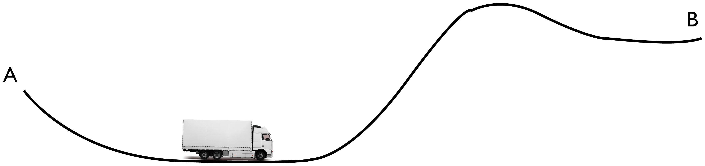

<!--
Textbook-prose companion to lectures/lecture07-discretization-static-opt.qmd,
intended as a booklet chapter for readers who did not attend the lecture.
Same content and figures as the slides, but written as connected prose
rather than bullet points, so it can stand on its own. Figures are the
same ones already cropped/verified for the slide deck, referenced from
../lectures/figures/lecture7/ rather than duplicated.

FIRST PASS (2026-09-20). Conventions carried over from units 1-6:
- Prose, not bullets; every equation from the deck is kept.
- Figure captions are written here (the slides deliberately carry none).
  CAVEAT: the captions were written from the surrounding slide text and
  the lecture's own narrative, not by re-inspecting each cropped image
  pixel by pixel -- they are the most likely thing to need correcting in
  the review round.
- The deck's Appendix A ("Application: minimum energy control of a
  vehicle", slides 45-50) is folded into a collapsible callout at the end
  of the discretization half, rather than kept as a trailing appendix
  section -- same treatment as unit 5's Appendix A and unit 6's
  appendices A-E.
- Per [[feedback-concluding-remarks-no-learning-outcomes]], the "After
  this lecture you should be able to" and "Additional live scripts"
  blocks are not transcribed; the deck's substantive "Concluding remarks"
  bullets are absorbed into the closing Summary section.
- Quick-check callouts follow the unit 1-4 pattern: an OPEN
  {.callout-tip collapse="false"} with the question, immediately followed
  by a COLLAPSED {.callout-note collapse="true"} with the solution.
- Code is linked, not embedded (see
  [[feedback-pyodide-live-code-snippets]]): code/unit7/ holds
  discretization.py and gradient_method.py plus the original notebooks.
-->

[Slides](../lectures/lecture07-discretization-static-opt.html) &middot; [Exercises](../exercises/unit7-exercises.html) &middot; [Jupyter notebooks](../code/unit7/notebooks.html)

## Why we need something beyond exact dynamic programming

Units 5 and 6 showed that for stage decision problems with a linear
dynamic model and a quadratic cost, the costs-to-go of the dynamic
programming algorithm can be computed *analytically*: they are quadratic
forms $x_k^\intercal P_kx_k$, the matrices $P_k$ obey a Riccati
recursion, and the optimal policy is a linear state feedback
$u_k=K_kx_k$. That is a very satisfying state of affairs, and it is also
a rare one. Linear models with quadratic costs are one of the very few
classes of problems for which the DP algorithm can be carried out in
closed form. In general we cannot run DP analytically at all.

The obstruction is easy to see on a problem barely more complicated than
the ones of Unit 5. Take the two-stage problem

$$
\text{cost:} \quad \sum_{k=0}^1 x_k^2+u_k^2+g_2(x_2), \qquad g_2(x_2)=e^{x_2}, \qquad \text{model:} \ \ x_{k+1}=x_k+u_k .
$$

Everything about this problem is as simple as it could be -- scalar
state, scalar input, two stages, a quadratic running cost, a linear
model -- and yet the single change $g_2(x_2)=x_2^2 \to e^{x_2}$ in the
terminal cost is enough to destroy the closed-form solution. The last
step of the DP recursion asks for
$J_1(x_1)=\min_{u_1}\ x_1^2+u_1^2+e^{x_1+u_1}$, whose minimizer solves
the transcendental equation $2u_1+e^{x_1+u_1}=0$; there is no elementary
function $J_1$ to carry into the next step.

This unit and the next therefore change the question. Instead of asking
how to solve the DP recursion exactly, we ask how to *approximate* the
solution well enough to be useful, and what each approximation costs us.
Three methods are developed over the next three units:

- **discretization** (this unit), which replaces the continuous state and
  input spaces by finite grids and then runs exact DP on the resulting
  finite problem;
- **static optimization** (also this unit), which eliminates the state
  variables altogether and turns the whole problem into a single
  unconstrained minimization over the control sequence;
- **approximate dynamic programming** (Unit 8), which keeps the DP
  structure but replaces the exact cost-to-go by a cheap approximation
  computed online.

None of the three is uniformly best, and a good part of the value of this
unit is understanding precisely where each one breaks down. The short
version, which we will arrive at with some care by the end of the unit,
is that discretization is defeated by *dimension* and static optimization
is defeated by *non-convexity*.

## Discretization

The idea behind discretization is to turn a stage decision problem, with
its continuous state and input spaces,

$$
x_{k+1}=f_k(x_k,u_k), \qquad \sum_{k=0}^{h-1}g_k(x_k,u_k)+g_h(x_h),
$$

into a *discrete optimization problem* of the kind we already know how to
solve exactly -- a finite transition diagram, solved by the DP algorithm
of Units 1-3. The conversion is done by sampling, or quantizing, the
state and input spaces: we keep only a finite grid of representative
states and a finite set of representative inputs, and we let the dynamic
model tell us which grid state each (grid state, grid input) pair leads
to.

::: {style="text-align: center;"}
{#fig-discretization-graph width="55%" fig-align="center"}
:::

The appeal of this is that nothing new has to be invented: once the
problem is finite, the DP algorithm applies verbatim, and it applies
regardless of how ugly the cost function is. The price, as we will see,
is paid in the number of grid points.

### A first example: the scalar problem with a non-quadratic terminal cost

Return to the two-stage problem that motivated this unit,

$$
\sum_{k=0}^1 x_k^2+u_k^2+g_2(x_2), \qquad x_{k+1}=x_k+u_k, \qquad k\in\{0,1\},
$$

with the non-quadratic terminal cost $g_2(x_2)=e^{x_2}$. It pays to first
run the method on the version we *can* solve exactly, as a sanity check.
For the quadratic terminal cost $g_2(x_2)=x_2^2$ we obtained in Unit 5
the optimal policy and optimal costs-to-go

$$
u_0=-\frac{3}{5}x_0, \qquad u_1=-\frac{1}{2}x_1, \qquad J_0(x_0)=\frac{8}{5}x_0^2, \qquad J_1(x_1)=\frac{3}{2}x_1^2 .
$$

If discretization reproduces these, we can reasonably trust it on the
exponential version, where we have nothing to compare against.

The discretization itself is a matter of choosing a grid spacing
$\delta$ and grid extents $M$ and $N$, and restricting

$$
\bar u_k \in \{-M,-M+1,\dots,M\}, \qquad \bar x_k \in \{-N,-N+1,\dots,N\},
$$

where the bars denote *integer* grid indices, so that the actual state
and input values are $x_k=\delta\bar x_k$ and $u_k=\delta\bar u_k$. The
model $x_{k+1}=x_k+u_k$ then becomes, in grid indices, simply
$\bar x_{k+1}=\bar x_k+\bar u_k$ -- which is exact, no approximation
required, because the dynamics happen to map grid points to grid points.
The cost transforms as

$$
\delta^2\Big(\sum_{k=0}^1 \bar x_k^2+\bar u_k^2\Big)+g_2(\delta\bar x_2),
$$

since each squared term picks up a factor $\delta^2$ while the terminal
cost is simply evaluated at the grid value $\delta \bar x_2$. The result
is a finite trellis: three columns of nodes (one per stage), with arcs
from every node of one column to the nodes reachable from it, weighted by
the stage cost.

::: {style="text-align: center;"}
{#fig-example-trellis width="85%" fig-align="center"}
:::

Running exact DP backwards on this trellis for the quadratic terminal
cost recovers, up to the grid resolution, the policy and costs-to-go we
know analytically.

::: {style="text-align: center;"}
{#fig-results-quadratic width="85%" fig-align="center"}
:::

This is the encouragement we needed: the same computation, with $x_2^2$
replaced by $e^{x_2}$, should give an equally good approximation of the
optimal policy for a problem we cannot solve in closed form.

::: {style="text-align: center;"}
{#fig-results-exp width="85%" fig-align="center"}
:::

That the discretized solution converges to the true one as the grid is
refined is a statement that can be made precise, but we do not pursue the
formalization here.

It is worth recording the numerical answer, because we will obtain it
again by a completely different route in the second half of this unit.
For initial state $x_0=1$ the optimal cost is about $2.64$.

::: {style="text-align: center;"}
{#fig-cost-near-x0 width="35%" fig-align="center"}
:::

The corresponding control sequence is an initial control $u_0=-0.7$,
which drives the state to $x_1=0.3$, followed by $u_1=-0.45$.

::: {style="text-align: center;"}
{#fig-control-plots width="70%" fig-align="center"}
:::

Keep the triple $(2.64,\,-0.7,\,-0.45)$ in mind. In the section on static
optimization we will recompute it, without any grid at all, and get
$2.6424$ at $u=(-0.7157,-0.4315)$.

:::: {.callout-tip collapse="false" title="Quick exercise: what does the grid spacing cost you?"}
In the discretization above, the grid indices satisfy
$\bar x_k\in\{-N,\dots,N\}$ and $\bar u_k\in\{-M,\dots,M\}$ with spacing
$\delta$. Suppose you halve $\delta$ while keeping the covered range of
states and inputs the same. By what factor does the number of arcs in
the trellis of @fig-example-trellis grow?
::::

:::: {.callout-note collapse="true" title="Solution"}
Keeping the covered range fixed while halving $\delta$ means doubling
both $N$ and $M$, so the number of states per stage roughly doubles
($2N+1 \to 4N+1$) and the number of inputs per state roughly doubles
too. The number of arcs per stage is (states) $\times$ (inputs), so it
grows by a factor of about $4$. For a scalar problem this is a mild
price. The point of the "curse of dimensionality" discussion below is
that for a state in $\mathbb{R}^n$ and an input in $\mathbb{R}^m$ the
same refinement multiplies the work by $2^{n+m}$ instead -- which for a
quadcopter, $n=12$ and $m=4$, is a factor of $65\,536$ for one halving
of the grid.
::::

:::: {.callout-important collapse="true" title="Interactive example: run the discretization yourself"}
The panel below is the computation of this subsection, carried out live.
Choose the grid spacing $\delta$, the ranges covered by the state and
input grids, and which terminal cost to use, and it runs exact backward DP
over the resulting trellis. It starts at the values behind
@fig-results-quadratic and @fig-results-exp: $\delta=0.05$, states out to
$\pm5$ ($N=100$) and inputs out to $\pm2.5$ ($M=50$).

Red markers are the computed grid values, one per grid point; for the
quadratic terminal cost the blue curves are the analytical answers from
Unit 5, so you can see the discretization sitting on top of them.

Worth trying:

- Start with the quadratic terminal cost. At $\delta=0.05$ the costs-to-go
  are already indistinguishable from $\tfrac85x_0^2$ and $\tfrac32x_1^2$,
  and the readout confirms $J_0(1)=1.6$, $u_0=-0.6$, $x_1=0.4$,
  $u_1=-0.2$ exactly. This is the sanity check the text asks for.
- Now watch the two worst-error figures as you halve $\delta$ (there is a
  button for it). The error in the cost-to-go falls by a factor of about
  $4$ each time, the error in the policy by a factor of about $2$: the
  cost is smooth at its minimum, so a grid error of $\delta$ costs only
  $\delta^2$ in value, while the policy can never be better than the
  nearest grid input. That is why the policy plots look visibly
  staircase-like at any resolution while the cost plots look perfect.
- Switch to the exponential terminal cost. Nothing about the computation
  changes, which is the whole point: DP never needed the cost to be
  quadratic. At $\delta=0.05$ the readout gives $2.6432$ at $u_0=-0.7$,
  $u_1=-0.45$, the triple quoted above. Refine to $\delta=0.0125$ and it
  becomes $2.6424$ at $u_0\approx-0.7125$ — converging on the
  $2.6424$ at $(-0.7157,-0.4315)$ that the gradient method will produce in
  the second half of this unit, by a route with no grid in it at all.
- Keep an eye on the arc count and the solve time while you refine. For
  this scalar problem halving $\delta$ costs a factor of four and the
  whole thing still runs in milliseconds. Hold that thought for the
  curse-of-dimensionality discussion below, where the same refinement on a
  quadcopter costs a factor of $2^{16}$ instead.

```{=html}
<div id="ds-wrap" style="margin:1em 0; text-align:center;">
  <div style="margin-bottom:0.6em; font-size:0.9em;">
    <label>&delta;
      <input id="ds-delta" type="number" value="0.05" min="0.002" step="0.005" style="width:6em;">
    </label>
    <label style="margin-left:0.7em;">states to &plusmn;
      <input id="ds-xmax" type="number" value="5" min="0.1" step="1" style="width:5em;">
    </label>
    <label style="margin-left:0.7em;">inputs to &plusmn;
      <input id="ds-umax" type="number" value="2.5" min="0.1" step="0.5" style="width:5em;">
    </label>
    <label style="margin-left:0.7em;">terminal cost g&#8322;(x&#8322;)
      <select id="ds-term">
        <option value="exp" selected>e^x&#8322;</option>
        <option value="quad">x&#8322;&sup2;</option>
      </select>
    </label>
  </div>
  <div id="ds-plot"></div>
  <div id="ds-info" style="margin:0.4em 0;"></div>
  <div id="ds-note" style="font-size:0.85em; color:#6a1b9a; min-height:1.2em;"></div>
  <div>
    <button id="ds-halve" style="padding:4px 12px;">Halve &delta;</button>
    <button id="ds-reset" style="padding:4px 12px; margin-left:0.4em;">Back to &delta; = 0.05</button>
  </div>
</div>
<script>
(function () {
  // ---- exact backward DP on the (state, input) grid of the notes ----
  function dpSolve(delta, N, M, term) {
    const ns = 2 * N + 1, ni = 2 * M + 1, h = 2;
    const x = new Float64Array(ns), u = new Float64Array(ni);
    for (let i = 0; i < ns; i++) x[i] = (i - N) * delta;
    for (let j = 0; j < ni; j++) u[j] = (j - M) * delta;
    const J = [new Float64Array(ns), new Float64Array(ns), new Float64Array(ns)];
    for (let i = 0; i < ns; i++) J[2][i] = term === 'quad' ? x[i] * x[i] : Math.exp(x[i]);
    const uo = [new Float64Array(ns), new Float64Array(ns)];
    for (let k = h - 1; k >= 0; k--) {
      const Jn = J[k + 1], Jk = J[k], uk = uo[k];
      for (let i = 0; i < ns; i++) {
        let best = Infinity, bj = -1;
        const xi = x[i], xi2 = xi * xi;
        // reachable grid indices: i + (j - M) must lie in [0, ns-1]
        const jlo = Math.max(0, M - i), jhi = Math.min(ni - 1, M + (ns - 1 - i));
        for (let j = jlo; j <= jhi; j++) {
          const v = xi2 + u[j] * u[j] + Jn[i + j - M];
          if (v < best) { best = v; bj = j; }
        }
        Jk[i] = best; uk[i] = bj < 0 ? NaN : u[bj];
      }
    }
    return { x, J, uo, ns, ni };
  }

  const el = id => document.getElementById(id);
  const MAXARCS = 14e6;
  let R = null, info = '';

  function num(id, d) { const v = Number(el(id).value); return isFinite(v) ? v : d; }
  function compute() {
    let delta = Math.max(0.002, Math.min(1, num('ds-delta', 0.05)));
    const xmax = Math.max(delta, Math.min(20, num('ds-xmax', 5)));
    const umax = Math.max(delta, Math.min(20, num('ds-umax', 2.5)));
    const term = el('ds-term').value;
    let N = Math.max(1, Math.round(xmax / delta)), M = Math.max(1, Math.round(umax / delta));
    let note = '';
    while ((2 * N + 1) * (2 * M + 1) * 2 > MAXARCS) {
      delta *= 2; N = Math.max(1, Math.round(xmax / delta)); M = Math.max(1, Math.round(umax / delta));
      note = 'The grid was too large, so &delta; was coarsened to ' + delta.toFixed(4) + '.';
    }
    const t0 = (typeof performance !== 'undefined' && performance.now) ? performance.now() : Date.now();
    const r = dpSolve(delta, N, M, term);
    const t1 = (typeof performance !== 'undefined' && performance.now) ? performance.now() : Date.now();
    r.delta = delta; r.N = N; r.M = M; r.term = term; r.ms = t1 - t0;
    r.arcs = (2 * N + 1) * (2 * M + 1) * 2;
    // readings at x0 = 1
    const i1 = Math.round(1 / delta) + N;
    if (i1 >= 0 && i1 < r.ns) {
      r.J01 = r.J[0][i1]; r.u01 = r.uo[0][i1];
      r.x1 = r.x[i1] + r.u01;
      const i2 = Math.round(r.x1 / delta) + N;
      r.u1 = (i2 >= 0 && i2 < r.ns) ? r.uo[1][i2] : NaN;
    } else { r.J01 = NaN; r.u01 = NaN; r.x1 = NaN; r.u1 = NaN; r.offGrid = true; }
    // error against the analytic solution, quadratic case, |x| <= 3
    if (term === 'quad') {
      let eJ = 0, eU = 0;
      for (let i = 0; i < r.ns; i++) if (Math.abs(r.x[i]) <= 3) {
        eJ = Math.max(eJ, Math.abs(r.J[0][i] - 1.6 * r.x[i] * r.x[i]));
        eU = Math.max(eU, Math.abs(r.uo[0][i] + 0.6 * r.x[i]));
      }
      r.eJ = eJ; r.eU = eU;
    }
    if (r.offGrid) note += (note ? ' ' : '') + 'x&#8320; = 1 lies outside the state grid, so the readings below are empty &mdash; raise the state range.';
    R = r; info = note;
  }

  const cv = document.createElement('canvas');
  cv.width = 690; cv.height = 430;
  cv.style.maxWidth = '100%'; cv.style.border = '1px solid #ccc';
  cv.style.display = 'block'; cv.style.margin = '0 auto 6px';
  el('ds-plot').appendChild(cv);
  const c = cv.getContext('2d');
  const XLO = -3, XHI = 3;

  function panel(col, row) {
    return { x: 54 + col * 345, y: 16 + row * 212, w: 288, h: 168 };
  }
  function drawPanel(col, row, label, get, analytic, yclamp) {
    const p = panel(col, row);
    let lo = Infinity, hi = -Infinity;
    for (let i = 0; i < R.ns; i++) {
      const xv = R.x[i];
      if (xv < XLO || xv > XHI) continue;
      const v = get(i);
      if (!isFinite(v)) continue;
      lo = Math.min(lo, v); hi = Math.max(hi, v);
    }
    if (yclamp) { lo = Math.min(lo, yclamp[0]); hi = Math.max(hi, yclamp[1]); }
    if (!isFinite(lo)) { lo = 0; hi = 1; }
    if (hi - lo < 1e-9) { lo -= 1; hi += 1; }
    const pad = 0.08 * (hi - lo); lo -= pad; hi += pad;
    const X = v => p.x + (v - XLO) / (XHI - XLO) * p.w;
    const Y = v => p.y + p.h - (v - lo) / (hi - lo) * p.h;
    c.strokeStyle = '#333'; c.lineWidth = 1; c.strokeRect(p.x, p.y, p.w, p.h);
    c.strokeStyle = '#eee';
    if (lo < 0 && hi > 0) { c.beginPath(); c.moveTo(p.x, Y(0)); c.lineTo(p.x + p.w, Y(0)); c.stroke(); }
    c.beginPath(); c.moveTo(X(0), p.y); c.lineTo(X(0), p.y + p.h); c.stroke();
    // analytic curve underneath
    if (analytic) {
      c.strokeStyle = '#1565c0'; c.lineWidth = 2; c.beginPath();
      for (let i = 0; i <= 200; i++) {
        const xv = XLO + i / 200 * (XHI - XLO), yv = analytic(xv);
        if (i === 0) c.moveTo(X(xv), Y(yv)); else c.lineTo(X(xv), Y(yv));
      }
      c.stroke();
    }
    // grid points
    const npts = Math.round((Math.min(XHI, R.N * R.delta) - Math.max(XLO, -R.N * R.delta)) / R.delta);
    const rad = npts > 400 ? 0.9 : (npts > 120 ? 1.3 : 2);
    c.fillStyle = '#c62828';
    for (let i = 0; i < R.ns; i++) {
      const xv = R.x[i];
      if (xv < XLO || xv > XHI) continue;
      const v = get(i);
      if (!isFinite(v) || v < lo || v > hi) continue;
      c.beginPath(); c.arc(X(xv), Y(v), rad, 0, 2 * Math.PI); c.fill();
    }
    c.fillStyle = '#333'; c.font = '12px sans-serif'; c.textAlign = 'left';
    c.fillText(label, p.x + 5, p.y + 13);
    c.textAlign = 'right'; c.font = '11px sans-serif';
    c.fillText((Math.round(hi * 100) / 100).toString(), p.x - 3, p.y + 9);
    c.fillText((Math.round(lo * 100) / 100).toString(), p.x - 3, p.y + p.h);
    c.textAlign = 'center';
    c.fillText('-3', p.x, p.y + p.h + 13);
    c.fillText('0', X(0), p.y + p.h + 13);
    c.fillText('3', p.x + p.w, p.y + p.h + 13);
  }
  function draw() {
    c.clearRect(0, 0, cv.width, cv.height);
    const q = R.term === 'quad';
    drawPanel(0, 0, 'J₀(x₀)', i => R.J[0][i], q ? (x => 1.6 * x * x) : null, [0, 0]);
    drawPanel(1, 0, 'J₁(x₁)', i => R.J[1][i], q ? (x => 1.5 * x * x) : null, [0, 0]);
    drawPanel(0, 1, 'u₀(x₀)', i => R.uo[0][i], q ? (x => -0.6 * x) : null, null);
    drawPanel(1, 1, 'u₁(x₁)', i => R.uo[1][i], q ? (x => -0.5 * x) : null, null);
    c.fillStyle = '#555'; c.font = '11px sans-serif'; c.textAlign = 'center';
    c.fillText(q ? 'red: grid DP   ·   blue: analytic solution of Unit 5'
                 : 'red: grid DP   ·   no closed form to compare against', cv.width / 2, cv.height - 4);
  }

  const f = (v, n) => isFinite(v) ? v.toFixed(n === undefined ? 4 : n) : '&mdash;';
  function report() {
    const q = R.term === 'quad';
    let t = '<table style="margin:0 auto; border-collapse:collapse; font-size:0.85em;">';
    const row = (a, b) => t += '<tr><td style="text-align:right;padding:1px 8px;color:#555;">' + a +
      '</td><td style="text-align:left;padding:1px 8px;">' + b + '</td></tr>';
    row('grid', (2 * R.N + 1) + ' states &times; ' + (2 * R.M + 1) + ' inputs, &delta; = ' + R.delta +
      ' &nbsp;&rarr;&nbsp; ' + R.arcs.toLocaleString('en-US') + ' arcs, solved in ' + R.ms.toFixed(0) + ' ms');
    row('from x&#8320; = 1', 'J&#8320;(1) = <b>' + f(R.J01) + '</b>, &nbsp; u&#8320; = <b>' + f(R.u01, 4) +
      '</b> &nbsp;&rarr;&nbsp; x&#8321; = ' + f(R.x1, 4) + ', &nbsp; u&#8321; = <b>' + f(R.u1, 4) + '</b>');
    if (q) row('exact answer', 'J&#8320;(1) = 1.6, &nbsp; u&#8320; = &minus;0.6, &nbsp; x&#8321; = 0.4, &nbsp; u&#8321; = &minus;0.2');
    else row('for comparison', 'the gradient method of the second half of this unit gives 2.6424 at u = (&minus;0.7157, &minus;0.4315)');
    if (q) row('worst error on |x| &le; 3', 'in J&#8320;: <b>' + f(R.eJ, 6) + '</b> &nbsp;&middot;&nbsp; in u&#8320;: <b>' + f(R.eU, 6) + '</b>');
    t += '</table>';
    el('ds-info').innerHTML = t;
    el('ds-note').innerHTML = info;
  }
  function refresh() { compute(); draw(); report(); }
  ['ds-delta', 'ds-xmax', 'ds-umax', 'ds-term'].forEach(id => el(id).addEventListener('change', refresh));
  el('ds-halve').addEventListener('click', () => {
    el('ds-delta').value = String(Math.max(0.002, num('ds-delta', 0.05) / 2));
    refresh();
  });
  el('ds-reset').addEventListener('click', () => {
    el('ds-delta').value = '0.05'; el('ds-xmax').value = '5'; el('ds-umax').value = '2.5';
    el('ds-term').value = 'exp'; refresh();
  });
  refresh();
})();
</script>
```

::::

### From continuous time to a stage decision problem

The example above was already posed in discrete time, and its state was
a scalar. Real control problems are usually neither. To extend the method
to a state in $\mathbb{R}^n$ we will need a second kind of
discretization -- of *time* -- alongside the discretization of the state
and input spaces. A small mechanical example will carry us through both.

Consider the toy problem of computing the force needed to move a unit
mass one metre along a flat surface, from rest to rest, in one second,
with minimum energy.

::: {style="text-align: center;"}
{#fig-mass-diagram width="55%" fig-align="center"}
:::

In continuous time the problem reads

$$
\ddot z(t)=u(t), \qquad z(0)=0, \quad z(1)=1, \qquad \dot z(0)=\dot z(1)=0, \qquad \min\int_0^1 u(t)^2dt .
$$

Later in the course we will develop the tools (the continuous-time
minimum principle) to solve this exactly; the answer is
$u(t)=6-12t$, giving $v(t)=6t-6t^2$ and $z(t)=3t^2-2t^3$. For now it
serves as a known reference against which the discretized solutions can
be judged.

To get from this continuous-time problem to a stage decision problem we
need *temporal* discretization, which is a different operation from the
state/input discretization of the previous section. The full chain of
conversions is as follows.

::: {style="text-align: center;"}
{#fig-discretization-flow width="95%" fig-align="center"}
:::

Temporal discretization is not an artificial step introduced for the sake
of computation. It is what digital control *is*: the controller is a
computer, it reads the sensors at discrete instants, it computes, and it
holds the actuator command constant until the next instant.

::: {style="text-align: center;"}
{#fig-digital-control width="80%" fig-align="center"}
:::

So the discrete-time model $x_{k+1}=f_k(x_k,u_k)$ is not an
approximation of the physical system as the controller experiences it --
it is an exact description of it, provided we compute $f_k$ correctly.

### Computing the discrete-time model

The recipe is straightforward: solve the differential equation
$\dot x(t)=f_c(t,x(t),u(t))$ on the interval $t\in[t_k,t_{k+1})$, from
the initial condition $x(t_k)=x_k$ and with the input held at the
constant value $u(t)=u_k$, and evaluate the solution at $t=t_{k+1}$:

$$
x_k=x(t_k), \qquad x_{k+1}=x(t_{k+1})=f(x_k,u_k).
$$

::: {style="text-align: center;"}
{#fig-timeline width="55%" fig-align="center"}
:::

For a linear system this integration can be carried out in closed form.
If $\dot x(t)=Ax(t)+Bu(t)$, the variation-of-constants formula gives

$$
x(t)=e^{A(t-t_k)}x(t_k)+\int_{t_k}^t e^{A(t-s)}Bu(s)\,ds,
$$

and evaluating at $t=t_{k+1}=t_k+\tau$ with $u(s)\equiv u_k$ yields the
exact discrete-time model

$$
x_{k+1}=A_dx_k+B_du_k, \qquad A_d=e^{A\tau}, \qquad B_d=\Big(\int_0^\tau e^{As}ds\Big)B .
$$

This is worth emphasizing: for linear systems, temporal discretization
introduces *no error whatsoever* at the sampling instants. The
discretized model is exact.

Applying this to the unit mass gives the familiar double integrator,

$$
\begin{bmatrix}\dot z(t)\\ \dot v(t)\end{bmatrix}=\begin{bmatrix}0&1\\0&0\end{bmatrix}\begin{bmatrix}z(t)\\v(t)\end{bmatrix}+\begin{bmatrix}0\\1\end{bmatrix}u(t)
\quad\longrightarrow\quad
\begin{bmatrix}z_{k+1}\\v_{k+1}\end{bmatrix}=\begin{bmatrix}1&\tau\\0&1\end{bmatrix}\begin{bmatrix}z_k\\v_k\end{bmatrix}+\begin{bmatrix}\tau^2/2\\\tau\end{bmatrix}u_k,
$$

with $u(t)=u_k$ for $t\in[t_k,t_{k+1})$, $z_k=z(t_k)$, $v_k=v(t_k)$,
$t_{k+1}-t_k=\tau$ and $K\tau=1$ so that $K$ steps span the one-second
horizon. The cost transforms just as exactly, since the input is
piecewise constant:

$$
\int_0^1 u(t)^2dt = \sum_{k=0}^{K-1}\int_{t_k}^{t_{k+1}} u_k^2\,dt = \tau\sum_{k=0}^{K-1}u_k^2 .
$$

The boundary conditions $z(0)=0$, $z(1)=1$, $\dot z(0)=\dot z(1)=0$
become $z_0=v_0=v_K=0$ and $z_K=1$. This discrete-time problem is a
linear quadratic problem with fixed endpoints, and it can be solved by
the machinery of Unit 5; the optimal solution can be written as

$$
u_k=-R^{-1}B^\intercal\big((A^\intercal)^{-1}\big)^{k+1}\lambda_0, \qquad \lambda_0=M_{12}^{-1}\begin{bmatrix}1\\0\end{bmatrix}, \qquad \begin{bmatrix}M_{11}&M_{12}\\M_{21}&M_{22}\end{bmatrix}=\begin{bmatrix}A&-BR^{-1}B^\intercal(A^\intercal)^{-1}\\0&(A^\intercal)^{-1}\end{bmatrix}^K,
$$

where $\lambda_0$ is the initial co-state chosen to meet the terminal
constraint. What matters for us is the picture: as the sampling period
$\tau$ shrinks, the discrete-time optimal input approaches the
continuous-time answer $u(t)=6-12t$.

::: {style="text-align: center;"}
{#fig-solution-tau02-01 width="90%" fig-align="center"}
:::

::: {style="text-align: center;"}
{#fig-solution-tau005-0025 width="90%" fig-align="center"}
:::

:::: {.callout-important collapse="true" title="Interactive example: shrink the sampling period"}
The panel below solves the fixed-endpoint minimum-energy problem above for
whatever sampling period you choose, and draws the result against the
continuous-time optimum $u(t)=6-12t$, $z(t)=3t^2-2t^3$, $v(t)=6t-6t^2$. It
opens at $\tau=0.2$, the left half of @fig-solution-tau02-01; halving it
three times walks you through the other three panels of
@fig-solution-tau02-01 and @fig-solution-tau005-0025.

The discrete problem is solved exactly, not iteratively: with $x_0=0$ the
terminal condition reads $\sum_{k}A_d^{K-1-k}B_d\,u_k=[z_T\ \ 0]^\intercal$,
a pair of linear equations in the $K$ unknowns $u_k$, and the
minimum-energy solution of an underdetermined linear system is
$u=G^\intercal(GG^\intercal)^{-1}b$. You can also raise the horizon $T$ or
change the target position $z_T$.

Worth trying:

- The staircase never sits on the continuous curve at the sampling
  instants $t_k$ — the readout shows a gap of $1.4$ at $\tau=0.2$. Compare
  it with the gap measured against $u$ at the *middle* of each interval,
  which is six times smaller. A zero-order-hold input cannot track a
  sloping signal, and the best it can do is match its average over the
  interval.
- The position and velocity, by contrast, match the continuous optimum
  very well even at $\tau=0.2$: worst deviation $0.004$ in $z$ and $0.06$
  in $v$, and the terminal condition $z(T)=1$, $v(T)=0$ is met to machine
  precision at every $\tau$. That is not an accident of this example, it is
  the exactness of linear temporal discretization: the discretized model
  makes no error at the sampling instants, so the only approximation left
  is the restriction of $u$ to piecewise-constant signals.
- The energy tells the same story quantitatively. It is always *above* the
  continuous optimum $\int_0^1u^2dt=12$, since the staircase inputs are a
  subset of all admissible inputs, and the excess falls by a factor of
  four with each halving of $\tau$: $12.5$, $12.1212$, $12.0301$,
  $12.0075$. In fact the panel's energy matches
  $\frac{12z_T^2}{T^3}\cdot\frac{K^2}{K^2-1}$ exactly, which you can check
  against the readout for any $K$ — worth deriving if you want a small
  exercise.

```{=html}
<div id="di7-wrap" style="margin:1em 0; text-align:center;">
  <div style="margin-bottom:0.6em; font-size:0.9em;">
    <label>&tau;
      <input id="di7-tau" type="number" value="0.2" min="0.0001" step="0.01" style="width:6em;">
    </label>
    <label style="margin-left:0.7em;">horizon T
      <input id="di7-T" type="number" value="1" min="0.05" step="0.5" style="width:5em;">
    </label>
    <label style="margin-left:0.7em;">target z(T)
      <input id="di7-zT" type="number" value="1" step="0.5" style="width:5em;">
    </label>
  </div>
  <div id="di7-plot"></div>
  <div id="di7-info" style="margin:0.4em 0;"></div>
  <div id="di7-note" style="font-size:0.85em; color:#6a1b9a; min-height:1.2em;"></div>
  <div>
    <button id="di7-halve" style="padding:4px 12px;">Halve &tau;</button>
    <button id="di7-reset" style="padding:4px 12px; margin-left:0.4em;">Back to &tau; = 0.2</button>
  </div>
</div>
<script>
(function () {
  // ---- minimum-energy, fixed-endpoint double integrator ----
  // min tau*sum u_k^2 s.t. x_{k+1}=Ad x_k+Bd u_k, x_0=0, x_K=[zT,0]
  // closed form: u = G'(G G')^{-1} b, G = [A^{K-1}B, ..., A B, B]  (2 x K)
  function minEnergy(tau, T, zT) {
    const K = Math.max(1, Math.round(T / tau));
    const h = T / K;                                   // exact step actually used
    const Ad = [[1, h], [0, 1]], Bd = [h * h / 2, h];
    const G = [new Float64Array(K), new Float64Array(K)];
    // column k of G is Ad^(K-1-k) Bd
    let col = [Bd[0], Bd[1]];
    for (let k = K - 1; k >= 0; k--) {
      G[0][k] = col[0]; G[1][k] = col[1];
      col = [Ad[0][0] * col[0] + Ad[0][1] * col[1], Ad[1][0] * col[0] + Ad[1][1] * col[1]];
    }
    let m11 = 0, m12 = 0, m22 = 0;
    for (let k = 0; k < K; k++) { m11 += G[0][k] * G[0][k]; m12 += G[0][k] * G[1][k]; m22 += G[1][k] * G[1][k]; }
    const det = m11 * m22 - m12 * m12;
    const b = [zT, 0];
    const lam = [(m22 * b[0] - m12 * b[1]) / det, (-m12 * b[0] + m11 * b[1]) / det];
    const u = new Float64Array(K);
    for (let k = 0; k < K; k++) u[k] = G[0][k] * lam[0] + G[1][k] * lam[1];
    // forward simulate
    const z = new Float64Array(K + 1), v = new Float64Array(K + 1);
    let E = 0;
    for (let k = 0; k < K; k++) {
      z[k + 1] = z[k] + h * v[k] + h * h / 2 * u[k];
      v[k + 1] = v[k] + h * u[k];
      E += h * u[k] * u[k];
    }
    return { K, h, u, z, v, E, Eopt: 12 * zT * zT / (T * T * T) };
  }
  const uCont = (t, T, zT) => zT * (6 / (T * T) - 12 * t / (T * T * T));
  const zCont = (t, T, zT) => zT * (3 * (t / T) * (t / T) - 2 * Math.pow(t / T, 3));
  const vCont = (t, T, zT) => zT * (6 * t / (T * T) - 6 * t * t / (T * T * T));

  const el = id => document.getElementById(id);
  let R = null, note = '';

  function num(id, d) { const v = Number(el(id).value); return isFinite(v) ? v : d; }
  function compute() {
    const T = Math.max(0.05, Math.min(20, num('di7-T', 1)));
    const zT = num('di7-zT', 1);
    let tau = Math.max(1e-4, Math.min(T, num('di7-tau', 0.2)));
    note = '';
    if (T / tau < 2) { tau = T / 2; note = 'At least two steps are needed to meet two terminal conditions, so &tau; was reduced to ' + tau + '.'; }
    if (T / tau > 4000) { tau = T / 4000; note = '&tau; was raised to ' + tau.toExponential(2) + ' to keep the number of steps manageable.'; }
    R = minEnergy(tau, T, zT);
    R.T = T; R.zT = zT; R.tau = R.h;
    R.Eclosed = (12 * zT * zT / (T * T * T)) * (R.K * R.K) / (R.K * R.K - 1);
    let mx = 0, mxm = 0;
    for (let k = 0; k < R.K; k++) {
      mx = Math.max(mx, Math.abs(R.u[k] - uCont(k * R.h, T, zT)));
      mxm = Math.max(mxm, Math.abs(R.u[k] - uCont((k + 0.5) * R.h, T, zT)));
    }
    R.errLeft = mx; R.errMid = mxm;
    let ez = 0, ev = 0;
    for (let k = 0; k <= R.K; k++) {
      ez = Math.max(ez, Math.abs(R.z[k] - zCont(k * R.h, T, zT)));
      ev = Math.max(ev, Math.abs(R.v[k] - vCont(k * R.h, T, zT)));
    }
    R.errZ = ez; R.errV = ev;
  }

  const cv = document.createElement('canvas');
  cv.width = 690; cv.height = 400;
  cv.style.maxWidth = '100%'; cv.style.border = '1px solid #ccc';
  cv.style.display = 'block'; cv.style.margin = '0 auto 6px';
  el('di7-plot').appendChild(cv);
  const c = cv.getContext('2d');

  function box(row) { return { x: 56, y: 14 + row * 128, w: 616, h: 102 }; }
  function frame(p, lo, hi, label) {
    c.strokeStyle = '#333'; c.lineWidth = 1; c.strokeRect(p.x, p.y, p.w, p.h);
    if (lo < 0 && hi > 0) {
      c.strokeStyle = '#eee';
      const Y = p.y + p.h - (0 - lo) / (hi - lo) * p.h;
      c.beginPath(); c.moveTo(p.x, Y); c.lineTo(p.x + p.w, Y); c.stroke();
    }
    c.fillStyle = '#333'; c.font = '12px sans-serif'; c.textAlign = 'left';
    c.fillText(label, p.x + 5, p.y + 13);
    c.textAlign = 'right'; c.font = '11px sans-serif';
    c.fillText((Math.round(hi * 1000) / 1000).toString(), p.x - 3, p.y + 9);
    c.fillText((Math.round(lo * 1000) / 1000).toString(), p.x - 3, p.y + p.h);
  }
  function limits(vals) {
    let lo = Infinity, hi = -Infinity;
    vals.forEach(v => { if (isFinite(v)) { lo = Math.min(lo, v); hi = Math.max(hi, v); } });
    if (!isFinite(lo)) { lo = 0; hi = 1; }
    if (hi - lo < 1e-9) { lo -= 1; hi += 1; }
    const pad = 0.1 * (hi - lo);
    return [lo - pad, hi + pad];
  }
  function contCurve(p, fn, lo, hi) {
    const X = t => p.x + t / R.T * p.w, Y = v => p.y + p.h - (v - lo) / (hi - lo) * p.h;
    c.strokeStyle = '#1565c0'; c.lineWidth = 2; c.beginPath();
    for (let i = 0; i <= 300; i++) {
      const t = i / 300 * R.T, v = fn(t);
      if (i === 0) c.moveTo(X(t), Y(v)); else c.lineTo(X(t), Y(v));
    }
    c.stroke();
  }
  function draw() {
    c.clearRect(0, 0, cv.width, cv.height);
    const uc = [];
    for (let i = 0; i <= 20; i++) uc.push(uCont(i / 20 * R.T, R.T, R.zT));
    // --- input: zero-order-hold staircase ---
    let p = box(0);
    let [lo, hi] = limits(Array.prototype.slice.call(R.u).concat(uc));
    frame(p, lo, hi, 'control u(t)');
    contCurve(p, t => uCont(t, R.T, R.zT), lo, hi);
    const X = t => p.x + t / R.T * p.w, Y = v => p.y + p.h - (v - lo) / (hi - lo) * p.h;
    c.strokeStyle = '#c62828'; c.lineWidth = R.K > 300 ? 1 : 1.8; c.beginPath();
    for (let k = 0; k < R.K; k++) {
      c.moveTo(X(k * R.h), Y(R.u[k])); c.lineTo(X((k + 1) * R.h), Y(R.u[k]));
      if (k < R.K - 1) { c.moveTo(X((k + 1) * R.h), Y(R.u[k])); c.lineTo(X((k + 1) * R.h), Y(R.u[k + 1])); }
    }
    c.stroke();
    // --- position and velocity ---
    const draw2 = (row, label, arr, fn) => {
      const q = box(row);
      const zc = []; for (let i = 0; i <= 20; i++) zc.push(fn(i / 20 * R.T));
      const [a, b] = limits(Array.prototype.slice.call(arr).concat(zc));
      frame(q, a, b, label);
      contCurve(q, fn, a, b);
      const XX = t => q.x + t / R.T * q.w, YY = v => q.y + q.h - (v - a) / (b - a) * q.h;
      c.fillStyle = '#c62828';
      const rad = R.K > 300 ? 1 : (R.K > 80 ? 1.5 : 2.6);
      for (let k = 0; k <= R.K; k++) { c.beginPath(); c.arc(XX(k * R.h), YY(arr[k]), rad, 0, 2 * Math.PI); c.fill(); }
    };
    draw2(1, 'position z(t)', R.z, t => zCont(t, R.T, R.zT));
    draw2(2, 'velocity v(t)', R.v, t => vCont(t, R.T, R.zT));
    c.fillStyle = '#333'; c.font = '11px sans-serif'; c.textAlign = 'center';
    c.fillText('t = 0', 56, 390); c.fillText(R.T + ' s', 672, 390);
    c.fillStyle = '#555';
    c.fillText('red: discretized solution (' + R.K + ' steps)   ·   blue: continuous-time optimum', cv.width / 2, 390);
  }

  const f = (v, n) => isFinite(v) ? v.toFixed(n === undefined ? 4 : n) : '&mdash;';
  function report() {
    const row = (a, b) => '<tr><td style="text-align:right;padding:1px 8px;color:#555;">' + a +
      '</td><td style="text-align:left;padding:1px 8px;">' + b + '</td></tr>';
    el('di7-info').innerHTML = '<table style="margin:0 auto;border-collapse:collapse;font-size:0.85em;">' +
      row('steps', '<b>K = ' + R.K + '</b> &nbsp; (&tau; = ' + R.h + ', K&tau; = ' + R.T + ')') +
      row('energy &tau;&sum;u<sub>k</sub>&sup2;', '<b>' + f(R.E, 6) + '</b> &nbsp;&middot;&nbsp; continuous optimum &int;u&sup2;dt = ' +
        f(R.Eopt, 6) + ' &nbsp;&middot;&nbsp; excess ' + ((R.E / R.Eopt - 1) * 100).toFixed(4) + '%') +
      row('closed form', '12z<sub>T</sub>&sup2;/T&sup3; &middot; K&sup2;/(K&sup2;&minus;1) = ' + f(R.Eclosed, 6)) +
      row('endpoint reached', 'z(T) = ' + f(R.z[R.K], 8) + ', &nbsp; v(T) = ' + R.v[R.K].toExponential(1) +
        ' &nbsp;(target ' + R.zT + ', 0)') +
      row('worst deviation', 'in z: ' + f(R.errZ, 5) + ' &nbsp;&middot;&nbsp; in v: ' + f(R.errV, 5) +
        ' &nbsp;&middot;&nbsp; in u (vs u(t<sub>k</sub>)): ' + f(R.errLeft, 4) +
        ', (vs u at the interval midpoint): ' + f(R.errMid, 4)) +
      '</table>';
    el('di7-note').innerHTML = note;
  }
  function refresh() { compute(); draw(); report(); }
  ['di7-tau', 'di7-T', 'di7-zT'].forEach(id => el(id).addEventListener('change', refresh));
  el('di7-halve').addEventListener('click', () => {
    el('di7-tau').value = String(num('di7-tau', 0.2) / 2); refresh();
  });
  el('di7-reset').addEventListener('click', () => {
    el('di7-tau').value = '0.2'; el('di7-T').value = '1'; el('di7-zT').value = '1'; refresh();
  });
  refresh();
})();
</script>
```

::::

### What to watch out for in temporal discretization

Two aspects deserve comment, one for the model and one for the cost.

**The dynamic model.** For non-linear systems, discretization may be
hard: there is generally no closed-form solution of the differential
equation over one sampling interval. A numerical integration method is
then used, the simplest being the explicit Euler step

$$
x_{k+1}=x_k+\tau f(t_k,x_k,u_k).
$$

Unlike the linear case, this *is* an approximation, and its accuracy
degrades as $\tau$ grows; higher-order schemes (Runge-Kutta and the like)
are used when Euler is too crude.

**The cost function.** There are three situations to distinguish. In the
first, the problem formulation already penalizes the state and input at
the sampling times only, in which case nothing needs to be done:

$$
\sum_{k=0}^{h-1}g_k(x(t_k),u(t_k))+g_h(x(T)) = \sum_{k=0}^{h-1}g_k(x_k,u_k)+g_h(x_h).
$$

In the second, the cost is genuinely a continuous-time integral, and it
can be split exactly interval by interval,

$$
\int_0^T g_c(t,x(t),u(t))dt = \sum_{k=0}^{h-1}\underbrace{\int_{t_k}^{t_{k+1}} g_c(t,x(t),u(t))dt}_{g_k(x_k,u_k)},
$$

each term being a genuine function of $(x_k,u_k)$ alone because the input
is constant and the state on the interval is determined by $x_k$ and
$u_k$. This is what we did for $\int_0^1u^2dt$ above, where the integral
happened to evaluate to $\tau u_k^2$ exactly. In the third, and most
common, situation, that integral cannot be computed in closed form, and
one settles for the rectangle approximation

$$
\int_0^T g_c(t,x(t),u(t))dt \approx \sum_{k=0}^{h-1}\tau\, g_c(k\tau,x_k,u_k).
$$

:::: {.callout-important collapse="true" title="Interactive example: how much does the discretized model lie?"}
The two claims of this subsection can be checked directly. The panel below
simulates a model in continuous time and overlays the trajectory the
*discretized* model produces, and reports the worst gap between them at the
sampling instants. Two models are available.

**The linear model** $\dot x=Ax+Bu$, with $A$, $B$, the constant input $u$
and the initial state yours to set, discretized exactly as
$A_d=e^{A\tau}$, $B_d=\big(\int_0^\tau e^{As}ds\big)B$. Make $\tau$ as
large as you like — a whole second if you want, with only four samples
across the window. The red markers still land on the blue curve to
fourteen or fifteen digits. That is the point made above: for a linear
system with a piecewise-constant input, temporal discretization introduces
*no error at all* at the sampling instants, however coarse the sampling. It
says nothing about what happens between them, which is exactly why the
staircase in the previous subsection looked nothing like $6-12t$ while the
states matched perfectly.

**The nonlinear model**, an inverted pendulum
$\ddot\theta=\frac{g}{\ell}\sin\theta-b\dot\theta+u$ with $\theta$ measured
from the upright, which has no closed-form solution over a sampling
interval. Here the blue curve is a reference solution computed with
Runge-Kutta at a step $400$ times smaller, and the red markers are the
explicit Euler model $x_{k+1}=x_k+\tau f(x_k,u_k)$ of the text. Now the gap
is real, and it is large: at $\tau=0.2$ the Euler pendulum is out by $1.4$
radians — some $80^\circ$ — which for a model meant to describe a pendulum
near upright is useless.

Worth trying:

- Halve $\tau$ repeatedly in the nonlinear case and watch the error: $1.41$,
  $0.93$, $0.54$, $0.28$, $0.145$ rad. It falls by a factor of two each
  time, no faster — explicit Euler is a first-order method, and buying one
  more decimal digit costs ten times the computation.
- Now switch the scheme to Runge-Kutta 4 at the *same* $\tau$. The error
  goes from $1.4$ to $0.005$ rad at $\tau=0.2$, and then falls by a factor
  of about sixteen per halving: $4.9\cdot10^{-3}$, $3.2\cdot10^{-4}$,
  $2.1\cdot10^{-5}$, $1.3\cdot10^{-6}$. Four extra function evaluations per
  step buy three orders of magnitude. The readout always shows the other
  scheme's error at the same $\tau$ next to the one you chose, so the
  comparison needs no bookkeeping.
- Make $\tau$ large enough, or $\ell$ small enough, and the Euler iteration
  does not merely lose accuracy — it blows up, while the real pendulum of
  course does not. Nothing about the physics has changed; the instability
  belongs to the integration scheme alone.
- Back in the linear model, try an unstable $A$ (say $a_{21}=2$,
  $a_{22}=-0.3$) and a long horizon. The trajectory grows by orders of
  magnitude and the discretized model still tracks it to twelve digits.

```{=html}
<div id="tz-wrap" style="margin:1em 0; text-align:center;">
  <div style="margin-bottom:0.5em; font-size:0.9em;">
    <label>model
      <select id="tz-model">
        <option value="lin" selected>linear, exact A&#7496; = e^(A&tau;)</option>
        <option value="nl">inverted pendulum (nonlinear)</option>
      </select>
    </label>
    <label style="margin-left:0.8em;">&tau;
      <input id="tz-tau" type="number" value="0.4" min="0.0001" step="0.05" style="width:6em;">
    </label>
    <label style="margin-left:0.7em;">window T
      <input id="tz-T" type="number" value="4" min="0.05" step="1" style="width:5em;">
    </label>
  </div>
  <div id="tz-lin" style="margin-bottom:0.4em; font-size:0.9em;">
    A =
    <input id="tz-a11" type="number" value="0" step="0.5" style="width:4.5em;">
    <input id="tz-a12" type="number" value="1" step="0.5" style="width:4.5em;">
    <input id="tz-a21" type="number" value="-4" step="0.5" style="width:4.5em;">
    <input id="tz-a22" type="number" value="-0.5" step="0.5" style="width:4.5em;">
    <span style="margin-left:0.6em;">B =</span>
    <input id="tz-b1" type="number" value="0" step="0.5" style="width:4.5em;">
    <input id="tz-b2" type="number" value="1" step="0.5" style="width:4.5em;">
  </div>
  <div id="tz-lin2" style="margin-bottom:0.6em; font-size:0.9em;">
    <label>u
      <input id="tz-u" type="number" value="1" step="0.5" style="width:5em;">
    </label>
    <label style="margin-left:0.7em;">x&#8320; =
      <input id="tz-x01" type="number" value="1" step="0.5" style="width:4.5em;">
      <input id="tz-x02" type="number" value="0" step="0.5" style="width:4.5em;">
    </label>
  </div>
  <div id="tz-nl2" style="margin-bottom:0.6em; font-size:0.9em; display:none;">
    <label>&ell;
      <input id="tz-l" type="number" value="1" min="0.02" step="0.1" style="width:5em;">
    </label>
    <label style="margin-left:0.7em;">damping b
      <input id="tz-damp" type="number" value="0.3" min="0" step="0.1" style="width:5em;">
    </label>
    <label style="margin-left:0.7em;">torque u
      <input id="tz-torque" type="number" value="0" step="0.5" style="width:5em;">
    </label>
    <label style="margin-left:0.7em;">&theta;&#8320;, d&theta;&#8320;/dt
      <input id="tz-th0" type="number" value="0.2" step="0.1" style="width:4.5em;">
      <input id="tz-thd0" type="number" value="0" step="0.5" style="width:4.5em;">
    </label>
    <label style="margin-left:0.7em;">scheme
      <select id="tz-method">
        <option value="euler" selected>explicit Euler</option>
        <option value="rk4">Runge-Kutta 4</option>
      </select>
    </label>
  </div>
  <div id="tz-nl" style="display:none;"></div>
  <div id="tz-plot"></div>
  <div id="tz-info" style="margin:0.4em 0;"></div>
  <div id="tz-note" style="font-size:0.85em; color:#6a1b9a; min-height:1.2em;"></div>
  <div>
    <button id="tz-halve" style="padding:4px 12px;">Halve &tau;</button>
    <button id="tz-reset" style="padding:4px 12px; margin-left:0.4em;">Defaults</button>
  </div>
</div>
<script>
(function () {
  // ---------- small dense matrix exponential (scaling and squaring) ----------
  function mId(n) { const R = []; for (let i = 0; i < n; i++) { R.push(new Array(n).fill(0)); R[i][i] = 1; } return R; }
  function mMul(X, Y) {
    const n = X.length, R = [];
    for (let i = 0; i < n; i++) { R.push(new Array(n).fill(0));
      for (let k = 0; k < n; k++) { const v = X[i][k]; if (!v) continue;
        for (let j = 0; j < n; j++) R[i][j] += v * Y[k][j]; } }
    return R;
  }
  function expm(Araw) {
    const n = Araw.length;
    let nrm = 0;
    for (let i = 0; i < n; i++) { let s = 0; for (let j = 0; j < n; j++) s += Math.abs(Araw[i][j]); nrm = Math.max(nrm, s); }
    let sq = 0;
    while (nrm > 0.25) { nrm /= 2; sq++; }
    const sc = Math.pow(2, -sq);
    const A = Araw.map(r => r.map(v => v * sc));
    let S = mId(n), term = mId(n);
    for (let k = 1; k <= 24; k++) {
      term = mMul(term, A).map(r => r.map(v => v / k));
      S = S.map((r, i) => r.map((v, j) => v + term[i][j]));
    }
    for (let s = 0; s < sq; s++) S = mMul(S, S);
    return S;
  }
  // exact zero-order-hold step for xdot = A x + B u over a time t
  function zoh(A, B, t) {
    const Aug = [[A[0][0] * t, A[0][1] * t, B[0] * t],
                 [A[1][0] * t, A[1][1] * t, B[1] * t],
                 [0, 0, 0]];
    const E = expm(Aug);
    return { Ad: [[E[0][0], E[0][1]], [E[1][0], E[1][1]]], Bd: [E[0][2], E[1][2]] };
  }

  // ---------- inverted pendulum, theta measured from upright ----------
  // thetaddot = (g/l) sin(theta) - b thetadot + u
  function pendF(st, p) {
    return [st[1], (9.81 / p.l) * Math.sin(st[0]) - p.b * st[1] + p.u];
  }
  function eulerStep(st, p, dt) {
    const f = pendF(st, p);
    return [st[0] + dt * f[0], st[1] + dt * f[1]];
  }
  function rk4Step(st, p, dt) {
    const k1 = pendF(st, p);
    const s2 = [st[0] + dt / 2 * k1[0], st[1] + dt / 2 * k1[1]], k2 = pendF(s2, p);
    const s3 = [st[0] + dt / 2 * k2[0], st[1] + dt / 2 * k2[1]], k3 = pendF(s3, p);
    const s4 = [st[0] + dt * k3[0], st[1] + dt * k3[1]], k4 = pendF(s4, p);
    return [st[0] + dt / 6 * (k1[0] + 2 * k2[0] + 2 * k3[0] + k4[0]),
            st[1] + dt / 6 * (k1[1] + 2 * k2[1] + 2 * k3[1] + k4[1])];
  }
  const finite2 = s => isFinite(s[0]) && isFinite(s[1]) && Math.abs(s[0]) < 1e8 && Math.abs(s[1]) < 1e8;

  const el = id => document.getElementById(id);
  let R = null, note = '';
  const num = (id, d) => { const v = Number(el(id).value); return isFinite(v) ? v : d; };

  function compute() {
    const mode = el('tz-model').value;
    let T = Math.max(0.05, Math.min(60, num('tz-T', mode === 'lin' ? 4 : 2)));
    let tau = Math.max(1e-4, Math.min(T, num('tz-tau', 0.2)));
    note = '';
    let K = Math.round(T / tau);
    if (K < 1) { K = 1; tau = T; }
    if (K > 4000) { K = 4000; tau = T / K; note = '&tau; was raised to ' + tau.toExponential(2) + ' to keep the number of steps manageable.'; }
    tau = T / K;
    el('tz-lin').style.display = mode === 'lin' ? '' : 'none';
    el('tz-nl').style.display = mode === 'lin' ? '' : 'none';
    el('tz-nl2').style.display = mode === 'lin' ? 'none' : '';
    el('tz-lin2').style.display = mode === 'lin' ? '' : 'none';

    if (mode === 'lin') {
      const A = [[num('tz-a11', 0), num('tz-a12', 1)], [num('tz-a21', 0), num('tz-a22', 0)]];
      const B = [num('tz-b1', 0), num('tz-b2', 1)];
      const u = num('tz-u', 1), x0 = [num('tz-x01', 1), num('tz-x02', 0)];
      const st = zoh(A, B, tau);
      const disc = [[x0[0], x0[1]]];
      let s = [x0[0], x0[1]];
      for (let k = 0; k < K; k++) {
        s = [st.Ad[0][0] * s[0] + st.Ad[0][1] * s[1] + st.Bd[0] * u,
             st.Ad[1][0] * s[0] + st.Ad[1][1] * s[1] + st.Bd[1] * u];
        disc.push([s[0], s[1]]);
      }
      // exact continuous solution on a fine grid, and at the sampling instants
      const NF = 600, cont = [];
      for (let i = 0; i <= NF; i++) {
        const t = i / NF * T, e = zoh(A, B, t);
        cont.push([t, e.Ad[0][0] * x0[0] + e.Ad[0][1] * x0[1] + e.Bd[0] * u,
                      e.Ad[1][0] * x0[0] + e.Ad[1][1] * x0[1] + e.Bd[1] * u]);
      }
      let e1 = 0, e2 = 0;
      for (let k = 0; k <= K; k++) {
        const e = zoh(A, B, k * tau);
        const xe = [e.Ad[0][0] * x0[0] + e.Ad[0][1] * x0[1] + e.Bd[0] * u,
                    e.Ad[1][0] * x0[0] + e.Ad[1][1] * x0[1] + e.Bd[1] * u];
        e1 = Math.max(e1, Math.abs(disc[k][0] - xe[0]));
        e2 = Math.max(e2, Math.abs(disc[k][1] - xe[1]));
      }
      R = { mode, T, tau, K, disc, cont, err: [e1, e2], Ad: st.Ad, Bd: st.Bd,
            lab: ['x&sup1;', 'x&sup2;'], labc: ['x¹', 'x²'], diverged: false };
    } else {
      const p = { l: Math.max(0.02, num('tz-l', 1)), b: num('tz-damp', 0.3), u: num('tz-torque', 0) };
      const x0 = [num('tz-th0', 0.2), num('tz-thd0', 0)];
      const method = el('tz-method').value;
      const step = method === 'euler' ? eulerStep : rk4Step;
      const disc = [[x0[0], x0[1]]];
      let s = [x0[0], x0[1]], diverged = false;
      for (let k = 0; k < K; k++) {
        s = step(s, p, tau);
        if (!finite2(s)) { diverged = true; break; }
        disc.push([s[0], s[1]]);
      }
      // reference: RK4 on a 400x finer grid, sampled densely for the curve
      const sub = 400, dt = tau / sub, cont = [];
      let r = [x0[0], x0[1]];
      const refAt = [[r[0], r[1]]];
      cont.push([0, r[0], r[1]]);
      const every = Math.max(1, Math.round(sub / Math.max(1, Math.round(600 / K))));
      for (let k = 0; k < K; k++) {
        for (let i = 0; i < sub; i++) {
          r = rk4Step(r, p, dt);
          if ((i + 1) % every === 0) cont.push([k * tau + (i + 1) * dt, r[0], r[1]]);
        }
        refAt.push([r[0], r[1]]);
      }
      let e1 = 0, e2 = 0;
      for (let k = 0; k < disc.length; k++) {
        e1 = Math.max(e1, Math.abs(disc[k][0] - refAt[k][0]));
        e2 = Math.max(e2, Math.abs(disc[k][1] - refAt[k][1]));
      }
      // the other method at the same tau, for comparison
      const other = method === 'euler' ? rk4Step : eulerStep;
      let o = [x0[0], x0[1]], oe = 0, odiv = false;
      for (let k = 0; k < K; k++) {
        o = other(o, p, tau);
        if (!finite2(o)) { odiv = true; break; }
        oe = Math.max(oe, Math.abs(o[0] - refAt[k + 1][0]));
      }
      R = { mode, T, tau, K, disc, cont, err: [e1, e2], diverged, method,
            otherErr: odiv ? NaN : oe, otherName: method === 'euler' ? 'RK4' : 'Euler',
            lab: ['&theta; [rad]', 'd&theta;/dt [rad/s]'], labc: ['theta [rad]', 'dtheta/dt [rad/s]'] };
      if (diverged) note = 'The ' + (method === 'euler' ? 'Euler' : 'RK4') +
        ' iteration blew up after ' + (disc.length - 1) + ' steps &mdash; at this &tau; the scheme is unstable for this model.';
    }
    if (note === '' && R.mode === 'lin' && R.K > 0) note = '';
  }

  const cv = document.createElement('canvas');
  cv.width = 690; cv.height = 320;
  cv.style.maxWidth = '100%'; cv.style.border = '1px solid #ccc';
  cv.style.display = 'block'; cv.style.margin = '0 auto 6px';
  el('tz-plot').appendChild(cv);
  const c = cv.getContext('2d');

  function drawComp(row, idx) {
    const p = { x: 56, y: 14 + row * 148, w: 616, h: 122 };
    let lo = Infinity, hi = -Infinity;
    R.cont.forEach(r => { const v = r[1 + idx]; if (isFinite(v)) { lo = Math.min(lo, v); hi = Math.max(hi, v); } });
    R.disc.forEach(r => { const v = r[idx]; if (isFinite(v)) { lo = Math.min(lo, v); hi = Math.max(hi, v); } });
    if (!isFinite(lo)) { lo = 0; hi = 1; }
    if (hi - lo < 1e-9) { lo -= 1; hi += 1; }
    const span = hi - lo; lo -= 0.08 * span; hi += 0.08 * span;
    const X = t => p.x + t / R.T * p.w, Y = v => p.y + p.h - (v - lo) / (hi - lo) * p.h;
    c.strokeStyle = '#333'; c.lineWidth = 1; c.strokeRect(p.x, p.y, p.w, p.h);
    if (lo < 0 && hi > 0) { c.strokeStyle = '#eee'; c.beginPath(); c.moveTo(p.x, Y(0)); c.lineTo(p.x + p.w, Y(0)); c.stroke(); }
    // continuous reference
    c.strokeStyle = '#1565c0'; c.lineWidth = 2; c.beginPath();
    let started = false;
    R.cont.forEach(r => {
      const v = r[1 + idx];
      if (!isFinite(v)) return;
      if (!started) { c.moveTo(X(r[0]), Y(v)); started = true; } else c.lineTo(X(r[0]), Y(v));
    });
    c.stroke();
    // discrete samples, joined by a faint line so the drift is visible
    c.strokeStyle = 'rgba(198,40,40,0.45)'; c.lineWidth = 1; c.beginPath();
    for (let k = 0; k < R.disc.length; k++) {
      const v = R.disc[k][idx];
      if (k === 0) c.moveTo(X(k * R.tau), Y(v)); else c.lineTo(X(k * R.tau), Y(v));
    }
    c.stroke();
    c.fillStyle = '#c62828';
    const rad = R.K > 400 ? 1 : (R.K > 120 ? 1.5 : 2.6);
    for (let k = 0; k < R.disc.length; k++) {
      const v = R.disc[k][idx];
      if (!isFinite(v) || v < lo || v > hi) continue;
      c.beginPath(); c.arc(X(k * R.tau), Y(v), rad, 0, 2 * Math.PI); c.fill();
    }
    c.fillStyle = '#333'; c.font = '12px sans-serif'; c.textAlign = 'left';
    c.fillText(R.labc[idx], p.x + 5, p.y + 13);
    c.textAlign = 'right'; c.font = '11px sans-serif';
    c.fillText((Math.round(hi * 1000) / 1000).toString(), p.x - 3, p.y + 9);
    c.fillText((Math.round(lo * 1000) / 1000).toString(), p.x - 3, p.y + p.h);
    if (row === 1) {
      c.textAlign = 'center';
      c.fillText('t = 0', p.x, p.y + p.h + 13);
      c.fillText(R.T + ' s', p.x + p.w, p.y + p.h + 13);
      c.fillStyle = '#555';
      c.fillText('blue: ' + (R.mode === 'lin' ? 'exact continuous solution' : 'reference solution (RK4 at τ/400)') +
        '   ·   red: the discretized model, ' + R.K + ' steps of τ = ' + R.tau, cv.width / 2, p.y + p.h + 13);
    }
  }
  function draw() { c.clearRect(0, 0, cv.width, cv.height); drawComp(0, 0); drawComp(1, 1); }

  function report() {
    const row = (a, b) => '<tr><td style="text-align:right;padding:1px 8px;color:#555;">' + a +
      '</td><td style="text-align:left;padding:1px 8px;">' + b + '</td></tr>';
    const ee = v => isFinite(v) ? v.toExponential(2) : 'diverged';
    let t = '<table style="margin:0 auto;border-collapse:collapse;font-size:0.85em;">';
    t += row('steps', 'K = <b>' + R.K + '</b> &nbsp;(&tau; = ' + R.tau + ', K&tau; = ' + R.T + ')');
    if (R.mode === 'lin') {
      t += row('discrete model', 'A<sub>d</sub> = e<sup>A&tau;</sup> = [' + R.Ad[0][0].toFixed(4) + ' ' + R.Ad[0][1].toFixed(4) +
        '; ' + R.Ad[1][0].toFixed(4) + ' ' + R.Ad[1][1].toFixed(4) + '], &nbsp; B<sub>d</sub> = [' +
        R.Bd[0].toFixed(5) + '; ' + R.Bd[1].toFixed(5) + ']');
      t += row('worst gap at the sampling instants', '<b>' + ee(R.err[0]) + '</b> in x&sup1;, <b>' + ee(R.err[1]) +
        '</b> in x&sup2; &nbsp;&mdash;&nbsp; machine precision, for any &tau;');
    } else {
      t += row('scheme', (R.method === 'euler' ? 'explicit Euler, x<sub>k+1</sub> = x<sub>k</sub> + &tau;f(x<sub>k</sub>,u<sub>k</sub>)' : 'Runge-Kutta 4'));
      t += row('worst gap at the sampling instants', '<b>' + ee(R.err[0]) + '</b> rad in &theta;, <b>' + ee(R.err[1]) +
        '</b> rad/s in d&theta;/dt');
      t += row('same &tau;, ' + R.otherName + ' instead', '<b>' + ee(R.otherErr) + '</b> rad in &theta;');
    }
    t += '</table>';
    el('tz-info').innerHTML = t;
    el('tz-note').innerHTML = note;
  }
  function refresh() { compute(); draw(); report(); }
  ['tz-model', 'tz-tau', 'tz-T', 'tz-a11', 'tz-a12', 'tz-a21', 'tz-a22', 'tz-b1', 'tz-b2', 'tz-u',
   'tz-x01', 'tz-x02', 'tz-l', 'tz-damp', 'tz-torque', 'tz-th0', 'tz-thd0', 'tz-method']
    .forEach(id => el(id).addEventListener('change', refresh));
  el('tz-halve').addEventListener('click', () => { el('tz-tau').value = String(num('tz-tau', 0.2) / 2); refresh(); });
  el('tz-reset').addEventListener('click', () => {
    el('tz-model').value = 'lin'; el('tz-tau').value = '0.4'; el('tz-T').value = '4';
    el('tz-a11').value = '0'; el('tz-a12').value = '1'; el('tz-a21').value = '-4'; el('tz-a22').value = '-0.5';
    el('tz-b1').value = '0'; el('tz-b2').value = '1'; el('tz-u').value = '1';
    el('tz-x01').value = '1'; el('tz-x02').value = '0';
    el('tz-l').value = '1'; el('tz-damp').value = '0.3'; el('tz-torque').value = '0';
    el('tz-th0').value = '0.2'; el('tz-thd0').value = '0'; el('tz-method').value = 'euler';
    refresh();
  });
  refresh();
})();
</script>
```

::::

### Discretizing a state space $\mathbb{R}^n$ and an input space $\mathbb{R}^m$

With the temporal discretization in hand we have a genuine stage decision
problem,

$$
g_0(x_0,u_0) \quad g_1(x_1,u_1) \quad \dots \quad g_{h-1}(x_{h-1},u_{h-1}) \quad g_h(x_h),
$$

$$
x_1=f_0(x_0,u_0), \qquad x_2=f_1(x_1,u_1), \qquad \dots \qquad x_h=f_{h-1}(x_{h-1},u_{h-1}),
$$

with $x_k\in\mathbb{R}^n$ and $u_k\in\mathbb{R}^m$. Discretizing it means
replacing $\mathbb{R}^n$ by a *lattice* of sampled states -- a regular
grid, with its own spacing in each coordinate -- and $\mathbb{R}^m$ by a
finite set of sampled inputs, and then evaluating the dynamic model at
each lattice point and each admissible input to find which lattice point
the transition leads to.

::: {style="text-align: center;"}
{#fig-lattice width="70%" fig-align="center"}
:::

For the double integrator the picture becomes concrete: the state
lattice is a grid in the $(z,v)$ plane, with spacings $\delta_z$ and
$\delta_v$, and the inputs are multiples of a spacing $\delta_u$.

::: {style="text-align: center;"}
{#fig-example-discretization width="85%" fig-align="center"}
:::

A pleasant feature of this particular example is that the grid can be
chosen so that the transitions land *exactly* on lattice points, with no
rounding at all. Writing the discretized model again,

$$
\begin{bmatrix}z_{k+1}\\v_{k+1}\end{bmatrix}=\begin{bmatrix}1&\tau\\0&1\end{bmatrix}\begin{bmatrix}z_k\\v_k\end{bmatrix}+\begin{bmatrix}\tau^2/2\\\tau\end{bmatrix}u_k \quad\text{with}\quad \delta_z=\delta_u\tau^2/2, \ \ \delta_v=\delta_u\tau,
$$

and substituting $z_k=\delta_z i_z$, $v_k=\delta_v i_v$,
$u_k=\delta_u i_u$ for integer grid indices, the two update equations
collapse to the purely integer recursions

$$
i_z' = i_z + 2i_v + i_u, \qquad i_v' = i_v + i_u,
$$

so the lattice is mapped into itself exactly. This is the
multidimensional counterpart of the observation, in the scalar example,
that $x_{k+1}=x_k+u_k$ preserved the grid.

::: {style="text-align: center;"}
{#fig-example-model width="80%" fig-align="center"}
:::

With this procedure we obtain the finite transition map
$\bar x_{k+1}=f(\bar x_k,\bar u_k)$ that defines the discrete
optimization problem.

**Cost, initial and terminal conditions.** The cost
$\tau\sum_{k=0}^{K-1}u_k^2$ becomes, in grid quantities,

$$
\tau\sum_{k=0}^{K-1}u_k^2 \quad\longrightarrow\quad \tau\delta_u^2\sum_{k=0}^{K-1}\bar u_k^2 ,
$$

where, if the input indices are enumerated as $\bar u_k\in\{1,\dots,n_u\}$,
the actual input value is recovered by the centring map
$u_k=\delta_u\big(\bar u_k-1-(n_u-1)/2\big)$, so that the input set is
symmetric about zero.

The two-dimensional lattice is in practice enumerated by a single index.
With $n_z$ position levels and $n_v+1$ velocity levels, the state whose
position index is $i_z$ and whose velocity index is $i_v$ is numbered

$$
\bar x = 1 + i_v + (n_v+1)\,i_z .
$$

The *initial* condition $z_0=v_0=0$ is therefore the state
$\bar x_0=1+0+(n_v+1)(0)=1$, and the *terminal* condition $z_K=1$,
$v_K=0$ is the single state $\bar x_h=1+0+(n_v+1)(n_z)$. Terminal
conditions of this kind -- "the state must be exactly this" -- are
imposed inside the DP algorithm by giving the terminal cost the value
zero at the desired state and $\infty$ everywhere else:

$$
J_h(\bar x_h) = \begin{cases}0 & \text{if } \bar x_h=1+0+(n_v+1)(n_z)\\ \infty & \text{otherwise.}\end{cases}
$$

The infinite cost simply makes every path that fails to reach the target
unattractive, so the backward recursion automatically discards it. This
trick -- a terminal cost of $\infty$ as a hard constraint -- is worth
remembering; it reappears in the vehicle application at the end of this
section.

**Results.** Running exact DP on the resulting finite problem for a
range of grid spacings shows the two resolutions trading off against each
other: the temporal resolution $\tau$ and the input resolution
$\delta_u$.

::: {style="text-align: center;"}
{#fig-solution-du1-05 width="90%" fig-align="center"}
:::

::: {style="text-align: center;"}
{#fig-solution-du01 width="90%" fig-align="center"}
:::

::: {style="text-align: center;"}
{#fig-solution-tau005 width="90%" fig-align="center"}
:::

A runnable Python companion to this section -- zero-order-hold
discretization of a continuous-time model and an exact backward-DP solver
over finite state and action grids -- is available in
[`code/unit7/discretization.py`](../code/unit7/discretization.py), with
the original annotated notebooks
[`A_7_discexample.ipynb`](../code/unit7/A_7_discexample.ipynb) (the
scalar example of the previous section) and
[`A_7_statedisc.ipynb`](../code/unit7/A_7_statedisc.ipynb) (this
double-integrator grid DP) alongside it; see
[`code/unit7/README.md`](../code/unit7/README.md).

:::: {.callout-important collapse="true" title="Interactive example: refine time and the input grid separately"}
This is the panel at the end of §2.3 again, but now the input is quantized
too, so the problem being solved is the fully discrete one of this
subsection: exact backward DP over the $(z,v)$ lattice, with
$\delta_z=\delta_u\tau^2/2$ and $\delta_v=\delta_u\tau$ so that the
integer recursions $i_z'=i_z+2i_v+i_u$, $i_v'=i_v+i_u$ hold exactly and no
rounding is needed. The terminal condition is imposed as described above,
by an infinite terminal cost everywhere except the single lattice state
$z=1$, $v=0$. It is the computation of
[`A_7_statedisc.ipynb`](../code/unit7/A_7_statedisc.ipynb), with $\tau$ and
$\delta_u$ as the two knobs and the ranges of the velocity and input grids
also adjustable.

It opens at $\tau=0.2$, $\delta_u=1$ — the left panel of
@fig-solution-du1-05. Halving $\delta_u$ twice reaches
@fig-solution-du01, and halving $\tau$ instead walks along the other axis.
The grey horizontal lines in the input plot are the admissible input
levels, so you can see exactly what the quantization has to work with.

Worth trying:

- At $\tau=0.2$, $\delta_u=1$ the input can only take whole-number values
  and the energy comes out at $12.80$, against $12.50$ for the same $\tau$
  with a continuous input (the §2.3 panel) and $12$ for the continuous-time
  problem. The two approximations are now stacked: time, then amplitude.
- Halve $\delta_u$ to $0.5$ and the energy drops to exactly $12.50$ — the
  continuous-input value. That is not a coincidence: at $\tau=0.2$ the
  unquantized optimum is $u=(5,\,2.5,\,0,\,-2.5,\,-5)$, every entry a
  multiple of $0.5$, so this grid happens to *contain* the exact answer.
- Now halve again to $\delta_u=0.2$ and watch the energy go *up*, to
  $12.512$. A finer input grid made the answer worse, because $2.5$ is not
  a multiple of $0.2$ and the grid no longer contains the optimum. At
  $\delta_u=0.1$ it is back to $12.50$. Grid refinement converges, but it
  need not improve things at every step — a useful corrective to the
  intuition that finer is always better.
- Refine time instead, keeping $\delta_u=1$: $12.80$ at $\tau=0.2$, then
  $12.40$, then $12.20$. The input plot shows why this only goes so far —
  the staircase gets more steps but each one is still pinned to a
  whole-number level, which is the point made by @fig-solution-tau005.
  Both resolutions have to come down together.
- Watch the lattice size and the arc count as you refine. $\delta_z$ goes
  as $\delta_u\tau^2$, so halving *both* $\tau$ and $\delta_u$ multiplies
  the number of position levels by eight, the velocity levels by four, the
  inputs by two and the stages by two: a factor of $128$ for one step of
  refinement in each knob. The panel refuses the finest combination of
  @fig-solution-tau005 outright, reporting the arc count instead — at
  $\tau=0.05$, $\delta_u=0.2$ it is $1.1$ billion arcs over $800\,000$
  lattice states. That refusal, on a problem with a two-dimensional state
  and a scalar input, is the subject of the next subsection.
- Finally, narrow the velocity or input range until the target becomes
  unreachable. The DP reports it honestly: the infinite terminal cost
  never gets paid off, and $J_0$ stays infinite.

```{=html}
<div id="sd7-wrap" style="margin:1em 0; text-align:center;">
  <div style="margin-bottom:0.6em; font-size:0.9em;">
    <label>&tau;
      <input id="sd7-tau" type="number" value="0.2" min="0.01" max="0.5" step="0.05" style="width:5.5em;">
    </label>
    <label style="margin-left:0.7em;">&delta;<sub>u</sub>
      <input id="sd7-du" type="number" value="1" min="0.01" max="4" step="0.1" style="width:5.5em;">
    </label>
    <label style="margin-left:0.7em;">velocity grid 0 &hellip;
      <input id="sd7-vmax" type="number" value="2" min="0.5" max="6" step="0.5" style="width:5em;">
    </label>
    <label style="margin-left:0.7em;">inputs &plusmn;
      <input id="sd7-umax" type="number" value="7" min="1" max="20" step="1" style="width:5em;">
    </label>
  </div>
  <div id="sd7-plot"></div>
  <div id="sd7-info" style="margin:0.4em 0;"></div>
  <div id="sd7-note" style="font-size:0.85em; color:#6a1b9a; min-height:1.2em;"></div>
  <div>
    <button id="sd7-halve-du" style="padding:4px 12px;">Halve &delta;<sub>u</sub></button>
    <button id="sd7-halve-tau" style="padding:4px 12px; margin-left:0.4em;">Halve &tau;</button>
    <button id="sd7-reset" style="padding:4px 12px; margin-left:0.4em;">Back to &tau; = 0.2, &delta;<sub>u</sub> = 1</button>
  </div>
</div>
<script>
(function () {
  // ---- grid DP over the discretized (z,v) lattice and input grid ----
  // delta_z = delta_u tau^2/2, delta_v = delta_u tau, so the integer
  // recursions i_z' = i_z + 2 i_v + i_u, i_v' = i_v + i_u are exact.
  const WORK_CAP = 6e8, MEM_CAP = 8e6;
  function gridDP(tau, du, vmax, umax) {
    const K = Math.max(1, Math.round(1 / tau));
    const dv = tau * du, dz = tau * tau / 2 * du;
    const U = Math.max(1, Math.round(umax / du)), nu = 2 * U + 1;
    const nv = Math.max(1, Math.round(vmax / dv)), nd = Math.max(1, Math.round(1 / dz));
    const nz = nd + 1, nvv = nv + 1, ns = nz * nvv;
    const work = K * ns * nu, mem = (K + 1) * ns;
    if (work > WORK_CAP || mem > MEM_CAP)
      return { tooBig: true, K, nu, nv, nd, ns, work, mem, dv, dz, U };
    const Js = new Array(K + 1);
    let J = new Float64Array(ns).fill(Infinity);
    J[nd] = 0;                                    // i_z = nd, i_v = 0
    Js[K] = J;
    for (let k = K - 1; k >= 0; k--) {
      const Jn = Js[k + 1], Jk = new Float64Array(ns).fill(Infinity);
      for (let iv = 0; iv <= nv; iv++) {
        const base = nz * iv;
        for (let iu = -U; iu <= U; iu++) {
          const iv2 = iv + iu < 0 ? 0 : (iv + iu > nv ? nv : iv + iu);
          const s = 2 * iv + iu, c = iu * iu, nb = nz * iv2;
          // segment 1: i_z + s < 0  -> clamp low
          let lo = 0, hi = Math.min(nd, -s - 1);
          if (s < 0) {
            const base0 = Jn[nb] + c;
            for (let iz = lo; iz <= hi; iz++) if (base0 < Jk[base + iz]) Jk[base + iz] = base0;
          }
          // segment 2: inside
          lo = Math.max(0, -s); hi = Math.min(nd, nd - s);
          for (let iz = lo; iz <= hi; iz++) {
            const v = c + Jn[nb + iz + s];
            if (v < Jk[base + iz]) Jk[base + iz] = v;
          }
          // segment 3: i_z + s > nd -> clamp high
          if (s > 0) {
            const baseN = Jn[nb + nd] + c;
            for (let iz = Math.max(0, nd - s + 1); iz <= nd; iz++)
              if (baseN < Jk[base + iz]) Jk[base + iz] = baseN;
          }
        }
      }
      Js[k] = Jk;
    }
    // forward rollout from (i_z, i_v) = (0, 0)
    let iz = 0, iv = 0;
    const us = [], zs = [0], vs = [0], ius = [];
    let tot = 0;
    const reached = isFinite(Js[0][0]);
    for (let k = 0; k < K; k++) {
      let best = Infinity, bu = 0;
      for (let iu = -U; iu <= U; iu++) {
        const iv2 = iv + iu < 0 ? 0 : (iv + iu > nv ? nv : iv + iu);
        let iz2 = iz + 2 * iv + iu; iz2 = iz2 < 0 ? 0 : (iz2 > nd ? nd : iz2);
        const v = iu * iu + Js[k + 1][nz * iv2 + iz2];
        if (v < best) { best = v; bu = iu; }
      }
      const ivOld = iv;
      iv = iv + bu < 0 ? 0 : (iv + bu > nv ? nv : iv + bu);
      iz = iz + 2 * ivOld + bu; iz = iz < 0 ? 0 : (iz > nd ? nd : iz);
      tot += bu * bu;
      ius.push(bu); us.push(bu * du); zs.push(iz * dz); vs.push(iv * dv);
    }
    return { tooBig: false, K, nu, nv, nd, ns, work, mem, dv, dz, U,
             cost: tau * du * du * Js[0][0], costRoll: tau * du * du * tot,
             us, zs, vs, ius, reached };
  }
  const uStar = t => 6 - 12 * t, zStar = t => 3 * t * t - 2 * t * t * t, vStar = t => 6 * t - 6 * t * t;

  const el = id => document.getElementById(id);
  let R = null, note = '', pending = false;
  const num = (id, d) => { const v = Number(el(id).value); return isFinite(v) ? v : d; };

  function run() {
    const tau = Math.max(0.01, Math.min(0.5, num('sd7-tau', 0.2)));
    const du = Math.max(0.01, Math.min(4, num('sd7-du', 1)));
    const vmax = Math.max(0.5, Math.min(6, num('sd7-vmax', 2)));
    const umax = Math.max(1, Math.min(20, num('sd7-umax', 7)));
    const t0 = (typeof performance !== 'undefined' && performance.now) ? performance.now() : Date.now();
    const r = gridDP(tau, du, vmax, umax);
    const t1 = (typeof performance !== 'undefined' && performance.now) ? performance.now() : Date.now();
    r.tau = tau; r.du = du; r.ms = t1 - t0;
    note = '';
    if (!r.tooBig) {
      let ez = 0, ev = 0, eu = 0;
      for (let k = 0; k <= r.K; k++) {
        ez = Math.max(ez, Math.abs(r.zs[k] - zStar(k * tau)));
        ev = Math.max(ev, Math.abs(r.vs[k] - vStar(k * tau)));
      }
      for (let k = 0; k < r.K; k++) eu = Math.max(eu, Math.abs(r.us[k] - uStar((k + 0.5) * tau)));
      r.errZ = ez; r.errV = ev; r.errU = eu;
      if (!r.reached) note = 'The target state could not be reached on this grid &mdash; widen the velocity or input range.';
    }
    R = r;
    draw(); report();
  }
  function refresh() {
    const tau = Math.max(0.01, Math.min(0.5, num('sd7-tau', 0.2)));
    const du = Math.max(0.01, Math.min(4, num('sd7-du', 1)));
    const K = Math.round(1 / tau), nu = 2 * Math.round(Math.max(1, Math.min(20, num('sd7-umax', 7))) / du) + 1;
    const ns = (Math.round(2 / (du * tau * tau)) + 1) * (Math.round(Math.max(0.5, num('sd7-vmax', 2)) / (du * tau)) + 1);
    if (K * ns * nu > 6e7) {
      el('sd7-info').innerHTML = '<span style="color:#555;">solving &hellip; ' +
        (K * ns * nu).toLocaleString('en-US') + ' arcs</span>';
      pending = true;
      setTimeout(function () { pending = false; run(); }, 20);
    } else run();
  }

  const cv = document.createElement('canvas');
  cv.width = 690; cv.height = 400;
  cv.style.maxWidth = '100%'; cv.style.border = '1px solid #ccc';
  cv.style.display = 'block'; cv.style.margin = '0 auto 6px';
  el('sd7-plot').appendChild(cv);
  const c = cv.getContext('2d');
  const box = row => ({ x: 56, y: 14 + row * 128, w: 616, h: 102 });

  function limits(vals) {
    let lo = Infinity, hi = -Infinity;
    vals.forEach(v => { if (isFinite(v)) { lo = Math.min(lo, v); hi = Math.max(hi, v); } });
    if (!isFinite(lo)) { lo = 0; hi = 1; }
    if (hi - lo < 1e-9) { lo -= 1; hi += 1; }
    const pad = 0.1 * (hi - lo);
    return [lo - pad, hi + pad];
  }
  function frame(p, lo, hi, label) {
    c.strokeStyle = '#333'; c.lineWidth = 1; c.strokeRect(p.x, p.y, p.w, p.h);
    if (lo < 0 && hi > 0) {
      c.strokeStyle = '#eee';
      const Y = p.y + p.h - (0 - lo) / (hi - lo) * p.h;
      c.beginPath(); c.moveTo(p.x, Y); c.lineTo(p.x + p.w, Y); c.stroke();
    }
    c.fillStyle = '#333'; c.font = '12px sans-serif'; c.textAlign = 'left';
    c.fillText(label, p.x + 5, p.y + 13);
    c.textAlign = 'right'; c.font = '11px sans-serif';
    c.fillText((Math.round(hi * 1000) / 1000).toString(), p.x - 3, p.y + 9);
    c.fillText((Math.round(lo * 1000) / 1000).toString(), p.x - 3, p.y + p.h);
  }
  function contCurve(p, fn, lo, hi) {
    const X = t => p.x + t * p.w, Y = v => p.y + p.h - (v - lo) / (hi - lo) * p.h;
    c.strokeStyle = '#1565c0'; c.lineWidth = 2; c.beginPath();
    for (let i = 0; i <= 300; i++) { const t = i / 300, v = fn(t);
      if (i === 0) c.moveTo(X(t), Y(v)); else c.lineTo(X(t), Y(v)); }
    c.stroke();
  }
  function draw() {
    c.clearRect(0, 0, cv.width, cv.height);
    if (R.tooBig) {
      c.fillStyle = '#b71c1c'; c.font = '14px sans-serif'; c.textAlign = 'center';
      c.fillText('This grid is too large to solve in the browser.', cv.width / 2, 150);
      c.fillStyle = '#555'; c.font = '12px sans-serif';
      c.fillText(R.work.toLocaleString('en-US') + ' arc evaluations over ' +
        R.ns.toLocaleString('en-US') + ' lattice states per stage.', cv.width / 2, 175);
      c.fillText('Coarsen δᵤ or τ — and see §2.6.', cv.width / 2, 196);
      return;
    }
    // input, with the admissible input levels drawn in
    let p = box(0);
    const ucont = []; for (let i = 0; i <= 20; i++) ucont.push(uStar(i / 20));
    let [lo, hi] = limits(R.us.concat(ucont));
    frame(p, lo, hi, 'control u(t)   (' + R.nu + ' admissible levels, δᵤ = ' + R.du + ')');
    if (R.nu <= 61) {
      c.strokeStyle = 'rgba(120,144,156,0.30)'; c.lineWidth = 1;
      for (let iu = -R.U; iu <= R.U; iu++) {
        const v = iu * R.du;
        if (v < lo || v > hi) continue;
        const Y = p.y + p.h - (v - lo) / (hi - lo) * p.h;
        c.beginPath(); c.moveTo(p.x, Y); c.lineTo(p.x + p.w, Y); c.stroke();
      }
    }
    contCurve(p, uStar, lo, hi);
    const X = t => p.x + t * p.w, Y = v => p.y + p.h - (v - lo) / (hi - lo) * p.h;
    c.strokeStyle = '#c62828'; c.lineWidth = 1.8; c.beginPath();
    for (let k = 0; k < R.K; k++) {
      c.moveTo(X(k * R.tau), Y(R.us[k])); c.lineTo(X((k + 1) * R.tau), Y(R.us[k]));
      if (k < R.K - 1) { c.moveTo(X((k + 1) * R.tau), Y(R.us[k])); c.lineTo(X((k + 1) * R.tau), Y(R.us[k + 1])); }
    }
    c.stroke();
    const draw2 = (row, label, arr, fn, extra) => {
      const q = box(row);
      const cc = []; for (let i = 0; i <= 20; i++) cc.push(fn(i / 20));
      const [a, b] = limits(arr.concat(cc));
      frame(q, a, b, label + extra);
      contCurve(q, fn, a, b);
      const XX = t => q.x + t * q.w, YY = v => q.y + q.h - (v - a) / (b - a) * q.h;
      c.fillStyle = '#c62828';
      const rad = R.K > 60 ? 1.6 : 2.8;
      for (let k = 0; k <= R.K; k++) { c.beginPath(); c.arc(XX(k * R.tau), YY(arr[k]), rad, 0, 2 * Math.PI); c.fill(); }
    };
    draw2(1, 'position z(t)', R.zs, zStar, '   (δz = ' + (Math.round(R.dz * 1e8) / 1e8) + ')');
    draw2(2, 'velocity v(t)', R.vs, vStar, '   (δv = ' + (Math.round(R.dv * 1e8) / 1e8) + ')');
    c.fillStyle = '#333'; c.font = '11px sans-serif'; c.textAlign = 'center';
    c.fillText('t = 0', 56, 390); c.fillText('1 s', 672, 390);
    c.fillStyle = '#555';
    c.fillText('red: grid DP (' + R.K + ' stages)   ·   blue: continuous-time optimum   ·   grey: the admissible input levels',
      cv.width / 2, 390);
  }

  const f = (v, n) => isFinite(v) ? v.toFixed(n === undefined ? 4 : n) : '&mdash;';
  function report() {
    const row = (a, b) => '<tr><td style="text-align:right;padding:1px 8px;color:#555;">' + a +
      '</td><td style="text-align:left;padding:1px 8px;">' + b + '</td></tr>';
    let t = '<table style="margin:0 auto;border-collapse:collapse;font-size:0.85em;">';
    t += row('grid', 'K = ' + R.K + ' stages &nbsp;&middot;&nbsp; ' + (R.nd + 1) + ' &times; ' + (R.nv + 1) +
      ' = <b>' + R.ns.toLocaleString('en-US') + '</b> lattice states &nbsp;&middot;&nbsp; ' + R.nu + ' inputs');
    t += row('spacings', '&delta;<sub>u</sub> = ' + R.du + ', &nbsp; &delta;<sub>z</sub> = &delta;<sub>u</sub>&tau;&sup2;/2 = ' +
      (Math.round(R.dz * 1e9) / 1e9) + ', &nbsp; &delta;<sub>v</sub> = &delta;<sub>u</sub>&tau; = ' + (Math.round(R.dv * 1e9) / 1e9));
    t += row('work', '<b>' + R.work.toLocaleString('en-US') + '</b> arc evaluations' +
      (R.tooBig ? ' &mdash; refused' : ', solved in ' + R.ms.toFixed(0) + ' ms'));
    if (!R.tooBig) {
      t += row('energy &tau;&delta;<sub>u</sub>&sup2;&sum;u&#773;<sub>k</sub>&sup2;', '<b>' + f(R.cost, 5) +
        '</b> &nbsp;&middot;&nbsp; continuous optimum 12 &nbsp;&middot;&nbsp; excess ' + ((R.cost / 12 - 1) * 100).toFixed(3) + '%');
      t += row('endpoint', 'z(1) = ' + f(R.zs[R.K], 6) + ', v(1) = ' + f(R.vs[R.K], 6) + ' &nbsp;(target 1, 0)' +
        (R.reached ? '' : ' &mdash; <b style="color:#b71c1c;">not reached</b>'));
      t += row('worst deviation', 'in z: ' + f(R.errZ, 5) + ' &nbsp;&middot;&nbsp; in v: ' + f(R.errV, 5) +
        ' &nbsp;&middot;&nbsp; in u (vs the interval midpoint): ' + f(R.errU, 4));
    }
    t += '</table>';
    el('sd7-info').innerHTML = t;
    el('sd7-note').innerHTML = note;
  }

  ['sd7-tau', 'sd7-du', 'sd7-vmax', 'sd7-umax'].forEach(id => el(id).addEventListener('change', refresh));
  el('sd7-halve-du').addEventListener('click', () => { el('sd7-du').value = String(num('sd7-du', 1) / 2); refresh(); });
  el('sd7-halve-tau').addEventListener('click', () => { el('sd7-tau').value = String(num('sd7-tau', 0.2) / 2); refresh(); });
  el('sd7-reset').addEventListener('click', () => {
    el('sd7-tau').value = '0.2'; el('sd7-du').value = '1';
    el('sd7-vmax').value = '2'; el('sd7-umax').value = '7'; refresh();
  });
  refresh();
})();
</script>
```

::::

### The curse of dimensionality

Discretization can always be applied to a general stage decision problem,
though not always painlessly: as the examples above show, it may not be
possible to hit the desired final state exactly, and the choice of grid
spacings requires care.

That raises an obvious question. Is dynamic programming then so powerful
that we can solve *any* stage decision problem? Note how sweeping the
claim would be: most digital control problems are stage decision
problems.

The answer is no, and the reason is purely computational. Discretizing
the state and input spaces is only feasible when those spaces have small
dimension. Suppose $x_k\in\mathbb{R}^n$ and $u_k\in\mathbb{R}^m$, and
suppose we discretize each component of the state with $N$ values and
each component of the input with $M$ values. The number of lattice
points per stage is then about $N^n$, and the number of decisions -- arcs
leaving each state -- is about $M^m$. Both grow *exponentially* in the
dimension.

The numbers become absurd very quickly. For the control of a quadcopter,
$n=12$ and $m=4$. Taking a modest $N=M=100$ values per component, we
would need $N^n=10^{24}$ states per stage and $M^m=10^8$ decisions per
state per stage. No refinement of the implementation rescues this; the
difficulty is structural.

Bellman called this the **curse of dimensionality**, and it is the single
most important limitation of discretization. It is also the reason the
rest of this unit, and the whole of Unit 8, exist.

:::: {.callout-tip collapse="false" title="Quick exercise: what exactly is cursed -- the state, the input, or the horizon?"}
The phrase "curse of dimensionality" is often heard as "dynamic
programming cannot handle large problems". It is worth pinning down which
kind of largeness actually hurts.

Take a stage decision problem with $x_k\in\mathbb{R}^n$,
$u_k\in\mathbb{R}^m$, horizon $h$, and a grid of $N$ values per state
component and $M$ values per input component.

(i) How many arc evaluations does one backward DP sweep cost, in terms of
$n$, $m$, $N$, $M$ and $h$? And how many numbers must be held in memory to
store the cost-to-go at a single stage?

(ii) Using that count, by what factor does the work grow if you
(a) double the horizon $h$, (b) halve both grid spacings, i.e. double $N$
and $M$, (c) add one component to the state, (d) add one component to the
input? Which of these four is harmless?

(iii) Now put numbers in. Sample at $\tau=0.01$ s over a one-second
horizon, so $h=100$, and take $N=M=100$ as in the text. Compute the work
for the double integrator of the previous subsections ($n=2$, $m=1$) and
for the quadcopter ($n=12$, $m=4$). At $10^9$ arc evaluations per second,
how long does each take? Then recompute the quadcopter for a horizon one
*thousand* times longer, and compare the damage done by the extra time
with the damage done by the extra dimensions.

(iv) Suppose you are willing to spend $10^9$ arc evaluations. (a) Keeping
$n=12$, $m=4$ and $h=100$, how many grid values per component can you
afford? Is the resulting grid of any use? (b) Keeping $N=M=100$ and
$h=100$, what is the largest total dimension $n+m$ you can afford?

(v) Finally, compare with the other two methods in this course. The
Riccati recursion of Unit 5 costs about $h\,n^3$ arithmetic operations.
The static-optimization route of the second half of this unit turns the
problem into a minimization over the $h\,m$ numbers
$u_0,\dots,u_{h-1}$. In which of the three methods does $n$ appear in an
exponent, and in which does $h$?
::::

:::: {.callout-note collapse="true" title="Solution"}
**(i)** There are about $N^n$ lattice states per stage; from each of them
the recursion must try each of about $M^m$ admissible grid inputs, and
there are $h$ stages to sweep. So the work is

$$
h\cdot N^n\cdot M^m
$$

arc evaluations. The cost-to-go $J_k$ is a number per lattice state, so
storing one stage of it takes $N^n$ numbers — a quantity that involves
$n$ but not $m$ and not $h$. This asymmetry is worth noting: the input
grid is only *enumerated*, one input at a time, and never stored, whereas
the state grid must be held in memory in its entirety. It is one reason
the state dimension usually bites harder than the input dimension, the
other being simply that $n>m$ in most applications.

**(ii)** From $h\,N^nM^m$:

- (a) doubling $h$ doubles the work. A factor of $2$.
- (b) doubling $N$ and $M$ multiplies it by $2^{n+m}$.
- (c) one more state component multiplies it by $N$.
- (d) one more input component multiplies it by $M$.

Only (a) is harmless. The horizon enters *linearly*, because backward DP
visits each stage exactly once: it is a single sweep, not a search over
sequences. Everything else enters exponentially in a dimension.

**(iii)** With $h=100$, $N=M=100$:

- double integrator: $10^2\cdot(10^2)^2\cdot(10^2)^1 = 10^8$ arcs, about
  $0.1$ seconds. Entirely routine — it is what the panel at the end of
  §2.1 does while you watch.
- quadcopter: $10^2\cdot(10^2)^{12}\cdot(10^2)^4 = 10^{34}$ arcs, i.e.
  $10^{25}$ seconds, about $3\cdot10^{17}$ years. That is some $2\cdot10^7$
  times the age of the universe. (The $10^{24}$ states per stage and
  $10^8$ decisions per state quoted in the text are the two factors
  $N^n$ and $M^m$.)
- quadcopter over $1000$ seconds instead of $1$: $h=10^5$, so the work
  becomes $10^{37}$ arcs. A horizon one thousand times longer costs a
  factor of one thousand. The twelve state dimensions cost a factor of
  $10^{24}$. The lesson is the comparison, not either number: *time is
  cheap, dimension is not.*

**(iv)**

- (a) We need $10^2\cdot N^{12}\cdot N^4\leq10^9$, i.e. $N^{16}\leq10^7$,
  giving $N\leq10^{7/16}\approx2.7$: two grid values per component. A grid
  with two points per axis cannot represent a trajectory at all, so the
  answer is that no useful grid fits in the budget. Refining is not an
  option either — each halving of the spacing costs $2^{16}\approx65\,000$.
- (b) We need $10^{2}\cdot10^{2n}\cdot10^{2m}\leq10^9$, i.e.
  $n+m\leq3.5$. Three dimensions in total, all told, which is exactly the
  double integrator with its scalar input. A billion operations buys you
  three dimensions; it buys you ten million time steps.

**(v)** In the Riccati recursion the cost $h\,n^3$ is linear in $h$ and
*polynomial* in $n$: the state dimension appears as an exponent of $3$ on
$n$, not with $n$ in the exponent. A hundred-dimensional LQ problem is a
few hundred megaflops, nothing more. In the static-optimization route the
unknowns are the $h\,m$ numbers $u_0,\dots,u_{h-1}$, so the state
dimension barely appears at all — it costs a matrix-vector product per
step when the trajectory is simulated — while the horizon now does enter
the problem *size* rather than just the number of sweeps. Only
discretization has $n$ in an exponent.

That is the precise sense in which dynamic programming by discretization
is cursed, and the precise reason the rest of this unit exists: the two
methods that follow buy their scalability by giving up something else —
exactness over all initial states and the guarantee of a global minimum.
::::

:::: {.callout-note collapse="true" title="Application: minimum-energy control of a vehicle"}
The machinery above is not restricted to textbook examples. Consider the
problem of minimizing the energy used by a vehicle travelling from rest
at point A to rest at point B, a distance $D$ away, in a given time $H$,
by choosing the engine torque.

::: {style="text-align: center;"}
{#fig-truck-illustration width="55%" fig-align="center"}
:::

A simple power model, of the kind considered in [1, p. 5], balances the
power at the wheels against the inertial, gravitational, rolling and
aerodynamic contributions:

$$
\underbrace{P_w}_{\substack{\text{inertial}\\\text{power}}} = \underbrace{mv(t)\dot v(t)}_{} + \underbrace{mgv(t)\sin(\alpha(d(t)))}_{\substack{\text{gravitational}\\\text{power}}} + \underbrace{c_0mgv(t)\cos(\alpha(d(t)))}_{\substack{\text{rolling}\\\text{losses}}} + \underbrace{c_2v(t)^3}_{\substack{\text{aerodynamic}\\\text{losses}}},
$$

$$
P_w = \underbrace{P_m}_{\substack{\text{power}\\\text{motor}}} + \underbrace{P_k}_{\substack{\text{power}\\\text{brakes}}},
$$

where $v$ is velocity, $d$ the distance from A, $\alpha$ the road angle,
$m$ the mass, $g$ gravity, and $c_0,c_2$ constants.

[1] *Optimal Control of Hybrid Vehicles*, Bram de Jager, Thijs van
Keulen, John Kessels, Springer, 2013.

From the power model one derives the dynamic model

$$
\dot v(t) = -g\sin(\alpha(d(t))) - c_0g\cos(\alpha(d(t)))\mathbb{1}_{v>0} - c_2v(t)^2+c_1T(t), \qquad \mathbb{1}_{v>0}=\begin{cases}1 & \text{if } v>0\\0 & \text{if } v=0,\end{cases}
$$

$$
\dot d(t) = v(t), \qquad x(t)=\begin{bmatrix}d(t)\\v(t)\end{bmatrix},
$$

with $c_1$ a constant and $T(t)$ the motor torque. The energy is the
integral of the power, which is a function of the state (velocity being
proportional to rotational velocity $\omega$) and the input (motor torque
$T$):

$$
J = \int_0^H P(T(t),v(t))\,dt .
$$

::: {style="text-align: center;"}
![Electric power drawn by the machine as a function of electric-machine torque and rotational velocity (after [1]): the efficiency map is strongly non-quadratic, which is exactly why a grid-based DP method is attractive here.](../lectures/figures/lecture7/pg47-torque-heatmap.png){#fig-torque-heatmap width="40%" fig-align="center"}
:::

The solution approach follows the five steps developed above.

**Step 1.** Discretize the plant in time, here with an Euler
approximation, since the dynamics are non-linear:

$$
\begin{bmatrix}d_{k+1}\\v_{k+1}\end{bmatrix} = \underbrace{\begin{bmatrix}d_k+\tau v_k\\v_k+\tau(-g\sin(\alpha(d_k))-c_0g\cos(\alpha(d_k))\mathbb{1}_{v_k>0}-c_2v_k^2+c_1u_k)\end{bmatrix}}_{f(x_k,u_k)}, \qquad T(t)=u_k \ \text{ for } t\in[t_k,t_{k+1}),
$$

with $x_k=x(t_k)$ and $t_k=k\tau$.

**Step 2.** Discretize the state and input spaces as before.

**Step 3.** Compute the dynamic model in the discretized space.

::: {style="text-align: center;"}
{#fig-approach-lattice width="80%" fig-align="center"}
:::

**Step 4.** Discretize the cost, assuming for simplicity $H=K\tau$:

$$
J = \int_0^H P(T(t),v(t))dt \approx \tau\Big(\sum_{k=0}^{K-1}P(u_k,v_k)\Big).
$$

**Step 5.** Set the terminal cost so that only states close to the
desired final state -- distance $D$ and zero velocity -- are acceptable.
Because of the approximations, the final state may not be reachable
exactly, so the hard constraint is relaxed to a small ball of radius
$\epsilon$:

$$
J_H(x_H) = \begin{cases}0 & \text{if } \big\|x_H-\begin{bmatrix}D\\0\end{bmatrix}\big\|^2<\epsilon \\ \infty & \text{otherwise,}\end{cases} \qquad \epsilon \ \text{a small constant.}
$$

::: {style="text-align: center;"}
{#fig-terminal-lattice width="35%" fig-align="center"}
:::

Results of this approach in the context of optimal driving for an
electric bus can be found in the MSc thesis *"To identify the potential
gains of an optimal driving strategy in an electric bus"*, A. R. Shenoy,
TU/e, 2016. A very good reference highlighting automotive applications is
*Vehicle Propulsion Systems*, Lino Guzzella and Antonio Sciarretta
(Appendix III), 2013.
::::

:::: {.callout-important collapse="true" title="Interactive example: the brachistochrone, solved on a lattice"}
The discretization recipe is not confined to the problems of this unit. The
panel below is
[`A_7_K_Brachistochrone.ipynb`](../code/unit7/A_7_K_Brachistochrone.ipynb)
made live: Bernoulli's 1696 problem of finding the curve from
$A=(0,0)$ to $B=(z_B,y_B)$ along which a bead slides without friction in
least time, with the $y$-axis pointing down and the speed fixed by energy
conservation at $v=\sqrt{2gy}$.

Almost nothing here is linear or quadratic, and yet the five steps are the
same ones used above. The curves are restricted to $C^1$ cubic splines over
$h$ segments; the *state* at a node is the pair (height, slope), each drawn
from a finite set — $L+1$ heights $\ell\bar y/L$ and $2R+1$ slopes
$\tan\!\big(\tfrac{\pi r}{2(R+1)}\big)$; the *decision* at a node is the
next node's pair; the stage cost is the travel time along the unique cubic
joining the two, obtained by quadrature; and the terminal cost is $0$ at the
target height and $\infty$ elsewhere, which is how $B$ is reached exactly.
The grey dots are the admissible node heights, blue is the exact cycloid
$(z,y)=c(\theta-\sin\theta,\,1-\cos\theta)$, red is what DP returns.

Worth trying:

- At the notebook's own settings the descent takes $0.6625$ s against
  $0.6355$ s for the true cycloid, an excess of $4.3\%$ — from a state
  space of just eighteen points. Press "finer grid" ($L=20$, $R=3$,
  $h=8$) and the excess drops to $0.66\%$.
- Compare both with the straight ramp from $A$ to $B$: $1.1432$ s, four
  fifths slower than the cycloid. That gap is the whole point of the
  problem, and it is why the answer surprised Bernoulli's contemporaries.
- Look at where the red curve goes. It dives below the target height and
  comes back up to meet $B$ — at $L=20$, $R=3$ the node heights run
  $0,10,14,16,17,17,16,13,8$ against a target of $8$. Trading height for
  speed early and paying some of it back later beats going straight at it.
- Refine $R$ alone and then $L$ alone. The slope set matters more than you
  might expect: with $R=1$ the only available slopes are $\pm45^\circ$ and
  $0$, which is why the coarse curve looks faceted.
- Watch the state count. It is $(L+1)(2R+1)$, and the cost table has
  $n^2$ entries, each needing a quadrature — so the work grows as
  $L^2R^2$, and the panel refuses grids beyond about $1.3$ million segment
  times. The curse of dimensionality again, now with a two-dimensional
  state made of a height and a slope.

```{=html}
<div id="br-wrap" style="margin:1em 0; text-align:center;">
  <div style="margin-bottom:0.6em; font-size:0.9em;">
    <label>y<sub>B</sub>
      <input id="br-yB" type="number" value="0.16" min="0.01" step="0.02" style="width:5.5em;">
    </label>
    <label style="margin-left:0.6em;">z<sub>B</sub>
      <input id="br-zB" type="number" value="1" min="0.1" step="0.1" style="width:5em;">
    </label>
    <label style="margin-left:0.6em;">y&#772;
      <input id="br-Y" type="number" value="0.4" min="0.02" step="0.05" style="width:5em;">
    </label>
    <label style="margin-left:0.6em;">heights L
      <input id="br-L" type="number" value="5" min="2" max="60" step="1" style="width:4.5em;">
    </label>
    <label style="margin-left:0.6em;">slopes R
      <input id="br-R" type="number" value="1" min="1" max="10" step="1" style="width:4.5em;">
    </label>
    <label style="margin-left:0.6em;">segments h
      <input id="br-h" type="number" value="5" min="2" max="24" step="1" style="width:4.5em;">
    </label>
  </div>
  <div id="br-plot"></div>
  <div id="br-info" style="margin:0.4em 0;"></div>
  <div id="br-note" style="font-size:0.85em; color:#6a1b9a; min-height:1.2em;"></div>
  <div>
    <button id="br-fine" style="padding:4px 12px;">Finer grid (L=20, R=3, h=8)</button>
    <button id="br-reset" style="padding:4px 12px; margin-left:0.4em;">Back to the notebook's settings</button>
  </div>
</div>
<script>
(function () {
  // ---- brachistochrone by spline discretization + exact DP ----
  const G = 9.81;
  // Gauss-Legendre nodes/weights on [0,1]
  const GL = (function (N) {
    const x = new Float64Array(N), w = new Float64Array(N);
    for (let i = 0; i < N; i++) {
      let t = Math.cos(Math.PI * (i + 0.75) / (N + 0.5));     // initial guess
      for (let it = 0; it < 100; it++) {
        let p0 = 1, p1 = t;
        for (let k = 2; k <= N; k++) { const p2 = ((2 * k - 1) * t * p1 - (k - 1) * p0) / k; p0 = p1; p1 = p2; }
        const dp = N * (t * p1 - p0) / (t * t - 1);
        const dt = -p1 / dp; t += dt;
        if (Math.abs(dt) < 1e-15) break;
      }
      let p0 = 1, p1 = t;
      for (let k = 2; k <= N; k++) { const p2 = ((2 * k - 1) * t * p1 - (k - 1) * p0) / k; p0 = p1; p1 = p2; }
      const dp = N * (t * p1 - p0) / (t * t - 1);
      x[i] = 0.5 * (1 - t); w[i] = 1 / ((1 - t * t) * dp * dp);   // mapped to [0,1]
    }
    return { x, w };
  })(32);

  // cubic through (0,y0,dy0) and (dx,y1,dy1); travel time along it, or Infinity
  function segTime(dx, y0, dy0, y1, dy1) {
    const a = y0, b = dy0;
    const c = 3 / (dx * dx) * (y1 - y0 - dy0 * dx) - (dy1 - dy0) / dx;
    const d = -2 / (dx * dx * dx) * (y1 - y0 - dy0 * dx) + (dy1 - dy0) / (dx * dx);
    const p = w => a + b * w + c * w * w + d * w * w * w;
    // the particle may never rise above its release height
    for (let i = 1; i <= 240; i++) {
      const w = (i / 241) * dx;
      if (p(w) <= 0) return { t: Infinity, co: [a, b, c, d] };
    }
    // substitute w = dx s^2 to absorb the 1/sqrt(y) singularity at a start height of 0
    let t = 0;
    for (let i = 0; i < GL.x.length; i++) {
      const s = GL.x[i], w = dx * s * s, y = p(w);
      if (y <= 0) return { t: Infinity, co: [a, b, c, d] };
      const dp = b + 2 * c * w + 3 * d * w * w;
      t += GL.w[i] * 2 * dx * s * Math.sqrt(1 + dp * dp) / Math.sqrt(2 * G * y);
    }
    return { t, co: [a, b, c, d] };
  }

  function solveBrach(yB, zB, L, R, h, Y) {
    const dz = zB / h, dy = Y / L, R2 = 2 * R + 1, n = (L + 1) * R2;
    const yv = new Float64Array(L + 1), tn = new Float64Array(R2);
    for (let l = 0; l <= L; l++) yv[l] = l * dy;
    for (let r = 0; r < R2; r++) tn[r] = Math.tan(Math.PI / 2 * (r - R) / (R + 1));
    let iy = 0, bd = Infinity;
    for (let l = 0; l <= L; l++) { const e = Math.abs(yv[l] - yB); if (e < bd) { bd = e; iy = l; } }
    // stage cost, identical at every stage
    const C = new Float64Array(n * n);
    for (let il = 0; il <= L; il++) for (let ir = 0; ir < R2; ir++) {
      const row = (il * R2 + ir) * n;
      for (let jl = 0; jl <= L; jl++) for (let jr = 0; jr < R2; jr++)
        C[row + jl * R2 + jr] = segTime(dz, yv[il], tn[ir], yv[jl], tn[jr]).t;
    }
    let J = new Float64Array(n).fill(Infinity);
    for (let r = 0; r < R2; r++) J[iy * R2 + r] = 0;
    const pol = [];
    for (let k = h - 1; k >= 0; k--) {
      const Jn = J, Jk = new Float64Array(n).fill(Infinity), pk = new Int32Array(n).fill(-1);
      for (let i = 0; i < n; i++) {
        const row = i * n;
        let best = Infinity, bj = -1;
        for (let j = 0; j < n; j++) { const v = C[row + j] + Jn[j]; if (v < best) { best = v; bj = j; } }
        Jk[i] = best; pk[i] = bj;
      }
      J = Jk; pol[k] = pk;
    }
    // best release slope at y = 0
    let i0 = 0, t0 = Infinity;
    for (let r = 0; r < R2; r++) if (J[r] < t0) { t0 = J[r]; i0 = r; }
    const seq = [i0];
    let feasible = isFinite(t0);
    for (let k = 0; k < h && feasible; k++) {
      const nx = pol[k][seq[k]];
      if (nx < 0) { feasible = false; break; }
      seq.push(nx);
    }
    const pts = [], nodes = [];
    if (feasible) for (let k = 0; k < h; k++) {
      const il = Math.floor(seq[k] / R2), ir = seq[k] % R2;
      const jl = Math.floor(seq[k + 1] / R2), jr = seq[k + 1] % R2;
      const sg = segTime(dz, yv[il], tn[ir], yv[jl], tn[jr]);
      const co = sg.co;
      if (k === 0) nodes.push([0, yv[il]]);
      nodes.push([(k + 1) * dz, yv[jl]]);
      for (let i = 0; i <= 24; i++) {
        const w = i / 24 * dz;
        pts.push([k * dz + w, co[0] + co[1] * w + co[2] * w * w + co[3] * w * w * w]);
      }
    }
    return { t: t0, n, R2, iy, yv, tn, seq, pts, nodes, feasible, dz, dy,
             yTarget: yv[iy], work: n * n };
  }

  // the exact cycloid through (0,0) and (zB,yB)
  function cycloid(yB, zB) {
    const f = th => (th - Math.sin(th)) / (1 - Math.cos(th)) - zB / yB;
    let lo = 1e-6, hi = 2 * Math.PI - 1e-9;
    for (let i = 0; i < 200; i++) { const m = (lo + hi) / 2; if (f(m) < 0) lo = m; else hi = m; }
    const thb = (lo + hi) / 2, c = yB / (1 - Math.cos(thb));
    const pts = [];
    for (let i = 0; i <= 400; i++) {
      const th = i / 400 * thb;
      pts.push([c * (th - Math.sin(th)), c * (1 - Math.cos(th))]);
    }
    return { T: Math.sqrt(c / G) * thb, c, thb, pts };
  }

  const el = id => document.getElementById(id);
  let R = null, EX = null, note = '';
  const num = (id, d) => { const v = Number(el(id).value); return isFinite(v) ? v : d; };

  function run() {
    const zB = Math.max(0.1, Math.min(5, num('br-zB', 1)));
    let yB = Math.max(0.01, Math.min(5, num('br-yB', 0.16)));
    let Y = Math.max(yB * 1.05, Math.min(10, num('br-Y', 0.4)));
    const L = Math.max(2, Math.min(60, Math.round(num('br-L', 5))));
    const Rr = Math.max(1, Math.min(10, Math.round(num('br-R', 1))));
    const h = Math.max(2, Math.min(24, Math.round(num('br-h', 5))));
    note = '';
    const n = (L + 1) * (2 * Rr + 1);
    if (n * n > 1.3e6) {
      R = { tooBig: true, n, work: n * n }; EX = cycloid(yB, zB);
      draw(); report(); return;
    }
    const t0 = (typeof performance !== 'undefined' && performance.now) ? performance.now() : Date.now();
    R = solveBrach(yB, zB, L, Rr, h, Y);
    const t1 = (typeof performance !== 'undefined' && performance.now) ? performance.now() : Date.now();
    R.ms = t1 - t0; R.yB = yB; R.zB = zB; R.L = L; R.R = Rr; R.h = h; R.Y = Y; R.tooBig = false;
    EX = cycloid(yB, zB);
    R.tLine = Math.sqrt(zB * zB + yB * yB) * Math.sqrt(2 / (9.81 * yB));
    if (!R.feasible) note = 'No admissible spline reaches B on this grid &mdash; raise the number of slope levels R, or y&#772;.';
    else if (Math.abs(R.yTarget - yB) > 1e-12)
      note = 'y<sub>B</sub> = ' + yB + ' is not on the height grid; the nearest level, ' +
        (Math.round(R.yTarget * 1e6) / 1e6) + ', is used as the target.';
    draw(); report();
  }

  const cv = document.createElement('canvas');
  cv.width = 690; cv.height = 340;
  cv.style.maxWidth = '100%'; cv.style.border = '1px solid #ccc';
  cv.style.display = 'block'; cv.style.margin = '0 auto 6px';
  el('br-plot').appendChild(cv);
  const c = cv.getContext('2d');

  function draw() {
    c.clearRect(0, 0, cv.width, cv.height);
    const P = { x: 52, y: 20, w: 606, h: 282 };
    const zB = R.tooBig ? num('br-zB', 1) : R.zB;
    const yTop = R.tooBig ? num('br-Y', 0.4) : Math.max(R.Y, EX.pts.reduce((m, p) => Math.max(m, p[1]), 0)) * 1.04;
    const X = z => P.x + z / zB * P.w, Yc = y => P.y + y / yTop * P.h;   // y downward
    c.strokeStyle = '#333'; c.lineWidth = 1; c.strokeRect(P.x, P.y, P.w, P.h);
    if (R.tooBig) {
      c.fillStyle = '#b71c1c'; c.font = '14px sans-serif'; c.textAlign = 'center';
      c.fillText('This grid is too large: ' + R.n + ' states, ' + R.work.toLocaleString('en-US') + ' spline segments to time.',
        cv.width / 2, 150);
      c.fillStyle = '#555'; c.font = '12px sans-serif';
      c.fillText('Reduce L or R — the cost table alone has n² entries.', cv.width / 2, 172);
      return;
    }
    // the admissible node lattice
    c.fillStyle = 'rgba(120,144,156,0.35)';
    for (let k = 0; k <= R.h; k++) for (let l = 0; l <= R.L; l++) {
      c.beginPath(); c.arc(X(k * R.dz), Yc(R.yv[l]), 1.3, 0, 2 * Math.PI); c.fill();
    }
    // straight line A->B
    c.strokeStyle = '#90a4ae'; c.lineWidth = 1; c.setLineDash([4, 3]);
    c.beginPath(); c.moveTo(X(0), Yc(0)); c.lineTo(X(R.zB), Yc(R.yB)); c.stroke(); c.setLineDash([]);
    // exact cycloid
    c.strokeStyle = '#1565c0'; c.lineWidth = 2.2; c.beginPath();
    EX.pts.forEach((p, i) => { if (p[0] > R.zB) return; if (i === 0) c.moveTo(X(p[0]), Yc(p[1])); else c.lineTo(X(p[0]), Yc(p[1])); });
    c.stroke();
    // the spline solution
    if (R.feasible) {
      c.strokeStyle = '#c62828'; c.lineWidth = 2.2; c.beginPath();
      R.pts.forEach((p, i) => { if (i === 0) c.moveTo(X(p[0]), Yc(p[1])); else c.lineTo(X(p[0]), Yc(p[1])); });
      c.stroke();
      c.fillStyle = '#c62828';
      R.nodes.forEach(p => { c.beginPath(); c.arc(X(p[0]), Yc(p[1]), 3.2, 0, 2 * Math.PI); c.fill(); });
    }
    // A and B
    c.fillStyle = '#263238';
    c.beginPath(); c.arc(X(0), Yc(0), 4, 0, 2 * Math.PI); c.fill();
    c.beginPath(); c.arc(X(R.zB), Yc(R.yB), 4, 0, 2 * Math.PI); c.fill();
    c.font = '12px sans-serif'; c.textAlign = 'left';
    c.fillText('A', X(0) + 6, Yc(0) + 14);
    c.textAlign = 'right';
    c.fillText('B', X(R.zB) - 6, Yc(R.yB) + 14);
    c.fillStyle = '#333'; c.font = '11px sans-serif'; c.textAlign = 'center';
    c.fillText('z = 0', P.x, P.y + P.h + 14);
    c.fillText('z = ' + R.zB, P.x + P.w, P.y + P.h + 14);
    c.textAlign = 'right';
    c.fillText('y = 0', P.x - 4, P.y + 4);
    c.fillText('y = ' + (Math.round(yTop * 1000) / 1000), P.x - 4, P.y + P.h);
    c.textAlign = 'center'; c.fillStyle = '#555';
    c.fillText('grey dots: admissible node heights  ·  dashed: the straight ramp  ·  blue: exact cycloid  ·  red: spline DP solution',
      cv.width / 2, cv.height - 5);
  }

  function report() {
    const row = (a, b) => '<tr><td style="text-align:right;padding:1px 8px;color:#555;">' + a +
      '</td><td style="text-align:left;padding:1px 8px;">' + b + '</td></tr>';
    let t = '<table style="margin:0 auto;border-collapse:collapse;font-size:0.85em;">';
    t += row('grid', R.tooBig ? R.n + ' states' :
      (R.L + 1) + ' heights &times; ' + (2 * R.R + 1) + ' slopes = <b>' + R.n + '</b> states, ' +
      R.h + ' segments &nbsp;&middot;&nbsp; ' + R.work.toLocaleString('en-US') +
      ' segment times computed in ' + R.ms.toFixed(0) + ' ms');
    if (!R.tooBig && R.feasible) {
      t += row('descent time', '<b>' + R.t.toFixed(5) + ' s</b> on the spline &nbsp;&middot;&nbsp; <b>' +
        EX.T.toFixed(5) + ' s</b> on the exact cycloid &nbsp;&middot;&nbsp; excess ' +
        ((R.t / EX.T - 1) * 100).toFixed(2) + '%');
      t += row('for comparison', 'the straight ramp from A to B takes ' + R.tLine.toFixed(5) + ' s, i.e. ' +
        ((R.tLine / EX.T - 1) * 100).toFixed(1) + '% longer than the cycloid');
      t += row('node heights &ell;', R.seq.map(s => Math.floor(s / R.R2)).join(', ') +
        ' &nbsp; (of 0&hellip;' + R.L + ', target ' + R.iy + ')');
      t += row('node slopes r', R.seq.map(s => s % R.R2 - R.R).join(', ') +
        ' &nbsp; (of &minus;' + R.R + '&hellip;' + R.R + ', angle r&middot;90&deg;/' + (R.R + 1) + ')');
      t += row('cycloid parameters', 'c = ' + EX.c.toFixed(5) + ', &nbsp; &theta;&#772; = ' + EX.thb.toFixed(5) + ' rad');
    }
    t += '</table>';
    el('br-info').innerHTML = t;
    el('br-note').innerHTML = note;
  }
  ['br-yB', 'br-zB', 'br-L', 'br-R', 'br-h', 'br-Y'].forEach(id => el(id).addEventListener('change', run));
  el('br-reset').addEventListener('click', () => {
    el('br-yB').value = '0.16'; el('br-zB').value = '1'; el('br-L').value = '5';
    el('br-R').value = '1'; el('br-h').value = '5'; el('br-Y').value = '0.4'; run();
  });
  el('br-fine').addEventListener('click', () => {
    el('br-L').value = '20'; el('br-R').value = '3'; el('br-h').value = '8'; run();
  });
  run();
})();
</script>
```

::::

## Static optimization

Before turning to the second method, it is worth pausing to place it
against the material of the previous units.

::: {.content-visible when-format="html"}

::: {.gridtable}
+----------------+--------------------------------------+--------------------------------------+
|                | Discrete                             | Stage decision                       |
|                | optimization problems                | problems                             |
|                | (Units 1--4)                         | (Units 5--7)                         |
+================+======================================+======================================+
| **Optimal      | - Computed using the dynamic programming algorithm.                         |
| policy**       | - Copes with disturbances.                                                  |
|                +--------------------------------------+--------------------------------------+
|                | Easy to apply DP.                    | Not easy to apply DP, except         |
|                |                                      |   when the cost is quadratic and     |
|                |                                      |   the model is linear (Unit 5).      |
|                |                                      |   Otherwise, discretize first.       |
+----------------+--------------------------------------+--------------------------------------+
| **Optimal      | - Sufficient for problems without disturbances.                             |
| path**         | - Can also be used to compute policies (more efficient                      |
|                |   if computed online).                                                      |
|                +--------------------------------------+--------------------------------------+
|                | Alternative methods can be           | Alternative method: static           |
|                |  more efficient: Dijkstra's          |  optimization, the second half       |
|                |  algorithm, A\*.                     |  of this unit.                       |
+----------------+--------------------------------------+--------------------------------------+

: Where dynamic programming stands in each of the two settings, and what to reach for when it does not apply. {#tbl-recap}
:::

:::

:::: {.content-visible when-format="pdf"}

```{=latex}
\begin{table}[H]
\centering
\renewcommand{\arraystretch}{1.2}
\setlength{\tabcolsep}{5pt}
\begin{tabular}{|p{2.2cm}|p{6.3cm}|p{6.3cm}|}
\hline
 & \textbf{Discrete optimization problems} (Units 1--4)
 & \textbf{Stage decision problems} (Units 5--7) \\
\hline
\multirow{4}{2.2cm}{\textbf{Optimal policy}}
 & \multicolumn{2}{p{13.1cm}|}{%
   \begin{itemize}\setlength{\itemsep}{0pt}\setlength{\topsep}{2pt}
     \item Computed using the dynamic programming algorithm.
     \item Copes with disturbances.
   \end{itemize}} \\
\cline{2-3}
 & Easy to apply DP.
 & Not easy to apply DP, except when the cost is quadratic and the model
   is linear (Unit 5). Otherwise, discretize first. \\
\hline
\multirow{4}{2.2cm}{\textbf{Optimal path}}
 & \multicolumn{2}{p{13.1cm}|}{%
   \begin{itemize}\setlength{\itemsep}{0pt}\setlength{\topsep}{2pt}
     \item Sufficient for problems without disturbances.
     \item Can also be used to compute policies (more efficient if computed online).
   \end{itemize}} \\
\cline{2-3}
 & Alternative methods can be more efficient: Dijkstra's algorithm, A*.
 & Alternative method: static optimization, the second half of this unit. \\
\hline
\end{tabular}
\caption{Where dynamic programming stands in each of the two settings, and what
to reach for when it does not apply.}
\end{table}
```

::::

### Turning a stage decision problem into a single minimization

The problem we started this unit with,

$$
\sum_{k=0}^1 x_k^2+u_k^2+g_2(x_2), \qquad g_2(x_2)=e^{x_2}, \qquad x_{k+1}=x_k+u_k, \qquad k\in\{0,1\}, \qquad x_0=1,
$$

can be written as a plain optimization problem

$$
\min_{y\in\mathbb{R}^n} c(y),
$$

with no dynamics and no constraints at all. The trick is to eliminate the
state variables, which are not really free: they are determined by the
initial state and the control sequence. Writing

$$
x_1=x_0+u_0, \qquad x_2=x_1+u_1=x_0+u_0+u_1,
$$

and substituting into the cost gives

$$
x_0^2+u_0^2+x_1^2+u_1^2+e^{x_2} = x_0^2+u_0^2+(x_0+u_0)^2+u_1^2+e^{(x_0+u_0+u_1)},
$$

which is a function of $(u_0,u_1)$ alone. Setting $y=(u_0,u_1)$ puts the
problem in the desired form $\min_{y\in\mathbb{R}^2}c(y)$.

This reformulation is the second of our three methods, and it has a very
different character from discretization. It gives up on computing a
*policy* -- a rule $u_k=\mu_k(x_k)$ valid for every state -- and computes
instead an optimal *path*: one control sequence, for one initial state.
In exchange, it is completely unaffected by the dimension of the state
space. What it is affected by, as we will see, is convexity.

### Unconstrained optimization: the basic vocabulary

Consider the general unconstrained problem

$$
\min_{y\in\mathbb{R}^n} c(y).
$$

::: {style="text-align: center;"}
{#fig-minmax-curve width="55%" fig-align="center"}
:::

A point $y^*\in\mathbb{R}^n$ is a

- **local minimum** if there exists $\epsilon>0$ such that for all
  $y\in\mathbb{R}^n$ with $\|y-y^*\|<\epsilon$,

  $$
  c(y^*)\leq c(y); \tag{1}
  $$

- **strict minimum** if (1) holds with strict inequality;
- **global minimum** if (1) holds for every $y\in\mathbb{R}^n$.

Local, strict and global maxima are defined in the same way with the
inequality reversed. The distinction matters a great deal in practice:
numerical methods find local minima, whereas what we usually want is a
global one.

### First-order conditions

If $c\in\mathcal{C}^1$, a *necessary* condition for $y^*$ to be a minimum
is that the gradient of $c$ vanish at $y^*$:

$$
\nabla c(y^*)=0,
$$

that is, the $n$ unknowns $(y_1^*,\dots,y_n^*)$ must satisfy the $n$
equations

$$
\nabla c(y^*) = \begin{bmatrix}\frac{\partial}{\partial y_1}c(y_1^*,\dots,y_n^*) & \dots & \frac{\partial}{\partial y_n}c(y_1^*,\dots,y_n^*)\end{bmatrix} = \begin{bmatrix}0 & \dots & 0\end{bmatrix}.
$$

A few notational conventions, used throughout the rest of the course:
with some abuse of notation, $\nabla c(y^*)$ means
$\nabla c(y)|_{y=y^*}$; when convenient we write
$\frac{\partial c}{\partial y}(y^*) \equiv \nabla c(y^*)$ or
$c_y(y^*) \equiv \nabla c(y^*)$; and by convention the gradient is a
*row* vector.

As an example, take

$$
c(y)=y_1e^{-y_1^2-y_2^2}, \qquad \nabla c(y)=e^{-y_1^2-y_2^2}\begin{bmatrix}-2y_1^2+1 & -2y_1y_2\end{bmatrix}.
$$

Since the exponential never vanishes, $\nabla c(y)=0$ requires
$y_1y_2=0$ and $2y_1^2=1$, hence $y_2=0$ and $y_1=\pm 1/\sqrt2$:

$$
(y_1,y_2)=\Big(\tfrac{1}{\sqrt2},0\Big) \quad \text{maximum}, \qquad (y_1,y_2)=\Big(-\tfrac{1}{\sqrt2},0\Big) \quad \text{minimum}.
$$

::: {style="text-align: center;"}
{#fig-saddle-surface width="55%" fig-align="center"}
:::

### Second-order conditions

The first-order condition alone cannot tell a minimum from a maximum or a
saddle point, which is what the second derivative is for.

**Necessary condition.** If $c\in\mathcal{C}^2$, a necessary condition
for $y^*$ to be a local minimum is that the Hessian be positive
semi-definite,

$$
\nabla^2c(y^*)\geq0, \qquad \nabla^2c(y) = \begin{bmatrix}\frac{d^2c}{dy_1^2}(y) & \dots & \frac{d^2c}{dy_1dy_n}(y) \\ \dots & \dots & \dots \\ \frac{d^2c}{dy_ndy_1}(y) & \dots & \frac{d^2c}{dy_n^2}(y)\end{bmatrix}.
$$

**Sufficient condition.** If $c\in\mathcal{C}^2$, a sufficient condition
for $y^*$ to be a strict local minimum is that the Hessian be positive
definite,

$$
\nabla^2c(y^*)>0.
$$

::: {style="text-align: center;"}
{#fig-function-icons width="95%" fig-align="center"}
:::

### Convex functions

Everything changes when the cost is convex. A function
$c:\mathbb{R}^n\to\mathbb{R}$ is **convex** if for every
$y_1\in\mathbb{R}^n$, $y_2\in\mathbb{R}^n$ and $\alpha\in[0,1]$,

$$
c(\alpha y_1+(1-\alpha)y_2) \leq \alpha c(y_1)+(1-\alpha)c(y_2),
$$

that is, the chord joining any two points on the graph lies on or above
the graph.

::: {style="text-align: center;"}
{#fig-convex-diagram width="50%" fig-align="center"}
:::

Two consequences make convexity the single most useful structural
property in numerical optimization:

- if $c\in\mathcal{C}^2$, convexity is *equivalent* to
  $\nabla^2c(y)\geq0$ for all $y\in\mathbb{R}^n$;
- for a convex $c\in\mathcal{C}^1$, the condition $\nabla c(y^*)=0$ is
  not only necessary but also *sufficient* for $y^*$ to be a **global**
  minimum.

The second point is the important one. For a convex problem there are no
spurious local minima to get trapped in: any stationary point found by
any method is the answer.

:::: {.callout-tip collapse="false" title="Quick exercise: is the reformulated cost convex?"}
Show that the reformulated cost of the motivating example,

$$
c(u_0,u_1)=x_0^2+u_0^2+(x_0+u_0)^2+u_1^2+e^{x_0+u_0+u_1},
$$

is convex in $(u_0,u_1)$ for any fixed $x_0$, without computing the
Hessian.
::::

:::: {.callout-note collapse="true" title="Solution"}
Convexity is preserved by sums and by composition with an affine map.
The term $x_0^2$ is a constant; $u_0^2$ and $u_1^2$ are convex;
$(x_0+u_0)^2$ is the convex function $t\mapsto t^2$ composed with the
affine map $(u_0,u_1)\mapsto x_0+u_0$, hence convex; and
$e^{x_0+u_0+u_1}$ is the convex function $t\mapsto e^t$ composed with
the affine map $(u_0,u_1)\mapsto x_0+u_0+u_1$, hence convex. A sum of
convex functions is convex, so $c$ is convex. (Computing the Hessian
confirms it: $\nabla^2 c = \begin{bmatrix}4&0\\0&2\end{bmatrix}+e^{x_0+u_0+u_1}\begin{bmatrix}1&1\\1&1\end{bmatrix}$,
the sum of a positive definite and a positive semi-definite matrix.)

Note what this argument does *not* cover: the second non-quadratic
terminal cost $\sqrt{|x_2|}$, which is not convex -- and that is exactly
where the gradient method will run into trouble below.
::::

### The gradient method

The workhorse numerical method for

$$
\min_{y\in\mathbb{R}^n} c(y)
$$

is gradient descent. Denoting the iterates by $y^{(k)}$ (the lecture
slides write $x_k$; we use $y^{(k)}$ here to avoid a clash with the state
of the control problem), the method is:

::: {style="border: 2px solid #333; border-radius: 8px; padding: 0.8em;"}
Given an initial estimate $y^{(0)}$, iterate

$$
y^{(k+1)} = y^{(k)} - \epsilon_k \nabla c(y)^\intercal|_{y=y^{(k)}}
$$

until a stopping criterion is met (e.g. $k>k_{\max}$ or
$\|\nabla c(y)|_{y=y^{(k)}}\|<\delta$).
:::

Each step moves against the gradient, i.e. in the direction of steepest
local decrease; the transpose appears only because the gradient is a row
vector by our convention.

**Choosing the step $\epsilon_k$** is the delicate part.

- Ideally $\epsilon_k$ solves
  $\min_{\alpha\in\mathbb{R}_{\geq0}} c\big(y^{(k)}-\alpha\nabla c(y)^\intercal|_{y=y^{(k)}}\big)$,
  the *exact line search*. This is the best possible step along the
  chosen direction, but finding it requires solving a scalar
  minimization at every iteration, which may be computationally
  demanding.
- The simplest choice is a constant step $\epsilon_k=\bar\epsilon$, but
  in general one needs $\epsilon_k\to0$; otherwise the method will, in
  the best case, oscillate around the minimum rather than settle on it.
  A small $\bar\epsilon$ means many iterations are needed to get close;
  a large $\bar\epsilon$ risks divergence.
- In practice a heuristic is used that guarantees a decrease,
  $c(y^{(k+1)})<c(y^{(k)})$ -- Armijo's rule and its relatives being the
  standard choice.

**Newton's method** is much faster near the solution. It replaces the
descent direction $\nabla c(y)^\intercal$ by
$[\nabla^2c(y)]^{-1}\nabla c(y)^\intercal$, scaling the step by the local
curvature; the price is that the Hessian must be formed and inverted at
each iteration.

:::: {.callout-important collapse="true" title="Interactive example: run gradient descent yourself"}
The panel below runs the method above on five problems, three of them the
ones this unit actually cares about. **Click anywhere in the left plot to
choose the starting point $y^{(0)}$**, then step or play the iteration. The
left panel shows the cost — as contour bands in two dimensions, as the
curve itself in one — with the iterates joined in red and the known
minimiser marked by a green cross; the right panel tracks
$\log_{10}\|\nabla c(y^{(k)})\|$, the quantity the stopping criterion
actually watches.

The five problems are the reformulated cost
$1+u_0^2+(1+u_0)^2+u_1^2+g_2(1+u_0+u_1)$ of §3.9 with each of its three
terminal costs, plus two classics: the Rosenbrock valley and a
one-dimensional double well.

Worth trying:

- **Quadratic terminal cost, fixed step.** The Hessian here is
  $\begin{bmatrix}6&2\\2&4\end{bmatrix}$, with eigenvalues $7.236$ and
  $2.764$, so the iteration is stable exactly for
  $\bar\epsilon<2/\lambda_{\max}=0.2764$. Try $\bar\epsilon=0.05$ ($142$
  iterations to converge), $0.2$ ($32$), $0.25$ ($120$ — past the best
  value it slows down again as the steps start to overshoot), and $0.3$,
  where it diverges. This is the whole "too small is slow, too large
  diverges" story in four clicks, and the threshold is not a rule of
  thumb but a number you can compute.
- **Exact line search, same problem.** Notice the right-angled turns: the
  new gradient is orthogonal to the direction just searched, which is what
  "the best step along this direction" means. It is faster per iteration
  but each iteration costs a scalar minimization.
- **Rosenbrock.** With a fixed step the iterates crawl along the floor of
  the valley and $10^4$ iterations still leave you short; with exact line
  search it is done in about $50$. Nothing about the problem is
  non-convex — the difficulty is purely the curvature, and it is what
  Newton's method is for.
- **The double well.** Click on the left of the hump and you reach
  $y=-1.4445$ with $c=-4.7148$; click on the right and you reach
  $y=1.3819$ with $c=-3.3009$. Both runs satisfy the stopping criterion
  perfectly, the gradient going to zero in each case, and neither has any
  way of telling you that the other is better. This is §3.7 in one picture.
- **Non-quadratic II, $g_2=\sqrt{|x_2|}$.** This one fails differently, and
  more interestingly. Watch $\|\nabla c\|$: it does *not* go to zero. The
  iterates slide onto the cusp line $1+u_0+u_1=0$ and jam there, because
  any step along $-\nabla c$ crosses the kink and increases the cost. Where
  they jam depends on where you started, and only one point of that line,
  $(-\tfrac23,-\tfrac13)$ with $c=\tfrac53$, is the actual minimum. A
  stopping test on the gradient would never fire; one on the decrease per
  step would, and would report success at the wrong place.

```{=html}
<div id="gd-wrap" style="margin:1em 0; text-align:center;">
  <div style="margin-bottom:0.5em; font-size:0.9em;">
    <label>cost
      <select id="gd-fn">
        <option value="lq" selected>§3.9, g&#8322; = x&#8322;&sup2; (2D, convex quadratic)</option>
        <option value="expo">§3.9, g&#8322; = e^x&#8322; (2D, convex)</option>
        <option value="sqrt">§3.9, g&#8322; = &radic;|x&#8322;| (2D, cusp)</option>
        <option value="rosen">Rosenbrock (2D, curved valley)</option>
        <option value="well">double well (1D, two minima)</option>
      </select>
    </label>
    <label style="margin-left:0.7em;">step
      <select id="gd-rule">
        <option value="fixed" selected>fixed &epsilon;</option>
        <option value="exact">exact line search</option>
      </select>
    </label>
    <span id="gd-eps-wrap">
      <label style="margin-left:0.4em;">&epsilon;
        <input id="gd-eps" type="number" value="0.1" min="0.000001" step="0.02" style="width:5.5em;">
      </label>
    </span>
    <label style="margin-left:0.7em;">max k
      <input id="gd-kmax" type="number" value="60" min="1" max="4000" step="10" style="width:5em;">
    </label>
    <label style="margin-left:0.7em;">ms/step
      <input id="gd-speed" type="number" value="160" min="30" max="2000" step="20" style="width:5em;">
    </label>
  </div>
  <div id="gd-plot"></div>
  <div id="gd-info" style="margin:0.4em 0;"></div>
  <div>
    <button id="gd-play" style="padding:4px 14px;">Play</button>
    <button id="gd-step" style="padding:4px 12px; margin-left:0.4em;">Step</button>
    <button id="gd-rewind" style="padding:4px 12px; margin-left:0.4em;">Rewind</button>
    <button id="gd-end" style="padding:4px 12px; margin-left:0.4em;">Run to the end</button>
  </div>
  <div style="font-size:0.8em; color:#555; margin-top:0.5em;">
    <span style="color:#1565c0;">blue dot</span>: y&#8317;&#8304;&#8318; &nbsp;&middot;&nbsp;
    <span style="color:#c62828;">red</span>: the iterates &nbsp;&middot;&nbsp;
    <span style="color:#2e7d32;">green cross</span>: the known minimiser, where there is one.
    Darker shading is a higher cost.
  </div>
</div>
<script>
(function () {
  // ---- the five test problems -------------------------------------------
  // each: f(v) -> cost, g(v) -> gradient, dim, window, star (minimiser), fstar
  const PROBS = {
    lq: {
      name: 'quadratic terminal cost: u₀²+(1+u₀)²+u₁²+(1+u₀+u₁)²+1',
      dim: 2, labels: ['u₀', 'u₁'],
      f: v => 1 + v[0] * v[0] + (1 + v[0]) * (1 + v[0]) + v[1] * v[1] + Math.pow(1 + v[0] + v[1], 2),
      g: v => [2 * v[0] + 2 * (1 + v[0]) + 2 * (1 + v[0] + v[1]), 2 * v[1] + 2 * (1 + v[0] + v[1])],
      win: [-2.2, 1.0, -1.8, 1.0], star: [-0.6, -0.2], fstar: 1.6,
      note: 'convex quadratic &mdash; the §3.9 example, minimum (&minus;3/5, &minus;1/5) with cost 8/5'
    },
    expo: {
      name: 'non-quadratic I: u₀²+(1+u₀)²+u₁²+e^(1+u₀+u₁)+1',
      dim: 2, labels: ['u₀', 'u₁'],
      f: v => 1 + v[0] * v[0] + (1 + v[0]) * (1 + v[0]) + v[1] * v[1] + Math.exp(1 + v[0] + v[1]),
      g: v => [2 * v[0] + 2 * (1 + v[0]) + Math.exp(1 + v[0] + v[1]), 2 * v[1] + Math.exp(1 + v[0] + v[1])],
      win: [-2.2, 1.0, -1.8, 1.0], star: [-0.71572, -0.43145], fstar: 2.642424,
      note: 'convex but not quadratic &mdash; the same problem with g₂ = e^x₂; minimum (&minus;0.7157, &minus;0.4315), cost 2.6424'
    },
    sqrt: {
      name: 'non-quadratic II: u₀²+(1+u₀)²+u₁²+√|1+u₀+u₁|+1',
      dim: 2, labels: ['u₀', 'u₁'],
      f: v => 1 + v[0] * v[0] + (1 + v[0]) * (1 + v[0]) + v[1] * v[1] + Math.sqrt(Math.abs(1 + v[0] + v[1])),
      g: v => {
        const s = 1 + v[0] + v[1], a = Math.abs(s);
        const d = a < 1e-9 ? 0 : 0.5 * Math.sign(s) / Math.sqrt(a);
        return [2 * v[0] + 2 * (1 + v[0]) + d, 2 * v[1] + d];
      },
      win: [-2.2, 1.0, -1.8, 1.0], star: null, fstar: null,
      note: 'non-smooth at 1+u₀+u₁ = 0, where the gradient blows up &mdash; the case built to fail'
    },
    rosen: {
      name: 'Rosenbrock: (1−y₁)² + 100(y₂−y₁²)²',
      dim: 2, labels: ['y₁', 'y₂'],
      f: v => Math.pow(1 - v[0], 2) + 100 * Math.pow(v[1] - v[0] * v[0], 2),
      g: v => [-2 * (1 - v[0]) - 400 * v[0] * (v[1] - v[0] * v[0]), 200 * (v[1] - v[0] * v[0])],
      win: [-1.6, 1.6, -0.6, 1.8], star: [1, 1], fstar: 0,
      note: 'convex-looking but viciously curved: a narrow parabolic valley, the standard stress test'
    },
    well: {
      name: 'double well (1D): y⁴ − 4y² + 0.5y',
      dim: 1, labels: ['y'],
      f: v => Math.pow(v[0], 4) - 4 * v[0] * v[0] + 0.5 * v[0],
      g: v => [4 * Math.pow(v[0], 3) - 8 * v[0] + 0.5],
      win: [-2.6, 2.6, -5, 3], star: null, fstar: null,
      note: 'non-convex, two local minima &mdash; where you start decides which one you reach'
    }
  };

  // ---- the gradient method ----------------------------------------------
  // exact line search by golden section on alpha in [0, aMax]
  function lineSearch(P, y, d, aMax) {
    const phi = a => P.f(y.map((v, i) => v - a * d[i]));
    let lo = 0, hi = aMax;
    // bracket: grow until the cost stops falling
    let a = 1e-4;
    let best = phi(0), bestA = 0;
    while (a <= aMax) { const v = phi(a); if (v < best) { best = v; bestA = a; } else break; a *= 1.6; }
    lo = Math.max(0, bestA / 1.6); hi = Math.min(aMax, bestA * 1.6);
    if (hi <= lo) return bestA;
    const gr = (Math.sqrt(5) - 1) / 2;
    let c1 = hi - gr * (hi - lo), c2 = lo + gr * (hi - lo);
    for (let i = 0; i < 60; i++) {
      if (phi(c1) < phi(c2)) { hi = c2; c2 = c1; c1 = hi - gr * (hi - lo); }
      else { lo = c1; c1 = c2; c2 = lo + gr * (hi - lo); }
    }
    return (lo + hi) / 2;
  }
  function gdRun(P, y0, rule, eps, kmax) {
    const path = [y0.slice()], costs = [P.f(y0)], gnorms = [], steps = [];
    let y = y0.slice(), diverged = false;
    for (let k = 0; k < kmax; k++) {
      const gv = P.g(y);
      const gn = Math.sqrt(gv.reduce((s, v) => s + v * v, 0));
      gnorms.push(gn);
      if (!isFinite(gn)) { diverged = true; break; }
      if (gn < 1e-10) { steps.push(0); break; }
      const a = rule === 'exact' ? lineSearch(P, y, gv, 4 / Math.max(gn, 1e-9)) : eps;
      steps.push(a);
      y = y.map((v, i) => v - a * gv[i]);
      if (!y.every(isFinite) || y.some(v => Math.abs(v) > 1e8)) { diverged = true; path.push(y.slice()); costs.push(NaN); break; }
      path.push(y.slice());
      costs.push(P.f(y));
    }
    return { path, costs, gnorms, steps, diverged };
  }

  const el = id => document.getElementById(id);
  let key = 'lq', P = PROBS.lq, y0 = [0.5, 0.5], run = null, kshow = 0, timer = null;
  const num = (id, d) => { const v = Number(el(id).value); return isFinite(v) ? v : d; };

  const cv = document.createElement('canvas');
  cv.width = 690; cv.height = 330;
  cv.style.maxWidth = '100%'; cv.style.border = '1px solid #ccc';
  cv.style.display = 'block'; cv.style.margin = '0 auto 6px';
  cv.style.cursor = 'crosshair';
  el('gd-plot').appendChild(cv);
  const c = cv.getContext('2d');
  const MAIN = { x: 48, y: 14, w: 300, h: 300 }, CONV = { x: 408, y: 14, w: 264, h: 258 };

  function recompute() {
    const rule = el('gd-rule').value;
    const eps = Math.max(1e-6, num('gd-eps', 0.1));
    const kmax = Math.max(1, Math.min(4000, Math.round(num('gd-kmax', 60))));
    run = gdRun(P, y0, rule, eps, kmax);
    kshow = 0;
  }
  function selectProblem(k) {
    key = k; P = PROBS[k];
    el('gd-eps-wrap').style.display = el('gd-rule').value === 'fixed' ? '' : 'none';
    y0 = P.dim === 2 ? [P.win[1] * 0.6, P.win[3] * 0.6] : [P.win[1] * 0.8];
    recompute();
  }

  // ---- drawing ----
  function band(v) {                      // 0..1 -> contour band colour
    const n = 16, i = Math.max(0, Math.min(n - 1, Math.floor(v * n)));
    const t = i / (n - 1);
    return 'rgb(' + Math.round(255 - 150 * t) + ',' + Math.round(255 - 125 * t) + ',' + Math.round(252 - 40 * t) + ')';
  }
  const mx = v => MAIN.x + (v - P.win[0]) / (P.win[1] - P.win[0]) * MAIN.w;
  const my = v => MAIN.y + MAIN.h - (v - P.win[2]) / (P.win[3] - P.win[2]) * MAIN.h;

  function drawMain() {
    c.clearRect(0, 0, cv.width, cv.height);
    if (P.dim === 2) {
      const N = 100, cw = MAIN.w / N, ch = MAIN.h / N;
      let lo = Infinity, hi = -Infinity;
      const F = [];
      for (let i = 0; i < N; i++) { F.push([]);
        for (let j = 0; j < N; j++) {
          const a = P.win[0] + (i + 0.5) / N * (P.win[1] - P.win[0]);
          const b = P.win[2] + (j + 0.5) / N * (P.win[3] - P.win[2]);
          const v = P.f([a, b]);
          F[i].push(v);
          if (isFinite(v)) { lo = Math.min(lo, v); hi = Math.max(hi, v); }
        } }
      for (let i = 0; i < N; i++) for (let j = 0; j < N; j++) {
        const v = F[i][j];
        if (!isFinite(v)) continue;
        c.fillStyle = band(Math.pow((v - lo) / (hi - lo), 0.32));
        c.fillRect(MAIN.x + i * cw, MAIN.y + MAIN.h - (j + 1) * ch, cw + 0.6, ch + 0.6);
      }
      if (P.star) {
        c.strokeStyle = '#2e7d32'; c.lineWidth = 2;
        const X = mx(P.star[0]), Y = my(P.star[1]);
        c.beginPath(); c.moveTo(X - 6, Y); c.lineTo(X + 6, Y); c.moveTo(X, Y - 6); c.lineTo(X, Y + 6); c.stroke();
      }
      // the iterate path
      const n = Math.min(kshow, run.path.length - 1);
      c.strokeStyle = '#c62828'; c.lineWidth = 1.5; c.beginPath();
      for (let k = 0; k <= n; k++) {
        const p = run.path[k];
        if (!p.every(isFinite)) break;
        if (k === 0) c.moveTo(mx(p[0]), my(p[1])); else c.lineTo(mx(p[0]), my(p[1]));
      }
      c.stroke();
      for (let k = 0; k <= n; k++) {
        const p = run.path[k];
        if (!p.every(isFinite)) break;
        c.fillStyle = k === n ? '#b71c1c' : 'rgba(198,40,40,0.5)';
        c.beginPath(); c.arc(mx(p[0]), my(p[1]), k === n ? 4 : 2, 0, 2 * Math.PI); c.fill();
      }
      c.fillStyle = '#1565c0';
      c.beginPath(); c.arc(mx(run.path[0][0]), my(run.path[0][1]), 3.4, 0, 2 * Math.PI); c.fill();
      c.strokeStyle = '#333'; c.lineWidth = 1; c.strokeRect(MAIN.x, MAIN.y, MAIN.w, MAIN.h);
      c.fillStyle = '#333'; c.font = '12px sans-serif'; c.textAlign = 'center';
      c.fillText(P.labels[0], MAIN.x + MAIN.w / 2, MAIN.y + MAIN.h + 26);
      c.save(); c.translate(MAIN.x - 32, MAIN.y + MAIN.h / 2); c.rotate(-Math.PI / 2);
      c.fillText(P.labels[1], 0, 0); c.restore();
      c.font = '11px sans-serif';
      c.fillText(P.win[0].toString(), MAIN.x, MAIN.y + MAIN.h + 13);
      c.fillText(P.win[1].toString(), MAIN.x + MAIN.w, MAIN.y + MAIN.h + 13);
      c.textAlign = 'right';
      c.fillText(P.win[3].toString(), MAIN.x - 4, MAIN.y + 9);
      c.fillText(P.win[2].toString(), MAIN.x - 4, MAIN.y + MAIN.h);
    } else {
      // 1D: the curve, with the iterates on it
      let lo = Infinity, hi = -Infinity;
      const pts = [];
      for (let i = 0; i <= 500; i++) {
        const a = P.win[0] + i / 500 * (P.win[1] - P.win[0]), v = P.f([a]);
        pts.push([a, v]);
        if (isFinite(v)) { lo = Math.min(lo, v); hi = Math.max(hi, v); }
      }
      const pad = 0.08 * (hi - lo); lo -= pad; hi += pad;
      const X = a => MAIN.x + (a - P.win[0]) / (P.win[1] - P.win[0]) * MAIN.w;
      const Y = v => MAIN.y + MAIN.h - (v - lo) / (hi - lo) * MAIN.h;
      c.strokeStyle = '#333'; c.lineWidth = 1; c.strokeRect(MAIN.x, MAIN.y, MAIN.w, MAIN.h);
      if (lo < 0 && hi > 0) { c.strokeStyle = '#eee'; c.beginPath(); c.moveTo(MAIN.x, Y(0)); c.lineTo(MAIN.x + MAIN.w, Y(0)); c.stroke(); }
      c.strokeStyle = '#1565c0'; c.lineWidth = 2; c.beginPath();
      pts.forEach((p, i) => { if (i === 0) c.moveTo(X(p[0]), Y(p[1])); else c.lineTo(X(p[0]), Y(p[1])); });
      c.stroke();
      const n = Math.min(kshow, run.path.length - 1);
      for (let k = 0; k <= n; k++) {
        const a = run.path[k][0];
        if (!isFinite(a)) break;
        c.fillStyle = k === n ? '#b71c1c' : 'rgba(198,40,40,0.45)';
        c.beginPath(); c.arc(X(a), Y(P.f([a])), k === n ? 4.5 : 2.4, 0, 2 * Math.PI); c.fill();
        if (k === n) {
          c.strokeStyle = '#b71c1c'; c.lineWidth = 1;
          c.beginPath(); c.moveTo(X(a), Y(P.f([a]))); c.lineTo(X(a), Y(lo)); c.stroke();
        }
      }
      c.fillStyle = '#333'; c.font = '12px sans-serif'; c.textAlign = 'center';
      c.fillText('y', MAIN.x + MAIN.w / 2, MAIN.y + MAIN.h + 26);
      c.font = '11px sans-serif';
      c.fillText(P.win[0].toString(), MAIN.x, MAIN.y + MAIN.h + 13);
      c.fillText(P.win[1].toString(), MAIN.x + MAIN.w, MAIN.y + MAIN.h + 13);
      c.textAlign = 'right';
      c.fillText((Math.round(hi * 100) / 100).toString(), MAIN.x - 4, MAIN.y + 9);
      c.fillText((Math.round(lo * 100) / 100).toString(), MAIN.x - 4, MAIN.y + MAIN.h);
    }
    drawConv();
  }
  function drawConv() {
    c.strokeStyle = '#333'; c.lineWidth = 1; c.strokeRect(CONV.x, CONV.y, CONV.w, CONV.h);
    const n = Math.min(kshow, run.gnorms.length - 1);
    const vals = run.gnorms.filter(isFinite).map(v => Math.log10(Math.max(v, 1e-16)));
    let lo = Math.min.apply(null, vals.concat([0])), hi = Math.max.apply(null, vals.concat([0]));
    if (hi - lo < 1) { lo -= 0.5; hi += 0.5; }
    const X = k => CONV.x + (run.gnorms.length <= 1 ? 0 : k / (run.gnorms.length - 1)) * CONV.w;
    const Y = v => CONV.y + CONV.h - (v - lo) / (hi - lo) * CONV.h;
    c.strokeStyle = '#eee';
    for (let d = Math.ceil(lo); d <= Math.floor(hi); d++) {
      c.beginPath(); c.moveTo(CONV.x, Y(d)); c.lineTo(CONV.x + CONV.w, Y(d)); c.stroke();
    }
    c.strokeStyle = '#c62828'; c.lineWidth = 1.6; c.beginPath();
    let started = false;
    for (let k = 0; k <= n; k++) {
      const v = run.gnorms[k];
      if (!isFinite(v)) break;
      const p = [X(k), Y(Math.log10(Math.max(v, 1e-16)))];
      if (!started) { c.moveTo(p[0], p[1]); started = true; } else c.lineTo(p[0], p[1]);
    }
    c.stroke();
    c.fillStyle = '#333'; c.font = '11px sans-serif'; c.textAlign = 'left';
    c.fillText('log₁₀ |∇c(y)| against the iteration k', CONV.x + 5, CONV.y + 12);
    c.textAlign = 'right';
    c.fillText(Math.round(hi).toString(), CONV.x - 3, CONV.y + 9);
    c.fillText(Math.round(lo).toString(), CONV.x - 3, CONV.y + CONV.h);
    c.textAlign = 'center';
    c.fillText('k = 0', CONV.x, CONV.y + CONV.h + 13);
    c.fillText('k = ' + (run.gnorms.length - 1), CONV.x + CONV.w, CONV.y + CONV.h + 13);
    c.fillStyle = '#555';
    c.fillText('click the left panel to choose y⁽⁰⁾', CONV.x + CONV.w / 2, CONV.y + CONV.h + 32);
  }

  const f4 = v => isFinite(v) ? (Math.abs(v) < 1e-4 && v !== 0 ? v.toExponential(2) : v.toFixed(5)) : '&mdash;';
  function report() {
    const n = Math.min(kshow, run.path.length - 1);
    const yk = run.path[n], ck = run.costs[n], gk = run.gnorms[Math.min(n, run.gnorms.length - 1)];
    const row = (a, b) => '<tr><td style="text-align:right;padding:1px 8px;color:#555;">' + a +
      '</td><td style="text-align:left;padding:1px 8px;">' + b + '</td></tr>';
    let t = '<table style="margin:0 auto;border-collapse:collapse;font-size:0.85em;">';
    t += row('problem', P.note);
    t += row('iteration k', '<b>' + n + '</b> of ' + (run.path.length - 1) +
      (run.diverged ? ' &nbsp;<b style="color:#b71c1c;">diverged</b>' : '') +
      (!run.diverged && run.gnorms.length && run.gnorms[run.gnorms.length - 1] < 1e-10 ? ' &nbsp;(gradient below 10&#8315;&#185;&#8304;)' : ''));
    t += row('y<sup>(k)</sup>', '(' + yk.map(v => f4(v)).join(', ') + ')');
    t += row('c(y<sup>(k)</sup>)', '<b>' + f4(ck) + '</b>' +
      (P.fstar !== null ? ' &nbsp;&middot;&nbsp; c&minus;c* = ' + f4(ck - P.fstar) : ''));
    t += row('|&nabla;c|', f4(gk) + (n < run.steps.length ? ' &nbsp;&middot;&nbsp; step &epsilon;<sub>k</sub> = ' + f4(run.steps[n]) : ''));
    t += '</table>';
    el('gd-info').innerHTML = t;
  }
  function redraw() { drawMain(); report(); }

  function stop() { if (timer !== null) { clearInterval(timer); timer = null; } el('gd-play').innerHTML = 'Play'; }
  function play() {
    if (timer !== null) { stop(); return; }
    if (kshow >= run.path.length - 1) kshow = 0;
    el('gd-play').innerHTML = 'Pause';
    timer = setInterval(function () {
      if (kshow >= run.path.length - 1) { stop(); return; }
      kshow++; redraw();
    }, Math.max(30, num('gd-speed', 160)));
  }
  cv.addEventListener('click', function (ev) {
    const r = cv.getBoundingClientRect();
    const px = (ev.clientX - r.left) * cv.width / r.width, py = (ev.clientY - r.top) * cv.height / r.height;
    if (px < MAIN.x || px > MAIN.x + MAIN.w || py < MAIN.y || py > MAIN.y + MAIN.h) return;
    const a = P.win[0] + (px - MAIN.x) / MAIN.w * (P.win[1] - P.win[0]);
    if (P.dim === 2) {
      const b = P.win[2] + (MAIN.y + MAIN.h - py) / MAIN.h * (P.win[3] - P.win[2]);
      y0 = [a, b];
    } else y0 = [a];
    stop(); recompute(); redraw();
  });
  el('gd-fn').addEventListener('change', () => { stop(); selectProblem(el('gd-fn').value); redraw(); });
  el('gd-rule').addEventListener('change', () => {
    el('gd-eps-wrap').style.display = el('gd-rule').value === 'fixed' ? '' : 'none';
    stop(); recompute(); redraw();
  });
  ['gd-eps', 'gd-kmax'].forEach(id => el(id).addEventListener('change', () => { stop(); recompute(); redraw(); }));
  el('gd-play').addEventListener('click', play);
  el('gd-step').addEventListener('click', () => { stop(); if (kshow < run.path.length - 1) kshow++; redraw(); });
  el('gd-rewind').addEventListener('click', () => { stop(); kshow = 0; redraw(); });
  el('gd-end').addEventListener('click', () => { stop(); kshow = run.path.length - 1; redraw(); });
  selectProblem('lq'); redraw();
})();
</script>
```

::::

### What these methods can and cannot do

These methods work very well for convex problems -- where the cost and,
in the constrained case, the constraint functions are convex. For
non-convex problems, computing the minimum is genuinely hard, and the
numerical methods have many issues, the most familiar being that they get
stuck in local minima.

There are of course many more methods than the two sketched above. For
unconstrained problems: Newton and quasi-Newton methods, conjugate
gradient methods, and others. For constrained problems: penalty, barrier
and augmented Lagrangian methods.

One class of problems deserves separate mention, because it will be the
computational engine of Unit 8. *Quadratic programming* problems,

$$
\min_x \ q(x)=\tfrac12 x^\intercal Gx+x^\intercal d \qquad \text{subject to} \quad a_i^\intercal x=b_i, \ \ i\in\mathcal{E}, \qquad a_i^\intercal x\geq b_i, \ \ i\in\mathcal{I},
$$

can be solved very efficiently, and they are exactly what is needed to
model linear quadratic control problems with input and state
constraints -- the subject of the first half of Unit 8.

Two very good references, if you want to go further:

*Numerical Optimization*, Jorge Nocedal and Stephen Wright, Springer,
1999.

*Convex Optimization*, Stephen Boyd and Lieven Vandenberghe, Cambridge
University Press, 2004.

### Application to optimal control: eliminating the state

The elimination we performed on the two-stage example works in general.
Finding an optimal path for a stage decision problem,

$$
\min_{x,u} \ \sum_{k=0}^{h-1}g_k(x_k,u_k)+g_h(x_h) \qquad \text{s.t. } x_{k+1}=f(x_k,u_k), \quad k\in\{0,\dots,h-1\},
$$

is a *constrained* optimization problem in the joint variable $(x,u)$.
But the state trajectory is entirely determined by the initial state
$x_0$ (which is given) and the control sequence
$u=(u_0,u_1,\dots,u_{h-1})$, by composing the dynamic model with itself:

$$
x_1=f(x_0,u_0)=F_1(x_0,u_0)=\bar F_1(x_0,u),
$$
$$
x_2=f(f(x_0,u_0),u_1)=F_2(x_0,u_0,u_1)=\bar F_2(x_0,u),
$$
$$
x_3=f(f(f(x_0,u_0),u_1),u_2)=F_3(x_0,u_0,u_1,u_2)=\bar F_3(x_0,u),
$$
$$
\vdots
$$
$$
x_h=f(f(\dots,f(x_0,u_0),u_1),u_2,\dots,u_{h-1})=F_h(x_0,u_0,\dots,u_{h-1})=\bar F_h(x_0,u).
$$

Here $F_k$ makes explicit that $x_k$ depends only on the first $k$
inputs, while $\bar F_k$ regards it as a function of the whole sequence
$u$ -- a convenient uniform notation. Substituting these expressions into
the cost leaves an unconstrained problem in $u$ alone:

$$
\min_u c(u), \qquad c(u)=\sum_{k=0}^{h-1}g_k(\bar F_k(x_0,u),u_k)+g_h(\bar F_h(x_0,u)), \qquad \bar F_0(x_0,u)=x_0 .
$$

Note what has and has not been achieved. The number of optimization
variables is $mh$ -- the input dimension times the horizon -- and is
completely independent of the state dimension $n$. That is precisely the
weakness of discretization turned into a strength. On the other hand
$c(u)$ inherits whatever nastiness $f$ and $g_k$ possess, and long
horizons make the composed maps $\bar F_k$ increasingly awkward.

:::: {.callout-tip collapse="false" title="Quick exercise: eliminate the state on a scalar system"}
Take the scalar linear system

$$
x_{k+1}=2x_k+u_k, \qquad k\in\{0,1\}, \qquad x_0=1,
$$

with the cost

$$
\sum_{k=0}^{1}\big(x_k^2+u_k^2\big)+3x_2^2 .
$$

(i) Carry out the elimination: write $x_1$ and $x_2$ as functions of $x_0$
and $(u_0,u_1)$, substitute, and put the result in the form

$$
c(u)=u^\intercal Xu+Yu+z, \qquad u=\begin{bmatrix}u_0\\u_1\end{bmatrix},
$$

with $X$ symmetric. Give $X$, $Y$ and $z$.

(ii) Is the stationary point of $c$ a minimum? Say how you know from $X$
alone, and whether it is the *global* minimum.

(iii) Solve the first-order conditions for $u^\star$, and give the
resulting state trajectory and the optimal cost.

(iv) Check your answer against the dynamic programming of Unit 5: run the
Riccati recursion $P_2=3$,
$P_k=a^2P_{k+1}+q-\frac{(aP_{k+1}b)^2}{b^2P_{k+1}+r}$ with $a=2$, $b=1$,
$q=r=1$, and compare $u_0^\star$ with $K_0x_0$ and $u_1^\star$ with
$K_1x_1$, where $K_k=-\frac{bP_{k+1}a}{b^2P_{k+1}+r}$. The two routes must
agree; make sure you can say *why* they give the same numbers but not the
same kind of answer.

(v) Finally, suppose the state were in $\mathbb{R}^{12}$ and the horizon
were $h=50$, with a scalar input. How many optimization variables would
this reformulation have? Compare with the lattice that the first half of
this unit would have needed.
::::

:::: {.callout-note collapse="true" title="Solution"}
**(i)** Composing the model twice,

$$
x_1=2x_0+u_0=2+u_0, \qquad x_2=2x_1+u_1=4+2u_0+u_1 .
$$

Substituting into the cost,

$$
c(u)=1+u_0^2+(2+u_0)^2+u_1^2+3(4+2u_0+u_1)^2 ,
$$

and expanding,

$$
c(u)=14u_0^2+12u_0u_1+4u_1^2+52u_0+24u_1+53 ,
$$

so that

$$
X=\begin{bmatrix}14&6\\6&4\end{bmatrix}, \qquad Y=\begin{bmatrix}52&24\end{bmatrix}, \qquad z=53 .
$$

Note where each piece comes from: the $3x_2^2$ term alone contributes
$3\cdot4=12$ to $X_{11}$ and $3\cdot 2\cdot 2=12$ to the cross term,
because $x_2$ depends on $u_0$ with coefficient $a=2$. With $a=1$, as in
§3.9, those factors disappear — which is exactly why that example looks
tidier than this one.

**(ii)** $X$ is symmetric with trace $18$ and determinant
$56-36=20$, so its eigenvalues are
$\tfrac12(18\pm\sqrt{324-80})=16.810$ and $1.190$, both positive:
$X\succ0$. A quadratic with a positive definite $X$ is strictly convex, so
its unique stationary point is the global minimum. (This is the comfortable
case; the two non-quadratic terminal costs of §3.9 are where it stops being
automatic.)

**(iii)** $\nabla c(u)=2u^\intercal X+Y=0$ gives
$u^\star=-\tfrac12X^{-1}Y^\intercal$. With
$X^{-1}=\tfrac1{20}\begin{bmatrix}4&-6\\-6&14\end{bmatrix}$,

$$
X^{-1}Y^\intercal=\frac1{20}\begin{bmatrix}4\cdot52-6\cdot24\\-6\cdot52+14\cdot24\end{bmatrix}=\frac1{20}\begin{bmatrix}64\\24\end{bmatrix}=\begin{bmatrix}3.2\\1.2\end{bmatrix}, \qquad u^\star=\begin{bmatrix}-1.6\\-0.6\end{bmatrix}.
$$

The trajectory is then $x_0=1$, $x_1=2-1.6=0.4$,
$x_2=0.8-0.6=0.2$, and the cost

$$
c(u^\star)=1+2.56+0.16+0.36+3(0.04)=4.2 .
$$

**(iv)** The recursion gives
$P_1=4\cdot3+1-\frac{(2\cdot3)^2}{3+1}=13-9=4$ and
$P_0=4\cdot4+1-\frac{(2\cdot4)^2}{4+1}=17-12.8=4.2$, with gains
$K_1=-\frac{6}{4}=-1.5$ and $K_0=-\frac{8}{5}=-1.6$. Hence
$u_0=K_0x_0=-1.6$ and $u_1=K_1x_1=-1.5(0.4)=-0.6$: the same pair. The
optimal cost is $J_0(x_0)=P_0x_0^2=4.2$, the same number.

They agree because both minimize the same function over the same set; they
differ in what they return. DP produces the *policy* $u_k=K_kx_k$, valid
from any state, and as a by-product the cost-to-go for every $x_0$. The
elimination produces two *numbers*, valid for $x_0=1$ and nothing else. If
a disturbance moved the state off $x_1=0.4$, the gain $K_1$ would still be
the right thing to apply, whereas $u_1=-0.6$ would not, and the whole
minimization would have to be redone. Unit 8 is built on exactly that
observation.

**(v)** The optimization variables are the inputs, $mh=1\cdot50=50$ of
them, whatever the state dimension is — the reformulation never mentions
$n$ except inside the composed maps $\bar F_k$. Discretizing instead, with
a modest $N=100$ values per state component, would have meant
$N^n=100^{12}=10^{24}$ lattice states per stage. That contrast is the
reason both halves of this unit exist, and the reason the second half is
the one that scales.
::::

### Three examples on the same problem

To see the method work and then fail, run it on one dynamic model with
three different terminal costs.

**Dynamic model** $\quad x_{k+1}=x_k+u_k$, $k\in\{0,1\}$.

**Cost** $\quad \displaystyle\sum_{k=0}^1 x_k^2+u_k^2+g_2(x_2)$.

| Terminal cost | |
|---|---|
| Quadratic | $g_2(x_2)=x_2^2$ |
| Non-quadratic I | $g_2(x_2)=e^{x_2}$ |
| Non-quadratic II | $g_2(x_2)=\sqrt{\lvert x_2\rvert}$ |

**Initial condition** $\quad x_0=1$.

#### Quadratic terminal cost

**Step 1.** Write the state variables as functions of the control inputs:

$$
x_1=x_0+u_0, \qquad x_2=x_1+u_1=x_0+u_0+u_1 .
$$

**Step 2.** Write the cost as a function of the control inputs:

$$
x_0^2+u_0^2+x_1^2+u_1^2+x_2^2 = x_0^2+u_0^2+(x_0+u_0)^2+(x_0+u_0+u_1)^2+u_1^2
$$

$$
= \begin{bmatrix}u_0\\u_1\end{bmatrix}^\intercal\begin{bmatrix}3&1\\1&2\end{bmatrix}\begin{bmatrix}u_0\\u_1\end{bmatrix}+x_0\begin{bmatrix}4&2\end{bmatrix}\begin{bmatrix}u_0\\u_1\end{bmatrix}+3x_0^2 .
$$

**Step 3.** Find the optimal inputs by differentiating and setting the
derivative to zero. For a quadratic $u^\intercal Xu+x_0Y u+z$ with
$X>0$, the stationary point is $u=-\tfrac12X^{-1}Y^\intercal x_0$:

$$
\begin{bmatrix}u_0\\u_1\end{bmatrix} = -\frac12\begin{bmatrix}3&1\\1&2\end{bmatrix}^{-1}\begin{bmatrix}4\\2\end{bmatrix}x_0 = \begin{bmatrix}-\frac35\\-\frac15\end{bmatrix}x_0 = \begin{bmatrix}-\frac35\\-\frac15\end{bmatrix} \quad (\text{when } x_0=1).
$$

**Step 4.** Substitute back into the cost:

$$
\text{cost:} \ \frac85 .
$$

Both the answers agree with Unit 5 exactly, as they must. The DP solution
gave the *policy* $u_0=-\tfrac35x_0$, $u_1=-\tfrac12x_1$ and cost-to-go
$J_0(x_0)=\tfrac85x_0^2$; here we obtain the *path* for the particular
initial state $x_0=1$, and indeed $u_1=-\tfrac12x_1=-\tfrac12\cdot\tfrac25=-\tfrac15$.
Note that the static-optimization route has produced a pair of numbers,
not a feedback law: if $x_0$ changed, or if a disturbance pushed the
state off its predicted trajectory, the whole computation would have to
be redone. Unit 8 is built around exactly that observation.

#### Non-quadratic terminal cost I: $g_2(x_2)=e^{x_2}$

**Step 1** is unchanged:
$x_1=x_0+u_0$, $x_2=x_1+u_1=x_0+u_0+u_1$.

**Step 2.** The cost becomes

$$
x_0^2+u_0^2+x_1^2+u_1^2+e^{x_2} = x_0^2+u_0^2+(x_0+u_0)^2+u_1^2+e^{(x_0+u_0+u_1)} .
$$

**Step 3.** Now the first-order conditions are no longer linear.
Differentiating and setting the derivative to zero would lead to a system
of non-linear equations; one could apply a numerical method to solve it,
but in general this is difficult. Two practical routes remain: apply the
gradient method to minimize $c$ directly, or -- since there are only two
scalar control inputs -- simply plot the function and look.

Plotting

$$
h(u_0,u_1)=1+u_0^2+(1+u_0)^2+u_1^2+e^{1+u_0+u_1}
$$

for $x_0=1$ shows a convex bowl, as established in the quick exercise
above.

::: {style="text-align: center;"}
{#fig-convex-surface width="45%" fig-align="center"}
:::

Applying the gradient method with line search,

$$
u^{(k+1)}=u^{(k)}-\alpha_k\frac{\partial J}{\partial u}(u^{(k)}), \qquad \alpha_k=\underset{\alpha\in[0,1)}{\arg\min} \ J(u^{(k)}-\alpha a), \ \ a=\frac{\partial J}{\partial u}(u^{(k)}), \qquad u^{(k)}=[u_0^{(k)} \ \ u_1^{(k)}],
$$

from two quite different initial guesses, $u^{(0)}=(1,1)$ and
$u^{(0)}=(0.1,1.5)$, both runs converge in six iterations to the same
point,

$$
u^{(6)}\approx(-0.7157,\ -0.4315).
$$

**Step 4.** Substituting back, $h(-0.7157,-0.4315)=2.6424$.

This is the payoff promised earlier. Compare with the discretization
result of the first half of this unit: a cost of about $2.64$, attained
with $u_0=-0.7$ and $u_1=-0.45$. Two completely different numerical
methods -- one gridding the state space and running exact DP, the other
eliminating the state entirely and running gradient descent -- agree to
the resolution of the coarser one. That agreement is the practical
justification for trusting either.

#### Non-quadratic terminal cost II: $g_2(x_2)=\sqrt{\lvert x_2\rvert}$

Now change the terminal cost once more and plot

$$
1+u_0^2+(1+u_0)^2+u_1^2+\sqrt{\lvert 1+u_0+u_1\rvert}.
$$

::: {style="text-align: center;"}
{#fig-nonconvex-surface width="80%" fig-align="center"}
:::

Running the same gradient method with line search from two initial
guesses now gives two *different* answers:

$$
u^{(0)}=(1,1) \ \to \ h(-0.5695,-0.1376)=1.6910, \qquad u^{(0)}=(-0.9,-0.6) \ \to \ h(-0.6667,-0.3333)=1.6669 .
$$

The second is better than the first, and neither run has any way of
knowing it. For non-convex functions we may simply fail to obtain the
minimum with the gradient method -- and, worse, fail to notice.

Contrast this with discretization: a grid-based DP sweep on this same
problem is entirely indifferent to convexity, because it examines every
grid point and therefore cannot be trapped anywhere. That contrast is the
substance of the comparison we can now draw.

A runnable Python companion to this section is
[`code/unit7/gradient_method.py`](../code/unit7/gradient_method.py),
which implements the cost, its gradient, and plain gradient descent, and
reproduces the example of
[`A_7_gradsearch.ipynb`](../code/unit7/A_7_gradsearch.ipynb);
[`A_7_K_MinEnergy.ipynb`](../code/unit7/A_7_K_MinEnergy.ipynb) and
[`A_7_K_Brachistochrone.ipynb`](../code/unit7/A_7_K_Brachistochrone.ipynb)
apply the same machinery to larger problems.

### Comparing the two methods

We were able to solve, numerically, a problem we could not solve
analytically with DP -- and it was convexity of the reformulated cost
that made this work. For non-convex costs it would be hard. We could
equally have used discretization plus DP, which is also a numerical
method, and which would have been indifferent to convexity but limited by
the dimension of the state.

The two limitations are complementary, and neither is repairable:
discretization is limited by the curse of dimensionality, while static
optimization can get stuck in local minima and is only guaranteed to
behave when the cost is convex. This gives a compact decision table:

| dimension | convexity | DP discretization | Static optimization |
|---|---|---|---|
| small $n\leq3$ | convex | ✓ | ✓ |
| small $n\leq3$ | non-convex | ✓ | ✗ |
| large | convex | ✗ | ✓ |
| large | non-convex | ✗ | ✗ |

Two entries deserve a comment. In the top row, both methods work, and the
choice is made on other grounds -- discretization gives a policy, static
optimization gives only a path. In the bottom row, *neither* method
works. Large, non-convex problems are the hard case, and they are also
the common case in practice. That empty corner of the table is where
Unit 8 begins.

:::: {.callout-tip collapse="false" title="Quick exercise: which method for which problem?"}
For each of the following, decide which of the two methods of this unit
you would attempt, and why.

(a) A scalar inventory problem over 20 stages with a piecewise-linear,
    non-convex ordering cost.
(b) Trajectory optimization for a 12-state quadcopter over a horizon of
    50 steps, with a quadratic cost and linear dynamics.
(c) The same quadcopter, but with a cost that includes a non-convex
    obstacle-avoidance penalty.
::::

:::: {.callout-note collapse="true" title="Solution"}
(a) Discretization. The state is scalar, so the grid is cheap, and
non-convexity is no obstacle to a DP sweep. Static optimization would
have 20 variables and a non-convex cost, with no guarantee of finding
the global minimum.

(b) Static optimization. With $n=12$ the state grid is hopeless
($N^{12}$ points), while the reformulated problem has only $mh=4\times50=200$
variables and -- being a linear model with a quadratic cost -- is convex,
in fact a quadratic program. (Of course, for this particular case we
also have the exact LQR solution of Unit 5, which is better still, and
gives a policy rather than a path.)

(c) Neither, as the table's bottom row says: large and non-convex. This
is precisely the setting where the approximate dynamic programming
methods of Unit 8 -- MPC and rollout -- become the practical answer,
accepting suboptimality in exchange for a policy that can be computed
online.
::::

:::: {.callout-important collapse="true" title="Interactive example: minimum-energy control of a crane"}
To close the unit, here is the whole static-optimization route applied to a
problem of a realistic size — the one in
[`A_7_K_MinEnergy.ipynb`](../code/unit7/A_7_K_MinEnergy.ipynb). A load of
mass $m=0.2$ hangs on a rod of length $\ell=0.5$ from a crane trolley of
mass $M=1$, with $b=0.05$, $I=0.01$, giving the four-state model
$[x\ \ \dot x\ \ \theta\ \ \dot\theta]^\intercal$ sampled at $\tau=0.1$.
The trolley starts displaced by $x_0$ with everything at rest, and must be
brought to $x=\dot x=\theta=\dot\theta=0$ exactly at time $T=h\tau$, with
the load no longer swinging. The energy spent is

$$
\sum_{k=0}^{h-1}g(u_k), \qquad g(u)=u^2+q\,u^4, \qquad q=3\cdot10^{-4},
$$

which is *not* quadratic, so none of the machinery of Unit 5 applies and
the grid of the first half of this unit would need four state dimensions.

The elimination of §3.8 is done in two stages here, which is worth seeing.
Since $x_h=0$ is demanded exactly and the system has $n=4$ states, the
*last four* inputs are not free at all: writing
$x_h=\mathcal{C}\tilde u+A^4x_{h-4}$ with
$\mathcal{C}=[A^3B\ \ A^2B\ \ AB\ \ B]$ invertible, they are determined by
everything that came before,
$\tilde u=M\bar u+v$ with $v=-\mathcal{C}^{-1}A^hx_0$ and
$M=-\mathcal{C}^{-1}[A^{h-1}B\ \cdots\ A^4B]$. What is left is an
*unconstrained* minimization over the $h-4$ remaining inputs $\bar u$, and
the terminal condition holds identically at every iterate — which the panel
reports, and which is why $|x_h|$ never moves off $10^{-15}$ no matter how
bad the current guess is.

The strip at the top is the crane itself, moving exactly as the plots below
say it does: the trolley at $x(t)$, the rod at the true angle $\theta(t)$ and
drawn to the same scale as the trolley's travel, the orange arrow the force
$u(t)$, and the faint blue curve the path the load sweeps out. It is the
*continuous* motion, not the samples — between two sampling instants the
input is held constant, so the model is re-integrated at $\tau/8$ to get the
curve between them. Press "play motion" or drag the time slider; the
animation always shows the iterate currently selected, so you can watch a
half-converged guess swing the load around and then replay the converged one.

Worth trying:

- Press "run to the end" at the default $h=9$. Iteration $0$ starts at an
  energy of $725\,383$ and Newton's method brings it to $70.6629$ in five
  steps. That starting value is not arbitrary: $\bar u=0$ *is* the $h=4$
  solution, the one with no freedom at all, so the animation shows exactly
  what the extra five degrees of freedom are worth.
- Set $h=4$. There is nothing to optimise — four inputs, four terminal
  conditions — and the panel says so. The sequence costs $725\,383$ and
  peaks at $181$ N. Now walk $h$ up: $16\,417$ at $h=5$, $547$ at $h=7$,
  $70.7$ at $h=9$, $6.77$ at $h=12$, $0.705$ at $h=16$. Time is the
  cheapest thing you can give a controller.
- Switch between Newton and the plain gradient method at $h=9$. Both reach
  $70.662911$; Newton takes $5$ iterations and the gradient method takes
  $1707$. At $h=16$ the gradient method has still not converged after
  $8000$. This is the claim at the end of §3.6, made on a real problem.
- Set $q=0$. The cost becomes a pure quadratic in $\bar u$ and Newton's
  method lands on the answer in a *single* step — it minimizes the
  quadratic model, and here the model is the function. Put $q$ back and it
  needs five.
- Watch the motion at iteration $0$ and then at the last iteration. The
  first flings the trolley back and forth and lets the load swing wildly;
  the converged one moves it across once and arrives with the rod hanging
  still. Both end at exactly $x=\theta=0$ — the terminal constraint was
  never in question — but one costs ten thousand times more.
- The cart's travel is small next to the half-metre rod, so at $x_0=0.1$ the
  animation is a modest shuffle. Set $x_0=0.3$ or $0.4$ and it becomes a
  proper crane move, with the load swinging visibly out and being caught
  again at the end.
- Press "random start" a few times. The iterates begin at energies of
  $10^6$–$10^8$ and every run lands on $70.662911$: with $g$ convex, the
  gradient and Newton methods cannot be trapped, which is the guarantee
  §3.7 says we lose the moment convexity goes.

```{=html}
<div id="mc-wrap" style="margin:1em 0; text-align:center;">
  <div style="margin-bottom:0.6em; font-size:0.9em;">
    <label>h
      <input id="mc-h" type="number" value="9" min="4" max="24" step="1" style="width:4.5em;">
    </label>
    <label style="margin-left:0.6em;">x&#8320;
      <input id="mc-x0" type="number" value="0.1" step="0.05" style="width:5em;">
    </label>
    <label style="margin-left:0.6em;">q (quartic term)
      <input id="mc-q" type="number" value="0.0003" min="0" step="0.0001" style="width:6.5em;">
    </label>
    <label style="margin-left:0.6em;">method
      <select id="mc-method">
        <option value="newton" selected>Newton</option>
        <option value="grad">gradient</option>
      </select>
    </label>
    <label style="margin-left:0.6em;">max k
      <input id="mc-kmax" type="number" value="40" min="1" max="8000" step="10" style="width:5em;">
    </label>
    <label style="margin-left:0.6em;">ms/step
      <input id="mc-speed" type="number" value="220" min="40" max="2000" step="20" style="width:5em;">
    </label>
  </div>
  <div id="mc-anim"></div>
  <div style="margin:0.2em 0 0.6em; font-size:0.9em;">
    <button id="mc-motion" style="padding:4px 12px;">Play motion</button>
    <label style="margin-left:0.6em;">time
      <input id="mc-time" type="range" min="0" max="72" step="1" value="0" style="width:260px; vertical-align:middle;">
    </label>
  </div>
  <div id="mc-plot"></div>
  <div id="mc-info" style="margin:0.4em 0;"></div>
  <div id="mc-note" style="font-size:0.85em; color:#6a1b9a; min-height:1.2em;"></div>
  <div>
    <button id="mc-play" style="padding:4px 14px;">Play</button>
    <button id="mc-step" style="padding:4px 12px; margin-left:0.4em;">Step</button>
    <button id="mc-rewind" style="padding:4px 12px; margin-left:0.4em;">Rewind</button>
    <button id="mc-end" style="padding:4px 12px; margin-left:0.4em;">Run to the end</button>
    <button id="mc-rand" style="padding:4px 12px; margin-left:0.4em;">Random start</button>
    <button id="mc-reset" style="padding:4px 12px; margin-left:0.4em;">Defaults</button>
  </div>
  <div style="font-size:0.8em; color:#555; margin-top:0.5em;">
    <span style="color:#1565c0;">blue</span>: the h&minus;4 free inputs &nbsp;&middot;&nbsp;
    <span style="color:#c62828;">red</span>: the last four, fixed by x<sub>h</sub> = 0. &nbsp;In the animation,
    the <span style="color:#ef6c00;">orange arrow</span> is the force u(t) on the trolley and the faint blue curve
    is the path the load traces out.
  </div>
</div>
<script>
(function () {
  // ---- hanging crane: model, state elimination, Newton / gradient ----
  const CR = { m: 0.2, M: 1, b: 0.05, I: 0.01, g: 9.8, l: 0.5, tau: 0.1, n: 4 };
  function mats(n) { return Array.from({ length: n }, () => new Array(n).fill(0)); }
  function mmul(X, Y) {
    const n = X.length, p = Y.length, q = Y[0].length, Z = Array.from({ length: n }, () => new Array(q).fill(0));
    for (let i = 0; i < n; i++) for (let k = 0; k < p; k++) { const v = X[i][k]; if (!v) continue;
      for (let j = 0; j < q; j++) Z[i][j] += v * Y[k][j]; }
    return Z;
  }
  function mvec(X, v) { return X.map(r => r.reduce((s, a, j) => s + a * v[j], 0)); }
  function expm(Araw) {
    const n = Araw.length;
    let nrm = 0;
    for (let i = 0; i < n; i++) { let s = 0; for (let j = 0; j < n; j++) s += Math.abs(Araw[i][j]); nrm = Math.max(nrm, s); }
    let sq = 0;
    while (nrm > 0.25) { nrm /= 2; sq++; }
    const sc = Math.pow(2, -sq), A = Araw.map(r => r.map(v => v * sc));
    let S = mats(n).map((r, i) => r.map((_, j) => i === j ? 1 : 0));
    let T = S.map(r => r.slice());
    for (let k = 1; k <= 24; k++) {
      T = mmul(T, A).map(r => r.map(v => v / k));
      S = S.map((r, i) => r.map((v, j) => v + T[i][j]));
    }
    for (let s = 0; s < sq; s++) S = mmul(S, S);
    return S;
  }
  function solveLin(Ain, bin) {               // Gaussian elimination with partial pivoting
    const n = bin.length, Aa = Ain.map((r, i) => r.concat([bin[i]]));
    for (let c = 0; c < n; c++) {
      let piv = c;
      for (let r = c + 1; r < n; r++) if (Math.abs(Aa[r][c]) > Math.abs(Aa[piv][c])) piv = r;
      if (Math.abs(Aa[piv][c]) < 1e-300) return null;
      const t = Aa[c]; Aa[c] = Aa[piv]; Aa[piv] = t;
      for (let r = 0; r < n; r++) {
        if (r === c) continue;
        const f = Aa[r][c] / Aa[c][c];
        if (!f) continue;
        for (let j = c; j <= n; j++) Aa[r][j] -= f * Aa[c][j];
      }
    }
    return Aa.map((r, i) => r[n] / Aa[i][i]);
  }
  function inv(Ain) {
    const n = Ain.length, out = mats(n);
    for (let j = 0; j < n; j++) {
      const e = new Array(n).fill(0); e[j] = 1;
      const col = solveLin(Ain, e);
      if (!col) return null;
      for (let i = 0; i < n; i++) out[i][j] = col[i];
    }
    return out;
  }

  function discretize(tau) {
    const { m, M, b, I, g, l } = CR;
    const p = (I + m * l * l) * (M + m) - m * m * l * l;
    const Ac = [[0, 1, 0, 0],
                [0, -(I + m * l * l) * b / p, (m * m * g * l * l) / p, 0],
                [0, 0, 0, 1],
                [0, (m * l * b) / p, -m * g * l * (M + m) / p, 0]];
    const Bc = [0, (I + m * l * l) / p, 0, -m * l / p];
    const Aug = mats(5);
    for (let i = 0; i < 4; i++) { for (let j = 0; j < 4; j++) Aug[i][j] = Ac[i][j] * tau; Aug[i][4] = Bc[i] * tau; }
    const E = expm(Aug);
    const Ad = mats(4), Bd = new Array(4);
    for (let i = 0; i < 4; i++) { for (let j = 0; j < 4; j++) Ad[i][j] = E[i][j]; Bd[i] = E[i][4]; }
    return { Ad, Bd, p };
  }
  const SUBS = 8;                       // sub-steps per sampling period, for playback
  const SYS = discretize(CR.tau);
  const SYSF = discretize(CR.tau / SUBS);

  function matpow(A, k) {
    let R = mats(4).map((r, i) => r.map((_, j) => i === j ? 1 : 0));
    for (let i = 0; i < k; i++) R = mmul(R, A);
    return R;
  }
  // eliminate the state: the last 4 inputs follow from the first h-4
  function setup(h, x0v) {
    const { Ad, Bd } = SYS, x0 = [x0v, 0, 0, 0];
    const cols = [3, 2, 1, 0].map(k => mvec(matpow(Ad, k), Bd));
    const C = mats(4);
    for (let i = 0; i < 4; i++) for (let j = 0; j < 4; j++) C[i][j] = cols[j][i];
    const Ci = inv(C);
    if (!Ci) return null;
    const v = mvec(Ci, mvec(matpow(Ad, h), x0)).map(z => -z);
    const nf = h - 4;
    const Mm = mats(4).map(() => new Array(Math.max(nf, 0)).fill(0));
    for (let k = 0; k < nf; k++) {
      const col = mvec(matpow(Ad, h - 1 - k), Bd), mc = mvec(Ci, col);
      for (let i = 0; i < 4; i++) Mm[i][k] = -mc[i];
    }
    return { C, Ci, v, Mm, nf, x0 };
  }
  // energy g(u) = u^2 + q u^4
  function makeCost(S, q) {
    const gf = u => u * u + q * u * u * u * u;
    const g1 = u => 2 * u + 4 * q * u * u * u;
    const g2 = u => 2 + 12 * q * u * u;
    const tail = ub => S.v.map((vi, i) => vi + S.Mm[i].reduce((s, a, k) => s + a * ub[k], 0));
    return {
      tail,
      f: ub => ub.reduce((s, u) => s + gf(u), 0) + tail(ub).reduce((s, u) => s + gf(u), 0),
      grad: ub => {
        const t = tail(ub), gt = t.map(g1);
        return ub.map((u, k) => g1(u) + S.Mm.reduce((s, row, i) => s + gt[i] * row[k], 0));
      },
      hess: ub => {
        const t = tail(ub), h2 = t.map(g2), n = ub.length, H = mats(n);
        for (let a = 0; a < n; a++) for (let b2 = 0; b2 < n; b2++) {
          let s = 0;
          for (let i = 0; i < 4; i++) s += h2[i] * S.Mm[i][a] * S.Mm[i][b2];
          H[a][b2] = s + (a === b2 ? g2(ub[a]) : 0);
        }
        return H;
      }
    };
  }
  function lineMin(F, ub, d) {               // golden section on alpha in [0, aMax]
    const phi = a => F.f(ub.map((u, i) => u - a * d[i]));
    let a = 1e-3, best = phi(0), bestA = 0;
    while (a <= 64) { const v = phi(a); if (v < best) { best = v; bestA = a; } else if (bestA > 0) break; a *= 1.5; }
    let lo = Math.max(0, bestA / 1.5), hi = bestA === 0 ? 1e-2 : bestA * 1.5;
    const gr = (Math.sqrt(5) - 1) / 2;
    let c1 = hi - gr * (hi - lo), c2 = lo + gr * (hi - lo);
    for (let i = 0; i < 70; i++) {
      if (phi(c1) < phi(c2)) { hi = c2; c2 = c1; c1 = hi - gr * (hi - lo); }
      else { lo = c1; c1 = c2; c2 = lo + gr * (hi - lo); }
    }
    return (lo + hi) / 2;
  }
  function optimise(h, x0v, q, method, kmax, startRandom) {
    const S = setup(h, x0v);
    if (!S) return null;
    const F = makeCost(S, q);
    let ub = new Array(S.nf).fill(0);
    if (startRandom) ub = ub.map(() => (Math.random() * 2 - 1) * 10);
    const hist = [{ ub: ub.slice(), c: F.f(ub), gn: Math.hypot.apply(null, F.grad(ub)) }];
    for (let it = 0; it < kmax && S.nf > 0; it++) {
      const gv = F.grad(ub);
      let d = gv;
      if (method === 'newton') {
        const sol = solveLin(F.hess(ub), gv);
        if (sol && sol.every(isFinite)) d = sol;
      }
      const a = lineMin(F, ub, d);
      const nb = ub.map((u, i) => u - a * d[i]);
      if (!nb.every(isFinite)) break;
      ub = nb;
      const gn = Math.hypot.apply(null, F.grad(ub));
      const cNew = F.f(ub), cOld = hist[hist.length - 1].c;
      hist.push({ ub: ub.slice(), c: cNew, gn });
      if (gn < 1e-11) break;
      if (cOld - cNew <= 1e-13 * Math.max(1, Math.abs(cOld))) break;
    }
    return { S, F, hist, h, q, x0v, nf: S.nf };
  }
  // full input sequence and trajectory for a given free part
  function rollout(S, ub, h) {
    const u = ub.concat(S.v.map((vi, i) => vi + S.Mm[i].reduce((s, a, k) => s + a * ub[k], 0)));
    const xs = [S.x0.slice()];
    for (let k = 0; k < h; k++) {
      const x = xs[k];
      xs.push(SYS.Ad.map((row, i) => row.reduce((s, a, j) => s + a * x[j], 0) + SYS.Bd[i] * u[k]));
    }
    return { u, xs };
  }
  // the real motion between the samples: the input is held, so re-integrate at tau/SUBS
  function fineTraj(S, ub, h) {
    const u = rollout(S, ub, h).u;
    let x = S.x0.slice();
    const pts = [{ t: 0, x: x.slice(), u: u[0] }];
    for (let k = 0; k < h; k++) {
      for (let i = 0; i < SUBS; i++) {
        x = SYSF.Ad.map((row, r) => row.reduce((s, a, j) => s + a * x[j], 0) + SYSF.Bd[r] * u[k]);
        pts.push({ t: (k + (i + 1) / SUBS) * CR.tau, x: x.slice(), u: u[k] });
      }
    }
    return pts;
  }

  const el = id => document.getElementById(id);
  const num = (id, d) => { const v = Number(el(id).value); return isFinite(v) ? v : d; };
  let R = null, kshow = 0, timer = null, note = '';
  let fine = null, tIdx = 0, mTimer = null;

  function recompute(randomStart) {
    const h = Math.max(4, Math.min(24, Math.round(num('mc-h', 9))));
    const x0 = num('mc-x0', 0.1);
    const q = Math.max(0, num('mc-q', 3e-4));
    const method = el('mc-method').value;
    const kmax = Math.max(1, Math.min(8000, Math.round(num('mc-kmax', method === 'newton' ? 40 : 2000))));
    R = optimise(h, x0, q, method, kmax, !!randomStart);
    note = '';
    if (!R) { note = 'The controllability matrix is singular for these parameters.'; return; }
    R.h = h;
    if (R.nf === 0) note = 'With h = 4 there is nothing to optimise: four inputs, four terminal conditions, so the sequence is <em>determined</em>. Raise h to buy freedom.';
    kshow = 0;
  }

  const av = document.createElement('canvas');
  av.width = 690; av.height = 212;
  av.style.maxWidth = '100%'; av.style.border = '1px solid #ccc';
  av.style.display = 'block'; av.style.margin = '0 auto 6px';
  el('mc-anim').appendChild(av);
  const ac = av.getContext('2d');

  const cv = document.createElement('canvas');
  cv.width = 690; cv.height = 344;
  cv.style.maxWidth = '100%'; cv.style.border = '1px solid #ccc';
  cv.style.display = 'block'; cv.style.margin = '0 auto 6px';
  el('mc-plot').appendChild(cv);
  const c = cv.getContext('2d');
  const PU = { x: 46, y: 14, w: 356, h: 130 };
  const PX = { x: 46, y: 186, w: 356, h: 130 };
  const PC = { x: 462, y: 14, w: 208, h: 302 };

  function frame(p, lo, hi, label) {
    c.strokeStyle = '#333'; c.lineWidth = 1; c.strokeRect(p.x, p.y, p.w, p.h);
    if (lo < 0 && hi > 0) {
      c.strokeStyle = '#eee';
      const Y = p.y + p.h - (0 - lo) / (hi - lo) * p.h;
      c.beginPath(); c.moveTo(p.x, Y); c.lineTo(p.x + p.w, Y); c.stroke();
    }
    c.fillStyle = '#333'; c.font = '11px sans-serif'; c.textAlign = 'left';
    c.fillText(label, p.x + 5, p.y + 12);
    c.textAlign = 'right';
    c.fillText((Math.round(hi * 1000) / 1000).toString(), p.x - 3, p.y + 9);
    c.fillText((Math.round(lo * 1000) / 1000).toString(), p.x - 3, p.y + p.h);
  }
  function lims(vals) {
    let lo = Infinity, hi = -Infinity;
    vals.forEach(v => { if (isFinite(v)) { lo = Math.min(lo, v); hi = Math.max(hi, v); } });
    if (!isFinite(lo)) { lo = -1; hi = 1; }
    if (hi - lo < 1e-9) { lo -= 1; hi += 1; }
    const pad = 0.12 * (hi - lo);
    return [lo - pad, hi + pad];
  }
  function draw() {
    c.clearRect(0, 0, cv.width, cv.height);
    if (!R) return;
    const it = Math.min(kshow, R.hist.length - 1);
    const ro = rollout(R.S, R.hist[it].ub, R.h);
    const h = R.h, tau = CR.tau;
    // --- inputs ---
    let [lo, hi] = lims(ro.u);
    frame(PU, lo, hi, 'input uₖ   (free: ' + R.nf + ', fixed by the terminal condition: 4)');
    const X = k => PU.x + (k / h) * PU.w, Y = v => PU.y + PU.h - (v - lo) / (hi - lo) * PU.h;
    for (let k = 0; k < h; k++) {
      const free = k < R.nf;
      c.strokeStyle = free ? '#1565c0' : '#c62828';
      c.lineWidth = 2;
      c.beginPath(); c.moveTo(X(k), Y(ro.u[k])); c.lineTo(X(k + 1), Y(ro.u[k])); c.stroke();
      c.beginPath(); c.moveTo(X(k) + (X(k + 1) - X(k)) / 2, Y(0));
      c.lineTo(X(k) + (X(k + 1) - X(k)) / 2, Y(ro.u[k])); c.stroke();
      c.fillStyle = free ? '#1565c0' : '#c62828';
      c.beginPath(); c.arc(X(k) + (X(k + 1) - X(k)) / 2, Y(ro.u[k]), 2.6, 0, 2 * Math.PI); c.fill();
    }
    c.fillStyle = '#333'; c.font = '11px sans-serif'; c.textAlign = 'center';
    c.fillText('t = 0', PU.x, PU.y + PU.h + 13);
    c.fillText((h * tau).toFixed(1) + ' s', PU.x + PU.w, PU.y + PU.h + 13);
    // --- states ---
    const xs = ro.xs.map(s => s[0]), th = ro.xs.map(s => s[2]);
    const sc = Math.max(...xs.map(Math.abs)) / Math.max(1e-9, Math.max(...th.map(Math.abs))) || 1;
    const [lo2, hi2] = lims(xs.concat(th.map(v => v * sc)));
    frame(PX, lo2, hi2, 'cart position x(t)  and  angle θ(t) × ' + (Math.round(sc * 100) / 100));
    const X2 = k => PX.x + (k / h) * PX.w, Y2 = v => PX.y + PX.h - (v - lo2) / (hi2 - lo2) * PX.h;
    const trace = (arr, col, mul) => {
      c.strokeStyle = col; c.lineWidth = 1.8; c.beginPath();
      arr.forEach((v, k) => { const p = [X2(k), Y2(v * mul)]; if (k === 0) c.moveTo(p[0], p[1]); else c.lineTo(p[0], p[1]); });
      c.stroke();
      c.fillStyle = col;
      arr.forEach((v, k) => { c.beginPath(); c.arc(X2(k), Y2(v * mul), 2.2, 0, 2 * Math.PI); c.fill(); });
    };
    trace(xs, '#1565c0', 1); trace(th, '#2e7d32', sc);
    c.fillStyle = '#333'; c.font = '11px sans-serif'; c.textAlign = 'center';
    c.fillText('t = 0', PX.x, PX.y + PX.h + 13);
    c.fillText((h * tau).toFixed(1) + ' s', PX.x + PX.w, PX.y + PX.h + 13);
    c.fillStyle = '#555';
    c.fillText('blue: x   ·   green: θ   ·   both must be 0 at the end', PX.x + PX.w / 2, PX.y + PX.h + 28);
    // --- convergence ---
    const cs = R.hist.map(s => s.c), cmin = Math.min.apply(null, cs);
    const ys = cs.map(v => Math.log10(Math.max(v - cmin, 1e-14)));
    let [l3, h3] = lims(ys);
    frame(PC, l3, h3, 'log₁₀ ( c − c* )  vs iteration');
    const X3 = k => PC.x + (R.hist.length <= 1 ? 0 : k / (R.hist.length - 1)) * PC.w;
    const Y3 = v => PC.y + PC.h - (v - l3) / (h3 - l3) * PC.h;
    c.strokeStyle = '#c62828'; c.lineWidth = 1.6; c.beginPath();
    for (let k = 0; k <= it; k++) { const p = [X3(k), Y3(ys[k])]; if (k === 0) c.moveTo(p[0], p[1]); else c.lineTo(p[0], p[1]); }
    c.stroke();
    if (R.hist.length <= 40) for (let k = 0; k <= it; k++) {
      c.fillStyle = '#c62828'; c.beginPath(); c.arc(X3(k), Y3(ys[k]), 2.4, 0, 2 * Math.PI); c.fill();
    }
    c.fillStyle = '#333'; c.font = '11px sans-serif'; c.textAlign = 'center';
    c.fillText('k = 0', PC.x, PC.y + PC.h + 13);
    c.fillText('k = ' + (R.hist.length - 1), PC.x + PC.w, PC.y + PC.h + 13);
  }
  function drawCrane() {
    const W = av.width, H = av.height;
    ac.clearRect(0, 0, W, H);
    if (!fine) return;
    const L = CR.l, railY = 44, trolleyH = 16, bottomPad = 26;
    // one isotropic scale: the rod must fit vertically, the motion horizontally
    let xlo = Infinity, xhi = -Infinity;
    fine.forEach(p => {
      const cart = p.x[0], load = p.x[0] + L * Math.sin(p.x[2]);
      xlo = Math.min(xlo, cart, load, 0); xhi = Math.max(xhi, cart, load, 0);
    });
    const spanNeeded = Math.max((xhi - xlo) * 1.5, 1.6 * L);
    const sV = (H - railY - trolleyH - bottomPad) / (L * 1.12);
    const sH = (W - 40) / spanNeeded;
    const s = Math.min(sV, sH);
    const cx0 = (xlo + xhi) / 2;
    const PX = x => W / 2 + (x - cx0) * s, PY = y => railY + trolleyH + y * s;
    // rail
    ac.strokeStyle = '#90a4ae'; ac.lineWidth = 3;
    ac.beginPath(); ac.moveTo(18, railY); ac.lineTo(W - 18, railY); ac.stroke();
    ac.strokeStyle = '#cfd8dc'; ac.lineWidth = 1;
    for (let x = 20; x < W - 18; x += 11) { ac.beginPath(); ac.moveTo(x, railY); ac.lineTo(x - 8, railY - 9); ac.stroke(); }
    // target
    ac.strokeStyle = '#2e7d32'; ac.lineWidth = 1.4; ac.setLineDash([5, 4]);
    ac.beginPath(); ac.moveTo(PX(0), railY); ac.lineTo(PX(0), H - 8); ac.stroke(); ac.setLineDash([]);
    ac.fillStyle = '#2e7d32'; ac.font = '11px sans-serif'; ac.textAlign = 'left';
    ac.fillText('target x = 0, \u03B8 = 0', PX(0) + 5, H - 10);
    // the whole path of the load, faint
    ac.strokeStyle = 'rgba(21,101,192,0.30)'; ac.lineWidth = 1.4; ac.beginPath();
    fine.forEach((p, i) => {
      const lx = PX(p.x[0] + L * Math.sin(p.x[2])), ly = PY(L * Math.cos(p.x[2]));
      if (i === 0) ac.moveTo(lx, ly); else ac.lineTo(lx, ly);
    });
    ac.stroke();
    // the crane at the current instant
    const p = fine[Math.max(0, Math.min(tIdx, fine.length - 1))];
    const cartX = PX(p.x[0]), th = p.x[2];
    const loadX = PX(p.x[0] + L * Math.sin(th)), loadY = PY(L * Math.cos(th));
    ac.fillStyle = '#37474f';
    ac.fillRect(cartX - 26, railY, 52, trolleyH);
    ac.strokeStyle = '#263238'; ac.lineWidth = 2.5;
    ac.beginPath(); ac.moveTo(cartX, railY + trolleyH); ac.lineTo(loadX, loadY); ac.stroke();
    ac.fillStyle = '#c62828';
    ac.beginPath(); ac.arc(loadX, loadY, 11, 0, 2 * Math.PI); ac.fill();
    // the applied force
    const uNow = p.u, amp = Math.max(1e-9, Math.max.apply(null, fine.map(q => Math.abs(q.u))));
    const aLen = 46 * uNow / amp;
    if (Math.abs(aLen) > 1.5) {
      ac.strokeStyle = '#ef6c00'; ac.lineWidth = 2.5;
      const y0 = railY + trolleyH / 2, xT = cartX + (aLen > 0 ? 26 : -26), xE = xT + aLen;
      ac.beginPath(); ac.moveTo(xT, y0); ac.lineTo(xE, y0); ac.stroke();
      ac.beginPath(); ac.moveTo(xE, y0); ac.lineTo(xE - Math.sign(aLen) * 7, y0 - 4.5);
      ac.lineTo(xE - Math.sign(aLen) * 7, y0 + 4.5); ac.closePath();
      ac.fillStyle = '#ef6c00'; ac.fill();
    }
    // clock and progress
    ac.fillStyle = '#333'; ac.font = '12px sans-serif'; ac.textAlign = 'left';
    ac.fillText('t = ' + p.t.toFixed(2) + ' s   of   ' + (R.h * CR.tau).toFixed(1) + ' s' +
      '    u = ' + p.u.toFixed(2) + ' N', 16, 18);
    ac.strokeStyle = '#cfd8dc'; ac.lineWidth = 3;
    ac.beginPath(); ac.moveTo(16, 28); ac.lineTo(W - 16, 28); ac.stroke();
    ac.strokeStyle = '#1565c0';
    ac.beginPath(); ac.moveTo(16, 28);
    ac.lineTo(16 + (W - 32) * (fine.length <= 1 ? 0 : tIdx / (fine.length - 1)), 28); ac.stroke();
    ac.fillStyle = '#555'; ac.font = '11px sans-serif'; ac.textAlign = 'right';
    ac.fillText('iterate ' + Math.min(kshow, R.hist.length - 1) + '  \u00b7  rod and cart to the same scale',
      W - 16, 18);
  }

  const f = (v, n) => isFinite(v) ? v.toFixed(n === undefined ? 4 : n) : '&mdash;';
  function report() {
    if (!R) { el('mc-info').innerHTML = ''; el('mc-note').innerHTML = note; return; }
    const it = Math.min(kshow, R.hist.length - 1);
    const ro = rollout(R.S, R.hist[it].ub, R.h);
    const xh = ro.xs[R.h], nx = Math.hypot.apply(null, xh);
    const row = (a, b) => '<tr><td style="text-align:right;padding:1px 8px;color:#555;">' + a +
      '</td><td style="text-align:left;padding:1px 8px;">' + b + '</td></tr>';
    el('mc-info').innerHTML = '<table style="margin:0 auto;border-collapse:collapse;font-size:0.85em;">' +
      row('problem', 'h = ' + R.h + ' steps (T = ' + (R.h * CR.tau).toFixed(1) + ' s), ' + R.nf +
        ' free input' + (R.nf === 1 ? '' : 's') + ' after eliminating the state, 4 fixed by x<sub>h</sub> = 0') +
      row('iteration', '<b>' + it + '</b> of ' + (R.hist.length - 1) + ' &nbsp;(' +
        (el('mc-method').value === 'newton' ? 'Newton' : 'gradient') + ' with line search)') +
      row('energy &sum; g(u<sub>k</sub>)', '<b>' + f(R.hist[it].c, 6) + '</b> &nbsp;&middot;&nbsp; |&nabla;c| = ' +
        (isFinite(R.hist[it].gn) ? R.hist[it].gn.toExponential(2) : '&mdash;')) +
      row('terminal state', '|x<sub>h</sub>| = ' + nx.toExponential(2) +
        ' &nbsp;&mdash;&nbsp; met exactly at every iteration, by construction') +
      row('largest |u<sub>k</sub>|', f(Math.max.apply(null, ro.u.map(Math.abs)), 3) + ' N') +
      '</table>';
    el('mc-note').innerHTML = note;
  }
  function refreshFine() {
    if (!R) { fine = null; return; }
    const it = Math.min(kshow, R.hist.length - 1);
    fine = fineTraj(R.S, R.hist[it].ub, R.h);
    if (tIdx > fine.length - 1) tIdx = fine.length - 1;
    el('mc-time').max = String(fine.length - 1);
    el('mc-time').value = String(tIdx);
  }
  function redraw() { refreshFine(); draw(); drawCrane(); report(); }
  function stop() { if (timer !== null) { clearInterval(timer); timer = null; } el('mc-play').innerHTML = 'Play'; }
  function play() {
    if (timer !== null) { stop(); return; }
    if (!R || R.hist.length < 2) return;
    if (kshow >= R.hist.length - 1) kshow = 0;
    el('mc-play').innerHTML = 'Pause';
    timer = setInterval(function () {
      if (kshow >= R.hist.length - 1) { stop(); return; }
      kshow++; redraw();
    }, Math.max(40, num('mc-speed', 220)));
  }
  ['mc-h', 'mc-x0', 'mc-q', 'mc-method', 'mc-kmax'].forEach(id =>
    el(id).addEventListener('change', () => { stop(); stopMotion(); tIdx = 0; recompute(false); redraw(); }));
  el('mc-play').addEventListener('click', play);
  el('mc-step').addEventListener('click', () => { stop(); if (R && kshow < R.hist.length - 1) kshow++; redraw(); });
  el('mc-rewind').addEventListener('click', () => { stop(); kshow = 0; redraw(); });
  el('mc-end').addEventListener('click', () => { stop(); if (R) kshow = R.hist.length - 1; redraw(); });
  el('mc-rand').addEventListener('click', () => { stop(); recompute(true); redraw(); });
  function stopMotion() { if (mTimer !== null) { clearInterval(mTimer); mTimer = null; } el('mc-motion').innerHTML = 'Play motion'; }
  el('mc-motion').addEventListener('click', () => {
    if (mTimer !== null) { stopMotion(); return; }
    if (!fine) return;
    if (tIdx >= fine.length - 1) tIdx = 0;
    el('mc-motion').innerHTML = 'Stop';
    mTimer = setInterval(function () {
      if (!fine || tIdx >= fine.length - 1) { stopMotion(); return; }
      tIdx++; el('mc-time').value = String(tIdx); drawCrane();
    }, 40);
  });
  el('mc-time').addEventListener('input', () => {
    stopMotion();
    tIdx = Math.round(Number(el('mc-time').value) || 0);
    drawCrane();
  });
  el('mc-reset').addEventListener('click', () => {
    el('mc-h').value = '9'; el('mc-x0').value = '0.1'; el('mc-q').value = '0.0003';
    el('mc-method').value = 'newton'; el('mc-kmax').value = '40';
    stop(); recompute(false); redraw();
  });
  recompute(false); redraw();
})();
</script>
```

::::

## Summary

Exact dynamic programming can be carried out analytically only in special
cases, of which the linear quadratic problem of Units 5-6 is the main
one. This unit developed two numerical alternatives.

**State and input discretization** transforms any stage decision problem
into a finite discrete optimization problem, on which the DP algorithm of
Units 1-3 runs unchanged, producing an approximate *policy*. When the
underlying problem is posed in continuous time, a separate *temporal*
discretization comes first -- exact for linear systems, via
$A_d=e^{A\tau}$ and $B_d=\int_0^\tau e^{As}ds\,B$, and approximate (Euler
or better) for non-linear ones -- which is also precisely what a digital
controller does to the plant anyway. Discretization is insensitive to
non-convexity but is not feasible when the state and input dimensions are
large: with $N$ values per state component and $M$ per input component,
the grid has $N^n$ states and $M^m$ decisions per state, an exponential
growth that Bellman named the curse of dimensionality.

**Static optimization** goes the other way: it eliminates the state
variables by composing the dynamic model, leaving a single unconstrained
minimization $\min_u c(u)$ in the control sequence alone, to be attacked
with the gradient method, Newton's method, or a quadratic-programming
solver. Its cost is independent of the state dimension, but it delivers
an optimal *path* rather than a policy, and it is only reliable when the
reformulated cost is convex -- as the $e^{x_2}$ and $\sqrt{|x_2|}$
examples showed side by side.

Neither method covers the case of a large, non-convex problem, and
neither static optimization on its own produces a feedback policy. Unit 8
takes up both gaps at once, by embedding these numerical solvers inside
a receding-horizon loop.
