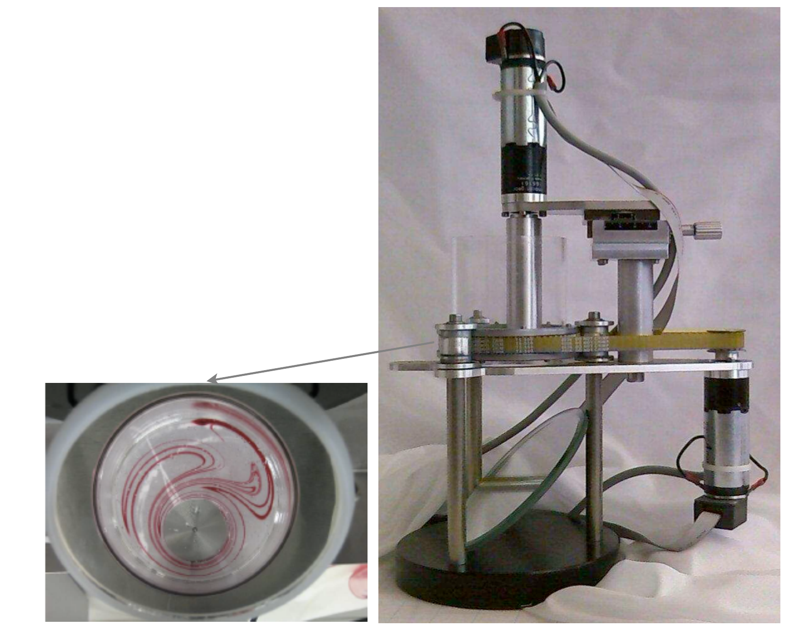

<!--
Textbook-prose companion to lectures/lecture08-approximate-dp.qmd,
intended as a booklet chapter for readers who did not attend the lecture.
Same content and figures as the slides, but written as connected prose
rather than bullet points, so it can stand on its own. Figures are the
same ones already cropped/verified for the slide deck, referenced from
../lectures/figures/lecture8/ rather than duplicated.

FIRST PASS (2026-09-20). Conventions carried over from units 1-7:
- Prose, not bullets; every equation from the deck is kept.
- Figure captions are written here (the slides deliberately carry none).
  CAVEAT: written from the surrounding slide text and the lecture's
  narrative rather than by re-inspecting each cropped image pixel by
  pixel -- the most likely thing to need correcting in the review round.
- Per [[feedback-concluding-remarks-no-learning-outcomes]], the "After
  this lecture you should be able to" / "Additional live scripts" blocks
  are not transcribed; the deck's substantive concluding bullets and its
  final comparison table are absorbed into the closing Summary.
- Quick-check callouts follow the unit 1-4 pattern (open tip with the
  question, collapsed note with the solution).
- Code is linked, not embedded: code/unit8/ holds mpc.py and rollout.py
  plus the original notebooks.

TWO TRANSCRIPTION FIXES relative to the deck, flagged here rather than
made silently:
- "Further remarks on ADP" (slide 16) says the quality of an
  approximation is measured by "how close it is from optimal u_k^*",
  using the same symbol u_k^* for both the approximate and the optimal
  input. Written out here as: how close the input produced by the
  approximation is to the true optimal u_k^*.
- The MPC prediction-matrix slide (slide 24) stacks
  \bar x = [x_{k+1} ... x_{k+H-1}] while \bar u has H entries
  [u_k ... u_{k+H-1}]; the state stack is one short of what the cost sum
  uses. Transcribed as in the deck, with a footnote-style remark in the
  text that the index range is the deck's, since the convention only
  affects whether the H-th predicted state is penalized.
-->

[Slides](../lectures/lecture08-approximate-dp.html) &middot; [Exercises](../exercises/unit8-exercises.html) &middot; [Jupyter notebooks](../code/unit8/notebooks.html)

## Where we stand, and what is still missing

Unit 7 left us with two numerical methods for stage decision problems,
and a table summarizing when each one may be used:

| dimension | convexity | DP discretization | Static optimization |
|---|---|---|---|
| small $n\leq3$ | convex | ✓ | ✓ |
| small $n\leq3$ | non-convex | ✓ | ✗ |
| large | convex | ✗ | ✓ |
| large | non-convex | ✗ | ✗ |

Discretization gives an approximate *policy* when the state and input
dimensions are small; static optimization gives an optimal *path* when
the problem is convex. The empty corner -- large and non-convex -- is
untouched, and even in the convex corner we only obtain a path, valid for
one initial state and no disturbances.

This unit closes both gaps with a single idea. We will see how to obtain
optimal (or near-optimal) *policies* out of methods that compute only
paths, by recomputing the path online at every stage and discarding all
but its first decision. Applied to linear quadratic control with input
constraints, this turns a quadratic-programming solver into a feedback
controller. Applied more aggressively -- truncating the horizon, or
appending a cheap base policy beyond it -- it gives the two workhorse
methods of modern control practice, model predictive control and
rollout, which we will use on a genuinely large, genuinely non-convex
problem: the control of switched linear systems.

## Approximate dynamic programming

### The challenge

Iterating the dynamic programming algorithm for stage decision problems
is hard because the costs-to-go are hard to compute:

$$
J_k(x_k) = \min_{u_k} \ g_k(x_k,u_k)+J_{k+1}(f_k(x_k,u_k)).
$$

::: {style="text-align: center;"}
{#fig-challenge-diagram width="75%" fig-align="center"}
:::

The two methods of Unit 7 each fall short in a specific way.
Discretization is only possible when the state and input spaces are not
large. Static optimization only assures optimality for convex problems,
and in any case only produces optimal *paths*. So the question becomes:
how do we obtain a (sub)optimal *policy*?

Three ideas answer this, in increasing order of cheapness and decreasing
order of fidelity.

### Idea I: the online replanning policy

Compute an optimal path online, starting from the *current* state, and
apply only its first decision.

::: {style="text-align: center;"}
{#fig-online-replanning-diagram width="70%" fig-align="center"}
:::

Then repeat the whole procedure at the next stage, from whatever state
the system actually reached. This method is also known as *certainty
equivalent control* (CEC), because it plans as though the uncertain
future were certain -- a name that connects it directly to the certainty
equivalence property of Unit 6. The essential point is that the
*feedback* comes not from the plan, which is open loop, but from the act
of re-planning from the measured state.

### Idea II: model predictive control

Idea I still requires solving an optimization problem over the entire
remaining horizon at every stage, which may be far too expensive. Idea II
is the same, but computes decisions only over a short horizon $H$.

::: {style="text-align: center;"}
{#fig-mpc-diagram width="70%" fig-align="center"}
:::

Repeating this in a receding (or rolling) horizon way is the fundamental
idea of **model predictive control** (MPC). The optimization problem to
be solved at each stage is much smaller, which is what makes the
algorithm feasible to run online. Note, however, that MPC is in general
*not* optimal -- and not even for problems without disturbances, since
truncating the horizon genuinely discards information about the future.

### Idea III: rollout

Truncating the horizon throws away everything beyond step $H$. Idea III
recovers some of it cheaply: optimize over the horizon as in MPC, but
evaluate what happens *after* the horizon by simulating a given **base
policy** rather than by ignoring it.

::: {style="text-align: center;"}
{#fig-rollout-diagram width="70%" fig-align="center"}
:::

Again the first decision is applied and the procedure repeated in a
receding-horizon way. The optimization problem at each stage is as small
as in MPC, so the method is equally feasible online; this is the
fundamental idea of **rollout**. Like MPC, it is in general not optimal,
not even without disturbances.

### The unifying view

All three ideas are instances of one scheme. *Approximate* the cost-to-go
by some $\tilde J_{k+1}$ that is cheap to evaluate, and use the solution
$u_k$ of

$$
J_k(x_k) = \min_{u_k} \ g_k(x_k,u_k)+\tilde J_{k+1}(f_k(x_k,u_k))
$$

as the control input -- in general different from the optimal control
input.

::: {style="text-align: center;"}
{#fig-adp-costtogo width="80%" fig-align="center"}
:::

The decisive practical feature is this: for each state $x_k$ we only have
to minimize this one function and compute one action. We never have to
*iterate* the cost-to-go backwards over the whole state space, which is
what made exact DP intractable in the first place. This formulation is
also more general than any of the three ideas -- $\tilde J_{k+1}$ can be
anything, including a function learned from data, which is exactly the
bridge to the reinforcement learning material later in the course.

Let us see how each idea fits this template.

- **Idea I (online replanning).** For problems with disturbances, the
  true cost -- which requires computing expected values -- is
  approximated by a deterministic cost. For problems without
  disturbances, Idea I yields exactly the same policy as DP.
- **Idea II (MPC).** The approximation is the deterministic cost over a
  short horizon. This is an approximation even for problems without
  disturbances.
- **Idea III (rollout).** The approximation is the cost of the base
  policy when $H=1$, and the cost over a short horizon plus the cost of
  the base policy when the horizon is larger than one. Again, this is an
  approximation even for problems without disturbances.

Although we mainly consider finite-horizon costs, the ideas extend
naturally to infinite-horizon costs -- and in the switched-systems
section at the end of this unit the infinite-horizon version is actually
the *easier* one to write down.

We now formalize these statements.

### Online replanning, formally

For the stage decision problem

$$
x_{k+1}=f_k(x_k,u_k,w_k), \qquad \sum_{k=0}^{h-1}g_k(x_k,u_k)+g_h(x_h),
$$

the online replanning policy is the following implicit rule.

1. At each stage $k$ (initially $k=0$), assuming the full state $x_k$ is
   measured, solve the problem below for the initial condition $x_k$,
   assuming no disturbances ($w_k=0$, $w_{k+1}=0,\dots$):

   $$
   \sum_{\ell=k}^{h-1}g_\ell(x_\ell,u_\ell)+g_h(x_h), \qquad x_{\ell+1}=f_\ell(x_\ell,u_\ell,0), \quad \ell\in\{k,k+1,\dots,h-1\},
   $$

   obtaining estimates of the optimal control inputs
   $u_k,u_{k+1},\dots,u_{h-1}$.

2. Take the first decision $u_k$ and apply it to the process. The system
   evolves to $x_{k+1}=f_k(x_k,u_k,w_k)$, which is in general different
   from the predicted $x_{k+1}=f_k(x_k,u_k,0)$, because of the
   disturbance. Repeat from step 1.

::: {style="text-align: center;"}
{#fig-replanning-lattice width="70%" fig-align="center"}
:::

This is not merely a heuristic. For problems with no disturbances it is
*equivalent* to a DP step:

$$
\min_{u_k} \ g_k(x_k,u_k)+\tilde J_{k+1}(x_{k+1}), \qquad x_{\ell+1}=f_\ell(x_\ell,u_\ell,0), \quad \ell\in\{k,\dots,h-1\}, \tag{1}
$$

$$
\tilde J_{k+1}(x_{k+1}) = \min_{u_{k+1},\dots,u_{h-1}} \ \sum_{\ell=k+1}^{h-1} g_\ell(x_\ell,u_\ell) \quad \text{s.t. (1), initial condition } x_{k+1},
$$

selecting $u_k$ and applying it. For problems without disturbances the
$\tilde J_k$ are the true optimal costs-to-go, and they satisfy the DP
equation

$$
\tilde J_k(x_k) = \min_{u_k} \ g_k(x_k,u_k)+\tilde J_{k+1}(x_{k+1}),
$$

so online replanning is exactly optimal. For problems with stochastic
disturbances the $\tilde J_k$ are approximations of the optimal
costs-to-go,

$$
J_k(x_k) = \min_{u_k} \ g_k(x_k,u_k)+\mathbb{E}[J_{k+1}(x_{k+1})], \qquad x_{\ell+1}=f_\ell(x_\ell,u_\ell,w_\ell), \quad \ell\in\{k,\dots,h-1\},
$$

$$
\underbrace{\phantom{J_k(x_k) = \min_{u_k} \ g_k(x_k,u_k)+\mathbb{E}[J_{k+1}(x_{k+1})]}}_{\text{approximated by } \tilde J_{k+1}(x_{k+1})}
$$

the approximation consisting precisely in replacing the expectation over
future disturbances by a deterministic prediction that sets them to zero.

:::: {.callout-tip collapse="false" title="Quick exercise: when is certainty equivalent control exactly optimal?"}
Unit 6 proved that for a linear model with a quadratic cost and additive
zero-mean disturbances, the optimal policy coincides with the
deterministic one -- the certainty equivalence property. Combine this
with the statement above: for which class of problems is the online
replanning policy of this section not merely a good heuristic but
genuinely the optimal policy?
::::

:::: {.callout-note collapse="true" title="Solution"}
Two classes, for two different reasons.

First, any problem *without* disturbances, as argued above: there the
$\tilde J_k$ are the true costs-to-go, so replanning reproduces the DP
policy exactly. (Replanning is then wasted effort in principle, since
the plan never needs revising; in practice it still protects against
model error.)

Second, linear models with quadratic costs and additive zero-mean white
disturbances -- exactly the setting of Unit 6. There the approximation
"set the future disturbances to zero" is not an approximation of the
optimal policy at all: certainty equivalence says the optimal policy
*is* the one computed as if the disturbances were absent. The realized
cost is of course higher than the deterministic one, by the
$\sum_k\text{trace}(P_{k+1}\mathbb{E}[w_kw_k^\intercal])$ term,
but the policy is the same.

This is why the constrained linear quadratic example in the next section
works so well: the problem is very nearly the one for which certainty
equivalence is a theorem. The input constraint is what takes it outside
that theorem, but it remains convex.
::::

### Model predictive control, formally

::: {style="text-align: center;"}
{#fig-mpc-path width="60%" fig-align="center"}
:::

At each time $k$, consider the optimal control problem only over a
horizon $H$:

$$
\min_{u_k,u_{k+1},\dots,u_{k+H-1}} \ \sum_{\ell=k}^{k+H-1}g_\ell(x_\ell,u_\ell) \quad \text{s.t.} \quad x_{\ell+1}=f_\ell(x_\ell,u_\ell), \quad \ell\in\{k,\dots,k+H-1\}, \tag{1}
$$

and select the first control input $u_k$ resulting from this
optimization. Equivalently, in the ADP template,
$\min_{u_k} \ g_k(x_k,u_k)+\tilde J_{k+1}(x_{k+1})$ with

$$
\tilde J_{k+1}(x_{k+1}) = \min_{u_{k+1},\dots,u_{k+H-1}} \ \sum_{\ell=k+1}^{k+H-1}g_\ell(x_\ell,u_\ell) \quad \text{s.t. (1)}.
$$

Two practical points. First, at the last decision stages
$k\in\{h-H,h-H-1,\dots,h\}$ the cost function is slightly different for
finite-horizon problems, since the window now runs past the end of the
problem and must include the terminal cost:

$$
\min_{u_k,u_{k+1},\dots,u_{k+H-1}} \ \sum_{\ell=k}^{k+H-1}g_\ell(x_\ell,u_\ell)+g_h(x_h) \quad \text{s.t. (1),} \ \ell\in\{k,\dots,h-1\}.
$$

Second, there are several variants of MPC, and in particular some
variants use a **terminal constraint**, which is useful for proving
stability -- for example, imposing that the state after the horizon be
zero, $x_{k+H}=0$ (and, for finite-horizon problems at the last stages,
$x_h=0$). Without such a device, nothing in the formulation above
prevents the controller from steering the state somewhere convenient
within the window and disastrous beyond it.

### Rollout, formally

::: {style="text-align: center;"}
{#fig-rollout-path width="60%" fig-align="center"}
:::

Rollout is MPC with a base policy $u_k=\bar\mu(x_k)$ used after the
horizon. At each time, consider the optimal control problem over the
horizon $H$, assuming the base policy is applied afterwards:

$$
\min_{u_k,u_{k+1},\dots,u_{k+H-1}} \ \sum_{\ell=k}^{k+H-1}g_\ell(x_\ell,u_\ell) + \sum_{\ell=k+H}^{h-1}g_\ell(x_\ell,\bar\mu_\ell(x_\ell)) + g_h(x_h) \quad \text{s.t. (1)},
$$

and select the first control input $u_k$. Equivalently, in the ADP
template, $\min_{u_k} \ g_k(x_k,u_k)+\tilde J_{k+1}(x_{k+1})$ with

$$
\tilde J_{k+1}(x_{k+1}) = \min_{u_{k+1},\dots,u_{k+H-1}} \ \sum_{\ell=k+1}^{k+H-1}g_\ell(x_\ell,u_\ell) + \sum_{\ell=k+H}^{h-1}g_\ell(x_\ell,\bar\mu_\ell(x_\ell)) + g_h(x_h).
$$

The second sum is not optimized over -- it is simply *evaluated*, by
simulating the base policy forward. That is what makes rollout cheap:
the cost of the tail is computed, not searched.

### Further remarks on approximate dynamic programming

A few observations that apply to all of the above, and that are easy to
get wrong.

The quality of an approximation is measured by how good the resulting
input is -- how close the input produced by the approximation is to the
optimal $u_k^*$ -- and *not* by how good the approximation
$\tilde J_{k+1}(x_{k+1})$ is of $J_{k+1}(x_{k+1})$. A crude cost-to-go
approximation that happens to rank the available actions correctly is
worth more than an accurate one that does not. (Adding a constant to
$\tilde J_{k+1}$, for the extreme example, changes its accuracy but not
a single decision.)

Decisions need only be computed, in real time, for the value of the
present state. We do not need to iterate the cost-to-go over the whole
state space, which is what the curse of dimensionality made impossible.

There are many variants for approximating the costs-to-go beyond the
three developed here. But because the approximation is heuristic in
nature, it is very hard to quantify when a specific method is good, and
to establish formal results about it. For example, we saw in Unit 5 that
the optimal policy for the infinite-horizon linear quadratic regulator
makes the closed loop of a linear system stable. Establishing the
analogous statement for an approximate method is typically very hard --
which is why the terminal-constraint variants of MPC mentioned above
exist, and why the stability proof in the switched-systems section below
is worth the trouble.

## Linear quadratic control with inequality constraints

The first application is the one closest to Units 5-6, and it shows the
whole progression -- path, then CEC policy, then MPC -- on a problem we
already understand well.

### Problem formulation

**Dynamic model** $\quad x_{k+1}=Ax_k+Bu_k+w_k$, with
$u_k\in\mathbb{R}$ for simplicity and $w_k$ a possible disturbance.

**Cost function** $\quad \displaystyle\sum_{k=0}^{h-1}x_k^\intercal Qx_k+u_k^\intercal Ru_k+x_h^\intercal Q_hx_h$.

**Input constraints** $\quad u_k\in[-c,c]$ for all $k$, for a given
$c>0$.

Find a policy $\pi=\{\mu_0,\dots,\mu_{h-1}\}$, $u_k=\mu_k(x_k)$, which
minimizes the cost function.

The input constraint is what takes this problem outside Unit 5. Actuators
saturate -- a motor has a maximum torque, a valve is either fully open or
not -- and the LQR gain $u_k=K_kx_k$ simply ignores that fact. Nor can
the constraint be handled by clipping the LQR input at $\pm c$ after the
fact: the DP recursion that produced $K_k$ assumed the unclipped input
would be available at every future stage, so the resulting policy is not
optimal for the constrained problem.

Let us first obtain an optimal *path*, and then upgrade it to a policy
by online replanning and MPC.

### The quadratic programming formulation

Stack the state and input trajectories,

$$
\bar x=[x_1^\intercal \ x_2^\intercal \ \dots \ x_h^\intercal]^\intercal, \qquad \bar u=[u_0^\intercal \ u_1^\intercal \ \dots \ u_{h-1}^\intercal]^\intercal .
$$

Applying the state-elimination idea of Unit 7 in batch form, every
predicted state is an affine function of $x_0$ and $\bar u$, so that

**Cost function** $\quad (\bar A x_0+\bar B\bar u)^\intercal \bar Q(\bar Ax_0+\bar B\bar u)+\bar u^\intercal \bar R\bar u$,

**Dynamic model (equality constraints)** $\quad \bar x=\bar Ax_0+\bar B\bar u$,

**Inequality constraints** $\quad \begin{bmatrix}I\\-I\end{bmatrix}\bar u \leq c\begin{bmatrix}1\\\vdots\\1\end{bmatrix}$,

where

$$
\bar A=\begin{bmatrix}A\\A^2\\\vdots\\A^h\end{bmatrix} \quad
\bar B=\begin{bmatrix}B&0&0&0&\cdots&0\\AB&B&0&0&\cdots&0\\A^2B&AB&B&0&\cdots&0\\A^3B&A^2B&AB&B&\cdots&0\\\vdots&\ddots&\ddots&\ddots&\ddots&\vdots\\A^{h-1}B&A^{h-2}B&A^{h-3}B&\cdots&AB&B\end{bmatrix} \quad
\bar Q=\begin{bmatrix}Q&0&0&\cdots&0\\0&Q&0&\cdots&0\\\vdots&\ddots&\ddots&\ddots&\vdots\\0&0&0&\cdots&Q_h\end{bmatrix} \quad
\bar R=\begin{bmatrix}R&0&0&\cdots&0\\0&R&0&\cdots&0\\\vdots&\ddots&\ddots&\ddots&\vdots\\0&0&0&\cdots&R\end{bmatrix} .
$$

The block lower-triangular structure of $\bar B$ is just causality
written down: the state at stage $\ell$ depends on the inputs up to
$\ell-1$ and on no later ones.

This is a standard quadratic programming problem -- see, e.g., *Convex
Optimization* by Boyd and Vandenberghe -- implemented in MATLAB as
`quadprog.m`. It is a *convex* problem: the cost is a convex quadratic
and the feasible set, a box, is convex. As discussed in Unit 7, that is
precisely the situation in which numerical optimization is reliable. This
already allows us to obtain an optimal path.

### Example: the constrained double integrator

Take the double integrator of Unit 5,

::: {style="text-align: center;"}
![The double integrator as a cart on a frictionless surface: state $x=[y\ \ v]^\intercal$ (position and velocity), input the applied force.](../lectures/figures/lecture8/pg19-cart-diagram.png){#fig-cart-diagram width="55%" fig-align="center"}
:::

with $x=[y\ \ v]^\intercal$ and parameters $Q=Q_h=I$, $R=1$,
$x_0=[1\ \ 0]^\intercal$, $\tau=0.2$ and $h=50$. Without constraints we
recover the optimal path of Unit 5.

::: {style="text-align: center;"}
{#fig-example-unconstrained width="85%" fig-align="center"}
:::

Now impose $u_k\in[-L,L]$ with $L=0.25$ and solve the QP again.

::: {style="text-align: center;"}
![Optimal path with the input constrained to $[-0.25,0.25]$: the input saturates at the bound during the initial phase and the state converges more slowly, but the solution is genuinely optimal for the constrained problem -- not the unconstrained solution clipped at the bound.](../lectures/figures/lecture8/pg19-example-constrained.png){#fig-example-constrained width="85%" fig-align="center"}
:::

So far, so good -- but all of this is an *open-loop* plan. What happens
if the system is actually disturbed?

::: {style="text-align: center;"}
{#fig-example-disturbances width="85%" fig-align="center"}
:::

The behaviour is far from what was intended. We want an optimal
**policy** -- which is what CEC and MPC will give us.

:::: {.callout-important collapse="true" title="Interactive example: the plan, the bound, and what a disturbance does to both"}
The panel runs the batch QP of this section on the cart and animates the
result. Everything is as in the figures above — $\tau=0.2$, $Q=Q_h=I$,
$R=0.01$, $x_0=[1\ \ 0]^\intercal$, $h=50$, bound $L=0.25$ — and the
strategy selector walks through the three figures in order.

- **No bound.** The QP reproduces the Unit 5 answer: the first input is
  $u_0=-3.7718$, exactly $K_0x_0$ from the Riccati recursion, and the
  closed-loop cost is $6.1852=x_0^\intercal P_0x_0$. That agreement is the
  check worth making first, because it says the batch formulation is the
  same problem written differently.
- **Bound $|u|\leq0.25$.** Fourteen of the fifty inputs sit exactly on the
  bound and the cost rises to $9.7729$. Look at the shape: this is not the
  unconstrained solution clipped. Clipping $-3.77$ to $-0.25$ and leaving
  the rest alone would be far worse; the QP spreads the braking over the
  whole saturated stretch instead.
- **That plan, replayed with disturbances.** The same fifty numbers are
  applied open-loop to a system that is being pushed around, and the cart
  ends at $|x_h|=0.39$ instead of the origin, with a cost of $11.25$.
  Nothing in the scheme notices.

Things to try: raise $L$ until the bound stops binding and watch the
largest $|u|$ settle back on $3.7715$; raise $R$ and watch the input get
gentler and the bound stop mattering; change the seed to convince yourself
the drift in the third case is not one unlucky realization. The two
closed-loop strategies in the selector are the subject of the next two
sections — try them now if you like, but they are discussed there.
```{=html}
<div id="d33-wrap" style="margin:1em 0; text-align:center;">
  <div style="margin-bottom:0.6em; font-size:0.9em;">
    <label>strategy
      <select id="d33-mode">
        <option value="uncon">open-loop plan, no bound</option>
        <option value="con">open-loop plan, |u| &le; L</option>
        <option value="open">that plan, replayed with disturbances</option>
        <option value="cec">online replanning (CEC)</option>
        <option value="mpc">MPC, horizon H</option>
      </select>
    </label>
    <label style="margin-left:0.6em;">L
      <input id="d33-L" type="number" value="0.25" min="0.01" step="0.05" style="width:5em;">
    </label>
    <label style="margin-left:0.6em;">R
      <input id="d33-R" type="number" value="0.01" min="0.000001" step="0.01" style="width:5.5em;">
    </label>
    <label style="margin-left:0.6em;">h
      <input id="d33-h" type="number" value="50" min="5" max="80" step="5" style="width:4.5em;">
    </label>
    <span id="d33-H-wrap"><label style="margin-left:0.6em;">H
      <input id="d33-H" type="number" value="25" min="2" max="80" step="1" style="width:4.5em;">
    </label></span>
    <span id="d33-sig-wrap"><label style="margin-left:0.6em;">&sigma;
      <input id="d33-sig" type="number" value="0.01" min="0" step="0.005" style="width:5em;">
    </label>
    <label style="margin-left:0.4em;">seed
      <input id="d33-seed" type="number" value="15" step="1" style="width:4.5em;">
    </label></span>
  </div>
  <div id="d33-anim"></div>
  <div id="d33-plot"></div>
  <div id="d33-info" style="margin:0.4em 0;"></div>
  <div id="d33-note" style="font-size:0.85em; color:#6a1b9a; min-height:1.2em;"></div>
  <div>
    <button id="d33-play" style="padding:4px 14px;">Play</button>
    <button id="d33-step" style="padding:4px 12px; margin-left:0.4em;">Step</button>
    <button id="d33-rewind" style="padding:4px 12px; margin-left:0.4em;">Rewind</button>
    <button id="d33-end" style="padding:4px 12px; margin-left:0.4em;">Run to the end</button>
    <button id="d33-reset" style="padding:4px 12px; margin-left:0.4em;">Defaults</button>
    <label style="margin-left:0.6em; font-size:0.88em;">ms/step
      <input id="d33-speed" type="number" value="110" min="30" max="1000" step="10" style="width:5em;">
    </label>
  </div>
</div>
<script>
(function () {
  const PFX = 'd33-', DEFAULT_MODE = 'con';
  // ---- constrained LQ on the double integrator: batch QP + policies ----
  const TAU = 0.2;
  const Ad = [[1, TAU], [0, 1]], Bd = [TAU * TAU / 2, TAU];
  const mv = (M, v) => [M[0][0] * v[0] + M[0][1] * v[1], M[1][0] * v[0] + M[1][1] * v[1]];
  const step1 = (x, u) => [Ad[0][0] * x[0] + Ad[0][1] * x[1] + Bd[0] * u,
                           Ad[1][0] * x[0] + Ad[1][1] * x[1] + Bd[1] * u];

  // batch prediction: x_{k+i} = Ab_i x + sum_j Bb[i][j] u_j , i = 1..H
  function batch(H) {
    const Ab = [], Bb = [];
    let P = [[1, 0], [0, 1]];
    const pow = [P];
    for (let i = 1; i <= H; i++) {
      P = [[P[0][0] * Ad[0][0] + P[0][1] * Ad[1][0], P[0][0] * Ad[0][1] + P[0][1] * Ad[1][1]],
           [P[1][0] * Ad[0][0] + P[1][1] * Ad[1][0], P[1][0] * Ad[0][1] + P[1][1] * Ad[1][1]]];
      pow.push(P);
    }
    for (let i = 1; i <= H; i++) {
      Ab.push(pow[i]);
      const row = new Array(H).fill(null);
      for (let j = 0; j < i; j++) row[j] = mv(pow[i - 1 - j], Bd);
      Bb.push(row);
    }
    return { Ab, Bb };
  }
  // cost  sum_{i=1..H} x_i' Qi x_i + R sum u^2 , with Qi = I except QH = qT*I
  function qpParts(H, x0, R, qT) {
    const { Ab, Bb } = batch(H);
    const w = i => (i === H - 1 ? qT : 1);                 // weight on predicted state i (0-based)
    // gradient of  f(u) = sum_i w_i |Ab_i x0 + sum_j Bb_ij u_j|^2 + R |u|^2
    const base = Ab.map(M => mv(M, x0));
    function states(u) {
      return base.map((b, i) => {
        let s0 = b[0], s1 = b[1];
        for (let j = 0; j <= i; j++) { const B2 = Bb[i][j]; s0 += B2[0] * u[j]; s1 += B2[1] * u[j]; }
        return [s0, s1];
      });
    }
    function f(u) {
      const X = states(u);
      let c = 0;
      for (let i = 0; i < H; i++) c += w(i) * (X[i][0] * X[i][0] + X[i][1] * X[i][1]);
      for (let j = 0; j < H; j++) c += R * u[j] * u[j];
      return c;
    }
    function grad(u) {
      const X = states(u), g = new Array(H).fill(0);
      for (let i = 0; i < H; i++) {
        const c0 = 2 * w(i) * X[i][0], c1 = 2 * w(i) * X[i][1];
        for (let j = 0; j <= i; j++) { const B2 = Bb[i][j]; g[j] += c0 * B2[0] + c1 * B2[1]; }
      }
      for (let j = 0; j < H; j++) g[j] += 2 * R * u[j];
      return g;
    }
    // Lipschitz constant of the gradient, by power iteration on the Hessian
    let v = new Array(H).fill(0).map(() => Math.random() - 0.5), Lp = 1;
    const g0 = grad(new Array(H).fill(0));
    for (let it = 0; it < 120; it++) {
      const gv = grad(v).map((g, j) => g - g0[j]);          // Hessian * v
      Lp = Math.sqrt(gv.reduce((s, a) => s + a * a, 0));
      if (!(Lp > 0)) { Lp = 1; break; }
      v = gv.map(a => a / Lp);
    }
    return { f, grad, states, L: Lp };
  }
  // box-constrained QP by FISTA
  function qpSolve(H, x0, R, qT, bound, iters, warm) {
    const P = qpParts(H, x0, R, qT);
    const clip = u => Math.max(-bound, Math.min(bound, u));
    let u = new Array(H).fill(0);
    if (warm) for (let j = 0; j < H; j++) u[j] = clip(warm[j + 1] !== undefined ? warm[j + 1] : 0);
    let y = u.slice(), t = 1;
    const s = 1 / Math.max(P.L, 1e-12);
    for (let it = 0; it < (iters || 1500); it++) {
      const g = P.grad(y);
      const un = y.map((v2, j) => clip(v2 - s * g[j]));
      const tn = (1 + Math.sqrt(1 + 4 * t * t)) / 2;
      y = un.map((v2, j) => v2 + ((t - 1) / tn) * (v2 - u[j]));
      u = un; t = tn;
    }
    return { u, cost: P.f(u), states: P.states(u) };
  }
  // unconstrained finite-horizon LQR, for reference
  function riccati(h, R) {
    let P = [[1, 0], [0, 1]];
    const K = new Array(h);
    for (let k = h - 1; k >= 0; k--) {
      const PB = mv(P, Bd), den = R + Bd[0] * PB[0] + Bd[1] * PB[1];
      const BPA = [Bd[0] * (P[0][0] * Ad[0][0] + P[0][1] * Ad[1][0]) + Bd[1] * (P[1][0] * Ad[0][0] + P[1][1] * Ad[1][0]),
                   Bd[0] * (P[0][0] * Ad[0][1] + P[0][1] * Ad[1][1]) + Bd[1] * (P[1][0] * Ad[0][1] + P[1][1] * Ad[1][1])];
      K[k] = [-BPA[0] / den, -BPA[1] / den];
      const APA = [[0, 0], [0, 0]];
      for (let i = 0; i < 2; i++) for (let j = 0; j < 2; j++) {
        let s2 = 0;
        for (let a = 0; a < 2; a++) for (let b = 0; b < 2; b++) s2 += Ad[a][i] * P[a][b] * Ad[b][j];
        APA[i][j] = s2;
      }
      const APB = [Ad[0][0] * PB[0] + Ad[1][0] * PB[1], Ad[0][1] * PB[0] + Ad[1][1] * PB[1]];
      P = [[APA[0][0] + 1 - APB[0] * BPA[0] / den, APA[0][1] - APB[0] * BPA[1] / den],
           [APA[1][0] - APB[1] * BPA[0] / den, APA[1][1] + 1 - APB[1] * BPA[1] / den]];
    }
    return { K, P };
  }
  // deterministic disturbance sequence, so every strategy sees the same one
  function noise(seed, h, sigma) {
    let s = seed >>> 0, out = [];
    const rnd = () => { s = (s * 1664525 + 1013904223) >>> 0; return s / 4294967296; };
    for (let k = 0; k < h; k++) {
      let u1 = 0; while (u1 === 0) u1 = rnd();
      const g = Math.sqrt(-2 * Math.log(u1)) * Math.cos(2 * Math.PI * rnd());
      let u2 = 0; while (u2 === 0) u2 = rnd();
      const g2 = Math.sqrt(-2 * Math.log(u2)) * Math.cos(2 * Math.PI * rnd());
      out.push([sigma * g, sigma * g2]);
    }
    return out;
  }

  const el = id => document.getElementById(PFX + id);
  const num = (id, d) => { const v = Number(el(id).value); return isFinite(v) ? v : d; };
  let RUN = null, kshow = 0, timer = null, note = '';

  function compute() {
    const mode = el('mode').value;
    const L = Math.max(0.01, Math.min(20, num('L', 0.25)));
    const R = Math.max(1e-6, num('R', 0.01));
    const h = Math.max(5, Math.min(80, Math.round(num('h', 50))));
    const H = Math.max(2, Math.min(h, Math.round(num('H', 25))));
    const sig = Math.max(0, num('sig', 0.01));
    const seed = Math.round(num('seed', 15));
    el('H-wrap').style.display = mode === 'mpc' ? '' : 'none';
    el('sig-wrap').style.display = (mode === 'uncon' || mode === 'con') ? 'none' : '';
    const dist = (mode === 'uncon' || mode === 'con') ? 0 : sig;
    const w = noise(seed, h, dist);
    const bound = (mode === 'uncon') ? 1e6 : L;
    const t0 = (typeof performance !== 'undefined' && performance.now) ? performance.now() : Date.now();
    let plan0 = null, planAt = [], x = [1, 0], us = [], xs = [[1, 0]], J = 0, warm = null, sizes = [];
    if (mode === 'uncon' || mode === 'con' || mode === 'open') {
      plan0 = qpSolve(h, [1, 0], R, 1, bound, 9000).u;
      sizes.push(h);
    }
    for (let k = 0; k < h; k++) {
      let u, plan;
      if (plan0) { u = plan0[k]; plan = plan0.slice(k); }
      else if (mode === 'cec') {
        const s = qpSolve(h - k, x, R, 1, bound, 400, warm); warm = s.u; u = s.u[0]; plan = s.u; sizes.push(h - k);
      } else {
        const Hk = Math.min(H, h - k);
        const s = qpSolve(Hk, x, R, 1, bound, 400, warm); warm = s.u; u = s.u[0]; plan = s.u; sizes.push(Hk);
      }
      planAt.push(plan);
      J += x[0] * x[0] + x[1] * x[1] + R * u * u;
      us.push(u);
      x = step1(x, u);
      x = [x[0] + w[k][0], x[1] + w[k][1]];
      xs.push(x.slice());
    }
    J += x[0] * x[0] + x[1] * x[1];
    const t1 = (typeof performance !== 'undefined' && performance.now) ? performance.now() : Date.now();
    RUN = { mode, L, R, h, H, sig: dist, xs, us, J, planAt, w, ms: t1 - t0, bound,
            sizes, maxu: Math.max.apply(null, us.map(Math.abs)) };
    note = mode === 'open'
      ? 'The plan is computed once, at k = 0, and replayed regardless of what the state actually does.'
      : (mode === 'uncon' ? 'No input bound: this is the Unit 5 solution, reached here through the QP.' : '');
    kshow = 0;
  }

  const av = document.createElement('canvas');
  av.width = 690; av.height = 120;
  av.style.maxWidth = '100%'; av.style.border = '1px solid #ccc';
  av.style.display = 'block'; av.style.margin = '0 auto 6px';
  el('anim').appendChild(av);
  const ac = av.getContext('2d');
  const cv = document.createElement('canvas');
  cv.width = 690; cv.height = 330;
  cv.style.maxWidth = '100%'; cv.style.border = '1px solid #ccc';
  cv.style.display = 'block'; cv.style.margin = '0 auto 6px';
  el('plot').appendChild(cv);
  const c = cv.getContext('2d');

  function drawCart() {
    const W = av.width, Hh = av.height;
    ac.clearRect(0, 0, W, Hh);
    const k = Math.min(kshow, RUN.h);
    const y = RUN.xs[k][0], u = RUN.us[Math.min(k, RUN.h - 1)];
    let lo = 0, hi = 0;
    RUN.xs.forEach(s => { lo = Math.min(lo, s[0]); hi = Math.max(hi, s[0]); });
    const pad = 0.25 * Math.max(hi - lo, 0.2);
    lo -= pad; hi += pad;
    const PX = v => 40 + (v - lo) / (hi - lo) * (W - 80), rail = 72;
    ac.strokeStyle = '#90a4ae'; ac.lineWidth = 3;
    ac.beginPath(); ac.moveTo(20, rail); ac.lineTo(W - 20, rail); ac.stroke();
    ac.strokeStyle = '#cfd8dc'; ac.lineWidth = 1;
    for (let p = 22; p < W - 20; p += 11) { ac.beginPath(); ac.moveTo(p, rail); ac.lineTo(p - 8, rail + 9); ac.stroke(); }
    ac.strokeStyle = '#2e7d32'; ac.lineWidth = 1.4; ac.setLineDash([5, 4]);
    ac.beginPath(); ac.moveTo(PX(0), 26); ac.lineTo(PX(0), rail); ac.stroke(); ac.setLineDash([]);
    ac.fillStyle = '#2e7d32'; ac.font = '11px sans-serif'; ac.textAlign = 'center';
    ac.fillText('y = 0', PX(0), 20);
    // the path already travelled
    ac.strokeStyle = 'rgba(21,101,192,0.35)'; ac.lineWidth = 2;
    ac.beginPath(); ac.moveTo(PX(RUN.xs[0][0]), rail - 30); ac.lineTo(PX(y), rail - 30); ac.stroke();
    ac.fillStyle = '#2563eb';
    ac.fillRect(PX(y) - 24, rail - 22, 48, 22);
    // the applied force
    const amp = Math.max(RUN.maxu, 1e-9), aLen = 44 * u / amp;
    if (Math.abs(aLen) > 1.5) {
      ac.strokeStyle = '#ef6c00'; ac.lineWidth = 2.5;
      const yy = rail - 11, xT = PX(y) + (aLen > 0 ? 24 : -24), xE = xT + aLen;
      ac.beginPath(); ac.moveTo(xT, yy); ac.lineTo(xE, yy); ac.stroke();
      ac.beginPath(); ac.moveTo(xE, yy); ac.lineTo(xE - Math.sign(aLen) * 7, yy - 4.5);
      ac.lineTo(xE - Math.sign(aLen) * 7, yy + 4.5); ac.closePath();
      ac.fillStyle = '#ef6c00'; ac.fill();
    }
    ac.fillStyle = '#333'; ac.font = '12px sans-serif'; ac.textAlign = 'left';
    ac.fillText('k = ' + k + '   t = ' + (k * TAU).toFixed(1) + ' s   y = ' + y.toFixed(3) +
      '   u = ' + u.toFixed(3) + (Math.abs(Math.abs(u) - RUN.L) < 1e-4 && RUN.mode !== 'uncon' ? '  (at the bound)' : ''), 16, 16);
    ac.strokeStyle = '#cfd8dc'; ac.lineWidth = 3;
    ac.beginPath(); ac.moveTo(16, rail + 26); ac.lineTo(W - 16, rail + 26); ac.stroke();
    ac.strokeStyle = '#1565c0';
    ac.beginPath(); ac.moveTo(16, rail + 26); ac.lineTo(16 + (W - 32) * k / RUN.h, rail + 26); ac.stroke();
  }

  function panel(row) { return { x: 50, y: 12 + row * 106, w: 620, h: 82 }; }
  function drawPanels() {
    c.clearRect(0, 0, cv.width, cv.height);
    const k = Math.min(kshow, RUN.h);
    const series = [
      { lab: 'position y', get: i => RUN.xs[i][0], n: RUN.h + 1, planIdx: 0 },
      { lab: 'velocity v', get: i => RUN.xs[i][1], n: RUN.h + 1, planIdx: 1 },
      { lab: 'input u', get: i => RUN.us[i], n: RUN.h, isU: true }
    ];
    series.forEach((s, row) => {
      const p = panel(row);
      let lo = Infinity, hi = -Infinity;
      for (let i = 0; i < s.n; i++) { const v = s.get(i); lo = Math.min(lo, v); hi = Math.max(hi, v); }
      if (s.isU && RUN.mode !== 'uncon') { lo = Math.min(lo, -RUN.L * 1.25); hi = Math.max(hi, RUN.L * 1.25); }
      if (hi - lo < 1e-9) { lo -= 1; hi += 1; }
      const m = 0.1 * (hi - lo); lo -= m; hi += m;
      const X = i => p.x + (i / RUN.h) * p.w, Y = v => p.y + p.h - (v - lo) / (hi - lo) * p.h;
      c.strokeStyle = '#333'; c.lineWidth = 1; c.strokeRect(p.x, p.y, p.w, p.h);
      if (lo < 0 && hi > 0) { c.strokeStyle = '#eee'; c.beginPath(); c.moveTo(p.x, Y(0)); c.lineTo(p.x + p.w, Y(0)); c.stroke(); }
      if (s.isU && RUN.mode !== 'uncon') {
        c.strokeStyle = '#b71c1c'; c.setLineDash([4, 3]); c.lineWidth = 1.2;
        [RUN.L, -RUN.L].forEach(b => { c.beginPath(); c.moveTo(p.x, Y(b)); c.lineTo(p.x + p.w, Y(b)); c.stroke(); });
        c.setLineDash([]);
      }
      // the plan currently held, drawn ahead of the executed part
      if (k < RUN.h && RUN.mode !== 'uncon' && RUN.mode !== 'con') {
        const plan = RUN.planAt[k];
        c.strokeStyle = 'rgba(245,124,0,0.85)'; c.lineWidth = 1.4; c.setLineDash([4, 3]);
        c.beginPath();
        if (s.isU) plan.forEach((uu, j) => { const xx = X(k + j), yy = Y(uu); if (j === 0) c.moveTo(xx, yy); else c.lineTo(xx, yy); });
        else {
          let xp = RUN.xs[k].slice();
          c.moveTo(X(k), Y(xp[s.planIdx]));
          plan.forEach((uu, j) => { xp = step1(xp, uu); c.lineTo(X(k + j + 1), Y(xp[s.planIdx])); });
        }
        c.stroke(); c.setLineDash([]);
      }
      // what has actually happened
      c.strokeStyle = '#1565c0'; c.lineWidth = 1.8; c.beginPath();
      const upto = s.isU ? Math.min(k, RUN.h - 1) : k;
      for (let i = 0; i <= upto; i++) { const xx = X(i), yy = Y(s.get(i)); if (i === 0) c.moveTo(xx, yy); else c.lineTo(xx, yy); }
      c.stroke();
      c.fillStyle = '#1565c0';
      c.beginPath(); c.arc(X(upto), Y(s.get(upto)), 3.2, 0, 2 * Math.PI); c.fill();
      c.fillStyle = '#333'; c.font = '11px sans-serif'; c.textAlign = 'left';
      c.fillText(s.lab, p.x + 5, p.y + 12);
      c.textAlign = 'right';
      c.fillText((Math.round(hi * 100) / 100).toString(), p.x - 3, p.y + 9);
      c.fillText((Math.round(lo * 100) / 100).toString(), p.x - 3, p.y + p.h);
      if (row === 2) {
        c.textAlign = 'center';
        c.fillText('t = 0', p.x, p.y + p.h + 13);
        c.fillText((RUN.h * TAU).toFixed(0) + ' s', p.x + p.w, p.y + p.h + 13);
        c.fillStyle = '#555';
        c.fillText('blue: what the system actually did' +
          (RUN.mode === 'cec' || RUN.mode === 'mpc' ? '   \\u00b7   orange dashed: the plan held at this instant' : '') +
          (RUN.mode !== 'uncon' ? '   \\u00b7   red dashed: the bound \\u00b1' + RUN.L : ''),
          cv.width / 2, p.y + p.h + 28);
      }
    });
  }
  function report() {
    const k = Math.min(kshow, RUN.h);
    const row = (a, b) => '<tr><td style="text-align:right;padding:1px 8px;color:#555;">' + a +
      '</td><td style="text-align:left;padding:1px 8px;">' + b + '</td></tr>';
    const names = { uncon: 'open-loop plan, no input bound', con: 'open-loop plan, |u| &le; L',
      open: 'open-loop plan replayed on the disturbed system', cec: 'online replanning (CEC)',
      mpc: 'MPC, horizon H = ' + RUN.H };
    el('info').innerHTML = '<table style="margin:0 auto;border-collapse:collapse;font-size:0.85em;">' +
      row('strategy', '<b>' + names[RUN.mode] + '</b>' + (RUN.sig > 0 ? ', disturbances &sigma; = ' + RUN.sig : ', no disturbances')) +
      row('QP solved', RUN.sizes.length === 1
        ? 'once, ' + RUN.sizes[0] + ' variables'
        : RUN.sizes.length + ' times, ' + (RUN.mode === 'cec'
            ? RUN.sizes[0] + ' variables down to ' + RUN.sizes[RUN.sizes.length - 1] + ' (shrinking)'
            : 'at most ' + Math.max.apply(null, RUN.sizes) + ' variables (fixed)') +
          ' &nbsp;&middot;&nbsp; ' + RUN.ms.toFixed(0) + ' ms in total') +
      row('closed-loop cost', '<b>' + RUN.J.toFixed(4) + '</b> &nbsp;&middot;&nbsp; final |x<sub>h</sub>| = ' +
        Math.hypot(RUN.xs[RUN.h][0], RUN.xs[RUN.h][1]).toFixed(4)) +
      row('inputs at the bound', RUN.mode === 'uncon' ? 'n/a (unbounded)' :
        RUN.us.filter(v => Math.abs(Math.abs(v) - RUN.L) < 1e-4).length + ' of ' + RUN.h +
        ' &nbsp;&middot;&nbsp; largest |u| = ' + RUN.maxu.toFixed(4)) +
      '</table>';
    el('note').innerHTML = note;
  }
  function redraw() { drawCart(); drawPanels(); report(); }
  function stop() { if (timer !== null) { clearInterval(timer); timer = null; } el('play').innerHTML = 'Play'; }
  function play() {
    if (timer !== null) { stop(); return; }
    if (kshow >= RUN.h) kshow = 0;
    el('play').innerHTML = 'Pause';
    timer = setInterval(function () {
      if (kshow >= RUN.h) { stop(); return; }
      kshow++; redraw();
    }, Math.max(30, num('speed', 110)));
  }
  ['mode', 'L', 'R', 'h', 'H', 'sig', 'seed'].forEach(id =>
    el(id).addEventListener('change', () => { stop(); compute(); redraw(); }));
  el('play').addEventListener('click', play);
  el('step').addEventListener('click', () => { stop(); if (kshow < RUN.h) kshow++; redraw(); });
  el('rewind').addEventListener('click', () => { stop(); kshow = 0; redraw(); });
  el('end').addEventListener('click', () => { stop(); kshow = RUN.h; redraw(); });
  el('reset').addEventListener('click', () => {
    el('mode').value = DEFAULT_MODE; el('L').value = '0.25'; el('R').value = '0.01';
    el('h').value = '50'; el('H').value = '25'; el('sig').value = '0.01'; el('seed').value = '15';
    stop(); compute(); redraw();
  });
  el('mode').value = DEFAULT_MODE;
  compute(); redraw();
})();
</script>
```

::::

### The online replanning policy for this problem

The construction is the batch formulation above, restarted at each stage
from the measured state. At each stage $k$ define

$$
\bar x=[x_{k+1}^\intercal \ x_{k+2}^\intercal \ \dots \ x_h^\intercal]^\intercal, \qquad \bar u=[u_k^\intercal \ u_{k+1}^\intercal \ \dots \ u_{h-1}^\intercal]^\intercal ,
$$

so that

**Cost function** $\quad \displaystyle\sum_{\ell=k}^{h-1}x_\ell^\intercal Qx_\ell+u_\ell^\intercal Ru_\ell+x_h^\intercal Q_hx_h = (\bar Ax_k+\bar B\bar u)^\intercal \bar Q(\bar Ax_k+\bar B\bar u)+\bar u^\intercal \bar R\bar u$,

**Dynamic model (equality constraints)** $\quad \bar x=\bar Ax_k+\bar B\bar u$,

**Inequality constraints** $\quad \begin{bmatrix}I\\-I\end{bmatrix}\bar u \leq c\begin{bmatrix}1\\\vdots\\1\end{bmatrix}$,

with

$$
\bar A=\begin{bmatrix}A\\A^2\\\vdots\\A^{h-k}\end{bmatrix} \quad
\bar B=\begin{bmatrix}B&0&0&0&\cdots&0\\AB&B&0&0&\cdots&0\\A^2B&AB&B&0&\cdots&0\\A^3B&A^2B&AB&B&\cdots&0\\\vdots&\ddots&\ddots&\ddots&\ddots&\vdots\\A^{h-1-k}B&A^{h-2-k}B&A^{h-3-k}B&\cdots&AB&B\end{bmatrix} \quad
\bar Q=\begin{bmatrix}Q&0&0&\cdots&0\\0&Q&0&\cdots&0\\\vdots&\ddots&\ddots&\ddots&\vdots\\0&0&0&\cdots&Q_h\end{bmatrix} \quad
\bar R=\begin{bmatrix}R&0&0&\cdots&0\\0&R&0&\cdots&0\\\vdots&\ddots&\ddots&\ddots&\vdots\\0&0&0&\cdots&R\end{bmatrix} .
$$

Take the first component of $\bar u$, that is $u_k$, and apply it to the
plant. Note that the stacked matrices shrink as $k$ advances: the problem
solved at each stage is a little smaller than the previous one.

::: {style="text-align: center;"}
{#fig-example-replanning width="85%" fig-align="center"}
:::

The contrast with @fig-example-disturbances is the whole point of this
unit in one picture. The optimization solved is exactly the same at its
core; the only change is that it is re-solved from the state that was
actually reached.

:::: {.callout-important collapse="true" title="Interactive example: re-solving from the state you actually reached"}
Same panel, now opening on the online replanning policy, and on exactly
the same disturbance realization that drifted away in §3.3 — the seed is
shared, so the comparison is honest. Switch between *that plan, replayed
with disturbances* and *online replanning* and the contrast of
@fig-example-disturbances against @fig-example-replanning appears in one
click: the cost falls from $11.25$ to $9.09$ and the final state from
$|x_h|=0.39$ to $0.0115$.

The orange dashed curve is the plan currently held — the whole remaining
$\bar u$ from this stage — drawn ahead of the blue trajectory that has
actually happened. Step through and watch it: at every stage a fresh plan
is computed, only its first entry is ever used, and the next plan does not
agree with the tail of the previous one. That disagreement *is* the
feedback.

Two things worth noticing in the readout. The QP is solved fifty times,
with the number of variables shrinking from $50$ down to $1$ as $k$
advances — the shrinking-horizon property this section describes. And with
the disturbances switched off ($\sigma=0$) the replanning cost is exactly
the open-loop cost, $9.7729$: with a perfect model and no disturbance,
re-solving changes nothing at all, which is the cleanest statement of why
this only buys something when something can go wrong.
```{=html}
<div id="d34-wrap" style="margin:1em 0; text-align:center;">
  <div style="margin-bottom:0.6em; font-size:0.9em;">
    <label>strategy
      <select id="d34-mode">
        <option value="uncon">open-loop plan, no bound</option>
        <option value="con">open-loop plan, |u| &le; L</option>
        <option value="open">that plan, replayed with disturbances</option>
        <option value="cec">online replanning (CEC)</option>
        <option value="mpc">MPC, horizon H</option>
      </select>
    </label>
    <label style="margin-left:0.6em;">L
      <input id="d34-L" type="number" value="0.25" min="0.01" step="0.05" style="width:5em;">
    </label>
    <label style="margin-left:0.6em;">R
      <input id="d34-R" type="number" value="0.01" min="0.000001" step="0.01" style="width:5.5em;">
    </label>
    <label style="margin-left:0.6em;">h
      <input id="d34-h" type="number" value="50" min="5" max="80" step="5" style="width:4.5em;">
    </label>
    <span id="d34-H-wrap"><label style="margin-left:0.6em;">H
      <input id="d34-H" type="number" value="25" min="2" max="80" step="1" style="width:4.5em;">
    </label></span>
    <span id="d34-sig-wrap"><label style="margin-left:0.6em;">&sigma;
      <input id="d34-sig" type="number" value="0.01" min="0" step="0.005" style="width:5em;">
    </label>
    <label style="margin-left:0.4em;">seed
      <input id="d34-seed" type="number" value="15" step="1" style="width:4.5em;">
    </label></span>
  </div>
  <div id="d34-anim"></div>
  <div id="d34-plot"></div>
  <div id="d34-info" style="margin:0.4em 0;"></div>
  <div id="d34-note" style="font-size:0.85em; color:#6a1b9a; min-height:1.2em;"></div>
  <div>
    <button id="d34-play" style="padding:4px 14px;">Play</button>
    <button id="d34-step" style="padding:4px 12px; margin-left:0.4em;">Step</button>
    <button id="d34-rewind" style="padding:4px 12px; margin-left:0.4em;">Rewind</button>
    <button id="d34-end" style="padding:4px 12px; margin-left:0.4em;">Run to the end</button>
    <button id="d34-reset" style="padding:4px 12px; margin-left:0.4em;">Defaults</button>
    <label style="margin-left:0.6em; font-size:0.88em;">ms/step
      <input id="d34-speed" type="number" value="110" min="30" max="1000" step="10" style="width:5em;">
    </label>
  </div>
</div>
<script>
(function () {
  const PFX = 'd34-', DEFAULT_MODE = 'cec';
  // ---- constrained LQ on the double integrator: batch QP + policies ----
  const TAU = 0.2;
  const Ad = [[1, TAU], [0, 1]], Bd = [TAU * TAU / 2, TAU];
  const mv = (M, v) => [M[0][0] * v[0] + M[0][1] * v[1], M[1][0] * v[0] + M[1][1] * v[1]];
  const step1 = (x, u) => [Ad[0][0] * x[0] + Ad[0][1] * x[1] + Bd[0] * u,
                           Ad[1][0] * x[0] + Ad[1][1] * x[1] + Bd[1] * u];

  // batch prediction: x_{k+i} = Ab_i x + sum_j Bb[i][j] u_j , i = 1..H
  function batch(H) {
    const Ab = [], Bb = [];
    let P = [[1, 0], [0, 1]];
    const pow = [P];
    for (let i = 1; i <= H; i++) {
      P = [[P[0][0] * Ad[0][0] + P[0][1] * Ad[1][0], P[0][0] * Ad[0][1] + P[0][1] * Ad[1][1]],
           [P[1][0] * Ad[0][0] + P[1][1] * Ad[1][0], P[1][0] * Ad[0][1] + P[1][1] * Ad[1][1]]];
      pow.push(P);
    }
    for (let i = 1; i <= H; i++) {
      Ab.push(pow[i]);
      const row = new Array(H).fill(null);
      for (let j = 0; j < i; j++) row[j] = mv(pow[i - 1 - j], Bd);
      Bb.push(row);
    }
    return { Ab, Bb };
  }
  // cost  sum_{i=1..H} x_i' Qi x_i + R sum u^2 , with Qi = I except QH = qT*I
  function qpParts(H, x0, R, qT) {
    const { Ab, Bb } = batch(H);
    const w = i => (i === H - 1 ? qT : 1);                 // weight on predicted state i (0-based)
    // gradient of  f(u) = sum_i w_i |Ab_i x0 + sum_j Bb_ij u_j|^2 + R |u|^2
    const base = Ab.map(M => mv(M, x0));
    function states(u) {
      return base.map((b, i) => {
        let s0 = b[0], s1 = b[1];
        for (let j = 0; j <= i; j++) { const B2 = Bb[i][j]; s0 += B2[0] * u[j]; s1 += B2[1] * u[j]; }
        return [s0, s1];
      });
    }
    function f(u) {
      const X = states(u);
      let c = 0;
      for (let i = 0; i < H; i++) c += w(i) * (X[i][0] * X[i][0] + X[i][1] * X[i][1]);
      for (let j = 0; j < H; j++) c += R * u[j] * u[j];
      return c;
    }
    function grad(u) {
      const X = states(u), g = new Array(H).fill(0);
      for (let i = 0; i < H; i++) {
        const c0 = 2 * w(i) * X[i][0], c1 = 2 * w(i) * X[i][1];
        for (let j = 0; j <= i; j++) { const B2 = Bb[i][j]; g[j] += c0 * B2[0] + c1 * B2[1]; }
      }
      for (let j = 0; j < H; j++) g[j] += 2 * R * u[j];
      return g;
    }
    // Lipschitz constant of the gradient, by power iteration on the Hessian
    let v = new Array(H).fill(0).map(() => Math.random() - 0.5), Lp = 1;
    const g0 = grad(new Array(H).fill(0));
    for (let it = 0; it < 120; it++) {
      const gv = grad(v).map((g, j) => g - g0[j]);          // Hessian * v
      Lp = Math.sqrt(gv.reduce((s, a) => s + a * a, 0));
      if (!(Lp > 0)) { Lp = 1; break; }
      v = gv.map(a => a / Lp);
    }
    return { f, grad, states, L: Lp };
  }
  // box-constrained QP by FISTA
  function qpSolve(H, x0, R, qT, bound, iters, warm) {
    const P = qpParts(H, x0, R, qT);
    const clip = u => Math.max(-bound, Math.min(bound, u));
    let u = new Array(H).fill(0);
    if (warm) for (let j = 0; j < H; j++) u[j] = clip(warm[j + 1] !== undefined ? warm[j + 1] : 0);
    let y = u.slice(), t = 1;
    const s = 1 / Math.max(P.L, 1e-12);
    for (let it = 0; it < (iters || 1500); it++) {
      const g = P.grad(y);
      const un = y.map((v2, j) => clip(v2 - s * g[j]));
      const tn = (1 + Math.sqrt(1 + 4 * t * t)) / 2;
      y = un.map((v2, j) => v2 + ((t - 1) / tn) * (v2 - u[j]));
      u = un; t = tn;
    }
    return { u, cost: P.f(u), states: P.states(u) };
  }
  // unconstrained finite-horizon LQR, for reference
  function riccati(h, R) {
    let P = [[1, 0], [0, 1]];
    const K = new Array(h);
    for (let k = h - 1; k >= 0; k--) {
      const PB = mv(P, Bd), den = R + Bd[0] * PB[0] + Bd[1] * PB[1];
      const BPA = [Bd[0] * (P[0][0] * Ad[0][0] + P[0][1] * Ad[1][0]) + Bd[1] * (P[1][0] * Ad[0][0] + P[1][1] * Ad[1][0]),
                   Bd[0] * (P[0][0] * Ad[0][1] + P[0][1] * Ad[1][1]) + Bd[1] * (P[1][0] * Ad[0][1] + P[1][1] * Ad[1][1])];
      K[k] = [-BPA[0] / den, -BPA[1] / den];
      const APA = [[0, 0], [0, 0]];
      for (let i = 0; i < 2; i++) for (let j = 0; j < 2; j++) {
        let s2 = 0;
        for (let a = 0; a < 2; a++) for (let b = 0; b < 2; b++) s2 += Ad[a][i] * P[a][b] * Ad[b][j];
        APA[i][j] = s2;
      }
      const APB = [Ad[0][0] * PB[0] + Ad[1][0] * PB[1], Ad[0][1] * PB[0] + Ad[1][1] * PB[1]];
      P = [[APA[0][0] + 1 - APB[0] * BPA[0] / den, APA[0][1] - APB[0] * BPA[1] / den],
           [APA[1][0] - APB[1] * BPA[0] / den, APA[1][1] + 1 - APB[1] * BPA[1] / den]];
    }
    return { K, P };
  }
  // deterministic disturbance sequence, so every strategy sees the same one
  function noise(seed, h, sigma) {
    let s = seed >>> 0, out = [];
    const rnd = () => { s = (s * 1664525 + 1013904223) >>> 0; return s / 4294967296; };
    for (let k = 0; k < h; k++) {
      let u1 = 0; while (u1 === 0) u1 = rnd();
      const g = Math.sqrt(-2 * Math.log(u1)) * Math.cos(2 * Math.PI * rnd());
      let u2 = 0; while (u2 === 0) u2 = rnd();
      const g2 = Math.sqrt(-2 * Math.log(u2)) * Math.cos(2 * Math.PI * rnd());
      out.push([sigma * g, sigma * g2]);
    }
    return out;
  }

  const el = id => document.getElementById(PFX + id);
  const num = (id, d) => { const v = Number(el(id).value); return isFinite(v) ? v : d; };
  let RUN = null, kshow = 0, timer = null, note = '';

  function compute() {
    const mode = el('mode').value;
    const L = Math.max(0.01, Math.min(20, num('L', 0.25)));
    const R = Math.max(1e-6, num('R', 0.01));
    const h = Math.max(5, Math.min(80, Math.round(num('h', 50))));
    const H = Math.max(2, Math.min(h, Math.round(num('H', 25))));
    const sig = Math.max(0, num('sig', 0.01));
    const seed = Math.round(num('seed', 15));
    el('H-wrap').style.display = mode === 'mpc' ? '' : 'none';
    el('sig-wrap').style.display = (mode === 'uncon' || mode === 'con') ? 'none' : '';
    const dist = (mode === 'uncon' || mode === 'con') ? 0 : sig;
    const w = noise(seed, h, dist);
    const bound = (mode === 'uncon') ? 1e6 : L;
    const t0 = (typeof performance !== 'undefined' && performance.now) ? performance.now() : Date.now();
    let plan0 = null, planAt = [], x = [1, 0], us = [], xs = [[1, 0]], J = 0, warm = null, sizes = [];
    if (mode === 'uncon' || mode === 'con' || mode === 'open') {
      plan0 = qpSolve(h, [1, 0], R, 1, bound, 9000).u;
      sizes.push(h);
    }
    for (let k = 0; k < h; k++) {
      let u, plan;
      if (plan0) { u = plan0[k]; plan = plan0.slice(k); }
      else if (mode === 'cec') {
        const s = qpSolve(h - k, x, R, 1, bound, 400, warm); warm = s.u; u = s.u[0]; plan = s.u; sizes.push(h - k);
      } else {
        const Hk = Math.min(H, h - k);
        const s = qpSolve(Hk, x, R, 1, bound, 400, warm); warm = s.u; u = s.u[0]; plan = s.u; sizes.push(Hk);
      }
      planAt.push(plan);
      J += x[0] * x[0] + x[1] * x[1] + R * u * u;
      us.push(u);
      x = step1(x, u);
      x = [x[0] + w[k][0], x[1] + w[k][1]];
      xs.push(x.slice());
    }
    J += x[0] * x[0] + x[1] * x[1];
    const t1 = (typeof performance !== 'undefined' && performance.now) ? performance.now() : Date.now();
    RUN = { mode, L, R, h, H, sig: dist, xs, us, J, planAt, w, ms: t1 - t0, bound,
            sizes, maxu: Math.max.apply(null, us.map(Math.abs)) };
    note = mode === 'open'
      ? 'The plan is computed once, at k = 0, and replayed regardless of what the state actually does.'
      : (mode === 'uncon' ? 'No input bound: this is the Unit 5 solution, reached here through the QP.' : '');
    kshow = 0;
  }

  const av = document.createElement('canvas');
  av.width = 690; av.height = 120;
  av.style.maxWidth = '100%'; av.style.border = '1px solid #ccc';
  av.style.display = 'block'; av.style.margin = '0 auto 6px';
  el('anim').appendChild(av);
  const ac = av.getContext('2d');
  const cv = document.createElement('canvas');
  cv.width = 690; cv.height = 330;
  cv.style.maxWidth = '100%'; cv.style.border = '1px solid #ccc';
  cv.style.display = 'block'; cv.style.margin = '0 auto 6px';
  el('plot').appendChild(cv);
  const c = cv.getContext('2d');

  function drawCart() {
    const W = av.width, Hh = av.height;
    ac.clearRect(0, 0, W, Hh);
    const k = Math.min(kshow, RUN.h);
    const y = RUN.xs[k][0], u = RUN.us[Math.min(k, RUN.h - 1)];
    let lo = 0, hi = 0;
    RUN.xs.forEach(s => { lo = Math.min(lo, s[0]); hi = Math.max(hi, s[0]); });
    const pad = 0.25 * Math.max(hi - lo, 0.2);
    lo -= pad; hi += pad;
    const PX = v => 40 + (v - lo) / (hi - lo) * (W - 80), rail = 72;
    ac.strokeStyle = '#90a4ae'; ac.lineWidth = 3;
    ac.beginPath(); ac.moveTo(20, rail); ac.lineTo(W - 20, rail); ac.stroke();
    ac.strokeStyle = '#cfd8dc'; ac.lineWidth = 1;
    for (let p = 22; p < W - 20; p += 11) { ac.beginPath(); ac.moveTo(p, rail); ac.lineTo(p - 8, rail + 9); ac.stroke(); }
    ac.strokeStyle = '#2e7d32'; ac.lineWidth = 1.4; ac.setLineDash([5, 4]);
    ac.beginPath(); ac.moveTo(PX(0), 26); ac.lineTo(PX(0), rail); ac.stroke(); ac.setLineDash([]);
    ac.fillStyle = '#2e7d32'; ac.font = '11px sans-serif'; ac.textAlign = 'center';
    ac.fillText('y = 0', PX(0), 20);
    // the path already travelled
    ac.strokeStyle = 'rgba(21,101,192,0.35)'; ac.lineWidth = 2;
    ac.beginPath(); ac.moveTo(PX(RUN.xs[0][0]), rail - 30); ac.lineTo(PX(y), rail - 30); ac.stroke();
    ac.fillStyle = '#2563eb';
    ac.fillRect(PX(y) - 24, rail - 22, 48, 22);
    // the applied force
    const amp = Math.max(RUN.maxu, 1e-9), aLen = 44 * u / amp;
    if (Math.abs(aLen) > 1.5) {
      ac.strokeStyle = '#ef6c00'; ac.lineWidth = 2.5;
      const yy = rail - 11, xT = PX(y) + (aLen > 0 ? 24 : -24), xE = xT + aLen;
      ac.beginPath(); ac.moveTo(xT, yy); ac.lineTo(xE, yy); ac.stroke();
      ac.beginPath(); ac.moveTo(xE, yy); ac.lineTo(xE - Math.sign(aLen) * 7, yy - 4.5);
      ac.lineTo(xE - Math.sign(aLen) * 7, yy + 4.5); ac.closePath();
      ac.fillStyle = '#ef6c00'; ac.fill();
    }
    ac.fillStyle = '#333'; ac.font = '12px sans-serif'; ac.textAlign = 'left';
    ac.fillText('k = ' + k + '   t = ' + (k * TAU).toFixed(1) + ' s   y = ' + y.toFixed(3) +
      '   u = ' + u.toFixed(3) + (Math.abs(Math.abs(u) - RUN.L) < 1e-4 && RUN.mode !== 'uncon' ? '  (at the bound)' : ''), 16, 16);
    ac.strokeStyle = '#cfd8dc'; ac.lineWidth = 3;
    ac.beginPath(); ac.moveTo(16, rail + 26); ac.lineTo(W - 16, rail + 26); ac.stroke();
    ac.strokeStyle = '#1565c0';
    ac.beginPath(); ac.moveTo(16, rail + 26); ac.lineTo(16 + (W - 32) * k / RUN.h, rail + 26); ac.stroke();
  }

  function panel(row) { return { x: 50, y: 12 + row * 106, w: 620, h: 82 }; }
  function drawPanels() {
    c.clearRect(0, 0, cv.width, cv.height);
    const k = Math.min(kshow, RUN.h);
    const series = [
      { lab: 'position y', get: i => RUN.xs[i][0], n: RUN.h + 1, planIdx: 0 },
      { lab: 'velocity v', get: i => RUN.xs[i][1], n: RUN.h + 1, planIdx: 1 },
      { lab: 'input u', get: i => RUN.us[i], n: RUN.h, isU: true }
    ];
    series.forEach((s, row) => {
      const p = panel(row);
      let lo = Infinity, hi = -Infinity;
      for (let i = 0; i < s.n; i++) { const v = s.get(i); lo = Math.min(lo, v); hi = Math.max(hi, v); }
      if (s.isU && RUN.mode !== 'uncon') { lo = Math.min(lo, -RUN.L * 1.25); hi = Math.max(hi, RUN.L * 1.25); }
      if (hi - lo < 1e-9) { lo -= 1; hi += 1; }
      const m = 0.1 * (hi - lo); lo -= m; hi += m;
      const X = i => p.x + (i / RUN.h) * p.w, Y = v => p.y + p.h - (v - lo) / (hi - lo) * p.h;
      c.strokeStyle = '#333'; c.lineWidth = 1; c.strokeRect(p.x, p.y, p.w, p.h);
      if (lo < 0 && hi > 0) { c.strokeStyle = '#eee'; c.beginPath(); c.moveTo(p.x, Y(0)); c.lineTo(p.x + p.w, Y(0)); c.stroke(); }
      if (s.isU && RUN.mode !== 'uncon') {
        c.strokeStyle = '#b71c1c'; c.setLineDash([4, 3]); c.lineWidth = 1.2;
        [RUN.L, -RUN.L].forEach(b => { c.beginPath(); c.moveTo(p.x, Y(b)); c.lineTo(p.x + p.w, Y(b)); c.stroke(); });
        c.setLineDash([]);
      }
      // the plan currently held, drawn ahead of the executed part
      if (k < RUN.h && RUN.mode !== 'uncon' && RUN.mode !== 'con') {
        const plan = RUN.planAt[k];
        c.strokeStyle = 'rgba(245,124,0,0.85)'; c.lineWidth = 1.4; c.setLineDash([4, 3]);
        c.beginPath();
        if (s.isU) plan.forEach((uu, j) => { const xx = X(k + j), yy = Y(uu); if (j === 0) c.moveTo(xx, yy); else c.lineTo(xx, yy); });
        else {
          let xp = RUN.xs[k].slice();
          c.moveTo(X(k), Y(xp[s.planIdx]));
          plan.forEach((uu, j) => { xp = step1(xp, uu); c.lineTo(X(k + j + 1), Y(xp[s.planIdx])); });
        }
        c.stroke(); c.setLineDash([]);
      }
      // what has actually happened
      c.strokeStyle = '#1565c0'; c.lineWidth = 1.8; c.beginPath();
      const upto = s.isU ? Math.min(k, RUN.h - 1) : k;
      for (let i = 0; i <= upto; i++) { const xx = X(i), yy = Y(s.get(i)); if (i === 0) c.moveTo(xx, yy); else c.lineTo(xx, yy); }
      c.stroke();
      c.fillStyle = '#1565c0';
      c.beginPath(); c.arc(X(upto), Y(s.get(upto)), 3.2, 0, 2 * Math.PI); c.fill();
      c.fillStyle = '#333'; c.font = '11px sans-serif'; c.textAlign = 'left';
      c.fillText(s.lab, p.x + 5, p.y + 12);
      c.textAlign = 'right';
      c.fillText((Math.round(hi * 100) / 100).toString(), p.x - 3, p.y + 9);
      c.fillText((Math.round(lo * 100) / 100).toString(), p.x - 3, p.y + p.h);
      if (row === 2) {
        c.textAlign = 'center';
        c.fillText('t = 0', p.x, p.y + p.h + 13);
        c.fillText((RUN.h * TAU).toFixed(0) + ' s', p.x + p.w, p.y + p.h + 13);
        c.fillStyle = '#555';
        c.fillText('blue: what the system actually did' +
          (RUN.mode === 'cec' || RUN.mode === 'mpc' ? '   \\u00b7   orange dashed: the plan held at this instant' : '') +
          (RUN.mode !== 'uncon' ? '   \\u00b7   red dashed: the bound \\u00b1' + RUN.L : ''),
          cv.width / 2, p.y + p.h + 28);
      }
    });
  }
  function report() {
    const k = Math.min(kshow, RUN.h);
    const row = (a, b) => '<tr><td style="text-align:right;padding:1px 8px;color:#555;">' + a +
      '</td><td style="text-align:left;padding:1px 8px;">' + b + '</td></tr>';
    const names = { uncon: 'open-loop plan, no input bound', con: 'open-loop plan, |u| &le; L',
      open: 'open-loop plan replayed on the disturbed system', cec: 'online replanning (CEC)',
      mpc: 'MPC, horizon H = ' + RUN.H };
    el('info').innerHTML = '<table style="margin:0 auto;border-collapse:collapse;font-size:0.85em;">' +
      row('strategy', '<b>' + names[RUN.mode] + '</b>' + (RUN.sig > 0 ? ', disturbances &sigma; = ' + RUN.sig : ', no disturbances')) +
      row('QP solved', RUN.sizes.length === 1
        ? 'once, ' + RUN.sizes[0] + ' variables'
        : RUN.sizes.length + ' times, ' + (RUN.mode === 'cec'
            ? RUN.sizes[0] + ' variables down to ' + RUN.sizes[RUN.sizes.length - 1] + ' (shrinking)'
            : 'at most ' + Math.max.apply(null, RUN.sizes) + ' variables (fixed)') +
          ' &nbsp;&middot;&nbsp; ' + RUN.ms.toFixed(0) + ' ms in total') +
      row('closed-loop cost', '<b>' + RUN.J.toFixed(4) + '</b> &nbsp;&middot;&nbsp; final |x<sub>h</sub>| = ' +
        Math.hypot(RUN.xs[RUN.h][0], RUN.xs[RUN.h][1]).toFixed(4)) +
      row('inputs at the bound', RUN.mode === 'uncon' ? 'n/a (unbounded)' :
        RUN.us.filter(v => Math.abs(Math.abs(v) - RUN.L) < 1e-4).length + ' of ' + RUN.h +
        ' &nbsp;&middot;&nbsp; largest |u| = ' + RUN.maxu.toFixed(4)) +
      '</table>';
    el('note').innerHTML = note;
  }
  function redraw() { drawCart(); drawPanels(); report(); }
  function stop() { if (timer !== null) { clearInterval(timer); timer = null; } el('play').innerHTML = 'Play'; }
  function play() {
    if (timer !== null) { stop(); return; }
    if (kshow >= RUN.h) kshow = 0;
    el('play').innerHTML = 'Pause';
    timer = setInterval(function () {
      if (kshow >= RUN.h) { stop(); return; }
      kshow++; redraw();
    }, Math.max(30, num('speed', 110)));
  }
  ['mode', 'L', 'R', 'h', 'H', 'sig', 'seed'].forEach(id =>
    el(id).addEventListener('change', () => { stop(); compute(); redraw(); }));
  el('play').addEventListener('click', play);
  el('step').addEventListener('click', () => { stop(); if (kshow < RUN.h) kshow++; redraw(); });
  el('rewind').addEventListener('click', () => { stop(); kshow = 0; redraw(); });
  el('end').addEventListener('click', () => { stop(); kshow = RUN.h; redraw(); });
  el('reset').addEventListener('click', () => {
    el('mode').value = DEFAULT_MODE; el('L').value = '0.25'; el('R').value = '0.01';
    el('h').value = '50'; el('H').value = '25'; el('sig').value = '0.01'; el('seed').value = '15';
    stop(); compute(); redraw();
  });
  el('mode').value = DEFAULT_MODE;
  compute(); redraw();
})();
</script>
```

::::

### Discussion: why it works, and why MPC is still needed

Certainty equivalent control allowed us to transform an algorithm that
computes optimal *paths* -- a call to `quadprog.m` -- into an algorithm
that computes optimal *policies*. That it works so well here follows
from the problem being convex: a problem with inequality constraints is
convex when the cost is convex and the feasible set is convex, both of
which hold for this problem.

Two reasons nevertheless push us towards MPC.

The first is computational. Although `quadprog.m` is quite efficient, in
problems with a high sampling rate or a long time horizon of interest it
may not be possible to run it inside one sampling period. The receding
horizon caps the size of the QP once and for all, independently of $h$.

The second is more interesting, and often decisive in practice: the
model is typically not extremely accurate, and planning far into the
future on the basis of a model you do not trust can produce worse
results than planning a short way ahead. Considering a short horizon may
therefore actually *improve* performance.

We shall try MPC imposing that the final state after the prediction
horizon be zero. See Bertsekas' book, Ch. 6, for the close connection
with rollout in this case -- imposing $x_{k+H}=0$ amounts to taking the
base policy "apply zero control input" after the horizon.

### MPC for this problem

At each stage define

$$
\bar x=[x_{k+1}^\intercal \ x_{k+2}^\intercal \ \dots \ x_{k+H-1}^\intercal]^\intercal, \qquad \bar u=[u_k^\intercal \ u_{k+1}^\intercal \ \dots \ u_{k+H-1}^\intercal]^\intercal ,
$$

(the state stack runs to $k+H-1$ as in the lecture slides; the convention
only affects whether the last predicted state carries a penalty), and

**Cost function** $\quad \displaystyle\sum_{\ell=k}^{k+H-1}x_\ell^\intercal Qx_\ell+u_\ell^\intercal Ru_\ell = (\bar Ax_k+\bar B\bar u)^\intercal \bar Q(\bar Ax_k+\bar B\bar u)+\bar u^\intercal \bar R\bar u$,

**Dynamic model (equality constraints)** $\quad \bar x=\bar Ax_k+\bar B\bar u$,

**Inequality constraints** $\quad \begin{bmatrix}I\\-I\end{bmatrix}\bar u \leq c\begin{bmatrix}1\\\vdots\\1\end{bmatrix}$,

with

$$
\bar A=\begin{bmatrix}A\\A^2\\\vdots\\A^{H-1}\end{bmatrix} \quad
\bar B=\begin{bmatrix}B&0&0&0&\cdots&0\\AB&B&0&0&\cdots&0\\A^2B&AB&B&0&\cdots&0\\\vdots&\ddots&\ddots&\ddots&\ddots&\vdots\\A^{H-2}B&A^{H-3}B&\cdots&\cdots&B&0\end{bmatrix} \quad
\bar Q=\begin{bmatrix}Q&0&0&\cdots&0\\0&Q&0&\cdots&0\\\vdots&\ddots&\ddots&\ddots&\vdots\\0&0&0&\cdots&Q\end{bmatrix} \quad
\bar R=\begin{bmatrix}R&0&0&\cdots&0\\0&R&0&\cdots&0\\\vdots&\ddots&\ddots&\ddots&\vdots\\0&0&0&\cdots&R\end{bmatrix} .
$$

Take the first component of $\bar u$, that is $u_k$, and apply it to the
plant. Unlike the replanning policy, these matrices have a *fixed* size,
set by $H$ and not by $h-k$.

Running this on the constrained double integrator, the first iteration
produces a prediction over the window:

::: {style="text-align: center;"}
{#fig-mpc-first-iteration width="85%" fig-align="center"}
:::

Applying the first control input $u_0=-0.25$ -- the input saturates
immediately -- leads to the state
$x_1=\begin{bmatrix}0.995\\-0.05\end{bmatrix}$, and the process is
repeated.

::: {style="text-align: center;"}
{#fig-mpc-end-result width="85%" fig-align="center"}
:::

Note that the end result differs from the one predicted at iteration 0,
because the state and input predictions change over time -- at each stage
a new window is optimized, and its plan need not agree with the previous
one. This is characteristic of receding-horizon control and is not a
defect: the executed trajectory is the concatenation of first steps, not
any one of the plans.

::: {style="text-align: center;"}
{#fig-mpc-disturbances width="85%" fig-align="center"}
:::

A runnable Python companion to this section is
[`code/unit8/mpc.py`](../code/unit8/mpc.py), which builds the batch
prediction matrices above, solves the resulting QP by projected gradient
descent (no external QP solver required), and simulates the closed loop;
the original annotated notebook is
[`A_8_LQinputconstraints.ipynb`](../code/unit8/A_8_LQinputconstraints.ipynb).
See [`code/unit8/README.md`](../code/unit8/README.md).

:::: {.callout-tip collapse="false" title="Quick exercise: what does MPC reduce to when the constraints are inactive?"}
Suppose the input bound $c$ is so large that the constraint
$|u_\ell|\leq c$ is never active, the horizon is the full remaining
horizon ($H=h-k$), and there are no disturbances. What policy does the
MPC scheme above produce?
::::

:::: {.callout-note collapse="true" title="Solution"}
Exactly the LQR policy of Unit 5, $u_k=K_kx_k$. With the constraints
inactive the QP is an unconstrained convex quadratic minimization, whose
solution is the optimal path for the remaining horizon; taking its first
component and repeating at every stage is online replanning, which for a
problem without disturbances reproduces the DP policy. And the DP policy
for this problem is the Riccati feedback of Unit 5.

This is a useful sanity check when implementing MPC: switch off the
constraints, lengthen the horizon, and verify that the computed first
input matches $K_kx_k$. It is exactly the test that `code/unit8/mpc.py`
runs against Unit 5's Riccati recursion.
::::

:::: {.callout-important collapse="true" title="Interactive example: a window that slides"}
Same panel again, now opening on MPC. The only change from the previous
section is that the window has a fixed length $H$ instead of running to
the end of the horizon, so the QP stops shrinking — the readout says
"at most $H$ variables (fixed)" rather than "$50$ down to $1$".

- At $H=25$ the closed-loop cost is $9.0893$, matching online replanning
  to four decimals: half the horizon is already far enough ahead to make
  no difference on this problem, at half the computation.
- Shorten the window. $H=10$ gives $9.0940$ and $H=5$ gives $9.2969$ —
  worse, but only in the third digit, while the QP is a tenth of the size.
  This is the computational argument of §3.5 made concrete.
- Step through the first few stages with the orange dashed plan visible.
  At $k=0$ it is the prediction of @fig-mpc-first-iteration, and the first
  input is $u_0=-0.25$, saturated immediately, giving
  $x_1=[0.995\ \ -0.05]^\intercal$. Then compare that plan with the blue
  curve the system eventually follows: they are not the same, exactly as
  the text says. The executed trajectory is the concatenation of first
  steps, not any one plan.
- Set $H$ very short — $H=2$ or $3$ — and the horizon becomes too short to
  see the braking distance it needs. The cart overshoots and the cost
  climbs. That is the other half of the design trade-off: short windows are
  cheap and robust to model error, but they cannot anticipate what they
  cannot see.
```{=html}
<div id="d36-wrap" style="margin:1em 0; text-align:center;">
  <div style="margin-bottom:0.6em; font-size:0.9em;">
    <label>strategy
      <select id="d36-mode">
        <option value="uncon">open-loop plan, no bound</option>
        <option value="con">open-loop plan, |u| &le; L</option>
        <option value="open">that plan, replayed with disturbances</option>
        <option value="cec">online replanning (CEC)</option>
        <option value="mpc">MPC, horizon H</option>
      </select>
    </label>
    <label style="margin-left:0.6em;">L
      <input id="d36-L" type="number" value="0.25" min="0.01" step="0.05" style="width:5em;">
    </label>
    <label style="margin-left:0.6em;">R
      <input id="d36-R" type="number" value="0.01" min="0.000001" step="0.01" style="width:5.5em;">
    </label>
    <label style="margin-left:0.6em;">h
      <input id="d36-h" type="number" value="50" min="5" max="80" step="5" style="width:4.5em;">
    </label>
    <span id="d36-H-wrap"><label style="margin-left:0.6em;">H
      <input id="d36-H" type="number" value="25" min="2" max="80" step="1" style="width:4.5em;">
    </label></span>
    <span id="d36-sig-wrap"><label style="margin-left:0.6em;">&sigma;
      <input id="d36-sig" type="number" value="0.01" min="0" step="0.005" style="width:5em;">
    </label>
    <label style="margin-left:0.4em;">seed
      <input id="d36-seed" type="number" value="15" step="1" style="width:4.5em;">
    </label></span>
  </div>
  <div id="d36-anim"></div>
  <div id="d36-plot"></div>
  <div id="d36-info" style="margin:0.4em 0;"></div>
  <div id="d36-note" style="font-size:0.85em; color:#6a1b9a; min-height:1.2em;"></div>
  <div>
    <button id="d36-play" style="padding:4px 14px;">Play</button>
    <button id="d36-step" style="padding:4px 12px; margin-left:0.4em;">Step</button>
    <button id="d36-rewind" style="padding:4px 12px; margin-left:0.4em;">Rewind</button>
    <button id="d36-end" style="padding:4px 12px; margin-left:0.4em;">Run to the end</button>
    <button id="d36-reset" style="padding:4px 12px; margin-left:0.4em;">Defaults</button>
    <label style="margin-left:0.6em; font-size:0.88em;">ms/step
      <input id="d36-speed" type="number" value="110" min="30" max="1000" step="10" style="width:5em;">
    </label>
  </div>
</div>
<script>
(function () {
  const PFX = 'd36-', DEFAULT_MODE = 'mpc';
  // ---- constrained LQ on the double integrator: batch QP + policies ----
  const TAU = 0.2;
  const Ad = [[1, TAU], [0, 1]], Bd = [TAU * TAU / 2, TAU];
  const mv = (M, v) => [M[0][0] * v[0] + M[0][1] * v[1], M[1][0] * v[0] + M[1][1] * v[1]];
  const step1 = (x, u) => [Ad[0][0] * x[0] + Ad[0][1] * x[1] + Bd[0] * u,
                           Ad[1][0] * x[0] + Ad[1][1] * x[1] + Bd[1] * u];

  // batch prediction: x_{k+i} = Ab_i x + sum_j Bb[i][j] u_j , i = 1..H
  function batch(H) {
    const Ab = [], Bb = [];
    let P = [[1, 0], [0, 1]];
    const pow = [P];
    for (let i = 1; i <= H; i++) {
      P = [[P[0][0] * Ad[0][0] + P[0][1] * Ad[1][0], P[0][0] * Ad[0][1] + P[0][1] * Ad[1][1]],
           [P[1][0] * Ad[0][0] + P[1][1] * Ad[1][0], P[1][0] * Ad[0][1] + P[1][1] * Ad[1][1]]];
      pow.push(P);
    }
    for (let i = 1; i <= H; i++) {
      Ab.push(pow[i]);
      const row = new Array(H).fill(null);
      for (let j = 0; j < i; j++) row[j] = mv(pow[i - 1 - j], Bd);
      Bb.push(row);
    }
    return { Ab, Bb };
  }
  // cost  sum_{i=1..H} x_i' Qi x_i + R sum u^2 , with Qi = I except QH = qT*I
  function qpParts(H, x0, R, qT) {
    const { Ab, Bb } = batch(H);
    const w = i => (i === H - 1 ? qT : 1);                 // weight on predicted state i (0-based)
    // gradient of  f(u) = sum_i w_i |Ab_i x0 + sum_j Bb_ij u_j|^2 + R |u|^2
    const base = Ab.map(M => mv(M, x0));
    function states(u) {
      return base.map((b, i) => {
        let s0 = b[0], s1 = b[1];
        for (let j = 0; j <= i; j++) { const B2 = Bb[i][j]; s0 += B2[0] * u[j]; s1 += B2[1] * u[j]; }
        return [s0, s1];
      });
    }
    function f(u) {
      const X = states(u);
      let c = 0;
      for (let i = 0; i < H; i++) c += w(i) * (X[i][0] * X[i][0] + X[i][1] * X[i][1]);
      for (let j = 0; j < H; j++) c += R * u[j] * u[j];
      return c;
    }
    function grad(u) {
      const X = states(u), g = new Array(H).fill(0);
      for (let i = 0; i < H; i++) {
        const c0 = 2 * w(i) * X[i][0], c1 = 2 * w(i) * X[i][1];
        for (let j = 0; j <= i; j++) { const B2 = Bb[i][j]; g[j] += c0 * B2[0] + c1 * B2[1]; }
      }
      for (let j = 0; j < H; j++) g[j] += 2 * R * u[j];
      return g;
    }
    // Lipschitz constant of the gradient, by power iteration on the Hessian
    let v = new Array(H).fill(0).map(() => Math.random() - 0.5), Lp = 1;
    const g0 = grad(new Array(H).fill(0));
    for (let it = 0; it < 120; it++) {
      const gv = grad(v).map((g, j) => g - g0[j]);          // Hessian * v
      Lp = Math.sqrt(gv.reduce((s, a) => s + a * a, 0));
      if (!(Lp > 0)) { Lp = 1; break; }
      v = gv.map(a => a / Lp);
    }
    return { f, grad, states, L: Lp };
  }
  // box-constrained QP by FISTA
  function qpSolve(H, x0, R, qT, bound, iters, warm) {
    const P = qpParts(H, x0, R, qT);
    const clip = u => Math.max(-bound, Math.min(bound, u));
    let u = new Array(H).fill(0);
    if (warm) for (let j = 0; j < H; j++) u[j] = clip(warm[j + 1] !== undefined ? warm[j + 1] : 0);
    let y = u.slice(), t = 1;
    const s = 1 / Math.max(P.L, 1e-12);
    for (let it = 0; it < (iters || 1500); it++) {
      const g = P.grad(y);
      const un = y.map((v2, j) => clip(v2 - s * g[j]));
      const tn = (1 + Math.sqrt(1 + 4 * t * t)) / 2;
      y = un.map((v2, j) => v2 + ((t - 1) / tn) * (v2 - u[j]));
      u = un; t = tn;
    }
    return { u, cost: P.f(u), states: P.states(u) };
  }
  // unconstrained finite-horizon LQR, for reference
  function riccati(h, R) {
    let P = [[1, 0], [0, 1]];
    const K = new Array(h);
    for (let k = h - 1; k >= 0; k--) {
      const PB = mv(P, Bd), den = R + Bd[0] * PB[0] + Bd[1] * PB[1];
      const BPA = [Bd[0] * (P[0][0] * Ad[0][0] + P[0][1] * Ad[1][0]) + Bd[1] * (P[1][0] * Ad[0][0] + P[1][1] * Ad[1][0]),
                   Bd[0] * (P[0][0] * Ad[0][1] + P[0][1] * Ad[1][1]) + Bd[1] * (P[1][0] * Ad[0][1] + P[1][1] * Ad[1][1])];
      K[k] = [-BPA[0] / den, -BPA[1] / den];
      const APA = [[0, 0], [0, 0]];
      for (let i = 0; i < 2; i++) for (let j = 0; j < 2; j++) {
        let s2 = 0;
        for (let a = 0; a < 2; a++) for (let b = 0; b < 2; b++) s2 += Ad[a][i] * P[a][b] * Ad[b][j];
        APA[i][j] = s2;
      }
      const APB = [Ad[0][0] * PB[0] + Ad[1][0] * PB[1], Ad[0][1] * PB[0] + Ad[1][1] * PB[1]];
      P = [[APA[0][0] + 1 - APB[0] * BPA[0] / den, APA[0][1] - APB[0] * BPA[1] / den],
           [APA[1][0] - APB[1] * BPA[0] / den, APA[1][1] + 1 - APB[1] * BPA[1] / den]];
    }
    return { K, P };
  }
  // deterministic disturbance sequence, so every strategy sees the same one
  function noise(seed, h, sigma) {
    let s = seed >>> 0, out = [];
    const rnd = () => { s = (s * 1664525 + 1013904223) >>> 0; return s / 4294967296; };
    for (let k = 0; k < h; k++) {
      let u1 = 0; while (u1 === 0) u1 = rnd();
      const g = Math.sqrt(-2 * Math.log(u1)) * Math.cos(2 * Math.PI * rnd());
      let u2 = 0; while (u2 === 0) u2 = rnd();
      const g2 = Math.sqrt(-2 * Math.log(u2)) * Math.cos(2 * Math.PI * rnd());
      out.push([sigma * g, sigma * g2]);
    }
    return out;
  }

  const el = id => document.getElementById(PFX + id);
  const num = (id, d) => { const v = Number(el(id).value); return isFinite(v) ? v : d; };
  let RUN = null, kshow = 0, timer = null, note = '';

  function compute() {
    const mode = el('mode').value;
    const L = Math.max(0.01, Math.min(20, num('L', 0.25)));
    const R = Math.max(1e-6, num('R', 0.01));
    const h = Math.max(5, Math.min(80, Math.round(num('h', 50))));
    const H = Math.max(2, Math.min(h, Math.round(num('H', 25))));
    const sig = Math.max(0, num('sig', 0.01));
    const seed = Math.round(num('seed', 15));
    el('H-wrap').style.display = mode === 'mpc' ? '' : 'none';
    el('sig-wrap').style.display = (mode === 'uncon' || mode === 'con') ? 'none' : '';
    const dist = (mode === 'uncon' || mode === 'con') ? 0 : sig;
    const w = noise(seed, h, dist);
    const bound = (mode === 'uncon') ? 1e6 : L;
    const t0 = (typeof performance !== 'undefined' && performance.now) ? performance.now() : Date.now();
    let plan0 = null, planAt = [], x = [1, 0], us = [], xs = [[1, 0]], J = 0, warm = null, sizes = [];
    if (mode === 'uncon' || mode === 'con' || mode === 'open') {
      plan0 = qpSolve(h, [1, 0], R, 1, bound, 9000).u;
      sizes.push(h);
    }
    for (let k = 0; k < h; k++) {
      let u, plan;
      if (plan0) { u = plan0[k]; plan = plan0.slice(k); }
      else if (mode === 'cec') {
        const s = qpSolve(h - k, x, R, 1, bound, 400, warm); warm = s.u; u = s.u[0]; plan = s.u; sizes.push(h - k);
      } else {
        const Hk = Math.min(H, h - k);
        const s = qpSolve(Hk, x, R, 1, bound, 400, warm); warm = s.u; u = s.u[0]; plan = s.u; sizes.push(Hk);
      }
      planAt.push(plan);
      J += x[0] * x[0] + x[1] * x[1] + R * u * u;
      us.push(u);
      x = step1(x, u);
      x = [x[0] + w[k][0], x[1] + w[k][1]];
      xs.push(x.slice());
    }
    J += x[0] * x[0] + x[1] * x[1];
    const t1 = (typeof performance !== 'undefined' && performance.now) ? performance.now() : Date.now();
    RUN = { mode, L, R, h, H, sig: dist, xs, us, J, planAt, w, ms: t1 - t0, bound,
            sizes, maxu: Math.max.apply(null, us.map(Math.abs)) };
    note = mode === 'open'
      ? 'The plan is computed once, at k = 0, and replayed regardless of what the state actually does.'
      : (mode === 'uncon' ? 'No input bound: this is the Unit 5 solution, reached here through the QP.' : '');
    kshow = 0;
  }

  const av = document.createElement('canvas');
  av.width = 690; av.height = 120;
  av.style.maxWidth = '100%'; av.style.border = '1px solid #ccc';
  av.style.display = 'block'; av.style.margin = '0 auto 6px';
  el('anim').appendChild(av);
  const ac = av.getContext('2d');
  const cv = document.createElement('canvas');
  cv.width = 690; cv.height = 330;
  cv.style.maxWidth = '100%'; cv.style.border = '1px solid #ccc';
  cv.style.display = 'block'; cv.style.margin = '0 auto 6px';
  el('plot').appendChild(cv);
  const c = cv.getContext('2d');

  function drawCart() {
    const W = av.width, Hh = av.height;
    ac.clearRect(0, 0, W, Hh);
    const k = Math.min(kshow, RUN.h);
    const y = RUN.xs[k][0], u = RUN.us[Math.min(k, RUN.h - 1)];
    let lo = 0, hi = 0;
    RUN.xs.forEach(s => { lo = Math.min(lo, s[0]); hi = Math.max(hi, s[0]); });
    const pad = 0.25 * Math.max(hi - lo, 0.2);
    lo -= pad; hi += pad;
    const PX = v => 40 + (v - lo) / (hi - lo) * (W - 80), rail = 72;
    ac.strokeStyle = '#90a4ae'; ac.lineWidth = 3;
    ac.beginPath(); ac.moveTo(20, rail); ac.lineTo(W - 20, rail); ac.stroke();
    ac.strokeStyle = '#cfd8dc'; ac.lineWidth = 1;
    for (let p = 22; p < W - 20; p += 11) { ac.beginPath(); ac.moveTo(p, rail); ac.lineTo(p - 8, rail + 9); ac.stroke(); }
    ac.strokeStyle = '#2e7d32'; ac.lineWidth = 1.4; ac.setLineDash([5, 4]);
    ac.beginPath(); ac.moveTo(PX(0), 26); ac.lineTo(PX(0), rail); ac.stroke(); ac.setLineDash([]);
    ac.fillStyle = '#2e7d32'; ac.font = '11px sans-serif'; ac.textAlign = 'center';
    ac.fillText('y = 0', PX(0), 20);
    // the path already travelled
    ac.strokeStyle = 'rgba(21,101,192,0.35)'; ac.lineWidth = 2;
    ac.beginPath(); ac.moveTo(PX(RUN.xs[0][0]), rail - 30); ac.lineTo(PX(y), rail - 30); ac.stroke();
    ac.fillStyle = '#2563eb';
    ac.fillRect(PX(y) - 24, rail - 22, 48, 22);
    // the applied force
    const amp = Math.max(RUN.maxu, 1e-9), aLen = 44 * u / amp;
    if (Math.abs(aLen) > 1.5) {
      ac.strokeStyle = '#ef6c00'; ac.lineWidth = 2.5;
      const yy = rail - 11, xT = PX(y) + (aLen > 0 ? 24 : -24), xE = xT + aLen;
      ac.beginPath(); ac.moveTo(xT, yy); ac.lineTo(xE, yy); ac.stroke();
      ac.beginPath(); ac.moveTo(xE, yy); ac.lineTo(xE - Math.sign(aLen) * 7, yy - 4.5);
      ac.lineTo(xE - Math.sign(aLen) * 7, yy + 4.5); ac.closePath();
      ac.fillStyle = '#ef6c00'; ac.fill();
    }
    ac.fillStyle = '#333'; ac.font = '12px sans-serif'; ac.textAlign = 'left';
    ac.fillText('k = ' + k + '   t = ' + (k * TAU).toFixed(1) + ' s   y = ' + y.toFixed(3) +
      '   u = ' + u.toFixed(3) + (Math.abs(Math.abs(u) - RUN.L) < 1e-4 && RUN.mode !== 'uncon' ? '  (at the bound)' : ''), 16, 16);
    ac.strokeStyle = '#cfd8dc'; ac.lineWidth = 3;
    ac.beginPath(); ac.moveTo(16, rail + 26); ac.lineTo(W - 16, rail + 26); ac.stroke();
    ac.strokeStyle = '#1565c0';
    ac.beginPath(); ac.moveTo(16, rail + 26); ac.lineTo(16 + (W - 32) * k / RUN.h, rail + 26); ac.stroke();
  }

  function panel(row) { return { x: 50, y: 12 + row * 106, w: 620, h: 82 }; }
  function drawPanels() {
    c.clearRect(0, 0, cv.width, cv.height);
    const k = Math.min(kshow, RUN.h);
    const series = [
      { lab: 'position y', get: i => RUN.xs[i][0], n: RUN.h + 1, planIdx: 0 },
      { lab: 'velocity v', get: i => RUN.xs[i][1], n: RUN.h + 1, planIdx: 1 },
      { lab: 'input u', get: i => RUN.us[i], n: RUN.h, isU: true }
    ];
    series.forEach((s, row) => {
      const p = panel(row);
      let lo = Infinity, hi = -Infinity;
      for (let i = 0; i < s.n; i++) { const v = s.get(i); lo = Math.min(lo, v); hi = Math.max(hi, v); }
      if (s.isU && RUN.mode !== 'uncon') { lo = Math.min(lo, -RUN.L * 1.25); hi = Math.max(hi, RUN.L * 1.25); }
      if (hi - lo < 1e-9) { lo -= 1; hi += 1; }
      const m = 0.1 * (hi - lo); lo -= m; hi += m;
      const X = i => p.x + (i / RUN.h) * p.w, Y = v => p.y + p.h - (v - lo) / (hi - lo) * p.h;
      c.strokeStyle = '#333'; c.lineWidth = 1; c.strokeRect(p.x, p.y, p.w, p.h);
      if (lo < 0 && hi > 0) { c.strokeStyle = '#eee'; c.beginPath(); c.moveTo(p.x, Y(0)); c.lineTo(p.x + p.w, Y(0)); c.stroke(); }
      if (s.isU && RUN.mode !== 'uncon') {
        c.strokeStyle = '#b71c1c'; c.setLineDash([4, 3]); c.lineWidth = 1.2;
        [RUN.L, -RUN.L].forEach(b => { c.beginPath(); c.moveTo(p.x, Y(b)); c.lineTo(p.x + p.w, Y(b)); c.stroke(); });
        c.setLineDash([]);
      }
      // the plan currently held, drawn ahead of the executed part
      if (k < RUN.h && RUN.mode !== 'uncon' && RUN.mode !== 'con') {
        const plan = RUN.planAt[k];
        c.strokeStyle = 'rgba(245,124,0,0.85)'; c.lineWidth = 1.4; c.setLineDash([4, 3]);
        c.beginPath();
        if (s.isU) plan.forEach((uu, j) => { const xx = X(k + j), yy = Y(uu); if (j === 0) c.moveTo(xx, yy); else c.lineTo(xx, yy); });
        else {
          let xp = RUN.xs[k].slice();
          c.moveTo(X(k), Y(xp[s.planIdx]));
          plan.forEach((uu, j) => { xp = step1(xp, uu); c.lineTo(X(k + j + 1), Y(xp[s.planIdx])); });
        }
        c.stroke(); c.setLineDash([]);
      }
      // what has actually happened
      c.strokeStyle = '#1565c0'; c.lineWidth = 1.8; c.beginPath();
      const upto = s.isU ? Math.min(k, RUN.h - 1) : k;
      for (let i = 0; i <= upto; i++) { const xx = X(i), yy = Y(s.get(i)); if (i === 0) c.moveTo(xx, yy); else c.lineTo(xx, yy); }
      c.stroke();
      c.fillStyle = '#1565c0';
      c.beginPath(); c.arc(X(upto), Y(s.get(upto)), 3.2, 0, 2 * Math.PI); c.fill();
      c.fillStyle = '#333'; c.font = '11px sans-serif'; c.textAlign = 'left';
      c.fillText(s.lab, p.x + 5, p.y + 12);
      c.textAlign = 'right';
      c.fillText((Math.round(hi * 100) / 100).toString(), p.x - 3, p.y + 9);
      c.fillText((Math.round(lo * 100) / 100).toString(), p.x - 3, p.y + p.h);
      if (row === 2) {
        c.textAlign = 'center';
        c.fillText('t = 0', p.x, p.y + p.h + 13);
        c.fillText((RUN.h * TAU).toFixed(0) + ' s', p.x + p.w, p.y + p.h + 13);
        c.fillStyle = '#555';
        c.fillText('blue: what the system actually did' +
          (RUN.mode === 'cec' || RUN.mode === 'mpc' ? '   \\u00b7   orange dashed: the plan held at this instant' : '') +
          (RUN.mode !== 'uncon' ? '   \\u00b7   red dashed: the bound \\u00b1' + RUN.L : ''),
          cv.width / 2, p.y + p.h + 28);
      }
    });
  }
  function report() {
    const k = Math.min(kshow, RUN.h);
    const row = (a, b) => '<tr><td style="text-align:right;padding:1px 8px;color:#555;">' + a +
      '</td><td style="text-align:left;padding:1px 8px;">' + b + '</td></tr>';
    const names = { uncon: 'open-loop plan, no input bound', con: 'open-loop plan, |u| &le; L',
      open: 'open-loop plan replayed on the disturbed system', cec: 'online replanning (CEC)',
      mpc: 'MPC, horizon H = ' + RUN.H };
    el('info').innerHTML = '<table style="margin:0 auto;border-collapse:collapse;font-size:0.85em;">' +
      row('strategy', '<b>' + names[RUN.mode] + '</b>' + (RUN.sig > 0 ? ', disturbances &sigma; = ' + RUN.sig : ', no disturbances')) +
      row('QP solved', RUN.sizes.length === 1
        ? 'once, ' + RUN.sizes[0] + ' variables'
        : RUN.sizes.length + ' times, ' + (RUN.mode === 'cec'
            ? RUN.sizes[0] + ' variables down to ' + RUN.sizes[RUN.sizes.length - 1] + ' (shrinking)'
            : 'at most ' + Math.max.apply(null, RUN.sizes) + ' variables (fixed)') +
          ' &nbsp;&middot;&nbsp; ' + RUN.ms.toFixed(0) + ' ms in total') +
      row('closed-loop cost', '<b>' + RUN.J.toFixed(4) + '</b> &nbsp;&middot;&nbsp; final |x<sub>h</sub>| = ' +
        Math.hypot(RUN.xs[RUN.h][0], RUN.xs[RUN.h][1]).toFixed(4)) +
      row('inputs at the bound', RUN.mode === 'uncon' ? 'n/a (unbounded)' :
        RUN.us.filter(v => Math.abs(Math.abs(v) - RUN.L) < 1e-4).length + ' of ' + RUN.h +
        ' &nbsp;&middot;&nbsp; largest |u| = ' + RUN.maxu.toFixed(4)) +
      '</table>';
    el('note').innerHTML = note;
  }
  function redraw() { drawCart(); drawPanels(); report(); }
  function stop() { if (timer !== null) { clearInterval(timer); timer = null; } el('play').innerHTML = 'Play'; }
  function play() {
    if (timer !== null) { stop(); return; }
    if (kshow >= RUN.h) kshow = 0;
    el('play').innerHTML = 'Pause';
    timer = setInterval(function () {
      if (kshow >= RUN.h) { stop(); return; }
      kshow++; redraw();
    }, Math.max(30, num('speed', 110)));
  }
  ['mode', 'L', 'R', 'h', 'H', 'sig', 'seed'].forEach(id =>
    el(id).addEventListener('change', () => { stop(); compute(); redraw(); }));
  el('play').addEventListener('click', play);
  el('step').addEventListener('click', () => { stop(); if (kshow < RUN.h) kshow++; redraw(); });
  el('rewind').addEventListener('click', () => { stop(); kshow = 0; redraw(); });
  el('end').addEventListener('click', () => { stop(); kshow = RUN.h; redraw(); });
  el('reset').addEventListener('click', () => {
    el('mode').value = DEFAULT_MODE; el('L').value = '0.25'; el('R').value = '0.01';
    el('h').value = '50'; el('H').value = '25'; el('sig').value = '0.01'; el('seed').value = '15';
    stop(); compute(); redraw();
  });
  el('mode').value = DEFAULT_MODE;
  compute(); redraw();
})();
</script>
```

::::

### Reference tracking

The ideas above extend directly to the problem of having the state follow
a desired trajectory $\{r_k \mid k\in\{0,1,\dots,h\}\}$:

**Dynamic model** $\quad x_{k+1}=Ax_k+Bu_k+w_k$, $u_k\in\mathbb{R}$ for
simplicity.

**Cost function** $\quad \displaystyle\sum_{k=0}^{h-1}(x_k-r_k)^\intercal Q(x_k-r_k)+u_k^\intercal Ru_k+(x_h-r_h)^\intercal Q_h(x_h-r_h)$.

**Input constraints** $\quad u_k\in[-c,c]$ for all $k$, for a given
$c>0$.

Find a policy $\pi=\{\mu_0,\dots,\mu_{h-1}\}$, $u_k=\mu_k(x_k)$,
minimizing the cost.

Stacking as before, with $\bar r=[r_1^\intercal \dots r_h^\intercal]^\intercal$
alongside $\bar x=[x_1^\intercal \dots x_h^\intercal]^\intercal$ and
$\bar u=[u_0^\intercal \dots u_{h-1}^\intercal]^\intercal$:

**Cost function** $\quad (\bar Ax_0+\bar B\bar u+\bar r)^\intercal \bar Q(\bar Ax_0+\bar B\bar u+\bar r)+\bar u^\intercal \bar R\bar u$,

**Dynamic model (equality constraints)** $\quad \bar x=\bar Ax_0+\bar B\bar u$,

**Inequality constraints** $\quad \begin{bmatrix}I\\-I\end{bmatrix}\bar u \leq c\begin{bmatrix}1\\\vdots\\1\end{bmatrix}$,

with $\bar A,\bar B,\bar Q,\bar R$ exactly as in the stabilization
problem above. The reference enters only as an extra affine term in the
cost, so the problem is still a convex QP, and the MPC and online
replanning ideas carry over unchanged.

:::: {.callout-important collapse="true" title="Interactive example: a quadcopter tracking a moving reference"}
The tracking formulation above, flown. This is
[`A_8_A_MPC_quad_tracking.ipynb`](../code/unit8/A_8_A_MPC_quad_tracking.ipynb):
the longitudinal channel of a quadcopter, $m\ddot p=mg\theta$ and
$I_\theta\ddot\theta=\tau$, which after scaling the pitch and the torque is
a fourth-order integrator with $x=[p\ \ \dot p\ \ \ddot p\ \ \dddot p]^\intercal$
and $u=\ddddot p$. Only the *position* is penalized over the window,
$C=[1\ 0\ 0\ 0]$, with $\rho=0.01$ on the input and the bound $|u|\leq0.4$;
the reference is $r(t)=3\sin(0.3t)$, $\tau=0.1$, and the vehicle starts
away from it at $x_0=[-1\ \ -1\ \ 0.1\ \ 0.4]^\intercal$. The drawing is
tilted by the true pitch, since $\theta=\ddot p/g$ is the third state
divided by gravity.

Worth trying:

- Watch the default run first. The quadcopter catches the reference within
  about ten seconds and then holds it to an rms error of $0.26$ m while
  banking to about $7^\circ$, with the input against its bound for roughly
  half the steps.
- Now shorten the horizon. At $H=60$ the tracking is visibly ragged
  (rms $1.36$); at $H=50$ and below the loop **goes unstable** and the
  position runs away to hundreds of metres. The panel says so in red. This
  is the opposite lesson to the cart of §3.6, where a short window merely
  cost a little, and it is worth understanding why: here only the position
  is penalized and there is no terminal cost, so a short window has no
  reason to arrive with a sensible velocity or acceleration. The horizon
  $H=80$ in the notebook is not a round number picked for comfort — it sits
  not far above the stability boundary for this problem.
- Lengthen it instead: $H=100$ gives rms $0.054$ and $H=120$ gives $0.050$,
  so the benefit flattens out once the window covers a decent fraction of
  the $20.9$ s reference period.
- Tighten the actuator to $c=0.15$ and the loop fails again, this time for
  an honest physical reason: no input that small can swing a three-metre
  amplitude at this frequency. Open it to $c=2$ and the error falls to
  $0.004$. Between those two is the regime where the constraint is what
  shapes the answer, which is the whole subject of this part of the unit.
- Speed the reference up ($\omega_r=0.6$) or shrink it ($r=1$) and watch the
  pitch angle: it is the second derivative of the position, so the faster
  the manoeuvre, the harder the vehicle has to bank.

```{=html}
<div id="q-wrap" style="margin:1em 0; text-align:center;">
  <div style="margin-bottom:0.6em; font-size:0.9em;">
    <label>horizon H
      <input id="q-H" type="number" value="80" min="5" max="140" step="5" style="width:5em;">
    </label>
    <label style="margin-left:0.6em;">|u| &le;
      <input id="q-c" type="number" value="0.4" min="0.01" step="0.05" style="width:5em;">
    </label>
    <label style="margin-left:0.6em;">&rho;
      <input id="q-rho" type="number" value="0.01" min="0.000001" step="0.01" style="width:5.5em;">
    </label>
    <label style="margin-left:0.6em;">reference r
      <input id="q-amp" type="number" value="3" step="0.5" style="width:4.5em;">
    </label>
    <label style="margin-left:0.4em;">&omega;<sub>r</sub>
      <input id="q-wr" type="number" value="0.3" min="0.01" step="0.1" style="width:4.5em;">
    </label>
    <label style="margin-left:0.6em;">T [s]
      <input id="q-T" type="number" value="25" min="5" max="40" step="5" style="width:4.5em;">
    </label>
  </div>
  <div id="q-anim"></div>
  <div id="q-plot"></div>
  <div id="q-info" style="margin:0.4em 0;"></div>
  <div>
    <button id="q-play" style="padding:4px 14px;">Play</button>
    <button id="q-step" style="padding:4px 12px; margin-left:0.4em;">Step</button>
    <button id="q-rewind" style="padding:4px 12px; margin-left:0.4em;">Rewind</button>
    <button id="q-end" style="padding:4px 12px; margin-left:0.4em;">Run to the end</button>
    <button id="q-reset" style="padding:4px 12px; margin-left:0.4em;">Defaults</button>
    <label style="margin-left:0.6em; font-size:0.88em;">ms/step
      <input id="q-speed" type="number" value="50" min="20" max="500" step="10" style="width:5em;">
    </label>
  </div>
</div>
<script>
(function () {
  // ---- quadcopter (longitudinal): 4th-order integrator, MPC output tracking ----
  const QTAU = 0.1, GRAV = 9.81;
  // exact ZOH of the 4th-order integrator
  const QA = [[1, QTAU, QTAU * QTAU / 2, QTAU * QTAU * QTAU / 6],
              [0, 1, QTAU, QTAU * QTAU / 2],
              [0, 0, 1, QTAU],
              [0, 0, 0, 1]];
  const QB = [Math.pow(QTAU, 4) / 24, Math.pow(QTAU, 3) / 6, QTAU * QTAU / 2, QTAU];
  const qstep = (x, u) => [
    QA[0][0] * x[0] + QA[0][1] * x[1] + QA[0][2] * x[2] + QA[0][3] * x[3] + QB[0] * u,
    QA[1][1] * x[1] + QA[1][2] * x[2] + QA[1][3] * x[3] + QB[1] * u,
    QA[2][2] * x[2] + QA[2][3] * x[3] + QB[2] * u,
    x[3] + QB[3] * u];
  // output prediction over H steps: p_{k+i} = M_i x + sum_j N_ij u_j
  function qMN(H) {
    const M = [], N = [];
    let P = [[1, 0, 0, 0], [0, 1, 0, 0], [0, 0, 1, 0], [0, 0, 0, 1]];
    const pw = [P];
    for (let i = 1; i <= H; i++) {
      const Q2 = [[0, 0, 0, 0], [0, 0, 0, 0], [0, 0, 0, 0], [0, 0, 0, 0]];
      for (let a = 0; a < 4; a++) for (let b = 0; b < 4; b++) {
        let s = 0;
        for (let m = 0; m < 4; m++) s += P[a][m] * QA[m][b];
        Q2[a][b] = s;
      }
      P = Q2; pw.push(P);
    }
    const CB = [];                                  // C A^i B  =  first row of A^i times B
    for (let i = 0; i < H; i++) {
      let s = 0;
      for (let m = 0; m < 4; m++) s += pw[i][0][m] * QB[m];
      CB.push(s);
    }
    for (let i = 1; i <= H; i++) {
      M.push(pw[i][0].slice());
      const row = new Float64Array(H);
      for (let j = 0; j < i; j++) row[j] = CB[i - 1 - j];
      N.push(row);
    }
    return { M, N };
  }
  // min_u |N u + d|^2 + rho |u|^2  s.t. |u| <= c
  function qSolve(MN2, d, rho, c, iters, warm, Lip) {
    const H = d.length, N = MN2.N;
    const grad = u => {
      const r = new Float64Array(H);
      for (let i = 0; i < H; i++) {
        let s = d[i];
        const Ni = N[i];
        for (let j = 0; j <= i; j++) s += Ni[j] * u[j];
        r[i] = s;
      }
      const g = new Float64Array(H);
      for (let i = 0; i < H; i++) {
        const Ni = N[i], ri = 2 * r[i];
        for (let j = 0; j <= i; j++) g[j] += ri * Ni[j];
      }
      for (let j = 0; j < H; j++) g[j] += 2 * rho * u[j];
      return g;
    };
    let u = new Float64Array(H);
    if (warm) for (let j = 0; j < H; j++) u[j] = Math.max(-c, Math.min(c, warm[j + 1] !== undefined ? warm[j + 1] : 0));
    let y = Float64Array.from(u), t = 1;
    const s = 1 / Math.max(Lip, 1e-12);
    for (let it = 0; it < iters; it++) {
      const g = grad(y), un = new Float64Array(H);
      for (let j = 0; j < H; j++) un[j] = Math.max(-c, Math.min(c, y[j] - s * g[j]));
      const tn = (1 + Math.sqrt(1 + 4 * t * t)) / 2, f = (t - 1) / tn;
      for (let j = 0; j < H; j++) y[j] = un[j] + f * (un[j] - u[j]);
      u = un; t = tn;
    }
    return u;
  }
  function qLip(MN2, rho) {                          // 2(N'N + rho I) spectral norm, by power iteration
    const H = MN2.N.length, N = MN2.N;
    let v = new Float64Array(H).map(() => Math.random() - 0.5), L = 1;
    for (let it = 0; it < 150; it++) {
      const r = new Float64Array(H);
      for (let i = 0; i < H; i++) { let s = 0; const Ni = N[i]; for (let j = 0; j <= i; j++) s += Ni[j] * v[j]; r[i] = s; }
      const g = new Float64Array(H);
      for (let i = 0; i < H; i++) { const Ni = N[i], ri = 2 * r[i]; for (let j = 0; j <= i; j++) g[j] += ri * Ni[j]; }
      for (let j = 0; j < H; j++) g[j] += 2 * rho * v[j];
      L = Math.sqrt(g.reduce((s, a) => s + a * a, 0));
      if (!(L > 0)) return 1;
      for (let j = 0; j < H; j++) v[j] = g[j] / L;
    }
    return L;
  }
  function qRun(T, H, c, rho, amp, wr, x0, iters) {
    const h = Math.round(T / QTAU);
    const ref = k => amp * Math.sin(wr * k * QTAU);
    const full = qMN(H), Lf = qLip(full, rho);
    const cache = {};
    let x = x0.slice(), warm = null;
    const xs = [x.slice()], us = [], plans = [];
    for (let k = 0; k < h; k++) {
      const Hk = Math.min(H, h - k);
      let MN2, L;
      if (Hk === H) { MN2 = full; L = Lf; }
      else { if (!cache[Hk]) cache[Hk] = { mn: qMN(Hk), L: qLip(qMN(Hk), rho) }; MN2 = cache[Hk].mn; L = cache[Hk].L; }
      const d = new Float64Array(Hk);
      for (let i = 0; i < Hk; i++) {
        const Mi = MN2.M[i];
        d[i] = Mi[0] * x[0] + Mi[1] * x[1] + Mi[2] * x[2] + Mi[3] * x[3] - ref(k + 1 + i);
      }
      const u = qSolve(MN2, d, rho, c, iters, warm, L);
      warm = u;
      plans.push(u);
      us.push(u[0]);
      x = qstep(x, u[0]);
      xs.push(x.slice());
    }
    return { xs, us, plans, h, ref, H, c, rho, amp, wr };
  }

  const el = id => document.getElementById('q-' + id);
  const num = (id, d) => { const v = Number(el(id).value); return isFinite(v) ? v : d; };
  let R = null, kshow = 0, timer = null, pending = false;

  function build() {
    const T = Math.max(5, Math.min(40, num('T', 25)));
    const H = Math.max(5, Math.min(140, Math.round(num('H', 80))));
    const c = Math.max(0.01, num('c', 0.4));
    const rho = Math.max(1e-6, num('rho', 0.01));
    const amp = num('amp', 3), wr = Math.max(0.01, num('wr', 0.3));
    R = qRun(T, H, c, rho, amp, wr, [-1, -1, 0.1, 0.4], 120);
    R.T = T;
    let s = 0, n = 0, mp = 0, sat = 0;
    const kStart = Math.min(Math.round(10 / QTAU), R.h);
    for (let k = kStart; k <= R.h; k++) { const e = R.xs[k][0] - R.ref(k); s += e * e; n++; }
    for (let k = 0; k <= R.h; k++) mp = Math.max(mp, Math.abs(R.xs[k][0]));
    R.us.forEach(u => { if (Math.abs(Math.abs(u) - c) < 1e-5) sat++; });
    R.rms = n ? Math.sqrt(s / n) : NaN; R.maxp = mp; R.sat = sat;
    R.maxth = Math.max.apply(null, R.xs.map(x => Math.abs(x[2]))) / GRAV * 180 / Math.PI;
    kshow = 0;
  }
  function refresh() {
    const H = Math.round(num('H', 80)), T = num('T', 25);
    if (H * T / QTAU > 12000) {
      el('info').innerHTML = '<span style="color:#555;">solving ' + Math.round(T / QTAU) +
        ' quadratic programs of size ' + H + ' &hellip;</span>';
      pending = true;
      setTimeout(function () { pending = false; build(); redraw(); }, 20);
    } else { build(); redraw(); }
  }

  const av = document.createElement('canvas');
  av.width = 690; av.height = 150;
  av.style.maxWidth = '100%'; av.style.border = '1px solid #ccc';
  av.style.display = 'block'; av.style.margin = '0 auto 6px';
  el('anim').appendChild(av);
  const ac = av.getContext('2d');
  const cv = document.createElement('canvas');
  cv.width = 690; cv.height = 330;
  cv.style.maxWidth = '100%'; cv.style.border = '1px solid #ccc';
  cv.style.display = 'block'; cv.style.margin = '0 auto 6px';
  el('plot').appendChild(cv);
  const c2 = cv.getContext('2d');

  function drawQuad() {
    const W = av.width, Hh = av.height;
    ac.clearRect(0, 0, W, Hh);
    const k = Math.min(kshow, R.h);
    const p = R.xs[k][0], th = R.xs[k][2] / GRAV, rr = R.ref(k);
    const span = Math.max(Math.abs(R.amp) * 1.35, R.maxp * 1.05, 1);
    const PX = v => W / 2 + (v / span) * (W / 2 - 40), yc = 80;
    ac.strokeStyle = '#eceff1'; ac.lineWidth = 1;
    ac.beginPath(); ac.moveTo(20, yc + 40); ac.lineTo(W - 20, yc + 40); ac.stroke();
    // the reference, as a ghost marker
    ac.strokeStyle = '#2e7d32'; ac.lineWidth = 1.6; ac.setLineDash([5, 4]);
    ac.beginPath(); ac.moveTo(PX(rr), 28); ac.lineTo(PX(rr), yc + 40); ac.stroke(); ac.setLineDash([]);
    ac.fillStyle = '#2e7d32'; ac.font = '11px sans-serif'; ac.textAlign = 'center';
    ac.fillText('reference', PX(rr), 22);
    // trail
    ac.strokeStyle = 'rgba(21,101,192,0.25)'; ac.lineWidth = 2;
    ac.beginPath();
    for (let i = 0; i <= k; i++) { const X = PX(R.xs[i][0]); if (i === 0) ac.moveTo(X, yc + 32); else ac.lineTo(X, yc + 32); }
    ac.stroke();
    // the quadcopter, pitched by theta = p''/g
    const cx = PX(p), arm = 26, co = Math.cos(th), si = Math.sin(th);
    ac.save(); ac.translate(cx, yc); ac.rotate(-th);
    ac.strokeStyle = '#263238'; ac.lineWidth = 3.5;
    ac.beginPath(); ac.moveTo(-arm, 0); ac.lineTo(arm, 0); ac.stroke();
    ac.fillStyle = '#2563eb';
    ac.fillRect(-10, -6, 20, 12);
    ac.strokeStyle = '#37474f'; ac.lineWidth = 2;
    [-arm, arm].forEach(ax => {
      ac.beginPath(); ac.moveTo(ax, 0); ac.lineTo(ax, -9); ac.stroke();
      ac.beginPath(); ac.moveTo(ax - 11, -10); ac.lineTo(ax + 11, -10); ac.stroke();
    });
    ac.restore();
    ac.fillStyle = '#333'; ac.font = '12px sans-serif'; ac.textAlign = 'left';
    ac.fillText('t = ' + (k * QTAU).toFixed(1) + ' s   p = ' + p.toFixed(3) + '   r = ' + rr.toFixed(3) +
      '   error = ' + (p - rr).toFixed(3) + '   pitch = ' + (th * 180 / Math.PI).toFixed(1) + '°', 14, 16);
    ac.strokeStyle = '#cfd8dc'; ac.lineWidth = 3;
    ac.beginPath(); ac.moveTo(14, Hh - 10); ac.lineTo(W - 14, Hh - 10); ac.stroke();
    ac.strokeStyle = '#1565c0';
    ac.beginPath(); ac.moveTo(14, Hh - 10); ac.lineTo(14 + (W - 28) * k / R.h, Hh - 10); ac.stroke();
  }
  function drawPlots() {
    c2.clearRect(0, 0, cv.width, cv.height);
    const k = Math.min(kshow, R.h);
    const rows = [
      { lab: 'position p(t) and reference r(t)', get: i => R.xs[i][0], n: R.h + 1, ref: true },
      { lab: 'pitch θ(t) = p″/g  [deg]', get: i => R.xs[i][2] / GRAV * 180 / Math.PI, n: R.h + 1 },
      { lab: 'input u(t)', get: i => R.us[i], n: R.h, isU: true }
    ];
    rows.forEach((s, row) => {
      const p = { x: 50, y: 12 + row * 106, w: 620, h: 82 };
      let lo = Infinity, hi = -Infinity;
      for (let i = 0; i < s.n; i++) { const v = s.get(i); if (isFinite(v)) { lo = Math.min(lo, v); hi = Math.max(hi, v); } }
      if (s.ref) for (let i = 0; i <= R.h; i++) { const v = R.ref(i); lo = Math.min(lo, v); hi = Math.max(hi, v); }
      if (s.isU) { lo = Math.min(lo, -R.c * 1.3); hi = Math.max(hi, R.c * 1.3); }
      if (!isFinite(lo) || hi - lo < 1e-9) { lo = -1; hi = 1; }
      const m = 0.1 * (hi - lo); lo -= m; hi += m;
      const X = i => p.x + (i / R.h) * p.w, Y = v => p.y + p.h - (v - lo) / (hi - lo) * p.h;
      c2.strokeStyle = '#333'; c2.lineWidth = 1; c2.strokeRect(p.x, p.y, p.w, p.h);
      if (lo < 0 && hi > 0) { c2.strokeStyle = '#eee'; c2.beginPath(); c2.moveTo(p.x, Y(0)); c2.lineTo(p.x + p.w, Y(0)); c2.stroke(); }
      if (s.isU) {
        c2.strokeStyle = '#b71c1c'; c2.setLineDash([4, 3]); c2.lineWidth = 1.2;
        [R.c, -R.c].forEach(b => { c2.beginPath(); c2.moveTo(p.x, Y(b)); c2.lineTo(p.x + p.w, Y(b)); c2.stroke(); });
        c2.setLineDash([]);
      }
      if (s.ref) {
        c2.strokeStyle = '#2e7d32'; c2.lineWidth = 1.5; c2.beginPath();
        for (let i = 0; i <= R.h; i++) { const xx = X(i), yy = Y(R.ref(i)); if (i === 0) c2.moveTo(xx, yy); else c2.lineTo(xx, yy); }
        c2.stroke();
      }
      const upto = s.isU ? Math.min(k, R.h - 1) : k;
      c2.strokeStyle = '#1565c0'; c2.lineWidth = 1.8; c2.beginPath();
      for (let i = 0; i <= upto; i++) { const v = s.get(i); const xx = X(i), yy = Y(v); if (i === 0) c2.moveTo(xx, yy); else c2.lineTo(xx, yy); }
      c2.stroke();
      c2.fillStyle = '#1565c0';
      c2.beginPath(); c2.arc(X(upto), Y(s.get(upto)), 3.2, 0, 2 * Math.PI); c2.fill();
      c2.fillStyle = '#333'; c2.font = '11px sans-serif'; c2.textAlign = 'left';
      c2.fillText(s.lab, p.x + 5, p.y + 12);
      c2.textAlign = 'right';
      c2.fillText((Math.round(hi * 100) / 100).toString(), p.x - 3, p.y + 9);
      c2.fillText((Math.round(lo * 100) / 100).toString(), p.x - 3, p.y + p.h);
      if (row === 2) {
        c2.textAlign = 'center';
        c2.fillText('t = 0', p.x, p.y + p.h + 13);
        c2.fillText(R.T + ' s', p.x + p.w, p.y + p.h + 13);
        c2.fillStyle = '#555';
        c2.fillText('blue: the quadcopter   ·   green: the reference   ·   red dashed: the input bound ±' + R.c,
          cv.width / 2, p.y + p.h + 28);
      }
    });
  }
  function report() {
    const row = (a, b) => '<tr><td style="text-align:right;padding:1px 8px;color:#555;">' + a +
      '</td><td style="text-align:left;padding:1px 8px;">' + b + '</td></tr>';
    const bad = R.rms > 2;
    el('info').innerHTML = '<table style="margin:0 auto;border-collapse:collapse;font-size:0.85em;">' +
      row('setting', 'H = ' + R.H + ' steps (' + (R.H * QTAU).toFixed(1) + ' s ahead), |u| &le; ' + R.c +
        ', &rho; = ' + R.rho + ', reference ' + R.amp + '&middot;sin(' + R.wr + 't), period ' +
        (2 * Math.PI / R.wr).toFixed(1) + ' s') +
      row('tracking error', '<b' + (bad ? ' style="color:#b71c1c;"' : '') + '>rms ' +
        (R.rms > 1e4 ? R.rms.toExponential(2) : R.rms.toFixed(4)) + '</b> after the first 10 s' +
        (bad ? ' &mdash; the loop has gone unstable' : '')) +
      row('excursion', 'largest |p| = ' + R.maxp.toFixed(3) + ' m &nbsp;&middot;&nbsp; largest pitch = ' +
        R.maxth.toFixed(1) + '&deg;') +
      row('input', R.sat + ' of ' + R.h + ' steps at the bound') +
      '</table>';
  }
  function redraw() { if (!R) return; drawQuad(); drawPlots(); report(); }
  function stop() { if (timer !== null) { clearInterval(timer); timer = null; } el('play').innerHTML = 'Play'; }
  function play() {
    if (timer !== null) { stop(); return; }
    if (!R) return;
    if (kshow >= R.h) kshow = 0;
    el('play').innerHTML = 'Pause';
    timer = setInterval(function () {
      if (kshow >= R.h) { stop(); return; }
      kshow++; redraw();
    }, Math.max(20, num('speed', 50)));
  }
  ['T', 'H', 'c', 'rho', 'amp', 'wr'].forEach(id =>
    el(id).addEventListener('change', () => { stop(); refresh(); }));
  el('play').addEventListener('click', play);
  el('step').addEventListener('click', () => { stop(); if (R && kshow < R.h) kshow++; redraw(); });
  el('rewind').addEventListener('click', () => { stop(); kshow = 0; redraw(); });
  el('end').addEventListener('click', () => { stop(); if (R) kshow = R.h; redraw(); });
  el('reset').addEventListener('click', () => {
    el('T').value = '25'; el('H').value = '80'; el('c').value = '0.4';
    el('rho').value = '0.01'; el('amp').value = '3'; el('wr').value = '0.3';
    stop(); refresh();
  });
  refresh();
})();
</script>
```

::::

### Application: quadcopter trajectory tracking

MPC for reference tracking is applied in the MSc thesis *"Quadrotor
Trajectory Tracking using Cascaded Model Predictive Control and Attitude
Control on $S^2\times S^1$"*, Dave Kooijman, to control a quadcopter. As
explained there, MPC has three advantages over a standard feedback plus
feedforward (PD+FF) policy:

(i) it allows input and state constraints to be met;

(ii) it integrates feedforward and feedback in a single computation;

(iii) it anticipates future references.

Experimental results make each of these concrete.

::: {style="text-align: center;"}
{#fig-application-position width="60%" fig-align="center"}
:::

::: {style="text-align: center;"}
{#fig-application-acceleration width="60%" fig-align="center"}
:::

::: {style="text-align: center;"}
{#fig-application-trajectory width="85%" fig-align="center"}
:::

Point (iii) is worth dwelling on, because it is the one that has no
counterpart in classical feedback design: the controller knows where the
reference is *going*, not merely where it is now, and the optimization
uses that information automatically.

The simulation and the experiment below make the advantages of MPC clear.

```{=html}
<div style="text-align:center; margin: 1em 0;">
  <video controls playsinline style="max-width:100%; width:720px;">
    <source src="../lectures/figures/lecture8/LEC8_sim_pdff_vs_mpc.mp4" type="video/mp4">
  </video>
  <div style="font-size:0.85em; color:#555; margin-top:0.3em;">
    Simulation: the quadcopter chasing a moving reference, the two strategies shown one above the other.
  </div>
</div>
<div style="text-align:center; margin: 1em 0;">
  <video controls playsinline style="max-width:100%; width:720px;">
    <source src="../lectures/figures/lecture8/LEC8_exp_constant_velocity_08.mp4" type="video/mp4">
  </video>
  <div style="font-size:0.85em; color:#555; margin-top:0.3em;">
    Experiment: the same comparison flown in the lab, on the constant-velocity square trajectory at 0.8 m/s.
  </div>
</div>
```

An MPC trajectory-tracking example for a linearized quadcopter is
available as
[`A_8_A_MPC_quad_tracking.ipynb`](../code/unit8/A_8_A_MPC_quad_tracking.ipynb).

## Control of switched systems

The constrained linear quadratic problem was convex and moderate in size,
so static optimization was available and ADP was a convenience. We turn
now to a class of problems in the bottom row of the Unit 7 table --
combinatorial, hence thoroughly non-convex -- where ADP is not a
convenience but the only practical option, and where, remarkably, it
works extremely well.

### Switched linear systems

**Dynamic model** $\quad x_{k+1}=A_{\sigma_k}x_k$, with
$\sigma_k\in\{1,\dots,m\}$ and $x_k\in\mathbb{R}^n$.

**Cost function** $\quad \displaystyle\sum_{k=0}^{h-1}x_k^\intercal Q_{\sigma_k}x_k+x_h^\intercal \bar Q_hx_h$.

**Goal:** find an optimal path (or policy) for the control input
$u_k=\sigma_k$, for a given initial condition $x_0$.

The state is continuous, but the *input* is a finite set of labels: at
each stage we choose which of $m$ linear modes the system runs in. There
is no continuous input to differentiate with respect to, so the static
optimization machinery of Unit 7 does not apply at all. Applying the
dynamic programming algorithm, meanwhile, leads to a combinatorial
problem: the exact cost-to-go at stage $k$ is a pointwise minimum over
$m^{h-k}$ quadratic forms, one per remaining switching sequence, and that
number explodes. So let us apply approximate dynamic programming.

### The three ideas, specialized

**CEC (online replanning).**

*Step 1.* At step $k$, compute all the possible control sequences

$$
(\sigma_k,\sigma_{k+1},\sigma_{k+2},\dots,\sigma_{h-1}).
$$

*Step 2.* Compute the cost
$\displaystyle\sum_{\ell=k}^{h-1}x_\ell^\intercal Q_{\sigma_\ell}x_\ell+x_h^\intercal \bar Q_hx_h$
for each of these sequences, and pick a sequence
$(\tilde\sigma_k,\tilde\sigma_{k+1},\tilde\sigma_{k+2},\dots,\tilde\sigma_{h-1})$
with minimum cost.

*Step 3.* Apply the first element $\sigma_k=\tilde\sigma_k$, set
$k=k+1$, and go to step 1 if $k\neq h$.

This is still combinatorial -- $m^{h-k}$ sequences at stage $k$ -- so it
is not yet a solution. It is, however, the correct starting point, and
the two remaining ideas fix exactly this.

**MPC.**

*Step 1.* At step $k$, compute all possible control sequences in the
prediction horizon,

$$
(\sigma_k,\sigma_{k+1},\dots,\sigma_{k+H-1}) \ \text{ if } 0\leq k\leq h-H, \qquad (\sigma_k,\sigma_{k+1},\dots,\sigma_{h-1}) \ \text{ otherwise}.
$$

*Step 2.* Compute the cost

$$
\sum_{\ell=k}^{k+H-1}x_\ell^\intercal Q_{\sigma_\ell}x_\ell \ \text{ if } 0\leq k\leq h-H, \qquad \sum_{\ell=k}^{h-1}x_\ell^\intercal Q_{\sigma_\ell}x_\ell+x_h^\intercal \bar Q_hx_h \ \text{ otherwise,}
$$

for each of these sequences, and pick a minimizing sequence
$(\tilde\sigma_k,\dots,\tilde\sigma_{k+H-1})$, or
$(\tilde\sigma_k,\dots,\tilde\sigma_{h-1})$ as appropriate.

*Step 3.* Apply the first element $\sigma_k=\tilde\sigma_k$, set
$k=k+1$, and go to step 1 if $k\neq h$.

Now the enumeration is over $m^H$ sequences, which is a fixed and
controllable number. For $m=4$ and $H=4$ this is $256$ evaluations per
stage -- entirely routine.

**Rollout.** Pick a base policy
$(\bar\sigma_0,\bar\sigma_1,\dots,\bar\sigma_{h-1})$, a horizon $H>0$,
and start with $k=0$.

1. At step $k$, compute all the control sequences with free
   $\sigma_k,\dots,\sigma_{k+H-1}$ of the form

   $$
   (\sigma_k,\dots,\sigma_{k+H-1},\bar\sigma_0,\bar\sigma_1,\dots,\bar\sigma_{h-1-k-H}) \ \text{ if } 0\leq k\leq h-H, \qquad (\sigma_k,\sigma_{k+1},\dots,\sigma_{h-1}) \ \text{ otherwise}.
   $$

2. Compute the cost
   $\displaystyle\sum_{\ell=k}^{h-1}x_\ell^\intercal Q_{\sigma_\ell}x_\ell+x_h^\intercal \bar Q_hx_h$
   for each of these sequences, and pick a minimizing one
   $(\tilde\sigma_k,\tilde\sigma_{k+1},\tilde\sigma_{k+2},\dots,\tilde\sigma_{h-1})$.

3. Apply the first element $\sigma_k=\tilde\sigma_k$, set $k=k+1$, and
   go to step 1 if $k\neq h$.

The enumeration is again over $m^H$ sequences, exactly as in MPC -- the
tail is fixed by the base policy, not searched -- but the cost being
compared now accounts for the whole remaining horizon rather than just
the window.

### Application: mixing two fluids in minimum time

How do you mix two fluids in minimum time?

::: {style="text-align: center;"}
{#fig-mixing-photo width="70%" fig-align="center"}
:::

The actuation consists of four possible rotations, decided once every $h$
seconds, so $\sigma_k\in\{1,\dots,4\}$.

The basic mechanism for effective mixing is repetitive **stretching** and
**folding** -- the same operation a baker performs on dough.

::: {style="text-align: center;"}
{#fig-kneading-stretching width="80%" fig-align="center"}
:::

Repeating this mechanism is exactly a periodic open-loop strategy. The
question this application asks is whether a closed-loop strategy can do
better.

**Model.** Divide the domain into $N$ subdomains and let $x_k^i$,
$i\in\{1,\dots,N\}$, denote the concentration of fluid in subdomain $i$
at time $k\tau$.

::: {style="text-align: center;"}
{#fig-spiral-diagram width="30%" fig-align="center"}
:::

The concentrations then evolve as a function of the control action
$\sigma_k\in\{1,\dots,4\}$ according to

$$
x_{k+1} = A_{\sigma_k}x_k,
$$

which is precisely the switched linear system above -- each rotation
option is a fixed permutation-and-mixing matrix acting on the vector of
subdomain concentrations.

::: {style="text-align: center;"}
{#fig-grid-diagram width="55%" fig-align="center"}
:::

**Cost function.** When homogeneity is achieved, the concentration of
every subdomain equals a common constant $c$, so the error

$$
e_k := x_k - c\begin{bmatrix}1\\1\\\vdots\\1\end{bmatrix}, \qquad c = \frac1N\begin{bmatrix}1 & 1 & \dots & 1\end{bmatrix}x_0,
$$

converges to zero -- note that $c$ is fixed by the initial condition,
since mixing conserves the total amount of fluid. The *intensity of
segregation* is defined as

$$
e_k^\intercal e_k,
$$

and measures how far the concentration profile is from homogeneity. We
are interested in minimizing the intensity of segregation at every time
step,

$$
\sum_{k=0}^h e_k^\intercal e_k,
$$

which is a quadratic cost of exactly the form assumed above (the cost
matrices $Q_\sigma$ being the identity, after the change of variable from
$x$ to $e$).

**Results.** Comparing rollout against the periodic strategy:

```{=html}
<div style="text-align:center; margin: 1em 0;">
  <video controls playsinline loop style="max-width:100%; width:640px;">
    <source src="../lectures/figures/lecture8/LEC8_mixing_rollout_vs_periodic.mp4" type="video/mp4">
  </video>
  <div style="font-size:0.85em; color:#555; margin-top:0.3em; max-width:640px; margin-left:auto; margin-right:auto; text-align:left;">
    Rollout (left) against the periodic base policy (right), filmed through the actuation sequence:
    the dark dye starts as a single blob and is progressively folded into the fluid. The coloured
    circle marks which cylinder is being turned at that step. Rollout reaches homogeneity visibly
    sooner than the periodic sequence.
  </div>
</div>
```

::: {style="text-align: center;"}
{#fig-results-apparatus width="60%" fig-align="center"}
:::

The periodic sequence consists of alternating a rotation of the outer
cylinder with a clockwise rotation of the inner cylinder. The rollout
strategy optimizes over a horizon of length $4$, assuming that the
periodic policy is used afterwards.

What about MPC? An MPC approach with horizon $H=2$ boils down to picking
the decision that minimizes the squared norm of the error at the next
iteration -- a minimum-error "greedy" strategy, since the first term does
not depend on $\sigma_k$:

$$
\underset{\sigma_k}{\arg\min} \ e_k^\intercal e_k+e_{k+1}^\intercal e_{k+1} = \underset{\sigma_k}{\arg\min} \ e_k^\intercal e_k+e_k^\intercal A_{\sigma_k}^\intercal A_{\sigma_k}e_k = \underset{\sigma_k}{\arg\min} \ \underbrace{e_k^\intercal A_{\sigma_k}^\intercal A_{\sigma_k}e_k}_{e_{k+1}^\intercal e_{k+1}} .
$$

::: {style="text-align: center;"}
{#fig-mpc-h2-results width="55%" fig-align="center"}
:::

In this case MPC with $H=2$ leads to *worse* results. This deserves
emphasis, because it is the clearest illustration in the course of what
the base policy buys you. Greedy mixing undoes at the next step what it
gained at this one: the rotation that most reduces the error immediately
is not the one that sets up the stretching-and-folding sequence which
reduces it over the following ten steps. Rollout, by evaluating the
periodic base policy beyond the horizon, sees that consequence; MPC with
a short horizon and no terminal cost does not.

### Explicit rollout and MPC policies for switched systems

For switched linear systems we can go further and write the rollout and
MPC policies down in closed form. This is easier for infinite-horizon
costs than for finite-horizon ones, so consider

$$
x_{k+1}=A_{\sigma_k}x_k, \qquad \sum_{k=0}^\infty x_k^\intercal Q_{\sigma_k}x_k .
$$

Note that online replanning is not even viable here: in the infinite-
horizon case it would entail enumerating infinitely many options.

**Cost of the base policy.** Suppose the base policy is a constant
switching $\sigma_k=j$ for all $k$. Then

$$
\sum_{k=\ell}^\infty x_k^\intercal Q_jx_k = x_\ell^\intercal M^jx_\ell \quad \text{when} \quad x_{k+1}=A_jx_k,
$$

where $M^j=\sum_{k=0}^\infty (A_j^\intercal)^kQ_j(A_j)^k$ is the solution
of the linear (Lyapunov) equation

$$
A_j^\intercal M^jA_j - M^j = -Q_j .
$$

This is the crucial computational fact: the infinite tail of the cost,
under a fixed mode, is a *quadratic form* whose matrix is obtained by
solving one linear equation -- no simulation, no truncation.

If the base policy is periodic, a similar expression holds. For example,
with $m=2$, $\sigma_k\in\{1,2\}$ and
$(\sigma_\ell,\sigma_{\ell+1},\sigma_{\ell+2},\sigma_{\ell+3},\sigma_{\ell+4},\dots)=(1,2,1,2,1,\dots)$,

$$
\sum_{k=\ell}^\infty x_k^\intercal Q_{\sigma_k}x_k = x_\ell^\intercal \bar M^1x_\ell,
$$

where $\bar M^1,\bar M^2$ solve the coupled pair

$$
A_1^\intercal \bar M^2A_1-\bar M^1=-Q_1, \qquad A_2^\intercal \bar M^1A_2-\bar M^2=-Q_2 .
$$

**The explicit rollout policy.** In the prediction horizon there are
$m^H$ options. Index them $i\in\{1,2,3,\dots,m^H\}$, so that each $i$
corresponds to a unique set of free schedules,

$$
(\sigma_k,\sigma_{k+1},\dots,\sigma_{k+H-1}) = (\bar\sigma_0^i,\bar\sigma_1^i,\bar\sigma_2^i,\dots,\bar\sigma_{H-1}^i),
$$

and to a unique cost, which is again a quadratic form:

$$
x_k^\intercal P^ix_k = \sum_{\ell=k}^{k+H-1}x_\ell^\intercal Q_{\sigma_\ell}x_\ell + \sum_{\ell=k+H}^\infty x_\ell^\intercal Q_{\bar\sigma_\ell}x_\ell .
$$

The rollout policy is then simply

$$
\iota(x_k) = \underset{i}{\arg\min} \ x_k^\intercal P^ix_k, \qquad \sigma_k=\pi(\iota(x_k)),
$$

where $\pi$ extracts the first component of the schedule associated with
$i$: $\pi(i)=\bar\sigma_0^i$.

The practical significance is that the $m^H$ matrices $P^i$ are computed
**offline**, once. Online, the controller evaluates $m^H$ quadratic forms
at the current state and takes the smallest -- a handful of matrix-vector
products, well within any realistic sampling period.

**Example.** For $m=2$ and $H=2$, with $\bar M$ the base-policy cost
matrix:

| $i$ | $\bar\sigma_0$ | $\bar\sigma_1$ | $\pi(i)$ | $P^i$ |
|---|---|---|---|---|
| 1 | 1 | 1 | 1 | $P^1=Q_1+A_1^\intercal Q_1A_1+(A_1A_1)^\intercal \bar M(A_1A_1)$ |
| 2 | 1 | 2 | 1 | $P^2=Q_1+A_1^\intercal Q_2A_1+(A_2A_1)^\intercal \bar M(A_2A_1)$ |
| 3 | 2 | 1 | 2 | $P^3=Q_2+A_2^\intercal Q_1A_2+(A_1A_2)^\intercal \bar M(A_1A_2)$ |
| 4 | 2 | 2 | 2 | $P^4=Q_2+A_2^\intercal Q_2A_2+(A_2A_2)^\intercal \bar M(A_2A_2)$ |

Each row reads left to right along the predicted trajectory: the cost
incurred at the current state under the first mode, the cost at the next
state under the second mode, and the base-policy tail evaluated at the
state two steps ahead.

:::: {.callout-tip collapse="false" title="Quick exercise: how much work is the rollout policy, online and offline?"}
For a switched system with $m$ modes, state dimension $n$ and rollout
horizon $H$, count (a) how many matrices $P^i$ must be stored, and (b)
how many floating-point operations the online policy needs per stage,
to leading order. Compare with exact DP over a horizon $h$.
::::

:::: {.callout-note collapse="true" title="Solution"}
(a) $m^H$ matrices of size $n\times n$, computed offline. For $m=2$,
$H=4$, $n=4$ that is $16$ small matrices.

(b) Each evaluation $x_k^\intercal P^ix_k$ costs $O(n^2)$, so the online
cost per stage is $O(m^Hn^2)$ -- and $H$ is ours to choose.

Exact DP, by contrast, would represent the cost-to-go at stage $k$ as
the pointwise minimum of up to $m^{h-k}$ quadratic forms, so both the
storage and the work grow exponentially in the *problem* horizon $h$
rather than in the *design* horizon $H$. That is the whole trade: we
have exchanged $m^{h}$ for $m^{H}$ and optimality for suboptimality.

Note also that the growth in (b) is in $m^H$ and not in the state
dimension $n$, which is why this method is comfortable with the
resource-aware example below where $n$ is large.
::::

### Application: resource-aware control over a network

How do you efficiently control several dynamical systems over a wireless
network, when you must decide how to schedule the transmissions?

::: {style="text-align: center;"}
{#fig-inverted-pendulums width="80%" fig-align="center"}
:::

**Model.** The two processes are identical and modelled by

$$
x_{k+1}^i = \bar Ax_k^i+\bar Bu_k^i, \qquad i\in\{1,2\},
$$

each with an identical cost

$$
J_i = \sum_{k=0}^\infty (x_k^i)^\intercal \bar Qx_k^i+(u_k^i)^\intercal \bar Ru_k^i,
$$

and we wish to minimize $J_1+J_2$. If each system could update its
control law at every time instant, the optimal control law would be the
LQR feedback $u_k^i=K_ix_k^i$. Instead, since each system can only update
its input at mutually exclusive times, the input is held at its previous
value whenever the other loop has the channel:

$$
u_k^1 = \begin{cases}K_1x_k^1, & \text{if } \sigma_k=1\\v_k^1, & \text{if } \sigma_k=2\end{cases} \qquad u_k^2 = \begin{cases}K_2x_k^2, & \text{if } \sigma_k=2\\v_k^2, & \text{if } \sigma_k=1\end{cases} \qquad v_k^i=u_{k-1}^i, \ \ i\in\{1,2\}.
$$

Augmenting the state with the held inputs turns this into precisely a
switched linear system. Letting

$$
x_k = \begin{bmatrix}x_k^1\\v_k^1\\x_k^2\\v_k^2\end{bmatrix},
$$

we can write **model** $\ x_{k+1}=A_{\sigma_k}x_k$ and **cost**
$\ \sum_{k=0}^\infty x_k^\intercal Q_{\sigma_k}x_k$, where

$$
A_1=\begin{bmatrix}\bar A+\bar BK & 0 & 0 & 0\\K & 0 & 0 & 0\\0 & 0 & \bar A & \bar B\\0 & 0 & 0 & I\end{bmatrix} \qquad A_2=\begin{bmatrix}\bar A & \bar B & 0 & 0\\0 & I & 0 & 0\\0 & 0 & \bar A+\bar BK & 0\\0 & 0 & K & 0\end{bmatrix},
$$

$$
Q_1=\begin{bmatrix}\bar Q+K^\intercal \bar RK & 0 & 0 & 0\\0 & 0 & 0 & 0\\0 & 0 & \bar Q & 0\\0 & 0 & 0 & \bar R\end{bmatrix} \qquad Q_2=\begin{bmatrix}\bar Q & 0 & 0 & 0\\0 & \bar R & 0 & 0\\0 & 0 & \bar Q+K^\intercal \bar RK & 0\\0 & 0 & 0 & 0\end{bmatrix}.
$$

Read the blocks of $A_1$: the loop that transmits ($i=1$) closes with the
LQR gain, $\bar A+\bar BK$, and records its new input in $v^1$; the loop
that does not ($i=2$) runs open loop with its held input, which is
carried forward by the identity block.

**Example.** With parameters

$$
\bar A=e^{A_c\tau}, \qquad \bar B=\int_0^\tau e^{A_cs}ds\,B_c, \qquad A_c=\begin{bmatrix}0&1\\3&0\end{bmatrix}, \qquad B_c=\begin{bmatrix}0\\1\end{bmatrix},
$$

$$
\bar Q=I, \qquad \bar R=0.01, \qquad \tau=0.1, \qquad x_0=\begin{bmatrix}-0.1\\0\\0\\1\\0\\0\end{bmatrix}, \qquad \text{base policy } (1,2,1,2,1,\dots),
$$

the rollout policy is compared against the periodic base policy.

::: {style="text-align: center;"}
{#fig-example-4plots width="80%" fig-align="center"}
:::

The costs are: periodic (base) $16.1330$, rollout $12.7055$ -- an
improvement of about a fifth, obtained purely by scheduling better,
with the same controllers and the same channel.

The schedule itself explains where the improvement comes from. Given this
initial condition, paying more attention to system 2 leads to better
results:

| $k$ | 1 | 2 | 3 | 4 | 5 | 6 | 7 | 8 | 9 | 10 |
|---|---|---|---|---|---|---|---|---|---|---|
| $\sigma_k$ | 2 | 2 | 2 | 1 | 2 | 1 | 2 | 1 | 2 | 1 |

The rollout policy gives the channel to loop 2 three times in a row at
the start -- system 2 begins far from equilibrium, system 1 close to it --
and only then settles into something close to the alternating base
policy. A periodic schedule, being state-independent, cannot do this.

::: {style="text-align: center;"}
{#fig-example-control-inputs width="80%" fig-align="center"}
:::

:::: {.callout-important collapse="true" title="Interactive example: who gets the channel?"}
Both pendulums, both policies, on an initial condition of your choosing.
The model is the one above — $A_c=\begin{bmatrix}0&1\\3&0\end{bmatrix}$,
$\bar Q=I$, $\bar R=0.01$, $\tau=0.1$, the LQR gain
$K=[-9.0556\ \ -7.0543]$ — and the rollout policy is the one-step lookahead
over the periodic base policy, exactly as described. **Click on either
pendulum to tip it**, or type the angles in.

The loop holding the channel is drawn in colour and has its input
recomputed; the other is greyed out and runs on its held input, which the
staircase in the bottom plot makes visible. The grey dashed curves are the
other policy on the same initial condition, so the comparison is always on
screen.

Worth trying:

- The default is the example above, $\theta^1_0=-0.1$ and $\theta^2_0=1$.
  Rollout gives the channel to loop 2 three times in a row — the schedule
  reads $2,2,2,1,2,1,2,1,\dots$ — and costs $12.71$ against the periodic
  policy's $16.13$, about $21\%$ better. Watch loop 2 being brought back
  under control while loop 1, which was nearly upright anyway, is left to
  drift a little.
- Now make the two loops **symmetric**: set both angles to $0.5$. Rollout
  and the periodic policy cost exactly the same, and the rollout schedule
  *is* the alternating one. When neither loop deserves priority, the
  state-independent policy is already optimal — and rollout, being a
  one-step improvement over it, agrees. That is the cleanest way to see
  what rollout is actually exploiting: asymmetry.
- Swap the two angles ($\theta^1_0=1$, $\theta^2_0=-0.1$). The gain drops
  to about $4\%$ — not because the problem is easier, but because the
  periodic schedule happens to start by serving loop 1, which is the one
  that needs it. Rollout cannot improve much on a base policy that is
  already doing the right thing by luck.
- Tip one pendulum well over, to $\pm1$ rad or so, and leave the other at
  zero. The schedule becomes a long run of updates to the disturbed loop
  before it returns to alternating.
- Try velocity instead of angle: both angles zero, $\dot\theta^1_0=1$.
  Rollout is about a quarter better again, and the schedule shows it
  spending the channel on loop 1 for a long stretch — the state that
  matters is not only where the pendulum is, but where it is going.

```{=html}
<div id="rc-wrap" style="margin:1em 0; text-align:center;">
  <div style="margin-bottom:0.6em; font-size:0.9em;">
    <label>policy
      <select id="rc-policy">
        <option value="rollout" selected>rollout</option>
        <option value="periodic">periodic base policy</option>
      </select>
    </label>
    <label style="margin-left:0.7em;">&theta;&sup1;&#8320;
      <input id="rc-t1" type="number" value="-0.1" step="0.1" style="width:5em;">
    </label>
    <label style="margin-left:0.3em;">&theta;&#775;&sup1;&#8320;
      <input id="rc-w1" type="number" value="0" step="0.5" style="width:5em;">
    </label>
    <label style="margin-left:0.7em;">&theta;&sup2;&#8320;
      <input id="rc-t2" type="number" value="1" step="0.1" style="width:5em;">
    </label>
    <label style="margin-left:0.3em;">&theta;&#775;&sup2;&#8320;
      <input id="rc-w2" type="number" value="0" step="0.5" style="width:5em;">
    </label>
  </div>
  <div id="rc-anim"></div>
  <div id="rc-plot"></div>
  <div id="rc-info" style="margin:0.4em 0;"></div>
  <div>
    <button id="rc-play" style="padding:4px 14px;">Play</button>
    <button id="rc-step" style="padding:4px 12px; margin-left:0.4em;">Step</button>
    <button id="rc-rewind" style="padding:4px 12px; margin-left:0.4em;">Rewind</button>
    <button id="rc-end" style="padding:4px 12px; margin-left:0.4em;">Run to the end</button>
    <button id="rc-swap" style="padding:4px 12px; margin-left:0.4em;">Switch policy</button>
    <button id="rc-reset" style="padding:4px 12px; margin-left:0.4em;">Defaults</button>
    <label style="margin-left:0.6em; font-size:0.88em;">ms/step
      <input id="rc-speed" type="number" value="140" min="40" max="1000" step="20" style="width:5em;">
    </label>
  </div>
</div>
<script>
(function () {
  // ---- two inverted pendulums sharing one channel: a switched linear system ----
  const RTAU = 0.1, RQ = 1, RR = 0.01;
  function expm3(M) {
    let S = [[1,0,0],[0,1,0],[0,0,1]], T = [[1,0,0],[0,1,0],[0,0,1]];
    for (let k = 1; k <= 30; k++) {
      const P = [[0,0,0],[0,0,0],[0,0,0]];
      for (let i = 0; i < 3; i++) for (let j = 0; j < 3; j++) {
        let s = 0; for (let m = 0; m < 3; m++) s += T[i][m] * M[m][j];
        P[i][j] = s / k;
      }
      T = P;
      for (let i = 0; i < 3; i++) for (let j = 0; j < 3; j++) S[i][j] += T[i][j];
    }
    return S;
  }
  const E3 = expm3([[0, RTAU, 0], [3 * RTAU, 0, RTAU], [0, 0, 0]]);
  const Abar = [[E3[0][0], E3[0][1]], [E3[1][0], E3[1][1]]], Bbar = [E3[0][2], E3[1][2]];
  // infinite-horizon LQR gain for (Abar, Bbar, I, 0.01)
  const Kbar = (function () {
    let P = [[1, 0], [0, 1]];
    for (let it = 0; it < 20000; it++) {
      const PB = [P[0][0]*Bbar[0]+P[0][1]*Bbar[1], P[1][0]*Bbar[0]+P[1][1]*Bbar[1]];
      const den = RR + Bbar[0]*PB[0] + Bbar[1]*PB[1];
      const BPA = [Bbar[0]*(P[0][0]*Abar[0][0]+P[0][1]*Abar[1][0]) + Bbar[1]*(P[1][0]*Abar[0][0]+P[1][1]*Abar[1][0]),
                   Bbar[0]*(P[0][0]*Abar[0][1]+P[0][1]*Abar[1][1]) + Bbar[1]*(P[1][0]*Abar[0][1]+P[1][1]*Abar[1][1])];
      const APA = [[0,0],[0,0]];
      for (let i = 0; i < 2; i++) for (let j = 0; j < 2; j++) {
        let s = 0;
        for (let a = 0; a < 2; a++) for (let b = 0; b < 2; b++) s += Abar[a][i]*P[a][b]*Abar[b][j];
        APA[i][j] = s;
      }
      const APB = [Abar[0][0]*PB[0]+Abar[1][0]*PB[1], Abar[0][1]*PB[0]+Abar[1][1]*PB[1]];
      const N = [[APA[0][0]+RQ-APB[0]*BPA[0]/den, APA[0][1]-APB[0]*BPA[1]/den],
                 [APA[1][0]-APB[1]*BPA[0]/den, APA[1][1]+RQ-APB[1]*BPA[1]/den]];
      let d = 0;
      for (let i = 0; i < 2; i++) for (let j = 0; j < 2; j++) d = Math.max(d, Math.abs(N[i][j]-P[i][j]));
      P = N;
      if (d < 1e-14) break;
    }
    const PB = [P[0][0]*Bbar[0]+P[0][1]*Bbar[1], P[1][0]*Bbar[0]+P[1][1]*Bbar[1]];
    const den = RR + Bbar[0]*PB[0] + Bbar[1]*PB[1];
    const BPA = [Bbar[0]*(P[0][0]*Abar[0][0]+P[0][1]*Abar[1][0]) + Bbar[1]*(P[1][0]*Abar[0][0]+P[1][1]*Abar[1][0]),
                 Bbar[0]*(P[0][0]*Abar[0][1]+P[0][1]*Abar[1][1]) + Bbar[1]*(P[1][0]*Abar[0][1]+P[1][1]*Abar[1][1])];
    return [-BPA[0]/den, -BPA[1]/den];
  })();
  // the two 6x6 mode matrices and cost matrices, laid out as in the notes
  const Z6 = () => Array.from({length:6},()=>new Array(6).fill(0));
  const ABK = [[Abar[0][0]+Bbar[0]*Kbar[0], Abar[0][1]+Bbar[0]*Kbar[1]],
               [Abar[1][0]+Bbar[1]*Kbar[0], Abar[1][1]+Bbar[1]*Kbar[1]]];
  function buildA(which) {                     // which = 1: loop 1 transmits
    const M = Z6();
    const put = (r, c, B2) => { for (let i = 0; i < B2.length; i++) for (let j = 0; j < B2[i].length; j++) M[r+i][c+j] = B2[i][j]; };
    if (which === 1) {
      put(0,0,ABK); put(2,0,[[Kbar[0],Kbar[1]]]);
      put(3,3,Abar); put(3,5,[[Bbar[0]],[Bbar[1]]]); M[5][5] = 1;
    } else {
      put(0,0,Abar); put(0,2,[[Bbar[0]],[Bbar[1]]]); M[2][2] = 1;
      put(3,3,ABK); put(5,3,[[Kbar[0],Kbar[1]]]);
    }
    return M;
  }
  function buildQ(which) {
    const M = Z6(), KK = [[RQ+RR*Kbar[0]*Kbar[0], RR*Kbar[0]*Kbar[1]], [RR*Kbar[1]*Kbar[0], RQ+RR*Kbar[1]*Kbar[1]]];
    if (which === 1) { M[0][0]=KK[0][0]; M[0][1]=KK[0][1]; M[1][0]=KK[1][0]; M[1][1]=KK[1][1];
                       M[3][3]=RQ; M[4][4]=RQ; M[5][5]=RR; }
    else { M[0][0]=RQ; M[1][1]=RQ; M[2][2]=RR;
           M[3][3]=KK[0][0]; M[3][4]=KK[0][1]; M[4][3]=KK[1][0]; M[4][4]=KK[1][1]; }
    return M;
  }
  const AM = [buildA(1), buildA(2)], QM = [buildQ(1), buildQ(2)];
  const mul6 = (M, v) => M.map(r => r.reduce((s, a, j) => s + a * v[j], 0));
  const quad6 = (M, v) => v.reduce((s, vi, i) => s + vi * M[i].reduce((t, a, j) => t + a * v[j], 0), 0);
  // cost-to-go of the periodic base policy: Pa = Q1 + A1' Pb A1, Pb = Q2 + A2' Pa A2
  const PBASE = (function () {
    let Pa = Z6(), Pb = Z6();
    for (let i = 0; i < 6; i++) { Pa[i][i] = 1; Pb[i][i] = 1; }
    const congr = (A2, P) => {
      const T = Z6();
      for (let i = 0; i < 6; i++) for (let j = 0; j < 6; j++) {
        let s = 0;
        for (let a = 0; a < 6; a++) { if (!A2[a][i]) continue;
          for (let b = 0; b < 6; b++) s += A2[a][i] * P[a][b] * A2[b][j]; }
        T[i][j] = s;
      }
      return T;
    };
    for (let it = 0; it < 6000; it++) {
      const na = congr(AM[0], Pb), nb = congr(AM[1], Pa);
      let d = 0;
      const Pa2 = Z6(), Pb2 = Z6();
      for (let i = 0; i < 6; i++) for (let j = 0; j < 6; j++) {
        Pa2[i][j] = QM[0][i][j] + na[i][j];
        Pb2[i][j] = QM[1][i][j] + nb[i][j];
        d = Math.max(d, Math.abs(Pa2[i][j]-Pa[i][j]), Math.abs(Pb2[i][j]-Pb[i][j]));
      }
      Pa = Pa2; Pb = Pb2;
      if (d < 1e-13) break;
    }
    return [Pa, Pb];
  })();
  // simulate a policy: 'periodic' or 'rollout'
  function simulate(policy, x0, N) {
    let x = x0.slice();
    const xs = [x.slice()], sched = [], us = [];
    let J = 0;
    for (let k = 0; k < N; k++) {
      let s;
      if (policy === 'periodic') s = k % 2;
      else {
        const tail = PBASE[k % 2];
        let best = Infinity;
        for (let c = 0; c < 2; c++) {
          const nx = mul6(AM[c], x);
          const v = quad6(QM[c], x) + quad6(tail, nx);
          if (v < best) { best = v; s = c; }
        }
      }
      // the inputs actually applied at this step
      const u1 = s === 0 ? Kbar[0]*x[0] + Kbar[1]*x[1] : x[2];
      const u2 = s === 1 ? Kbar[0]*x[3] + Kbar[1]*x[4] : x[5];
      us.push([u1, u2]);
      J += quad6(QM[s], x);
      sched.push(s + 1);
      x = mul6(AM[s], x);
      xs.push(x.slice());
    }
    return { xs, sched, us, J };
  }

  const el = id => document.getElementById('rc-' + id);
  const num = (id, d) => { const v = Number(el(id).value); return isFinite(v) ? v : d; };
  let SIMS = null, kshow = 0, timer = null, NSHOW = 40;

  function compute() {
    const x0 = [num('t1', -0.1), num('w1', 0), 0, num('t2', 1), num('w2', 0), 0];
    SIMS = { periodic: simulate('periodic', x0, 600), rollout: simulate('rollout', x0, 600), x0 };
    kshow = 0;
  }
  const pol = () => el('policy').value;
  const cur = () => SIMS[pol()];

  const av = document.createElement('canvas');
  av.width = 690; av.height = 190;
  av.style.maxWidth = '100%'; av.style.border = '1px solid #ccc';
  av.style.display = 'block'; av.style.margin = '0 auto 6px'; av.style.cursor = 'crosshair';
  el('anim').appendChild(av);
  const ac = av.getContext('2d');
  const cv = document.createElement('canvas');
  cv.width = 690; cv.height = 300;
  cv.style.maxWidth = '100%'; cv.style.border = '1px solid #ccc';
  cv.style.display = 'block'; cv.style.margin = '0 auto 6px';
  el('plot').appendChild(cv);
  const c2 = cv.getContext('2d');

  function drawPend(cx, th, label, hasCh, u, held) {
    const pivY = 150, L = 92;
    ac.strokeStyle = '#90a4ae'; ac.lineWidth = 3;
    ac.beginPath(); ac.moveTo(cx - 48, pivY); ac.lineTo(cx + 48, pivY); ac.stroke();
    ac.strokeStyle = hasCh ? '#1565c0' : '#9e9e9e'; ac.lineWidth = hasCh ? 4 : 3;
    const tipX = cx + L * Math.sin(th), tipY = pivY - L * Math.cos(th);
    ac.beginPath(); ac.moveTo(cx, pivY); ac.lineTo(tipX, tipY); ac.stroke();
    ac.fillStyle = hasCh ? '#c62828' : '#bdbdbd';
    ac.beginPath(); ac.arc(tipX, tipY, 10, 0, 2 * Math.PI); ac.fill();
    ac.strokeStyle = '#cfd8dc'; ac.lineWidth = 1; ac.setLineDash([3, 3]);
    ac.beginPath(); ac.moveTo(cx, pivY); ac.lineTo(cx, pivY - L - 12); ac.stroke(); ac.setLineDash([]);
    ac.fillStyle = '#333'; ac.font = '12px sans-serif'; ac.textAlign = 'center';
    ac.fillText(label + '   θ = ' + (th * 180 / Math.PI).toFixed(1) + '°', cx, pivY + 18);
    ac.fillStyle = hasCh ? '#1565c0' : '#9e9e9e'; ac.font = '11px sans-serif';
    ac.fillText(hasCh ? '● has the channel — u updated' : '○ no channel — u held at ' + held.toFixed(2),
      cx, pivY + 34);
  }
  function drawAnim() {
    ac.clearRect(0, 0, av.width, av.height);
    const S = cur(), k = Math.min(kshow, NSHOW);
    const x = S.xs[k], s = S.sched[Math.min(k, S.sched.length - 1)];
    const u = S.us[Math.min(k, S.us.length - 1)];
    ac.fillStyle = '#333'; ac.font = '12px sans-serif'; ac.textAlign = 'left';
    ac.fillText('k = ' + k + '   t = ' + (k * RTAU).toFixed(1) + ' s   policy: ' +
      (pol() === 'rollout' ? 'rollout' : 'periodic') + '   channel → loop ' + s, 14, 18);
    drawPend(190, x[0], 'loop 1', s === 1, u[0], x[2]);
    drawPend(500, x[3], 'loop 2', s === 2, u[1], x[5]);
    // the schedule so far
    const bw = (av.width - 40) / NSHOW;
    for (let i = 0; i < NSHOW; i++) {
      const done = i < k;
      ac.fillStyle = !done ? '#eceff1' : (S.sched[i] === 1 ? '#1565c0' : '#ef6c00');
      ac.fillRect(20 + i * bw, 28, Math.max(bw - 1.5, 1), 11);
    }
    ac.fillStyle = '#555'; ac.font = '10px sans-serif'; ac.textAlign = 'left';
    ac.fillText('schedule:  blue = loop 1,  orange = loop 2', 20, 50);
  }
  function drawPlots() {
    c2.clearRect(0, 0, cv.width, cv.height);
    const k = Math.min(kshow, NSHOW), S = cur(), O = SIMS[pol() === 'rollout' ? 'periodic' : 'rollout'];
    const rows = [
      { lab: 'angle θ¹ (loop 1)', g: (R, i) => R.xs[i][0], n: NSHOW + 1 },
      { lab: 'angle θ² (loop 2)', g: (R, i) => R.xs[i][3], n: NSHOW + 1 },
      { lab: 'inputs u¹ (blue) and u² (orange), held between updates', g: null, n: NSHOW }
    ];
    rows.forEach((r, row) => {
      const p = { x: 54, y: 10 + row * 96, w: 616, h: 74 };
      let lo = Infinity, hi = -Infinity;
      const push = v => { if (isFinite(v)) { lo = Math.min(lo, v); hi = Math.max(hi, v); } };
      if (r.g) for (let i = 0; i < r.n; i++) { push(r.g(S, i)); push(r.g(O, i)); }
      else for (let i = 0; i < r.n; i++) { push(S.us[i][0]); push(S.us[i][1]); push(O.us[i][0]); push(O.us[i][1]); }
      if (hi - lo < 1e-9) { lo -= 1; hi += 1; }
      const m = 0.12 * (hi - lo); lo -= m; hi += m;
      const X = i => p.x + (i / NSHOW) * p.w, Y = v => p.y + p.h - (v - lo) / (hi - lo) * p.h;
      c2.strokeStyle = '#333'; c2.lineWidth = 1; c2.strokeRect(p.x, p.y, p.w, p.h);
      if (lo < 0 && hi > 0) { c2.strokeStyle = '#eee'; c2.beginPath(); c2.moveTo(p.x, Y(0)); c2.lineTo(p.x + p.w, Y(0)); c2.stroke(); }
      const line = (get, col, n, w, dash) => {
        c2.strokeStyle = col; c2.lineWidth = w; c2.setLineDash(dash || []);
        c2.beginPath();
        for (let i = 0; i <= n; i++) { const xx = X(i), yy = Y(get(i)); if (i === 0) c2.moveTo(xx, yy); else c2.lineTo(xx, yy); }
        c2.stroke(); c2.setLineDash([]);
      };
      if (r.g) {
        line(i => r.g(O, i), 'rgba(120,144,156,0.75)', NSHOW, 1.3, [4, 3]);
        line(i => r.g(S, i), '#1565c0', k, 2, null);
        c2.fillStyle = '#1565c0';
        c2.beginPath(); c2.arc(X(k), Y(r.g(S, k)), 3.2, 0, 2 * Math.PI); c2.fill();
      } else {
        const stair = (idx, col) => {
          c2.strokeStyle = col; c2.lineWidth = 1.8; c2.beginPath();
          for (let i = 0; i < Math.max(k, 1); i++) {
            c2.moveTo(X(i), Y(S.us[i][idx])); c2.lineTo(X(i + 1), Y(S.us[i][idx]));
            if (i + 1 < k) { c2.moveTo(X(i + 1), Y(S.us[i][idx])); c2.lineTo(X(i + 1), Y(S.us[i + 1][idx])); }
          }
          c2.stroke();
        };
        stair(0, '#1565c0'); stair(1, '#ef6c00');
      }
      c2.fillStyle = '#333'; c2.font = '11px sans-serif'; c2.textAlign = 'left';
      c2.fillText(r.lab, p.x + 5, p.y + 12);
      c2.textAlign = 'right';
      c2.fillText((Math.round(hi * 100) / 100).toString(), p.x - 3, p.y + 9);
      c2.fillText((Math.round(lo * 100) / 100).toString(), p.x - 3, p.y + p.h);
      if (row === 2) {
        c2.textAlign = 'center';
        c2.fillText('t = 0', p.x, p.y + p.h + 13);
        c2.fillText((NSHOW * RTAU).toFixed(1) + ' s', p.x + p.w, p.y + p.h + 13);
        c2.fillStyle = '#555';
        c2.fillText('solid: the selected policy   ·   grey dashed: the other one, same initial condition',
          cv.width / 2, p.y + p.h + 28);
      }
    });
  }
  function report() {
    const Jp = SIMS.periodic.J, Jr = SIMS.rollout.J;
    const row = (a, b) => '<tr><td style="text-align:right;padding:1px 8px;color:#555;">' + a +
      '</td><td style="text-align:left;padding:1px 8px;">' + b + '</td></tr>';
    el('info').innerHTML = '<table style="margin:0 auto;border-collapse:collapse;font-size:0.85em;">' +
      row('initial angles', 'θ¹₀ = ' + SIMS.x0[0] + ' rad, θ²₀ = ' + SIMS.x0[3] +
        ' rad &nbsp;(velocities ' + SIMS.x0[1] + ', ' + SIMS.x0[4] + ')') +
      row('cost', 'periodic <b>' + Jp.toFixed(4) + '</b> &nbsp;&middot;&nbsp; rollout <b>' + Jr.toFixed(4) +
        '</b> &nbsp;&middot;&nbsp; rollout is ' + ((1 - Jr / Jp) * 100).toFixed(1) + '% better') +
      row('rollout schedule', SIMS.rollout.sched.slice(0, 14).join(', ') + ', &hellip;') +
      row('periodic schedule', SIMS.periodic.sched.slice(0, 14).join(', ') + ', &hellip;') +
      '</table>';
  }
  function redraw() { drawAnim(); drawPlots(); report(); }
  function stop() { if (timer !== null) { clearInterval(timer); timer = null; } el('play').innerHTML = 'Play'; }
  function play() {
    if (timer !== null) { stop(); return; }
    if (kshow >= NSHOW) kshow = 0;
    el('play').innerHTML = 'Pause';
    timer = setInterval(function () {
      if (kshow >= NSHOW) { stop(); return; }
      kshow++; redraw();
    }, Math.max(40, num('speed', 140)));
  }
  av.addEventListener('click', function (ev) {
    const r = av.getBoundingClientRect();
    const px = (ev.clientX - r.left) * av.width / r.width, py = (ev.clientY - r.top) * av.height / r.height;
    if (py < 60 || py > 170) return;
    const which = px < av.width / 2 ? 1 : 2, cx = which === 1 ? 190 : 500;
    const th = Math.max(-1.2, Math.min(1.2, (px - cx) / 92));
    el(which === 1 ? 't1' : 't2').value = String(Math.round(th * 1000) / 1000);
    stop(); compute(); redraw();
  });
  ['policy', 't1', 'w1', 't2', 'w2'].forEach(id =>
    el(id).addEventListener('change', () => { stop(); compute(); redraw(); }));
  el('play').addEventListener('click', play);
  el('step').addEventListener('click', () => { stop(); if (kshow < NSHOW) kshow++; redraw(); });
  el('rewind').addEventListener('click', () => { stop(); kshow = 0; redraw(); });
  el('end').addEventListener('click', () => { stop(); kshow = NSHOW; redraw(); });
  el('swap').addEventListener('click', () => {
    el('policy').value = pol() === 'rollout' ? 'periodic' : 'rollout'; redraw();
  });
  el('reset').addEventListener('click', () => {
    el('t1').value = '-0.1'; el('w1').value = '0'; el('t2').value = '1'; el('w2').value = '0';
    el('policy').value = 'rollout'; stop(); compute(); redraw();
  });
  compute(); redraw();
})();
</script>
```

::::

A runnable Python companion to this section is
[`code/unit8/rollout.py`](../code/unit8/rollout.py) -- exact backward DP
for switched systems, the Lyapunov-equation base-policy cost, and the
$H=1$ rollout policy -- with the original annotated notebooks
[`A_8_SLS.ipynb`](../code/unit8/A_8_SLS.ipynb) (switched linear systems
and the resource-aware application) and
[`A_8_K_MPCRollout.ipynb`](../code/unit8/A_8_K_MPCRollout.ipynb) (MPC and
rollout with random disturbances) alongside it.

A second instance of the same idea: how do you control the two arms of a
SCARA robot with only one amplifier, so that the tip tracks a trajectory
with minimum error?

::: {style="text-align: center;"}
{#fig-scara-robot width="90%" fig-align="center"}
:::

Only one of $\tau_1$ or $\tau_2$ can be applied at each time instant --
structurally the same resource-allocation problem as the shared wireless
channel, and solved the same way.

## Summary

When exact dynamic programming is out of reach and discretization is not
feasible, approximate dynamic programming provides a practical way to
obtain a policy. Its single organizing idea is to replace the true
cost-to-go $J_{k+1}$ by a cheap approximation $\tilde J_{k+1}$ and solve
only the one-step minimization
$\min_{u_k} g_k(x_k,u_k)+\tilde J_{k+1}(f_k(x_k,u_k))$ at the current
state, online, rather than iterating a function backwards over the whole
state space.

Three approximations were developed, in decreasing order of cost and
fidelity. **Online replanning** (CEC) solves the full remaining problem
with the disturbances set to zero and applies only the first decision; it
is exactly optimal for problems without disturbances, and -- by the
certainty equivalence result of Unit 6 -- for linear quadratic problems
with additive noise. **MPC** truncates the horizon to a fixed window $H$,
making the online problem a fixed, small size at the price of
suboptimality even in the deterministic case; terminal constraints are
the standard device for recovering stability guarantees. **Rollout**
keeps the short window but evaluates a base policy beyond it, which
often recovers most of what truncation lost -- dramatically so in the
fluid-mixing application, where greedy $H=2$ MPC performed *worse* than
the periodic policy it was meant to improve on, while rollout over the
same policy performed substantially better.

Two applications carried the ideas. For **linear quadratic control with
input constraints**, batch state elimination turns the problem into a
convex quadratic program, and re-solving that program at every stage
converts a path-computing routine into a disturbance-rejecting feedback
policy; the same construction extends to reference tracking, where MPC
additionally integrates feedforward with feedback and anticipates future
references. For **switched linear systems**, where the input is a finite
set of modes and exact DP is combinatorial, the infinite-horizon cost of
a fixed or periodic base policy is a quadratic form obtained from a
Lyapunov equation, which makes the rollout policy explicit: $m^H$
matrices $P^i$ computed offline, and an $\arg\min$ over $m^H$ quadratic
forms online.

The one honest caveat is that all of this is heuristic. Because the
approximation is chosen rather than derived, it must be assessed case by
case, and the quality of an approximation is measured by the decisions it
produces, not by how closely $\tilde J_{k+1}$ resembles $J_{k+1}$. With
that caveat, the comparison table of Unit 7 can finally be completed:

| dimension | convexity | DP discretization | Static optimization | ADP | ADP (switched systems) |
|---|---|---|---|---|---|
| small | convex | ✓ | ✓ | ? | ✓ |
| small | non-convex | ✓ | ✗ | ? | ✓ |
| large | convex | ✗ | ✓ | ? | ✓ |
| large | non-convex | ✗ | ✗ | ? | ✓ |

The question marks in the ADP column are not an oversight. They are the
answer: in general one cannot say in advance whether an approximation
will be good, which is why the last column -- a class of problems where
it demonstrably is -- had to be established by working the case through.
